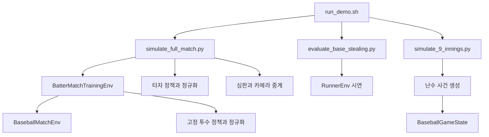

# 야구 강화학습 프로젝트 전체 해설 보고서

작성일: 2026-10-09. 이 파일은 9개 상세 장을 내용 생략 없이 이어 붙인 통합본이다. 코드·설계 문서 251개, 41,271행의 원문은 별도 파일별 sourcebook에도 생략 없이 보존했다. 두 저장소의 first-parent 커밋 44개와 별도 stash 3개를 추적했고, 모델·정규화·TensorBoard·평가 배열·CSV를 대조했다.

읽기의 중심은 목적과 문제, 당시 기록한 생각, 실제 구현, 발생한 문제, 수정 결과와 남은 한계다. 초기 게임→영상/월드모델→상태 벡터 PPO→후속 이족 제어라는 흐름을 따라간다. 원본은 바꾸지 않았으며 이번 재학습·전체 영상 재검수는 수행하지 않았다. 순수 게임 카운트와 심판의 작은 계약 사례만 새로 실행했다.

각 장의 독립 파일도 그대로 제공한다. 큰 통합본에서 이동하기 어려우면 아래 장별 링크를 이용한다.

| 읽기 순서 | 상세 장 | 다루는 내용 |
|---:|---|---|
| 1 | [01_목적_문제정의_설계판단_시간순_복원](01_목적_문제정의_설계판단_시간순_복원.md) | 목적·문제 정의·기대효과·27개 커밋과 단계별 설계 판단 |
| 2 | [04_초기설계_레거시_월드모델_코드해설](04_초기설계_레거시_월드모델_코드해설.md) | 초기 기구학·게임·영상 인지·RSSM·Dreamer·PPO·UI 전수 해설 |
| 3 | [05_패치44개_실패_수정_설계사고_해설](05_패치44개_실패_수정_설계사고_해설.md) | 44개 패치의 수정 의도·실제 적용·남은 문제 |
| 4 | [02_물리_환경_관측_보상_코드해설](02_물리_환경_관측_보상_코드해설.md) | 환경·규칙 코드13개·XML8개·진단21개와 모든 함수·요소·주소 |
| 5 | [03_학습_평가_모델_실험증거_코드해설](03_학습_평가_모델_실험증거_코드해설.md) | 훈련·평가 전수 해설과 모델·정규화·학습 로그·성공 판정 |
| 6 | [06_문서주장_실제구현_검증수준_대조](06_문서주장_실제구현_검증수준_대조.md) | 문서·영상·데모의 주장과 실제 연결·작은 계약 실행 결과 |
| 7 | [09_이족후속_연구일지_설계판단_시간순_복원](09_이족후속_연구일지_설계판단_시간순_복원.md) | 후속 연구일지 모든 Entry·17개 커밋·사용자 피드백과 수정 |
| 8 | [07_이족후속_전신제어_물리환경_코드해설](07_이족후속_전신제어_물리환경_코드해설.md) | 후속 환경10개·XML10개·PD/IK/보행·직접 지정과 정책의 경계 |
| 9 | [08_이족후속_학습_평가_모델_실험증거](08_이족후속_학습_평가_모델_실험증거.md) | 후속 스크립트·모델·CSV 재계산·지표 대상·분모·재현성 |

[251개 전체 코드·설계 문서 원문 색인](98_전체코드_원문색인.md) · [파일별 해설 누락 검사](97_파일별해설_전체범위_검사.md) · [원본 보존 검증](evidence/final_integrity.json)


---

# 상세 장 1: 01_목적_문제정의_설계판단_시간순_복원

# 야구 강화학습 프로젝트: 목적, 문제 정의, 설계 판단과 시간순 복원

조사 기준: 2026-10-09. 주 대상은 `baseball/main`의 `f63dc977f29d53103b0853ac29fbaeddfb95b60e`다. 이어지는 `bipedal_baseball/main`의 `ec3f85484ffb2d612fc890f2b515eba705748d9e`도 별도 장에서 다룬다. 두 폴더는 각각 독립 Git 저장소다. 상위 취업준비 저장소의 커밋을 이 프로젝트의 개발 이력으로 섞지 않았다.

## 1. 이 보고서를 읽는 기준

이 보고서는 목적과 성공을 좋은 말로 연결하는 소개서가 아니다. 실제로 무엇을 만들었고, 무엇을 학습시켰고, 무엇은 사람이 정했는지까지 내려가 프로젝트를 이해하는 해설서다. 코드가 남아 있다는 사실, 실행 기록이 있다는 사실, 그 코드가 의도한 기능을 올바르게 수행한다는 사실을 서로 구분한다.

근거는 다음 네 종류로 표시한다.

- **기록**: README, PAPER, EXPERIMENT_LOG, RESEARCH_LOG, 패치 주석, Git 커밋에 실제로 적혀 있는 의도와 주장.
- **코드 확인**: 현재 파일 또는 특정 커밋의 소스를 직접 읽어 확인한 동작. 경로와 줄번호는 파일별 해설에 붙였다.
- **실행 증거**: 이미 보존된 TensorBoard, 평가 배열, CSV, 기존 감사의 실행 로그. 2026-09-26 감사 결과를 이번에 다시 실행한 결과처럼 쓰지 않는다.
- **해석·제안**: 기록과 코드로부터 추론한 설계 이유 및 앞으로의 수정 방안. 작성자가 당시 머릿속으로 실제 생각한 것이라고 단정하지 않는다.

이번 작업에서 원본 코드, 모델 가중치, 실험 로그, 영상, Git 이력을 변경하지 않았다. 장시간 재학습이나 전체 데모 재렌더링을 수행하지 않았다. 현재 파일 분석, Git blob 구문 분석, 안전한 모델 메타데이터 읽기와 기존 실행 증거 재대조를 수행했다. 현재 순수 Python GameState의 파울 3사례·기본 카운트 전이 2사례와 심판의 합성 궤적 점 검사도 작게 실행했으며 06장에 따로 기록했다. AST 구문 검사는 Python을 실행하는 것이 아니며, 구문이 맞다는 것이 런타임 정상이나 물리적 타당성을 뜻하지 않는다.

현재 외부 작업 폴더의 `task.md`, `implementation_plan.md`, `walkthrough.md`는 bipedal Phase 12 내용이다. 초기 baseball 패치가 같은 경로에 썼다는 이유로 현 내용을 당시의 초기 기록으로 사용하면 시간 역전이 생긴다. 현재 사본은 `evidence/external_current_*.md`에 보존했으며 후속 단계의 기록으로만 취급한다.

## 2. 목적을 세 단계로 나눠 이해하기

### 2.0 초기 게임 스튜디오라는 출발점도 함께 읽기

8월31일 stash의 untracked snapshot `f04e72e:README.md`에는 `Baseball RL Game & Simulator Studio`가 남아 있다. 이 설명은 물리 환경·학습 엔진·시각화 대시보드·터미널 게임의 네 모듈을 묶고, 사용자가 투수나 타자로 직접 참여하거나 AI 대결을 관전하는 경험을 제시한다. 공 궤적·스트라이크존 heatmap·타구 데이터를 대시보드에서 보는 것이 출력이다. 초기 mechanism/game/dashboard 코드와 연결되는 목적이며, 원문은 stash patch에 보존했다.

이 자료에서 읽히는 구체적인 질문은 “투구의 구종·구속·조준과 타격 타이밍·경로가 어떤 결과를 만들고, 서로를 상대하는 정책을 사람이 이해하고 플레이할 수 있게 보여줄 수 있는가”다. 후기 PAPER의 실물 전이 비전은 이 질문을 로봇 제어와 전체 야구 생태계로 넓혀 설명한다. 두 자료가 서로 다른 시점·형태로 남았으므로 후기 회고만으로 초기 모든 구현이 전신 로봇 배포를 이미 겨냥했다고 단정하지 않는다. stash README의 league/PER 주장 역시 실제 trainer 연결을 04장에서 별도로 확인한다.

### 2.1 장기 비전: 자율 야구와 실물 전이

`docs/PAPER.md:170-198`의 회고는 최초 비전을 실물 전이 가능한 강화학습 기반 야구 생태계라고 설명한다. 감독, 9명의 수비수, 투구, 타격, 주루, 보행, 상호작용을 하나의 플랫폼으로 연결하려는 목표다. 야구를 선택하면 빠르게 이동하는 물체를 관측하고, 시간 안에 판단하고, 관절체를 움직여 접촉하고, 결과를 규칙으로 판정하는 문제를 한 장면에서 다룰 수 있다.

이 목표는 좋은 연구 질문이지만, 그 목표의 존재가 달성을 뜻하지 않는다. 현재 baseball 코드에는 실물 로봇 통신, 실제 센서 상태 추정, C++ 제어 런타임, 실기기 배포 증거가 없다. PAPER의 ONNX/CAN/RT-Preempt/EKF 서술은 탐색과 향후 계획으로 읽어야 한다. 특정 0.2ms 추론이나 1kHz 제어가 이 프로젝트에서 측정됐다는 뜻으로 옮기면 안 된다.

### 2.2 개발 중 선택한 범위: 문제를 작게 쪼개 학습 가능하게 만들기

초기 `.agents/AGENTS.md`는 64×64 자기시점 영상과 고유수용감각으로 공의 위치를 추론하도록 정한다. 처음부터 서로 변하는 투수와 타자를 맞붙이지 않고 티볼·투구·포구 드릴을 별도로 학습시키며, 나중에 같은 수비 신경망을 공유하고 통신을 붙이는 전략이다.

이후 주요 `cognitive_ai` PPO 드릴과 match는 H1 모델 위에 미리 정한 관절 키프레임과 공의 정확한 위치·속도 벡터를 사용한다. 초기 `CognitiveBaseballEnv`에는 영상 관측 선언도 남아 있지만 그와 연결된 `train_cognitive`는 정책 신경망 최적화 대신 상태를 직접 읽는 heuristic timing 탐색이다. 주요 PPO는 전체 몸의 모든 토크를 처음부터 발견하기보다 투구 릴리스, 조준, 파워, 스윙 시작과 높이·회전 보정을 선택한다. 이 변경은 같은 문제의 구현 최적화만이 아니라 **학습 문제 자체를 바꾼 범위 조정**이다. 영상 인지와 전신 균형의 부담을 덜고 타이밍·목표 선택을 먼저 다루는 구조가 된다.

PAPER는 보행과 고속 접촉을 동시에 학습시키는 어려움, 연산 부담을 범위 조정 이유로 적는다. 실제 코드는 고정 골반, 각도 직접 대입, 다리 없는 이동 베이스로 그 선택을 뒷받침한다. 다만 정량적인 연산 병목 프로파일이나 기존 전신 학습과의 통제 비교가 남아 있는 것은 별도로 확인해야 한다. 설명이 그럴듯하다는 이유로 원인 실험까지 완료됐다고 말할 수 없다.

### 2.3 현재 확인되는 산출물: 여러 드릴과 시연의 묶음

현재 baseball은 투수·타자 드릴 환경, 고정 상대를 이용한 타자 학습, 일부 수비·주루 환경, 경기 판정과 카메라 연출, 9이닝 논리 시연, 모델·영상·문서를 묶은 프로젝트다. `run_demo.sh`는 이들을 순서대로 호출한다. 하나의 공·하나의 상태·모든 정책이 9이닝 내내 이어지는 통합 경기 실행과는 다른 연결 구조다.

이 차이는 가치를 부정하기 위한 구분이 아니다. 어떤 학습과 모듈화가 실제 기여인지 정확히 찾기 위한 구분이다. 사용자가 직접 만든 판단을 설명할 때는 “많은 로봇을 다 학습했다”보다 “학습하기 어려운 복합 문제를 어떤 제약 아래 나눴고, 어디에서 통합 계약이 깨졌는지 확인했다”가 실제 코드와 더 잘 맞는다.

현재 데모의 호출 관계를 그리면 다음과 같다. 세 가지 시연은 같은 실행 스크립트에서 순서대로 호출되지만 상태를 공유하는 하나의 경기 루프는 아니다.



## 3. 문제 정의를 구체적으로 다시 세우기

### 3.1 인지 문제

초기 문제는 카메라 영상만으로 빠른 공의 위치·속도·미래 경로를 추정하는 것이다. 부분 관측과 시간 정보가 필요하므로 CNN 인코더, 고유수용감각 인코더, 잠재 상태와 순환 월드모델이 초기 archive에 등장한다. 이때 “영상에 공이 보이는가”, “공이 너무 작아 한 픽셀 이하가 되는가”, “정책이 보지 못하는 진실값이 들어가는가”가 중요한 검증 질문이다.

후기 cognitive 문제는 정확한 공 위치와 속도, 도달 예상 시간과 높이를 받는 상태 벡터 정책이다. 이 문제에서는 영상 인식 오차를 검증하는 것이 아니라 좌표계, 단위, 순서, 정규화, 예측식이 맞는지 검증해야 한다. 타이밍 성능을 영상 기반 추적 성능으로 부르면 두 문제를 혼동하게 된다.

### 3.2 접촉과 타이밍 문제

정지한 티볼에 닿는 것부터 시작하면 스윙 형상과 배트 접촉을 검증할 수 있다. 이후 느린 토스를 넣으면 도달 시간에 맞춰 스윙을 시작해야 한다. 50/80km/h 피칭머신은 대응 시간을 줄이고, 변화구는 단순 직선 예측을 어렵게 만든다. 이 순서는 “쉬운 성공 경험을 먼저 만든다”는 교육적 이야기보다, 실패 원인을 분리하는 실험 설계로 이해하는 편이 정확하다. 정지 공에도 못 맞추면 인지나 구속을 탓할 수 없기 때문이다.

그러나 티볼 공 질량을 낮춘다고 중력가속도가 없어지지는 않는다. 힘과 질량, 중력보상, 직접 위치 유지가 각각 어떻게 적용되는지 봐야 한다. 이 사례처럼 문서의 설명과 물리식은 다른 근거다. 물리 환경의 세부는 02장에서 검증한다.

### 3.3 자연스러운 모션과 과제 보상 문제

단순히 공만 맞추는 보상은 사람 같은 동작을 보장하지 않는다. 키프레임을 만들어 기본 동작을 주고 일부 파라미터만 학습시키면 탐색 범위가 줄고 영상도 빠르게 만들 수 있다. 대신 자연스러운 동작은 주로 제작한 궤적이 제공하며, 정책이 토크를 통해 동작을 스스로 발견한 정도는 줄어든다. 보상 최적화와 모션 제작을 구분해야 한다.

PAPER와 패치의 MoCap 표현은 실제 광학식 모션캡처 데이터 수집·리타게팅 파이프라인과 동일하지 않다. `mocap_preview.py`와 `inject_mocap_*`는 사람이 코드로 정한 6×19 각도 테이블을 보간한다. “오타니 스타일”은 동작 디자인의 참고 표현이며, 실측 선수 데이터가 코드에 들어왔다는 증거가 아니다.

### 3.4 물리 모델과 게임 규칙 문제

물리 엔진이 충돌을 계산하는 것과 야구 규칙을 정확히 판정하는 것은 별개다. 스트라이크 존을 통과한 위치를 저장하고, 파울을 세었을 때 기존 볼·스트라이크를 보존하고, 타구의 최초 낙구와 담장 사건을 구분해야 한다. 고속 공은 두 샘플 사이에 존을 통과할 수 있으므로 현재 점만 검사하는 방식에는 누락 가능성이 있다. 심판·상태 머신은 신경망이 아니라 사람이 작성한 결정 규칙이다.

### 3.5 여러 정책과 모듈 사이의 계약 문제

단독 PitcherEnv에서 학습한 정책을 MatchEnv로 가져올 때 차원이 같아도 입력 순서와 의미, 모션 조정 관절, 물리 법칙이 같아야 한다. VecNormalize는 열별 통계를 저장하므로 순서가 바뀌면 다른 의미의 숫자가 다른 통계로 정규화된다. 모델 파일, 정규화 파일, 환경 설정과 버전, 관측 스키마가 하나의 단위여야 한다.

평가 환경의 자동 reset도 같은 종류의 계약이다. 끝난 공의 위치를 보려면 terminal info나 terminal observation을 사용해야 한다. 다음 타석으로 reset된 공을 읽고 이전 타석 판정에 넣으면 멋진 중계 화면과 부정확한 지표가 함께 만들어질 수 있다.

## 4. 기대효과와 실제 확인 수준

| 기대효과 | 왜 기대할 수 있는가 | 현재 확인되는 부분 | 아직 필요한 증거 |
|---|---|---|---|
| 복잡한 RL 문제를 단계별로 설계하는 능력 | 티볼→토스→머신→변화구→맞대결로 원인을 분리 | 해당 환경·학습·진단 코드가 존재 | 공통 조건·다중 시드의 커리큘럼 비교 |
| 물리 시뮬레이션 이해 | XML·접촉·관절 주소·외력·릴리스 조작 | 소스와 수정 기록이 구체적으로 존재 | 단위/에너지/시간 간격 검증과 외부 실측 보정 |
| 인지와 제어 결합 연구 | 초기 CNN·RSSM, 후기 상태 정책을 비교 가능 | 설계 전환과 코드가 남음 | 자기시점 영상 정책의 검증된 학습·성능 |
| 모듈별 디버깅과 통합 경험 | 정책·정규화·물리·판정·중계가 만남 | 계약 오류와 수정 흔적을 추적 가능 | 통합 계약을 고친 뒤 종단간 경기 평가 |
| 시각적 설명과 연구 기록 | 영상, 카메라, HTML/PDF, 코드·로그 연결 | 제작·정리 이력과 파일이 있음 | 주장과 정확한 실험 bundle의 일대일 연결 |
| 실물 전이 준비 | 토크 제한·지연·도메인 랜덤화라는 질문으로 확장 | 후속 bipedal에 일부 장치가 구현됨 | 실제 모터·센서·실시간 제어·하드웨어 검증 |
| 디지털 스포츠 제품 | 심판·카메라·게임 로직은 재사용 가능한 구성요소 | 시연 가능한 요소들이 있음 | 실제 사용자/운영/제품 검증; 상업 효과 측정 |

성공률, 성능 개선, 상업 가치, 학술적 새로움은 서로 다른 주장이다. 학습량 200만 step은 학습이 있었다는 증거이고, 높은 보상은 해당 보상 최적화의 증거다. 그것만으로 현실적인 야구나 실물 로봇 성능, RL의 기준선 대비 우월성이 입증되지는 않는다.

## 5. 실제 Git 시간선

시간은 커밋의 작성·저장 시각(+09:00)이다. 전체 first-parent 27개를 확인했고, 별도 stash 저장 상태 3개도 목록에 포함했다. 각 커밋의 원문 diff는 `history/`에 보존했다. 파일이 처음 커밋된 시점은 실제 작업을 시작하거나 끝낸 정확한 시각과 다를 수 있다.

| 저장 시각 | 커밋 | 실제 변경 | 해석과 주의점 |
|---|---|---|---|
| 07-22 18:50:09 | bf82416 | PyTorch workbook·학습 저장소 시작 | 이때는 현재 야구 프레임워크가 아님 |
| 07-24 19:06:24 | 60641d0 | 투수·타자 mechanism, 기본 환경 파일 | 손/팔·궤적을 수식과 기구학으로 만드는 초기 기반 |
| 07-24 19:15:50 | 2ef3ca9 | 게임 환경, game CLI, dashboard, networks, replay, trainer | 첫 end-to-end 프레임워크가 한 묶음으로 저장됨 |
| 07-24 19:39:51 | b2be6bf | networks 수정 | 커밋 제목보다 실제 diff 범위는 좁음 |
| 07-27 08:32:00 | 01b6357 | EXECUTION_GUIDE 작성 | 당시 경로와 실행 구조; 현 경로와 구분 |
| 07-31 11:46:13 | 7f926ed | 초기 파일 archive 이동, 영상·월드모델·다중 에이전트·H1 cognitive 추가 | 큰 설계 전환이 일괄 저장됨; 파일별 정확한 제작 순서는 Git만으로 알 수 없음 |
| 08-31 21:26:27 | stash 98f2dfc / c8cc421 / f04e72e | WIP/index/untracked snapshot | main의 독립 개발 단계 세 개로 세면 안 됨 |
| 09-01 23:24:37 | 62f112b | Phase1~7 환경·훈련·평가·패치·영상 일괄 저장 | 티볼부터 수비까지 실제 세부 순서는 문서와 코드 연결로 복원 |
| 09-01 23:33:29 | fafee96 | 심판, 스트라이크 존, 방송 카메라 | Phase8.1; 판정 로직과 화면 연출의 결합 |
| 09-01 23:42:50 | a7227be | 공기역학 함수·제구 보상 수정 | Phase8.2; match 소스의 들여쓰기 오류가 Git에 실제 들어감 |
| 09-01 23:49:00 | df8a0aa | 포수·주자 XML/환경/학습·도루 시연 | Phase8.3; 앞의 구문 오류는 이 커밋에서도 남음 |
| 09-01 23:51:08 | d1cfbb5 | 9이닝 game state와 난수 시연 | Phase9; match 구문 오류는 여전히 남음 |
| 09-01 23:57:09 | 58b2a58 | mega PPO, 4-frame stack, annealing, adversarial stub | 구문 오류 수정; self-play는 완성되지 않은 뼈대 |
| 09-03 00:17:38 | 93aa1e7 | README 패키징 | 프로젝트 설명을 정리 |
| 09-03 00:17:44 | fe09ffc | run_demo.sh | 서로 다른 3개 시연을 순차 실행 |
| 09-06 02:55:10 | 37cba3b | 학술 형식 PAPER 작성 | 기존 구현을 논문 형식으로 재서술 |
| 09-06 03:10:32 | 547f58a | HTML 보고서와 이미지 | 코드 진전보다 문서/프레젠테이션 작업 |
| 09-06 03:15:43 | 27ac333 | 누락 프레임/텍스처·인쇄 CSS 수정 | 보고서 표시 문제 수정 |
| 09-06 03:36:12 | ec0d5f9 | 전문가 관점 서술·two-track roadmap | 독립 외부 전문가 심사 증거로 취급하지 않음 |
| 09-06 03:40:52 | 652e940 | 패치 파일 scripts/patches 이동·PDF | 경로 정리; 대부분 코드 내용 변화 없음 |
| 09-06 03:41:42 | a64134d | 24 모델 ZIP·16 norm 파일을 Git 포함 | 학습 시각과 모델 공개 저장 시각은 다름 |
| 09-06 04:02:04 | 92043ab | SKALA 계기·배포/벤치마크 회고 추가 | 회고로서 생각의 기록; 배포 구현 완료가 아님 |
| 09-06 04:08:22 | 530b6ea | 초기 비전·연산 장벽·회고 표현 수정 | 과거의 동기를 후에 설명한 기록임을 표시 |
| 09-06 04:18:38 | 48db86d | 문서 docs 이동 | 정리·게시 구조 변화 |
| 09-06 04:18:42 | 25db149 | README docs 링크 | 문서 접근성 개선 |
| 09-06 04:19:53 | bb1d93d | .nojekyll | GitHub Pages 표시 설정 |
| 09-06 04:21:31 | ee09bb0 | 고아 submodule 참조 제거 | checkout 실패 원인 제거; 필요한 실제 assets 여부는 별도 |
| 09-06 04:26:03 | f63dc97 | report_assets→assets | 현재 분석 대상 HEAD |

### 5.1 실제 수정이 확인되는 실패 사례

`a7227be`의 match diff는 `_apply_aerodynamics()`와 `mj_step()`을 substep 반복문 밖으로 잘못 내보냈고 아래 contact 블록은 깊은 들여쓰기로 남겼다. Git blob을 AST로 분석하면 268행 `unexpected indent`가 나온다. 다음 `df8a0aa`, `d1cfbb5`에서도 같은 오류가 남는다. `58b2a58`에서 해당 네 줄을 반복문 안으로 다시 들여쓰고 `self.has_hit`을 `getattr(self,'has_hit',False)`로 바꿔 구문 오류를 고친다.

이 사례를 “물리 엔진을 넣고 성공했다”로 압축하면 세 중요한 단계가 사라진다. 기능을 추가하려는 의도, 문법이 깨진 실제 결과, 이후 문법 수정이다. 더구나 현재 타격 플래그는 `has_contacted`이며 `has_hit`은 설정되지 않는다. `getattr`는 속성 에러를 피하지만 올바른 타격 상태를 연결하는 수정까지 하지 못했다. 구문 수정과 기능 수정은 다른 완료 기준이다. 이번 구문 기록은 `evidence/git_syntax_by_commit.json`에 있다.

### 5.2 커밋이 말하지 못하는 것

Phase1~7은 62f112b에 한꺼번에 추가됐다. 따라서 “티볼 개발에 몇 시간, 변화구에 몇 시간” 같은 정밀 작업시간을 Git 시각으로 계산하면 잘못이다. TensorBoard의 wall_time은 학습 이벤트 시간이며 사람의 개발 시간과도 다르다. 보고서는 정확히 남아 있는 시간만 적고, 상세 드릴 순서는 의존 관계와 phase 기록으로 복원한다. 별도 stash는 오래된 b2be6bf를 base로 하며 WIP diff는 game/dashboard 수정이고 untracked tree는 README 한 파일이다. 이를 8월31일 새 cognitive 단계의 snapshot이라고 설명하면 안 된다.

## 6. Phase별 목적→구현→문제→수정→생각

### Phase 0: 초기 기구학·게임·학습 프레임워크

**목적과 구현.** 투수/타자 mechanism, 게임 환경, 행동 신경망, replay, trainer, dashboard를 연결해 야구 문제를 학습 루프로 만들려 했다. 이 단계는 현 H1 PPO보다 초기 구조다. archive는 단순 쓰레기 폴더가 아니라 처음에 어떤 인지와 학습을 시도했는지 남긴 설계 유산이다. 04장에서 mechanism 수식, CNN·상태 인코더, RSSM, imagination, 손실과 curriculum까지 파일별로 내려간다.

**문제와 판단.** 복잡한 영상 인지, 여러 역할, 월드모델, 실제 접촉을 한 번에 맞춰야 하는 구조는 고장 원인을 분리하기 어렵다. 예를 들어 단일 world_model_trainer에서 actor target을 detach한 뒤 actor loss를 역전파하는 결함은 “월드모델을 구현했다”는 파일 존재와 학습 가능한 경로가 다름을 보여준다. 다중 에이전트 버전에는 그 gradient를 살리려던 변화가 있다. 정확한 결과는 소스 수준과 학습 증거 수준을 분리해 읽는다.

**설계 생각의 근거.** egocentric-only, isolated-drills-first는 AGENTS에 명시돼 있다. parameter sharing과 latent communication은 향후 확장 계획이며 현재 9인 통신을 학습했다는 의미가 아니다.

### Phase 1-A: 티볼로 스윙과 접촉부터 분리

**목적과 구현.** 공이 정지한 상태에서 배트가 접촉하도록 만든다. 문서에는 trigger·높이의 2D 행동이 적혀 있지만 현재 `teeball_env.py:22-24,62,84`는 reset부터 스윙을 활성화하고 높이 보정 1D만 받는다. 따라서 현 티볼 정책이 스윙 시작까지 배운다고 설명하면 맞지 않는다. 고속 공이 보이지 않아서 실패하는지, 스윙 자체가 닿지 않는지 분리하는 최소 과제다. `test_grid`, `test_trigger`, `test_timing_*`, `check_contact_pos`, `sweep_bat`는 시작 조건·타이밍·스윙 평면을 직접 고정해 탐색하는 진단 흔적이다. 각 진단이 현재 행동 계약을 따르는지도 02장에서 따로 확인한다.

**문제와 수정.** 공의 높이·타자 위치·배트 경로가 맞아야 한다. 단순 타격률보다 실제 bat-ball contact, 타구 방향·속도, 이탈·지면 접촉이 중요하다. 문서의 90%는 해당 평가 조건에서 주장된 수치다. 모델과 당시 환경·seed·평가 분모가 정확히 묶이지 않으면 현 코드에서 그대로 재현되는 성능으로 인용할 수 없다.

**생각의 해석.** 과제를 쉽게 만들어 시작했다는 판단은 합리적이다. 그러나 접촉 경로를 직접 만든 정도와 PPO가 보정한 정도를 설명해야 강화학습의 기여를 과장하지 않는다.

### Phase 1-B: 소프트토스로 시간 예측 도입

**목적과 구현.** 7~9m/s 수준의 느린 공을 던지고 위치3·속도3·예상 도달시간·예상 높이의 8D 관측을 준다. 정책이 기다리다 적절한 시점에 스윙하도록 만드는 과제다.

**문제와 수정.** 서로 단위와 범위가 다른 위치·속도·시간을 그대로 넣으면 학습을 어렵게 만들 수 있어 `train_normalized.py`와 VecNormalize가 등장한다. 정상화는 데이터 스케일 문제를 다루지만 타이밍 또는 접촉 모델이 잘못된 것을 고치지는 않는다. 문서의 정규화 도입 후 타격 성공률 70%는 전후 동일 조건 평가 원자료가 없으며, 기존 9/26 소표본 진단 6/10과 별도 결과다. 70%는 상대 개선율이라는 뜻이 아니다.

**생각의 해석.** “신경망이 더 커야 한다” 이전에 입력을 보기 좋게 만드는 접근이다. 이때부터 normalization provenance가 정책 파일만큼 중요한 의존성이 된다.

### Phase 1-C: 피칭머신으로 대응 시간을 줄이기

**목적과 구현.** 같은 드릴을 50km/h, 80km/h로 올려 스윙 시작 시점의 오차에 더 민감한 조건을 만든다. `train_curriculum_pitching.py`, 별도 deep 80km/h 스크립트와 모델이 나뉜다.

**문제와 수정.** 낮은 구속에서 배운 타이밍이 높은 구속에 그대로 맞지 않는다. 공이 배트를 지나는 공간·시간의 조합을 확인해야 하고, 명목상 속도와 실제 공기 저항 후 속도도 다르다. 학습 재개·정규화 재사용·새 환경 값이 어떻게 이어지는지 03장에서 모두 추적한다. 80km/h best와 deep norm을 임의로 섞으면 결과가 달라지는 이유도 그 장에 설명한다.

**생각의 해석.** 점진적 난이도는 상대와 환경을 동시에 바꾸는 복잡성을 줄인다. 다만 각 단계를 따로 성공한 것이 한 정책이 전체 범위를 다루는 성능과 동일하지 않다.

### Phase 1-D: 변화구와 몸통 회전

**목적과 구현.** breaking_ball_env는 구종별 횡·종 가속도와 스윙 yaw 보정을 추가한다. 직선·중력 예측만으로 맞추기 어려운 경로에 대응하려 한다.

**문제와 수정.** 구종이 바뀌면 예측 높이·코스가 달라져 timing만으로는 실패한다. 다만 이 단계에는 정확한 공 상태와 사람이 만든 예측값이 주어지며, 표준 공기역학 전체를 센서에서 추론하는 문제가 아니다. 문서의 10/15 컨택은 해당 기록의 주장으로 유지하고, 과거 감사의 1/10을 그 수치의 직접 반증 또는 재현이라고 단정하지 않는다.

### Phase 2: 직접 투수 모델과 제구·속도 목표

**목적과 구현.** H1 투수, 손-공 weld, 4D 릴리스·조준·파워 선택을 만들고 plate 도달 거리와 속도를 보상한다. 릴리스에서 손 속도와 파워 계수로 공 속도를 직접 설정한다. 이 속도 주입은 실제 모터가 같은 공 속도를 만들 수 있다는 보장과 다르다.

**문제와 수정.** 빠르게만 던지면 제구가 나빠질 수 있어 zone reward를 강화한다. 이후 8.2에서 strike에는 큰 보상, ball에는 거리 패널티를 넣는다. 단독 관측/경기 관측의 순서, 13D 구형 norm/16D 현재 환경, 19관절 목록으로 바뀌면서 조준 인덱스가 달라지는 문제가 남아 있다.

**생각의 근거.** 패치 주석과 reward diff는 “속도를 올리면서 제구를 강제한다”는 의도를 보여준다. 문서의 15/15·84.4km/h는 그 시점의 주장이고, 다른 checkpoint·조건의 9/26 10/10은 별도 제한된 진단이다.

### Phase 3: 같은 공간의 투타 맞대결

**목적과 구현.** 투수·타자 XML을 합치고, 기존 투수 정책을 고정한 타자 wrapper로 타자 학습을 한다. 두 환경의 joint 이름에 p_/b_ prefix를 넣고, 타석 위치를 옮겨 접촉 공간을 정합한다. 타자의 결과를 HUD로 표시한다.

**문제와 수정.** joint 없는 이름을 -1로 쓰면 다른 주소를 잘못 읽을 수 있어 valid_indices와 qpos/qvel 주소를 분리한다. 각도를 직접 덮고 기존 속도를 남겨 놓으면 물리 상태가 맞지 않을 수 있어 qvel을 0으로 만드는 패치가 나온다. 이것은 수치 안정화를 위한 기구학 개입이지 동역학적 모션 학습을 완료했다는 뜻은 아니다.

**생각의 해석.** 역할별 학습을 유지하면서 상대만 실제 모델로 교체하려는 구조다. 그러나 단독과 합동 환경의 관측·물리 계약이 같지 않으면 고정 정책조차 같은 행동을 보장하지 못한다.

### Phase 4: 고속 투구와 선구안

**목적과 구현.** 파워 범위를 높이고 구종 변화를 넣는다. 타자가 못 맞힌 채 끝난 공에서 존 밖 스윙에는 -100, 존 밖에서 기다림에는 +150을 주며, 존 안에서 기다리면 -150을 준다. 존 안 헛스윙은 -50이다. 타자가 모든 공에 무조건 휘두르거나 무조건 기다리는 행동을 막으려는 plate discipline이다.

**문제와 판단.** 높은 릴리스 속도가 나왔다고 실제 H1 모터 토크·출력 범위에서 해당 투구가 가능하다는 뜻은 아니다. 또한 볼넷이라는 경기 누적 사건과 단일 공을 참는 보상은 다르다. 체계적인 선구안 평가는 zone label, swing decision, 오분류, 누적 count를 분리해야 한다.

### Phase 5: 경기장과 타구 추적

**목적과 구현.** 잔디·흙, 베이스·라인·담장, 바람·항력, 타격 이후 궤적과 카메라를 넣어 관람 가능한 장면을 만든다. 공이 끝까지 어디에 가는지 관찰하려는 목적은 좋은 평가 도구로도 이어질 수 있다.

**문제와 판단.** 현재 XML의 상대 텍스처 경로는 원본 checkout 자족성을 깨뜨릴 수 있다. 경기장 비주얼과 판정 좌표가 같은 기준인지, 두 항력 구현이 겹치지 않는지, 실제 접촉 뒤 최종 상태를 저장하는지 따로 검증해야 한다. “AAA급”은 문서의 평가 표현이며 측정된 엔진 품질 기준이 아니다.

### Phase 6: 19관절 모션 제작

**목적과 구현.** 높이 든 다리, 와인드업, 체중 이동처럼 보이는 투구와 큰 스윙을 위해 6개 키프레임을 19개 관절로 확장한다. `mocap_preview`는 CubicSpline으로 순수 기구학 미리보기를 만들고, inject 스크립트는 같은 동작 테이블을 환경에 넣는다.

**문제와 수정.** 기존 5관절 인덱스 0/1/2가 19관절 목록에서는 hip를 의미하게 되므로 조준 인덱스 변경이 필요하다. 패치는 그 변경을 시도하지만 현재 단독 PitcherEnv에는 이전 슬라이스 수정이 남아 있다. 성공한 수정 의도와 실제 적용 결과를 확인하지 않으면 보기 좋은 모션이 정책 전이 문제를 숨긴다.

### Phase 7: 보행을 제외한 수비

**목적과 구현.** H1 다리 가지를 제거하고 base_x/base_y/base_yaw 이동 자유도와 왼손 글러브를 붙인다. 낙구 위치 추적과 팔 위치를 먼저 학습시키려 한다. 모델 이름에 wheels가 있지만 wheel-ground rolling 전체를 구현했는지는 XML의 slide joint 구조를 기준으로 읽는다.

**문제와 수정.** 모델 복제 과정에서 중복 ball/body/material, 제거한 다리를 참조하는 actuator, 누락한 이동/왼팔 actuator, include 경로와 카메라를 연달아 고친다. 이 패치 묶음은 모델 재사용이 빠르지만 참조 관계를 끝까지 검증해야 한다는 과정을 보여준다. 과거 5/5는 수치 불안정과 함께 발생했으므로 정상 포구 성능의 근거로 채택하기 어렵다.

### Phase 8.1~8.3: 심판·물리·포수·주루 확장

**목적과 구현.** 판정과 카메라 전환, 구종별 힘, 포수·주자 모델을 추가해 단순 투타 장면을 경기 사건으로 바꾸려 한다. 역할을 복제해 확장하는 접근은 자연스럽지만 이름·주소·보상·종료가 새 개체를 가리키는지 확인해야 한다.

**문제와 남은 상태.** has_hit/has_contacted 불일치, 외력과 직접 가속도 적용의 중첩, 포수 glove_box 이름 불일치, 주자 관측이 공의 상태를 읽는 문제가 현재 소스에 남아 있다. COR 1.35는 패치의 문자열 치환 시도는 존재하지만 현재 active contact 코드에 실제 적용되는 것과 다르다. 상세 경로는 02/03/05장에서 다룬다.

### Phase 9: 9이닝 논리

**목적과 구현.** balls/strikes/outs/bases/score/inning을 추적하는 객체를 만들고 random choice로 사건을 생성해 게임을 끝까지 진행한다. 상태 머신을 로봇 제어와 분리해 먼저 검사하려는 방법으로는 의미가 있다.

**문제와 남은 상태.** 물리 경기의 공 결과를 상태 머신으로 넘기는 통합 루프는 현재 demo에 없다. foul 전에 count를 지우는 결함도 남아 있다. “9이닝 텍스트 시연을 만들었다”와 “PPO 로봇들이 9이닝 실제로 경기한다”를 각각 적어야 한다.

### Mega 단계: 더 많은 학습, 시간 정보, adversarial 뼈대

**목적과 구현.** 16개 병렬 환경, 200만 step 목표, learning-rate annealing, 타자 4-frame stack, adversarial wrapper를 추가한다. 실제 이벤트는 200만 이상 step을 보여 학습 실행의 존재는 확인된다.

**문제와 남은 상태.** MlpPolicy에 frame stack을 주는 것과 LSTM은 다르다. frozen batter 행동을 만드는 pass, 잘못된 observation 형식과 action 차원 등 adversarial 코드는 완성된 self-play가 아니다. 더 오래 학습하는 것은 기존 관측·물리·평가 계약 오류를 자동으로 고치지 않는다. best model과 마지막 norm의 저장 시점도 묶이지 않으므로 재현성 문제가 생긴다.

## 7. 설계 선택에서 읽을 수 있는 고민

첫째, 전신·영상·다중 에이전트를 처음부터 모두 해결하려는 비전과 제한된 계산·디버깅 자원 사이에서 범위를 조정했다. 코드에 남은 고정 골반·키프레임·slide base는 그 조정의 실제 형태다. 이를 감추기보다 제약과 판단을 설명하는 편이 설계 경험을 더 구체적으로 보여준다.

둘째, 실패를 정책 탓만 하지 않고 배트 경로, 공 높이, 관절 주소, 속도, 정규화, 카메라, XML 참조까지 내려가 진단했다. 44개 패치와 21개 cognitive 진단 파일은 이런 탐색을 보여준다. 그러나 문자열 치환이 성공했는지, 바뀐 contract가 맞는지 검증하는 자동 장치가 부족해 수정 의도와 실제 상태가 벌어졌다.

셋째, 스윙하지 않기·번트만 하기 같은 reward hacking을 문제로 보고 속도/스윙/선구안 항목을 추가했다. 다만 그 보상이 실제 물리량인지 액션 크기의 대용인지까지 확인해야 한다. 잘못된 지표를 최적화하면 높은 학습 보상과 잘못된 야구 장면이 동시에 나올 수 있다.

넷째, 시연과 연구 증거를 동시에 만들려 했다. 영상·중계·보고서는 학습 과정을 전달하는 장점이 있지만, 카메라와 HUD가 읽는 상태가 reset 후 값이면 관람과 평가가 함께 오염된다. 시연용 코드도 실험 계측기처럼 계약을 가져야 한다.

다섯째, 후기 회고는 실물 배포와 학술 비교에 필요한 요소를 스스로 짚고 후속 bipedal로 이어진다. 여기서 핵심은 배우려 한 질문과 실제 해낸 구현을 모두 존중하면서도 같은 것으로 쓰지 않는 것이다. 구현을 넘어선 기대는 기대효과로, 코드와 로그가 증명한 것은 성과로 기록한다.

## 8. 이론을 확인할 때 사용한 1차 자료

MuJoCo의 qpos와 qvel은 free/ball joint가 있으면 차원이 다를 수 있으며, 입력·외력·접촉을 이용해 동역학을 적분한다. 따라서 위치를 직접 덮는 것과 actuator로 토크를 넣는 것은 다른 제어 경로다. 이는 파일별 기구학 개입을 설명하는 기준으로만 사용했다. [MuJoCo 계산 문서](https://mujoco.readthedocs.io/en/stable/computation/index.html)

SB3 VecEnv는 episode 끝에 자동 reset될 수 있고 마지막 observation을 별도로 전달한다. VecNormalize와 frame stack은 환경 wrapper이며 입력 전처리/시간 정보의 계약을 갖는다. 이 일반 규약과 현재 프로젝트가 그 규약을 쓰는 방식을 대조했다. [SB3 벡터 환경 문서](https://stable-baselines3.readthedocs.io/en/master/guide/vec_envs.html)

PPO는 환경에서 모은 경험으로 정책을 업데이트하는 알고리즘이다. 알고리즘을 썼다는 사실은 환경의 보상·물리·평가를 검증하지 않는다. 본 프로젝트의 성능 판단은 코드와 로그에 근거한다. [PPO 원논문](https://arxiv.org/abs/1707.06347)

DeepMimic은 예제 동작을 활용한 물리 기반 캐릭터 skill 학습을 제시한다. 본 프로젝트의 수작업 각도 테이블 보간과 표준 예제 기반 동역학 학습은 구분해서 설명했다. 이는 향후 비교의 참고 기준이며 현재 프로젝트가 DeepMimic을 구현했다는 뜻은 아니다. [DeepMimic 연구자 프로젝트 페이지](https://xbpeng.github.io/projects/DeepMimic/)

## 9. 본인의 선택에서 사고를 복원하기: AI 활용과 개인 기여의 연결

### 9.1 이번 보완의 목적과 근거 수준

사용자는 이번 대화에서 AI에게 명령하고 진행을 승인한 것이 자신의 주된 역할이었다고 설명했고, 문서에 남은 선택과 행동에서 그 사고를 유추해 경험 서사의 간극을 메워 달라고 요청했다. 따라서 코드 작성량으로 개인 기여를 환산하지 않고, 무엇을 문제로 보았는지, 어떤 작업 방향과 검증 기준을 요구했는지, 어떤 선택을 유지하거나 바꾸었는지를 복원한다.

이 절의 1인칭 문장은 기록을 바탕으로 구성한 경험 서사다. 당시의 내적 독백을 그대로 옮긴 인용문은 아니다. 근거는 다음과 같이 나눈다.

- 직접 요구: 연구일지가 사용자 발언으로 인용한 문장. 현재 저장된 문서의 인용이며 원 대화 전체를 별도로 확보한 것은 아니다.
- 대응 변화: 그 요구 뒤에 남은 일지, 소스, Git diff의 변경.
- 사고 복원: 요구와 변경을 연결해 읽을 수 있는 판단. 이를 요청한 사용자 설명에 따라 선택의 주체를 본인으로 놓되, 특정 수식·상수의 독자적 고안이나 모든 실험의 직접 실행까지 추가하지 않는다.
- 회고·설계안: 프로젝트가 기록한 설계 논리. 본인이 채택한 방향으로 설명할 수 있으나 각 세부의 최초 제안자는 구분되지 않는 경우가 있다.

AI에게 무엇을 시켰는지 자체가 개인 행동의 일부다. 특히 완료 기준을 바꾸거나, 높은 성공률에도 재작업을 요구하거나, 다음 단계에서 고려할 조건을 구체적으로 제시한 행동은 판단의 근거가 된다. 반대로 AI가 수행한 순기구학 계산을 그대로 본인의 독자적 수학 도출로 쓰는 것은 이 복원에 포함하지 않는다.

### 9.2 직접 발언에서 복원되는 다섯 판단

| 기록된 발언·행동 | 직접 확인되는 선택 | 복원할 수 있는 생각 |
|---|---|---|
| RESEARCH_LOG 215행: 투수도 같이 학습하지 않느냐는 질문 | 투수 학습을 다음 작업 범위에 포함하도록 요구 | 타자 한쪽의 결과에 더해 상대와의 연결도 확인해야 함 |
| 같은 215행: 검증·실행·영상 열기·분석·자동화를 요구 | 진행을 맡기면서 확인 절차도 지정 | 반복 작업을 자동화하되 수치와 실제 장면의 정합을 확인해야 함 |
| 854행: 무릎을 더 굽혀야 높이가 맞지 않겠느냐는 제안 | 다음 타자 학습에 자세와 높이 조건을 반영하도록 요구 | 학습 결과에 영향을 주는 몸의 기하와 초기 자세를 함께 봐야 함 |
| 944행: 포수가 아직 중심을 잡지 못한다는 지적 | 기존 완료 설명 이후에도 균형 문제의 재수정을 요구 | 넘어짐 여부 외에 흔들림과 중심 유지도 수용 기준임 |
| 같은 944행: 낮은 자세·양팔·허리·왼발·체중 이동을 요구 | 사람다운 동작을 구체적인 신체 조건으로 나눔 | 타격의 한 순간뿐 아니라 지지·회전·팔 동작의 연결을 검토해야 함 |

#### 판단 1. 단독 타자 학습에서 상대와의 연결로 범위를 정하기

근거는 [후속 연구일지의 사용자 질문](../../../bipedal_baseball/RESEARCH_LOG.md:215)과 그 다음의 작업 목록이다. 사용자는 “근데 투수도 같이학습 안하나?”라고 질문했다. 일지에는 투수 환경·학습·평가와 투타 결투 환경을 추가하는 방향이 이어진다.

여기서 복원할 수 있는 사고는 “타자가 주어진 공을 잘 맞히는 결과만으로 내가 만들려는 야구 장면을 충분히 확인할 수 있는가”라는 질문이다. 공을 만들어 주는 조건과 그 공에 대응하는 타자를 함께 보도록 실험 범위를 넓힌 선택으로 읽을 수 있다. 이는 단독 성능과 모듈 연결의 차이를 다루는 판단이다.

경험 문장으로는 다음과 같이 쓸 수 있다.

> 타자의 학습 결과를 확인하는 과정에서 투수도 학습 대상에 포함해야 한다고 판단했습니다. 투구 조건과 타자의 대응이 한 장면에서 연결되도록 다음 작업의 범위를 정했습니다.

이 문장은 투수 알고리즘의 수식·네트워크를 본인이 처음 고안했다거나 두 정책의 전신 경기가 완전히 검증되었다는 주장까지 포함하지 않는다.

#### 판단 2. 자동 진행에 검증 조건을 붙이기

같은 [연구일지 215행](../../../bipedal_baseball/RESEARCH_LOG.md:215)에는 “알아서 검증하고 실행해주고 영상직접 열어보고 확인하면서 분석하고 자동화하여 진행해주세요”라는 요구가 있다. 작업을 위임한 사실과 검증 방식을 지정한 사실이 한 문장에 함께 남아 있다.

복원할 수 있는 사고는 반복 구현·실행에는 AI를 활용하면서, 로그의 완료 문구와 성공률이 실제 움직임을 제대로 대표하는지도 확인해야 한다는 판단이다. [763~769행](../../../bipedal_baseball/RESEARCH_LOG.md:763)의 후속 설명은 콘솔 중심 검토에 영상·프레임 검사를 추가했다고 기록한다. 이 문서의 후속 설명은 투구 존 높이와 포수 환경 문제로 이어진다.

경험 문장으로는 다음과 같이 연결할 수 있다.

> 반복 구현과 실험 진행은 AI를 활용해 이어가되, 영상을 열어 동작까지 확인하도록 검증 조건을 붙였습니다. 단계가 완료되었다는 설명이 실제 장면에서도 성립하는지를 함께 보도록 요구했습니다.

원래 발언의 “직접 열어보기”는 AI에게 준 지시다. 본인이 모든 영상을 프레임별로 측정했다는 뜻으로 확대하지 않는다. 본인의 직접 기여는 자동화의 범위와 검토 기준을 지정한 데 있다.

#### 판단 3. 무릎과 높이의 관계를 다음 실험 조건으로 제시하기

[연구일지 854행](../../../bipedal_baseball/RESEARCH_LOG.md:854)에는 “다음번에 타자 학습할 때 무릎을 좀더 굽혀야 높이 맞지 않겠나 싶은데”라는 발언이 있다. 이는 단순한 진행 승인을 넘어 수정 방향의 가설을 제시한 사례다.

이 발언에서 읽을 수 있는 생각은 타격 높이와 몸의 자세가 맞지 않는 문제가 학습 결과에 영향을 줄 수 있다는 것이다. 구속·학습량·네트워크만 보지 않고 무릎 굴곡과 타격 높이의 관계를 검토 대상으로 올렸다. 이후 일지는 준비 자세·관절 각도·골반 높이·타석 위치를 변경하고, 발의 지면 침투에 의한 튀어 오름도 수정했다고 기록한다. 사용자 발언이 자세 변경의 방향을 제시했다는 사실과, 침투 깊이 및 비침투 높이를 계산한 구현 과정은 구분한다.

경험 문장으로는 다음과 같이 쓸 수 있다.

> 타자의 자세를 보며 무릎을 더 굽혀야 공의 높이에 맞출 수 있겠다는 가설을 제시했습니다. 다음 학습에서는 자세와 타격 높이의 관계를 고려하도록 조건을 바꾸었습니다.

이 요구에서 특정 관절각이나 골반 높이의 수치를 사용자가 독립적으로 계산했다고까지 유추하지 않는다. 자신의 기여는 문제의 방향을 짚고 실험 조건으로 옮긴 판단이다.

#### 판단 4. 생존율과 자세 안정성을 따로 보기

직전 Entry 11은 무낙하·높은 타격률을 완료 결과처럼 기록했으나, [944행](../../../bipedal_baseball/RESEARCH_LOG.md:944)의 사용자 피드백은 “아직 포수 중심 못잡는거 너무 아쉽고”로 시작한다. 문서에 좋은 숫자가 있어도 사용자가 문제를 남겨 두고 다시 개선을 요구했다는 점이 중요하다.

복원할 수 있는 생각은 “넘어지지 않는다”는 사건 지표가 “중심을 안정적으로 유지한다”는 동작 품질 전체를 설명하지 못한다는 것이다. 사용자는 포수의 흔들림을 별도 검토 대상으로 유지했다. 이후 골반 목표 위치·복원 제어·위치 편차 지표가 추가되거나 조정된다.

경험 문장으로는 다음과 같이 연결할 수 있다.

> 넘어지지 않았다는 결과가 제시된 뒤에도 포수의 중심 문제가 남아 있다고 보았습니다. 균형 유지의 기준에 자세의 흔들림과 중심 위치도 포함하도록 재수정을 요구했습니다.

여기서 성과는 완료 주장을 그대로 수용하지 않고 수용 기준을 구체화한 행동이다. 최종 포수 drift는 목표에 미달하므로 모든 안정화 목표가 해결되었다고 끝내지 않는다.

#### 판단 5. ‘사람답게’라는 요구를 수정 가능한 조건으로 나누기

같은 [944행](../../../bipedal_baseball/RESEARCH_LOG.md:944)의 발언은 “타자 자세 더낮추고 양팔 모아서 치되허리를쓰고 왼발은 뜨지 않고 무게중심 잘 가져가야하는거아닌가”라고 구체적인 신체 조건을 제시한다. 막연한 불만 표현에서 그치지 않고 자세·팔·허리·앞발·체중 이동을 나누어 요구했다.

복원할 수 있는 생각은 공과 배트의 접촉뿐 아니라 발의 지지, 몸통 회전, 양팔의 연결이 의도한 동작 안에서 함께 성립해야 한다는 것이다. 이후 구현에는 양팔을 포함한 관절 목표, 손-배트 결합, 허리와 골반의 회전, 발 접지 보조와 관련 지표가 나타난다. 세부 수식은 AI가 구현했더라도, 무엇을 개선할 대상으로 삼을지와 결과를 받아들일 조건을 정한 기여는 설명할 수 있다.

경험 문장으로는 다음과 같이 쓸 수 있다.

> 사람다운 타격이라는 목표를 낮은 자세, 모인 양팔, 허리 회전, 앞발 접지와 체중 이동으로 나누어 제시했습니다. 각 조건이 동작에 반영되도록 수정 방향을 정하고 반복 개선을 요구했습니다.

원문과 코드에 남은 종료값·site 잔차를 스윙 전 과정의 완벽한 접지나 실제 양손 간격으로 확대하지 않는다. 본인의 판단을 살리는 데 그런 확대는 필요하지 않다.

### 9.3 전체 설계 흐름에서 복원되는 세 가지 추가 판단

#### 범위를 분해하면서 무엇을 먼저 확인할지 정한 판단

[PAPER 회고 172~177행](../../docs/PAPER.md:172)은 큰 야구 생태계의 목표와 복합 과제·연산 부담, 단계적 분해를 적는다. 현재 코드에는 고정 기반에서 접촉과 타이밍을 확인하는 드릴이 남아 있다. 이를 다음과 같은 사고로 복원할 수 있다.

> 한 번에 여러 동작을 연결하면 실패가 어디에서 비롯되는지 구분하기 어려웠습니다. 먼저 공에 닿는 조건과 타이밍을 따로 확인하는 단계로 범위를 나누고, 각 단계를 다음 실험의 기반으로 삼았습니다.

이는 후기 회고와 실제 구조의 정합에서 얻는 해석이다. 당시 본인이 모든 병목을 직접 측정했다는 주장이나 커리큘럼이 통계적으로 우월하다는 주장까지 포함하지 않는다.

#### 단순화가 제외한 균형 문제를 다시 중심에 놓은 판단

[후속 연구일지 10~17행](../../../bipedal_baseball/RESEARCH_LOG.md:10)은 이전 프로젝트에서 다리를 제거해 이족 접촉 문제를 회피했다는 반성과, 두 발로 서서 타격하는 질문에 집중하겠다는 선택을 적는다. 코드도 고정 기저 타격에서 자유 골반·다리 PD 제어로 확장된다.

이 흐름은 다음과 같이 설명할 수 있다.

> 타격 장면을 구현하는 동안 몸을 고정하거나 이동 방식을 단순화했지만, 그 조건에서는 스윙하면서 균형을 유지하는 문제를 충분히 다루기 어려웠습니다. 후속 실험에서는 두 발의 지지와 전신 균형을 다시 중심 과제로 삼았습니다.

이는 단순화를 무조건 잘못으로 취급하지 않고 그 선택이 검증 범위를 어디까지 제한하는지 받아들인 판단이다. 실물 전이까지 성공했다는 뜻은 아니다.

#### 자세 안정성과 스윙 자유도를 함께 조정한 판단

Git 3dc3ab8d에서 강성을 강화한 뒤 ec3f8548은 일부 gain과 앞발 보조 토크를 낮춘다. 최종 commit 메시지는 swing-vs-balance tradeoff와 스윙을 막지 않는 조정을 직접 적는다. [연구일지 1118~1141행](../../../bipedal_baseball/RESEARCH_LOG.md:1118)도 해당 선택을 기록한다.

복원할 수 있는 사고는 “더 강하게 붙잡는 제어”가 항상 더 좋은 타격을 만들지 않으며 자세 유지와 회전·전환에 필요한 움직임을 함께 평가해야 한다는 것이다. 사용자가 선택·승인한 설계 방향의 논리로 설명할 수 있다. 각 gain의 최초 계산자를 본인으로 정하거나 성능 변화의 원인을 한 항목으로 확정할 필요는 없다.

> 자세를 안정시키기 위해 제어를 강화하는 방향으로 진행했지만, 스윙을 방해하는 문제가 함께 나타났습니다. 안정성을 유지하면서 움직임에 필요한 여유를 남기도록 일부 강성을 다시 낮추는 방향을 선택했습니다.

여러 조건과 학습이 동시에 달라졌으므로 타격률의 변화가 강성 조정 하나로 발생했다고 주장하지 않는다. 본인의 선택은 결과를 보며 변경 방향을 되돌릴 수 있었다는 데 있다.

### 9.4 경험을 설명할 때 연결되는 사고의 흐름

다음은 위 기록에서 복원한 설명 예시다. 특정 회사나 글자 수에 맞춘 최종 자기소개서는 아니다.

> 야구를 소재로 휴머노이드의 투구와 타격을 실험하는 프로젝트를 AI 코딩 도구와 함께 진행했습니다. 구현과 반복 실행에는 AI를 활용했고, 저는 목표와 다음 작업의 범위, 결과를 받아들일 조건을 정했습니다.
>
> 타자 학습을 진행하면서 투수도 학습 대상에 포함하도록 요구했고, 결과를 영상으로 확인하는 절차를 함께 지정했습니다. 타자의 자세에서는 무릎을 더 굽혀야 공의 높이에 맞출 수 있겠다는 가설을 제시해 다음 실험의 조건으로 반영했습니다.
>
> 높은 성공률이 제시된 뒤에도 포수가 중심을 잡지 못하고 타자의 양팔과 앞발이 부자연스러운 문제를 남겨 두었습니다. 그래서 사람다운 타격이라는 목표를 낮은 자세, 양팔 연결, 허리 사용, 앞발 접지와 체중 이동으로 구체화해 수정 방향을 요구했습니다.
>
> 이 과정을 통해 결과를 승인하는 데 필요한 기준도 구체화했습니다. 공을 맞혔는지, 넘어졌는지와 함께 어떤 자세와 움직임으로 그 결과를 만들었는지를 보아야 했습니다. 자세 안정성과 스윙의 여유를 함께 조정하는 후속 선택까지 이어졌고, 최종에도 남은 균형·구종 대응의 한계를 구분했습니다.

여기서 직접 발언으로 가장 강하게 뒷받침되는 기여는 투수 포함 요구, 영상 검증 지시, 무릎과 높이의 가설, 포수 중심의 재수정 요구, 전신 동작 조건의 구체화다. 정확한 제어 수식과 gain의 독자적 도출, 모든 실험의 개인 실행은 이 예시에 추가하지 않는다.

### 9.5 자기소개서 소재로서의 재평가

“AI에게 명령·승인했다”는 설명만으로 개인 판단이 없었다고 결론내리는 것은 부족하다. 실제 요구에 문제 관찰, 가설, 다음 작업 범위와 완료 기준이 들어 있기 때문이다. 이 경험은 본인이 요구·실험 방향·검증 기준을 정한 장면을 중심으로 문제 해결·개선·도전 문항의 소재가 될 수 있다.

현재 가장 강한 이야기의 시작점은 높은 타격률이나 방대한 코드가 아니다. 연구일지의 완료 설명 이후에도 중심과 자세의 문제가 남았다고 요구한 장면이다. 그 다음에 무릎과 높이의 관계, 양팔·허리·앞발·체중 이동을 조건으로 나눈 선택, 후속 조정을 연결하면 개인의 사고와 행동이 드러난다.

결과는 성공률 숫자로만 닫지 않는다. 요구를 구체적인 모델·제어·검토 항목으로 옮겨 반복 개선을 진행한 것은 설명 가능한 산출물이고, 최종에도 drift나 구종 대응의 미달이 남은 것은 구현의 한계다. 이 두 가지를 함께 쓰면 문제를 관찰하고 개선 방향을 정한 개인 경험을 살리면서도 완성도를 과장하지 않을 수 있다.


---

# 상세 장 2: 04_초기설계_레거시_월드모델_코드해설

# 초기 설계·보관 코드·월드 모델 전체 코드 해설

분석 기준일: 2026-10-09. 이 문서는 `baseball/archive/`에 남은 소스를 직접 읽은 정적 분석이다. 학습·시뮬레이터·GUI·체크포인트 역직렬화를 실행하지 않았다. 따라서 아래에서 '구현되어 있다'는 것은 소스의 제어 흐름과 수식이 존재한다는 의미이며, 학습 성공이나 측정 결과를 재현했다는 의미가 아니다. 경로는 별도 표기가 없으면 `baseball/archive/` 기준이며 `파일:Lx-Ly`는 현재 파일의 줄 번호다.

## 1. 보관 코드를 읽는 기준과 초기 설계 계약

`baseball/.agents/AGENTS.md`는 자기시점 영상 관측을 명시한다. 투수는 `pitcher_cam`, 타자는 `batter_cam`, 수비수는 `fielder_cam`의 64×64 픽셀과 자기 관절 상태만 받아야 하고, 정확한 공의 3D 위치를 신경망 입력으로 전달해서는 안 된다(5-10 행). 고정 베이스 타자 9-DOF, 투수 8-DOF 와 명시적 release intent, X/Y 이동과 글러브 피치로 구성된 수비수 3-DOF 가 원래의 에이전트 계약이다(12-16 행). 처음부터 적대적 자기대전을 하지 않고 tee-ball 과 각자 분리된 drill 을 먼저 학습하며 배트 속도 보상과 스윙 회피 패널티로 번트만 하는 퇴행을 막으려 한다(18-22 행). 미래의 9 대 9 수비수 가중치 공유와 Transformer 잠재 통신은 계획이지 이 문서만으로 구현 증거가 되지 않는다(24-26 행).

보관 파일에는 이 계약 이전의 전역 상태 벡터 기반 환경, 4 차원 분석적 'vision'을 쓰는 멀티모달 정책, 픽셀 CNN 기반 다중 에이전트 Dreamer, 전신 휴머노이드 확장이 함께 있다. 같은 `vision`이라는 키라도 '실제 RGB 이미지'와 '시뮬레이터가 계산한 방위각·고도각·거리·상대속도'는 전혀 다른 관측 계약이다. 특히 `training/world_model.py`와 `training/multimodal_networks.py`의 4D vision 을 64×64 자기시점 영상이라고 설명하면 안 된다. 보상이나 교사 정책이 정답 상태를 읽는 것과 학습 정책의 입력으로 정답 상태를 직접 전달하는 것도 구별해야 한다.

`EXECUTION_GUIDE.md`는 `/Users/jmjeon/Desktop/baseball`로 이동하고 구 `simulator.live_viewer`, `training.bc_trainer`, `training.mujoco_ppo_trainer`를 실행하도록 안내한다(12-23, 45-92 행). 현재 이 파일들은 `archive/legacy_scripts/simulator/`와 `archive/legacy_training/`로 옮겨져 있으며 패키지 import 역시 구 구조를 가정하는 곳이 있다. 이 가이드는 BC→PPO, 3D 관전, MP4/GIF, Dash 화면을 의도했던 설계의 설명이며 현재 프로젝트 최상위 명령이 그대로 작동한다는 보증이 아니다.

## 2. 벡터 관측 정책과 월드 모델

### 2.1 `training/networks.py` — 초기 투수 MLP·타자 LSTM Actor-Critic

`get_device`(26-32 행)는 CUDA→MPS→CPU 순으로 선택하고 `layer_init`(35-39 행)는 Linear 가중치 직교 초기화와 상수 bias 를 적용한다. `PitcherPolicy.__init__`(56-73 행)는 6D 카운트/직전 투구 정보에서 256→256→128 LayerNorm·SiLU backbone 을 통과하여 5D 투구 파라미터 평균을 만들고, 독립 학습 파라미터 `log_std`를 둔다. `forward`는 평균에 tanh 를 씌우고 표준편차는 별도로 유지한다. `get_action`은 Normal 의 재매개변수 표본을 -1~1 로 **사후 clamp**한 뒤 그 clamp 된 값의 원래 Normal log probability 를 계산한다(89-117 행). `evaluate_actions`(119-142 행)도 Normal 밀도로 재평가한다. 경계에 쌓이는 표본의 실제 확률 질량을 이 밀도가 표현하지 못하므로, PPO 비율의 분포 모델과 실행 액션 분포가 일치하지 않는 문제가 있다.

`BatterPolicy.__init__`(159-195 행)는 공 위치 3·공 속도 3·배트 위치 3·배트 속도 3·도착시간 1 의 13D 입력을 128D embedding 으로 만든 뒤 기본 2 층 128D LSTM(dropout 0.1), 128D 후처리, 4D 스윙 파라미터 평균으로 바꾼다. `init_hidden`(197-203 행)은 h/c 를 0 으로 만든다. `forward`(205-243 행)는 단일 관측을 길이 1 시퀀스로 확장하고 마지막 LSTM 출력만 사용한다. `get_action`(245-275 행)은 투수와 같은 clamp Normal 표본·log probability 를 반환하고 다음 hidden 을 함께 돌려준다. `evaluate_actions`(277-300 행)는 전달된 hidden 으로 같은 분포를 계산한다. 이 네트워크 자체는 시계열을 처리할 수 있지만 훈련기가 시퀀스나 rollout hidden 을 어떻게 보존하는지가 실제 recurrent 학습 여부를 결정한다.

`ValueNetwork.__init__/forward`(307-339 행)는 obs→256→256→1 feed-forward critic 이다. `PitcherAgent.__init__`, `get_action_and_value`, `evaluate`(346-380 행)는 투수 정책과 critic 을 묶어 action/log probability/entropy/value 를 반환한다. `BatterAgent`의 같은 세 메서드(383-430 행)는 LSTM 정책을 쓰되 critic 에는 시퀀스의 마지막 관측만 넣는다. 파일 첫머리의 아키텍처 설명과 실제 구현은 이 구조에서는 일치한다. 다만 공의 정확한 좌표·속도를 정책 입력으로 받으므로 뒤에 정해진 `.agents/AGENTS.md` 자기시점 영상 계약을 충족하는 구조는 아니다.

### 2.2 `training/multimodal_networks.py` — 4D 분석적 vision·18D 관절·6D 경기 맥락

`get_device`(14-19 행)는 MPS 우선이다. `MultimodalEncoder.__init__`(25-66 행)는 vision4→64→64, 관절 18→128→128, 카운트/주자 6→32→64 를 각각 LayerNorm·SiLU 로 처리하고 256D concat→hidden→hidden 으로 융합한다. `forward`(68-74 행)는 세 키를 요구한다. 이 vision 은 이미지 CNN 이 아니라 각도·거리·상대속도의 MLP 다.

`MultimodalBatterPolicy.__init__`(80-103 행)는 융합 특징에 1 층 hidden256 LSTM 을 붙이고 action9 평균과 log_std 를 만든다. 보조 `predictive_head`는 `[LSTM hidden, action]`에서 다음 vision4 를 예측하려는 128D ReLU MLP 다. `init_hidden`은 LSTM 의 h/c 를 초기화한다. `forward`(111-141 행)는 3 차원 벡터 시퀀스 입력과 2 차원 단일 입력을 구별하되 **항상 마지막 시점의 action 평균만 반환**한다. `get_action`(143-159 행)은 Normal `sample`을 사용하고 이 파일에서는 액션 clamp 도 하지 않는다. `evaluate_actions`(161-182 행)는 PPO 재평가 때 hidden 을 0 으로 초기화하고 마지막 hidden 만 반환한다. `predict_next_vision`(184-191 행)은 그 hidden 과 action 을 보조 head 에 연결한다. rollout 때 쌓은 기억과 무작위 단일 transition 재평가 기억이 다르면 PPO 의 old/new log probability 가 같은 조건부 정책의 확률이 아니다. '에피소드 전체 처리' 주석만으로 이 문제가 해결되지 않는다.

`MultimodalValueNetwork.__init__/forward`(194-215 행)는 동일 encoder 와 1D value head 를 갖는다. 시퀀스가 오면 모든 시점을 펼쳐 값들을 복원하며 actor 와 달리 시점별 critic 값을 낸다. actor 는 마지막 action 만, critic 은 모든 시점 value 를 반환하므로 학습기가 시퀀스를 전달할 때 두 출력의 시간축 계약을 별도로 맞춰야 한다.

### 2.3 `training/world_model.py` — 벡터 RSSM

`MultimodalEncoderWM.__init__/forward`(45-81 행)는 위 정책 encoder 를 독립 재정의한 것이다. 4D vision→64→64, proprio18→128→128, context6→32→64, 합 256→hidden256 의 구조다. `symlog`와 `symexp`(88-95 행)는 부호 보존 로그와 역변환으로 큰 보상 스케일을 다루려 한다.

`BaseballRSSM.__init__`(113-172 행)의 기본 상태는 결정론적 GRU h256 과 32 개 범주변수×각 32 클래스의 one-hot z1024 다. 합친 actor/critic 입력은 1280D 다. GRUCell 은 이전 z1024+action9 를 받아 h256 을 갱신한다. posterior 는 h256+관측특징 256→256→1024 logits, prior 는 h256→256→1024 logits 다. decoder 는 상태 1280→256→128→관측 28, reward head 도 256→128→1 의 symlog reward, continue head 는 128→1 sigmoid 다.

`initial_state`(178-184 행)는 h/z 모두 0 으로 시작한다. `get_state`와 `state_dim`(186-192 행)은 z 를 펼쳐 h 와 이어 붙인다. `_gru_step`(198-206 행)은 액션 조건 전이이고 `_sample_straight_through`(208-220 행)는 `gumbel_softmax(tau=1, hard=True)`로 forward 는 one-hot, backward 는 연속 근사로 한다. `observe`(222-254 행)는 **이전 액션**으로 h 를 이동한 뒤 현재 관측으로 posterior z 를 만든다. `imagine`(256-280 행)는 관측 없이 prior z 를 표본화한다. `decode_state`, `predict_reward`, `predict_continue`(286-299 행)는 각각 관측 28·로그보상·계속확률을 낸다. `observe_sequence`(305-361 행)는 각 시간의 관측과 **같은 인덱스 액션**을 즉시 GRU 에 넣는다. 수집 데이터가 obs_t, a_t 를 저장한다면 `observe`의 이전 액션 계약과 맞지 않는 1 스텝 정렬 문제가 생긴다. 이는 실제 trainer 의 저장 방식과 함께 확인해야 한다.

`compute_world_model_loss`(368-441 행)는 관측 28 재구성 MSE, symlog reward MSE, continue BCE 를 더하고 posterior||prior KL 을 추가한다. posterior detach 한 dynamics KL 과 prior detach 한 representation KL 을 0.8/0.2 로 섞고 0.1 을 곱한다. latent32 개의 KL 을 합한 뒤 batch/time 평균을 취한다. free-nats, categorical uniform mixing, 분포형 reward/value binning 같은 추가 안정화는 이 파일에 없다. 따라서 이름의 'DreamerV3 경량화'는 특정 아이디어를 차용한 구현이라는 뜻이며 완전한 해당 알고리즘 재현으로 읽으면 안 된다.

### 2.4 `training/world_model_trainer.py` — 단일 에이전트 Dreamer 연결과 중단될 수 있는 actor 업데이트

`SequenceReplayBuffer.__init__`, `add_episode`, `sample`, `fill_ratio`(44-144 행)는 최대 5000 에피소드 ring 과 기본 50 스텝의 연속 조각을 관리한다. 선택은 `np.random.choice` 균등 복원 추출이며 홈런/컨택 카운터는 통계일 뿐 sampling 확률을 바꾸지 않는다. 짧은 에피소드는 마지막 관측·액션·보상·done 을 반복하여 길이를 맞추고 padding mask 를 주지 않는다. 그러므로 반복 terminal 프레임과 보상이 실제 반복 데이터처럼 RSSM 손실에 들어간다. 덮어쓴 에피소드의 홈런 카운트를 빼지 않아 카운터는 현재 버퍼 점유량보다 누적 발생 수에 가깝다. 파일 첫머리의 'PrioritizedReplayBuffer 활용' 설명과 실제 사용되는 buffer 는 다르다.

`_mlp`(151-156 행)는 Linear/LayerNorm/SiLU 두 층과 출력층이다. `LatentActor.__init__/forward/get_action`(159-181 행)는 1280D 상태에서 hidden256 trunk, tanh 평균, 학습 log_std Normal 을 만든다. rsample 후 clamp 하며 log density 보정은 없다. `LatentCritic.__init__/forward`(184-192 행)는 scalar value MLP 다. docstring 은 'SymLog 공간'이라고 하지만 실제 loss 는 원보상 lambda-return 과 직접 MSE 이므로 구현은 원스케일 value 다.

`DreamerTrainer.__init__`(215-259 행)는 RSSM·actor·critic·EMA target critic 과 각각 Adam 을 생성한다. 기본 학습률은 각 3e-4, 실행 루프의 WM 은 1e-4 다. `_get_device`는 MPS→CUDA→CPU. `collect_episode`(273-320 행)는 현재 obs 에 이전 action 을 붙여 posterior 를 만들고 actor 액션으로 환경을 진행하며 **이전 obs_t 와 현재 action_t, 다음 보상**을 같은 index 로 저장한다. 따라서 앞 절 `observe_sequence`에 현재 a_t 를 넣는 방식은 수집 때 latent filter 와 일치하지 않는다. 마지막 `next_obs`는 저장되지 않는다.

`train_world_model`(326-376 행)는 시퀀스를 장치로 옮겨 zero-state 에서 posterior 를 계산하고 28D 관측을 concat 해 loss 를 만든 뒤 RSSM gradient clip100 과 Adam 을 적용한다. 중간 조각에서도 항상 h/z 를 0 으로 시작하며 burn-in 이 없어 잘린 시작점의 과거 기억이 사라진다. `_lambda_return`(382-403 행)은 0.99 gamma·0.95 lambda 로 뒤에서 합산한다. 수식 설명은 V_{t+1}인데 코드의 bootstrap 은 `values[:,t]`라 다음 상태 가치 정렬을 다시 검토해야 한다.

`update_actor_critic`(405-483 행)는 H15 번 상태→actor→예측보상/continue/target value→prior 전이의 상상을 만든다. critic 은 detach 된 state 에서 detach 된 lambda target 의 MSE 로 학습한다. **actor loss 는 `-(lambda_targets.detach()).mean()`(463 행)**이고 lambda_targets 생성도 `torch.no_grad()`(447-450 행) 안이다. action 의 log probability 를 수집하나 사용하지 않는다. 따라서 loss 가 actor 계산 그래프에 연결되지 않아 466 행 `backward()`는 일반적인 PyTorch 조건에서 gradient 없는 tensor 오류를 낸다. 'Reinforce-style'이라는 주석과 달리 log_prob×advantage 도 없고 differentiable return 도 아니다. 이는 정적 코드에서 직접 확인되는 학습 중단 원인이며 실행 재현 여부와 별개로 명확한 구현 결함이다.

`save`(489-499 행)는 optimizer 까지 저장하나 `load`(501-507 행)는 네 모델만 복원하고 optimizer 는 복원하지 않는다. `get_wm_metrics`(509-519 행)는 손실/상상보상/버퍼 비율/누적 이벤트를 평균 보고한다. `run_dreamer_training`(526-664 행)은 UnifiedBaseballEnv→50 회 warmup→에피소드당 WM 1 회+상상 5 회, contact curriculum, monitor/auditor/dashboard, 100 회 녹화와 200 회 저장을 연결한다. 컨택 시 audit 에 실제 타구 대신 **exit_velocity=120, angle=20, spray=10 의 fake_info**를 넣는다(579-586 행). 그래서 이 분기의 reward audit 결과는 실제 타구 물리 측정으로 해석할 수 없다. `EpisodeRecorder`에는 latent actor 만 넘겨 RSSM filter 없이 관측 정책처럼 호출하려 하므로 recorder 의 API 와도 맞춰야 한다. CLI 는 episodes/stage/warmup/imag 를 받아 루프를 호출한다(666-680 행).

### 2.5 `training/multi_agent_world_model.py` — 자기시점 픽셀 RSSM

`symlog/symexp`(19-23 행)는 단일 모델과 같다. `VisionEncoder.__init__/forward`(26-42 행)는 3×64×64 입력에 kernel4 stride2 Conv 3→32→64→128→256(ReLU)를 적용해 2×2 feature 를 만들고 flatten1024→256 LayerNorm·SiLU 로 압축한다. `VisionDecoder.__init__/forward`(45-67 행)는 state→1024→256×2×2, ConvTranspose 256→128→64→32→3 으로 되돌리지만 padding 없는 kernel4 stride2 는 2→6→14→30→62 가 된다. 코드가 마지막에 64×64 interpolation 으로 보정하므로 '정확히 두 배' 주석은 실제 convolution 크기와 다르다.

`MultimodalEncoderWM.__init__/forward`(70-90 행)는 픽셀을 0.5 중심으로 이동하고 NaN/Inf 를 정리한 vision256 과 prop→128 을 합쳐 hidden256 으로 만든다. context 입력은 없다. `BaseballVisionRSSM.__init__`(93-147 행)는 vector RSSM 와 같은 h256/z32×32 전이·prior/posterior 에 이미지 decoder, prop decoder128→prop_dim, reward128→1, continue128→1 sigmoid 를 둔다. `initial_state`, `get_state`, `state_dim`, `_gru_step`(149-163 행)은 기본 상태 유틸리티다. `_sample_straight_through`(165-184 행)는 logits ±30 clamp, U 를 1e-6~1-1e-6 로 clamp 한 수동 Gumbel noise+argmax one-hot 와 `hard - probs.detach() + probs`를 사용한다. 주석은 MPS backend 문제를 피하려는 의도를 설명한다. backward 분포는 noisy y softmax 가 아니라 원 logits softmax 다.

`observe`, `imagine`, `observe_sequence`(186-221 행)는 단일 모델과 같은 전이/필터 역할이며 시퀀스 액션 정렬 문제도 동일하다. `predict_reward/predict_continue`(223-227 행)는 잠재 상태의 reward/종료 확률이다. `compute_vision_world_model_loss`(230-307 행)는 중심화된 RGB MSE+prop MSE+symlog reward MSE+continue BCE+0.1×balanced KL 이다. 수동 log_softmax KL 로 MPS 의 categorical scatter 문제를 피하려 하고 posterior 확률을 최소 1e-8 로 제한한다. 이 파일은 실제 픽셀+자기 관절 관측 계약에 맞는 네트워크지만, 환경이 제공하는 입력과 trainer 의 연결이 함께 맞아야 정상적인 egocentric agent 가 된다.

### 2.6 `training/multi_agent_dreamer.py` — 세 에이전트 독립 뇌와 후속 수정 의도

`MultiAgentReplayBuffer.__init__/add_episode/sample`(33-98 행)는 하나의 공동 에피소드에 투수·타자·수비수 데이터를 키별로 보관하되 각 뇌가 자기 obs/action/reward 만 sample 한다. 5000 episode/50 step, 균등추출·끝값 padding 이며 픽셀 HWC uint8 을 BTCHW float/255 로 변환한다. 여러 뇌가 같은 세상의 episode 를 공유하는 것과 정답 상태를 관측으로 공유하는 것은 다르다.

`SingleAgentBrain.__init__`(101-121 행)는 RSSM/LatentActor/Critic/target critic 을 각각 만들고 target 은 requires_grad=False 로 고정한다. Adam 은 WM1e-4, actor/critic3e-4 다. `save_weights`는 config/model/optimizer/episode 를 저장하며 `load_weights`는 model 과 optimizer 를 복원한다(123-147 행). 그러나 target critic 을 저장하거나 load 후 온라인 critic 으로 동기화하지 않아 재시작 target 은 생성 당시 무작위 critic 값을 가질 수 있다.

`train_wm`(149-169 행)는 pixel RSSM sequence loss 와 clip10 을 사용한다. `train_actor_critic`(171-219 행)는 H15 differentiable imagination 을 만들고 critic 은 detach target MSE, actor 는 **detach 하지 않은 `-targets.mean()`**으로 업데이트한다. 192-193 행 `with torch.no_grad(): pass`와 'Actor 로 backprop 가 필요' 주석은 앞 단일 Dreamer 의 끊어진 actor gradient 를 고치려던 생각이 코드에 직접 남아 있는 부분이다. 이 분기에는 gradient 경로가 존재하지만 RSSM parameter 를 freeze 하거나 WM grad 를 분리하지 않아 actor backward 가 WM 에도 gradient 를 쌓는다. 당장 WM optimizer step 은 하지 않으므로 WM 을 동시에 학습한다고 단정할 수는 없고, 불필요한 gradient 계산과 분리 관리 문제가 있다. target value 가 같은 t 상태의 값이라 lambda-return 시간 정렬도 단일 trainer 와 같다.

`MultiAgentDreamerTrainer.__init__`(222-231 행)는 pitcher prop15/action8, batter prop18/action9, fielder prop6/action3 의 독립 모델을 생성한다. `collect_episode`(233-347 행)는 이전 action 을 사용한 posterior filter, 자기시점 영상 정책 액션, 공동 환경 step, agent 별 저장을 수행한다. recorder 는 batter/pitcher/fielder/broadcaster 640×480 네 화면을 2×2 합성하고 MP4 와 latest manifest 를 만든다. truncated 는 전체 루프 종료에는 쓰지만 저장 done 은 terminated 만 넣는다(313-315 행). 장면 video renderer 의 close 가 보이지 않으며 frame 전체를 메모리에 축적한다. `train_step`(349-361 행)는 brain 마다 batch4 WM 학습 후 **실제 posterior state 가 아닌 h/z=0 에서 상상 시작**한다. 따라서 수집 상황에 조건화된 imagination 보다는 무관측 초기 prior rollout 을 반복한다.

`run`(363-464 행)은 tee-ball/batter/pitcher/fielder/full 모드를 EnvConfig 로 구분한다. 분리 drill 의도는 `.agents`와 맞는다. 그러나 모든 mode 에서도 세 brain 모두 학습하며 자동 승급이나 freeze 된 상대 체크포인트 전환은 없다. episode 는 range(1,1000)으로 999 회, 버퍼가 3 이상이면 train_step 를 5 회 호출한다. '50 회마다 저장' 블록(452-457 행)이 episode loop 밖으로 들여쓰기되어 종료 ep999 에서만 검사되고 999%50≠0 이므로 중간 저장이 실행되지 않는다. 마지막 세 brain 저장만 남는다. `__main__`은 인자를 파싱하지 않고 기본 batter_drills `run()`을 호출한다. 이 파일은 연구 확장의 실제 연결 코드지만 현 최상위 PPO 진입점과는 다른 보관 학습 경로다.

## 3. 환경과 경기 판정: 분석적 상태에서 픽셀 관측까지

### 3.1 `legacy_envs/pitcher_mechanism.py`

`BallPhysics`(22-40 행)는 질량 0.145kg·반지름 0.0366m·밀도 1.225·g9.81 을 보관하며 `__post_init__`에서 단면적과 둘레를 계산한다. `PitchConfig`(43-77 행)는 속도 28~47m/s, 목표 x±0.35m/z0.45~1.05m, spin800~3200rpm, spin 축 0~2π, release [0,18.44,1.85]를 정한다. 이 두 클래스는 데이터 계약이다.

`AerodynamicsModel.__init__`, `drag_coefficient`, `lift_coefficient`(84-146 행)는 Cd 를 속도 35m/s 중심 폭 8 sigmoid 로 0.50→0.30 으로 바꾸고 Cl 을 min(1.5rω/v,0.40)로 만든다. 주석의 'Reynolds 기반'과 달리 Reynolds 수를 직접 계산하지 않고 속도 fitting 을 쓴다. `TrajectorySimulator.__init__`(159-167 행)는 기본 dt1ms. `compute_forces`(169-211 행)는 중력, -0.5ρACd|v|v 항력, ω×v 방향의 Magnus 를 합친다. 여기서 Magnus 크기에는 **|v| 한 번**만 곱해지고(207 행) cross product 를 단위화한다. 일반적인 0.5ρACl v² 형태와 차원·속도 스케일이 달라 의도한 양력 모델 수식과 구현을 검증할 지점이다. `_derivatives`(213-233 행)는 [v,F/m], `simulate`(235-327 행)는 RK4 4 개 기울기, y_stop 또는 z<-1 종료, plate 선형보간, 위치/속도/힘/시간 배열을 반환한다.

`PitcherMechanism.__init__`(348-356 행)는 물리/config/simulator 를 묶는다. `_normalize_to_range`는 affine mapping, `decode_action`(364-426 행)은 5D normalized action 을 속도·목표·spin 에 매핑한다. spin 축은 코드상 x/z 평면인데 주석은 y/z 평면이라고 한다(399-405 행). 목표점까지 **직선 방향으로** 초기속도를 정하므로 중력·drag·Magnus 를 역산해 실제 도착점을 맞추는 solver 가 아니다. `pitch`(428-479 행)는 유회전과 무회전을 각각 시뮬레이션해 plate 위치·도착속도·무브먼트 차이를 반환한다. `simulate_pitch`(481-520 행)는 직접 물리 인자를 받아 위치배열만 반환하는 검증용 래퍼다.

`StrikeZone.__init__`(535-553 행)는 plate 반폭 0.2159 와 z0.45~1.05 에 공 반지름을 확장한다. `is_strike`는 x/z 범위 검사, `distance_to_zone`는 사각형 거리, `zone_location`는 3×3 인덱스/존 밖(-1,-1)다(555-606 행). 모두 분석적 모델이며 로봇 팔 관절을 학습해 release 하는 환경과 다르다.

### 3.2 `legacy_envs/batter_mechanism.py`

`BatModel`(22-49 행)은 질량 0.94kg, 길이 0.84m, inertia0.22, sweet spot0.67m, COR 파라미터와 타자 원점[0.2,0.3,0]이다. `SwingConfig`(52-79 행)는 action0>0 이면 스윙, yaw±80/pitch±40 torque, 높이 0.3~1.3, 기간 0.15s, 최대각속도 35rad/s 를 정한다.

`SwingKinematics.__init__`, `compute_bat_state`, `simulate_swing`(93-260 행)는 2DOF yaw/pitch 운동학이다. `compute_bat_state`는 bat direction·tip/sweet spot·ω×r 속도·z 축 외적으로 만든 normal 을 계산한다. `simulate_swing`은 코킹 yaw0.4π에서 시작하며 목표높이를 초기 pitch arcsin 으로 바꾼 후 일정 torque/inertia 각가속도를 Euler 적분한다. 최대 각속도와 pitch±π/4 를 제한한다. 타자 원점 z0 과 sweet spot0.67m, pitch 제한 때문에 요청 height1.3m 를 실제 도달 가능한 손 위치로 구현한 것은 아니다. 높이 목표가 구조적 reachability 와 맞는지 확인해야 한다. yaw0 에서 배트는 -y 방향인데 '투수 방향' 주석은 다른 파일의 마운드+y 좌표와 충돌한다.

`CollisionEngine.__init__`, `check_collision`(276-320 행)는 공과 배트 선분의 최소거리<0.06m 를 컨택으로 본다. `sweet_spot_factor`(322-341 행)는 폭 0.08m Gaussian 을 최소 0.5 로 제한한다. `compute_cor`(343-361 행)는 0.30+(0.50-0.30)q 이며 `cor_tip`은 별도로 쓰지 않는다. `compute_exit_velocity`(363-403 행)는 공-배트 상대속도를 normal/tangent 로 나눠 법선반발-e, 접선보존, 배트속도 재합산을 하고 전체 벡터에 0.7+0.3q 를 곱한다. 이는 파일 첫머리의 단순 q×(e·vball+(1+e)·vbat)와 다른 실제 구현이다. `compute_launch_angle`은 atan2(vz,수평속도), `compute_spray_angle`은 atan2(vx,-vy)다(405-441 행). 이 spray convention 은 정상 외야+y 타구를 180° 방향으로 볼 수 있으므로 환경의 forward 정의와 일치시켜야 한다.

`BatterMechanism.__init__`, `_normalize_to_range`, `decode_action`(461-504 행)은 물리/config 와 4D action mapping 이다. `swing_and_check`(506-619 행)는 action0 으로 no-swing 를 정하고 나머지로 0.15 초 스윙을 만든 뒤 외부에서 준 시작시간에 trajectory 를 보간해 첫 선분 충돌에서 결과를 반환한다. 실제 접촉 거리에서의 배트 속도 대신 sweet spot 속도를 전달하는 점(588-592 행)은 접촉점 역학 근사다. `classify_hit`(621-656 행)는 spray>45 파울, speed155/140/120km/h 와 특정 launch-angle 범위로 홈런/장타/단타를 구분한다. 공이 fence 를 넘는지 실제 후속 비행을 시뮬레이션한 판정은 아니다.

### 3.3 `envs/baseball_game_env.py`

`REWARDS`(37-49 행)의 대부분 결과는 반대 보상이지만 ball 은(-1,+0.5)이므로 완전한 zero-sum 는 아니다. `BaseballGameEnv.__init__`(73-132 행)는 분석적 mechanisms, pitcher obs6/action5 와 batter obs13/action4 를 묶는다. `_reset_count`는 ball/strike/직전 plate/stance 초기화, `_get_pitcher_obs`는 카운트와 직전결과, `_get_batter_obs`는 정확한 공 위치·속도+배트 state+도착시간(134-175 행), `reset`은 타석·stance 를 초기화한다(177-213 행).

`step`(215-345 행)는 **한 액션쌍으로 한 투구 전체**를 시뮬레이션한다. 투구를 먼저 끝까지 계산한 뒤 시작시간을 `flight_time-0.20`으로 고정해 타자 스윙을 평가한다(237-247 행). action0 은 실제 반응 시점이 아니라 should_swing 여부다. strike/ball/foul/hit 후 count 와 보너스를 갱신하고 20 구에서 truncation 한다. 다음 타자 관측은 방금 계산한 투구의 초기 상태다(325-334 행). 그러므로 docstring 처럼 step 내부에서 시시각각 관찰에 반응하는 LSTM 정책을 실행하지는 않는다. `get_batter_trajectory_observations`(417-449 행)가 균등 subsampling 시퀀스를 만들지만 이것이 존재한다고 `step`에 폐루프 반응이 생기지 않는다. `_judge_outcome`(347-415 행)은 no swing/미스/analytic hit 분류, `render`와 `_render_ansi`(451-486 행)는 ASCII count/9 분할 plate/직전 speed 다. import 는 `envs.pitcher_mechanism` 등 구 위치를 가리키므로 archive 이후 현재 패키지 import 와 구분할 필요가 있다.

### 3.4 `envs/game_engine.py`

`BaseballGameEngine.__init__/reset_game/reset_at_bat`(4-26 행)는 9 이닝, 초/말, 점수, 주자, out/count 상태다. `get_context_vector`(28-40 행)는 ball/3, strike/2, out/2 와 주자 3 개를 반환한다. `process_pitch`(42-96 행)는 공 접촉 거리<2m 파울, 나머지 `_resolve_hit`, swing/called strike/ball, walk/strikeout, 이닝 갱신과 점수 적용을 처리한다. `_resolve_hit`(98-121 행)는 ev<70 또는 dist<15 아웃, dist90 홈런,50 2 루타, 나머지 단타다. `_advance_runners`는 강제진루와 정수 베이스 이동, `_add_out`은 out+1/count reset, `_check_inning_state`는 3out 마다 교대(123-163 행)다.

마지막 조건 `inning==max_innings and not is_top`은 바로 앞 else 에서 `is_top=True`로 세팅한 뒤 검사하므로 해당 분기에서는 성립할 수 없다(157-163 행). 경기 종료와 끝내기/홈팀 리드시 9 회말 생략 등의 규칙은 완성된 야구 규칙으로 간주하기 어렵다. 또한 `_check_inning_state`를 득점 적용 전에 호출하기 때문에 이닝 전환과 점수 귀속 순서도 검토 대상이다. 타구 결과는 ev/dist 규칙 기반이며 실제 수비·주루 완료 판정이 아니다.

### 3.5 `envs/unified_baseball_env.py`

`UnifiedBaseballEnv.CURRICULUM`(28-65 행)은 head-lock5m/25~30m/s→free gaze12m/30~38→18.44m/35~43 의 3 단계다. 마지막 이름은 'Full Multi-Agent'지만 이 클래스의 action 은 타자 9DOF 하나다. `PITCH_PARAMS`는 fastball spin 값을 선언하나 reset 의 공 회전/외력 계산으로 연결하지 않는다. `__init__`(71-130 행)는 MuJoCo 모델, ball/bat/camera IDs, action9, vision4/prop18/context6,480×640 방송 renderer 와 game engine 를 만든다. `set_curriculum_stage/get_curriculum_stage`는 stage 설정(132-137 행)이다.

`_compute_egocentric_vision`(142-185 행)는 정답 ball position 을 camera frame 으로 변환해 각도/거리/공 속력 norm 을 직접 반환한다. ±60°는 정확값,60~100°는 각도/거리 noise 와 velocity0,100°밖 또는 25m 밖은 0 이다. 'rel_velocity'는 실제 상대속도 벡터가 아니라 전역 공 속력이다. 이는 자기시점 **좌표계 특징**이지만 픽셀에서 추론한 시각은 아니므로 `.agents`의 anti-cheating 계약과 다르다. `_get_obs`(187-196 행)는 hard-coded `qpos[7:16]`, `qvel[6:15]`와 game-engine context 를 합친다. reset 에서 만든 random `self.game_context`(206-216 행)는 `_get_obs`에 반환하지 않아 context randomization 의도가 실제 관측에 전달되지 않는다.

`reset`(201-253 행)는 stage 목표 범위에서 공 위치/속도를 만들며 z 속도+2m/s 로 중력보정 근사를 한다. robot hard-coded slice 를 0 으로 초기화한다. `_apply_head_lock`(256-290 행)는 neck 고정원점과 정답 공 위치로 yaw/pitch PD torque 를 계산한다. 관측에 공 정답을 추가하는 것과 달리 이 부분은 curriculum teacher 제어지만, 자유 gaze 학습과 동일 자율성으로 해석하면 안 된다. `step`(295-415 행)은 arm actuator0~6 에 50/25Nm, head action 또는 teacher torque 를 넣고 contact 를 검사한다. 접촉 즉시 game engine 를 ev/3.6×3 의 비거리 근사로 호출하고 reward5+speed+fair+event+runs 를 주고 종료한다. miss 는 현재 x 만으로 strike zone 을 판단해 높이를 무시하며 arm speed 의 hard-coded slice 로 swung 를 추정한다. `_check_contacts`(417-437 행)는 배럴/테이퍼 contact 의 첫 순간에 cvel 로 ev/angle 를 저장한다. `render`는 batter_cam, `get_contact_rate`는 누적 contact/episode(439-446 행)다. XML 관절/actuator 순서가 바뀌면 slice 와 고정 index 제어가 다른 로봇을 가리킬 수 있다.

### 3.6 `envs/multi_agent_env.py`

`EnvConfig`(21-27 행)는 full/pitcher_only/batter_only/fielder_only, tee, vy, zone scale, bat speed reward 다. `MultiAgentBaseballEnv.__init__`(32-97 행)는 9/8/3 action 과 64×64 HWC uint8 vision·15/18/6 자기관절 관측을 설정한다. 투수 7 관절+release flag, 타자 head2+arm7, 수비 slide2+arm1 이다. `_get_obs`(134-168 행)는 정확히 각자의 camera 로 render 하고 joint name 주소로 qpos/qvel 을 추출하므로 앞 환경의 배열순서 의존성을 줄였다. RGB renderer 가 없는 human/None mode 에서는 **검은 이미지**를 반환한다.

`reset`(99-120 행)는 physics/episode flags 를 초기화하지만 game-engine 의 count/inning 은 사용하지 않는다. `_sync_ball_to_hand`는 freejoint 위치를 release site 에 매 step 복사, `_sync_ball_to_tee`는[0,0,1]과 0 속도에 고정한다(122-132 행). `step`(170-323 행)은 mode 별 비학습 agent 액션을 0/자동 release 로 override, 이름 기반 torque 적용, p_action7>0.5 release 를 처리한다. full/pitcher mode 도 release 순간 vy 를 `pitch_speed_y`로 직접 넣어준다(232-234 행). 따라서 투수의 팔 운동만으로 공의 전체 속도가 생성되는 물리 release 는 아니다. batter drill 은 15m 위치와 설정 속도/상향 1.5, fielder drill 은 random pop-fly(230 행에서 전역 np.random 사용)다.

배트 shaping 은 거리·자세·작은 action energy penalty, catch 이면(+fielder10,-batter10,+pitcher5), hit 후 땅에 닿으면(batter10,pitcher-10,fielder-5), 뒤로 통과하면 x 만의 strike 판정이다. `bat_speed_reward`는 측정한 배트 속도가 아니라 `max(abs(b_act[2:7]))×5`다(315-318 행). 이 보상이 contact 후 매 step 반복되어 실제 타구 질과 별개로 큰 action 유지·후속 시간을 보상할 수 있다. '_check_contacts'(325-338 행)는 실제 ball/bat geom 접촉, 이어서 ball/glove 접촉을 flag 로 만든다. no-release timeout 에는 별도의 투수 회피 penalty 가 없어 `.agents`가 걱정한 '던지지 않기' 문제를 자동 해결했다고 보기는 어렵다. 이 파일에는 close/render 독립 메서드가 없고 base Gym renderer 자원관리도 보완 대상이다.

### 3.7 `legacy_envs/mujoco_baseball_env.py`

`MuJoCoBaseballEnv.__init__`(27-74 행)는 3DOF bat torque/action 과 정확한 ball state+bat3+relative position 의 15D obs 를 정의한다. `_get_obs`(76-94 행)는 qpos7:10/qvel6:9 를 bat 으로 가정한다. `reset`(96-133 행)은 freejoint 를 qpos0:7, velocity0:6 로 가정해 18.44m/36~42m/s 공을 생성한다. `step`(135-158 행)는 ctrl0~2 에 100/50/50 torque 와 frame_skip5 를 사용한다. `_apply_aerodynamics`(160-175 행)는 Cd0.3 항력만 적용한다. docstring 의 Magnus 는 구현되지 않는다. `_check_contacts`는 contact 중 최대속도의 ev 와 angle 를 저장하고 `_compute_reward_and_done`은 contact10+speed/10+fair5 로 즉시 종료, miss-1 로 종료한다(177-231 행). `render/close`(233-243 행)는 MuJoCo renderer 반환/제거다. 현재 archive XML 은 9DOF arm 과 다른 로봇들까지 포함하므로 이 3DOF 환경이 그 XML 의 관절/actuator 계약과 일치하는지 검증 없이 실행할 수 없다.

## 4. PPO·BC·재현 데이터·학습 감시의 실제 연결

### 4.1 `training/replay_buffer.py`

`SumTree.__init__`는 2capacity-1 의 합트리, `total`은 root 합, `add`는 ring pointer 위치 leaf 의 priority 갱신, `update`는 부모까지 차분 전달, `get`은누적확률 구간을좌우 탐색해 leaf/data index 를 반환한다(22-86 행). add 의 data_index 인자는 사용되지 않고 내부 pointer 를 쓴다. `Transition`(93-106 행)은 pitcher6/action5 와 batter13/action4,각 reward,nextobs,done,info 의 데이터 클래스다.

`PrioritizedReplayBuffer.__init__`(128-156 행)는 capacity100000,alpha0.6,beta0.4→1.0/100000frames,special_boost2,최소 priority1e-6 다. `beta/fill_ratio`는현재 IS exponent/점유비율, `add`(169-200 행)는(|TD|+eps)^alpha 또는 maxpriority 에홈런 2 배·sweetspot1.6 배를준다. `sample`(202-248 행)는 priority 합을 batch 구간으로 나눈 stratified sampling,빈슬롯대체,정규화 IS weight 를 반환한다. size0 에서 sample 하면 batch_size0 으로 나누는 방어가 없다. `update_priorities`는새 TD 만으로 priority 를 다시 정해 이벤트 boost 를유지하지 않는다. `get_stats`는 누적 이벤트·maxpriority·beta, `transitions_to_batch`(282-311 행)는 Transition 목록을 NumPy 배열로 바꾼다. **이 PER 파일의 존재와 PPO 실제 replay 활용은 별개다.** 다음 trainer 는 add 와 통계만 쓰고 sample/update_priorities 를 학습에 연결하지 않는다. 따라서 PPO 가 홈런 우선 재학습을 한다고 설명할 근거는 없다.

### 4.2 `training/trainer.py`

`TrainingConfig`(40-70 행)는 lr3e-4,gamma.99,GAE.95,clip.2,entropy.01,value.5,clipgrad.5,64batch/4epoch,128steps,league10/snapshot50/latestprob.7,warmup100,curriculum3 등이다. 이 값들은 전부 실제 사용되는 것은 아니다. `ScriptedPitcherBot.__init__/get_action`(77-110 행)은 difficulty 에 따른 중앙 투구와 noise, `ScriptedBatterBot.__init__/get_action`(113-155 행)은 정답 position+velocity×arrival 로 존을 예측해 규칙 스윙한다.

`PPOUpdater.__init__`, `compute_gae`(162-202 행)는δ=r+γVnext(1-done)-V 와 λ 재귀를 구현한다. `ppo_update`(204-291 행)는 adv 정규화,무작위 transition minibatch,exp(newlog-oldlog),clipped surrogate,criticMSE,entropy,Adam/gradient clip 이다. `is_batter`인자를 받지만 시퀀스/hidden 특수 처리에는 사용하지 않는다. 단일 transition LSTM 재평가로 긴 기억 학습이 되지 않는다. 샘플 1 개에 std 기본 불편분산을 쓰면 NaN 도 검토해야 한다.

`SelfPlayTrainer.__init__`(305-353 행)는 두 agent 와 Adam,updater,과거 pool,scripted 봇,PER,analyticenv,디렉터리를 만든다. `_get_opponent_action`(354-413 행)은 warmup 때 봇,이후 latest70%/랜덤 30%의 snapshot 상대를 복원해 결정적 행동을 만드는**설계 코드**다. `_snapshot_agent`는 10 개 깊은 복사 pool 관리(415-426 행). 그러나 `_collect_episode`(428-558 행)는 항상**현재 pitcher_agent 와 현재 batter_agent 둘 다**직접 샘플하고 `_get_opponent_action`을 호출하지 않는다(460-473 행). 따라서 파일 설명의'warmup→과거상대 league'는 현재 루프에 연결되지 않았고 처음부터 움직이는 두 정책을 동시 학습한다. `.agents`의'No Tabula Rasa Self-Play'에 대해 이 보관 trainer 는 실제 구현상 반대편의 상태다. 타자 hidden 도 반환 후 버려 매 투구 0 초기화한다.

`_collect_episode`는 on-policy 버퍼와 PER 에 동일 경험을 저장하고 pitchdashboard 를기록한다. 승패는 야구 점수나 타석 결과가 아닌 두 agent 의 누적 reward 대소로 판정한다. `_update_agent`(560-608 행)는현재 에피소드 버퍼만 GAE/PPO 학습하며 next_value 에 마지막**이전 obs**를 쓴다. 에피소드 마지막 done 이 1 이면 bootstrap 은 가려지지만 중간 rollout 학습에 확장할 때 계약을 고쳐야 한다. `train`(610-645 행)은 매 episode 두 정책 동시 업데이트·50 회 snapshot·100 회 save 다. `_log_progress`(647-692 행)는 보상/이벤트/승률/PER 점유를 dashboard 로 저장한다. `_save_checkpoint/load_checkpoint`(694-717 행)는 모델·optimizer·승수복원, `main`(724-748 행)은 episodes/lr/warmup/resumeCLI 다. resume 해도 저장 episode 에서 loop 재개하는 구현은 없다. import 의`simulator.dashboard`도 보관 후 구 패키지 위치를 가정한다.

### 4.3 `training/curriculum_trainer.py`

`obs_to_tensor`(31-39 행)는 Dict→devicefloat/배치 차원 변환이다. `run_curriculum_training`(42-273 행)은 UnifiedEnv,9D(주석은 7D 로 낡음)멀티모달 2 층 LSTM 과 critic,공동 Adam1e-4 를 묶고 manager/monitor/recorder/auditor/logger 를 연결한다. 수집에는 LSTM hidden 을 유지하고 oldlog/value/nextvision 을 저장한다. 에피소드 끝에 GAEγ.99/λ.95 를 사용하며 4epoch,clip.2,critic.5,entropy.02,predictiveMSE.5,clipgrad.5 의 loss 를 쓴다. 기존 MCreturns 대신 GAE/configepoch 로 바꾸려던 생각이 주석에 명시되어 있다(138,164 행).

하지만 업데이트의`batch_obs`는[T,dim]로 만들어지고 policy 는 이를 T 개 독립 batch 의 길이 1 시퀀스로 본다(129-131,165 행). 따라서 수집 hidden 과 재평가 hidden 이 일치하지 않는다. 더 직접적인 문제는`evaluate_actions`가 new_log_probs[T,1]을 반환하고 old_log_probs 는[T]라는 점이다.172 행의 뺄셈은[T,T]로 broadcast 되어 각 시점의 old/new 확률이 서로 교차 혼합된다. 올바른 시점별[T]ratio 가 아니다. predictive loss 는 이때 hidden[T,256]과 action[T,9]를 다음 vision[T,4]로 회귀하므로 단일 전이 보조 학습은 연결되지만 recurrentsequence 학습은 아니다.

4epoch 합산 metric 을 여전히 3 으로 나눠 보고한다(197-200 행). manager 기본 최대 5 와 env 최대 3 이 달라 manager 가 4 로 승급하면 env 는 3 으로 clamp 하나 stage_name 조회는 env.CURRICULUM[4]로 KeyError 가능성이 있다(214-223 행). 최종 policy/value/stage/contact 저장(255-265 행)은 있고 주기 중간 checkpoint 는 없다. `__main__`은 1000episode·record50 으로 호출한다.

### 4.4 `training/curriculum_manager.py`

`CurriculumManager.__init__`(31-48 행)은 window50,patience3,maxstage5. `record_episode/get_contact_rate`는 컨택 bool 만 기록하며 info 는사용하지 않는다(50-63 행). `should_promote`(65-80 행)는 최소 25episode 이후 현재 threshold(.40,.25,.15,.10)위면 검사 횟수 3 번을 누적한다. 이는 연속 3episode 가 아니라**호출 검사 3 번**이다.50episode 마다 검사하는 trainer 에서는 충분한 성공이 유지되면 약 150episode 수준의 평가 호출 주기가 된다. `promote`(82-102 행)는 historyclear 전에 성공률을 저장하는 수정을 명시한다. `should_demote/demote`(104-128 행)는 window50 에서 직전 stage 기준 30%미만이면 낮춘다. `check_and_update`는 승급 우선, `get_status_str`은 maxstage 값과 무관하게 문자열'/5'다(130-150 행). 모델 checkpoint 롤백은 없고 환경 난이도만 바꾼다.

### 4.5 `training/health_monitor.py`

`TrainingHealthMonitor.__init__/record`(20-62 행)는 entropy/KL/value/policy/contact/reward/graddeque 를 선택 키별로 기록한다. `check_health`(64-132 행)는 최근 entropy<.01,KL>.1,criticloss>100,contact<.01,grad>10,reward 하락 5 등의 threshold 경보를 만든다. '학습률 자동 감소'는 메시지 권고일 뿐 optimizer/env 를 바꾸지 않는다. `get_summary`(134-148 행)는 없는 metric 을 0 평균으로 보여주고 `get_status_str`(150-165 행)는 다시 check_health 를 호출해 중복 alert 를 누적할 수 있다. Dreamer 가 wm_loss/actor_loss 를 넘겨도 이 monitor 는 해당 키를 기록하지 않으므로 유효한 모니터링 범위는 호출자가 제공한 키에 한정된다.

### 4.6 `training/reward_audit.py`

`RewardAuditSystem.__init__/record_hit`(17-37 행)는 성공 타구의 ev/LA/spray/rewarddeque 다. `audit`(39-80 행)는 20hit 이후 평균 ev<40km/h,파울>80%,50hit 이후 각도 std<2°를 경고한다. 경고를 보상 함수나 환경에 자동 반영하지 않는다. record_hit 에서 각 키를 독립적으로 append 하므로 일부 metric 누락 시 배열 길이와 분모 n_hits 가 어긋날 수 있다. `get_summary`(82-96 행)는 ev 평균/최대·파울 비율이다. Dreamer 단일 루프의 fakeinfo 는 이 감사의 입력 품질을 무효화한다.

### 4.7 `training/episode_recorder.py`

`EpisodeRecorder.__init__`(23-26 행)는 출력 폴더/fps30. `record_episode`(28-164 행)는 환경 reset,네 camera480×640 의 2×2grid,최대 300step,MP4avc1→mp4v fallback,대시보드 영상 목록을 구현한다. rssm 이 전달되면 posteriorfilter 와 latent actor,hidden 인자가 있으면 LSTM policy,그 외 MLP fallback 을 쓴다(81-104 행). 이 API 에는 RSSM 지원이 있지만 단일 Dreamer 루프는 rssm 을넘기지 않아 latent actor 에 obs Dict 를 전달한다. 렌더러 close 와 writer 두 번째 실패 검사도 없다. 마지막 `info['stage']`직접 조회는 stage 없는 환경에서 KeyError(161 행)다. 녹화를 위해 동일 trainingenv 를 reset 하므로 game-engine 누적 상태/episode 수 같은 부작용도 별도 evalenv 와 구별해야 한다.

### 4.8 `training/logger.py`

`DashboardLogger.__init__`는 logs/training_stats.json 과 videos/video_manifest.json 을 초기화(7-23 행), `_read_json`은 missing/invalid 시{}, `_write_json`은 직접 덮어쓰기(25-34 행), `log_episode_stats`는 episode record 최대 500, `log_video`는 최신 우선 최대 20 의 videos 목록을 쓴다(36-72 행). 파일락/atomicrename 없이 읽기 수정 쓰기를 하므로 동시 writer 또는 fetch 중 부분 JSON 읽기에 취약하다. 다중 Dreamer 는 동일 manifest 를`{"latest_video":...}`로 덮어쓰므로 이 logger 의`videos`schema 와 충돌한다.

### 4.9 `training/visualize_latent.py`

`collect_latent_states`(18-57 행)는 RSSM 관측 필터에서 h/z 결합 state 를 모으고 reward/contact 로 Ball/Strike/Contact 라벨을 추정한다. 이전 액션 대신 매번 0dummy 를 넣고 randomaction 로 환경을 진행해 filter 전이계약이 일치하지 않는다. 환경 step 은 fielder 키를 필수 요구하는데 여기서는 pitcher/batter 만 준다(46 행). 따라서 수비 추가 전 버전의 진단 스크립트다. `visualize_umap`(59-73 행)은 UMAP15neighbors/min_dist.1/euclidean→scatterPNG. main(75-88 행)은 checkpointload 가 주석이어서**무학습 모델**을 visualize 한다. 그림만으로 학습된 잠재 공간이 구종을 이해한다는 주장을 할 수 없다.

### 4.10 `expert/trajectory_solver.py`와 `expert/demo_collector.py`

`AnalyticalTrajectorySolver.__init__`는 g9.81/drag.0015. `solve_pitch_impact`(20-58 행)는거리/abs(vy)도착시간, x 만 exp 감쇄, z 포물선,vy 고정의 근사다. `solve_inverse_kinematics_swing`(60-101 행)은남은 시간<.18s 이면 yaw85°,pitch 높이 보정,roll 좌우 보정의 jointtarget 오차×kp4 를 clamp 한다. k_d=.5 를 선언하지만 속도항에 쓰지 않아 실제는 PD 가아닌 P 제어다. Jacobian 이나 링크 역기구학을 푸는 IKsolver 가 아니라 경험식 anglemapping 교사다. `ExpertDemoCollector.__init__`와 `collect_demos`(19-103 행)는 이 teacher 로 MuJoCo15D/3D 환경을 진행하며 모든 프레임 obs/action/reward 를 NPZ 압축 저장하고 contact 율을 기록한다. '정타/스윙위주'주석과 달리 success filtering 이나 스윙 구간 필터는 없다. 잔여 시간은 고정 0.002×frame_skip 을사용해 XMLtimestep 변경 시 불일치다(59 행). main 은 100episode 수집이며 이번 감사에서는 실행하지 않았다.

### 4.11 `legacy_training/bc_trainer.py`와 `legacy_training/mujoco_ppo_trainer.py`

`BCTrainer.__init__`(24-67 행)는 NPZobservations/actions 를 읽어 dim 을 추론하고 독립 transition 셔플 DataLoader64 와 2 층 128LSTM policy,Adam1e-3,MSE 를 만든다. `train`(69-108 행)은 policymean 와 teacheraction 의 MSE20epoch(메인 10)학습 후 policy/dim 만 저장한다. 시퀀스 경계가 없는 독립 sampleBC 이므로 LSTM 이 길이 1 관측 회귀기로 쓰인다. train 을 eval validation split 이나 실제 contact 평가에 연결하지 않는다. `main`은 BC10epoch.

`MuJoCoPPOTrainer.__init__`(27-69 행)는 동일 15D/3D 환경,BCpolicy 로드 또는 randomfallback,critic256MLP,공동 Adam3e-4 다. `train`(71-191 행)은 rollouthidden 을유지하나 재평가에서는[T,15]를독립 batch 로 넣어 기억 조건이 달라진다. MCdiscountedreturnγ.99,4epochclip.2,value.5,entropy.01,clipgrad.5 다. 파일 설명은 구속±10%,질량/바람/마찰 변동이지만 실제 이 trainer 는 환경 model 파라미터를 randomize 하지 않는다. 환경 reset 의 36~42m/s 범위만 있다. dashboard 의 home_run_rate 는 측정 홈런 비율이 아니라 contact_rate×.2 를 만들어 보고한다(174 행). contact 를 winrate 로 표기하는 것도 경기 승률과 다르다. 최종 policy/value/contact 저장만 있으며 optimizer 저장이 없다. main 은 30episode. 이 BC→PPO 는 실행 연결이 있는 보관 파이프라인이지만 원하는 물리 검증과 관측 계약을 충족했다는 근거는 아니다.

## 5. 자동 구축·Stage Gate·설계 파라미터

### 5.1 `auto_builder/stage_gate.py`

`StageGate.__init__`와 추상 `evaluate`(12-27 행)는 단계명과 passed/stuck/reason 반환 계약이다. 각각의 `Phase1Gate`부터 `Phase7Gate`까지는 생성자와 evaluate 를 갖는다. Phase1 은 release>.8, swing>.8, 배트속도>60 이며 1000 회 이후 정체(30-55 행), Phase2 는 visual tracking>.9 와 2000 회(58-78 행), Phase3 은 contact>.2 또는 contact<.05/3000 회 정체(81-101 행), Phase4 는 contact>.5, ev>80, sweetspot>.3 와 5000 회(104-128 행), Phase5 는 strike>.4/contact>.3 와 5000 회(131-153 행), Phase6 은 batter win40~60%와 ev/pitch speed>100 및 10000 회(156-182 행), Phase7 은 두 WM loss<2 와 상상 reward>5 및 20000 회(185-207 행)다. `GateKeeper.__init__/evaluate`(210-227 행)는 phase 번호를 해당 객체에 라우팅한다.

이 수치들은 학습의 목표 조건이지 관찰된 통과 결과가 아니다. Phase6 이유의 '인간 수준 근접'과 Phase7 의 '최상위 성능'은 엄밀한 비교 데이터 없이 조건부 메시지로만 존재한다. 특히 WM loss 와 imagined reward 는 모델이 자기 자신을 잘 맞추거나 낙관적인 reward 를 상상하는 것과 실제 환경 성능을 구별하지 못한다. held-out 실제 rollout 성공률과 prediction calibration 을 별도 gate 로 두려는 추가 설계가 필요하다.

### 5.2 `auto_builder/diagnostician.py`

`Diagnostician.__init__`는 비어 있다. `diagnose`(15-32 행)는 phase1~4 만 각 진단 함수로 보내고 phase5~7 은 빈 계획을 낸다. `_diagnose_phase_1`은 swing<.5 이면 action penalty=.5/swing bonus2, `_diagnose_phase_2`는 tracking<.5 이면 speed_max40, `_diagnose_phase_3`은 swing 부족이면 bonus3 또는 contact<.05 이면 release distance×.8(최소 2m)/speed35, `_diagnose_phase_4`는 ev<50 이면 sweetspot2/power1.5 를 반환한다(34-77 행). 실제 환경의 어떤 속성/보상식에 이 키를 적용하는지는 여기에 없다. Phase2 의 '속도를 늦춤'이라는 뜻은 원 설정이 40 보다 빠를 때에만 성립한다.

### 5.3 `auto_builder/auto_game_builder.py`

`AutoGameBuilder.__init__`(19-37 행)는 gate/diagnostician/phase1~7/env_params 와 JSON history 를 만든다. `_log_event`(39-48 행)는 시각/phase/type/details 의 누적 목록을 덮어쓴다. `_train_cycle`(50-75 행)에 '실제 RL Trainer 연동 TODO'가 명확하며, 현재 반환하는 release.85/swing.82/bat65/tracking.95/contact.25/ev85/sweetspot.35/episode1500 은 **하드코딩 모의 지표**다. `run`(77-120 행)은 gate 평가/진단/파라미터 dictionary update 를 하지만 118 행에서 항상 break 하여 한 cycle 만 돈다. 첫 모의 phase1 은 통과하더라도 실제 phase2 학습까지 진행하지 않는다. main 은 객체 생성과 run 이다. 완전 자동 학습 구축 기능은 구조 제안과 mock 이며 현재 학습 엔진을 스스로 재훈련·검증·승급한 구현이 아니다.

### 5.4 `auto_builder/phase_0_sanity_check.py`

`run_sanity_check`(15-92 행)는 XML existence/compile, nq/nv/nu 출력, 1 초 zero-control 적분에서 qpos/qvel finite 검사, ball 자유낙하 예상값 비교를 한다. 지면 충돌 때문에 자유낙하 오차가 커도 warning 만 내고 끝에 '모든 테스트 통과'/True 로 끝난다(84-92 행). 검증할 ball joint 를 찾지 못해도 같은 결론이 된다. 실제 torque actuator mapping, 관측/action 공간, 카메라, 체중·접지·contact impulse, no-release 회피를 검증하지 않는다. 'NaN 없는 1 초'는 정상 야구 물리나 배트 도달 가능성을 증명하지 못한다. 이번 감사는 함수 내용을 읽었고 이 sanity simulation 자체는 실행하지 않았다.

### 5.5 `robots/pitcher_robot.py`

`PitcherRobotParams`(37-132 행)는 베이스 80kg, 상완.45m/6kg·전완.40m/4kg, 어깨 250Nm×gear2.5, elbow150×2, wrist50, release2m/-5°, 공.145kg/.037m 등 설계값과 구종 spin/curriculum 속도 목록이다. '8DOF' 중 release1 은 실제 관절이 아니라 속도 직접 부여의 추상 의사결정이다(84-86 행). `total_arm_length`, `max_release_speed_ms/kmh`, `magnus_force_max_n`(134-170 행)은 길이합, torque×각변위 에너지 근사, km/h 변환, 양력 상한 추정이다. 이것은 실제 MuJoCo 팔이 달성한 release 속도의 측정이 아니다. `validate`(172-193 행)는 공 규격·추정 속도·release 높이 범위만 체크한다. `get_pitch_velocity`(195-214 행)는 km/h 와 release angle 로 vx0/vy 음수/vz 를 반환하며 pitch_type 을 사용하지 않는다. 따라서 main 의 fastball/curveball 예시는 speed 가 다를 뿐 구종 곡률을 만들지 않는다. docstring 의 반환 순서(vy,vz,vx)와 실제(vx,vy,vz)도 다르다. `print_summary`는 설계값/검증 출력, `DEFAULT_PITCHER`는 기본 인스턴스다.

### 5.6 `robots/batter_robot.py`

`BatterRobotParams`(32-107 행)는 목 2+팔 7 고정 로봇, 어깨 200Nm(이전 100→200 주석), elbow 범위 음수에서 0~150 으로 수정한 의도, 배트 handle.25+taper.09+barrel.50=.84m 와 mass.94kg 분해값이다. `total_arm_length`는 arm.8+bat.84, `max_bat_tip_speed_ms/kmh`(109-143 행)는 에너지 근사다. 선언한 forearm_mass 대신 inertia 계산에 상수 2.0 을 넣고 `m_arm=upper_arm_mass+elbow_damping*0` 변수는 사용하지 않는다. shoulder gear 도 이 근사 속도에는 들어가지 않는다. `validate`(145-172 행)는 배트 길이/질량합·반경/길이·추정 speed 를 검사하고 `print_summary`는 출력한다. `DEFAULT_BATTER`는 기본 인스턴스다. 이 파일의 고친 설계 숫자가 XML 을 자동 생성하거나 동기화하는 호출은 없으므로 소스 설계와 실사용 asset 숫자는 따로 비교해야 한다.

## 6. XML 물리 자산과 휴머노이드 확장

### 6.1 `assets/stadium_3d.xml`

compiler 는 degree/local/inertiafromgeom, timestep2ms RK4/gravity9.81 이다(1-6 행). default joint 는 **limited=false**, damping.01 이며 geom 은 condim3/friction.5,.1,.1/solref.004,1/margin1mm(8-11 행)다. explicit range 가 있는 hinge 들도 limited 를 다시 켜지 않으므로 선언 range 가 실제 joint limit 로 적용되는지 중요하다. asset(13-51 행)은 하늘·잔디·흙·목재 texture, 공/plate/파울/존/fence/좌석/광고판 재질이다. 세계 구조(53-140 행)는 조명 3, 지면,18.44m 마운드, 다이아몬드 길·base, tee, 시각용 strike box, fence/광고/scoreboard/파울폴/좌석이다. tee/zone/foul-line 은 비충돌이고 그 외 장식의 많은 geom 은 충돌 상태이므로 이름이 비주얼이라고 실제 collision 비용이 사라지지 않는다. base_1st[13.72,13.72]의 홈부터 거리 약 19.4m 는 통상 base path27.43m 와 달라 장면 배치가 실제 full-size 구장 규격을 충족한다고 보면 안 된다.

투수(142-165 행)는 고정 base 에서 shoulder pitch/yaw/roll3+elbow flex/pronate2+wrist flex/dev2, release marker 만 있고 손의 그리퍼/공 attachment constraint 는 없다. 이 7joint 가 **ball freejoint 보다 먼저 선언**된다. 공(173-177 행)은 radius.037/mass.145, freejoint 이다. 따라서 qpos0~6 은 투수 관절이며 qpos7~13 이 ball position/quaternion 이 된다. legacy env 의 ball-first 가정과 Unified 의 qpos7:16 관절 가정은 지금 XML 에서 맞지 않는다.

타자(179-223 행)는 고정 torso, head yaw/pitch2 와 head-attached batter camera, arm7 의 링크 chain 이다. 모든 타자 body geom 은 contype/conaffinity0 이나 배트는 충돌한다. bat handle cylinder half-length.2, taper half-length.1, barrel half-length.25/center.675 로 끝은.925m, knob 까지 보면 더 길며 질량합.05+.25+.20+.50=1.00kg 다. `BatterRobotParams`의 .84m/.94kg 와 다르다. 범위 elbow±150 도는 데이터클래스 0~150 와도 다르다. 수비(225-243 행)는 고정 높이.5 의 slide x/y+glove pitch3 이며 자체 보행/접지 균형은 모델링하지 않는다. fielder 카메라는 이동 body 에 붙는다.

actuator(246-272 행)는 타자 7, 투수 7, 수비 3, 목 2 총 19 motor 이다. **모든 motor 에 `name`이 없다.** `multi_agent_env`는 actuator 를 joint 명으로 찾으므로 이름 lookup 결과 -1 을 막지 못한다. 이 조건에서는 마지막 actuator 에 쓰는 Python 음수 index 가 되어 원하는 팔·목·수비 모터 mapping 이 성립하지 않는다. 제어 이름을 명시하거나 joint transmission 으로 매핑하며 누락 ID 검사를 해야 하는 이유가 여기 있다. ctrlrange200/150/50, 투수 250/150/50, gear2/2.5 등을 normalized1 에 곱하면 실제 관절 torque 는 ctrl×gear 라 데이터 클래스의 'max torque'와 동일 단위로 비교할 때도 gear 를 구분해야 한다.

### 6.2 `humanoid/assets/stadium_3d_humanoid.xml`

1-104 행은 기존 경기장과 Humanoid 의 nested default/body material/foot/arm/joint class 를 합친 것이다. 기본 motor control±1/limited true, humanoid childclass 의 joint 들은 limited true·damping/stiffness/armature 와 hip/knee/ankle/shoulder range 를 갖는다(9-70 행). 105-173 행은 경기장, 정적 pitcher_placeholder, ball, mobile fielder 다. 174-254 행의 torso 는[.6,-.1,1.2]에 있고 **root freejoint 가 없다**. abdomen3+각 leg6+각 arm3=21 hinge 는 있지만 torso 는 세계에 고정되어 있어 다리가 있다고 자유 이족 균형 학습 환경이 되는 것은 아니다. 오른손에 bat, 머리에 camera 가 있다. 256-281 행은 이름 있는 21 humanoid motors(gear20~120)와 이름 없는 fielder3,282-296 행은 pelvis/thigh contact exclusion 과 hamstring tendon couple 이다. 발의 shape 가 존재해도 root pinning 때문에 주 몸체의 외력/운동 자유도가 달라진다.

### 6.3 `humanoid/assets/stadium_3d_atlas.xml`

compiler(2 행)는 degree 와 meshdir `atlas_repo/model/meshes/`, default(7-13 행)는 joint limited=false, visual mesh collision0/density0 다.44-67 행의 OBJ meshes 를 상대 경로에서 요구한다. 70-138 행은 경기장과 placeholder/ball/fielder,139-335 행은 free pelvis 에서 back3/left arm7/neck1/right arm7/legs12=30 hinge 의 Atlas 링크/inertial 이다. pelvis freejoint 는 이 모델에 실제로 존재한다. 다만 body 대부분은 collision 없는 visual mesh 이며 접지는 feet 의 radius.0001m point geom 들이 맡는다(267-282,313-328 행). 발전체 접촉 모델이나 힘센서로 GRF 를 평가한 결과는 이 선언만으로 얻어지지 않는다.

주입된 joint range 는 -.663225/.663225 등의 **radian 값처럼 보이는 숫자**인데 compiler 는 degree 다(145 행 등). 현재 default limited=false 여서 range 제약은 꺼져 있지만, limited 를 켜기만 해도 단위 불일치를 먼저 고쳐야 한다.30 motor(337-368 행)는 name/joint 만 있고 gear/ctrlrange/force limit 를 별도로 선언하지 않는다. 환경은 action±1 을 직접 ctrl 에 넣으므로 산업로봇 수준의 출력이나 원본 Atlas actuator 설정이 보존되었다고 볼 수 없다. pelvis 자유도와 30 관절을 갖는다는 것, 원본 mesh 를 렌더한다는 것, 실제 Atlas 물리/모터 성능을 검증했다는 것은 각각 다른 주장이다.

### 6.4 `legacy_scripts/build_humanoid_stadium.py`

이 파일은 함수/메인 가드 없이 import 시 바로 XML 을 읽고 쓴다(3-99 행). stadium 과 humanoid_tmp 의 defaults/assets 를 합치고 custom batter 를 제거, humanoid torso 를 배치, **freejoint 를 삭제해 pinning**(34-40 행), 오른손 bat/머리 camera 를 추가, ball solref 와 tendon/contact 를 합치고 actuator 를 교체한다. 왜 초기 humanoid 자산이 고정 상체인지 이 script 의 주석이 직접 설명한다. 원본 stadium 의 pitcher 가 추가된 이후에는 old pitcher 도 남을 수 있으므로 생성 script 와 현재 checked-in 생성물의 동일성을 검증해야 한다. 이번에는 script 를 읽었고 생성하지 않았다.

### 6.5 `legacy_scripts/build_atlas_stadium.py`

`build_atlas_stadium`(4-93 행)는 stadium 과 외부 atlas_minimal_contact XML 을 읽어 meshdir/default/assets 를 주입, old torso 를 제거, free pelvis 를[.5,-.2,.95]/yaw90°로 배치하고 오른손 bat/머리 camera 를 추가한다. 전체 기존 actuator 를 clear 한 뒤 Atlas actuator 만 넣는다(79-89 행). stadium compiler angle 을 원본 Atlas compiler 설정과 함께 조정하거나 motor default 와 joint limit 를 검증하는 로직은 없다. main 은 이 함수 실행이며 필요한 외부 atlas_repo 입력이 현재 보관 트리에서 존재하는지는 별도 inventory 문제다.

### 6.6 `humanoid/envs/humanoid_baseball_env.py`

`HumanoidBaseballEnv.__init__`(23-90 행)는 21 named motor/joint 주소, ball/bat/camera/placeholder 를 매핑한다. action21/prop42/vision4 이고 **observation_space context shape2 를 선언**(72-76 행)하지만 `_get_obs`는 gamecontext6+target2=8 을 반환한다(172-174 행). `set_curriculum_stage`, `reset`, `_throw_pitch`(92-141 행)는 stage1 중앙 30m/s, 이후 코너 30~40 으로 공을 직접 발사한다. global np.random 으로 seed 통제가 완전하지 않고 reset 후 forward 전에 placeholder xpos 를 읽는다.

`_get_obs`(143-180 행)는 정확한 ball 위치를 head frame 으로 변환한 azimuth/elevation/distance/visible 이다. visible=0 이어도 angle/distance 를 지우지 않아 사각 밖 정답 정보가 입력에 남는다. target zone 정답도 context 로 전달한다. `_check_contacts`(182-201 행)는 최초 barrel/taper contact ev/각도다. `_get_reference_motion`(203-235 행)는 time fraction 에 abdomen/right-left shoulder/elbow 를 piecewise linear 로 지정하는 21D reference 다. mocap 이나 expert motion 데이터로부터 얻은 동작이 아니다.

`step`(237-340 행)은 action±1 을 21motor ctrl 에 넣고 5×2ms 적분, reference 오차 `max(0,1-pose_error)×.5`를 매 step 보상한다. contact 하면 ev×3 초 거리근사로 경기 판정한다. miss 종료는 **ball_y>2**(302 행)인데 placeholder 마운드는+y18.44 이고 공은 홈 방향-y 로 온다. 따라서 정상 시작 공도 첫 step 에>2 여서 아직 도착하기 전에 종료될 구조다. 전신형태 학습 목표·관측설계와 실제 rollout 종료가 충돌한다. 이 클래스에는 별도 render 메서드가 없어 일반 recorder/API 도 맞춰야 한다.

### 6.7 `humanoid/training/humanoid_networks.py`

`get_device`(14-19 행)는 MPS→CUDA→CPU 다. `MultimodalEncoder.__init__/forward`(25-66 행)는 vision4→64→64, prop42→128→128, context8→32→32 의 ReLU,concat224→hidden256→256+LayerNorm 이다. `MultimodalBatterPolicy.__init__`(72-95 행)는 LSTM256/기본 1 층/21Dmean 와 logstd,aux hidden+action→128→vision4 다. `init_hidden/forward`(97-133 행)는 batch/sequence 분기와 마지막 state 정책, `get_action`(135-151 행)은 Normal sample/keepdim log probability, `evaluate_actions`(153-174 행)는 zero hidden 재평가, `predict_next_vision`(176-183 행)는예측 head 다. `MultimodalValueNetwork.__init__/forward`(189-207 행)는 encoder+value1 이고 시점별 값 복원이다. 앞 multimodal policy 와 같은 recurrent 조건/broadcast 계약 주의가 이어진다.

### 6.8 `humanoid/training/humanoid_trainer.py`

`obs_to_tensor`와 `run_curriculum_training`(30-253 행)은 21DOF env·2 층 256LSTM·value·공동 Adam1e-4,MCreturnγ.99,3epochclip.2/value.5/entropy.02/prediction.5/clipgrad.5 를 연결한다. rollout hidden 유지와[T,dim]독립 transition 업데이트의 불일치, newlog[T,1]-old[T]의[T,T]broadcast 가 동일하다(120-123,147-157 행). imitation metric 은마지막 step 값만 window 에 넣고 episode 전체 평균은 아니다(110-111 행). curriculum50 회 검사,recorder,monitor,auditor,scoreboard 와최종 checkpoint 가있다. main 은 10000 회/record50. manager 최대 5/env 이름 3 개 간 불일치도 206 행에서 가능하다.

### 6.9 `humanoid/envs/atlas_baseball_env.py`

`AtlasBaseballEnv.__init__`(21-67 행)는 30 named motor 와 action30,vision4/prop60/context8,480×640renderer 다. `set_curriculum_stage/reset/_throw_pitch`(69-107 행)는 stage1 중앙 32m/s·그 외코너 30~42 의 직접 발사다. `_get_obs`(109-133 행)는 qpos[7:37]/qvel[6:36]을 30 관절로 가정한다. 그러나 XML 에는 ballfree7,수비 slide3,Atlasfree7 이관절 30 보다 앞에 있어 slice 에수비/Atlas 루트가 섞이고 뒷 관절이 빠진다. joint 명/address 로추출한 Humanoid 와 달리 이 Atlas 분기는 고정 slice 회귀다. vision 은 head-relative 정답 위치이며 alwaysvisible1,context 는 target 정답 8D 다.

`_check_contacts`(135-150 행)는 barrel contact 에서 ev/LA 만 저장한다. `step`(152-199 행)은 ctrl±1,5substeps,pelvis 높이.95 근처 reward 최대.5,contact15+ev/10,fall z<.4 penalty5,ball_y>2 종료다. 앞 환경과 같은 투구 방향 종료 결함이 있다. 높이 reward 는 COM support/ZMP/기울기/foot slip 를 직접 측정하지 않으므로'균형완성'과구별한다. `render`(201-205 행)는 broadcastcam. close 는 없다.

### 6.10 `humanoid/training/atlas_networks.py`

`get_device`와 `MultimodalEncoder.__init__/forward`(6-52 행)는 prop60/context8 로커진 ReLU 융합 encoder 다. `AtlasBatterPolicy.__init__/init_hidden/forward`(57-95 행)는 LSTM256,30Dmean,logstd 초기-.5,auxvisionhead 다. `get_action`(97-111 행)은 Normal sample 의 logprob 를 계산한 후 실제 action 만 clamp 한다. `evaluate_actions`(113-121 행)는그 clamp 된 action 의 Normal logprob 를 다시 계산하므로 old/newlog 분포 기준이 어긋난다. 또한반환 auxfeatures 는 LSTMhidden 이아닌 encoderfeature 다. `predict_next_vision`은 auxhead, `AtlasValueNetwork.__init__/forward`(127-136 행)는 critic 이다. logstd 범위 clamp 는 없다.

### 6.11 `humanoid/training/atlas_trainer.py`

`obs_to_tensor/batch_obs_to_tensor`(21-30 행)와 `run_atlas_training`(32-195 행)은 Atlasenv 와 2 층 LSTM,critic,Adam1e-4,MCreturn.99,3epochclip.2/value.5/entropy.01/clipgrad1 를 연결한다. 앞 policy 와달리 logprob[T]이라[T,T]broadcast 는없지만 rolloutmemory/zerohidden 재평가 불일치는 남는다. nextvision 을저장하고 predictivehead 를정의하나 loss 에사용하지 않는다. monitor/auditor 를만들지만 record/audit 하지않고 curriculum 도 record 만 하므로 자동 승급은 없다. frames 를 모으나 직접 저장하지 않고 별도 recorder 로 다시 에피소드를 진행한다(71-77,109-114 행). recorder 가이미 log_video 를호출한뒤 trainer 가 fullpath 로또 log 하여중복/상대경로 schema 문제가 생긴다. 최종 policy/value 만 저장한다. main 은 500episode 다.

### 6.12 `humanoid/envs/game_engine.py`

클래스와 메서드는`__init__`, `reset_game`, `reset_at_bat`, `get_context_vector`, `process_pitch`, `_resolve_hit`, `_advance_runners`, `_add_out`, `_check_inning_state`다(4-165 행). 상태 전이 구조는 archive/envs/game_engine 와 같지만 타구 기준은 ev80/dist20 아웃,dist100 홈런,60 이루타로 더 높다(96-120 행). 동일한 조건의 타구가 두 engine 에서 다른 결과를 얻을 수 있다.9 회말 종료 불가능 분기와 점수 적용 순서 문제도 복제되어 있다.두 파일을 동일한 경기 룰이라고 간주하면 안 된다.

## 7. 게임·관전·영상·UI·수동 자세 진단

### 7.1 `game.py` — 분석적 모델의 터미널 게임

`Colors`(32-45 행)는 ANSI 색상 상수다. `clear_screen`은 escape 출력, `render_strike_zone`(53-154 행)은 plate 좌표를 11×11 격자로 clamp 해 count·결과·도착속도·무브먼트를 표시한다. 이 화면의 zone 경계는 별도 grid 기준으로 정의되어 있어 환경 StrikeZone 의 정확한 물리 경계를 그대로 보장하지 않는다. `render_hit_result`(157-191 행)는 ev·LA·spray·sweetspot 을 텍스트 bar/방향으로 보여준다. `get_pitcher_action_from_user`(198-223 행)는 5 개 normalized 투구 인자, `get_batter_action_from_user`(226-253 행)는스윙 여부와 3 개스윙 인자를 받고 입력 오류 시 기본값으로 돌아간다. UI 에서'spin 축-1=커브/0=직구/1=슬라이더'라고 표시하지만 실제 mechanism 은 연속 회전축 각으로 매핑하므로 세 라벨이 독립 구종 정책을 선택하는 것은 아니다.

`BaseballGame.__init__`(266-299 행)는 spectator/pitcher/batter 역할,delay,analyticenv,두 network 와통계를 만든다. `_load_checkpoint`(301-305 행)는 SelfPlayTrainer 의두 state_dict 를 읽는다. BC3DOF 나 Dreamer 체크포인트와 동일 schema 가 아니다. `_get_ai_pitcher_action`과 `_get_ai_batter_action`(307-323 행)는정책 mean 을 사용한다. 타자 hidden 을넘기거나 보존하지 않으므로 AI 게임에서도 LSTM 은 매투구길이 1 로동작한다.

`play_at_bat`(325-446 행)는투수/타자 중 사용자 역할만 input 을 받아 동시에 액션 쌍을 완성하고 env.step 으로 투구 전체 결과를 얻는다. 실제 공을 보며 시간에 맞추어 키를 누르는 실시간 게임이 아니라 파라미터 선택식 타석 게임이다. 결과는 strikeout/walk/home_run/hit/out 을서술하고 wins 를누적한다. `_print_header`, `run`, `_print_game_summary`(448-513 행)는 타석 반복과 마지막 통계다. summary 의 hits 는 winner=batter 인 경우를 세어 볼넷까지 안타로 포함하고 AVG 분모도 전체 타석이므로 야구 타율과 다르다. 빈결과 summary 의 np.mean 은 NaN 이될 수 있다. `main`(520-567 행)은 role/checkpoint/at-bats/delayCLI 와 interrupt 처리다. checkpoint 없이도 random 가중치의 mean 으로 실행하도록 되어 있어'AI 게임이 뜨는 것'만으로 학습 모델 사용을 확인할 수 없다.

### 7.2 `legacy_scripts/simulator/game_engine.py`

`Baseball9InningGameEngine.__init__`(14-26 행)는 MuJoCo3DOFenv,analyticteacher,9 회점수/안타/HR/error 카운터다. `play_full_game`(28-41 행)은 9 회 초말을 모두 진행하고 boxscore/summary 를 반환한다. `_play_half_inning`(43-107 행)은 3out 까지 teacher 타격을 반복하며 ev≥140 와 LA20~40 이면 HR,ev≥115 이면 single,나머지는 out 으로 정한다. 접촉없는**한 투구를 바로 삼진/아웃**으로 처리한다. balls/strikes 변수는 선언하나 사용하지 않고 error 는 0 에서 갱신하지 않는다. 안타만 계속되면 half-inning 에 반복 상한이 없다. `_print_box_score`(109-124 행)는동점에도 homewin 으로 표시한다. `_get_game_summary`(126-134 행)는점수·hit·HR 만내고 main 은 전체 경기 실행이다.9 이닝 형식의 간이 결과 집계가 구현됐지만 야구 규칙 전체를 재현한 engine 은아니다.

### 7.3 `legacy_scripts/simulator/live_viewer.py`

`Live3DViewer.__init__`(27-32 행)는 xml_path/solver 를보관한다. `launch`(34-108 행)는 MuJoCoenv 를생성하고 expert/random/BC/PPO 분기를선택,checkpointpolicy.eval,passiveviewer 에서매 step 동기화하며 physics dt×frame_skip 에 맞추어 기다린다. constructor 의 xml_path 를 env 에전달하지 않는다(41 행). checkpoint 가없으면 BC/PPOmode 도 randomfallback 이다.60FPS 주석과 달리기본 dt2ms×skip5 는 100Hz 경과 시간 기준이다. viewer 를 처음부터 닫으면 step_info 가 정의되기 전 101 행에서 읽힐 수 있다. `main`(111-124 행)은 mode/checkpoint/episodeCLI 다. 현재 보관 위치에 서 defaultXML 경로는`legacy_scripts/assets`를 가리키지만 그 자산은`archive/assets`에 있다.모듈이 움직이면서 상대 path 가 달라진 문제다.

### 7.4 `legacy_scripts/simulator/video_recorder.py`

`VideoRecorder.__init__`(24-29 행)는 출력 폴더, `record_episode`(31-111 행)는 seed42 의 MuJoCooffscreenframe 을모아 expert/random/BC/PPO 정책으로 step 하고 MP460fps/GIF30fps 를 저장한다.실제 frame 간 physics 시간은 2ms×skip5=10ms 인데 video 는 16.7ms 이므로 재생 속도는 물리 실시간과 다르다.마지막 terminal 뒤 프레임은 수집하지 않는다.60FPS 고품질이라는 설명은 encoder/pixel/sourcefps 를 검증한 성능 결과가 아니다.checkpoint 없으면 randomfallback 이라는점은 liveviewer 와 같다. `main`은 expert_swing_3d 영상 생성이다.

### 7.5 `legacy_scripts/simulator/dashboard.py`

이 Dash/Plotly 화면은현재 staticHTML 대시보드와 다른 데이터 경로/schema 를 쓴다. DATA_DIR 은현재파일 parent.parent/data 라보관 후`archive/legacy_scripts/data`가된다(31-33 행). `load_json`(44-53 행)은 list 로 정규화하며 missing/invalid 를빈 list 로처리한다. `save_pitch_data`(56-70 행)는 최근 5000 투구, `save_training_metrics`(73-84 행)는 timestamp 를 더해 전체 목록을 저장한다. writer 는 atomic/lock 을 쓰지 않으며 metrics 목록에 상한이 없다.

`create_trajectory_3d`(91-180 행)는 최근 10 투구좌표와 platezone/최종점 마커를 그린다.문서의 Magnus 벡터·스윙 궤면이 실제 trace 로 추가되지는 않는다. `create_exit_dynamics`(183-307 행)는 exit_speed_kmh 있는 타구만 필터링해 ev/LA scatter·ev histogram·spray·LA histogram 을 만든다. sprayXY 반경은 실제 비거리가 아니라**km/h 단위속도**를쓰므로이 그림은 착지분포가 아니다(252-253 행). HRbox 는 155km/h/20~40°의 분류 규칙 시각화다. `create_strike_zone_heatmap`(310-401 행)는 platex/z2Dhistogram 과결과별 scatter,rawzonebox 를 만든다. `create_learning_progress`(404-523 행)는 두 winrate,avg_reward,bufferfill,HR/Krates 다. x 축은 metric 레코드 순번이지 각 레코드의 episode 값이 아니다(422 행).MuJoCoPPO 가 pitcher_reward 키를 저장하는데 이 plot 은 pitcher_avg_reward 를 찾으므로 그 분기의 reward 곡선이 0 으로 보일 수 있다.

`create_app`(530-687 행)는 title/header/statusbadges 와 4panelgrid,dcc.Interval1 초,stores 를설정한다. nested `load_data`(633-648 행)는매초 JSON 을읽고 pitch/hit/HR 수를 계산한다. nested `update_trajectory`, `update_exit_dynamics`, `update_strike_zone`, `update_learning`(655-685 행)는 빈 데이터 처리와 각 plotfunction 에위임한다. `_badge_style`, `_hex_to_rgb`, `_panel`(694-734 행)은 RGBA 색상·CSS·dcc.Graph 공통 wrapper 다. panel 의 title 인자는 사용하지 않는다. `main`(741-751 행)은 serverdebug/0.0.0.0:8050 이며이번 감사에서는 기동하지 않았다.화면 데이터가 누락됐을 때 빈 차트/기본 0 이 보이는 것과 실제로 성능이 0 이었다는 것은 구별해야 한다.

### 7.6 `dashboard/index.html`

1-10 행은 Koreanlang/UTF8/viewport,GoogleInterfont,version6CSS/JS 와 CDNChart.js 로드다.12-61 행은 headertrainingStatus,pulse 표시,왼쪽 autoplay/loop/mutedvideo 와 gallery,오른쪽 reward/WMloss 두 canvas 다.헤더의'Latest Episode (1st Person View)'는실제 recorder 가 만드는 네 시점 2×2 영상에도 같이 붙는다.화면 가시 제목만 보고 64×64 관측 영상을 그대로 시각화했다고 보면 안 된다.모델 실행 명령이나 APIbutton 은없고 JSON/video 를보는 staticread-onlyUI 다.

### 7.7 `dashboard/app.js`

1-70 행은세 agentreward 와세 WMloss 의 Chart.jslinechart,축색상·responsiveheight·animation0 을설정한다. `fetchStats`(75-112 행)는../logs/training_stats.json 을 3 초 간격으로 읽고 최근 50point 의 reward_batter/pitcher/fielder,각 wm_loss 를표시한다.그러나 갱신 여부를 episodes**길이가 늘었는지**로만 검사한다. logger 가최대 500 으로 유지하면 500 도달 후 내용이 바뀌어도 길이가 같아서 UI 가멈춘다. loss 가없는 episode 는 0 으로 표시되어 missing 과실제 zero 를혼동할 수 있다.또 staticUI 는멀티 agent 키를 기대하므로 단일 curriculumreward 키는 0 으로표시될 수 있다.

`fetchVideos`(114-142 행)는 manifest.videos 가 있고 길이가 늘었을 때 gallery 를 새로 만든다.최대 20 개를 유지하는 logger 와결합하면 20 개 이후 새 영상이 추가되어도 갱신되지 않는다.실제보관 manifest 는 latest_video 키만있어이 UI 가 읽지 못한다. `loadVideo`(144-154 행)는../videos/filename 을 src 에넣고 stage/episode 제목을 바꾼다.'cachebuster 추가'주석과 달리 timestamp/query 를 붙이지 않는다. 비교식 origin+substring(2)도절대 URL 의 slash/path 와 정확히 맞지 않을 수 있다.156-162 행은즉시 fetch 두개와 3 초 timer 두개다.네트워크/JSON 에러는 consolewarning 만보여 trainingStatus 가 오래된 값일 수 있다.

### 7.8 `dashboard/style.css`

1-35 행은 다크 배경·cyan/purple/texttokens,marginreset,Interfont,radialgradient,body 스크롤·최대 1800container 다.38-75 행은 glasspanel/backdropblur 와상태 pulsekeyframes,77-96 행은 title/statusbadge,99-113 행은 1.2fr/.8frgrid 와 headings,116-177 행은 videoflex/contain·제목·가로스크롤 gallery 와 buttonactive,180-203 행은 chartflex/min-height250 과 wrapper 다.overflow-y:auto/min-height:0/최소 chart 높이는 작은 화면에서 잘림을 고치려던 생각을 주석으로 설명한다(25,104,190 행).하지만 모바일 1 열전환 mediaquery 는 없어 두 열 비율은 좁은 화면에서도 유지된다.접근성의 reduced-motion 에대한 pulse 정지 설정도 없다.학습 로직이나 측정값 생성에 관여하지 않는다.

### 7.9 `videos/video_manifest.json`

내용은`{"latest_video":"ep_1785378859.mp4"}`하나이다.파일이 존재한다는 것은 최신 영상 포인터가 한 번 작성되었다는 증거이며 파일의 존재·재생가능성·해당 checkpoint·학습조건·성공률을 그 자체로 증명하지 않는다. training/logger 의 videos 배열과 staticUI 의기대 schema 가다르다.

### 7.10 `visualize_trained.py`

`prep_obs`(7-10 행)는 HWC 영상→BCHW/255 와관절 tensor 다. `run_visualization`(12-70 행)은 batter_only(-25m/s/zone×3),batterbrain18/9,**고정 runs/batter_drills_20260729_151058/batter_final.pt**로드,passiveviewer5episode 를 구현한다. 첫관측에는 0previousaction,다음부터 실제 a_b 를 posteriorfilter 에 넣어 수집과 같은 기억 계약을 지킨다. actor 는 deterministic=True 를 주지 않아 관전에서도 표본 행동이다.메인은 이 함수이며 이번에는 가중치를 읽거나 viewer 를 띄우지 않았다.

### 7.11 `interactive_pose.py`

최상위에서 XML/데이터를 로드하고 `key_callback`(9-19 행)이 P 키에 qpos 주소가 일치하는 jointangle 을출력한다. viewerloop(21-32 행)는**mj_step 없이 mj_forward 만**하여 GUIslider 자세를 보여준다.수동 pose 정렬/각도 추출 도구이며 힘·속도·균형·학습 성공을 검증하는 시뮬레이션이 아니다.최상위 실행부가 있으므로 import 자체가 GUI 작업을한다.

### 7.12 `simulate_swing.py`

함수 없이 최상위 실행한다.7DOF 의 ready/load/initiation/contact/follow-through 다섯 keyframe(10-25 행)을 jointname 주소로찾아 qpos 에 직접 설정하고 forward/render 한다(40-60 행).토크제어·시간보간·공 접촉은 없다.실제학습 policy 동작이 아니라 설계한 자세 snapshot 이다.출력은 오래된 특정`.gemini/antigravity-ide/brain/...`절대경로(27 행)라 현재 사용자 환경에서 재현 가능한 일반 script 도아니다.

### 7.13 `render_angles.py`

최상위에서 XML 을 load/forward 하고 pitcher/catcher/broadcaster/top-down 과자유 closeupcamera 를 renderPNG 로 저장한다(5-32 행).customcam 은 batterchest[-.85,0,1.3]/distance2.5/azimuth120/elevation-15 다.출력은 simulate_swing 와 같은 과거 절대경로(12 행).각 시점에서 모델 배치·카메라 방향을 눈으로 확인하는 도구이며 학습 동작 검증이 아니다.

### 7.14 `test_sim.py`

최상위에서 batter_onlyenv 를 reset 하고 0 액션으로 10step 공 위치와 속도를 print 한다(4-16 행).batter_onlymode 는투수 0 액션을자동 release 로 override 하므로 0 액션이 정지 시험은 아니다.assertion/기대 trajectory/error判定이 없어 관찰용 진단 script 다.

### 7.15 `test_posture.py`

최상위에서 XML/renderer 를 만들고 battercam 과 catchercam 이미지를 PNG 로 저장한다(5-20 행).첫 render 이미지를 copy 하지 않은 채 두 번째 renderer 사용 후 저장하므로 rendererbuffer 재사용 여부에 따라 첫 이미지가 덮일 가능성도 점검해야 한다.실제 pose 의 물리 안정성이나 학습 정책은 평가하지 않는다.

### 7.16 `test_arm.py`와 `test_arm.xml`

test_arm.py 는 inlineXML(5-50 행)을 test_arm.xml 로**덮어쓰는**top-levelscript 다(52-53 행).타자고정 torso,shoulder3/elbow1/wrist3 와대기 bat,ground/plate/light 만두고 forward/freecameraPNG 를 저장한다(55-63 행).test_arm.xml 은 이 생성물로 같은 7joint·capsulearm·batgeometry 를보관한다(1-45 행).actuator/ball/충돌시험/시간 진행이 없고 jointaxis 와초기 stance 를 시각적으로 점검하는 도구다.이번 작업은 읽기 전용이므로 이 script 를실행해 XML 을 덮어쓰지 않았다.

### 7.17 `legacy_scripts/auto_pipeline.py`

`run_automated_pipeline`(24-57 행)은 50episodeexpertdemo→BC10epoch→PPO30episode→best_model/best_batter_policy.ptcopy 를순서대로 연결한다.이 파일에는 실제 model 평가 함수나 기준별 비교가 없다.마지막 PPO 모델을 그대로 copy 하고'벤치마크 평가/최적 모델 등록'이라고 print 한다(45-51 행).이름이 best 여도 후보 간 성능 검증을 거친 best 선정이 아니다.이처럼 사용자에게 성공처럼 보이는 문구와 실제 수행 코드가 다른 곳을 성과 서술에서 분리해야 한다.구 training.bc_trainer/simulatorimport 는 이동 후 패키지 문제도 있다.

### 7.18 `legacy_scripts/convert_videos.py`

`convert_mp4v_to_h264_or_gif`(6-47 행)는 videos/*.mp4 를 읽어 프레임 전체 메모리 수집,기존 fps/크기로 avc1→H264 를시도하고 temp 파일크기가 0 보다 크면 원본을 os.replace 한다.함수 이름의 GIF 와주석의 WebM/VP80 은 실제로 생성하지 않는다.두번째 writeropen 검사·decode 가능성·프레임 수 보존을 확인하지 않아 단순히 비어 있지 않은 temp 를원본 대체 성공으로 보면 안 된다.이번에는 실행하지 않고 원본 영상도 변경하지 않았다.

### 7.19 패키지 표시 파일 다섯 개

`envs/__init__.py`는 E2Ephysics/Gymwrapper 라는 docstring 한줄이며 runtimeexport 나 registration 은없다. `training/__init__.py`는 SelfPlayPPO→CurriculumMultimodalPPO→WorldModelDreamer 의세 phase 파일을 소개하는 docstring 이다. `robots/__init__.py`는 physicalparams/XML 생성을 담당한다고 쓰지만 실제 동기화 generator 를 export 하지 않는다. `auto_builder/__init__.py`는 Plan→Execute→Verify→Adjust 를설명하나 mockorchestrator 의 실제 완성도를 바꾸지 않는다. `legacy_scripts/simulator/__init__.py`는 dashboardpackage 표시 docstring 이다.이 파일들에는 함수/클래스/importsideeffect 가없다.

## 8. 실행 연결과 '고치려던 생각'을 구분하는 근거

전체 보관 트리에는 여섯 갈래가 서로 겹친다. 분석적 Pitcher/BatterMechanism→BaseballGameEnv→SelfPlayTrainer/터미널 game 이 첫 갈래다. MuJoCo3DOF→analyticteacher→NPZ→BC→PPO→viewer/video/간이 9 이닝이 둘째다. Unified9DOF 와 4D 분석적 vision→LSTMmultimodalPPO 가 셋째, 같은환경→vectorRSSM 단일 Dreamer 가 넷째다. MultiAgentBaseballEnv 의 64×64RGB/자기관절→세개 VisionRSSM/Actor/Critic 가 다섯째다.21DOF 고정 torsoHumanoid 와 30DOFfreeAtlas→각멀티모달 PPO 가 여섯째다. 이들 모두가 한 현재 진입점의 일관된 pipeline 으로 합쳐져 있는 것은 아니다.

보관 코드가 해결하려고 한 문제는 소스의 주석과 분기에 구체적으로 남아 있다. core rules 는 자기대전 회피·정보 누출·무스윙/번트퇴행을 막으려 했다. Unified 는 head-lock 에서 자유 gaze 로, central/peripheral 시야로 넘어가려 했다. multimodal predictive head 는 다음 vision 을 예측하며 hidden 이 물리 패턴을 배우게 하려 했다. vector RSSM 는 실제 expensive rollout 대신 prior imagination 에서 정책을 개선하려 했다. multi-agent RSSM 는 4D 정답 특징을 이미지 CNN 으로 바꾸고 각자의 관측을 분리하려 했다. manualGumbel/KL/nan_to_num 은 MPS 수치/연산 문제를 줄이려 했다. curriculum 은 contact 율 하락에서 난이도를 낮추려 했다. health/audit/video 는 scalarreward 만 보고 잘못된 동작을 선택하는 일을 발견하려 했다. Atlas 는 pinning 을없애 freepelvis/접지를 확장하려 했다.

다만 생각이 실제로 완성되었는지는 별도다. league opponent function 은 수집 루프에서 호출되지 않는다. PER 은 학습에서 sample 하지 않는다. 단일 Dreamer 의 actorgradient 가끊긴다. 다중 Dreamer 는 gradient 를고쳤지만 zero-stateimagination 과 액션 정렬이 남는다. phasegate 자동조정은 mock 다. bestmodel 등록은 unconditionalcopy 다. Atlas 의 freepelvis 는있지만 actuator 출력·관측 index·degree/radian·ball 종료가맞지 않는다. 같은 프로젝트의 개선 흔적을 설명할 때 이 차이를 생략하면 계획과 실행을 섞게 된다.

이 보고서의 수정 제안은 원본을 고친 결과가 아니라 코드에서 드러난 계약을 다시 맞추기 위한 진단이다. 우선 모터 ID/관절주소/관측 shape/투구방향/terminal 을 맞추고, 그 다음 recurrent sequence/old-new log probability 와 action 분포를 맞추며,그뒤 world-model 시간정렬·paddingmask·burn-in·posterior-start imagination 과실제 holdout 평가를 연결하는 순서가 합리적이다. 영상·dashboard·stagegate 는측정 schema/실제 metric/시간 단위를 고정한 후 성과 증거로 사용해야 한다.

## 9. 초기 규칙과 현재 활성 PPO 구현이 달라진 지점

현재 활성 환경 담당자의 원문 조사와 교차 확인한 비교다. 초기 `.agents/AGENTS.md`가 말한 '64×64 자기시점 픽셀·자기 관절만 관측'은 archive 의 pixel MultiAgentVisionRSSM 갈래에서 명확히 구현하려던 목표였다. 현재 활성의 tee/soft-toss/breaking-ball/pitcher/match 는 여러 난이도와 물리 제어를 연결하는 대신 정답 위치·속도·구종·미래 투구 추정 등을 정책 입력으로 직접 제공한다. 초기 contract 를 그대로 지켰다고 설명할 수는 없다.

활성 `cognitive_ai/envs/teeball_env.py`는 관측 xyz3(19-20,163-166 행)·높이 action1(22-24 행)과 reset 의 자동 스윙(62 행)을 사용한다. 활성 `cognitive_ai/envs/soft_toss_env.py`는 문서의 6D 와 달리 실제 8D xyz/vxyz/time/predicted_z(20-25,180-191 행)다. 활성 `cognitive_ai/envs/breaking_ball_env.py`는 obs9/action3(18-22,235-247 행)이고 구종별 extra acceleration 을 qvel 에 직접 넣는다(161-170 행). 활성 `cognitive_ai/envs/pitcher_env.py`는 target2/released1/ballxyz3/vxyz3/handxyz3/progress1/구종 onehot3 의 16D(238-250 행),action4(32-33 행),공 속도 직접 주입(143-165 행)이다. 활성 `cognitive_ai/envs/baseball_match_env.py`는 get_observations 의 pitcher16/batter12 와 타자 구종 정답 one-hot(374-408,405-406 행)을 사용한다. 이는 같은 사용자에게 보이는 야구 장면이라도 학습해야 하는 문제의 정보량과 추론 난도가 바뀐 것이다.

활성 `cognitive_ai/envs/cognitive_baseball_env.py`는 실제 64×64×3 영상 관측을 정의한다(해당 환경 18-19,164-166 행). 다만 root_y 등을 기대하는 joint 계약(28-32 행)과 H1 XML 이 맞는지는 별도 보고서의 검증 대상이다. 여기서 PPO 와 Dreamer 의 우열을 결론 내리지는 않는다. 현재 pipeline 은 특정 단계의 제어 문제를 더 작은 행동공간과 정답 특징으로 나누었고, 초기 vision Dreamer 는 픽셀 인식·기억·정책·세계모델·상대모델을 동시에 배우려 했다는 **문제 정의의 차이**가 먼저다. 직접 관측한 정답 특징이 있다고 해서 프로젝트가 아무 학습도 하지 않았다는 뜻은 아니며, 그 정책을 시각만으로 공을 추론한 정책이라고 부를 근거가 없다는 뜻이다.

## 10. `data/pitch_log.json`의 생성 경로와 의미

루트 조사에서 확인한 현재 `data/pitch_log.json`의 23개 기록은 plate_x/plate_z/arrival_speed_kmh/spin_rate/spin_axis/movement_x/movement_z/outcome/trajectory_positions를 가진다. 이 schema의 직접 생산자는 archive `envs/baseball_game_env.py:298-312`의 `pitch_data`다. spin은 `PitcherMechanism.decode_action`의 회전 파라미터이고, movement는 유회전과 무회전 RK4 궤적의 plate 차이다. trajectory_positions는 분석적 simulator의 전체 위치 배열이다. 컨택이 있으면 exit_speed_kmh/LA/spray/sweetspot이 추가된다(314-321행).

기록을 실제 저장하는 호출 경로는 archive `training/trainer.py:_collect_episode`→`save_pitch_data(info['pitch_data'])`(517-519행)→archive `legacy_scripts/simulator/dashboard.py:56-70`다. 이는 현재 파일 배치 이전의 `simulator/dashboard.py`가 `data/pitch_log.json`을 만들도록 설계된 연결이다. 지금 이동된 dashboard 파일의 상대경로는 `legacy_scripts/data`를 가리킨다. 따라서 현재 23건이 새 보관 위치의 코드를 최근 실행해 생겼다고 확정할 수 없다. 각 pitch record에 타임스탬프가 필수로 없고 checkpoint/commit/seed/runID도 없어 정확한 실행 주체·시점을 확인하려면 추가 증거가 필요하다. 활성 cognitive 평가 로그와 동일한 실험으로 합치면 안 된다.

## 11. 전부 읽은 파일과 정의 위치 확인표

본문은 코드의 동작·연결·의도·문제 해설이며, 이 표는 누락 여부를 확인하기 위한 보조 인덱스다. AST 는 실행하지 않고 정의 위치만 파싱했다. Python 이외 파일은 전체 원문을 읽고 본문의 해당 자산·UI 절에 설명했다. 총 69 개 텍스트 파일이다.

| 파일 | 정의와 현재 줄 위치 |
|---|---|
| `EXECUTION_GUIDE.md` | 최상위 원문 전체 확인; 본문 역할 해설 참조 |
| `assets/stadium_3d.xml` | 최상위 원문 전체 확인; 본문 역할 해설 참조 |
| `auto_builder/__init__.py` | 최상위 원문 전체 확인; 본문 역할 해설 참조 |
| `auto_builder/auto_game_builder.py` | `AutoGameBuilder` L18–120; `AutoGameBuilder.__init__` L19–37; `AutoGameBuilder._log_event` L39–48; `AutoGameBuilder._train_cycle` L50–75; `AutoGameBuilder.run` L77–120 |
| `auto_builder/diagnostician.py` | `Diagnostician` L11–77; `Diagnostician.__init__` L12–13; `Diagnostician.diagnose` L15–32; `Diagnostician._diagnose_phase_1` L34–41; `Diagnostician._diagnose_phase_2` L43–48; `Diagnostician._diagnose_phase_3` L50–64; `Diagnostician._diagnose_phase_4` L66–77 |
| `auto_builder/phase_0_sanity_check.py` | `run_sanity_check` L15–92 |
| `auto_builder/stage_gate.py` | `StageGate` L12–27; `StageGate.__init__` L15–17; `StageGate.evaluate` L19–27; `Phase1Gate` L30–55; `Phase1Gate.__init__` L31–32; `Phase1Gate.evaluate` L34–55; `Phase2Gate` L58–78; `Phase2Gate.__init__` L59–60; `Phase2Gate.evaluate` L62–78; `Phase3Gate` L81–101; `Phase3Gate.__init__` L82–83; `Phase3Gate.evaluate` L85–101; `Phase4Gate` L104–128; `Phase4Gate.__init__` L105–106; `Phase4Gate.evaluate` L108–128; `Phase5Gate` L131–153; `Phase5Gate.__init__` L132–133; `Phase5Gate.evaluate` L135–153; `Phase6Gate` L156–182; `Phase6Gate.__init__` L157–158; `Phase6Gate.evaluate` L160–182; `Phase7Gate` L185–207; `Phase7Gate.__init__` L186–187; `Phase7Gate.evaluate` L189–207; `GateKeeper` L210–227; `GateKeeper.__init__` L213–222; `GateKeeper.evaluate` L224–227 |
| `dashboard/app.js` | 최상위 원문 전체 확인; 본문 역할 해설 참조 |
| `dashboard/index.html` | 최상위 원문 전체 확인; 본문 역할 해설 참조 |
| `dashboard/style.css` | 최상위 원문 전체 확인; 본문 역할 해설 참조 |
| `envs/__init__.py` | 최상위 원문 전체 확인; 본문 역할 해설 참조 |
| `envs/baseball_game_env.py` | `BaseballGameEnv` L56–486; `BaseballGameEnv.__init__` L73–132; `BaseballGameEnv._reset_count` L134–141; `BaseballGameEnv._get_pitcher_obs` L143–152; `BaseballGameEnv._get_batter_obs` L154–175; `BaseballGameEnv.reset` L177–213; `BaseballGameEnv.step` L215–345; `BaseballGameEnv._judge_outcome` L347–415; `BaseballGameEnv.get_batter_trajectory_observations` L417–449; `BaseballGameEnv.render` L451–455; `BaseballGameEnv._render_ansi` L457–486 |
| `envs/game_engine.py` | `BaseballGameEngine` L4–163; `BaseballGameEngine.__init__` L8–10; `BaseballGameEngine.reset_game` L12–22; `BaseballGameEngine.reset_at_bat` L24–26; `BaseballGameEngine.get_context_vector` L28–40; `BaseballGameEngine.process_pitch` L42–96; `BaseballGameEngine._resolve_hit` L98–121; `BaseballGameEngine._advance_runners` L123–143; `BaseballGameEngine._add_out` L145–147; `BaseballGameEngine._check_inning_state` L149–163 |
| `envs/multi_agent_env.py` | `EnvConfig` L22–27; `MultiAgentBaseballEnv` L29–338; `MultiAgentBaseballEnv.__init__` L32–97; `MultiAgentBaseballEnv.reset` L99–120; `MultiAgentBaseballEnv._sync_ball_to_hand` L122–126; `MultiAgentBaseballEnv._sync_ball_to_tee` L128–132; `MultiAgentBaseballEnv._get_obs` L134–168; `MultiAgentBaseballEnv.step` L170–323; `MultiAgentBaseballEnv._check_contacts` L325–338 |
| `envs/unified_baseball_env.py` | `UnifiedBaseballEnv` L23–446; `UnifiedBaseballEnv.__init__` L71–130; `UnifiedBaseballEnv.set_curriculum_stage` L132–134; `UnifiedBaseballEnv.get_curriculum_stage` L136–137; `UnifiedBaseballEnv._compute_egocentric_vision` L142–185; `UnifiedBaseballEnv._get_obs` L187–196; `UnifiedBaseballEnv.reset` L201–253; `UnifiedBaseballEnv._apply_head_lock` L256–290; `UnifiedBaseballEnv.step` L295–415; `UnifiedBaseballEnv._check_contacts` L417–437; `UnifiedBaseballEnv.render` L439–443; `UnifiedBaseballEnv.get_contact_rate` L445–446 |
| `expert/demo_collector.py` | `ExpertDemoCollector` L19–103; `ExpertDemoCollector.__init__` L22–28; `ExpertDemoCollector.collect_demos` L30–103; `main` L106–108 |
| `expert/trajectory_solver.py` | `AnalyticalTrajectorySolver` L13–101; `AnalyticalTrajectorySolver.__init__` L16–18; `AnalyticalTrajectorySolver.solve_pitch_impact` L20–58; `AnalyticalTrajectorySolver.solve_inverse_kinematics_swing` L60–101 |
| `game.py` | `Colors` L32–45; `clear_screen` L48–50; `render_strike_zone` L53–154; `render_hit_result` L157–191; `get_pitcher_action_from_user` L198–223; `get_batter_action_from_user` L226–253; `BaseballGame` L260–513; `BaseballGame.__init__` L266–299; `BaseballGame._load_checkpoint` L301–305; `BaseballGame._get_ai_pitcher_action` L307–314; `BaseballGame._get_ai_batter_action` L316–323; `BaseballGame.play_at_bat` L325–446; `BaseballGame._print_header` L448–457; `BaseballGame.run` L459–485; `BaseballGame._print_game_summary` L487–513; `main` L520–563 |
| `humanoid/assets/stadium_3d_atlas.xml` | 최상위 원문 전체 확인; 본문 역할 해설 참조 |
| `humanoid/assets/stadium_3d_humanoid.xml` | 최상위 원문 전체 확인; 본문 역할 해설 참조 |
| `humanoid/envs/atlas_baseball_env.py` | `AtlasBaseballEnv` L9–205; `AtlasBaseballEnv.__init__` L21–67; `AtlasBaseballEnv.set_curriculum_stage` L69–70; `AtlasBaseballEnv.reset` L72–82; `AtlasBaseballEnv._throw_pitch` L84–107; `AtlasBaseballEnv._get_obs` L109–133; `AtlasBaseballEnv._check_contacts` L135–150; `AtlasBaseballEnv.step` L152–199; `AtlasBaseballEnv.render` L201–205 |
| `humanoid/envs/game_engine.py` | `BaseballGameEngine` L4–165; `BaseballGameEngine.__init__` L5–7; `BaseballGameEngine.reset_game` L9–19; `BaseballGameEngine.reset_at_bat` L21–23; `BaseballGameEngine.get_context_vector` L25–37; `BaseballGameEngine.process_pitch` L39–94; `BaseballGameEngine._resolve_hit` L96–120; `BaseballGameEngine._advance_runners` L122–143; `BaseballGameEngine._add_out` L145–147; `BaseballGameEngine._check_inning_state` L149–165 |
| `humanoid/envs/humanoid_baseball_env.py` | `HumanoidBaseballEnv` L9–340; `HumanoidBaseballEnv.__init__` L23–90; `HumanoidBaseballEnv.set_curriculum_stage` L92–93; `HumanoidBaseballEnv.reset` L95–111; `HumanoidBaseballEnv._throw_pitch` L113–141; `HumanoidBaseballEnv._get_obs` L143–180; `HumanoidBaseballEnv._check_contacts` L182–201; `HumanoidBaseballEnv._get_reference_motion` L203–235; `HumanoidBaseballEnv.step` L237–340 |
| `humanoid/training/atlas_networks.py` | `get_device` L6–11; `MultimodalEncoder` L13–52; `MultimodalEncoder.__init__` L16–45; `MultimodalEncoder.forward` L47–52; `AtlasBatterPolicy` L54–125; `AtlasBatterPolicy.__init__` L57–73; `AtlasBatterPolicy.init_hidden` L75–79; `AtlasBatterPolicy.forward` L81–95; `AtlasBatterPolicy.get_action` L97–111; `AtlasBatterPolicy.evaluate_actions` L113–121; `AtlasBatterPolicy.predict_next_vision` L123–125; `AtlasValueNetwork` L127–136; `AtlasValueNetwork.__init__` L129–132; `AtlasValueNetwork.forward` L134–136 |
| `humanoid/training/atlas_trainer.py` | `obs_to_tensor` L21–22; `batch_obs_to_tensor` L24–30; `run_atlas_training` L32–195 |
| `humanoid/training/humanoid_networks.py` | `get_device` L14–19; `MultimodalEncoder` L22–66; `MultimodalEncoder.__init__` L25–58; `MultimodalEncoder.forward` L60–66; `MultimodalBatterPolicy` L69–183; `MultimodalBatterPolicy.__init__` L72–95; `MultimodalBatterPolicy.init_hidden` L97–101; `MultimodalBatterPolicy.forward` L103–133; `MultimodalBatterPolicy.get_action` L135–151; `MultimodalBatterPolicy.evaluate_actions` L153–174; `MultimodalBatterPolicy.predict_next_vision` L176–183; `MultimodalValueNetwork` L186–207; `MultimodalValueNetwork.__init__` L189–192; `MultimodalValueNetwork.forward` L194–207 |
| `humanoid/training/humanoid_trainer.py` | `obs_to_tensor` L30–38; `run_curriculum_training` L41–253 |
| `interactive_pose.py` | `key_callback` L9–19 |
| `legacy_envs/batter_mechanism.py` | `BatModel` L23–49; `SwingConfig` L53–79; `SwingKinematics` L86–260; `SwingKinematics.__init__` L93–99; `SwingKinematics.compute_bat_state` L101–173; `SwingKinematics.simulate_swing` L175–260; `CollisionEngine` L267–441; `CollisionEngine.__init__` L276–277; `CollisionEngine.check_collision` L279–320; `CollisionEngine.sweet_spot_factor` L322–341; `CollisionEngine.compute_cor` L343–361; `CollisionEngine.compute_exit_velocity` L363–403; `CollisionEngine.compute_launch_angle` L405–423; `CollisionEngine.compute_spray_angle` L425–441; `BatterMechanism` L448–656; `BatterMechanism.__init__` L461–469; `BatterMechanism._normalize_to_range` L471–475; `BatterMechanism.decode_action` L477–504; `BatterMechanism.swing_and_check` L506–619; `BatterMechanism.classify_hit` L621–656 |
| `legacy_envs/mujoco_baseball_env.py` | `MuJoCoBaseballEnv` L22–243; `MuJoCoBaseballEnv.__init__` L27–74; `MuJoCoBaseballEnv._get_obs` L76–94; `MuJoCoBaseballEnv.reset` L96–133; `MuJoCoBaseballEnv.step` L135–158; `MuJoCoBaseballEnv._apply_aerodynamics` L160–175; `MuJoCoBaseballEnv._check_contacts` L177–203; `MuJoCoBaseballEnv._compute_reward_and_done` L205–231; `MuJoCoBaseballEnv.render` L233–238; `MuJoCoBaseballEnv.close` L240–243 |
| `legacy_envs/pitcher_mechanism.py` | `BallPhysics` L23–40; `BallPhysics.__post_init__` L38–40; `PitchConfig` L44–77; `AerodynamicsModel` L84–146; `AerodynamicsModel.__init__` L90–91; `AerodynamicsModel.drag_coefficient` L93–122; `AerodynamicsModel.lift_coefficient` L124–146; `TrajectorySimulator` L153–327; `TrajectorySimulator.__init__` L159–167; `TrajectorySimulator.compute_forces` L169–211; `TrajectorySimulator._derivatives` L213–233; `TrajectorySimulator.simulate` L235–327; `PitcherMechanism` L334–520; `PitcherMechanism.__init__` L348–356; `PitcherMechanism._normalize_to_range` L358–362; `PitcherMechanism.decode_action` L364–426; `PitcherMechanism.pitch` L428–479; `PitcherMechanism.simulate_pitch` L481–520; `StrikeZone` L527–606; `StrikeZone.__init__` L535–553; `StrikeZone.is_strike` L555–568; `StrikeZone.distance_to_zone` L570–584; `StrikeZone.zone_location` L586–606 |
| `legacy_scripts/auto_pipeline.py` | `run_automated_pipeline` L24–57 |
| `legacy_scripts/build_atlas_stadium.py` | `build_atlas_stadium` L4–93 |
| `legacy_scripts/build_humanoid_stadium.py` | 최상위 원문 전체 확인; 본문 역할 해설 참조 |
| `legacy_scripts/convert_videos.py` | `convert_mp4v_to_h264_or_gif` L6–47 |
| `legacy_scripts/simulator/__init__.py` | 최상위 원문 전체 확인; 본문 역할 해설 참조 |
| `legacy_scripts/simulator/dashboard.py` | `load_json` L44–53; `save_pitch_data` L56–70; `save_training_metrics` L73–84; `create_trajectory_3d` L91–180; `create_exit_dynamics` L183–307; `create_strike_zone_heatmap` L310–401; `create_learning_progress` L404–523; `create_app` L530–687; `create_app.load_data` L633–648; `create_app.update_trajectory` L655–658; `create_app.update_exit_dynamics` L664–667; `create_app.update_strike_zone` L673–676; `create_app.update_learning` L682–685; `_badge_style` L694–704; `_hex_to_rgb` L707–710; `_panel` L713–734; `main` L741–747 |
| `legacy_scripts/simulator/game_engine.py` | `Baseball9InningGameEngine` L11–134; `Baseball9InningGameEngine.__init__` L14–26; `Baseball9InningGameEngine.play_full_game` L28–41; `Baseball9InningGameEngine._play_half_inning` L43–107; `Baseball9InningGameEngine._print_box_score` L109–124; `Baseball9InningGameEngine._get_game_summary` L126–134 |
| `legacy_scripts/simulator/live_viewer.py` | `Live3DViewer` L24–108; `Live3DViewer.__init__` L27–32; `Live3DViewer.launch` L34–108; `main` L111–120 |
| `legacy_scripts/simulator/video_recorder.py` | `VideoRecorder` L21–111; `VideoRecorder.__init__` L24–29; `VideoRecorder.record_episode` L31–111; `main` L114–116 |
| `legacy_training/bc_trainer.py` | `BCTrainer` L21–108; `BCTrainer.__init__` L24–67; `BCTrainer.train` L69–108; `main` L111–113 |
| `legacy_training/mujoco_ppo_trainer.py` | `MuJoCoPPOTrainer` L24–191; `MuJoCoPPOTrainer.__init__` L27–69; `MuJoCoPPOTrainer.train` L71–191; `main` L194–196 |
| `render_angles.py` | 최상위 원문 전체 확인; 본문 역할 해설 참조 |
| `robots/__init__.py` | 최상위 원문 전체 확인; 본문 역할 해설 참조 |
| `robots/batter_robot.py` | `BatterRobotParams` L33–195; `BatterRobotParams.total_arm_length` L111–113; `BatterRobotParams.max_bat_tip_speed_ms` L116–139; `BatterRobotParams.max_bat_tip_speed_kmh` L142–143; `BatterRobotParams.validate` L145–172; `BatterRobotParams.print_summary` L174–195 |
| `robots/pitcher_robot.py` | `PitcherRobotParams` L38–241; `PitcherRobotParams.total_arm_length` L136–138; `PitcherRobotParams.max_release_speed_ms` L141–154; `PitcherRobotParams.max_release_speed_kmh` L157–158; `PitcherRobotParams.magnus_force_max_n` L161–170; `PitcherRobotParams.validate` L172–193; `PitcherRobotParams.get_pitch_velocity` L195–214; `PitcherRobotParams.print_summary` L216–241 |
| `simulate_swing.py` | 최상위 원문 전체 확인; 본문 역할 해설 참조 |
| `test_arm.py` | 최상위 원문 전체 확인; 본문 역할 해설 참조 |
| `test_arm.xml` | 최상위 원문 전체 확인; 본문 역할 해설 참조 |
| `test_posture.py` | 최상위 원문 전체 확인; 본문 역할 해설 참조 |
| `test_sim.py` | 최상위 원문 전체 확인; 본문 역할 해설 참조 |
| `training/__init__.py` | 최상위 원문 전체 확인; 본문 역할 해설 참조 |
| `training/curriculum_manager.py` | `CurriculumManager` L12–150; `CurriculumManager.__init__` L31–48; `CurriculumManager.record_episode` L50–57; `CurriculumManager.get_contact_rate` L59–63; `CurriculumManager.should_promote` L65–80; `CurriculumManager.promote` L82–102; `CurriculumManager.should_demote` L104–118; `CurriculumManager.demote` L120–128; `CurriculumManager.check_and_update` L130–140; `CurriculumManager.get_status_str` L142–150 |
| `training/curriculum_trainer.py` | `obs_to_tensor` L31–39; `run_curriculum_training` L42–273 |
| `training/episode_recorder.py` | `EpisodeRecorder` L20–164; `EpisodeRecorder.__init__` L23–26; `EpisodeRecorder.record_episode` L28–164 |
| `training/health_monitor.py` | `TrainingHealthMonitor` L13–165; `TrainingHealthMonitor.__init__` L20–33; `TrainingHealthMonitor.record` L35–62; `TrainingHealthMonitor.check_health` L64–132; `TrainingHealthMonitor.get_summary` L134–148; `TrainingHealthMonitor.get_summary.safe_mean` L136–137; `TrainingHealthMonitor.get_status_str` L150–165 |
| `training/logger.py` | `DashboardLogger` L6–72; `DashboardLogger.__init__` L7–23; `DashboardLogger._read_json` L25–30; `DashboardLogger._write_json` L32–34; `DashboardLogger.log_episode_stats` L36–52; `DashboardLogger.log_video` L54–72 |
| `training/multi_agent_dreamer.py` | `MultiAgentReplayBuffer` L33–98; `MultiAgentReplayBuffer.__init__` L34–39; `MultiAgentReplayBuffer.add_episode` L41–54; `MultiAgentReplayBuffer.sample` L56–98; `MultiAgentReplayBuffer.sample._slice` L71–77; `SingleAgentBrain` L101–219; `SingleAgentBrain.__init__` L103–121; `SingleAgentBrain.save_weights` L123–133; `SingleAgentBrain.load_weights` L135–147; `SingleAgentBrain.train_wm` L149–169; `SingleAgentBrain.train_actor_critic` L171–219; `MultiAgentDreamerTrainer` L222–361; `MultiAgentDreamerTrainer.__init__` L223–231; `MultiAgentDreamerTrainer.collect_episode` L234–347; `MultiAgentDreamerTrainer.collect_episode.prep_obs` L255–258; `MultiAgentDreamerTrainer.train_step` L349–361; `run` L363–464 |
| `training/multi_agent_world_model.py` | `symlog` L19–20; `symexp` L22–23; `VisionEncoder` L26–42; `VisionEncoder.__init__` L28–38; `VisionEncoder.forward` L40–42; `VisionDecoder` L45–67; `VisionDecoder.__init__` L47–58; `VisionDecoder.forward` L60–67; `MultimodalEncoderWM` L70–90; `MultimodalEncoderWM.__init__` L71–79; `MultimodalEncoderWM.forward` L81–90; `BaseballVisionRSSM` L93–227; `BaseballVisionRSSM.__init__` L94–147; `BaseballVisionRSSM.initial_state` L149–152; `BaseballVisionRSSM.get_state` L154–155; `BaseballVisionRSSM.state_dim` L158–159; `BaseballVisionRSSM._gru_step` L161–163; `BaseballVisionRSSM._sample_straight_through` L165–184; `BaseballVisionRSSM.observe` L186–191; `BaseballVisionRSSM.imagine` L193–197; `BaseballVisionRSSM.observe_sequence` L199–221; `BaseballVisionRSSM.predict_reward` L223–224; `BaseballVisionRSSM.predict_continue` L226–227; `compute_vision_world_model_loss` L230–307 |
| `training/multimodal_networks.py` | `get_device` L14–19; `MultimodalEncoder` L22–74; `MultimodalEncoder.__init__` L25–66; `MultimodalEncoder.forward` L68–74; `MultimodalBatterPolicy` L77–191; `MultimodalBatterPolicy.__init__` L80–103; `MultimodalBatterPolicy.init_hidden` L105–109; `MultimodalBatterPolicy.forward` L111–141; `MultimodalBatterPolicy.get_action` L143–159; `MultimodalBatterPolicy.evaluate_actions` L161–182; `MultimodalBatterPolicy.predict_next_vision` L184–191; `MultimodalValueNetwork` L194–215; `MultimodalValueNetwork.__init__` L197–200; `MultimodalValueNetwork.forward` L202–215 |
| `training/networks.py` | `get_device` L26–32; `layer_init` L35–39; `PitcherPolicy` L46–142; `PitcherPolicy.__init__` L56–73; `PitcherPolicy.forward` L75–87; `PitcherPolicy.get_action` L89–117; `PitcherPolicy.evaluate_actions` L119–142; `BatterPolicy` L149–300; `BatterPolicy.__init__` L159–195; `BatterPolicy.init_hidden` L197–203; `BatterPolicy.forward` L205–243; `BatterPolicy.get_action` L245–275; `BatterPolicy.evaluate_actions` L277–300; `ValueNetwork` L307–339; `ValueNetwork.__init__` L317–328; `ValueNetwork.forward` L330–339; `PitcherAgent` L346–380; `PitcherAgent.__init__` L349–352; `PitcherAgent.get_action_and_value` L354–366; `PitcherAgent.evaluate` L368–380; `BatterAgent` L383–430; `BatterAgent.__init__` L386–389; `BatterAgent.get_action_and_value` L391–411; `BatterAgent.evaluate` L413–430 |
| `training/replay_buffer.py` | `SumTree` L22–86; `SumTree.__init__` L29–33; `SumTree.total` L35–37; `SumTree.add` L39–49; `SumTree.update` L51–59; `SumTree.get` L61–86; `Transition` L94–106; `PrioritizedReplayBuffer` L113–275; `PrioritizedReplayBuffer.__init__` L128–156; `PrioritizedReplayBuffer.beta` L159–162; `PrioritizedReplayBuffer.fill_ratio` L165–167; `PrioritizedReplayBuffer.add` L169–200; `PrioritizedReplayBuffer.sample` L202–248; `PrioritizedReplayBuffer.update_priorities` L250–260; `PrioritizedReplayBuffer.get_stats` L262–275; `transitions_to_batch` L282–311 |
| `training/reward_audit.py` | `RewardAuditSystem` L14–96; `RewardAuditSystem.__init__` L17–26; `RewardAuditSystem.record_hit` L28–37; `RewardAuditSystem.audit` L39–80; `RewardAuditSystem.get_summary` L82–96 |
| `training/trainer.py` | `TrainingConfig` L40–70; `ScriptedPitcherBot` L77–110; `ScriptedPitcherBot.__init__` L83–88; `ScriptedPitcherBot.get_action` L90–110; `ScriptedBatterBot` L113–155; `ScriptedBatterBot.__init__` L119–120; `ScriptedBatterBot.get_action` L122–155; `PPOUpdater` L162–291; `PPOUpdater.__init__` L165–167; `PPOUpdater.compute_gae` L169–202; `PPOUpdater.ppo_update` L204–291; `SelfPlayTrainer` L298–717; `SelfPlayTrainer.__init__` L305–352; `SelfPlayTrainer._get_opponent_action` L354–413; `SelfPlayTrainer._snapshot_agent` L415–426; `SelfPlayTrainer._collect_episode` L428–558; `SelfPlayTrainer._update_agent` L560–608; `SelfPlayTrainer.train` L610–645; `SelfPlayTrainer._log_progress` L647–692; `SelfPlayTrainer._save_checkpoint` L694–706; `SelfPlayTrainer.load_checkpoint` L708–717; `main` L724–744 |
| `training/visualize_latent.py` | `collect_latent_states` L18–57; `collect_latent_states.prep_obs` L29–32; `visualize_umap` L59–73 |
| `training/world_model.py` | `MultimodalEncoderWM` L45–81; `MultimodalEncoderWM.__init__` L57–75; `MultimodalEncoderWM.forward` L77–81; `symlog` L88–90; `symexp` L93–95; `BaseballRSSM` L102–361; `BaseballRSSM.__init__` L113–172; `BaseballRSSM.initial_state` L178–184; `BaseballRSSM.get_state` L186–188; `BaseballRSSM.state_dim` L191–192; `BaseballRSSM._gru_step` L198–206; `BaseballRSSM._sample_straight_through` L208–220; `BaseballRSSM.observe` L222–254; `BaseballRSSM.imagine` L256–280; `BaseballRSSM.decode_state` L286–289; `BaseballRSSM.predict_reward` L291–294; `BaseballRSSM.predict_continue` L296–299; `BaseballRSSM.observe_sequence` L305–361; `compute_world_model_loss` L368–441 |
| `training/world_model_trainer.py` | `SequenceReplayBuffer` L44–144; `SequenceReplayBuffer.__init__` L55–64; `SequenceReplayBuffer.add_episode` L66–90; `SequenceReplayBuffer.sample` L92–140; `SequenceReplayBuffer.sample._slice` L120–125; `SequenceReplayBuffer.fill_ratio` L143–144; `_mlp` L151–156; `LatentActor` L159–181; `LatentActor.__init__` L162–166; `LatentActor.forward` L168–172; `LatentActor.get_action` L174–181; `LatentCritic` L184–192; `LatentCritic.__init__` L187–189; `LatentCritic.forward` L191–192; `DreamerTrainer` L199–519; `DreamerTrainer.__init__` L215–259; `DreamerTrainer._get_device` L262–267; `DreamerTrainer.collect_episode` L274–320; `DreamerTrainer.train_world_model` L326–376; `DreamerTrainer._lambda_return` L382–403; `DreamerTrainer.update_actor_critic` L405–483; `DreamerTrainer.save` L489–499; `DreamerTrainer.load` L501–507; `DreamerTrainer.get_wm_metrics` L509–519; `DreamerTrainer.get_wm_metrics.safe_mean` L510–511; `run_dreamer_training` L526–663 |
| `videos/video_manifest.json` | 최상위 원문 전체 확인; 본문 역할 해설 참조 |
| `visualize_trained.py` | `prep_obs` L7–10; `run_visualization` L12–70 |


---

# 상세 장 3: 05_패치44개_실패_수정_설계사고_해설

# 44개 패치·진단·기록 스크립트: 무엇을 고치려 했고 실제로 무엇이 남았는가

이 장은 scripts/patches의 44개 파일을 모두 직접 읽어 작성했다. 상당수는 기존 파일을 문자열/regex로 직접 바꾸는 일회성 도구다. 작성 시점의 context, 적용 성공, 사후 검증을 따로 확인해야 한다. 이번 분석에서 이 스크립트들은 실행하지 않았다. 원문과 줄번호는 98 원문색인에 생략 없이 들어 있다.

## 공통 설계와 반복되는 문제

패치는 빠르게 한 문제를 해결하려는 개발 흔적이다. 그러나 replace/sub 없이도 정상 종료할 수 있고 삽입 개수·중복·모델 schema·관측 순서·terminal info를 검증하지 않는다. 함수 이름이 fix, phase 문구가 completed, 체크박스가 x인 것만으로 수정 성공을 판정하지 않는다. 실제 소스와 Git diff를 마지막 근거로 삼는다.

실제 확인되는 수정은 valid joint의 원래 keyframe 열 보존, qpos/qvel 주소 분리, 제거한 다리의 actuator 삭제, 포수/주자 joint prefix 재참조, 카메라 방향·텍스처·영상 형식 정리 등이다. 반대로 COR의 literal replacement, 임시 patch_eval의 저장 누락, 관측 비교 스크립트의 API 불일치처럼 의도에서 끝나거나 현재 계약을 따라가지 못한 작업도 있다.

## 01. `add_ball_to_catcher.py`

원본: [scripts/patches/add_ball_to_catcher.py](/Users/jin10000/Desktop/취업준비/원서_제출/02_핵심프로젝트_마스터풀/mini-project/baseball/scripts/patches/add_ball_to_catcher.py:1). 전체 10행.

3-10행은 포수 XML의 worldbody 아래에 자유 관절 공을 새로 붙인다. 시작 위치는 (0,18.4,1.5), 반지름 0.036m, 질량 0.145kg이다. 목적은 포수가 받을 투구 물체를 만들기다. 존재 여부를 검사하지 않아 재실행하면 같은 이름의 공이 중복될 수 있다. 뒤의 remove_ball은 이 생성 방식의 후처리이며, 공 하나를 정확히 소유하는 빌더로 정리한 것은 아니다.

## 02. `add_stadium.py`

원본: [scripts/patches/add_stadium.py](/Users/jin10000/Desktop/취업준비/원서_제출/02_핵심프로젝트_마스터풀/mini-project/baseball/scripts/patches/add_stadium.py:1). 전체 17행.

3-15행은 수비 모델의 plane/floor를 제거하고 stadium.xml include를 최상위에 넣는다. 배경을 교체해 외야 장면을 만들려는 의도다. 상대 경로 대상과 include의 구조를 검증하지 않은 채 원본 XML을 쓴다. 후속 fix_include가 include를 없애고 단순 grass plane으로 되돌리므로, 경기장을 붙이려던 시도와 최종 수비 모델의 실제 형태를 구분한다.

## 03. `check_dof.py`

원본: [scripts/patches/check_dof.py](/Users/jin10000/Desktop/취업준비/원서_제출/02_핵심프로젝트_마스터풀/mini-project/baseball/scripts/patches/check_dof.py:1). 전체 4행.

1-4행은 경기 XML을 컴파일하고 nv개의 DOF가 어떤 joint에 대응하는지 출력한다. 자유 관절이 qpos 7개·qvel 6개를 가지므로 단순 숫자 인덱스가 어긋나는 문제를 찾아내는 도구다. 출력 스크립트이며 주소 오류를 고치는 코드나 계약 검사는 아니다. 실행하지 않고 역할을 확인했다.

## 04. `check_obs.py`

원본: [scripts/patches/check_obs.py](/Users/jin10000/Desktop/취업준비/원서_제출/02_핵심프로젝트_마스터풀/mini-project/baseball/scripts/patches/check_obs.py:1). 전체 18행.

6-18행은 단독 투수와 경기의 관측 shape와 값을 비교하려 한다. 하지만 현재 get_observations는 dict인데 obs2,_로 언팩해 shape를 읽는 구조는 현 API와 맞지 않는다. 의도는 정책 전이 입력을 확인하는 것이나, 차원 검사만으로는 열 순서와 의미가 같음을 보장하지 않는다. 이 파일의 존재를 입력 계약 문제가 해결된 증거로 사용할 수 없다.

## 05. `convert_videos_h264.py`

원본: [scripts/patches/convert_videos_h264.py](/Users/jin10000/Desktop/취업준비/원서_제출/02_핵심프로젝트_마스터풀/mini-project/baseball/scripts/patches/convert_videos_h264.py:1). 전체 31행.

5-29행은 imageio_ffmpeg의 실행파일로 각 MP4를 libx264·yuv420p·faststart로 다시 인코딩한다. 성공 시 임시 변환 파일을 원본 경로로 os.replace한다. 브라우저와 보고서에서 영상을 표시하기 위한 호환성 작업이다. 두 절대 경로에 강하게 묶이고 영상을 교체하므로 분석 중 재실행하지 않았다. 모델·물리 성능을 개선하는 구현은 아니다.

## 06. `debug_action.py`

원본: [scripts/patches/debug_action.py](/Users/jin10000/Desktop/취업준비/원서_제출/02_핵심프로젝트_마스터풀/mini-project/baseball/scripts/patches/debug_action.py:1). 전체 5행.

2-5행은 RunnerEnv를 만들고 reset 후 action_space와 sample을 출력한다. 행동 차원·허용 범위를 확인하려는 진단이다. 주자가 실제 어느 joint를 움직이는지, 관측이 주자를 가리키는지, 성공을 제대로 판정하는지는 이 출력만으로 알 수 없다.

## 07. `debug_match.py`

원본: [scripts/patches/debug_match.py](/Users/jin10000/Desktop/취업준비/원서_제출/02_핵심프로젝트_마스터풀/mini-project/baseball/scripts/patches/debug_match.py:1). 전체 35행.

6-18행 make_b_env는 mocap 투수와 타자 wrapper를 만든다. 타자 norm을 로드하지만 22행 reset·28행 step은 b_norm이 아닌 b_vec를 사용하므로 모델에 정규화되지 않은 관측이 전달된다. 32행은 진행률·릴리스·속도·공 y를 출력해 타석 흐름을 조사한다. 마지막 자동 reset 이후 출력의 의미와 학습 때 입력과의 차이를 구분해야 한다. debugging 자체가 정상 정책 평가가 되지는 않는다.

## 08. `fix_actuators.py`

원본: [scripts/patches/fix_actuators.py](/Users/jin10000/Desktop/취업준비/원서_제출/02_핵심프로젝트_마스터풀/mini-project/baseball/scripts/patches/fix_actuators.py:1). 전체 21행.

3-18행 fix_xml은 복제한 포수·주자의 motor name/joint base_x/base_y/base_yaw를 catcher_/runner_로 바꾼다. 20-21행 두 XML에 적용한다. body와 joint를 rename한 뒤 actuator 참조가 옛 이름을 유지하는 XML 컴파일 문제를 고치려는 시도다. 환경 코드가 어느 인덱스를 읽는지는 별개이므로 이 수정만으로 주자 상태 오류까지 해결되지 않는다.

## 09. `fix_ball.py`

원본: [scripts/patches/fix_ball.py](/Users/jin10000/Desktop/취업준비/원서_제출/02_핵심프로젝트_마스터풀/mini-project/baseball/scripts/patches/fix_ball.py:1). 전체 13행.

8-11행은 worldbody의 직계 freejoint 중 ball_joint를 제거한다. 자유 관절을 실제 ball body 안에 두어야 한다는 모델 계층 문제를 다룬다. 재귀 전체 구조를 검증하거나 남은 중복 공을 검사하지 않는 국소 패치다.

## 10. `fix_body.py`

원본: [scripts/patches/fix_body.py](/Users/jin10000/Desktop/취업준비/원서_제출/02_핵심프로젝트_마스터풀/mini-project/baseball/scripts/patches/fix_body.py:1). 전체 16행.

7-14행은 worldbody의 직계 body를 이름 set으로 중복 제거한다. 재사용 과정에서 같은 이름이 여러 번 생긴 문제를 정리하려 한다. 첫 body를 무조건 남기므로 더 정확한 버전인지 판단하지 않고, 하위 body와 다른 참조는 검사하지 않는다. 최종 XML과 대조할 필요가 있다.

## 11. `fix_camera.py`

원본: [scripts/patches/fix_camera.py](/Users/jin10000/Desktop/취업준비/원서_제출/02_핵심프로젝트_마스터풀/mini-project/baseball/scripts/patches/fix_camera.py:1). 전체 29행.

7-27행은 기존 worldbody camera를 모두 제거한 뒤 field_cam을 (0,45,8), tracking_cam을 이동 베이스에 붙인다. 주석에서 카메라 방향·xyaxes를 여러 번 계산하며 시야를 조정한 흔적이 있다. 목적은 낙구와 로봇 이동을 이해할 수 있는 관람·진단 시점을 만드는 것이다. 카메라 영상이 정책 입력에 연결되는지는 별도 문제이며 현재 수비 state-vector policy와는 다르다.

## 12. `fix_ground.py`

원본: [scripts/patches/fix_ground.py](/Users/jin10000/Desktop/취업준비/원서_제출/02_핵심프로젝트_마스터풀/mini-project/baseball/scripts/patches/fix_ground.py:1). 전체 24행.

6-24행은 checker texture/material을 추가하고 grass에 매핑한 뒤 원점과 y=20에 높은 기준 기둥을 넣는다. 움직이는 카메라에서 로봇이 정말 이동하는지 확인하려는 시각적 기준점이다. 좌표를 인식하기 쉬워지지만 움직임의 동역학 타당성이나 학습 성공률을 직접 검증하지는 않는다. 중복 삽입 방지가 없다.

## 13. `fix_include.py`

원본: [scripts/patches/fix_include.py](/Users/jin10000/Desktop/취업준비/원서_제출/02_핵심프로젝트_마스터풀/mini-project/baseball/scripts/patches/fix_include.py:1). 전체 15행.

6-15행은 모든 include를 제거하고 단순 green plane을 만든다. 외부 경기장 참조 오류를 피하고 단독 수비 모델을 로드하려는 수정이다. 이 방법은 자족성을 얻는 대신 include로 가져오려던 정교한 경기장을 포기하는 선택이다. 제거한 asset/actuator 참조가 없는지까지 확인해야 한다.

## 14. `fix_mat.py`

원본: [scripts/patches/fix_mat.py](/Users/jin10000/Desktop/취업준비/원서_제출/02_핵심프로젝트_마스터풀/mini-project/baseball/scripts/patches/fix_mat.py:1). 전체 16행.

6-16행은 asset의 직계 material 이름 중복을 제거한다. body 중복 제거와 같은 양식의 후처리다. 남길 material의 내용 비교나 참조 무결성 검사는 하지 않는다. XML rename/build 과정에 schema 검증이 부족했음을 보여주는 흔적이다.

## 15. `fix_mocap_bug.py`

원본: [scripts/patches/fix_mocap_bug.py](/Users/jin10000/Desktop/취업준비/원서_제출/02_핵심프로젝트_마스터풀/mini-project/baseball/scripts/patches/fix_mocap_bug.py:1). 전체 5행.

1-5행은 경기 XML의 joint 이름을 출력하기만 한다. 파일명은 fix지만 실제 mutation은 없다. joint 이름이 expected prefix와 맞는지 조사하는 진단 단계다. 버그를 해결했다는 증거는 후속 주소 매핑과 최종 코드에서 찾아야 한다.

## 16. `fix_qvel.py`

원본: [scripts/patches/fix_qvel.py](/Users/jin10000/Desktop/취업준비/원서_제출/02_핵심프로젝트_마스터풀/mini-project/baseball/scripts/patches/fix_qvel.py:1). 전체 51행.

7-32행은 투수와 타자의 joint name을 찾아 valid_indices·qpos 주소·DOF 주소를 따로 저장하도록 바꾼다. 34-48행은 각도 강제 대입 때 대응 qvel을 0으로 지우도록 변경한다. 위치를 바꾸면서 속도가 이전 물리 상태를 유지해 생길 불안정을 억제하려는 의도다. 안정화는 기구학적 덮어쓰기로 달성하며, 모터 토크가 동작을 만들어낸 결과와는 다르다. regex/replace 결과 개수와 사후 컴파일을 검사하지 않는다.

## 17. `inject_mocap_batter.py`

원본: [scripts/patches/inject_mocap_batter.py](/Users/jin10000/Desktop/취업준비/원서_제출/02_핵심프로젝트_마스터풀/mini-project/baseball/scripts/patches/inject_mocap_batter.py:1). 전체 80행.

7-59행은 두 로봇의 관절 목록을 19개로 확장하고 투구·타격 각각 6개 keyframe을 직접 만든다. set_pkf/set_bkf는 문자열로 관절 열을 찾아 각도를 넣는 로컬 helper다. 61-77행은 예전 torso/shoulder 인덱스를 10/15/16 및 11로 바꾸려 한다. 이는 촬영된 원시 motion data를 읽는 과정이 아니라 수작업 동작 이식이다. base table 확장과 action 보정 인덱스 변경을 함께 해야 한다는 설계 계약을 보여준다. regex가 현재 문자열과 맞지 않으면 조용히 미적용될 수 있다.

## 18. `inject_mocap_pitcher.py`

원본: [scripts/patches/inject_mocap_pitcher.py](/Users/jin10000/Desktop/취업준비/원서_제출/02_핵심프로젝트_마스터풀/mini-project/baseball/scripts/patches/inject_mocap_pitcher.py:1). 전체 40행.

7-29행은 단독 투수도 6×19 수작업 와인드업·릴리스·팔로스루 테이블로 확장한다. 31-37행은 current_keyframes[2:,0/1/2]를 torso 10·right shoulder 15/16으로 변경하려 한다. 현재 단독 환경의 kfs 슬라이스와 문자열이 다르면 replace가 맞지 않는다. 실제 현재 환경에서는 이전 hip 열에 보정이 들어가는 문제가 확인되므로, 이 스크립트의 의도를 실제 수정 성공으로 서술하면 안 된다.

## 19. `make_catcher_runner_xml.py`

원본: [scripts/patches/make_catcher_runner_xml.py](/Users/jin10000/Desktop/취업준비/원서_제출/02_핵심프로젝트_마스터풀/mini-project/baseball/scripts/patches/make_catcher_runner_xml.py:1). 전체 39행.

5-21행은 fielder를 catcher로 복제하고 body 위치를 홈 뒤 (0,-1.5,0.4), base joint name을 catcher_로 바꾼다. 24-39행은 같은 방식으로 runner를 (27.4,27.4,0.4)에 만든다. 한 모델을 복제해 역할을 확장하는 빠른 방법이다. actuator·camera·weld·공·환경의 주소까지 rename하지 않아 후속 fix_actuators/add/remove_ball이 필요해진다. 27.4를 두 축에 넣은 좌표의 실제 홈-1루 거리도 단순 27.4m와 다르다.

## 20. `make_fielder_xml.py`

원본: [scripts/patches/make_fielder_xml.py](/Users/jin10000/Desktop/취업준비/원서_제출/02_핵심프로젝트_마스터풀/mini-project/baseball/scripts/patches/make_fielder_xml.py:1). 전체 62행.

3-26행은 pitcher pelvis를 옮겨 새 slide x/y·hinge yaw 베이스에 연결하고 양쪽 다리를 제거한다. 28-36행은 왼팔 끝에 box glove와 site를 붙인다. 41-60행은 material·camera·공을 생성한다. 보행 안정화 없이 낙구 추적을 먼저 다루려는 의도는 코드에 직접 나타난다. 실제 이동 모델은 slide joint이며 wheel contact dynamics는 별도로 구현하지 않는다. 기존 투수 공·weld·다리 actuator 같은 잔여 요소를 한꺼번에 정리하지 않아 패치가 여러 개 뒤따른다.

## 21. `mocap_preview.py`

원본: [scripts/patches/mocap_preview.py](/Users/jin10000/Desktop/취업준비/원서_제출/02_핵심프로젝트_마스터풀/mini-project/baseball/scripts/patches/mocap_preview.py:1). 전체 110행.

9-60행은 19관절의 6개 pose와 시간 [0,.5,.9,1.1,1.25,1.6]을 CubicSpline으로 보간한다. set_kf는 이름으로 열을 지정한다. 81-96행은 qpos를 직접 넣고 mj_forward로 렌더링하며 mj_step은 호출하지 않는다. 즉 물리를 무시한 동작 디자인 미리보기다. 100-109행 영상 변환·임시파일 제거를 한다. 이 영상은 동역학적 균형이나 토크 가능성의 검증이 아니며, 그 한계가 주석에도 명시돼 있다.

## 22. `patch2.py`

원본: [scripts/patches/patch2.py](/Users/jin10000/Desktop/취업준비/원서_제출/02_핵심프로젝트_마스터풀/mini-project/baseball/scripts/patches/patch2.py:1). 전체 12행.

6-8행은 단독 투수에서 특정 qvel=0 문자열을 제거한다. fix_qvel이 속도를 0으로 만들려는 방향과 달라 보여도 당시 다른 문맥의 패치일 수 있다. 기록만으로 두 작업의 실행 순서·실험 효과를 확정할 수 없다. 정확히 일치하는 한 문자열만 제거하고 결과 수를 확인하지 않으므로 실제 적용 여부는 당시 blob과 비교해야 한다.

## 23. `patch_actuators.py`

원본: [scripts/patches/patch_actuators.py](/Users/jin10000/Desktop/취업준비/원서_제출/02_핵심프로젝트_마스터풀/mini-project/baseball/scripts/patches/patch_actuators.py:1). 전체 20행.

8-18행은 fielder base motor 3개를 gear 500으로 추가하고 제거된 10개 다리 joint의 motor를 없앤다. 동작 모델 수정 뒤 actuator 참조를 맞추려는 해결책이다. 실제 actuator 배치 순서가 바뀌므로 환경의 ctrl[:3] 같은 숫자 접근과 계속 일치하는지 확인해야 한다. 구조 컴파일과 행동 의미를 함께 검증해야 하는 사례다.

## 24. `patch_env_joints.py`

원본: [scripts/patches/patch_env_joints.py](/Users/jin10000/Desktop/취업준비/원서_제출/02_핵심프로젝트_마스터풀/mini-project/baseball/scripts/patches/patch_env_joints.py:1). 전체 49행.

10-31행은 joint name이 없을 때 -1을 사용하지 않고 원래 keyframe 열 번호를 valid_indices에 보존한다. 33-46행은 각도 배열을 압축된 주소 순서가 아닌 원래 열에 맞춰 읽는다. 한쪽 모델에 일부 joint가 없을 때 pose가 엉뚱한 관절로 밀리는 문제를 고치려는 핵심 변경이다. 다만 존재하지 않는 필수 joint를 조용히 넘기는 방식은 환경의 잘못된 모델을 숨길 수도 있다.

## 25. `patch_eval.py`

원본: [scripts/patches/patch_eval.py](/Users/jin10000/Desktop/취업준비/원서_제출/02_핵심프로젝트_마스터풀/mini-project/baseball/scripts/patches/patch_eval.py:1). 전체 20행.

4-15행은 속도·타구 속도·거리를 env 속성 대신 info에서 읽는 수정안을 메모리 문자열에 적용한다. 17-20행 주석은 실제 info 키가 예상과 다르다는 사실과 reset 전에 읽어야 한다는 고민을 적는다. 파일에 content를 write하는 실행문이 없으므로 이것만으로 평가 파일을 수정한 것은 아니다. 알고 있던 문제, 제안한 해결, 실제 저장된 구현을 분리해야 하는 대표 사례다.

## 26. `patch_info.py`

원본: [scripts/patches/patch_info.py](/Users/jin10000/Desktop/취업준비/원서_제출/02_핵심프로젝트_마스터풀/mini-project/baseball/scripts/patches/patch_info.py:1). 전체 10행.

4-10행은 match step의 terminal info에 pitch_speed를 포함시키려는 literal replace다. 목적은 자동 reset 뒤에도 마지막 타석 속도를 보존하는 것이다. 일부 metric을 info로 옮기는 방향은 타당하지만 ball position/contact/swing/trajectory 등 모든 terminal contract가 함께 보존되는지는 별도다. 치환 전제 문자열이 다르면 조용히 아무것도 바꾸지 않는다.

## 27. `patch_left_arm.py`

원본: [scripts/patches/patch_left_arm.py](/Users/jin10000/Desktop/취업준비/원서_제출/02_핵심프로젝트_마스터풀/mini-project/baseball/scripts/patches/patch_left_arm.py:1). 전체 14행.

8-14행은 fielder 왼팔의 shoulder pitch/roll/yaw와 elbow motor를 추가한다. 글러브는 만들었지만 움직일 actuator가 부족한 문제를 해결하려는 후속이다. 입력 limit은 100/50이며 물리 torque와 ctrl limit·gear 관계를 함께 보아야 한다. 중복 actuator 방지와 정책 action→motor 이름 매핑 검사는 없다.

## 28. `patch_physics.py`

원본: [scripts/patches/patch_physics.py](/Users/jin10000/Desktop/취업준비/원서_제출/02_핵심프로젝트_마스터풀/mini-project/baseball/scripts/patches/patch_physics.py:1). 전체 8행.

3-8행은 match source를 읽고 def step(self, action) 위치를 print한다. 현 match step은 pitcher_action,batter_action의 두 인자다. 파일명과 주석은 공기역학 주입을 예고하지만 실제 파일 변경은 없다. 조사용 scaffold이며 구현 완료 증거가 아니다.

## 29. `patch_physics_full.py`

원본: [scripts/patches/patch_physics_full.py](/Users/jin10000/Desktop/취업준비/원서_제출/02_핵심프로젝트_마스터풀/mini-project/baseball/scripts/patches/patch_physics_full.py:1). 전체 57행.

7-31행은 항력·구종별 힘을 xfrc_applied에 넣는 helper를 삽입하려 한다. 33-40행 step 앞에 has_hit 조건을 붙인다. 42-54행은 bat-ball contact의 속도를 1.35배로 만들려 하지만 old_hit 문자열이 기존 _check_contact/has_contacted 구조와 다르면 적용되지 않는다. 실제 Git a7227be에는 helper가 들어갔지만 들여쓰기 오류도 들어갔고, 현재 active contact 경로에는 이 1.35 배율이 없다. 이 파일은 의도와 구현 결과가 벌어진 구체적 근거다.

## 30. `patch_pitcher_control.py`

원본: [scripts/patches/patch_pitcher_control.py](/Users/jin10000/Desktop/취업준비/원서_제출/02_핵심프로젝트_마스터풀/mini-project/baseball/scripts/patches/patch_pitcher_control.py:1). 전체 8행.

3-8행은 pitcher source를 읽고 strike-zone reward를 넣겠다는 주석을 남길 뿐 수정·출력·write가 없다. 실제 reward 변경은 Git a7227be의 PitcherEnv diff에서 확인된다. 이 스크립트의 존재가 실행의 증거는 아니다.

## 31. `patch_pitcher_env.py`

원본: [scripts/patches/patch_pitcher_env.py](/Users/jin10000/Desktop/취업준비/원서_제출/02_핵심프로젝트_마스터풀/mini-project/baseball/scripts/patches/patch_pitcher_env.py:1). 전체 24행.

6-21행은 단독 투수에서도 존재하는 joint의 원래 인덱스와 qpos 주소를 짝지어 angle을 넣도록 바꾼다. MatchEnv patch_env_joints의 동일한 계약을 독립 환경에 적용하려 한다. 명칭/모델 변경으로 joint가 빠졌을 때 배열 열이 밀리는 문제를 다룬다. 필수 관절 누락을 assert하지 않고 넘어가는 한계는 같다.

## 32. `patch_strike_zone.py`

원본: [scripts/patches/patch_strike_zone.py](/Users/jin10000/Desktop/취업준비/원서_제출/02_핵심프로젝트_마스터풀/mini-project/baseball/scripts/patches/patch_strike_zone.py:1). 전체 36행.

9-17행은 존 site를 처음 x=-.3에 넣으려다가 홈플레이트가 원점이라는 주석 검토 후 (0,0,.8)로 정한다. 19-34행은 cylinder의 기본 축과 xyaxes 외적을 계산해 ±45도 파울 라인을 만든다. 공간 기준을 실제 모델과 맞추려는 설계 사고가 직접 남는다. 시각적 site는 판정 코드가 사용하는 좌표와 연결해야 하며, 선분 존 교차 판정까지 구현한 것은 아니다.

## 33. `print_act.py`

원본: [scripts/patches/print_act.py](/Users/jin10000/Desktop/취업준비/원서_제출/02_핵심프로젝트_마스터풀/mini-project/baseball/scripts/patches/print_act.py:1). 전체 26행.

7-25행은 mocap 투수 모델을 경기의 16D pitcher 관측으로 호출하려 한다. 단독 PitcherEnv로 norm wrapper를 만들고 match dict의 pitcher를 normalize한다. shape를 16으로 맞추는 의도가 주석에 보이지만 열 순서가 다르면 의미는 깨진다. 이 스크립트는 바로 그 전이 경로를 진단할 수 있으나 순서 계약 검증을 포함하지 않는다.

## 34. `remove_ball.py`

원본: [scripts/patches/remove_ball.py](/Users/jin10000/Desktop/취업준비/원서_제출/02_핵심프로젝트_마스터풀/mini-project/baseball/scripts/patches/remove_ball.py:1). 전체 10행.

6-10행은 포수 XML에 같은 이름 ball body가 여러 개면 마지막 하나만 지운다. add_ball이 idempotent하지 않아 생긴 중복을 국소 제거한다. 세 개 이상이면 한 번으로 하나가 되지 않고 다른 duplicate/reference는 검사하지 않는다. 최종 공 소유권을 명시하는 빌더가 더 확실한 해결안이지만 이번에는 원본을 고치지 않았다.

## 35. `rename_videos.py`

원본: [scripts/patches/rename_videos.py](/Users/jin10000/Desktop/취업준비/원서_제출/02_핵심프로젝트_마스터풀/mini-project/baseball/scripts/patches/rename_videos.py:1). 전체 34행.

4-19행은 12개 원래 이름을 Phase 이름에 매핑한다. 22-30행은 별도 artifact 저장소에서 final_videos로 copy한 뒤 원래 artifact 이름도 rename한다. 영상 순서를 연구 단계처럼 읽기 좋게 만든 작업이다. 이름 바뀐 시점이 원래 실험 날짜와 동일한 것은 아니며 절대 경로도 지금 프로젝트 위치와 다르다.

## 36. `update_catalog.py`

원본: [scripts/patches/update_catalog.py](/Users/jin10000/Desktop/취업준비/원서_제출/02_핵심프로젝트_마스터풀/mini-project/baseball/scripts/patches/update_catalog.py:1). 전체 26행.

6-22행은 같은 12개 영상 이름 매핑을 catalog 문자열에 적용하고 24-25행 문서를 다시 쓴다. 의미는 문서 링크 정리이며 새로운 평가 결과를 계산하지 않는다. 현 문서는 docs 아래로 이동해 루트 VIDEO_CATALOG 경로 전제가 맞지 않는다.

## 37. `update_eval_videos.py`

원본: [scripts/patches/update_eval_videos.py](/Users/jin10000/Desktop/취업준비/원서_제출/02_핵심프로젝트_마스터풀/mini-project/baseball/scripts/patches/update_eval_videos.py:1). 전체 25행.

4-25행은 data/eval_videos의 실제 영상 파일을 같은 phase 명칭으로 rename한다. 파일의 생성 시각·model bundle을 별도 기록하지 않아 phase 명칭만으로 정확한 실험 provenance를 복원할 수 없다. 옛 절대 경로가 박혀 있어 지금 재실행하기 적합하지 않다.

## 38. `update_mds.py`

원본: [scripts/patches/update_mds.py](/Users/jin10000/Desktop/취업준비/원서_제출/02_핵심프로젝트_마스터풀/mini-project/baseball/scripts/patches/update_mds.py:1). 전체 12행.

1-6행은 mocap 영상을 catalog에 추가하고 8-12행은 외부 task의 Phase6 체크박스를 완료로 바꾼다. 결과를 기록하려는 작업이지만 문자열 체크박스는 실행 검증기가 아니다. 현재 외부 task는 Phase12 내용으로 덮였으므로 당시 state의 원문을 현재 파일에서 읽을 수 없다.

## 39. `update_mds_8_1.py`

원본: [scripts/patches/update_mds_8_1.py](/Users/jin10000/Desktop/취업준비/원서_제출/02_핵심프로젝트_마스터풀/mini-project/baseball/scripts/patches/update_mds_8_1.py:1). 전체 12행.

1-8행은 심판·존·카메라 task를 완료로 바꾸고 10-11행은 walkthrough에 목표·결과·영상 문구를 append한다. 주석/기록에서 목표는 명시되지만 완벽한 판정이라는 수사는 선분 교차·자동 reset 오류 검증과 다르다. 작성된 문장을 실험 측정값으로 다루지 않는다.

## 40. `update_mds_8_2.py`

원본: [scripts/patches/update_mds_8_2.py](/Users/jin10000/Desktop/취업준비/원서_제출/02_핵심프로젝트_마스터풀/mini-project/baseball/scripts/patches/update_mds_8_2.py:1). 전체 9행.

1-6행은 물리·구종 task를 완료로 표시하고 8-9행 공기역학 구현 및 commit 문구를 기록한다. 이 기록은 작업자가 기능 추가를 완료로 판단한 흔적이다. 실제 Git 구문 오류와 미적용 COR을 함께 보면 완료 표시와 기능 검증이 불일치했음을 알 수 있다.

## 41. `update_mds_fielder.py`

원본: [scripts/patches/update_mds_fielder.py](/Users/jin10000/Desktop/취업준비/원서_제출/02_핵심프로젝트_마스터풀/mini-project/baseball/scripts/patches/update_mds_fielder.py:1). 전체 21행.

3-13행은 다리를 제외하고 낙구 추적에 집중한다는 목표 및 5/5 결과를 walkthrough에 남긴다. 15-20행은 영상 catalog를 확장한다. 보행 문제를 과제에서 제거한 판단은 명시 기록으로 확인된다. 5/5의 정상 접촉 여부는 별도이며 이전 감사에 QACC 불안정·자동 reset이 보존돼 있다.

## 42. `update_mds_phase9.py`

원본: [scripts/patches/update_mds_phase9.py](/Users/jin10000/Desktop/취업준비/원서_제출/02_핵심프로젝트_마스터풀/mini-project/baseball/scripts/patches/update_mds_phase9.py:1). 전체 10행.

1-10행은 내야수·아웃 count·완전한9이닝 task까지 완료 체크로 바꾼다. 이 파일은 실제 내야수를 생성하거나 정책을 경기 루프에 연결하지 않는다. 코드상의 random game-state 시연과 체크리스트의 넓은 완료 주장을 구분해야 한다.

## 43. `update_phase9.py`

원본: [scripts/patches/update_phase9.py](/Users/jin10000/Desktop/취업준비/원서_제출/02_핵심프로젝트_마스터풀/mini-project/baseball/scripts/patches/update_phase9.py:1). 전체 22행.

1-16행은 Phase8.3을 체크하고 내야수·scoreboard·통합9이닝의 다음 작업을 추가한다. 18-22행은 포수·주자 시연 회고와 Phase9 설계안을 append한다. 당시 의도는 모든 단편을 Mega-Env의 state machine으로 연결하는 것이었다. 현 simulate_9_innings는 난수 사건과 game state만 연결하므로 이 설계안의 전체 구현과는 거리가 있다.

## 44. `update_walkthrough.py`

원본: [scripts/patches/update_walkthrough.py](/Users/jin10000/Desktop/취업준비/원서_제출/02_핵심프로젝트_마스터풀/mini-project/baseball/scripts/patches/update_walkthrough.py:1). 전체 26행.

6-25행은 12개 영상의 phase 이름을 외부 walkthrough에 치환한다. 연구 과정을 읽기 좋게 연결하는 편집 작업이다. 동일한 외부 경로가 후속 bipedal에서도 사용돼 현 walkthrough를 baseball 당시의 불변 기록으로 쓸 수 없다는 provenance 문제를 보여준다.


---

# 상세 장 4: 02_물리_환경_관측_보상_코드해설

# 02. 물리 모델·환경·관측·행동·보상·진단 코드 전체 해설

작성 기준: 2026-10-09 현재 파일. 담당 범위는 `cognitive_ai/envs/*.py` 13개, `shared_assets/*.xml` 8개, `cognitive_ai/scripts/*.py` 21개, `scripts/test_pitcher_action.py` 1개, 합계 43개다. 원본 코드를 변경하거나 실행하지 않았다. 이 문서는 직접 읽은 소스의 정적 분석, XML 구조·주소 산출, 기존 감사 기록의 대조를 기록한다. 부록에는 이 43개 소스의 모든 줄을 생략 없이 싣고, 모든 XML 요소 및 관절 주소를 따로 펼친다.

이 장에서 **확정**은 현재 소스로 확인되는 사실, **명시 의도**는 주석·docstring의 표현, **해석**은 구현 선택에 대한 분석, **이전 실행**은 2026-09-26 감사 기록, **제안**은 이번에 적용하지 않은 수정 방향을 뜻한다. 파일이 존재한다는 것과 실제로 실행 가능하다는 것, 접촉 플래그와 안정적인 포구, 한 공의 판정과 9이닝 경기는 각각 구분한다.

## 1. 이 코드가 풀고 있는 문제를 먼저 정확히 잡기

### 1.1 야구 전체와 현재 학습 태스크의 차이

현재 소스에는 서로 다른 수준의 문제가 한 디렉터리에 공존한다.

1. `stadium_3d.xml`은 고정 로봇팔 투수·타자와 이동 수비수를 배치한 경기장이다. 이 원형에는 actuator를 통한 관절 제어가 가능하다.
2. `humanoid_stadium.xml`은 기하학적 전신 휴머노이드, 위치 actuator, 양손 배트 연결을 만든다.
3. H1 계열 타격 환경은 작성자가 미리 만든 스윙 자세 5개를 보간하고, 에이전트가 높이·타이밍·방향 같은 작은 매개변수를 선택한다.
4. H1 투구 환경은 투구 자세 6개를 보간하고, 에이전트가 릴리즈 진행률·조준·파워를 선택한다. 릴리즈 속도는 손끝 운동량에서 측정해 전달하는 것이 아니라 공식으로 공의 `qvel`에 직접 대입한다.
5. 수비·포수·주자는 이동 기반과 상지 motor를 제어하도록 만들어졌다. 그러나 공 weld의 잔존, 잘못된 상태 주소, 존재하지 않는 glove 이름 등으로 의도한 태스크와 실행 논리가 어긋난다.
6. `BaseballGameState`는 스트라이크·볼·아웃·이닝·베이스·점수에 관한 별도 상태기계다. 물리 환경과 자동으로 연결되지 않는다.

따라서 현재 투타 코드를 정확히 설명하면 **“고정 골반의 H1 모양을 가진 물리 장면에서, 사람이 작성한 동작의 타이밍·조준 매개변수를 PPO로 고르는 제한된 야구 태스크”**다. 균형·보행·토크 기반 전신 동작을 동시에 학습했다는 근거는 이 환경들에 없다. 시뮬레이터를 썼다는 사실은 실물 로봇으로 전이했다는 증거가 아니다.

### 1.2 설계 규칙과 실제 코드의 간극

`.agents/AGENTS.md:5-26`은 64×64 자기 시점 영상, 전역 공 좌표를 관측에 넣지 않는 원칙, 개별 드릴을 먼저 학습하는 커리큘럼, 번트만 하는 보상 악용 방지, 향후 수비 정책 공유·Transformer 통신을 적어 놓았다. 이 장은 분석 보고서만 작성하므로 원본을 그 규칙에 맞춰 고치지 않았다.

- **유지된 사고방식:** Tee → Soft Toss → Pitching Machine → Breaking Ball → 상대 투수라는 단계 분해는 개별 능력을 먼저 만드는 커리큘럼과 맞는다.
- **현재 달라진 관측:** Tee부터 대부분의 H1 환경은 전역 `qpos/qvel`과 사람이 계산한 예측 특징을 신경망 입력으로 제공한다. 이는 영상 인지 능력을 검증한 환경이 아니다.
- **현재 달라진 제어:** 타격·투구는 `data.ctrl`로 토크를 학습시키는 방식에서 `qpos` 직접 지정으로 넘어왔다.
- **미구현:** 9명 수비 정책 공유, latent 통신, Transformer 협업을 이 13개 환경에서 찾을 수 없다.

이는 “모든 것이 잘못됐다”는 뜻이 아니라 프로젝트 목표가 실제 구현 과정에서 **인지·전신 제어에서 먼저 작동시키기 쉬운 상태 기반 매개변수 결정으로 좁혀졌음**을 보여 준다. 그 축소가 언제, 왜 승인되었는지는 Git·문서 이력 장에서 별도 확인해야 한다. 파일명·주석만으로 작성자의 심리나 날짜를 단정하지 않는다.

## 2. 코드 전체를 읽기 위한 좌표·상태·시간·물리 규약

### 2.1 좌표와 단위

장면에서 홈은 대체로 `(0,0,0)`이고 외야·마운드는 `+Y` 방향이다. 투구는 주로 `v_y<0`, 타구는 외야로 날아갈 때 `v_y>0`이다. `X`는 코스 좌우, `Z`는 높이, 길이는 m, 속도는 m/s, 시간은 s, 보상은 작성자의 무차원 점수다. km/h 표시에는 속도 크기에 3.6을 곱한다.

H1과 humanoid XML의 `angle="radian"`은 XML 각도를 rad로 작성한다는 뜻이다. `stadium_3d.xml`만 `angle="degree"`이므로 그 파일의 `euler/range`는 degree다. 런타임 hinge 좌표를 Python에서 직접 쓰는 단위는 rad다. XML에서 `body pos`는 부모 기준 위치이고 slide `qpos`는 그 위치에 더해지는 변위이므로, body의 기준 `Y=30`을 둔 상태에서 `qpos_y=land_y`를 넣으면 실제 세계 위치는 `30+land_y`가 된다.

공의 freejoint는 위치 3개와 회전 quaternion 4개를 `qpos`에, 선속도 3개와 각속도 3개를 `qvel`에 둔다. 둘의 주소·길이가 다르므로 `qpos[:3]`와 `qvel[:3]`를 “로봇 기반 상태”라고 가정할 수 없다. `geom size`에서 box 세 값은 반길이, cylinder 두 값은 반지름·반길이다. motor의 gear는 관절 전달 배율이며 `ctrl`을 속도로 해석하면 안 된다. 이 일반 의미는 [MuJoCo XML Reference](https://mujoco.readthedocs.io/en/stable/XMLreference.html#body-joint), [geom size](https://mujoco.readthedocs.io/en/stable/XMLreference.html#body-geom), [actuator transmission](https://mujoco.readthedocs.io/en/stable/XMLreference.html#actuator-general)와 대조했다. 구체적인 주소와 수치는 아래 현재 XML에서 산출한다.

### 2.2 이름 조회와 주소 조회가 다른 이유

환경들은 `mj_name2id`로 joint의 ID를 구하고 `model.jnt_qposadr[id]`, `model.jnt_dofadr[id]`로 상태 주소를 구한다. joint ID가 곧 상태 주소인 것은 아니다. 앞에 freejoint가 있으면 `qpos`가 7칸, `qvel`이 6칸을 먼저 차지한다. 이름이 없을 때 `mj_name2id`가 `-1`인데 검사하지 않으면 NumPy의 음수 인덱싱으로 마지막 joint의 주소를 읽는다. 예외가 발생하지 않고 엉뚱한 공 상태를 변경할 수 있다는 점이 이 프로젝트의 중요한 실패 양식이다.

### 2.3 시간이 네 종류로 섞인다

- XML timestep: H1·humanoid는 0.005s, 원형 stadium은 0.002s.
- 물리 substep: `mj_step` 한 번.
- 환경 step: action 한 번에 substep 2/4/10번.
- 동작 progress: 물리 substep마다 `1/duration_frames` 증가하는 무차원 진행률.

H1에서 타격 duration 24는 24개 환경 step이 아니라 **24개 물리 substep = 0.12s**다. frame_skip=4이면 스윙 완료까지 약 6개 action 결정이다. 투수 frame_skip=2는 action 주기 10ms이며 파워에 따라 동작 duration은 8~20개 물리 frame 수준으로 변한다. 물리 경고에 의해 내부 초기화가 발생하면 예상 시간과 실제 `data.time`이 달라질 수 있으므로 frame 수만으로 정상 비행을 증명하지 못한다.

| 환경 | XML dt | substep/action | action 간격 | 종료 상한의 물리시간 |
|---|---:|---:|---:|---:|
| Cognitive | 0.005s 기본 | 4 | 0.020s | step 상한 없음 |
| Tee | 0.005s | 2 | 0.010s | 40step=0.40s; 보통 동작 완료가 먼저 |
| Soft Toss | 0.005s | 4 | 0.020s | 45step=0.90s |
| Machine | 0.005s | 4 | 0.020s | 55step=1.10s |
| Breaking | 0.005s | 4 | 0.020s | 60step=1.20s |
| Pitcher | 0.005s | 2 | 0.010s | 70step=0.70s |
| Match | 0.005s | 2 | 0.010s | train 70step=0.70s; eval 450step=4.50s |
| Fielder | 0.005s | 4 | 0.020s | 200step=4.00s |
| Catcher | 0.005s | 10 | 0.050s | 150step=7.50s |
| Runner | 0.005s | 10 | 0.050s | 300step=15.00s |

상한시간은 정상적인 `mj_step` 연속성 아래 산술값이며 실제 실행 보증은 아니다.

### 2.4 키프레임 보간의 정확한 동작

5개 타격 자세라면 `scaled=progress*4`, `i=floor(scaled)`, `j=min(i+1,4)`, `alpha=scaled-i`, `angles=(1-alpha)*kf[i]+alpha*kf[j]`로 두 자세를 선형 보간한다. progress 0/0.25/0.5/0.75/1.0이 각각 stance/load/stride/contact/follow-through다. 이는 사람이 정한 관절 경로를 계속 덮어쓰는 것이며 신경망이 그 관절 경로를 발견하는 방식이 아니다.

Tee~Breaking은 각 지정 관절의 `qpos`를 쓰고 `qvel=0`으로 만든 다음 `mj_step`을 실행한다. 움직임의 실제 각속도를 일관되게 전달하지 않으므로 배트의 충돌 속도·에너지를 현실 동작과 동일하다고 볼 수 없다. 마지막 progress를 갱신한 뒤 1.0을 넘으면 다시 쓰지 않기 때문에 마지막 정확한 follow-through 자세가 적용되지 않을 수도 있다. 투수는 progress를 먼저 증가시키고 `clip`해 보간하므로 이 끝점 문제의 형태가 다르다.

### 2.5 사람이 미리 계산해 준 예측 특징

`y_plate=0.20m`인 것으로 가정하여 아래를 계산한다.

```text
t_remain = max(0, (ball_y - 0.20) / max(0.1, -ball_vy))
pred_z = ball_z + ball_vz*t_remain - 0.5*9.81*t_remain²
z_zone = (pred_z - 0.815)/0.135
pred_x = ball_x + ball_vx*t_remain
x_zone = pred_x/0.15
```

이 특징은 에이전트가 시각만으로 시간·높이를 추정해야 하는 부담을 없애 준다. 그러나 `vy≈0`에서 분모 0.1은 “아직 공이 출발하지 않았다”를 뜻하지 않고 100초 가까운 가짜 남은 시간을 만들 수 있다. 속도가 양수여도 같은 분모를 사용한다. 출력은 clip하지 않는다. `z_zone` 역시 이름상 정규화 좌표지만 제한 구간 밖에서는 ±1을 넘는다. match reset에서는 공이 손에 잡혀 있고 `vy=0`이어서 이 예측 특징이 큰 값을 만든다.

### 2.6 일관된 공기역학이 하나로 구현되어 있지 않다

- Cognitive는 외력 `F_drag=-0.5*rho*A*Cd*|v|*v`와 별도 `F_magnus`를 `xfrc_applied`에 넣는다.
- Tee·Soft·Machine에는 별도의 항력 구현이 없다.
- Breaking은 정해진 구종 가속도를 `qvel += a*0.005`로 넣는다.
- Pitcher는 구종 가속도를 `qvel += a*model_dt`로 넣는다.
- Match는 구종 가속도 + 바람 상대속도 기반 항력 가속도를 `qvel`에 넣고, 별도 `_apply_aerodynamics`에서 또 항력·구종 외력을 넣는다.

따라서 동일하게 “직구·커브”라고 불리는 공이 환경마다 다른 물리식을 따른다. 실측 야구 궤적과 맞춘 계수·spin rate·공 회전 모델의 검증은 이 파일들에 없다.

## 3. 환경별 관측·행동 계약 한눈에 보기

| 파일 / 클래스 | 실제 관측 순서 | 실제 action | 학습이 선택하는 것 |
|---|---|---|---|
| cognitive / CognitiveBaseballEnv | 64×64×3 RGB | trigger, height, speed | 스윙 개시·접촉 자세 일부·동작 duration |
| teeball / TeeBallEnv | xyz 3 | height 1 | 자동 스윙의 어깨 pitch 보정 |
| soft_toss / SoftTossEnv | xyz, vxyz, time, pred_z 8 | trigger, height 2 | 스윙 타이밍·높이 |
| pitching_machine / PitchingMachineEnv | xyz, vxyz, time, z_zone 8 | trigger, height 2 | 결정구간 안 타이밍·높이 |
| breaking_ball / BreakingBallEnv | xyz, vxyz, time, z_zone, x_zone 9 | trigger, height, yaw 3 | 타이밍·높이·코스 |
| pitcher / PitcherEnv | target2, released1, ball3, velocity3, hand3, progress1, pitch_onehot3=16 | release, z_aim, x_aim, power 4 | 릴리즈 시점·공 주입 속도·동작 일부 |
| match / BaseballMatchEnv | pitcher16: target2,released1,progress1,ball3,vel3,hand3,type3; batter12:ball3,vel3,time/z/x3,type3 | pitcher4와 batter3를 별도 인자 | 한 공 대결의 두 동작 매개변수 |
| adversarial / AdversarialPitcherEnv | 선언26, 실제 반환은 계약 파손 | 선언12, match가 읽는 것은 앞4 | 현재 완성된 학습 환경이 아님 |
| fielder / FielderEnv | ball3,vel3,base_qpos3,base_qvel3,upper_qpos9,upper_qvel9=30 | base3+upper9=12 | slide 기반 이동·상지 motor 입력 |
| catcher / CatcherEnv | 선언30; 실제 ball/quat/base/torso/arm이 잘못 섞인30 | 선언12, 유효7 | 기반3+왼팔4 motor 입력 |
| runner / RunnerEnv | 실제 ball_xyz3,ball_vxyz3,target-ball_xy2=8 | runner slide/yaw 3 | 주자 기반 motor 입력; 보상은 공 상태 참조 |
| baseball_rules / BaseballUmpire | trajectory / land_pos 함수 입력 | 없음 | 규칙 함수 |
| baseball_game_state / BaseballGameState | score/count/base 내부 상태 | outcome 문자열 | 경기 상태 전이 |

같은 길이의 벡터가 같은 의미라는 뜻은 아니다. 단독 pitcher index3은 ball_x지만 match pitcher index3은 progress다. 단독부터 match에 그대로 정책·정규화를 연결하면 shape 검사에는 통과해도 모든 주요 열의 의미가 달라진다.

## 4. `cognitive_baseball_env.py` — 영상 기반 초기 매크로 스윙

### 4.1 클래스와 생성자 `CognitiveBaseballEnv.__init__` (L7-58)

L11-16은 기본 H1 타격 XML을 읽고 MuJoCo 데이터·64×64 renderer를 만든다. renderer는 human 여부와 관계없이 생성되므로 headless에서도 렌더링 backend가 필요하다. L18-19의 action 3개와 uint8 영상 관측은 이 프로젝트에서 실제 영상 관측을 반환하는 부분이다. `cv2` import(L5)는 이 파일에서 쓰이지 않는다.

L21-25는 공 body·freejoint 주소·배트와 공 geom ID를 조회한다. L28-32의 제어 관절에는 `root_y`가 들어가지만 **현재 h1_baseball.xml에는 root_y가 없다**. `-1` ID를 검사하지 않으므로 마지막 joint인 공 주소를 가져온다. 뒤의 reset에서 이 주소에 stance 값을 쓰는 것은 실제 root를 조종하는 일이 아니다.

L34-42는 5×12 자세표다. 다리 6개는 모든 keyframe에서 같은 넓은 자세이고 몸통·오른팔이 움직인다. L44-49는 human일 때만 passive viewer를 만든다. L51의 frame_skip=4는 H1 기준20ms이다. L54-58의 mass/area/rho/Cd/Cl은 공기역학 상수이며 `self.mass`는 힘 계산에서 사용되지 않는다.

### 4.2 `reset` (L60-84)

MuJoCo 상태를 초기화하고 스윙 미시작·진행0·기본 duration20·접촉False·keyframe 복사를 준비한다. 먼저 stance를 지정한 뒤 `np.random.choice`로 직구 또는 커브를 고른다. seed를 `super()`에 넘겨도 샘플링은 전역 NumPy를 쓰므로 이 함수의 seed만으로 동일 공을 보장하지 않는다.

공은 `(x[-.1,.1],15,1.6)`에서 출발한다. 직구는 `(vx[-1,1],-40,-1)`, spin=0; 커브는 `(vx[-1,1],-30,+1)`, spin=(-50,0,30)이다. 약144km/h·108km/h의 Y속도에 해당한다. 마지막 `mj_forward` 뒤 영상과 빈 info를 반환한다.

### 4.3 `step` (L86-130)

action0>0이면 한 번만 시작한다. action2를 `interp([-1,1],[30,10])`로 duration에 바꾸므로 빨리 휘두르려면 +1이다. 높이는 `pitch_adj=-0.5*action1`이다. 그런데 L99는 keyframe 열3에 보정하고, 실제 관절표의 열3은 `right_shoulder_roll`이다. 주석의 “shoulder_y”와 다르다.

물리4회마다 외력→qpos 보간→mj_step→배트-공 contact 검사를 한다. 첫 접촉 +10. 공 y<-2 또는 z<.1이면 종료한다. 접촉하지 않았을 때 종료 위치가 abs(x)<.3, .5<z<1.2이면 -1, 나머지는 +.5다. 이것은 홈을 통과할 때 기록한 strike가 아니라 **종료 시점 공 위치의 대체 판정**이다. 지면 종료에서는 z<.1이므로 이 조건상 구역 밖 보상이 된다. 별도 timeout도 없다. info가 비어 있어 terminal 접촉·궤적을 외부가 보존하기 어렵다.

### 4.4 나머지 함수

- `_apply_aerodynamics` (L132-139): 속도<.1이면 return, 항력과 `cross(spin,v_hat)` 기반 횡력을 외력의 앞3칸에 쓴다. spin 단위를 명시하지 않았고 실제 공 각속도를 읽지 않는다. 속도가 작아졌을 때 직전 외력을 0으로 지우지 않아 잔존 가능성도 있다.
- `_update_swing_kinematics` (L141-154): 5자세를 선형 보간하고 qpos 직접 지정·qvel0. 이름을 매번 다시 조회하며 유효성 검사 없다.
- `_check_contact` (L156-162): ncon을 순회해 geom 두 순서를 모두 검사한다.
- `_get_obs` (L164-166): 고정된 이름 `batter_cam`으로 렌더링한다. H1 XML의 이 카메라는 worldbody에 고정되어 있어 로봇 머리를 따라가는 카메라가 아니다.
- renderer·viewer를 정리하는 클래스 전용 `close`는 없다.

**현재 결함:** root_y 이름 불일치, 높이 열·주석 불일치, 종료 지점 구역 판정, seed 계약 미준수. **명시 의도:** 영상 기반 인지와 작은 매크로 액션. **제안:** XML에 맞는 joint 계약을 검사하고 영상 경로를 유지할지 별도 상태 경로로 분리할지 명시한 뒤 작업한다. 이번 분석에서는 수정하지 않았다.

## 5. `teeball_env.py` — 먼저 닿을 수 있는가

### 5.1 `TeeBallEnv.__init__` (L12-56)

docstring(L9-10)은 좌표 기반으로 바꾼 이유와 스윙 트리거를 말하지만 실제 action은 높이 **1차원**이다(L22-24). 관측은 위치 xyz3, Box[-10,10]. L32-45의 관절11개·keyframe5개는 root_y를 빼고 H1에 존재하는 torso/right arm/다리만 제어한다. viewer는 human에만 생성한다. frame_skip2, max40.

### 5.2 `reset` (L58-81)

스윙을 자동 활성화하고 duration25물리frame=0.125s, min_dist999, contactFalse로 만든다. 공은 `(0,.4,z)`이고 z를 .65~.95에서 샘플링한다. 공 속도는 0. L76은 body_mass를 1e-6으로 바꾸는데 **질량을 줄이는 것은 중력 자체를 상쇄하는 방법이 아니다**. 자유 낙하 가속도는 질량과 무관하고 몸체 질량만 바꿔 공의 관성·모델 내부 파생량과 일관성을 검증한 코드도 없다. 실제 stationary 보조는 step에서 매번 공 선속도를0으로 만드는 조작이다.

### 5.3 `step` (L83-138)

현재 action을 `pitch_adj=-.80-.55*height`로 바꾸고 접촉·follow-through의 오른 어깨 pitch(열1)를 수정한다. 매 action마다 keyframe을 다시 만들기 때문에 자동 스윙 중 높이를 바꿀 수 있다. action -1/0/+1은 보정-.25/-.80/-1.35다.

각 substep에서 동작→물리→배트 중심과 공 중심 사이 거리→접촉 전 공 속도0→contact 검사 순서다. contact가 생겼을 substep에서도 검사 전에 공 속도를0으로 만들므로 최초 충돌 반응을 지우는 조작이 들어간다. 최초 접촉 +100, 접촉 또는 스윙완료로 종료하며 접촉이면 +100을 더한다. 성공 총 보상200, 실패는 `-50*min_dist²`. 거리 보상은 배트 원통 중심까지의 거리이며 표면·선분의 정확한 거리가 아니다. max40에서 truncation도 가능하다.

### 5.4 나머지 함수와 생각의 구조

`_update_swing_kinematics`(L140-153)는 5×11보간·qpos지정·qvel0, `_check_contact`(L155-161)는 geom 접촉, `_get_obs`(L163-166)는 공 위치 copy→float32, `close`(L168-170)는 viewer만 닫는다.

**해석:** 움직이는 공·시각·타이밍을 제거하고 “이 동작 가족으로 주어진 높이에 닿을 수 있는가”를 먼저 확인한 단순화다. 이는 학습이 안 될 때 학습 알고리즘을 늘리기 전에 행동 공간의 도달 가능성을 점검하는 합리적 분해다. **한계:** 질량·속도 조작을 둔 보조 드릴이며 정상 야구 충돌·타구 속도를 검증하는 장면은 아니다. **이미 구현한 개선:** root_y를 제외했고 높이 action을 보정 범위로 매핑했다. **미해결:** docstring의2액션 잔존, 중력 상쇄 설명, 속도 덮어쓰기, 표면 대신 중심 거리, 전역 RNG.

## 6. `soft_toss_env.py` — 움직이는 공의 타이밍을 추가

### 6.1 `SoftTossEnv.__init__` (L15-58)

주석의 “6차원,6m”는 현재 구현과 다르다. 실제 관측은8개: xyz3/vxyz3/time/predicted_z, 실제 출발거리는4m다. action2는 trigger·height. 같은 H1 joint11·keyframe5를 재사용한다. frame_skip4/max45.

### 6.2 `reset` (L60-88)

스윙은 inactive, duration24, trigger_ball_y=-999, min_dist999. 공 mass=.145로 되돌린다. 출발 `(0,4,1)`, vy[-8.2,-7.8], vz[1.55,2.05], vx[-.04,.04]. 수평 약28km/h 공이고 높이속도를 바꾸어 다양한 도착 높이를 만든다. 여기도 전역 RNG다.

### 6.3 `step` (L90-155)

아직 스윙 안 했고 trigger>0이면 시작하며 당시 ball_y와 height action을 저장한 자세를 만든다. Tee와 달리 시작 뒤 action height가 실제 스윙 경로를 다시 바꾸지 않는다. 4substep 동안 qpos보간·mj_step·최소 중심거리·첫접촉 +100을 계산한다.

종료조건은 contact 또는 y<-.3 또는 z<.1 또는 스윙완료다. 성공이면 `150+min(exit_speed*10,50)`를 추가하므로 총250~300이다. 속도5m/s 이상에서 추가속도 보상은50으로 포화한다. 실패는 `-50*min_dist²`. 스윙했으면 trigger_y=1.20에 가까울수록 감점이 줄고 `min(|trigger_y-1.20|*30,30)`이 최대30, 아예 안 휘두르면 -30이다. max45는 truncation.

### 6.4 함수 계약과 의미

- `_update_swing_kinematics`(L157-170), `_check_contact`(L172-178), `close`(L193-195)는 Tee와 같은 기능.
- `_get_obs`(L180-191)는 실제 좌표·속도6개에 중력식으로 계산한 time/pred_z2개를 붙인다. docstring의6개가 아니라8개다.

**해석:** 정지 공 도달성에 “언제 시작할 것인가”를 얹었고, 최소거리·정답에 가까운 타이밍·미스윙 패널티로 희소한 접촉 보상을 보조한다. **주의:** trigger_y1.20은 학습자가 찾아야 할 문제에 사람의 타이밍 prior를 넣은 값이다. 스윙 완료 즉시 실패 종료하므로 공을 끝까지 보내 구역판정·후속경기를 하는 목적은 아니다. 최소거리·최적타이밍의 연결은 진단 스크립트에서 탐색하도록 되어 있지만 스크립트 존재만으로 특정 값이 최적이었다고 입증되지는 않는다.

## 7. `pitching_machine_env.py` — 속도 단계를 올리고 판단 구간을 제한

### 7.1 생성자·`set_speed` (L16-61)

관측8/action2로 Soft와 shape를 맞춘다. 그러나 관측 마지막 열은 raw pred_z에서 **z_zone**으로 바뀌었다(L215-220). 동일 shape로 옛 모델을 이식할 때 마지막 열의 의미·정규화가 바뀐다는 점을 별도 검사해야 한다. `set_speed`는 target_speed 숫자만 바꾸며 다음 reset의 분기 선택에 사용한다.

### 7.2 `reset` (L63-117)

<=35는4m/z0=1/vy[-8.3,-7.7], <=60은10m/z0=1.6/vy[-15,-14], >60은15m/z0=1.8/vy[-22.2,-21]. target_speed를 정확히 km/h로 연속 변환하는 것이 아니라 세 범주의 대표 속도에 배정한다. 각 경우 `t=(dist-.20)/|vy|`, `drop=.5*g*t²`, 목표 z[.68,.95]에 대해 `vz=(z_target+drop-z0)/t`를 역산한다. vx[-.03,.03]만 작게 랜덤이다.

**생각:** 고속 공에서도 스트라이크 높이 자체는 도달하도록 환경을 설계하여 “공이 원래 못 맞출 위치로 왔기 때문에 실패했는지”와 “타이밍을 못 맞췄는지”를 분리하려 한 것으로 읽힌다. 이 의도는 launch식·주석으로 뒷받침되지만 모든 실제 궤적이 정확히 목표 높이에 도착했다는 실측 보증은 아니다.

### 7.3 `step` (L119-186)

미시작·trigger>0·남은시간<=.25s를 모두 만족해야 시작한다. 너무 이른 action은 무시되어 스윙 시작 선택범위가 제한된다. 시작 시점 time/z_zone을 저장하고 어깨 pitch 두 keyframe을 보정한다. 4substep 물리·최소거리·contactTrue. 종료 조건은 Soft와 동일하다.

성공은 `200+min(exit_speed*10,50)`. 실패는 `-50*min_dist²`, 시작했다면 `min(|trigger_t-.12|*400,50)`와 `min(|current_height_action-trigger_z_zone|*25,25)` 추가 감점, 안 휘두르면 -60. 주석의 [0.11,.13]는 실제 무감점 구간이 아니라 중심 .12로부터 **절대오차 감점**이다. 높이 감점은 시작 때 저장한 action이 아니라 **마지막 step의 action**을 쓴다. 시작 후 실제 자세가 고정되어도 정책은 종료 step의 action만 바꿔 높이 패널티를 낮출 수 있는 계약 빈틈이다.

### 7.4 나머지 함수

`_update_swing_kinematics`(L188-199), `_check_contact`(L201-207), `close`(L222-224)는 앞 단계와 같고 `_get_obs`(L209-220)는 마지막 예측높이를 [.68,.95]→[-1,+1] 좌표로 바꾼다. Box±100은 생성한 특징을 clip하지 않는다.

**이미 구현:** 속도 범주, 목표높이 역산, 시간 기반 trigger prior, nonswing패널티. **미해결:** observation8의 의미 변화, seed, 마지막 action 높이 penalty, timestep 변경을 고려한 duration 계약, 성공에 타구방향·충분한 타구속도 조건 부재.

## 8. `breaking_ball_env.py` — 좌우 코스와 변화구를 추가

### 8.1 `BreakingBallEnv.__init__` (L13-55)

관측9는 이전8에 x_zone을 추가하고, action3은 이전2에 torso yaw 매개변수를 더한다. 기본 H1과 같은11관절·5자세·20ms action 간격, max60이다.

### 8.2 `reset` (L57-125)

구종확률은 직구40%/슬라이더35%/커브25%이다. 출발거리는12m, 목표x[-.12,.12], z[.68,.95].

- 직구: vy[-18,-16.5], z0=1.6,x0=0; 가속도0. `vx=(x_target-x0)/t`.
- 슬라이더: vy[-15.5,-14.5], z0=1.6,x0=-.10; ax[2.5,4], `vx=(x_target-x0-.5*ax*t²)/t`.
- 커브: vy[-13.5,-12.5], z0=1.8,x0=.08; ax=-1.5,az=-3.5; 총낙하 g+3.5를 쓰고 z속도를 역산.

이는 실제 spin으로 변화구를 발생시키기보다 일정 가속도와 초기속도를 함께 구성하는 **제어된 궤적 생성기**다. “Magnus” 주석과 그 구현 수준을 구분해야 한다.

### 8.3 `step` (L127-212)

<=.25s의 결정구간에서 trigger>0이면 진행을 시작한다. 시작時 예측 z/x는 **extra_acc를 포함한** 등가속도식으로 계산한다(L143-147). 어깨 pitch 보정은 `-.75-.55*height`, torso보정은 `.35*yaw`; contact와 follow-through keyframe만 바뀐다.

매 substep에서 `qvel+=extra_acc*.005`를 먼저 수행하고 스윙보간·mj_step·최소거리·contact를 계산한다. 여기의 dt는 model timestep을 읽지 않은 하드코딩이다. 기본 XML에서는 일치하나 다른 timestep으로 바꾸면 가속도 시간이 어긋난다. contact 뒤에도 한 action의 남은 substep은 진행된다.

종료는 앞과 동일, 성공200~250. 실패는 거리² 감점과 time=.10 기준 최대40, height/x각최대20, 미스윙 -50이다. height/yaw감점은 Machine과 같이 마지막 action을 읽는 문제를 가진다. info는 pitch_type 문자열만 제공하며 contact·trigger·terminal ball state는 저장하지 않는다.

### 8.4 `_get_obs`와 중요한 정보 간극 (L235-247)

관측으로 제공하는 pred_z는 **중력만**, pred_x는 **등속도만** 가정한다(L240-241). step이 저장하는 지도용 trigger_z/x는 extra_acc를 포함한다. 따라서 에이전트에 주는 z/x 특징과 보상에서 요구하는 z/x가 동일하지 않다. 정책이 여러 시점의 속도 변화로 extra_acc를 추정할 가능성은 있지만 이9차원 단일 관측 자체에 구종onehot/가속도는 없다.

`_update_swing_kinematics`(L214-225), `_check_contact`(L227-233), `close`(L249-251)는 이전 구조를 반복한다. **해석:** 난도를 높이는 의도는 타당하나 관측과 shaping oracle의 의미를 명시해야 이 성능을 “구종인지”라고 해석할 수 있다. **제안:** forecast식 하나를 공유하거나 의도적인 불완전 관측 태스크라고 명시하고 recurrent/history 입력과 대조한다.

## 9. `pitcher_env.py` — 투구동작의 매개변수를 고른다

### 9.1 `PitcherEnv.__init__`, 내부 `set_kf` (L19-86)

docstring은13D, 주석은18D를 적었다가16D로 재계산하지만 실제 Box는16D다. action4는 release/z/x/power. `mound_distance`를 저장만 하고 XML body·마운드 위치를 변경하지 않는다. 현재 단독 XML은10m이다. render_mode를 받아도 viewer=None만 둬 human viewer를 띄우지 않는다.

joint 목록19개는 left leg5/right leg5/torso1/left arm4/right arm4 순서다. valid_indices와 qpos는 없는 joint를 걸러내지만 qvel_adrs는 전부 계산한다. qvel_adrs는 이후 쓰지 않는다. 6×19keyframe은 기본0에서 `set_kf(idx, **kwargs)`가 이름을 목록에서 찾아 해당열만 지정한다. 동작은 stance→leg lift→stride→cocking→release/follow→finish에 해당하는 사람 지정 자세다.

### 9.2 `reset` (L88-112)

공 릴리즈False, speed0, min_distance999, reachedFalse, progress0. 목표x[-.12,.12], z[.70,.93]를 샘플링하고 목표구종0/1/2를 균등 선택한다. `eq_active[0]=True`로 XML 첫 equality인 손-공 weld를 켠다. 처음 arm pose를 qpos에 넣고 forward한다. 명시적인 손끝공위치 대입·constraint 정착 루프는 없다.

### 9.3 `step`의 action 해석 (L114-127)

- release_progress_target=.60+.15*clip(a0) → .45~.75.
- z_aim=.4*a1, x_aim=.3*a2. 이 두 action은 별도 clip하지 않는다.
- power=.8+1.7*(a3+1)/2 → 정상 Box입력에서 .8~2.5.
- motion_frames=int(clip(16/power,8,24)). 정상 action 범위에서는약8~20.

**중대한 배열 의미:** `kfs[2:,0]+=x`, 열1+=z, 열2-=x*.5인데 실제0/1/2는 **left_hip_yaw/left_hip_roll/left_hip_pitch**다. 함수명이 arm이고 조준 주석이 있어도 조준 자세수정은 팔이 아닌 왼쪽 고관절에 들어간다. 공 속도공식도 조준action을 별도로 쓰므로 목표를 맞추는 학습이 가능한 것과 팔 동작이 조준을 실현하는 것은 다르다.

### 9.4 `step` 물리·릴리즈 (L131-182)

2substep마다 progress를 먼저 증가시키고 현재 action으로 만든6자세를 보간한다. progress가 release target에 도달하면 weld를 해제하고 다음을 공 선속도에 대입한다.

```text
vy = -18*power
vz = 2.2 + 4*z_aim
vx = -3.5*x_aim
fastball: vy*=1.1, extra_acc=(0,0,+3)
slider:   vy*=0.9, extra_acc=(+4.5,0,0)
curve:    vy*=0.8, extra_acc=(-1.5,0,-4.5)
```

손끝 속도·배트없는 실제 공 이동에서 velocity를 추출하지 않는다. 0action도 power1.65이며 자동동작·자동릴리즈가 발생하므로 “무동작” 기준선이 아니다. 목표구종은 환경이 정해 주고 onehot으로 관측에 제공한다. 에이전트가 구종을 선택하거나 spin을 학습하는 것도 아니다.

릴리즈 후 `qvel+=extra_acc*dt`, mj_step, ball_y<=.20인 **첫 표본**에서 목표xz Euclidean거리 하나를 저장한다. `min_dist`라는 이름과 달리 여러 궤적점의 최솟값이 아니다. y가 정확히.20인 선형보간 위치는 계산하지 않는다. 고속공은 한 substep에 수십cm 이동하므로 표본면 오차가 목표오차에 섞일 수 있다.

### 9.5 보상·종료·info (L183-221)

plate도달 또는 z<=.05 또는 y<-.5이면 terminated. 도달거리<=.20이면 `1000+(.20-d)*1000+release_kmh*3`이고 outcome STRIKE, 벗어나면 `-300*d`와 BALL. plate 미도달이면 `-100*max(.1,y-.20)`와 WILD PITCH. 이것은 타자별 직사각형 zone이 아니라 **무작위 목표중심 반경.20m 원**이다. 목표가 zone 가장자리이면 반경 안 공이 시각화zone 바깥일 수도 있다.

70step에서는 truncated도 True; 미릴리즈면 -100/NO PITCH. info는 success/dist/speed/released/reached/min_dist/release_kmh/type8개로 비교적 풍부하지만 terminal ball_xyz는 별도없다. `release_step`은 외부step 번호이고 substep 정확시간은 없다. `self.viewer`는sync 호출도없다.

### 9.6 나머지 함수·정책 전이 계약

`_set_arm_pose`(L223-225)와 `_update_arm_kinematics`(L228-236)는 qpos만 쓰고 qvel을0으로 만들지 않는다. 따라서 실제각속도·속도일관성은 따로검증해야 한다. `_get_obs`(L238-250)는 **target2,released1,ball3,vel3,hand3,progress1,type3** 순서이고 progress는 index12다. `close`(L252-254)는 viewer가 있을때만닫는다.

**해석:** 조준목표오차와 구속보상을 결합해 “빠르면서 목표에 가는 공”을 선호한다. 다만 속도는 직접주입공식이며 인체/로봇의 운동학으로 구속을 만들어낸 성과와 구분한다. **미해결:** 잘못된 joint열, shape주석, seed, mound_distance무효, joint속도, 높은구속 보상과 충돌오차, 선분교차, 원형zone기준.

## 10. `baseball_match_env.py` — 두 정책을 붙였을 때 무엇이 바뀌는가

### 10.1 클래스·`__init__`·`set_pkf`·`set_bkf` (L15-106)

두 H1의 joint 이름을 p_/b_ 접두사로 구분한다. 양쪽 모두19열 목록을 만들지만 실제 match XML에는 왼팔4관절이 없다. valid_indices로 없는 관절을 제외한다. 투수 keyframe은 단독과 같은6×19, 타자는 독립적인6×19를 만든다. 왼팔의 지정값은 XML에 왼팔이 없어 실행되지 않는다. 타자의 body 위치도 docstring의 X=-.85/Y=0과 달리 XML은(-.70,-.45,.82)다.

생성자는 마지막에 reset을 호출한다. gym.Env를 상속했지만 observation_space/action_space를 선언하지 않고 reset은 dict만, step은 obs/done/info의3개만 반환한다. 표준 Gym과 다른 자체 API다. 직접 DummyVecEnv로 취급하면 계약 불일치가 발생하므로 별도 wrapper가 중개해야 한다.

### 10.2 `reset` (L108-151)

투수·타자 progress0, swingFalse/duration24, releasedFalse/contactFalse, contact_stepNone, 타구속도·거리0, outcomeIN_PLAY로 시작한다. 목표와 구종은 단독 투수처럼 랜덤이다. 바람은 X/Y[-4,+4]m/s이며 주석의[-3,+3]과 다르다. 첫 weld를 켜고 keyframe을 복사한 뒤 stance를 설정한다. 타자 pose를 같은 값으로 두 번 쓴다(L147-148). is_in_strike_zone을 초기화하지 않아 이전 공의 판정이 남을 수 있다.

### 10.3 `_apply_aerodynamics` (L154-172)

speed>=1이면 `Fdrag=-.005*speed*v`다. 구종별 `c_l=.005*speed`를 정해진 부호로 Fz/Fx에 넣는다. fastball:+Z, slider:-X/-.5Z, curve:-1.5Z다. 실제 공 spin을 읽지 않는다. 속도<1일 때 기존 force를 지우지 않는다. 아래 step의 별도 가속도식과 동시에 작동한다.

### 10.4 `step` 매개변수 설정 (L174-212)

투수 action4의 의미는 단독과 같지만 keyframe 수정 열은10=torso,15=right_shoulder_pitch,16=right_shoulder_roll이다. 단독 투수에서는 left hip의 앞3열을 수정한다. 관측 순서를 고쳐도 두 환경의 body·제어·물리 차이가 남는다.

타자 action3은 trigger/height/yaw다. release 이후 t_remain<=.080s 안에서만 시작한다. 주석은.070이지만 실제는.080이다. swing duration24는120ms이고 명시 contact keyframe4/5의 진행률=.8, 약96ms 시점이다. 판단 창80ms와 keyframe의 contact96ms가 같은 기준으로 완전히 맞는다고 단정할 수 없다. 실제 공과 배트의 공간 교차는 전 구간에 걸쳐 확인해야 한다.

타자 height는 right_shoulder_pitch열15와 left_shoulder_pitch열11에 반대 부호로 넣지만 XML에 왼팔이 없어 열11은 실효가 없다. torso열10에 코스 보정을 한다. keyframe3·4만 바꾸고5의 follow-through에는 적용하지 않는다.

### 10.5 `step` 물리 loop (L213-272)

한 물리 서브스텝은 다음 순서로 진행한다.

1. 투수 progress를 갱신하고 qpos 보간값을 직접 쓰며 해당 qvel을0으로 만든다.
2. release 때 weld를 해제하고 공속도 공식과 구종 추가 가속도를 정한다.
3. released이면 qvel에 구종 가속도×dt를 더한다.
4. 바람 상대속도 `v_rel=v-wind`, `drag_acc=-.0054*|v_rel|*v_rel`를 다시 qvel에 더한다.
5. 타자 pose를 보간하여 qpos에 직접 쓰고 qvel을0으로 만든다.
6. `if not getattr(self,'has_hit',False)`에서 force 방식 공기역학을 적용한다.
7. mj_step 뒤 첫 배트 접촉을 has_contacted로 기록하고 당시 공속도를 exit_velocity로 저장한다.

**현재 코드로 확정한 문제:** has_hit는 이 클래스에서 생성·변경하지 않는다. 실제 접촉 플래그는 has_contacted이므로 force 함수는 접촉 뒤에도 항상 호출된다. 구종 가속도와 별도 Magnus force의 횡방향도 일치하지 않는다. slider는 qvel측+X, force측-X다. 항력 가속도와 항력 force도 중복된다. 공질량.145kg에서 `force=-.005|v|v`를 가속도로 바꾸면 계수는 약.03448이며 별도의 drag_acc .0054와 크기가 다르다. 어느 식이 최종 물리 모델인지 먼저 정해야 한다.

### 10.6 종료·결과 평가·반환 (L274-332)

상한은 train70스텝/eval450스텝, 접촉 이후는 train20스텝(.20s)/eval350스텝(3.50s)을 허용한다. current_step>=max, Y<-.5, Z<=.05, 접촉 후 상한 중 하나면 done이다. ground 판정은 공 중심Z.05 기준이다.

`_evaluate_outcome`은 done 시점 XY의 원점거리로 batted_distance를 정한다. 첫 착지점·최장거리·벽을 넘는 시점의 위치와 같지 않을 수 있다. foul은 Y<abs(X), fair 중 distance>=60 &Z>2.5면 HR, distance>=58 &Z<=2.5면 벽 맞고2루타, distance>=15 &exit_kmh>40이면 안타, 나머지는 out이다. XML 중앙벽은Y65/전체높이5m이므로 HR의60m/2.5m 기준과 다르다. 실제 벽 접촉을 검사하여2루타로 판정하는 것도 아니다.

접촉이 없으면 done 시점의 무작위 목표와 XZ거리<=.22로 zone을 정한다. swing했으면 STRIKE OUT, 미스윙 zone이면 CALLED STRIKE, outside면 BALL (Walk)라는 문자열을 낸다. 세 strike·네 ball을 누적하지 않으므로 문자열은 실제 삼진·볼넷 완료를 뜻하지 않는다. BaseballGameState와 자동 연결되지 않는다. 반환 info는 outcome/contact/pitch_speed/exit_speed/batted_distance/zone의6항목이며 reward는 없다.

### 10.7 자세·접촉·관측 함수 (L334-408)

`_check_contact`(L334-340)는 bat/ball geom의 양쪽 순서를 검사한다. `_set_pitcher_pose`/`_set_batter_pose`(L342-350), `_update_pitcher_kinematics`/`_update_batter_kinematics`(L352-372)는 존재하는 joint에만 값을 직접 쓰고 qvel을0으로 만든다.19개 작성자 배열과15개 실제 joint를 valid_indices로 연결한다.

`get_observations`(L374-408)는 투수16·타자12의 dict다. 투수 순서는 target2/released+progress2/ball3/velocity3/hand3/type3여서 단독과 index3~12의 의미가 다르다. 타자에게 구종 onehot을 명시적으로 준다(L405). 센서로 식별한 구종이 아니라 환경의 정답 레이블이다. 타자의 미래 특징은 바람·drag·extra_acc를 빼고 등속도/중력으로 예측한다. release 전에는 긴 허위 time이 생긴다.

**해석:** 개별 정책의 상호작용을 보려는 시도이나 동일한 task 계약을 아직 유지하지 못한다. **미해결:** 관측 열 순서, 속도/force 중복, has_hit 이름 불일치, 이전 zone 잔존, 표준 API, 표시와 판정 좌표, 도메인 변경의 명시. 이번 감사에서는 수정하지 않았다.

## 11. `adversarial_match_env.py` — 완성된 self-play가 아니라 연결 초안

`AdversarialPitcherEnv`(L9-68)의 docstring은 학습 투수와 동결 타자, 타격 감점·strike 보상을 설명한다. 실제 함수의 상태는 다음과 같다.

- `__init__`(L15-29): match와 umpire를 만들고 action12/obs26을 선언한다. 현재 match의 투수 action4/obs16과 다르다. 모델·정규화 경로가 둘 다 있으면 PPO와 VecNormalize를 로드하나 DummyVecEnv factory는 표준 API/space가 없는 match를 직접 반환한다. norm_reward=False도 없다.
- `reset`(L31-34): `obs,_=match.reset()`은 dict의 두 key를 해체하여 obs='pitcher'가 된다. `_get_pitcher_obs`는 이 문자열을 그대로 잘라 반환한다.
- `_get_pitcher_obs`(L36-42):78차원 관절 상태를 가정한 주석과26개 slice는 현재 dict 관측과 맞지 않는다. 주석에도 stub이라고 적혀 있다.
- `step`(L44-68): 타자 action12를0으로 만들고 모델이 있어도 inference는 pass다. match의3개 반환값을5개로 해체하려 하여 현재 계약에서 실패한다. 이후 ball_trajectory/has_hit 참조도 현재 match에 없다. reward의+1000/-1000/-500 분기까지 이어지는 완성 경로가 아니다.

**확정:** 동결 상대 모델이라는 설계 초안은 있으나 predict·관측 변환·Gym 전이 계약이 완성되지 않았다. **제안:** 기존 match 기반 타자 training wrapper와 계약을 맞춘 뒤 투수 reward wrapper를 구현해야 한다. action12를 줄이는 것만으로 해결되지 않는다.

## 12. `fielder_env.py` — motor 기반 수비와 좌표·포구 문제

### 12.1 생성자 (L7-42)

h1_fielder 모델, action12=base X/Y/yaw3+torso/left arm4/right arm4의9, obs30=ball3+velocity3+base position3+velocity3+upper q9+upper dq9다. frame_skip4/dt.02/max200이다. 이름으로 joint 주소를 찾으므로 Runner/Catcher의 앞 slice 착오는 없다. 하지만 base qpos는 세계 위치 자체가 아니라 slide 변위다.

### 12.2 `reset` (L44-77)

seed가 있으면 전역 NumPy seed를 바꾼다. 공을(0,0,1)에서 vx[-10,10], vy[15,30], vz[10,25]로 쏜다. 동일 높이 출발/착지를 가정한 `t=2*vz/g`로 landingXY를 계산하고 ±5m를 더해 base qpos에 쓴다. 출발Z1m·포구 높이·공기역학은 근사에 반영하지 않는다.

XML base body는(0,30,.4)다. base_y qpos에 land_y를 넣어 실제 baseY=30+landY+noise가 된다. landing 근처에서 시작한다는 주석과 다르다. 인체의 달리기보다 slide 이동 태스크다. reset에서 공 weld를 해제하지 않고 시작 공 위치는 XML origin_pole의 반경.2/높이10과 겹친다. 이 겹침과 멀리 떨어진 손에 공을 붙이는 weld가 동시에 존재한다.

### 12.3 `_get_obs` (L79-101)

ball XYZ/VXYZ, base X/Y/yaw와 속도, upper9관절 위치·속도의30차원이다. 상대 공위치나 낙하지점 추정은 별도로 없고 전역 상태와 관절 상태다.

### 12.4 `step` (L103-150)

base action에는×5한 motor ctrl을 넣고 XML gear500이 전달한다. 전달 전 입력 최대5, 단순 motor식의 힘/토크는 최대2500 스케일이다. 주석의 Max speed/force를 속도 제어로 해석하면 안 된다. 상지9는 action[-1,1]을 각 motor ctrlrange에 선형 매핑한다. torso 최대200, shoulder pitch/roll100, yaw/elbow50이다.

4번 물리 뒤 glove_site–ball_site 거리d를 측정해 -.1d를 준다. d<.25이면+1000/terminated/catchTrue, 아니면 공Z<.2이면-50/terminated/catchFalse다.200스텝은 truncated다. glove 실제 접촉과 포구 유지 조건은 없다.25cm 근접 성공과 물리 포구를 구분해야 한다.

**이전 실행 증거:** `_audit/20260926_013033/AUDIT_REPORT.md:169-178`은 저장 정책의5seed가 catchTrue였지만 모두 QACC 경고·시간 되감김을 보였다고 기록한다. seed0 첫 외부step에서 기대.02s/실제.01s,7step·t.13에 거리.1882가 기록됐다. 이번에는 재실행하지 않았다. **현재 확인:** weld·origin pole 겹침·base 원점 offset은 남아 있다. 각 원인의 기여를 정량화한 새 ablation은 없다. **제안:** 비의도 weld·초기 겹침·세계 변위 계약을 먼저 확인한 뒤 warning0, 시간 증분, 비행, 접촉 유지가 동시에 맞는지 검증한다.

## 13. `catcher_env.py` — 포수 행동과 공이 섞인 관측

### 13.1 생성자 (L7-26)

action12/obs30이다. glove lookup 이름은 `glove_box`인데 XML은 `glove_geom`이다. ID=-1을 검사하지 않아 geom_xpos[-1]이 마지막 geom, 현재 marker_20의 위치를 돌려준다. 거리 보상은 실제 glove가 아닌 곳을 향한다. 실제 contact의 geom ID는 음수가 아니므로 -1 glove와 ball의 쌍이 포구 접촉으로 일치하지 않는다.

actuator 목록12는 catcher base3/left arm4/torso yaw,pitch,roll/left hip yaw,roll이다. XML에는 torso만 있고 나머지 filler가 없다. step은 앞10개만 순회하고 없는 ID는 건너뛰므로 실효 action은 앞7개다. 모델의 right arm/torso motor는 있지만 이 action 목록으로 모두 제어하지 않는다.

### 13.2 `_get_obs` (L28-38)의 실제30칸

base_qpos=qpos[:3]은 공XYZ, base_qvel[:3]은 공 선속도다. arm_qpos=qpos[3:12]는 공 quaternion4+catcher base3+torso1+left shoulder pitch1이다. arm_qvel[3:12]는 공 각속도3+base velocity3+torso/left pitch/left roll3다. 뒤 ball position3/velocity3는 앞 정보를 반복한다. 선언한 base3+base velocity3+arm9+arm velocity9+ball6가 의미상 맞지 않는다.

### 13.3 `reset` (L40-59)

targetX[-.5,.5]/Z[.1,1.5], flight.4s로 가정해 vx=X/.4, vy=-18.4/.4=-46m/s(165.6km/h), vz=(targetZ-1.5+.5g*.4²)/.4를 넣는다. 공 위치는(0,18.4,1.5)다. 실제 포수는 XML Y=-1.5이므로.4s는 홈Y0 도착이고 glove까지는 더 날아가야 한다. 공 weld는 해제하지 않는다.

### 13.4 `step` (L61-96)

유효 actuator에 normalized action을 그대로 넣는다. left arm ctrlrange±100/50을 모두 사용하는 Fielder와 달리±1만 넣어 제어 규모가 다르다. base gear500은 유효하다.10substep 뒤 잘못된 geom까지의 거리로 -.1d, 마지막 substep의 contact만 순회하여+1000을 노린다. 중간 contact는 놓칠 수 있다. Y<-2 또는 Z<.1이면-50/terminal,150스텝은 truncated다. info는 catch/dist다.

**명시 의도:** 빠른 투구를 포수 base·팔로 받기. **현재 결함:** geom 이름·관측 주소·action 차원/실효·weld·제어 scale·substep contact 누락. 이전 감사와 현재 코드에 남아 있어 해결되었다고 할 수 없다. **제안:** 이름/주소 계약과 양성 glove contact·음성 다른 geom 조건을 확인한 뒤 학습한다.

## 14. `runner_env.py` — 달리는 몸보다 공을 보는 보상

### 14.1 생성자·목표 (L7-27)

action3은 runner X/Y/yaw motor다. 코드 start(19.4,19.4)→target(0,38.8)의 거리 약27.44m, max300이다. XML runner_base는(27.4,27.4,.4)여서 코드 start와 다르다. base slide 변위와 세계 절대위치를 구별해야 한다.

### 14.2 `_get_obs`·`reset` (L29-52)

obs8은 qpos[:3]/qvel[:3]/target-qpos[:2]다. XML 첫 joint가 ball freejoint여서 실제 공XYZ·공속도·공에서 목표까지의 차이다. reset의 qpos[0:3]=(19.4,19.4,2.35)는 공을 바꾼다.2.35를 yaw라고 주석에 썼지만 실제 공Z=2.35m다. runner base qpos7/8/9는 바꾸지 않는다. weld·contact가 이 공의 움직임에 영향을 줄 수 있다.

### 14.3 `step` (L54-83)

runner motor3의 ctrl=action,10substep 뒤 공XY에서 목표거리d를 계산해 -.05d를 준다. 공VXY를 목표방향에 내적한 값×.1을 속도 보상으로 더한다. d<1이면+1000/terminated,300스텝은 truncated, info는거리다. 성공은 주자가 목표1m 안에 들어왔다는 뜻이 아니라 공이 들어왔다는 뜻이다.

**이전 실행:** 감사보고서L185-191은 공만 목표에 놓고 주자는 멀리 둔 합성 상태에서 성공 보상이 발생했다고 기록한다. 실제 학습 정책이 이를 악용했다는 증거로 확대하지 않는다. **현재 확정:** 이름으로 주자 motor를 제어하지만 obs/reward/reset은 공을 참조한다. **제안:** joint 주소 계약을 고치고 공만 움직일 때 주자의 obs/reward가 불변인지 확인한다. 도루 SAFE/OUT에는 포수 송구·태그 시각 모델이 별도로 필요하다.

## 15. `baseball_rules.py` — 궤적·착지점 규칙 함수

`BaseballUmpire.__init__`(L4-11)은 X/Y±.215, Z.5~1.1의 직육면체다. match XML strike_zone 시각site(L277)와 맞지만 단독 Pitcher의 무작위 목표반경.20, match의 반경.22와는 다른 기준이다.

- `is_in_strike_zone`(L13-18): 중심좌표 한 점을 inclusive 검사한다. 반지름.037인 공 표면이 zone에 닿는지는 보지 않는다.
- `check_pitch_outcome`(L20-28): 표본 중 한 점이라도 zone 안이면 STRIKE, 아니면 BALL이다. 인접 두점 사이 선분이 zone을 통과해도 양끝이 밖이면 BALL이다. 예를 들어50ms 간격의46m/s 공은2.3m를 이동해 zone 깊이.43m를 건너뛸 수 있다.
- `check_hit_outcome`(L30-59): Y<0은FOUL, XY원점거리와 Y>=abs(X)로 fair를 정한다. fair &distance>120이면HR, 아니면FAIR다. Z를 받지만 판정에 쓰지 않는다. 실제 벽·높이·포구·바운드·이동 경로가 입력 계약에 없다.

**해석:** 규칙의 분리는 재사용·검사를 돕는다. 하지만 현재 match는 umpire 대신 다른 기준을 쓴다. **제안:** strike는 plane/volume 선분 교차로 통일하고 타구 규칙에는 첫착지·벽통과·포구 이벤트를 입력으로 주도록 구분한다. 이번에는 구현하지 않았다.

## 16. `baseball_game_state.py` — 결과를 이닝·점수로 잇는 별도 상태기계

- `__init__`(L2-10):1회초,0out/strike/ball,0:0점수,3개의 base bool로 시작한다.
- `handle_pitch`(L12-25): STRIKE3개면 out+1/count0, BALL4개면 forced advance/count0,3out이면 inning을 전환한다. match의 STRIKE OUT (Swinging) 같은 문자열을 그대로 인식하지 않는다.
- `handle_hit`(L27-41): 시작에서 count0 후 FOUL이면 strike<2 기준으로+1한다. 이전0볼1스트라이크든3볼2스트라이크든 FOUL 뒤에는 항상0볼1스트라이크다. 구체적인 실행 순서 오류다. HR은 base 주자수+타자1점과 base 초기화, FAIR는 모든 주자 한base 진루·3루 득점·타자1루다. 모든 fair를 단타로 단순화한 명시 주석이 있다.
- `advance_runners`(L43-50):1루 점유일 때만2루로 forced movement,2루도 점유하면3루, 만루면1점을 준다. 비강제 주자는 유지한다. 작은 범위의 볼넷 진루 구현이다.
- `reset_count`(L52-54): strike/ball0.
- `add_runs`(L56-58): 초는 away, 말은 home 득점.
- `change_inning`(L60-68): out/count/base0, 초→말, 말→다음회초.
- `get_scoreboard`(L70-72): Top/Bot,점수,O/S/B,3자리 base 문자열을 반환한다.

**미구현:**9회말 생략·끝내기·연장·타순·수비 out·2/3루타·병살·태그·도루·보크 등이다. 이닝 상태 표시의 기초이며 full match 규칙을 모두 검증한 상태는 아니다. **제안:** FOUL 분기를 count 초기화 전에 처리하고 각 count/base 조합을 확인한다.

## 17. XML 8개에서 확인되는 물리 설계 변화

### 17.1 공통 H1 뼈대와 모델 출처의 증거 범위

`merge_h1.py:4`는 `archive/mujoco_menagerie/unitree_h1/h1.xml`을 원본으로 읽는다. 현재 XML의 mesh·link 이름과 inertial 숫자는 H1 자산 계열이다. 다만 지금 그 원본 h1.xml은 baseball 아래에 없다. 따라서 원형 전체와 byte 단위로 같다는 직접 비교 결과라고 쓰지 않는다. 현재8개 모델 간 구조 비교와 생성 스크립트의 변환을 근거로 설명한다.

H1 visual mesh는 contype/conaffinity0으로 외형과 접촉 형상을 분리한다. collision class는 mass0/density0으로 별도 inertial과 질량을 중복 추정하지 않게 하고 capsule/cylinder/sphere/box로 근사한다. default joint는 damping1/armature.1이다. 카메라·contact shape·motor·equality는 각각 역할이 다르다. 부록은 모든 XML 요소와 주소를 확인할 수 있게 싣는다.

### 17.2 `h1_baseball.xml` (217줄)

- L2-3: radian, H1 asset meshdir,5ms timestep, 중력.
- L7-30: default 계층, visual/collision/발3형상/site 스타일.
- L32-57:21mesh와 black/white,sky/checker/plate/ball/bat 재질. local mesh와 builtin texture이며 경기장 외부 PNG 참조와 구별한다.
- L60: pelvis(-.85,0,.82), root joint가 없어 world에 고정된다.
- L63-132: 양다리 각각5hinge. yaw/roll±.43,pitch±1.57,knee[-.26,2.05],ankle[-.87,.52]. 대퇴·하퇴 각.4m, 명시 inertial, 발capsule3개.
- L133-166: torso yaw±2.35, 머리·헬멧·몸통·힙 contact geom, imu site, 왼팔4관절과 왼손 grip site. 왼 shoulder roll[-.34,3.11]/yaw[-1.3,4.45].
- L167-190: 오른팔4관절, roll[-3.11,.34]/yaw[-4.45,1.3]. bat는 right elbow child로 독립 joint가 없다. cylinder r.03/half-length.45(전체.9m),mass.9kg. 손에서 Y축90° 회전해 붙이고 left grip site를 둔다.
- L193: light/ground/home/mound/camera4/ball을 한 줄로 추가.18.44m mound는 실제 Tee/Soft/Machine의 출발거리와 별도의 표시다. 카메라는 world fixed다.
- L195-198: torso–양 shoulder roll link 접촉 제외.
- L200-216: motor15개(다리10+torso1+오른팔4), 왼팔 motor는 없다. Tee~Breaking은 이를 정책 action과 연결하지 않고 qpos를 직접 쓴다.
- L217: left_hand_to_bat connect. 왼손과 bat grip 위치를 연결하여 왼팔이 따라오게 한다. 오른팔 qpos 직접 지정과 equality solver가 충돌하는지는 별도 검증해야 한다.

현재 생성기와 다른 점도 있다. merge_h1은 pelvisZ1.05와 root6joint를 추가하지만 현재 모델은Z.82/root없음이다. 생성 결과가 이후 바뀐 상태이며 재실행하면 현재의 고정기저·주소 계약을 덮어쓴다.

### 17.3 `h1_pitcher.xml` (249줄)

default·mesh·inertial·다리·양팔은 같은 H1 계열이다. pelvis(0,10,.82),quat(.7071,0,0,-.7071)은 local+X가 world-Y를 보는 회전이다. L67의+90° 주석은 quaternion 부호와 다르다. pelvis joint가 없어 고정 기저다.

bat 대신 right elbow 끝의 pitcher_hand_site(L202)를 둔다.10m mound,home,target site(Y0,Z.815,halfZ.30),side/pitcher/behind_pitcher/catcher의 world fixed4카메라(L220-223), 독립 ball freejoint/site(L226-230)다. actuator는 torso+right arm4의5개(L239-243), 다리 joint는 있지만 motor는 없다. ball_weld는 손 site와 공 site를 연결하고 Python의 첫 equality 토글로 해제한다.

고정 몸·직접 자세로 넘어짐을 없애고 release 과제에 집중한 구조다. 전신의 질량과 관절이 존재해도 보행/균형 학습이 아니다. weld 정착·손/공 겹침·속도 주입의 초기조건은 별도로 확인해야 한다.

### 17.4 `h1_baseball_match.xml` (282줄)

grass/dirt texture는 `../data/textures/*.png`(L62/65)를 읽고 현재 파일은 존재한다.9월 감사는 별도 cwd/복사 XML에서 경로 해석 실패와 감사용 경로 조치를 기록했다. 과거 실패를 현재 원본에 파일이 없다는 증거로 재사용하지 않는다. 이번에는 모델 로드를 실행하지 않아 현재 compile 성공을 새로 확인하지 않았다.

field body(L81-114)는 grass plane,infield circle/box,1루(19.4,19.4),2루(0,38.8),3루(-19.4,19.4),home,mound10m,foul2선,벽3개다. wall half-height2.5는 전체높이5m다. strike_target site의 halfZ.27과 마지막 strike_zone site의 halfZ.3는 다른 표시다. foul line은 box2/cylinder2의 두 세트로 중복되고 collision0 선언이 없어 공과 접촉할 수 있다.

pitcher pelvis(0,10,.82),batter pelvis(-.70,-.45,.82)는 모두 고정이다. 각 모델은 다리10+torso1+오른팔4=15joint이고 왼팔4가 없다. 단독 H1의 명시 inertial/contact가 상당부분 생략되고 일부 body는 visual mesh를 통한 관성 추정에 의존한다. pelvis에는 명시 inertial이 남아 있다. 단독 모델과 같은 동역학이라고 판정하지 않는다.

bat r.035/길이.9/mass.9는 단독 r.03보다 굵다. ball r.037/mass.145/freejoint, pitcher_ball_weld1개, actuator block은 없다. 두 로봇의 동작은 Python qpos 지정이다. camera는 broadcast/batter_focus/pitcher_focus/catcher의4개다.

### 17.5 `h1_fielder.xml` (170줄)

투수 원형의 다리를 없애고 상반신을 mobile base에 얹는다. ball freejoint가 먼저 qpos0~6/qvel0~5를 차지한다(L76-80). base(0,30,.4)의 slideX/Y+hingeYaw, mass30kg, damping200/200/100, 상반신 pelvisZ+.4(L81)다. 다리 없는 평면 이동 기반이며 이족 달리기 모델이 아니다.

torso+양팔9joint, 왼 glove box half-size(.15,.15,.1)는 전체(.3,.3,.2)m,mass.5,friction(2,.005,.0001)이다. glove_site는 상자 하단Z-.1(L116)이다. 오른손 pitcher_hand_site와 ball_weld가 그대로 남는다(L143/168). flyball을 손에 붙이는 비의도 제약이다.

tracking_cam은 base child여서 따라가고 field_cam은 world fixed다. origin pole(0,0,5,r.2/half-length5)와 marker20 pole은 충돌을 끄지 않은 물체다(L152). 접촉 제외2개, torso/right arm5+base3+left arm4=12motor다. base gear500에는 ctrlrange가 명시되지 않는다.

### 17.6 `h1_catcher.xml` (170줄)

Fielder 모델과의 차이는 L81의 base 이름·joint 이름·position 및 L165의 base actuator 이름이다. base(0,-1.5,.4),catcher_x/y/yaw다. model="h1_fielder",fielder_pelvis,glove_geom,남은 hand site/weld,pole/camera는 그대로다. 관절 주소는 ball0~6→catcher base7~9→upper10~18이다.

CatcherEnv가 찾는 glove_box와 다르고 qpos[:3]을 base로 가정하는 obs도 틀린다. 없는 arm filler를 찾는다. 이름과 위치를 바꾼 복사 뒤 환경 계약을 함께 재검증하지 않은 흔적이다.

### 17.7 `h1_runner.xml` (170줄)

Fielder 모델과 L81/L165만 다르다. runner_base(27.4,27.4,.4),runner_x/y/yaw,motor동명이다. model 태그는 h1_fielder, 왼 glove/오른 hand site/ball freejoint/weld/poles가 남는다. 불필요한 공·weld를 제거하지 않고 start/target만 Python에서 정했다.

runner qpos7/8/9와 qvel6/7/8이 slide/yaw다. 현재 env가 읽는0/1/2는 공이다. world position은 기준27.4/27.4에 slide 변위를 더해야 한다. 독립 주자 물리 설계가 완료됐다고 해석할 수 없다.

### 17.8 `humanoid_stadium.xml` (195줄)

primitive capsule 휴머노이드다. radian/5ms,damping.5/armature.1,friction.8/.1/.1,condim3,margin.001이다. ball r.037/mass.145/freejoint(L42-45),pelvis(-.85,0,1)에 root X/Y/Z slide+RX/RY/RZ hinge6개(L51-56),양다리각6(hip3/knee1/ankle2),spine_twist/neckpitch,오른팔6(shoulder3/elbow/wrist2),왼팔4다. H1과 joint 이름이 다르다.

head child battercam은 머리를 따르는 자기시점이다. bat는 right hand에 joint 없이 붙고 왼손–bat grip을 connect한다(L158-162). position actuator는 오른팔/척추7 kp500,root6 kp1000,다리hip/knee8 kp500의21개다. 왼팔 motor를 제약이 따라오게 제거했다는 주석이 있다(L174). neck/ankle는 actuator가 없다.

primitive 전신으로 스윙·양손 연결을 먼저 확인하려는 구조다. servo/root가 있다는 것만으로 전신 균형 정책 학습이 입증되지 않는다. H1환경에 곧바로 넣으면 이름이 다르다.

### 17.9 `stadium_3d.xml` (274줄)

degree/2ms/RK4, constraint/energy를 켠다. defaultjoint limitedFalse/damping.01,friction.5/.1/.1,solref.004/1,solimp.9/.95/.001이다. primitive geom/builtin texture로 grass/mound/path/home/tee/zone/base/wall/광고/좌석/portal/dugout/backstop을 만든다. 많은 장식도 collision이 켜져 있고 tee/zone/foul line/일부 robot body는 끈다.

mound18.44,1루(13.72,13.72),2루(0,27.43),3루(-13.72,13.72)다. 홈–1루 약19.40m이며 match의1루(19.4,19.4)→거리27.44m와 다르다. realistic/pro라는 이름을 규격 일치 검증으로 읽지 않는다.

고정 투수는 shoulder3/elbow2/wrist2의7hinge(L143-165)다.8DOF 주석은 Python release 의도를 포함한 설명이며 XML releasejoint/actuator는 없다. hand는 p_release_site, 공은 독립 freejoint,손–공 weld는 없다. pitcher camera는 fixed, batter/fielder camera는 각각 head child다.

타자는 fixed torso,neck2+shoulder3+elbow1+wrist3=9hinge(L179-223),arm7+neck2motor다. bat knob/handle/taper/barrel의4geom,질량합1.0kg,barrel r.034/길이.5m다. elbow axis(.53,-.80,.27)은 사선이다. head/arm visual의 충돌을 꺼 공–bat 접촉을 집중시킨다.

수비는 base(0,60,.5)의 slideX/Y2+glove arm pitch1=3DOF(L225-243),sphere glove r.2/friction1/.5/.5,motor3다. actuator 총19=batter arm7/pitcher7/fielder3/neck2다. CognitiveBaseballEnv의 root_y/torso/right_shoulder_*와 이름이 달라 호환되지 않는다.

## 18. 진단 스크립트 22개: 고정 조건·탐색·증거 한계

대부분 assert·정답판정·테스트 runner 없이 탐색·렌더를 수행한다. 이번에는 실행하지 않았다. 출력 문구를 성공 성과로 등록하지 않으며 상대 XML/checkpoint/data 경로는 project root cwd를 가정한다. seed가 다르면 trigger마다 다른 공을 비교하므로 공정한 격자 실험인지도 확인해야 한다.

### 18.1 `merge_h1.py`, `merge_xml` (L3-88)

원 H1 parse→meshdir 변경→texture/material6개→기존 직속 light 제거→field/camera→ball freejoint→pelvis(-.85,0,1.05)/기존 freejoint 제거→root6slide/hinge→right elbow bat/grip·left elbow hand site→connect→left arm motor 제거→h1_baseball.xml 덮어쓰기다. 왼팔을 constraint로 따라오게 하고 root로 stride를 직접 제어한다는 명시 의도가 있다.

현재 입력 원본 경로가 없고 출력 모델은 root없는Z.82로 바뀌었다. 기존 equality와의 중복을 검사하지 않는다. 덮어쓰기여서 감사에서 실행하지 않았다. success print는 파일 쓰기 완료이며 MuJoCo compile·제어 계약 통과가 아니다.

### 18.2 `check_ball_phys.py` (top-level L4-20)

공 위치(0,4,1)/속도(0,-8,1.6),forward 후120substep=.60s,10frame마다Y/Z/VY/VZ 출력이다. 스윙 없이 낙하·도착 시간을 보는 실험이다. print시간 step*.005는 mj_step 뒤 첫샘플 실제.005s보다1frame 뒤처진다. dt하드코딩,오차/assert/log없음,로봇 contact/constraint 영향이 포함되는 한계다.

### 18.3 `check_contact_pos.py` (top-level L4-23)

H1 joint11개를 한 contact pose에 고정하고 shoulder pitch .5-.8=-.3,forward 뒤 bat center XYZ를 출력한다. 중간높이 pose의 위치를 보는 것이다. 공 접촉·배트 표면reach·시간·solver 반응은 확인하지 않는다.

### 18.4 `sweep_bat.py` (top-level L4-37)

5×11 기본자세,progress0~1의11표본에 대해 reset→qpos지정→forward→bat center 출력이다. 보간 경로가 투구라인을 지나는지 탐색한다. 물리step0/속도0이며 실제 표면 접촉·키프레임간 연속성·에너지 검사가 없어 동적 스윙 검증과 다르다.

### 18.5 `debug_miss.py`, `debug_miss` (L9-33)

SoftToss 한episode,triggerY1.50/height0,45step다. swing중 bat/ball/차이/거리, reward>50이면 HIT를 찍는다. 높이·앞뒤 timing을 찾으려는 실험이다. ball은 step전 copy,bat는 step후 읽어20ms 다른 시점이다.8m/s 공은 그동안16cm 이동하므로 표시 거리가 왜곡된다. 같은 substep 좌표로 기록하는 것이 제안이다.

### 18.6 `test_direct.py`, `test_kinematics_direct` (L9-57)

ballZ13개(.65~.95)×shoulder adj51개(-1.5~1)×progress30개=최대19,890forward다. Z를 바꾸고 keyframe3/4 shoulder pitch에 adj를 더한 뒤 각progress에서 qpos→forward→contact를 본다. PPO 실패와 기하학적 도달 실패를 구별하는 장점이 있다. 동적 시간·힘은 없고 adj범위는 실제action과 다르다. 성공 adj의 첫/끝 사이가 모두 연속 허용된다는 보증도 없다.

### 18.7 `test_grid.py`, `test_grid` (L9-50)

Z13×action21=273episodes다. 공높이를 고정·forward하고 episode내 같은action으로 TeeEnv를 진행하며 reward>50을 hit로 집계한다. 높이별 성공action과13높이 reachability를 출력한다. 현재 action mapping으로 닿는지 질문한다. 정지 보조 Tee의 특정XZ에 한정되고 저장/assert/정책비교가 없다. 높이마다 하나라도 성공action이 있는 비율이며 PPO타율은 아니다.

### 18.8 `test_scaling.py`, `test_scaling` (L9-51)

Z13×action41=533episodes다. 새 mapping `pitch_adj=-.3+.75*a`를 current_keyframes에 쓴다(주석.7/실제.75). 그러나 바로 Tee.step이 base.copy와 `-.8-.55*a`로 덮어써 새mapping은 적용되지 않는다. NewReachability 출력은 가정한 새mapping 효과가 아니다. 생성자 mapping 파라미터나 독립 보간 실험으로 실제 적용값을 기록해야 한다.

### 18.9 `test_teeball.py`, `test_heuristic_swing` (L10-45)

3episodes viewer,`z_delta=clip((Z-.8)*1.5)`,step10에서trigger1/나머지-1,action=[trigger,z_delta]2개를 보낸다. Teeaction은1개고 a0를height로 읽어 의도한z_delta는 무시한다. reset에서 자동swing이어서 step10 시작도 아니다. reward>0의HIT는 의도한 heuristic검증이 아니다.

### 18.10 `test_trained_teeball.py`, `watch_trained_agent` (L10-54)

best가 있으면 로드,없으면final,둘다 없으면return이다. plain Tee viewer에서 deterministic predict→step을 무한반복하고 reward>50HIT,sleep시연,KeyboardInterrupt close다. 저장정책의 시각 동작은 볼 수 있지만 분모/seed/hash/config/log없다. best파일명만으로 최선선정을 증명하지 못한다. viewer.is_running 검사도 없어 창닫기=종료 문구와 다르다.

### 18.11 `test_trigger.py`, `test_trigger_y` (L9-39)

triggerY1.5~3.0의16값×5공=80episodes,현재Z로height=(Z-.80)/.15,ballY<=threshold이면trigger1,45step/reward>50HIT다. threshold마다 공을 새로 random생성하고 seed없다. 현재높이는 도착높이가 아니고 height clip없다. 첫hit보상이지 타구거리 평가도 아니다.

### 18.12 `test_timing_higher.py`, `test_timing_higher` (L9-38)

같은heuristic,triggerY1.4~2.2의17값×10=170episodes다. 실패episode의min_dist만 평균내고 모두hit면0이다. 이른trigger를 더 촘촘히 탐색한다. 실패조건부 평균과 전체평균은 다르고 threshold별 공도 동일하지 않다.

### 18.13 `test_timing_precise.py`, `test_timing_precise` (L9-38)

triggerY.8~1.4의13값×10=130episodes다. 설명은.8~1.2,실제는1.4까지다. 실패거리평균/전부hit면0은 higher와 같다. 중간/늦은trigger 감도 실험이지 현재 prior1.20의 최적성을 증명하는 기록이 아니다.

### 18.14 `test_lower_trig.py`, `test_lower_trig` (L9-35)

triggerY.4~.8의9값×10=90episodes,나머지heuristic/통계는 같다. 늦은swing 접촉을 보는 과제다.20ms 판단주기와120ms 스윙을 고려해 Ythreshold뿐 아니라 잔여시간을 함께 기록해야 비교할 수 있다.

### 18.15 `test_accurate.py`, `test_accurate_contact` (L9-41)

triggerY1.2~2.2의11값×5=55episodes다. 현재Z를height에 넣는다. 주석은Y.20 교차의 정확성을 말하지만 실제 crossing높이/시간을 interpolate하지 않는다. 넓은trigger 탐색이며 정확한intercept 회귀검사는 아니다.

### 18.16 `test_aimed.py`, `test_aimed_toss` (L9-43)

triggerY1.2~2.0의17값×vz1.5/1.7/1.9=51episodes다. 위치(0,4,1)/속도(-.35,-8,vz)를 고정해 planeY.55 근처X-.15를 겨냥한다. randomVX/VY를 override하여 비교조건은 앞시리즈보다 명확하다. override 뒤forward를 다시하지 않고env.step의갱신에의존하며,heightclip없음,plane.55와환경.20가다르다. 정해진3높이코스이며 전체내외각일반화는 아니다.

### 18.17 `test_trajectory.py` (top-level L4-23)

공(0,4,1.1),VX0/VY-8/VZ1/1.4/1.8의3조건,각60substep=.30s,abs(Y-.4)<.1이면도착print다. 등속Y에서4→.4에는.45s가 필요한데 관찰은.30s다. 출력없음을 궤적실패로 볼 수 없다. timeprint도1frameoffset/.005하드코딩이다. 도착까지 충분한관찰시간·관찰실패표시·실제dt 사용이 제안이다.

### 18.18 `test_cameras.py` (top-level L4-19)

H1forward 후480×640renderer로 pitcher/batter/side/front4개를렌더하고RGB→BGR변환,data/{camera}.png저장이다. 카메라별try/except다. 폴더생성/imwrite결과검사없고기존이미지덮어쓰기가있다. 카메라·구도를확인하며 정책의시각인지검증과다르다. 이번에는출력보존을위해실행하지않았다.

### 18.19 `test_humanoid.py`, `test_humanoid` (L6-32)

primitive 모델·passive viewer·viewer_running loop다. spine=sin(2t)*1.5,shoulderY=cos(2t)*1.5-1을 position actuator에 넣고step/sync/sleep.01/t+.01한다. 실제dt.005와신호시간.01이다르다. shoulder목표[-2.5,.5]는joint[-1.5,1.5]를벗어난다. 두관절과connect의시각확인이며 접촉·균형·정책성공측정은 없다.

### 18.20 `test_h1_swing.py`, `test_h1_swing` (L6-57)

root_y+torso+rightarm4를6열로취급하고100step제약정착뒤sin(t)기반progress0↔1을보간,qpos/qvel0,step/sync한다. root_y를0으로유지해로봇이날지않게한다는주석은stride불안정의명시고민이다. 현재XML에는root_y가없어첫주소가공freejoint를가리킨다. 공X/공VX를0으로쓰므로의도한root제어검증이아니다. 코드와XML변화가함께관리되지않았다.

### 18.21 `test_cognitive_env.py`, `test` (L10-27)

CognitiveEnv에stadium_3d.xml,human,고정action(1,.5,.8),50step시연이다. 모델에root_y/torso/right_shoulder_*가없어관절목록과맞지않고없는ID가마지막joint를향한다. 렌더성공은스윙제어성공이아니다. 종료successfully문구에assert가없다.

### 18.22 `scripts/test_pitcher_action.py` (top-level L1-25)

단독PitcherDummyVecEnv+`mocap_pitcher_vec_normalize.pkl`,trainingFalse,PPOmocapbest로드→reset→deterministic action1회print다. 이어BatterMatchTrainingEnv를같은pitcherbundle로만들고reset/타자zeroaction1step/successprint한다. 두pitcheraction을비교하거나관측열의미를검사하지않는다.1step실행은입력의미의검증이아니다. norm_rewardFalse없고normbundle의16D현재호환성은별도점검사항이다. wrapper해설은학습장에있다.

## 19. 현재 코드에서 복원한 설계 고민의 흐름

아래는 생성 날짜 연대표가 아니라 docstring Phase·진단 코드의 문제 분해 순서다. 날짜는 별도 Git 연대기와 연결해야 한다.

| 단계 | 풀려던 문제 | 구현 | 문제/고민 | 현재 판정 |
|---|---|---|---|---|
| 경기장/로봇팔 | 투타·수비 시야·접촉 장면 | primitive geometry/arm motor/camera | 관절·인지·상대 학습의 동시 난도 | 자산 존재,새 실행 미검증 |
| humanoid/H1 | 스윙·양손 배트 | connect/왼팔 motor제거/H1병합 | stride로 날아감/root제거·고정 골반 | root기대 코드와 모델 불일치 |
| Tee | 허용 action으로 닿는가 | height1/자동swing/공정지 | adj/grid/scaling으로 reach 탐색 | scaling은 덮어쓰기 결함 |
| SoftToss | 시작 시점 | trigger+height/8D/4m | trigger격자/debug좌표 | 도달성·최적값 증거 구분 |
| 속도 curriculum | 구속 증가에 대응 | 속도3범주/도착Z역산/timewindow | 거리→잔여시간 판단 | obs마지막열 predZ→zone |
| 변화구 | 좌우·추가낙하 | 구종가속도/torsoyaw/9D | 관측예측과 reward oracle 차이 | 고정가속도 생성기 |
| H1투수 | 구속·목표 정확도 | release/aim/power4/weld/qvel | 손 운동과 공속도 단순 연결 | aim joint열 오류 |
| 투타결합 | 개별정책 통합 | p16/b12/typeonehot/wind/drag | obs/body/물리/모션 변경 | 동일 task계약 미유지 |
| adversarial | 동결 타자를 상대 | frozen idea/inverse reward stub | match API와 불일치 | 초안 |
| 역할·경기상태 | 수비·포수·주루 확대 | 상반신복사/거리reward/상태기계 | weld/주소/geom/FOUL순서 | 역할 존재와 경기완성 구분 |

직접 확인할 수 있는 생각은 주석·구현이다. 왼팔motor제거로connect가따라오게한다,rootY0으로날아감방지,미스윙penalty,decisionzone,typeonehot제공은명시기록이다. 선택이합리적인이유를설명하는문장은그기록의해석이며작성자가실제그렇게생각했다고단정하지않는다.

## 20. 기대효과·구현·남은 검증

### 20.1 기대효과

- 도달성·시점·높이·코스·속도를 나누어 어디서 막히는지 추적할 수 있다.
- MuJoCo state/contact로 이름·배트경로·공궤적·보상을 정량 기록할 수 있다.
- 작은 action은 전신토크 직접탐색보다 학습비용을 줄이는 방향이다. 절감률 실측은 없다.
- 정책·물리·규칙·점수상태를 분리하여 개별 계약을 확인하고 통합할 수 있다. 현재는 분리된 기준이 서로 맞지 않는다.
- reach격자/heuristic은 PPO추가학습 전에 환경의 해 가능성을 점검하는 기준선이다.

이는 설계 기대효과다. 타율향상·완전인지·실물구속재현·수비9명협력완료로 확대하지 않는다.

### 20.2 구현과 미검증의 구분

구현되어 있는 것은5/6keyframe보간,ball freejoint/bat contact,난도별공생성,속도범주,투구목표보상,통합scene,간단umpire/게임상태,진단격자다. 해석을 막는 현재 결함은 단독→match열/운동학,중복공기역학,없는root조회,catcher geom/주소,runner주소,adversarial API,weld잔존,FOULcount,scaling덮어쓰기다.

이번에는 원본 실행가능성·checkpoint 현재호환성·MuJoCo compile·장기 안정성·동일조건PPO/heuristic효과·seed분산·실제spin·실물전이를 검증하지 않았다. 과거 실행값은 해당 감사와 로그에 한정한다.

### 20.3 개선 검증 순서 — 제안, 미실행

1. 허용하는 obs/action/보조를 정의한다. 영상인지와 state기반 매개변수과제를 구분한다.
2. joint/geom/actuator/equality 이름을 시작에 검사하고 주소표·manifest를 보존한다.
3. reset shape/순서/단위/범위,seed재현,올바른body반응을 확인한다.
4. drag/Magnus/wind를 같은 단위·방법의 한모델로 적용한다.
5. 기대dt와data.time/warnings를 비교하고초기겹침/weld를 분리한다.
6. terminal상태/contact/trigger/궤적/구종을info에보존하여autoreset뒤상태로판정하지않는다.
7. 합성 계약검사와 실제 정책rollout를 구분한다.
8. 동일case에서 고정action/규칙/격자/PPO를 비교한 뒤 개선효과를 주장한다.

## 21. 근거와 읽기 범위

현재43개 소스를 직접 읽었다. 줄번호는 원본 기준이며 전문·hash는 부록에 있다. `.agents/AGENTS.md`,training/evaluation호출,`_audit/20260926_013033/AUDIT_REPORT.md`,memory registry의 감사 안내를 보조로 참조했다. 과거 memory를 현재결함으로 그대로 인용하지 않고 현재소스와 대조했다. 이전실행은 이전감사로 명시했다. 일반 MuJoCo속성의 해석은 공식문서만 사용했다.

부록A는 모든Python클래스/함수·호출,부록B는XML요소/주소,부록C는43개 원본전문이다. hash로 이후변경과이번독해버전을 구분할 수 있다.

## 부록 A. Python의 모든 클래스·함수와 실제 호출 목록

이 표는 현재 소스를 AST로 파싱한 정적 목록이다. 호출이 함수 내부에 적혀 있다는 사실과 실제 실행되었다는 사실을 구분한다. `print`, NumPy 산술, Python 기본 함수까지 호출 표현을 모두 남긴다. 모듈 수준 진단은 entrypoint 이름 대신 top-level로 표시한다.

### `cognitive_ai/envs/adversarial_match_env.py`

| 종류 | 이름 | 원본 줄 | 내부 호출 표현 |
|---|---|---|---|
| class | `AdversarialPitcherEnv` | L9-68 | 상속: `gym.Env` |
| function | `__init__` | L15-29 | `BaseballMatchEnv`, `BaseballUmpire`, `gym.spaces.Box`, `PPO.load`, `VecNormalize.load`, `DummyVecEnv` |
| function | `reset` | L31-34 | `super().reset`, `self.match_env.reset`, `self._get_pitcher_obs`, `super` |
| function | `_get_pitcher_obs` | L36-42 |  |
| function | `step` | L44-68 | `np.zeros`, `self.match_env.step`, `self.umpire.check_pitch_outcome`, `self._get_pitcher_obs`, `float` |
| entry | top-level | 모듈 전체 | `BaseballMatchEnv`, `BaseballUmpire`, `gym.spaces.Box`, `super().reset`, `self.match_env.reset`, `np.zeros`, `self.match_env.step`, `PPO.load`, `VecNormalize.load`, `self._get_pitcher_obs`, `self.umpire.check_pitch_outcome`, `float`, `DummyVecEnv`, `super` |

### `cognitive_ai/envs/baseball_game_state.py`

| 종류 | 이름 | 원본 줄 | 내부 호출 표현 |
|---|---|---|---|
| class | `BaseballGameState` | L1-72 | 상속:  |
| function | `__init__` | L2-10 |  |
| function | `handle_pitch` | L12-25 | `self.change_inning`, `self.reset_count`, `self.advance_runners` |
| function | `handle_hit` | L27-41 | `self.reset_count`, `self.add_runs`, `sum` |
| function | `advance_runners` | L43-50 | `self.add_runs` |
| function | `reset_count` | L52-54 |  |
| function | `add_runs` | L56-58 |  |
| function | `change_inning` | L60-68 | `self.reset_count` |
| function | `get_scoreboard` | L70-72 | `int` |
| entry | top-level | 모듈 전체 | `self.reset_count`, `self.change_inning`, `self.add_runs`, `int`, `self.advance_runners`, `sum` |

### `cognitive_ai/envs/baseball_match_env.py`

| 종류 | 이름 | 원본 줄 | 내부 호출 표현 |
|---|---|---|---|
| class | `BaseballMatchEnv` | L7-408 | 상속: `gym.Env` |
| function | `__init__` | L15-106 | `super().__init__`, `mujoco.MjModel.from_xml_path`, `mujoco.MjData`, `mujoco.mj_name2id`, `enumerate`, `np.zeros`, `set_pkf`, `set_bkf`, `self.reset`, `kwargs.items`, `super`, `self.p_valid_indices.append`, `self.p_qpos_adrs.append`, `self.p_qvel_adrs.append`, `self.b_valid_indices.append`, `self.b_qpos_adrs.append`, `self.b_qvel_adrs.append`, `self.p_joint_names.index`, `self.b_joint_names.index` |
| function | `reset` | L108-151 | `super().reset`, `mujoco.mj_resetData`, `float`, `np.random.choice`, `np.array`, `self.b_base_keyframes.copy`, `self.p_base_keyframes.copy`, `self._set_pitcher_pose`, `self._set_batter_pose`, `mujoco.mj_forward`, `self.get_observations`, `np.random.uniform`, `super` |
| function | `_apply_aerodynamics` | L154-172 | `np.linalg.norm`, `np.zeros`, `hasattr`, `np.array` |
| function | `step` | L174-300 | `int`, `self.p_base_keyframes.copy`, `float`, `max`, `range`, `np.clip`, `self.b_base_keyframes.copy`, `mujoco.mj_step`, `self._evaluate_outcome`, `self.get_observations`, `self._update_pitcher_kinematics`, `np.linalg.norm`, `self._update_batter_kinematics`, `getattr`, `self._apply_aerodynamics`, `self._check_contact`, `np.array` |
| function | `_evaluate_outcome` | L302-332 | `np.sqrt`, `float`, `np.abs` |
| function | `_check_contact` | L334-340 | `range` |
| function | `_set_pitcher_pose` | L342-345 | `zip` |
| function | `_set_batter_pose` | L347-350 | `zip` |
| function | `_update_pitcher_kinematics` | L352-361 | `len`, `int`, `min`, `zip`, `np.clip`, `np.floor` |
| function | `_update_batter_kinematics` | L363-372 | `len`, `int`, `min`, `zip`, `np.clip`, `np.floor` |
| function | `get_observations` | L374-408 | `self.data.qpos[self.ball_qpos_adr:self.ball_qpos_adr + 3].copy`, `self.data.qvel[self.ball_qvel_adr:self.ball_qvel_adr + 3].copy`, `np.array`, `mujoco.mj_name2id`, `self.data.site_xpos[hand_site_id].copy`, `np.zeros`, `hasattr`, `np.concatenate([p_target, p_rel_state, ball_pos, ball_vel, hand_pos, pitch_type_onehot]).astype`, `float`, `np.concatenate([ball_pos, ball_vel, features, pitch_type_onehot]).astype`, `max`, `np.concatenate` |
| function | `set_pkf` | L70-73 | `kwargs.items`, `self.p_joint_names.index` |
| function | `set_bkf` | L83-86 | `kwargs.items`, `self.b_joint_names.index` |
| entry | top-level | 모듈 전체 | `super().__init__`, `mujoco.MjModel.from_xml_path`, `mujoco.MjData`, `mujoco.mj_name2id`, `enumerate`, `np.zeros`, `set_pkf`, `set_bkf`, `self.reset`, `super().reset`, `mujoco.mj_resetData`, `float`, `np.random.choice`, `np.array`, `self.b_base_keyframes.copy`, `self.p_base_keyframes.copy`, `self._set_pitcher_pose`, `self._set_batter_pose`, `mujoco.mj_forward`, `self.get_observations`, `np.linalg.norm`, `hasattr`, `int`, `max`, `range`, `zip`, `len`, `min`, `self.data.qpos[self.ball_qpos_adr:self.ball_qpos_adr + 3].copy`, `self.data.qvel[self.ball_qvel_adr:self.ball_qvel_adr + 3].copy`, `self.data.site_xpos[hand_site_id].copy`, `np.concatenate([p_target, p_rel_state, ball_pos, ball_vel, hand_pos, pitch_type_onehot]).astype`, `np.concatenate([ball_pos, ball_vel, features, pitch_type_onehot]).astype`, `kwargs.items`, `np.random.uniform`, `np.clip`, `mujoco.mj_step`, `self._evaluate_outcome`, `np.sqrt`, `np.floor`, `super`, `self.p_valid_indices.append`, `self.p_qpos_adrs.append`, `self.p_qvel_adrs.append`, `self.b_valid_indices.append`, `self.b_qpos_adrs.append`, `self.b_qvel_adrs.append`, `self.p_joint_names.index`, `self.b_joint_names.index`, `self._update_pitcher_kinematics`, `self._update_batter_kinematics`, `getattr`, `self._apply_aerodynamics`, `self._check_contact`, `np.abs`, `np.concatenate` |

### `cognitive_ai/envs/baseball_rules.py`

| 종류 | 이름 | 원본 줄 | 내부 호출 표현 |
|---|---|---|---|
| class | `BaseballUmpire` | L3-59 | 상속:  |
| function | `__init__` | L4-11 |  |
| function | `is_in_strike_zone` | L13-18 |  |
| function | `check_pitch_outcome` | L20-28 | `self.is_in_strike_zone` |
| function | `check_hit_outcome` | L30-59 | `np.sqrt`, `abs` |
| entry | top-level | 모듈 전체 | `np.sqrt`, `self.is_in_strike_zone`, `abs` |

### `cognitive_ai/envs/breaking_ball_env.py`

| 종류 | 이름 | 원본 줄 | 내부 호출 표현 |
|---|---|---|---|
| class | `BreakingBallEnv` | L6-251 | 상속: `gym.Env` |
| function | `__init__` | L13-55 | `super().__init__`, `mujoco.MjModel.from_xml_path`, `mujoco.MjData`, `spaces.Box`, `mujoco.mj_name2id`, `np.array`, `viewer.launch_passive`, `super` |
| function | `reset` | L57-125 | `super().reset`, `mujoco.mj_resetData`, `self.base_keyframes.copy`, `np.random.choice`, `np.random.uniform`, `self._update_swing_kinematics`, `mujoco.mj_forward`, `np.array`, `self._get_obs`, `super`, `abs` |
| function | `step` | L127-212 | `float`, `max`, `range`, `self.base_keyframes.copy`, `mujoco.mj_step`, `np.linalg.norm`, `min`, `self.viewer.sync`, `self._get_obs`, `self._update_swing_kinematics`, `self._check_contact`, `abs` |
| function | `_update_swing_kinematics` | L214-225 | `len`, `int`, `min`, `enumerate`, `np.floor`, `mujoco.mj_name2id` |
| function | `_check_contact` | L227-233 | `range` |
| function | `_get_obs` | L235-247 | `self.data.qpos[self.ball_qpos_adr:self.ball_qpos_adr + 3].copy`, `self.data.qvel[self.ball_qvel_adr:self.ball_qvel_adr + 3].copy`, `float`, `np.array`, `np.concatenate([ball_pos, ball_vel, features]).astype`, `max`, `np.concatenate` |
| function | `close` | L249-251 | `self.viewer.close` |
| entry | top-level | 모듈 전체 | `super().__init__`, `mujoco.MjModel.from_xml_path`, `mujoco.MjData`, `spaces.Box`, `mujoco.mj_name2id`, `np.array`, `super().reset`, `mujoco.mj_resetData`, `self.base_keyframes.copy`, `np.random.choice`, `np.random.uniform`, `self._update_swing_kinematics`, `mujoco.mj_forward`, `float`, `max`, `range`, `len`, `int`, `min`, `enumerate`, `self.data.qpos[self.ball_qpos_adr:self.ball_qpos_adr + 3].copy`, `self.data.qvel[self.ball_qvel_adr:self.ball_qvel_adr + 3].copy`, `np.concatenate([ball_pos, ball_vel, features]).astype`, `viewer.launch_passive`, `self._get_obs`, `mujoco.mj_step`, `np.linalg.norm`, `self.viewer.sync`, `np.floor`, `self.viewer.close`, `super`, `abs`, `self._check_contact`, `np.concatenate` |

### `cognitive_ai/envs/catcher_env.py`

| 종류 | 이름 | 원본 줄 | 내부 호출 표현 |
|---|---|---|---|
| class | `CatcherEnv` | L6-96 | 상속: `gym.Env` |
| function | `__init__` | L7-26 | `mujoco.MjModel.from_xml_path`, `mujoco.MjData`, `gym.spaces.Box`, `mujoco.mj_name2id` |
| function | `_get_obs` | L28-38 | `np.concatenate([base_qpos, base_qvel, arm_qpos, arm_qvel, ball_pos, ball_vel]).astype`, `np.concatenate` |
| function | `reset` | L40-59 | `super().reset`, `mujoco.mj_resetData`, `np.random.uniform`, `mujoco.mj_forward`, `self._get_obs`, `super` |
| function | `step` | L61-96 | `enumerate`, `range`, `np.linalg.norm`, `mujoco.mj_step`, `self._get_obs`, `float` |
| entry | top-level | 모듈 전체 | `mujoco.MjModel.from_xml_path`, `mujoco.MjData`, `gym.spaces.Box`, `mujoco.mj_name2id`, `np.concatenate([base_qpos, base_qvel, arm_qpos, arm_qvel, ball_pos, ball_vel]).astype`, `super().reset`, `mujoco.mj_resetData`, `np.random.uniform`, `mujoco.mj_forward`, `enumerate`, `range`, `np.linalg.norm`, `self._get_obs`, `mujoco.mj_step`, `float`, `np.concatenate`, `super` |

### `cognitive_ai/envs/cognitive_baseball_env.py`

| 종류 | 이름 | 원본 줄 | 내부 호출 표현 |
|---|---|---|---|
| class | `CognitiveBaseballEnv` | L7-166 | 상속: `gym.Env` |
| function | `__init__` | L11-58 | `super().__init__`, `mujoco.MjModel.from_xml_path`, `mujoco.MjData`, `mujoco.Renderer`, `spaces.Box`, `mujoco.mj_name2id`, `np.array`, `viewer.launch_passive`, `super` |
| function | `reset` | L60-84 | `super().reset`, `mujoco.mj_resetData`, `self.base_keyframes.copy`, `self._update_swing_kinematics`, `np.random.choice`, `mujoco.mj_forward`, `np.random.uniform`, `np.array`, `self._get_obs`, `super` |
| function | `step` | L86-130 | `range`, `int`, `self.base_keyframes.copy`, `self._apply_aerodynamics`, `mujoco.mj_step`, `self.viewer.sync`, `self._get_obs`, `np.interp`, `self._update_swing_kinematics`, `self._check_contact`, `abs` |
| function | `_apply_aerodynamics` | L132-139 | `np.linalg.norm`, `np.cross` |
| function | `_update_swing_kinematics` | L141-154 | `len`, `int`, `min`, `enumerate`, `np.floor`, `mujoco.mj_name2id` |
| function | `_check_contact` | L156-162 | `range` |
| function | `_get_obs` | L164-166 | `self.renderer.update_scene`, `self.renderer.render` |
| entry | top-level | 모듈 전체 | `super().__init__`, `mujoco.MjModel.from_xml_path`, `mujoco.MjData`, `mujoco.Renderer`, `spaces.Box`, `mujoco.mj_name2id`, `np.array`, `super().reset`, `mujoco.mj_resetData`, `self.base_keyframes.copy`, `self._update_swing_kinematics`, `np.random.choice`, `mujoco.mj_forward`, `range`, `np.linalg.norm`, `len`, `int`, `min`, `enumerate`, `self.renderer.update_scene`, `self.renderer.render`, `viewer.launch_passive`, `np.random.uniform`, `self._get_obs`, `self._apply_aerodynamics`, `mujoco.mj_step`, `self.viewer.sync`, `np.cross`, `np.floor`, `super`, `np.interp`, `self._check_contact`, `abs` |

### `cognitive_ai/envs/fielder_env.py`

| 종류 | 이름 | 원본 줄 | 내부 호출 표현 |
|---|---|---|---|
| class | `FielderEnv` | L6-150 | 상속: `gym.Env` |
| function | `__init__` | L7-42 | `super().__init__`, `mujoco.MjModel.from_xml_path`, `mujoco.MjData`, `spaces.Box`, `mujoco.mj_name2id`, `super` |
| function | `reset` | L44-77 | `mujoco.mj_resetData`, `np.random.uniform`, `mujoco.mj_name2id`, `mujoco.mj_forward`, `np.random.seed`, `self._get_obs` |
| function | `_get_obs` | L79-101 | `self.data.qpos[self.ball_qpos_adr:self.ball_qpos_adr + 3].copy`, `self.data.qvel[self.ball_qvel_adr:self.ball_qvel_adr + 3].copy`, `np.concatenate([ball_pos, ball_vel, base_qpos, base_qvel, up_qpos, up_qvel]).astype`, `mujoco.mj_name2id`, `base_qpos.append`, `base_qvel.append`, `up_qpos.append`, `up_qvel.append`, `np.concatenate` |
| function | `step` | L103-150 | `enumerate`, `range`, `self._get_obs`, `np.linalg.norm`, `mujoco.mj_name2id`, `mujoco.mj_step` |
| entry | top-level | 모듈 전체 | `super().__init__`, `mujoco.MjModel.from_xml_path`, `mujoco.MjData`, `spaces.Box`, `mujoco.mj_name2id`, `mujoco.mj_resetData`, `np.random.uniform`, `mujoco.mj_forward`, `self.data.qpos[self.ball_qpos_adr:self.ball_qpos_adr + 3].copy`, `self.data.qvel[self.ball_qvel_adr:self.ball_qvel_adr + 3].copy`, `np.concatenate([ball_pos, ball_vel, base_qpos, base_qvel, up_qpos, up_qvel]).astype`, `enumerate`, `range`, `self._get_obs`, `np.linalg.norm`, `np.random.seed`, `base_qpos.append`, `base_qvel.append`, `up_qpos.append`, `up_qvel.append`, `mujoco.mj_step`, `super`, `np.concatenate` |

### `cognitive_ai/envs/pitcher_env.py`

| 종류 | 이름 | 원본 줄 | 내부 호출 표현 |
|---|---|---|---|
| class | `PitcherEnv` | L6-254 | 상속: `gym.Env` |
| function | `__init__` | L19-86 | `super().__init__`, `mujoco.MjModel.from_xml_path`, `mujoco.MjData`, `spaces.Box`, `mujoco.mj_name2id`, `enumerate`, `np.zeros`, `set_kf`, `np.array`, `kwargs.items`, `super`, `self.valid_indices.append`, `self.qpos_adrs.append`, `self.joint_names.index` |
| function | `reset` | L88-112 | `super().reset`, `mujoco.mj_resetData`, `np.array`, `float`, `np.random.choice`, `self._set_arm_pose`, `mujoco.mj_forward`, `np.random.uniform`, `self._get_obs`, `super` |
| function | `step` | L114-221 | `int`, `self.base_keyframes.copy`, `range`, `info.update`, `float`, `np.clip`, `mujoco.mj_step`, `self._get_obs`, `self._update_arm_kinematics`, `np.sqrt`, `getattr`, `max`, `np.array`, `np.linalg.norm` |
| function | `_set_arm_pose` | L223-225 | `zip` |
| function | `_update_arm_kinematics` | L228-236 | `len`, `int`, `min`, `zip`, `np.clip`, `np.floor` |
| function | `_get_obs` | L238-250 | `self.data.qpos[self.ball_qpos_adr:self.ball_qpos_adr + 3].copy`, `self.data.qvel[self.ball_qvel_adr:self.ball_qvel_adr + 3].copy`, `self.data.site_xpos[self.hand_site_id].copy`, `np.array`, `np.zeros`, `np.concatenate([target, rel_state[:1], ball_pos, ball_vel, hand_pos, rel_state[1:], pitch_type_onehot]).astype`, `np.concatenate` |
| function | `close` | L252-254 | `self.viewer.close` |
| function | `set_kf` | L58-61 | `kwargs.items`, `self.joint_names.index` |
| entry | top-level | 모듈 전체 | `super().__init__`, `mujoco.MjModel.from_xml_path`, `mujoco.MjData`, `spaces.Box`, `mujoco.mj_name2id`, `enumerate`, `np.zeros`, `set_kf`, `np.array`, `super().reset`, `mujoco.mj_resetData`, `float`, `np.random.choice`, `self._set_arm_pose`, `mujoco.mj_forward`, `int`, `self.base_keyframes.copy`, `range`, `info.update`, `zip`, `len`, `min`, `self.data.qpos[self.ball_qpos_adr:self.ball_qpos_adr + 3].copy`, `self.data.qvel[self.ball_qvel_adr:self.ball_qvel_adr + 3].copy`, `self.data.site_xpos[self.hand_site_id].copy`, `np.concatenate([target, rel_state[:1], ball_pos, ball_vel, hand_pos, rel_state[1:], pitch_type_onehot]).astype`, `kwargs.items`, `np.random.uniform`, `self._get_obs`, `np.clip`, `mujoco.mj_step`, `np.floor`, `self.viewer.close`, `super`, `self.valid_indices.append`, `self.qpos_adrs.append`, `self.joint_names.index`, `self._update_arm_kinematics`, `np.sqrt`, `getattr`, `np.concatenate`, `max`, `np.linalg.norm` |

### `cognitive_ai/envs/pitching_machine_env.py`

| 종류 | 이름 | 원본 줄 | 내부 호출 표현 |
|---|---|---|---|
| class | `PitchingMachineEnv` | L6-224 | 상속: `gym.Env` |
| function | `__init__` | L16-58 | `super().__init__`, `mujoco.MjModel.from_xml_path`, `mujoco.MjData`, `spaces.Box`, `mujoco.mj_name2id`, `np.array`, `viewer.launch_passive`, `super` |
| function | `set_speed` | L60-61 |  |
| function | `reset` | L63-117 | `super().reset`, `mujoco.mj_resetData`, `self.base_keyframes.copy`, `np.random.uniform`, `self._update_swing_kinematics`, `mujoco.mj_forward`, `self._get_obs`, `super`, `abs` |
| function | `step` | L119-186 | `float`, `max`, `range`, `self.base_keyframes.copy`, `mujoco.mj_step`, `np.linalg.norm`, `min`, `self.viewer.sync`, `self._get_obs`, `self._update_swing_kinematics`, `self._check_contact`, `abs` |
| function | `_update_swing_kinematics` | L188-199 | `len`, `int`, `min`, `enumerate`, `np.floor`, `mujoco.mj_name2id` |
| function | `_check_contact` | L201-207 | `range` |
| function | `_get_obs` | L209-220 | `self.data.qpos[self.ball_qpos_adr:self.ball_qpos_adr + 3].copy`, `self.data.qvel[self.ball_qvel_adr:self.ball_qvel_adr + 3].copy`, `float`, `np.array`, `np.concatenate([ball_pos, ball_vel, features]).astype`, `max`, `np.concatenate` |
| function | `close` | L222-224 | `self.viewer.close` |
| entry | top-level | 모듈 전체 | `super().__init__`, `mujoco.MjModel.from_xml_path`, `mujoco.MjData`, `spaces.Box`, `mujoco.mj_name2id`, `np.array`, `super().reset`, `mujoco.mj_resetData`, `self.base_keyframes.copy`, `np.random.uniform`, `self._update_swing_kinematics`, `mujoco.mj_forward`, `float`, `max`, `range`, `len`, `int`, `min`, `enumerate`, `self.data.qpos[self.ball_qpos_adr:self.ball_qpos_adr + 3].copy`, `self.data.qvel[self.ball_qvel_adr:self.ball_qvel_adr + 3].copy`, `np.concatenate([ball_pos, ball_vel, features]).astype`, `viewer.launch_passive`, `self._get_obs`, `mujoco.mj_step`, `np.linalg.norm`, `self.viewer.sync`, `np.floor`, `self.viewer.close`, `super`, `abs`, `self._check_contact`, `np.concatenate` |

### `cognitive_ai/envs/runner_env.py`

| 종류 | 이름 | 원본 줄 | 내부 호출 표현 |
|---|---|---|---|
| class | `RunnerEnv` | L6-83 | 상속: `gym.Env` |
| function | `__init__` | L7-27 | `mujoco.MjModel.from_xml_path`, `mujoco.MjData`, `gym.spaces.Box`, `np.array`, `mujoco.mj_name2id` |
| function | `_get_obs` | L29-38 | `np.concatenate([base_pos, base_vel, rel_target]).astype`, `np.concatenate` |
| function | `reset` | L40-52 | `super().reset`, `mujoco.mj_resetData`, `mujoco.mj_forward`, `self._get_obs`, `super` |
| function | `step` | L54-83 | `enumerate`, `range`, `np.linalg.norm`, `np.dot`, `mujoco.mj_step`, `self._get_obs`, `float`, `max` |
| entry | top-level | 모듈 전체 | `mujoco.MjModel.from_xml_path`, `mujoco.MjData`, `gym.spaces.Box`, `np.array`, `np.concatenate([base_pos, base_vel, rel_target]).astype`, `super().reset`, `mujoco.mj_resetData`, `mujoco.mj_forward`, `enumerate`, `range`, `np.linalg.norm`, `np.dot`, `mujoco.mj_name2id`, `self._get_obs`, `mujoco.mj_step`, `float`, `np.concatenate`, `super`, `max` |

### `cognitive_ai/envs/soft_toss_env.py`

| 종류 | 이름 | 원본 줄 | 내부 호출 표현 |
|---|---|---|---|
| class | `SoftTossEnv` | L6-195 | 상속: `gym.Env` |
| function | `__init__` | L15-58 | `super().__init__`, `mujoco.MjModel.from_xml_path`, `mujoco.MjData`, `spaces.Box`, `mujoco.mj_name2id`, `np.array`, `viewer.launch_passive`, `super` |
| function | `reset` | L60-88 | `super().reset`, `mujoco.mj_resetData`, `self.base_keyframes.copy`, `np.random.uniform`, `self._update_swing_kinematics`, `mujoco.mj_forward`, `self._get_obs`, `super` |
| function | `step` | L90-155 | `float`, `range`, `self.base_keyframes.copy`, `mujoco.mj_step`, `np.linalg.norm`, `min`, `self.viewer.sync`, `self._get_obs`, `self._update_swing_kinematics`, `self._check_contact`, `abs` |
| function | `_update_swing_kinematics` | L157-170 | `len`, `int`, `min`, `enumerate`, `np.floor`, `mujoco.mj_name2id` |
| function | `_check_contact` | L172-178 | `range` |
| function | `_get_obs` | L180-191 | `self.data.qpos[self.ball_qpos_adr:self.ball_qpos_adr + 3].copy`, `self.data.qvel[self.ball_qvel_adr:self.ball_qvel_adr + 3].copy`, `float`, `np.array`, `np.concatenate([ball_pos, ball_vel, features]).astype`, `max`, `np.concatenate` |
| function | `close` | L193-195 | `self.viewer.close` |
| entry | top-level | 모듈 전체 | `super().__init__`, `mujoco.MjModel.from_xml_path`, `mujoco.MjData`, `spaces.Box`, `mujoco.mj_name2id`, `np.array`, `super().reset`, `mujoco.mj_resetData`, `self.base_keyframes.copy`, `np.random.uniform`, `self._update_swing_kinematics`, `mujoco.mj_forward`, `float`, `range`, `len`, `int`, `min`, `enumerate`, `self.data.qpos[self.ball_qpos_adr:self.ball_qpos_adr + 3].copy`, `self.data.qvel[self.ball_qvel_adr:self.ball_qvel_adr + 3].copy`, `np.concatenate([ball_pos, ball_vel, features]).astype`, `viewer.launch_passive`, `self._get_obs`, `mujoco.mj_step`, `np.linalg.norm`, `self.viewer.sync`, `np.floor`, `max`, `self.viewer.close`, `super`, `self._check_contact`, `np.concatenate`, `abs` |

### `cognitive_ai/envs/teeball_env.py`

| 종류 | 이름 | 원본 줄 | 내부 호출 표현 |
|---|---|---|---|
| class | `TeeBallEnv` | L6-170 | 상속: `gym.Env` |
| function | `__init__` | L12-56 | `super().__init__`, `mujoco.MjModel.from_xml_path`, `mujoco.mj_name2id`, `mujoco.MjData`, `spaces.Box`, `np.array`, `viewer.launch_passive`, `super` |
| function | `reset` | L58-81 | `super().reset`, `mujoco.mj_resetData`, `self.base_keyframes.copy`, `np.random.uniform`, `self._update_swing_kinematics`, `mujoco.mj_forward`, `self._get_obs`, `super` |
| function | `step` | L83-138 | `float`, `self.base_keyframes.copy`, `range`, `mujoco.mj_step`, `np.linalg.norm`, `min`, `self.viewer.sync`, `self._get_obs`, `self._update_swing_kinematics`, `self._check_contact` |
| function | `_update_swing_kinematics` | L140-153 | `len`, `int`, `min`, `enumerate`, `np.floor`, `mujoco.mj_name2id` |
| function | `_check_contact` | L155-161 | `range` |
| function | `_get_obs` | L163-166 | `self.data.qpos[self.ball_qpos_adr:self.ball_qpos_adr + 3].copy`, `ball_pos.astype` |
| function | `close` | L168-170 | `self.viewer.close` |
| entry | top-level | 모듈 전체 | `super().__init__`, `mujoco.MjModel.from_xml_path`, `mujoco.mj_name2id`, `mujoco.MjData`, `spaces.Box`, `np.array`, `super().reset`, `mujoco.mj_resetData`, `self.base_keyframes.copy`, `np.random.uniform`, `self._update_swing_kinematics`, `mujoco.mj_forward`, `float`, `range`, `len`, `int`, `min`, `enumerate`, `self.data.qpos[self.ball_qpos_adr:self.ball_qpos_adr + 3].copy`, `ball_pos.astype`, `viewer.launch_passive`, `self._get_obs`, `mujoco.mj_step`, `np.linalg.norm`, `self.viewer.sync`, `np.floor`, `self.viewer.close`, `super`, `self._check_contact` |

### `cognitive_ai/scripts/check_ball_phys.py`

| 종류 | 이름 | 원본 줄 | 내부 호출 표현 |
|---|---|---|---|
| entry | top-level | 모듈 전체 | `mujoco.MjModel.from_xml_path`, `mujoco.MjData`, `mujoco.mj_resetData`, `mujoco.mj_forward`, `range`, `mujoco.mj_name2id`, `mujoco.mj_step`, `print` |

### `cognitive_ai/scripts/check_contact_pos.py`

| 종류 | 이름 | 원본 줄 | 내부 호출 표현 |
|---|---|---|---|
| entry | top-level | 모듈 전체 | `mujoco.MjModel.from_xml_path`, `mujoco.MjData`, `mujoco.mj_name2id`, `np.array`, `mujoco.mj_resetData`, `enumerate`, `mujoco.mj_forward`, `print` |

### `cognitive_ai/scripts/debug_miss.py`

| 종류 | 이름 | 원본 줄 | 내부 호출 표현 |
|---|---|---|---|
| function | `debug_miss` | L9-30 | `SoftTossEnv`, `env.reset`, `range`, `env.data.qpos[env.ball_qpos_adr:env.ball_qpos_adr + 3].copy`, `env.step`, `np.array`, `print`, `np.linalg.norm` |

### `cognitive_ai/scripts/merge_h1.py`

| 종류 | 이름 | 원본 줄 | 내부 호출 표현 |
|---|---|---|---|
| function | `merge_xml` | L3-85 | `ET.parse`, `tree.getroot`, `root.find`, `ET.SubElement`, `worldbody.findall`, `worldbody.find`, `tree.write`, `print`, `compiler.set`, `worldbody.remove`, `pelvis.set`, `pelvis.find`, `actuator.findall`, `pelvis.remove`, `motor.get('name', '').startswith`, `actuator.remove`, `motor.get` |

### `cognitive_ai/scripts/sweep_bat.py`

| 종류 | 이름 | 원본 줄 | 내부 호출 표현 |
|---|---|---|---|
| entry | top-level | 모듈 전체 | `mujoco.MjModel.from_xml_path`, `mujoco.MjData`, `mujoco.mj_name2id`, `np.array`, `print`, `np.linspace`, `len`, `int`, `min`, `mujoco.mj_resetData`, `enumerate`, `mujoco.mj_forward`, `np.floor` |

### `cognitive_ai/scripts/test_accurate.py`

| 종류 | 이름 | 원본 줄 | 내부 호출 표현 |
|---|---|---|---|
| function | `test_accurate_contact` | L9-38 | `SoftTossEnv`, `print`, `np.linspace`, `range`, `env.reset`, `np.mean`, `np.array`, `env.step`, `min_dists.append` |

### `cognitive_ai/scripts/test_aimed.py`

| 종류 | 이름 | 원본 줄 | 내부 호출 표현 |
|---|---|---|---|
| function | `test_aimed_toss` | L9-40 | `SoftTossEnv`, `np.linspace`, `print`, `env.reset`, `range`, `np.mean`, `np.array`, `env.step`, `min_dists.append` |

### `cognitive_ai/scripts/test_cameras.py`

| 종류 | 이름 | 원본 줄 | 내부 호출 표현 |
|---|---|---|---|
| entry | top-level | 모듈 전체 | `mujoco.MjModel.from_xml_path`, `mujoco.MjData`, `mujoco.mj_forward`, `mujoco.Renderer`, `renderer.update_scene`, `renderer.render`, `cv2.cvtColor`, `cv2.imwrite`, `print` |

### `cognitive_ai/scripts/test_cognitive_env.py`

| 종류 | 이름 | 원본 줄 | 내부 호출 표현 |
|---|---|---|---|
| function | `test` | L10-24 | `print`, `CognitiveBaseballEnv`, `env.reset`, `range`, `env.close`, `np.array`, `env.step` |

### `cognitive_ai/scripts/test_direct.py`

| 종류 | 이름 | 원본 줄 | 내부 호출 표현 |
|---|---|---|---|
| function | `test_kinematics_direct` | L9-54 | `TeeBallEnv`, `np.linspace`, `print`, `env.reset`, `mujoco.mj_forward`, `env.base_keyframes.copy`, `len`, `int`, `min`, `enumerate`, `env._check_contact`, `valid_adj.append`, `np.floor`, `round` |

### `cognitive_ai/scripts/test_grid.py`

| 종류 | 이름 | 원본 줄 | 내부 호출 표현 |
|---|---|---|---|
| function | `test_grid` | L9-47 | `TeeBallEnv`, `np.linspace`, `print`, `success_map.items`, `round`, `env.reset`, `mujoco.mj_forward`, `np.array`, `len`, `env.step`, `success_map[round(z, 3)].append` |

### `cognitive_ai/scripts/test_h1_swing.py`

| 종류 | 이름 | 원본 줄 | 내부 호출 표현 |
|---|---|---|---|
| function | `test_h1_swing` | L6-54 | `mujoco.MjModel.from_xml_path`, `mujoco.MjData`, `np.array`, `print`, `viewer.launch_passive`, `range`, `v.is_running`, `mujoco.mj_name2id`, `mujoco.mj_step`, `len`, `int`, `min`, `enumerate`, `v.sync`, `time.sleep`, `np.floor`, `np.sin` |

### `cognitive_ai/scripts/test_humanoid.py`

| 종류 | 이름 | 원본 줄 | 내부 호출 표현 |
|---|---|---|---|
| function | `test_humanoid` | L6-29 | `mujoco.MjModel.from_xml_path`, `mujoco.MjData`, `print`, `viewer.launch_passive`, `v.is_running`, `mujoco.mj_name2id`, `mujoco.mj_step`, `v.sync`, `time.sleep`, `np.sin`, `np.cos` |

### `cognitive_ai/scripts/test_lower_trig.py`

| 종류 | 이름 | 원본 줄 | 내부 호출 표현 |
|---|---|---|---|
| function | `test_lower_trig` | L9-32 | `SoftTossEnv`, `np.linspace`, `range`, `print`, `env.reset`, `np.mean`, `np.array`, `env.step`, `min_dists.append` |

### `cognitive_ai/scripts/test_scaling.py`

| 종류 | 이름 | 원본 줄 | 내부 호출 표현 |
|---|---|---|---|
| function | `test_scaling` | L9-48 | `TeeBallEnv`, `np.linspace`, `print`, `env.reset`, `mujoco.mj_forward`, `env.base_keyframes.copy`, `round`, `len`, `env.step`, `valid_actions.append`, `np.array` |

### `cognitive_ai/scripts/test_teeball.py`

| 종류 | 이름 | 원본 줄 | 내부 호출 표현 |
|---|---|---|---|
| function | `test_heuristic_swing` | L10-42 | `print`, `TeeBallEnv`, `range`, `env.close`, `env.reset`, `np.clip`, `time.sleep`, `isinstance`, `np.array`, `env.step` |

### `cognitive_ai/scripts/test_timing_higher.py`

| 종류 | 이름 | 원본 줄 | 내부 호출 표현 |
|---|---|---|---|
| function | `test_timing_higher` | L9-35 | `SoftTossEnv`, `print`, `np.linspace`, `range`, `env.reset`, `np.mean`, `np.array`, `env.step`, `min_dists.append` |

### `cognitive_ai/scripts/test_timing_precise.py`

| 종류 | 이름 | 원본 줄 | 내부 호출 표현 |
|---|---|---|---|
| function | `test_timing_precise` | L9-35 | `SoftTossEnv`, `print`, `np.linspace`, `range`, `env.reset`, `np.mean`, `np.array`, `env.step`, `min_dists.append` |

### `cognitive_ai/scripts/test_trained_teeball.py`

| 종류 | 이름 | 원본 줄 | 내부 호출 표현 |
|---|---|---|---|
| function | `watch_trained_agent` | L10-51 | `print`, `PPO.load`, `TeeBallEnv`, `os.path.exists`, `env.close`, `env.reset`, `time.sleep`, `model.predict`, `env.step` |

### `cognitive_ai/scripts/test_trajectory.py`

| 종류 | 이름 | 원본 줄 | 내부 호출 표현 |
|---|---|---|---|
| entry | top-level | 모듈 전체 | `mujoco.MjModel.from_xml_path`, `mujoco.MjData`, `mujoco.mj_name2id`, `mujoco.mj_resetData`, `mujoco.mj_forward`, `print`, `range`, `mujoco.mj_step`, `abs` |

### `cognitive_ai/scripts/test_trigger.py`

| 종류 | 이름 | 원본 줄 | 내부 호출 표현 |
|---|---|---|---|
| function | `test_trigger_y` | L9-36 | `SoftTossEnv`, `print`, `np.linspace`, `range`, `env.reset`, `np.array`, `env.step` |

### `scripts/test_pitcher_action.py`

| 종류 | 이름 | 원본 줄 | 내부 호출 표현 |
|---|---|---|---|
| entry | top-level | 모듈 전체 | `DummyVecEnv`, `VecNormalize.load`, `PPO.load`, `env.reset`, `model.predict`, `print`, `b_env.reset`, `b_env.step`, `np.array`, `PitcherEnv`, `BatterMatchTrainingEnv` |

## 부록 B. XML의 모든 요소·부모 관계·관절 상태 주소

아래 목록은 실행하지 않고 XML을 파싱하여 구성했다. 각 요소의 명시 속성을 생략 없이 보존한다. 같은 한 줄에 여러 요소가 들어 있는 XML도 요소별로 나누어 적는다. joint 상태 주소는 worldbody의 정의 순서와 free/ball/slide/hinge별 상태 길이를 누적한 **정적 예상 주소**이며 MuJoCo 모델을 새로 compile하여 얻은 런타임 검증값은 아니다. 현재 파일에는 include가 없어 이 주소의 근거를 직접 추적할 수 있다.

해석 시 기본 class 상속에 주의한다. visual의 충돌 플래그0은 H1의 외형을 보이게 하는 설정이고 collision class는 실제 단순 형상이다. body에 자체 joint가 없으면 부모에 고정되며, 상위 부모가 움직이는 경우 그 움직임을 따라간다. 이것이 모든 자식 body가 world에 고정되었다는 뜻은 아니다. `site`는 위치·시각·제약 참조점이며 contact geom을 대체하지 않는다. `camera` 역시 관측을 렌더링하는 프레임이고 policy가 실제로 사용했는지는 Python 호출을 확인해야 한다.

### `shared_assets/h1_baseball.xml`: 관절 주소 전수표

| joint | 원본 줄 | type | qpos 주소/길이 | qvel 주소/길이 | 축 / 범위 |
|---|---|---|---|---|---|
| `left_hip_yaw` | L65 | hinge | 0 / 1 | 0 / 1 | axis `0 0 1`; range `-0.43 0.43` |
| `left_hip_roll` | L70 | hinge | 1 / 1 | 1 / 1 | axis `1 0 0`; range `-0.43 0.43` |
| `left_hip_pitch` | L75 | hinge | 2 / 1 | 2 / 1 | axis `0 1 0`; range `-1.57 1.57` |
| `left_knee` | L82 | hinge | 3 / 1 | 3 / 1 | axis `0 1 0`; range `-0.26 2.05` |
| `left_ankle` | L88 | hinge | 4 / 1 | 4 / 1 | axis `0 1 0`; range `-0.87 0.52` |
| `right_hip_yaw` | L100 | hinge | 5 / 1 | 5 / 1 | axis `0 0 1`; range `-0.43 0.43` |
| `right_hip_roll` | L105 | hinge | 6 / 1 | 6 / 1 | axis `1 0 0`; range `-0.43 0.43` |
| `right_hip_pitch` | L110 | hinge | 7 / 1 | 7 / 1 | axis `0 1 0`; range `-1.57 1.57` |
| `right_knee` | L117 | hinge | 8 / 1 | 8 / 1 | axis `0 1 0`; range `-0.26 2.05` |
| `right_ankle` | L123 | hinge | 9 / 1 | 9 / 1 | axis `0 1 0`; range `-0.87 0.52` |
| `torso` | L135 | hinge | 10 / 1 | 10 / 1 | axis `0 0 1`; range `-2.35 2.35` |
| `left_shoulder_pitch` | L145 | hinge | 11 / 1 | 11 / 1 | axis `0 1 0`; range `-2.87 2.87` |
| `left_shoulder_roll` | L149 | hinge | 12 / 1 | 12 / 1 | axis `1 0 0`; range `-0.34 3.11` |
| `left_shoulder_yaw` | L154 | hinge | 13 / 1 | 13 / 1 | axis `0 0 1`; range `-1.3 4.45` |
| `left_elbow` | L159 | hinge | 14 / 1 | 14 / 1 | axis `0 1 0`; range `-1.25 2.61` |
| `right_shoulder_pitch` | L169 | hinge | 15 / 1 | 15 / 1 | axis `0 1 0`; range `-2.87 2.87` |
| `right_shoulder_roll` | L173 | hinge | 16 / 1 | 16 / 1 | axis `1 0 0`; range `-3.11 0.34` |
| `right_shoulder_yaw` | L178 | hinge | 17 / 1 | 17 / 1 | axis `0 0 1`; range `-4.45 1.3` |
| `right_elbow` | L183 | hinge | 18 / 1 | 18 / 1 | axis `0 1 0`; range `-1.25 2.61` |
| `ball_joint` | L193 | free | 19 / 7 | 19 / 6 | axis `기본 축`; range `명시 없음` |

이 XML의 정적 예상 합계는 nq=26, nv=25. actuator 요소 수는 15개다.

#### 모든 XML 요소의 역할과 속성

- **L1 · `mujoco[h1]`** — 장면 모델의 최상위 정의. 명시 속성: `model=h1`
- **L2 · `mujoco[h1]/compiler`** — 각도 단위, 경로, 자동 한계 또는 질량/관성 추정 방식의 설정. 명시 속성: `angle=radian; meshdir=unitree_h1_assets; autolimits=true`
- **L3 · `mujoco[h1]/option`** — 중력, timestep, 적분법 등 시뮬레이션 설정. 명시 속성: `timestep=0.005; gravity=0 0 -9.81`
- **L5 · `mujoco[h1]/statistic`** — 기본 시각화·모델 통계의 설정. 명시 속성: `meansize=0.05`
- **L7 · `mujoco[h1]/default`** — 이 class와 그 하위 class에서 생략된 요소 속성의 기본값. 명시 속성: `(명시 속성 없음)`
- **L8 · `mujoco[h1]/default/default[h1]`** — 이 class와 그 하위 class에서 생략된 요소 속성의 기본값. 명시 속성: `class=h1`
- **L9 · `mujoco[h1]/default/default[h1]/joint`** — 부모 body에 대한 회전/이동 자유도와 축·한계·감쇠. 명시 속성: `damping=1; armature=0.1`
- **L10 · `mujoco[h1]/default/default[h1]/default[visual]`** — 이 class와 그 하위 class에서 생략된 요소 속성의 기본값. 명시 속성: `class=visual`
- **L11 · `mujoco[h1]/default/default[h1]/default[visual]/geom`** — 형상 `mesh`; 명시 또는 visual class의 충돌 플래그가0이므로 시각 형상. 명시 속성: `type=mesh; contype=0; conaffinity=0; group=2; material=black`
- **L13 · `mujoco[h1]/default/default[h1]/default[collision]`** — 이 class와 그 하위 class에서 생략된 요소 속성의 기본값. 명시 속성: `class=collision`
- **L14 · `mujoco[h1]/default/default[h1]/default[collision]/geom`** — 형상 `default/class로 결정`; 충돌을 명시적으로 끄지 않은 형상; 실제 유효 충돌은 class/필터/부모 관계와 함께 결정된다. 명시 속성: `group=3; mass=0; density=0`
- **L15 · `mujoco[h1]/default/default[h1]/default[collision]/default[foot]`** — 이 class와 그 하위 class에서 생략된 요소 속성의 기본값. 명시 속성: `class=foot`
- **L16 · `mujoco[h1]/default/default[h1]/default[collision]/default[foot]/geom`** — 형상 `capsule`; 충돌을 명시적으로 끄지 않은 형상; 실제 유효 충돌은 class/필터/부모 관계와 함께 결정된다. 명시 속성: `type=capsule; size=.014`
- **L17 · `mujoco[h1]/default/default[h1]/default[collision]/default[foot]/default[foot1]`** — 이 class와 그 하위 class에서 생략된 요소 속성의 기본값. 명시 속성: `class=foot1`
- **L18 · `mujoco[h1]/default/default[h1]/default[collision]/default[foot]/default[foot1]/geom`** — 형상 `default/class로 결정`; 충돌을 명시적으로 끄지 않은 형상; 실제 유효 충돌은 class/필터/부모 관계와 함께 결정된다. 명시 속성: `fromto=-.035 0 -0.056 .02 0 -0.045`
- **L20 · `mujoco[h1]/default/default[h1]/default[collision]/default[foot]/default[foot2]`** — 이 class와 그 하위 class에서 생략된 요소 속성의 기본값. 명시 속성: `class=foot2`
- **L21 · `mujoco[h1]/default/default[h1]/default[collision]/default[foot]/default[foot2]/geom`** — 형상 `default/class로 결정`; 충돌을 명시적으로 끄지 않은 형상; 실제 유효 충돌은 class/필터/부모 관계와 함께 결정된다. 명시 속성: `fromto=.02 0 -0.045 .115 0 -0.056`
- **L23 · `mujoco[h1]/default/default[h1]/default[collision]/default[foot]/default[foot3]`** — 이 class와 그 하위 class에서 생략된 요소 속성의 기본값. 명시 속성: `class=foot3`
- **L24 · `mujoco[h1]/default/default[h1]/default[collision]/default[foot]/default[foot3]/geom`** — 형상 `default/class로 결정`; 충돌을 명시적으로 끄지 않은 형상; 실제 유효 충돌은 class/필터/부모 관계와 함께 결정된다. 명시 속성: `fromto=.14 -.03 -0.056 .14 .03 -0.056`
- **L28 · `mujoco[h1]/default/default[h1]/site`** — 참조점·참조형상. 관측 위치, grip/weld/connect 및 시각 표시에서 사용. 명시 속성: `size=0.001; rgba=0.5 0.5 0.5 0.3; group=4`
- **L32 · `mujoco[h1]/asset`** — 렌더링용 재료·텍스처·mesh 자산 목록. 명시 속성: `(명시 속성 없음)`
- **L33 · `mujoco[h1]/asset/material[black]`** — 표면 색·텍스처·반사율 등 시각 재질. 이름은 geom에서 참조된다. 명시 속성: `name=black; rgba=0.1 0.1 0.1 1`
- **L34 · `mujoco[h1]/asset/material[white]`** — 표면 색·텍스처·반사율 등 시각 재질. 이름은 geom에서 참조된다. 명시 속성: `name=white; rgba=1 1 1 1`
- **L36 · `mujoco[h1]/asset/mesh`** — 링크 외형 mesh 파일 참조. 질량/충돌 사용은 geom class와 inertial 설정도 함께 봐야 한다. 명시 속성: `file=pelvis.stl`
- **L37 · `mujoco[h1]/asset/mesh`** — 링크 외형 mesh 파일 참조. 질량/충돌 사용은 geom class와 inertial 설정도 함께 봐야 한다. 명시 속성: `file=left_hip_yaw_link.stl`
- **L38 · `mujoco[h1]/asset/mesh`** — 링크 외형 mesh 파일 참조. 질량/충돌 사용은 geom class와 inertial 설정도 함께 봐야 한다. 명시 속성: `file=left_hip_roll_link.stl`
- **L39 · `mujoco[h1]/asset/mesh`** — 링크 외형 mesh 파일 참조. 질량/충돌 사용은 geom class와 inertial 설정도 함께 봐야 한다. 명시 속성: `file=left_hip_pitch_link.stl`
- **L40 · `mujoco[h1]/asset/mesh`** — 링크 외형 mesh 파일 참조. 질량/충돌 사용은 geom class와 inertial 설정도 함께 봐야 한다. 명시 속성: `file=left_knee_link.stl`
- **L41 · `mujoco[h1]/asset/mesh`** — 링크 외형 mesh 파일 참조. 질량/충돌 사용은 geom class와 inertial 설정도 함께 봐야 한다. 명시 속성: `file=left_ankle_link.stl`
- **L42 · `mujoco[h1]/asset/mesh`** — 링크 외형 mesh 파일 참조. 질량/충돌 사용은 geom class와 inertial 설정도 함께 봐야 한다. 명시 속성: `file=right_hip_yaw_link.stl`
- **L43 · `mujoco[h1]/asset/mesh`** — 링크 외형 mesh 파일 참조. 질량/충돌 사용은 geom class와 inertial 설정도 함께 봐야 한다. 명시 속성: `file=right_hip_roll_link.stl`
- **L44 · `mujoco[h1]/asset/mesh`** — 링크 외형 mesh 파일 참조. 질량/충돌 사용은 geom class와 inertial 설정도 함께 봐야 한다. 명시 속성: `file=right_hip_pitch_link.stl`
- **L45 · `mujoco[h1]/asset/mesh`** — 링크 외형 mesh 파일 참조. 질량/충돌 사용은 geom class와 inertial 설정도 함께 봐야 한다. 명시 속성: `file=right_knee_link.stl`
- **L46 · `mujoco[h1]/asset/mesh`** — 링크 외형 mesh 파일 참조. 질량/충돌 사용은 geom class와 inertial 설정도 함께 봐야 한다. 명시 속성: `file=right_ankle_link.stl`
- **L47 · `mujoco[h1]/asset/mesh`** — 링크 외형 mesh 파일 참조. 질량/충돌 사용은 geom class와 inertial 설정도 함께 봐야 한다. 명시 속성: `file=torso_link.stl`
- **L48 · `mujoco[h1]/asset/mesh`** — 링크 외형 mesh 파일 참조. 질량/충돌 사용은 geom class와 inertial 설정도 함께 봐야 한다. 명시 속성: `file=left_shoulder_pitch_link.stl`
- **L49 · `mujoco[h1]/asset/mesh`** — 링크 외형 mesh 파일 참조. 질량/충돌 사용은 geom class와 inertial 설정도 함께 봐야 한다. 명시 속성: `file=left_shoulder_roll_link.stl`
- **L50 · `mujoco[h1]/asset/mesh`** — 링크 외형 mesh 파일 참조. 질량/충돌 사용은 geom class와 inertial 설정도 함께 봐야 한다. 명시 속성: `file=left_shoulder_yaw_link.stl`
- **L51 · `mujoco[h1]/asset/mesh`** — 링크 외형 mesh 파일 참조. 질량/충돌 사용은 geom class와 inertial 설정도 함께 봐야 한다. 명시 속성: `file=left_elbow_link.stl`
- **L52 · `mujoco[h1]/asset/mesh`** — 링크 외형 mesh 파일 참조. 질량/충돌 사용은 geom class와 inertial 설정도 함께 봐야 한다. 명시 속성: `file=right_shoulder_pitch_link.stl`
- **L53 · `mujoco[h1]/asset/mesh`** — 링크 외형 mesh 파일 참조. 질량/충돌 사용은 geom class와 inertial 설정도 함께 봐야 한다. 명시 속성: `file=right_shoulder_roll_link.stl`
- **L54 · `mujoco[h1]/asset/mesh`** — 링크 외형 mesh 파일 참조. 질량/충돌 사용은 geom class와 inertial 설정도 함께 봐야 한다. 명시 속성: `file=right_shoulder_yaw_link.stl`
- **L55 · `mujoco[h1]/asset/mesh`** — 링크 외형 mesh 파일 참조. 질량/충돌 사용은 geom class와 inertial 설정도 함께 봐야 한다. 명시 속성: `file=right_elbow_link.stl`
- **L56 · `mujoco[h1]/asset/mesh`** — 링크 외형 mesh 파일 참조. 질량/충돌 사용은 geom class와 inertial 설정도 함께 봐야 한다. 명시 속성: `file=logo_link.stl`
- **L57 · `mujoco[h1]/asset/texture`** — 파일 또는 builtin 방식의 표면/하늘 이미지 정의. 명시 속성: `type=skybox; builtin=gradient; rgb1=0.3 0.5 0.7; rgb2=0 0 0; width=512; height=512`
- **L57 · `mujoco[h1]/asset/texture[texplane]`** — 파일 또는 builtin 방식의 표면/하늘 이미지 정의. 명시 속성: `name=texplane; type=2d; builtin=checker; rgb1=0.2 0.3 0.4; rgb2=0.1 0.15 0.2; width=512; height=512`
- **L57 · `mujoco[h1]/asset/material[matplane]`** — 표면 색·텍스처·반사율 등 시각 재질. 이름은 geom에서 참조된다. 명시 속성: `name=matplane; reflectance=0.3; texture=texplane; texrepeat=1 1; texuniform=true`
- **L57 · `mujoco[h1]/asset/material[home_plate_mat]`** — 표면 색·텍스처·반사율 등 시각 재질. 이름은 geom에서 참조된다. 명시 속성: `name=home_plate_mat; rgba=0.9 0.9 0.9 1; reflectance=0.2`
- **L57 · `mujoco[h1]/asset/material[ball_mat]`** — 표면 색·텍스처·반사율 등 시각 재질. 이름은 geom에서 참조된다. 명시 속성: `name=ball_mat; rgba=0.98 0.98 0.95 1; reflectance=0.4`
- **L57 · `mujoco[h1]/asset/material[bat_mat]`** — 표면 색·텍스처·반사율 등 시각 재질. 이름은 geom에서 참조된다. 명시 속성: `name=bat_mat; rgba=0.8 0.6 0.3 1; reflectance=0.3`
- **L59 · `mujoco[h1]/worldbody`** — 세계 프레임의 고정 요소와 로봇 body tree. 명시 속성: `(명시 속성 없음)`
- **L60 · `mujoco[h1]/worldbody/body[pelvis]`** — 부모 body `world` 기준 프레임. 자체 joint 없음: 부모에 고정된 관계. 명시 속성: `name=pelvis; pos=-0.85 0 0.82; childclass=h1`
- **L61 · `mujoco[h1]/worldbody/body[pelvis]/inertial`** — 해당 body의 질량, 질량중심, 관성의 명시값. 실측 provenance는 별도 확인 대상. 명시 속성: `pos=-0.0002 4e-05 -0.04522; quat=0.498303 0.499454 -0.500496 0.501741; mass=5.39; diaginertia=0.0490211 0.0445821 0.00824619`
- **L62 · `mujoco[h1]/worldbody/body[pelvis]/geom[visual]`** — 형상 `default/class로 결정`; 명시 또는 visual class의 충돌 플래그가0이므로 시각 형상. 명시 속성: `class=visual; mesh=pelvis`
- **L63 · `mujoco[h1]/worldbody/body[pelvis]/body[left_hip_yaw_link]`** — 부모 body `pelvis` 기준 프레임. 자체 자유도: `left_hip_yaw`. 명시 속성: `name=left_hip_yaw_link; pos=0 0.0875 -0.1742`
- **L64 · `mujoco[h1]/worldbody/body[pelvis]/body[left_hip_yaw_link]/inertial`** — 해당 body의 질량, 질량중심, 관성의 명시값. 실측 provenance는 별도 확인 대상. 명시 속성: `pos=-0.04923 0.0001 0.0072; quat=0.69699 0.219193 0.233287 0.641667; mass=2.244; diaginertia=0.00304494 0.00296885 0.00189201`
- **L65 · `mujoco[h1]/worldbody/body[pelvis]/body[left_hip_yaw_link]/joint[left_hip_yaw]`** — 부모 body에 대한 회전/이동 자유도와 축·한계·감쇠. 명시 속성: `name=left_hip_yaw; axis=0 0 1; range=-0.43 0.43`
- **L66 · `mujoco[h1]/worldbody/body[pelvis]/body[left_hip_yaw_link]/geom[visual]`** — 형상 `default/class로 결정`; 명시 또는 visual class의 충돌 플래그가0이므로 시각 형상. 명시 속성: `class=visual; mesh=left_hip_yaw_link`
- **L67 · `mujoco[h1]/worldbody/body[pelvis]/body[left_hip_yaw_link]/geom[collision]`** — 형상 `cylinder`; 충돌을 명시적으로 끄지 않은 형상; 실제 유효 충돌은 class/필터/부모 관계와 함께 결정된다. 반지름 0.06m, 원통 길이 0.07m. 명시 속성: `size=0.06 0.035; pos=-0.067 0 0; quat=0.707123 0 0.70709 0; type=cylinder; class=collision`
- **L68 · `mujoco[h1]/worldbody/body[pelvis]/body[left_hip_yaw_link]/body[left_hip_roll_link]`** — 부모 body `left_hip_yaw_link` 기준 프레임. 자체 자유도: `left_hip_roll`. 명시 속성: `name=left_hip_roll_link; pos=0.039468 0 0`
- **L69 · `mujoco[h1]/worldbody/body[pelvis]/body[left_hip_yaw_link]/body[left_hip_roll_link]/inertial`** — 해당 body의 질량, 질량중심, 관성의 명시값. 실측 provenance는 별도 확인 대상. 명시 속성: `pos=-0.0058 -0.00319 -9e-05; quat=0.0438242 0.70721 -0.0729075 0.701867; mass=2.232; diaginertia=0.00243264 0.00225325 0.00205492`
- **L70 · `mujoco[h1]/worldbody/body[pelvis]/body[left_hip_yaw_link]/body[left_hip_roll_link]/joint[left_hip_roll]`** — 부모 body에 대한 회전/이동 자유도와 축·한계·감쇠. 명시 속성: `name=left_hip_roll; axis=1 0 0; range=-0.43 0.43`
- **L71 · `mujoco[h1]/worldbody/body[pelvis]/body[left_hip_yaw_link]/body[left_hip_roll_link]/geom[visual]`** — 형상 `default/class로 결정`; 명시 또는 visual class의 충돌 플래그가0이므로 시각 형상. 명시 속성: `class=visual; mesh=left_hip_roll_link`
- **L72 · `mujoco[h1]/worldbody/body[pelvis]/body[left_hip_yaw_link]/body[left_hip_roll_link]/geom[collision]`** — 형상 `cylinder`; 충돌을 명시적으로 끄지 않은 형상; 실제 유효 충돌은 class/필터/부모 관계와 함께 결정된다. 반지름 0.05m, 원통 길이 0.06m. 명시 속성: `class=collision; type=cylinder; size=0.05 0.03; quat=1 1 0 0; pos=0 -0.02 0`
- **L73 · `mujoco[h1]/worldbody/body[pelvis]/body[left_hip_yaw_link]/body[left_hip_roll_link]/body[left_hip_pitch_link]`** — 부모 body `left_hip_roll_link` 기준 프레임. 자체 자유도: `left_hip_pitch`. 명시 속성: `name=left_hip_pitch_link; pos=0 0.11536 0`
- **L74 · `mujoco[h1]/worldbody/body[pelvis]/body[left_hip_yaw_link]/body[left_hip_roll_link]/body[left_hip_pitch_link]/inertial`** — 해당 body의 질량, 질량중심, 관성의 명시값. 실측 provenance는 별도 확인 대상. 명시 속성: `pos=0.00746 -0.02346 -0.08193; quat=0.979828 0.0513522 -0.0169854 -0.192382; mass=4.152; diaginertia=0.0829503 0.0821457 0.00510909`
- **L75 · `mujoco[h1]/worldbody/body[pelvis]/body[left_hip_yaw_link]/body[left_hip_roll_link]/body[left_hip_pitch_link]/joint[left_hip_pitch]`** — 부모 body에 대한 회전/이동 자유도와 축·한계·감쇠. 명시 속성: `name=left_hip_pitch; axis=0 1 0; range=-1.57 1.57`
- **L76 · `mujoco[h1]/worldbody/body[pelvis]/body[left_hip_yaw_link]/body[left_hip_roll_link]/body[left_hip_pitch_link]/geom[visual]`** — 형상 `default/class로 결정`; 명시 또는 visual class의 충돌 플래그가0이므로 시각 형상. 명시 속성: `class=visual; mesh=left_hip_pitch_link`
- **L77 · `mujoco[h1]/worldbody/body[pelvis]/body[left_hip_yaw_link]/body[left_hip_roll_link]/body[left_hip_pitch_link]/geom[collision]`** — 형상 `capsule`; 충돌을 명시적으로 끄지 않은 형상; 실제 유효 충돌은 class/필터/부모 관계와 함께 결정된다. 명시 속성: `class=collision; type=capsule; size=0.03; fromto=0.02 0 -0.4 -0.02 0 0.02`
- **L78 · `mujoco[h1]/worldbody/body[pelvis]/body[left_hip_yaw_link]/body[left_hip_roll_link]/body[left_hip_pitch_link]/geom[collision]`** — 형상 `capsule`; 충돌을 명시적으로 끄지 않은 형상; 실제 유효 충돌은 class/필터/부모 관계와 함께 결정된다. 명시 속성: `class=collision; type=capsule; size=0.03; fromto=0.02 0 -0.4 0.02 0 0.02`
- **L79 · `mujoco[h1]/worldbody/body[pelvis]/body[left_hip_yaw_link]/body[left_hip_roll_link]/body[left_hip_pitch_link]/geom[collision]`** — 형상 `cylinder`; 충돌을 명시적으로 끄지 않은 형상; 실제 유효 충돌은 class/필터/부모 관계와 함께 결정된다. 반지름 0.05m, 원통 길이 0.04m. 명시 속성: `class=collision; type=cylinder; size=0.05 0.02; quat=1 1 0 0; pos=0 -0.07 0`
- **L80 · `mujoco[h1]/worldbody/body[pelvis]/body[left_hip_yaw_link]/body[left_hip_roll_link]/body[left_hip_pitch_link]/body[left_knee_link]`** — 부모 body `left_hip_pitch_link` 기준 프레임. 자체 자유도: `left_knee`. 명시 속성: `name=left_knee_link; pos=0 0 -0.4`
- **L81 · `mujoco[h1]/worldbody/body[pelvis]/body[left_hip_yaw_link]/body[left_hip_roll_link]/body[left_hip_pitch_link]/body[left_knee_link]/inertial`** — 해당 body의 질량, 질량중심, 관성의 명시값. 실측 provenance는 별도 확인 대상. 명시 속성: `pos=-0.00136 -0.00512 -0.1384; quat=0.626132 -0.034227 -0.0416277 0.777852; mass=1.721; diaginertia=0.0125237 0.0123104 0.0019428`
- **L82 · `mujoco[h1]/worldbody/body[pelvis]/body[left_hip_yaw_link]/body[left_hip_roll_link]/body[left_hip_pitch_link]/body[left_knee_link]/joint[left_knee]`** — 부모 body에 대한 회전/이동 자유도와 축·한계·감쇠. 명시 속성: `name=left_knee; axis=0 1 0; range=-0.26 2.05`
- **L83 · `mujoco[h1]/worldbody/body[pelvis]/body[left_hip_yaw_link]/body[left_hip_roll_link]/body[left_hip_pitch_link]/body[left_knee_link]/geom[visual]`** — 형상 `default/class로 결정`; 명시 또는 visual class의 충돌 플래그가0이므로 시각 형상. 명시 속성: `class=visual; mesh=left_knee_link`
- **L84 · `mujoco[h1]/worldbody/body[pelvis]/body[left_hip_yaw_link]/body[left_hip_roll_link]/body[left_hip_pitch_link]/body[left_knee_link]/geom[collision]`** — 형상 `capsule`; 충돌을 명시적으로 끄지 않은 형상; 실제 유효 충돌은 class/필터/부모 관계와 함께 결정된다. 명시 속성: `class=collision; type=capsule; size=0.025; fromto=0.02 0 -0.4 0.02 0 0`
- **L85 · `mujoco[h1]/worldbody/body[pelvis]/body[left_hip_yaw_link]/body[left_hip_roll_link]/body[left_hip_pitch_link]/body[left_knee_link]/geom[collision]`** — 형상 `sphere`; 충돌을 명시적으로 끄지 않은 형상; 실제 유효 충돌은 class/필터/부모 관계와 함께 결정된다. 반지름 0.05m. 명시 속성: `class=collision; type=sphere; size=0.05; pos=0 0 -0.115`
- **L86 · `mujoco[h1]/worldbody/body[pelvis]/body[left_hip_yaw_link]/body[left_hip_roll_link]/body[left_hip_pitch_link]/body[left_knee_link]/body[left_ankle_link]`** — 부모 body `left_knee_link` 기준 프레임. 자체 자유도: `left_ankle`. 명시 속성: `name=left_ankle_link; pos=0 0 -0.4`
- **L87 · `mujoco[h1]/worldbody/body[pelvis]/body[left_hip_yaw_link]/body[left_hip_roll_link]/body[left_hip_pitch_link]/body[left_knee_link]/body[left_ankle_link]/inertial`** — 해당 body의 질량, 질량중심, 관성의 명시값. 실측 provenance는 별도 확인 대상. 명시 속성: `pos=0.06722 0.00015 -0.04497; quat=0.489101 0.503197 0.565782 0.432972; mass=0.446; diaginertia=0.00220848 0.00218961 0.000214202`
- **L88 · `mujoco[h1]/worldbody/body[pelvis]/body[left_hip_yaw_link]/body[left_hip_roll_link]/body[left_hip_pitch_link]/body[left_knee_link]/body[left_ankle_link]/joint[left_ankle]`** — 부모 body에 대한 회전/이동 자유도와 축·한계·감쇠. 명시 속성: `name=left_ankle; axis=0 1 0; range=-0.87 0.52`
- **L89 · `mujoco[h1]/worldbody/body[pelvis]/body[left_hip_yaw_link]/body[left_hip_roll_link]/body[left_hip_pitch_link]/body[left_knee_link]/body[left_ankle_link]/geom[visual]`** — 형상 `default/class로 결정`; 명시 또는 visual class의 충돌 플래그가0이므로 시각 형상. 명시 속성: `class=visual; mesh=left_ankle_link`
- **L90 · `mujoco[h1]/worldbody/body[pelvis]/body[left_hip_yaw_link]/body[left_hip_roll_link]/body[left_hip_pitch_link]/body[left_knee_link]/body[left_ankle_link]/geom[foot1]`** — 형상 `default/class로 결정`; 충돌을 명시적으로 끄지 않은 형상; 실제 유효 충돌은 class/필터/부모 관계와 함께 결정된다. 명시 속성: `class=foot1`
- **L91 · `mujoco[h1]/worldbody/body[pelvis]/body[left_hip_yaw_link]/body[left_hip_roll_link]/body[left_hip_pitch_link]/body[left_knee_link]/body[left_ankle_link]/geom[foot2]`** — 형상 `default/class로 결정`; 충돌을 명시적으로 끄지 않은 형상; 실제 유효 충돌은 class/필터/부모 관계와 함께 결정된다. 명시 속성: `class=foot2`
- **L92 · `mujoco[h1]/worldbody/body[pelvis]/body[left_hip_yaw_link]/body[left_hip_roll_link]/body[left_hip_pitch_link]/body[left_knee_link]/body[left_ankle_link]/geom[foot3]`** — 형상 `default/class로 결정`; 충돌을 명시적으로 끄지 않은 형상; 실제 유효 충돌은 class/필터/부모 관계와 함께 결정된다. 명시 속성: `class=foot3`
- **L98 · `mujoco[h1]/worldbody/body[pelvis]/body[right_hip_yaw_link]`** — 부모 body `pelvis` 기준 프레임. 자체 자유도: `right_hip_yaw`. 명시 속성: `name=right_hip_yaw_link; pos=0 -0.0875 -0.1742`
- **L99 · `mujoco[h1]/worldbody/body[pelvis]/body[right_hip_yaw_link]/inertial`** — 해당 body의 질량, 질량중심, 관성의 명시값. 실측 provenance는 별도 확인 대상. 명시 속성: `pos=-0.04923 -0.0001 0.0072; quat=0.641667 0.233287 0.219193 0.69699; mass=2.244; diaginertia=0.00304494 0.00296885 0.00189201`
- **L100 · `mujoco[h1]/worldbody/body[pelvis]/body[right_hip_yaw_link]/joint[right_hip_yaw]`** — 부모 body에 대한 회전/이동 자유도와 축·한계·감쇠. 명시 속성: `name=right_hip_yaw; axis=0 0 1; range=-0.43 0.43`
- **L101 · `mujoco[h1]/worldbody/body[pelvis]/body[right_hip_yaw_link]/geom[visual]`** — 형상 `default/class로 결정`; 명시 또는 visual class의 충돌 플래그가0이므로 시각 형상. 명시 속성: `class=visual; mesh=right_hip_yaw_link`
- **L102 · `mujoco[h1]/worldbody/body[pelvis]/body[right_hip_yaw_link]/geom[collision]`** — 형상 `cylinder`; 충돌을 명시적으로 끄지 않은 형상; 실제 유효 충돌은 class/필터/부모 관계와 함께 결정된다. 반지름 0.06m, 원통 길이 0.07m. 명시 속성: `size=0.06 0.035; pos=-0.067 0 0; quat=0.707123 0 0.70709 0; type=cylinder; class=collision`
- **L103 · `mujoco[h1]/worldbody/body[pelvis]/body[right_hip_yaw_link]/body[right_hip_roll_link]`** — 부모 body `right_hip_yaw_link` 기준 프레임. 자체 자유도: `right_hip_roll`. 명시 속성: `name=right_hip_roll_link; pos=0.039468 0 0`
- **L104 · `mujoco[h1]/worldbody/body[pelvis]/body[right_hip_yaw_link]/body[right_hip_roll_link]/inertial`** — 해당 body의 질량, 질량중심, 관성의 명시값. 실측 provenance는 별도 확인 대상. 명시 속성: `pos=-0.0058 0.00319 -9e-05; quat=-0.0438242 0.70721 0.0729075 0.701867; mass=2.232; diaginertia=0.00243264 0.00225325 0.00205492`
- **L105 · `mujoco[h1]/worldbody/body[pelvis]/body[right_hip_yaw_link]/body[right_hip_roll_link]/joint[right_hip_roll]`** — 부모 body에 대한 회전/이동 자유도와 축·한계·감쇠. 명시 속성: `name=right_hip_roll; axis=1 0 0; range=-0.43 0.43`
- **L106 · `mujoco[h1]/worldbody/body[pelvis]/body[right_hip_yaw_link]/body[right_hip_roll_link]/geom[visual]`** — 형상 `default/class로 결정`; 명시 또는 visual class의 충돌 플래그가0이므로 시각 형상. 명시 속성: `class=visual; mesh=right_hip_roll_link`
- **L107 · `mujoco[h1]/worldbody/body[pelvis]/body[right_hip_yaw_link]/body[right_hip_roll_link]/geom[collision]`** — 형상 `cylinder`; 충돌을 명시적으로 끄지 않은 형상; 실제 유효 충돌은 class/필터/부모 관계와 함께 결정된다. 반지름 0.05m, 원통 길이 0.06m. 명시 속성: `class=collision; type=cylinder; size=0.05 0.03; quat=1 1 0 0; pos=0 0.02 0`
- **L108 · `mujoco[h1]/worldbody/body[pelvis]/body[right_hip_yaw_link]/body[right_hip_roll_link]/body[right_hip_pitch_link]`** — 부모 body `right_hip_roll_link` 기준 프레임. 자체 자유도: `right_hip_pitch`. 명시 속성: `name=right_hip_pitch_link; pos=0 -0.11536 0`
- **L109 · `mujoco[h1]/worldbody/body[pelvis]/body[right_hip_yaw_link]/body[right_hip_roll_link]/body[right_hip_pitch_link]/inertial`** — 해당 body의 질량, 질량중심, 관성의 명시값. 실측 provenance는 별도 확인 대상. 명시 속성: `pos=0.00746 0.02346 -0.08193; quat=0.979828 -0.0513522 -0.0169854 0.192382; mass=4.152; diaginertia=0.0829503 0.0821457 0.00510909`
- **L110 · `mujoco[h1]/worldbody/body[pelvis]/body[right_hip_yaw_link]/body[right_hip_roll_link]/body[right_hip_pitch_link]/joint[right_hip_pitch]`** — 부모 body에 대한 회전/이동 자유도와 축·한계·감쇠. 명시 속성: `name=right_hip_pitch; axis=0 1 0; range=-1.57 1.57`
- **L111 · `mujoco[h1]/worldbody/body[pelvis]/body[right_hip_yaw_link]/body[right_hip_roll_link]/body[right_hip_pitch_link]/geom[visual]`** — 형상 `default/class로 결정`; 명시 또는 visual class의 충돌 플래그가0이므로 시각 형상. 명시 속성: `class=visual; mesh=right_hip_pitch_link`
- **L112 · `mujoco[h1]/worldbody/body[pelvis]/body[right_hip_yaw_link]/body[right_hip_roll_link]/body[right_hip_pitch_link]/geom[collision]`** — 형상 `capsule`; 충돌을 명시적으로 끄지 않은 형상; 실제 유효 충돌은 class/필터/부모 관계와 함께 결정된다. 명시 속성: `class=collision; type=capsule; size=0.03; fromto=0.02 0 -0.4 -0.02 0 0.02`
- **L113 · `mujoco[h1]/worldbody/body[pelvis]/body[right_hip_yaw_link]/body[right_hip_roll_link]/body[right_hip_pitch_link]/geom[collision]`** — 형상 `capsule`; 충돌을 명시적으로 끄지 않은 형상; 실제 유효 충돌은 class/필터/부모 관계와 함께 결정된다. 명시 속성: `class=collision; type=capsule; size=0.03; fromto=0.02 0 -0.4 0.02 0 0.02`
- **L114 · `mujoco[h1]/worldbody/body[pelvis]/body[right_hip_yaw_link]/body[right_hip_roll_link]/body[right_hip_pitch_link]/geom[collision]`** — 형상 `cylinder`; 충돌을 명시적으로 끄지 않은 형상; 실제 유효 충돌은 class/필터/부모 관계와 함께 결정된다. 반지름 0.05m, 원통 길이 0.04m. 명시 속성: `class=collision; type=cylinder; size=0.05 0.02; quat=1 1 0 0; pos=0 0.07 0`
- **L115 · `mujoco[h1]/worldbody/body[pelvis]/body[right_hip_yaw_link]/body[right_hip_roll_link]/body[right_hip_pitch_link]/body[right_knee_link]`** — 부모 body `right_hip_pitch_link` 기준 프레임. 자체 자유도: `right_knee`. 명시 속성: `name=right_knee_link; pos=0 0 -0.4`
- **L116 · `mujoco[h1]/worldbody/body[pelvis]/body[right_hip_yaw_link]/body[right_hip_roll_link]/body[right_hip_pitch_link]/body[right_knee_link]/inertial`** — 해당 body의 질량, 질량중심, 관성의 명시값. 실측 provenance는 별도 확인 대상. 명시 속성: `pos=-0.00136 0.00512 -0.1384; quat=0.777852 -0.0416277 -0.034227 0.626132; mass=1.721; diaginertia=0.0125237 0.0123104 0.0019428`
- **L117 · `mujoco[h1]/worldbody/body[pelvis]/body[right_hip_yaw_link]/body[right_hip_roll_link]/body[right_hip_pitch_link]/body[right_knee_link]/joint[right_knee]`** — 부모 body에 대한 회전/이동 자유도와 축·한계·감쇠. 명시 속성: `name=right_knee; axis=0 1 0; range=-0.26 2.05`
- **L118 · `mujoco[h1]/worldbody/body[pelvis]/body[right_hip_yaw_link]/body[right_hip_roll_link]/body[right_hip_pitch_link]/body[right_knee_link]/geom[visual]`** — 형상 `default/class로 결정`; 명시 또는 visual class의 충돌 플래그가0이므로 시각 형상. 명시 속성: `class=visual; mesh=right_knee_link`
- **L119 · `mujoco[h1]/worldbody/body[pelvis]/body[right_hip_yaw_link]/body[right_hip_roll_link]/body[right_hip_pitch_link]/body[right_knee_link]/geom[collision]`** — 형상 `capsule`; 충돌을 명시적으로 끄지 않은 형상; 실제 유효 충돌은 class/필터/부모 관계와 함께 결정된다. 명시 속성: `class=collision; type=capsule; size=0.025; fromto=0.02 0 -0.4 0.02 0 0`
- **L120 · `mujoco[h1]/worldbody/body[pelvis]/body[right_hip_yaw_link]/body[right_hip_roll_link]/body[right_hip_pitch_link]/body[right_knee_link]/geom[collision]`** — 형상 `sphere`; 충돌을 명시적으로 끄지 않은 형상; 실제 유효 충돌은 class/필터/부모 관계와 함께 결정된다. 반지름 0.05m. 명시 속성: `class=collision; type=sphere; size=0.05; pos=0 0 -0.115`
- **L121 · `mujoco[h1]/worldbody/body[pelvis]/body[right_hip_yaw_link]/body[right_hip_roll_link]/body[right_hip_pitch_link]/body[right_knee_link]/body[right_ankle_link]`** — 부모 body `right_knee_link` 기준 프레임. 자체 자유도: `right_ankle`. 명시 속성: `name=right_ankle_link; pos=0 0 -0.4`
- **L122 · `mujoco[h1]/worldbody/body[pelvis]/body[right_hip_yaw_link]/body[right_hip_roll_link]/body[right_hip_pitch_link]/body[right_knee_link]/body[right_ankle_link]/inertial`** — 해당 body의 질량, 질량중심, 관성의 명시값. 실측 provenance는 별도 확인 대상. 명시 속성: `pos=0.06722 -0.00015 -0.04497; quat=0.432972 0.565782 0.503197 0.489101; mass=0.446; diaginertia=0.00220848 0.00218961 0.000214202`
- **L123 · `mujoco[h1]/worldbody/body[pelvis]/body[right_hip_yaw_link]/body[right_hip_roll_link]/body[right_hip_pitch_link]/body[right_knee_link]/body[right_ankle_link]/joint[right_ankle]`** — 부모 body에 대한 회전/이동 자유도와 축·한계·감쇠. 명시 속성: `name=right_ankle; axis=0 1 0; range=-0.87 0.52`
- **L124 · `mujoco[h1]/worldbody/body[pelvis]/body[right_hip_yaw_link]/body[right_hip_roll_link]/body[right_hip_pitch_link]/body[right_knee_link]/body[right_ankle_link]/geom[visual]`** — 형상 `default/class로 결정`; 명시 또는 visual class의 충돌 플래그가0이므로 시각 형상. 명시 속성: `class=visual; mesh=right_ankle_link`
- **L125 · `mujoco[h1]/worldbody/body[pelvis]/body[right_hip_yaw_link]/body[right_hip_roll_link]/body[right_hip_pitch_link]/body[right_knee_link]/body[right_ankle_link]/geom[foot1]`** — 형상 `default/class로 결정`; 충돌을 명시적으로 끄지 않은 형상; 실제 유효 충돌은 class/필터/부모 관계와 함께 결정된다. 명시 속성: `class=foot1`
- **L126 · `mujoco[h1]/worldbody/body[pelvis]/body[right_hip_yaw_link]/body[right_hip_roll_link]/body[right_hip_pitch_link]/body[right_knee_link]/body[right_ankle_link]/geom[foot2]`** — 형상 `default/class로 결정`; 충돌을 명시적으로 끄지 않은 형상; 실제 유효 충돌은 class/필터/부모 관계와 함께 결정된다. 명시 속성: `class=foot2`
- **L127 · `mujoco[h1]/worldbody/body[pelvis]/body[right_hip_yaw_link]/body[right_hip_roll_link]/body[right_hip_pitch_link]/body[right_knee_link]/body[right_ankle_link]/geom[foot3]`** — 형상 `default/class로 결정`; 충돌을 명시적으로 끄지 않은 형상; 실제 유효 충돌은 class/필터/부모 관계와 함께 결정된다. 명시 속성: `class=foot3`
- **L133 · `mujoco[h1]/worldbody/body[pelvis]/body[torso_link]`** — 부모 body `pelvis` 기준 프레임. 자체 자유도: `torso`. 명시 속성: `name=torso_link`
- **L134 · `mujoco[h1]/worldbody/body[pelvis]/body[torso_link]/inertial`** — 해당 body의 질량, 질량중심, 관성의 명시값. 실측 provenance는 별도 확인 대상. 명시 속성: `pos=0.000489 0.002797 0.20484; quat=0.999989 -0.00130808 -0.00282289 -0.00349105; mass=17.789; diaginertia=0.487315 0.409628 0.127837`
- **L135 · `mujoco[h1]/worldbody/body[pelvis]/body[torso_link]/joint[torso]`** — 부모 body에 대한 회전/이동 자유도와 축·한계·감쇠. 명시 속성: `name=torso; axis=0 0 1; range=-2.35 2.35`
- **L136 · `mujoco[h1]/worldbody/body[pelvis]/body[torso_link]/geom[visual]`** — 형상 `default/class로 결정`; 명시 또는 visual class의 충돌 플래그가0이므로 시각 형상. 명시 속성: `class=visual; mesh=torso_link`
- **L137 · `mujoco[h1]/worldbody/body[pelvis]/body[torso_link]/geom[visual]`** — 형상 `default/class로 결정`; 명시 또는 visual class의 충돌 플래그가0이므로 시각 형상. 명시 속성: `class=visual; material=white; mesh=logo_link`
- **L138 · `mujoco[h1]/worldbody/body[pelvis]/body[torso_link]/geom[head]`** — 형상 `capsule`; 충돌을 명시적으로 끄지 않은 형상; 실제 유효 충돌은 class/필터/부모 관계와 함께 결정된다. 명시 속성: `name=head; class=collision; type=capsule; size=0.06; fromto=0.05 0 0.68 0.05 0 0.6`
- **L139 · `mujoco[h1]/worldbody/body[pelvis]/body[torso_link]/geom[helmet]`** — 형상 `sphere`; 충돌을 명시적으로 끄지 않은 형상; 실제 유효 충돌은 class/필터/부모 관계와 함께 결정된다. 반지름 0.073m. 명시 속성: `name=helmet; class=collision; type=sphere; size=0.073; pos=0.045 0 0.68`
- **L140 · `mujoco[h1]/worldbody/body[pelvis]/body[torso_link]/geom[torso]`** — 형상 `box`; 충돌을 명시적으로 끄지 않은 형상; 실제 유효 충돌은 class/필터/부모 관계와 함께 결정된다. 명시 크기는 반길이이며 전체 크기는 0.14×0.2×0.44m. 명시 속성: `name=torso; class=collision; type=box; size=0.07 0.1 0.22; pos=0 0 0.25`
- **L141 · `mujoco[h1]/worldbody/body[pelvis]/body[torso_link]/geom[hip]`** — 형상 `capsule`; 충돌을 명시적으로 끄지 않은 형상; 실제 유효 충돌은 class/필터/부모 관계와 함께 결정된다. 명시 속성: `name=hip; class=collision; type=capsule; size=0.05; fromto=0 -0.1 -0.05 0 0.1 -0.05`
- **L142 · `mujoco[h1]/worldbody/body[pelvis]/body[torso_link]/site[imu]`** — 참조점·참조형상. 관측 위치, grip/weld/connect 및 시각 표시에서 사용. 명시 속성: `name=imu; pos=-0.04452 -0.01891 0.27756`
- **L143 · `mujoco[h1]/worldbody/body[pelvis]/body[torso_link]/body[left_shoulder_pitch_link]`** — 부모 body `torso_link` 기준 프레임. 자체 자유도: `left_shoulder_pitch`. 명시 속성: `name=left_shoulder_pitch_link; pos=0.0055 0.15535 0.42999; quat=0.976296 0.216438 0 0`
- **L144 · `mujoco[h1]/worldbody/body[pelvis]/body[torso_link]/body[left_shoulder_pitch_link]/inertial`** — 해당 body의 질량, 질량중심, 관성의 명시값. 실측 provenance는 별도 확인 대상. 명시 속성: `pos=0.005045 0.053657 -0.015715; quat=0.814858 0.579236 -0.0201072 -0.00936488; mass=1.033; diaginertia=0.00129936 0.000987113 0.000858198`
- **L145 · `mujoco[h1]/worldbody/body[pelvis]/body[torso_link]/body[left_shoulder_pitch_link]/joint[left_shoulder_pitch]`** — 부모 body에 대한 회전/이동 자유도와 축·한계·감쇠. 명시 속성: `name=left_shoulder_pitch; axis=0 1 0; range=-2.87 2.87`
- **L146 · `mujoco[h1]/worldbody/body[pelvis]/body[torso_link]/body[left_shoulder_pitch_link]/geom[visual]`** — 형상 `default/class로 결정`; 명시 또는 visual class의 충돌 플래그가0이므로 시각 형상. 명시 속성: `class=visual; mesh=left_shoulder_pitch_link`
- **L147 · `mujoco[h1]/worldbody/body[pelvis]/body[torso_link]/body[left_shoulder_pitch_link]/body[left_shoulder_roll_link]`** — 부모 body `left_shoulder_pitch_link` 기준 프레임. 자체 자유도: `left_shoulder_roll`. 명시 속성: `name=left_shoulder_roll_link; pos=-0.0055 0.0565 -0.0165; quat=0.976296 -0.216438 0 0`
- **L148 · `mujoco[h1]/worldbody/body[pelvis]/body[torso_link]/body[left_shoulder_pitch_link]/body[left_shoulder_roll_link]/inertial`** — 해당 body의 질량, 질량중심, 관성의 명시값. 실측 provenance는 별도 확인 대상. 명시 속성: `pos=0.000679 0.00115 -0.094076; quat=0.732491 0.00917179 0.0766656 0.676384; mass=0.793; diaginertia=0.00170388 0.00158256 0.00100336`
- **L149 · `mujoco[h1]/worldbody/body[pelvis]/body[torso_link]/body[left_shoulder_pitch_link]/body[left_shoulder_roll_link]/joint[left_shoulder_roll]`** — 부모 body에 대한 회전/이동 자유도와 축·한계·감쇠. 명시 속성: `name=left_shoulder_roll; axis=1 0 0; range=-0.34 3.11`
- **L150 · `mujoco[h1]/worldbody/body[pelvis]/body[torso_link]/body[left_shoulder_pitch_link]/body[left_shoulder_roll_link]/geom[visual]`** — 형상 `default/class로 결정`; 명시 또는 visual class의 충돌 플래그가0이므로 시각 형상. 명시 속성: `class=visual; mesh=left_shoulder_roll_link`
- **L151 · `mujoco[h1]/worldbody/body[pelvis]/body[torso_link]/body[left_shoulder_pitch_link]/body[left_shoulder_roll_link]/geom[left_shoulder]`** — 형상 `capsule`; 충돌을 명시적으로 끄지 않은 형상; 실제 유효 충돌은 class/필터/부모 관계와 함께 결정된다. 명시 속성: `name=left_shoulder; class=collision; type=capsule; size=0.04; fromto=0 0.01 0.008 0 -0.07 -0.02`
- **L152 · `mujoco[h1]/worldbody/body[pelvis]/body[torso_link]/body[left_shoulder_pitch_link]/body[left_shoulder_roll_link]/body[left_shoulder_yaw_link]`** — 부모 body `left_shoulder_roll_link` 기준 프레임. 자체 자유도: `left_shoulder_yaw`. 명시 속성: `name=left_shoulder_yaw_link; pos=0 0 -0.1343`
- **L153 · `mujoco[h1]/worldbody/body[pelvis]/body[torso_link]/body[left_shoulder_pitch_link]/body[left_shoulder_roll_link]/body[left_shoulder_yaw_link]/inertial`** — 해당 body의 질량, 질량중심, 관성의 명시값. 실측 provenance는 별도 확인 대상. 명시 속성: `pos=0.01365 0.002767 -0.16266; quat=0.703042 -0.0331229 -0.0473362 0.708798; mass=0.839; diaginertia=0.00408038 0.00370367 0.000622687`
- **L154 · `mujoco[h1]/worldbody/body[pelvis]/body[torso_link]/body[left_shoulder_pitch_link]/body[left_shoulder_roll_link]/body[left_shoulder_yaw_link]/joint[left_shoulder_yaw]`** — 부모 body에 대한 회전/이동 자유도와 축·한계·감쇠. 명시 속성: `name=left_shoulder_yaw; axis=0 0 1; range=-1.3 4.45`
- **L155 · `mujoco[h1]/worldbody/body[pelvis]/body[torso_link]/body[left_shoulder_pitch_link]/body[left_shoulder_roll_link]/body[left_shoulder_yaw_link]/geom[visual]`** — 형상 `default/class로 결정`; 명시 또는 visual class의 충돌 플래그가0이므로 시각 형상. 명시 속성: `class=visual; mesh=left_shoulder_yaw_link`
- **L156 · `mujoco[h1]/worldbody/body[pelvis]/body[torso_link]/body[left_shoulder_pitch_link]/body[left_shoulder_roll_link]/body[left_shoulder_yaw_link]/geom[collision]`** — 형상 `capsule`; 충돌을 명시적으로 끄지 않은 형상; 실제 유효 충돌은 class/필터/부모 관계와 함께 결정된다. 명시 속성: `class=collision; type=capsule; size=0.03; fromto=0 0 0.15 0 0 -0.2`
- **L157 · `mujoco[h1]/worldbody/body[pelvis]/body[torso_link]/body[left_shoulder_pitch_link]/body[left_shoulder_roll_link]/body[left_shoulder_yaw_link]/body[left_elbow_link]`** — 부모 body `left_shoulder_yaw_link` 기준 프레임. 자체 자유도: `left_elbow`. 명시 속성: `name=left_elbow_link; pos=0.0185 0 -0.198`
- **L158 · `mujoco[h1]/worldbody/body[pelvis]/body[torso_link]/body[left_shoulder_pitch_link]/body[left_shoulder_roll_link]/body[left_shoulder_yaw_link]/body[left_elbow_link]/inertial`** — 해당 body의 질량, 질량중심, 관성의 명시값. 실측 provenance는 별도 확인 대상. 명시 속성: `pos=0.15908 -0.000144 -0.015776; quat=0.0765232 0.720327 0.0853116 0.684102; mass=0.669; diaginertia=0.00601829 0.00600579 0.000408305`
- **L159 · `mujoco[h1]/worldbody/body[pelvis]/body[torso_link]/body[left_shoulder_pitch_link]/body[left_shoulder_roll_link]/body[left_shoulder_yaw_link]/body[left_elbow_link]/joint[left_elbow]`** — 부모 body에 대한 회전/이동 자유도와 축·한계·감쇠. 명시 속성: `name=left_elbow; axis=0 1 0; range=-1.25 2.61`
- **L160 · `mujoco[h1]/worldbody/body[pelvis]/body[torso_link]/body[left_shoulder_pitch_link]/body[left_shoulder_roll_link]/body[left_shoulder_yaw_link]/body[left_elbow_link]/geom[visual]`** — 형상 `default/class로 결정`; 명시 또는 visual class의 충돌 플래그가0이므로 시각 형상. 명시 속성: `class=visual; mesh=left_elbow_link`
- **L161 · `mujoco[h1]/worldbody/body[pelvis]/body[torso_link]/body[left_shoulder_pitch_link]/body[left_shoulder_roll_link]/body[left_shoulder_yaw_link]/body[left_elbow_link]/geom[collision]`** — 형상 `capsule`; 충돌을 명시적으로 끄지 않은 형상; 실제 유효 충돌은 class/필터/부모 관계와 함께 결정된다. 명시 속성: `class=collision; type=capsule; size=0.025; fromto=0 0 0 0.28 0 -0.015`
- **L162 · `mujoco[h1]/worldbody/body[pelvis]/body[torso_link]/body[left_shoulder_pitch_link]/body[left_shoulder_roll_link]/body[left_shoulder_yaw_link]/body[left_elbow_link]/geom[collision]`** — 형상 `sphere`; 충돌을 명시적으로 끄지 않은 형상; 실제 유효 충돌은 class/필터/부모 관계와 함께 결정된다. 반지름 0.033m. 명시 속성: `class=collision; type=sphere; size=0.033; pos=0.28 0 -0.015`
- **L163 · `mujoco[h1]/worldbody/body[pelvis]/body[torso_link]/body[left_shoulder_pitch_link]/body[left_shoulder_roll_link]/body[left_shoulder_yaw_link]/body[left_elbow_link]/site[l_hand_grip]`** — 참조점·참조형상. 관측 위치, grip/weld/connect 및 시각 표시에서 사용. 명시 속성: `name=l_hand_grip; pos=0.3 0 0; size=0.01`
- **L167 · `mujoco[h1]/worldbody/body[pelvis]/body[torso_link]/body[right_shoulder_pitch_link]`** — 부모 body `torso_link` 기준 프레임. 자체 자유도: `right_shoulder_pitch`. 명시 속성: `name=right_shoulder_pitch_link; pos=0.0055 -0.15535 0.42999; quat=0.976296 -0.216438 0 0`
- **L168 · `mujoco[h1]/worldbody/body[pelvis]/body[torso_link]/body[right_shoulder_pitch_link]/inertial`** — 해당 body의 질량, 질량중심, 관성의 명시값. 실측 provenance는 별도 확인 대상. 명시 속성: `pos=0.005045 -0.053657 -0.015715; quat=0.579236 0.814858 0.00936488 0.0201072; mass=1.033; diaginertia=0.00129936 0.000987113 0.000858198`
- **L169 · `mujoco[h1]/worldbody/body[pelvis]/body[torso_link]/body[right_shoulder_pitch_link]/joint[right_shoulder_pitch]`** — 부모 body에 대한 회전/이동 자유도와 축·한계·감쇠. 명시 속성: `name=right_shoulder_pitch; axis=0 1 0; range=-2.87 2.87`
- **L170 · `mujoco[h1]/worldbody/body[pelvis]/body[torso_link]/body[right_shoulder_pitch_link]/geom[visual]`** — 형상 `default/class로 결정`; 명시 또는 visual class의 충돌 플래그가0이므로 시각 형상. 명시 속성: `class=visual; mesh=right_shoulder_pitch_link`
- **L171 · `mujoco[h1]/worldbody/body[pelvis]/body[torso_link]/body[right_shoulder_pitch_link]/body[right_shoulder_roll_link]`** — 부모 body `right_shoulder_pitch_link` 기준 프레임. 자체 자유도: `right_shoulder_roll`. 명시 속성: `name=right_shoulder_roll_link; pos=-0.0055 -0.0565 -0.0165; quat=0.976296 0.216438 0 0`
- **L172 · `mujoco[h1]/worldbody/body[pelvis]/body[torso_link]/body[right_shoulder_pitch_link]/body[right_shoulder_roll_link]/inertial`** — 해당 body의 질량, 질량중심, 관성의 명시값. 실측 provenance는 별도 확인 대상. 명시 속성: `pos=0.000679 -0.00115 -0.094076; quat=0.676384 0.0766656 0.00917179 0.732491; mass=0.793; diaginertia=0.00170388 0.00158256 0.00100336`
- **L173 · `mujoco[h1]/worldbody/body[pelvis]/body[torso_link]/body[right_shoulder_pitch_link]/body[right_shoulder_roll_link]/joint[right_shoulder_roll]`** — 부모 body에 대한 회전/이동 자유도와 축·한계·감쇠. 명시 속성: `name=right_shoulder_roll; axis=1 0 0; range=-3.11 0.34`
- **L174 · `mujoco[h1]/worldbody/body[pelvis]/body[torso_link]/body[right_shoulder_pitch_link]/body[right_shoulder_roll_link]/geom[visual]`** — 형상 `default/class로 결정`; 명시 또는 visual class의 충돌 플래그가0이므로 시각 형상. 명시 속성: `class=visual; mesh=right_shoulder_roll_link`
- **L175 · `mujoco[h1]/worldbody/body[pelvis]/body[torso_link]/body[right_shoulder_pitch_link]/body[right_shoulder_roll_link]/geom[right_shoulder]`** — 형상 `capsule`; 충돌을 명시적으로 끄지 않은 형상; 실제 유효 충돌은 class/필터/부모 관계와 함께 결정된다. 명시 속성: `name=right_shoulder; class=collision; type=capsule; size=0.04; fromto=0 -0.01 0.008 0 0.07 -0.02`
- **L176 · `mujoco[h1]/worldbody/body[pelvis]/body[torso_link]/body[right_shoulder_pitch_link]/body[right_shoulder_roll_link]/body[right_shoulder_yaw_link]`** — 부모 body `right_shoulder_roll_link` 기준 프레임. 자체 자유도: `right_shoulder_yaw`. 명시 속성: `name=right_shoulder_yaw_link; pos=0 0 -0.1343`
- **L177 · `mujoco[h1]/worldbody/body[pelvis]/body[torso_link]/body[right_shoulder_pitch_link]/body[right_shoulder_roll_link]/body[right_shoulder_yaw_link]/inertial`** — 해당 body의 질량, 질량중심, 관성의 명시값. 실측 provenance는 별도 확인 대상. 명시 속성: `pos=0.01365 -0.002767 -0.16266; quat=0.708798 -0.0473362 -0.0331229 0.703042; mass=0.839; diaginertia=0.00408038 0.00370367 0.000622687`
- **L178 · `mujoco[h1]/worldbody/body[pelvis]/body[torso_link]/body[right_shoulder_pitch_link]/body[right_shoulder_roll_link]/body[right_shoulder_yaw_link]/joint[right_shoulder_yaw]`** — 부모 body에 대한 회전/이동 자유도와 축·한계·감쇠. 명시 속성: `name=right_shoulder_yaw; axis=0 0 1; range=-4.45 1.3`
- **L179 · `mujoco[h1]/worldbody/body[pelvis]/body[torso_link]/body[right_shoulder_pitch_link]/body[right_shoulder_roll_link]/body[right_shoulder_yaw_link]/geom[visual]`** — 형상 `default/class로 결정`; 명시 또는 visual class의 충돌 플래그가0이므로 시각 형상. 명시 속성: `class=visual; mesh=right_shoulder_yaw_link`
- **L180 · `mujoco[h1]/worldbody/body[pelvis]/body[torso_link]/body[right_shoulder_pitch_link]/body[right_shoulder_roll_link]/body[right_shoulder_yaw_link]/geom[collision]`** — 형상 `capsule`; 충돌을 명시적으로 끄지 않은 형상; 실제 유효 충돌은 class/필터/부모 관계와 함께 결정된다. 명시 속성: `class=collision; type=capsule; size=0.03; fromto=0 0 0.15 0 0 -0.2`
- **L181 · `mujoco[h1]/worldbody/body[pelvis]/body[torso_link]/body[right_shoulder_pitch_link]/body[right_shoulder_roll_link]/body[right_shoulder_yaw_link]/body[right_elbow_link]`** — 부모 body `right_shoulder_yaw_link` 기준 프레임. 자체 자유도: `right_elbow`. 명시 속성: `name=right_elbow_link; pos=0.0185 0 -0.198`
- **L182 · `mujoco[h1]/worldbody/body[pelvis]/body[torso_link]/body[right_shoulder_pitch_link]/body[right_shoulder_roll_link]/body[right_shoulder_yaw_link]/body[right_elbow_link]/inertial`** — 해당 body의 질량, 질량중심, 관성의 명시값. 실측 provenance는 별도 확인 대상. 명시 속성: `pos=0.15908 0.000144 -0.015776; quat=-0.0765232 0.720327 -0.0853116 0.684102; mass=0.669; diaginertia=0.00601829 0.00600579 0.000408305`
- **L183 · `mujoco[h1]/worldbody/body[pelvis]/body[torso_link]/body[right_shoulder_pitch_link]/body[right_shoulder_roll_link]/body[right_shoulder_yaw_link]/body[right_elbow_link]/joint[right_elbow]`** — 부모 body에 대한 회전/이동 자유도와 축·한계·감쇠. 명시 속성: `name=right_elbow; axis=0 1 0; range=-1.25 2.61`
- **L184 · `mujoco[h1]/worldbody/body[pelvis]/body[torso_link]/body[right_shoulder_pitch_link]/body[right_shoulder_roll_link]/body[right_shoulder_yaw_link]/body[right_elbow_link]/geom[visual]`** — 형상 `default/class로 결정`; 명시 또는 visual class의 충돌 플래그가0이므로 시각 형상. 명시 속성: `class=visual; mesh=right_elbow_link`
- **L185 · `mujoco[h1]/worldbody/body[pelvis]/body[torso_link]/body[right_shoulder_pitch_link]/body[right_shoulder_roll_link]/body[right_shoulder_yaw_link]/body[right_elbow_link]/geom[collision]`** — 형상 `capsule`; 충돌을 명시적으로 끄지 않은 형상; 실제 유효 충돌은 class/필터/부모 관계와 함께 결정된다. 명시 속성: `class=collision; type=capsule; size=0.025; fromto=0 0 0 0.28 0 -0.015`
- **L186 · `mujoco[h1]/worldbody/body[pelvis]/body[torso_link]/body[right_shoulder_pitch_link]/body[right_shoulder_roll_link]/body[right_shoulder_yaw_link]/body[right_elbow_link]/geom[collision]`** — 형상 `sphere`; 충돌을 명시적으로 끄지 않은 형상; 실제 유효 충돌은 class/필터/부모 관계와 함께 결정된다. 반지름 0.033m. 명시 속성: `class=collision; type=sphere; size=0.033; pos=0.28 0 -0.015`
- **L187 · `mujoco[h1]/worldbody/body[pelvis]/body[torso_link]/body[right_shoulder_pitch_link]/body[right_shoulder_roll_link]/body[right_shoulder_yaw_link]/body[right_elbow_link]/body[bat]`** — 부모 body `right_elbow_link` 기준 프레임. 자체 joint 없음: 부모에 고정된 관계. 명시 속성: `name=bat; pos=0.3 0 0; quat=0.707 0 0.707 0`
- **L187 · `mujoco[h1]/worldbody/body[pelvis]/body[torso_link]/body[right_shoulder_pitch_link]/body[right_shoulder_roll_link]/body[right_shoulder_yaw_link]/body[right_elbow_link]/body[bat]/geom[bat_barrel]`** — 형상 `cylinder`; 충돌을 명시적으로 끄지 않은 형상; 실제 유효 충돌은 class/필터/부모 관계와 함께 결정된다. 반지름 0.03m, 원통 길이 0.9m. 명시 속성: `name=bat_barrel; type=cylinder; size=0.03 0.45; pos=0 0 0.45; material=bat_mat; mass=0.9`
- **L187 · `mujoco[h1]/worldbody/body[pelvis]/body[torso_link]/body[right_shoulder_pitch_link]/body[right_shoulder_roll_link]/body[right_shoulder_yaw_link]/body[right_elbow_link]/body[bat]/site[bat_grip_left]`** — 참조점·참조형상. 관측 위치, grip/weld/connect 및 시각 표시에서 사용. 명시 속성: `name=bat_grip_left; pos=0 0 0.05; size=0.01`
- **L193 · `mujoco[h1]/worldbody/light`** — 장면 조명. 명시 속성: `directional=true; diffuse=0.8 0.8 0.8; specular=0.2 0.2 0.2; pos=0 0 10; dir=0 0 -1`
- **L193 · `mujoco[h1]/worldbody/geom[ground]`** — 형상 `plane`; 충돌을 명시적으로 끄지 않은 형상; 실제 유효 충돌은 class/필터/부모 관계와 함께 결정된다. 명시 속성: `name=ground; type=plane; size=30 30 0.1; material=matplane`
- **L193 · `mujoco[h1]/worldbody/geom[home_plate]`** — 형상 `box`; 충돌을 명시적으로 끄지 않은 형상; 실제 유효 충돌은 class/필터/부모 관계와 함께 결정된다. 명시 크기는 반길이이며 전체 크기는 0.44×0.44×0.01m. 명시 속성: `name=home_plate; type=box; size=0.22 0.22 0.005; pos=0 0 0.005; material=home_plate_mat`
- **L193 · `mujoco[h1]/worldbody/geom[pitcher_mound]`** — 형상 `box`; 충돌을 명시적으로 끄지 않은 형상; 실제 유효 충돌은 class/필터/부모 관계와 함께 결정된다. 명시 크기는 반길이이며 전체 크기는 0.6×0.2×0.01m. 명시 속성: `name=pitcher_mound; type=box; size=0.3 0.1 0.005; pos=0 18.44 0.005; material=home_plate_mat`
- **L193 · `mujoco[h1]/worldbody/camera[pitcher_cam]`** — 부착 부모의 프레임을 따르는 카메라. 위치·시야각과 축이 명시된다. 명시 속성: `name=pitcher_cam; pos=0 20.0 2.0; xyaxes=-1 0 0 0 0 1; fovy=60`
- **L193 · `mujoco[h1]/worldbody/camera[batter_cam]`** — 부착 부모의 프레임을 따르는 카메라. 위치·시야각과 축이 명시된다. 명시 속성: `name=batter_cam; pos=-0.85 -0.5 1.7; xyaxes=1 0 0 0 0 1; fovy=90`
- **L193 · `mujoco[h1]/worldbody/camera[side_cam]`** — 부착 부모의 프레임을 따르는 카메라. 위치·시야각과 축이 명시된다. 명시 속성: `name=side_cam; pos=-2.2 -1.8 1.4; xyaxes=0.74 -0.67 0 0.15 0.16 0.97; fovy=45`
- **L193 · `mujoco[h1]/worldbody/camera[front_cam]`** — 부착 부모의 프레임을 따르는 카메라. 위치·시야각과 축이 명시된다. 명시 속성: `name=front_cam; pos=-0.4 2.8 1.1; xyaxes=-1 0 0 0 -0.15 0.98; fovy=45`
- **L193 · `mujoco[h1]/worldbody/body[baseball]`** — 부모 body `world` 기준 프레임. 자체 자유도: `ball_joint`. 명시 속성: `name=baseball; pos=0 15 1.5`
- **L193 · `mujoco[h1]/worldbody/body[baseball]/freejoint[ball_joint]`** — 자유 공의 위치3+quaternion4, 선속도3+각속도3를 가진 상태. 명시 속성: `name=ball_joint`
- **L193 · `mujoco[h1]/worldbody/body[baseball]/geom[ball_geom]`** — 형상 `sphere`; 충돌을 명시적으로 끄지 않은 형상; 실제 유효 충돌은 class/필터/부모 관계와 함께 결정된다. 반지름 0.037m. 명시 속성: `name=ball_geom; type=sphere; size=0.037; mass=0.145; material=ball_mat`
- **L195 · `mujoco[h1]/contact`** — 특정 body 사이 접촉 제외 규칙 목록. 명시 속성: `(명시 속성 없음)`
- **L196 · `mujoco[h1]/contact/exclude`** — 두 body 사이 자동 접촉을 제외하는 규칙. 명시 속성: `body1=torso_link; body2=left_shoulder_roll_link`
- **L197 · `mujoco[h1]/contact/exclude`** — 두 body 사이 자동 접촉을 제외하는 규칙. 명시 속성: `body1=torso_link; body2=right_shoulder_roll_link`
- **L200 · `mujoco[h1]/actuator`** — 관절 구동기 목록. Python이 ctrl을 입력하는지 qpos를 직접 쓰는지 별도 확인. 명시 속성: `(명시 속성 없음)`
- **L201 · `mujoco[h1]/actuator/motor[left_hip_yaw]`** — joint에 ctrl과 gear를 전달하는 motor. 속도 목표를 직접 지정하는 servo가 아니다. 명시 속성: `class=h1; name=left_hip_yaw; joint=left_hip_yaw; ctrlrange=-200 200`
- **L202 · `mujoco[h1]/actuator/motor[left_hip_roll]`** — joint에 ctrl과 gear를 전달하는 motor. 속도 목표를 직접 지정하는 servo가 아니다. 명시 속성: `class=h1; name=left_hip_roll; joint=left_hip_roll; ctrlrange=-200 200`
- **L203 · `mujoco[h1]/actuator/motor[left_hip_pitch]`** — joint에 ctrl과 gear를 전달하는 motor. 속도 목표를 직접 지정하는 servo가 아니다. 명시 속성: `class=h1; name=left_hip_pitch; joint=left_hip_pitch; ctrlrange=-200 200`
- **L204 · `mujoco[h1]/actuator/motor[left_knee]`** — joint에 ctrl과 gear를 전달하는 motor. 속도 목표를 직접 지정하는 servo가 아니다. 명시 속성: `class=h1; name=left_knee; joint=left_knee; ctrlrange=-300 300`
- **L205 · `mujoco[h1]/actuator/motor[left_ankle]`** — joint에 ctrl과 gear를 전달하는 motor. 속도 목표를 직접 지정하는 servo가 아니다. 명시 속성: `class=h1; name=left_ankle; joint=left_ankle; ctrlrange=-40 40`
- **L206 · `mujoco[h1]/actuator/motor[right_hip_yaw]`** — joint에 ctrl과 gear를 전달하는 motor. 속도 목표를 직접 지정하는 servo가 아니다. 명시 속성: `class=h1; name=right_hip_yaw; joint=right_hip_yaw; ctrlrange=-200 200`
- **L207 · `mujoco[h1]/actuator/motor[right_hip_roll]`** — joint에 ctrl과 gear를 전달하는 motor. 속도 목표를 직접 지정하는 servo가 아니다. 명시 속성: `class=h1; name=right_hip_roll; joint=right_hip_roll; ctrlrange=-200 200`
- **L208 · `mujoco[h1]/actuator/motor[right_hip_pitch]`** — joint에 ctrl과 gear를 전달하는 motor. 속도 목표를 직접 지정하는 servo가 아니다. 명시 속성: `class=h1; name=right_hip_pitch; joint=right_hip_pitch; ctrlrange=-200 200`
- **L209 · `mujoco[h1]/actuator/motor[right_knee]`** — joint에 ctrl과 gear를 전달하는 motor. 속도 목표를 직접 지정하는 servo가 아니다. 명시 속성: `class=h1; name=right_knee; joint=right_knee; ctrlrange=-300 300`
- **L210 · `mujoco[h1]/actuator/motor[right_ankle]`** — joint에 ctrl과 gear를 전달하는 motor. 속도 목표를 직접 지정하는 servo가 아니다. 명시 속성: `class=h1; name=right_ankle; joint=right_ankle; ctrlrange=-40 40`
- **L211 · `mujoco[h1]/actuator/motor[torso]`** — joint에 ctrl과 gear를 전달하는 motor. 속도 목표를 직접 지정하는 servo가 아니다. 명시 속성: `class=h1; name=torso; joint=torso; ctrlrange=-200 200`
- **L212 · `mujoco[h1]/actuator/motor[right_shoulder_pitch]`** — joint에 ctrl과 gear를 전달하는 motor. 속도 목표를 직접 지정하는 servo가 아니다. 명시 속성: `class=h1; name=right_shoulder_pitch; joint=right_shoulder_pitch; ctrlrange=-40 40`
- **L213 · `mujoco[h1]/actuator/motor[right_shoulder_roll]`** — joint에 ctrl과 gear를 전달하는 motor. 속도 목표를 직접 지정하는 servo가 아니다. 명시 속성: `class=h1; name=right_shoulder_roll; joint=right_shoulder_roll; ctrlrange=-40 40`
- **L214 · `mujoco[h1]/actuator/motor[right_shoulder_yaw]`** — joint에 ctrl과 gear를 전달하는 motor. 속도 목표를 직접 지정하는 servo가 아니다. 명시 속성: `class=h1; name=right_shoulder_yaw; joint=right_shoulder_yaw; ctrlrange=-18 18`
- **L215 · `mujoco[h1]/actuator/motor[right_elbow]`** — joint에 ctrl과 gear를 전달하는 motor. 속도 목표를 직접 지정하는 servo가 아니다. 명시 속성: `class=h1; name=right_elbow; joint=right_elbow; ctrlrange=-18 18`
- **L217 · `mujoco[h1]/equality`** — 공 부착 또는 양손 grip의 등식 제약 목록. 명시 속성: `(명시 속성 없음)`
- **L217 · `mujoco[h1]/equality/connect[left_hand_to_bat]`** — 두 site/body의 접점 위치를 일치시키는 연결 제약. 명시 속성: `name=left_hand_to_bat; site1=l_hand_grip; site2=bat_grip_left`

### `shared_assets/h1_baseball_match.xml`: 관절 주소 전수표

| joint | 원본 줄 | type | qpos 주소/길이 | qvel 주소/길이 | 축 / 범위 |
|---|---|---|---|---|---|
| `p_left_hip_yaw` | L128 | hinge | 0 / 1 | 0 / 1 | axis `0 0 1`; range `-0.43 0.43` |
| `p_left_hip_roll` | L131 | hinge | 1 / 1 | 1 / 1 | axis `1 0 0`; range `-0.43 0.43` |
| `p_left_hip_pitch` | L134 | hinge | 2 / 1 | 2 / 1 | axis `0 1 0`; range `-1.57 1.57` |
| `p_left_knee` | L137 | hinge | 3 / 1 | 3 / 1 | axis `0 1 0`; range `-0.26 2.05` |
| `p_left_ankle` | L140 | hinge | 4 / 1 | 4 / 1 | axis `0 1 0`; range `-0.87 0.52` |
| `p_right_hip_yaw` | L150 | hinge | 5 / 1 | 5 / 1 | axis `0 0 1`; range `-0.43 0.43` |
| `p_right_hip_roll` | L153 | hinge | 6 / 1 | 6 / 1 | axis `1 0 0`; range `-0.43 0.43` |
| `p_right_hip_pitch` | L156 | hinge | 7 / 1 | 7 / 1 | axis `0 1 0`; range `-1.57 1.57` |
| `p_right_knee` | L159 | hinge | 8 / 1 | 8 / 1 | axis `0 1 0`; range `-0.26 2.05` |
| `p_right_ankle` | L162 | hinge | 9 / 1 | 9 / 1 | axis `0 1 0`; range `-0.87 0.52` |
| `p_torso` | L172 | hinge | 10 / 1 | 10 / 1 | axis `0 0 1`; range `-2.35 2.35` |
| `p_right_shoulder_pitch` | L176 | hinge | 11 / 1 | 11 / 1 | axis `0 1 0`; range `-2.87 2.87` |
| `p_right_shoulder_roll` | L179 | hinge | 12 / 1 | 12 / 1 | axis `1 0 0`; range `-3.11 0.34` |
| `p_right_shoulder_yaw` | L182 | hinge | 13 / 1 | 13 / 1 | axis `0 0 1`; range `-4.45 1.3` |
| `p_right_elbow` | L185 | hinge | 14 / 1 | 14 / 1 | axis `0 1 0`; range `-1.25 2.61` |
| `b_left_hip_yaw` | L201 | hinge | 15 / 1 | 15 / 1 | axis `0 0 1`; range `-0.43 0.43` |
| `b_left_hip_roll` | L204 | hinge | 16 / 1 | 16 / 1 | axis `1 0 0`; range `-0.43 0.43` |
| `b_left_hip_pitch` | L207 | hinge | 17 / 1 | 17 / 1 | axis `0 1 0`; range `-1.57 1.57` |
| `b_left_knee` | L210 | hinge | 18 / 1 | 18 / 1 | axis `0 1 0`; range `-0.26 2.05` |
| `b_left_ankle` | L213 | hinge | 19 / 1 | 19 / 1 | axis `0 1 0`; range `-0.87 0.52` |
| `b_right_hip_yaw` | L223 | hinge | 20 / 1 | 20 / 1 | axis `0 0 1`; range `-0.43 0.43` |
| `b_right_hip_roll` | L226 | hinge | 21 / 1 | 21 / 1 | axis `1 0 0`; range `-0.43 0.43` |
| `b_right_hip_pitch` | L229 | hinge | 22 / 1 | 22 / 1 | axis `0 1 0`; range `-1.57 1.57` |
| `b_right_knee` | L232 | hinge | 23 / 1 | 23 / 1 | axis `0 1 0`; range `-0.26 2.05` |
| `b_right_ankle` | L235 | hinge | 24 / 1 | 24 / 1 | axis `0 1 0`; range `-0.87 0.52` |
| `b_torso` | L245 | hinge | 25 / 1 | 25 / 1 | axis `0 0 1`; range `-2.35 2.35` |
| `b_right_shoulder_pitch` | L249 | hinge | 26 / 1 | 26 / 1 | axis `0 1 0`; range `-2.87 2.87` |
| `b_right_shoulder_roll` | L252 | hinge | 27 / 1 | 27 / 1 | axis `1 0 0`; range `-3.11 0.34` |
| `b_right_shoulder_yaw` | L255 | hinge | 28 / 1 | 28 / 1 | axis `0 0 1`; range `-4.45 1.3` |
| `b_right_elbow` | L258 | hinge | 29 / 1 | 29 / 1 | axis `0 1 0`; range `-1.25 2.61` |
| `ball_joint` | L273 | free | 30 / 7 | 30 / 6 | axis `기본 축`; range `명시 없음` |

이 XML의 정적 예상 합계는 nq=37, nv=36. actuator 요소 수는 0개다.

#### 모든 XML 요소의 역할과 속성

- **L1 · `mujoco[h1_baseball_match]`** — 장면 모델의 최상위 정의. 명시 속성: `model=h1_baseball_match`
- **L2 · `mujoco[h1_baseball_match]/compiler`** — 각도 단위, 경로, 자동 한계 또는 질량/관성 추정 방식의 설정. 명시 속성: `angle=radian; meshdir=unitree_h1_assets; autolimits=true`
- **L3 · `mujoco[h1_baseball_match]/option`** — 중력, timestep, 적분법 등 시뮬레이션 설정. 명시 속성: `timestep=0.005; gravity=0 0 -9.81`
- **L5 · `mujoco[h1_baseball_match]/statistic`** — 기본 시각화·모델 통계의 설정. 명시 속성: `meansize=0.05`
- **L7 · `mujoco[h1_baseball_match]/default`** — 이 class와 그 하위 class에서 생략된 요소 속성의 기본값. 명시 속성: `(명시 속성 없음)`
- **L8 · `mujoco[h1_baseball_match]/default/default[h1]`** — 이 class와 그 하위 class에서 생략된 요소 속성의 기본값. 명시 속성: `class=h1`
- **L9 · `mujoco[h1_baseball_match]/default/default[h1]/joint`** — 부모 body에 대한 회전/이동 자유도와 축·한계·감쇠. 명시 속성: `damping=1; armature=0.1`
- **L10 · `mujoco[h1_baseball_match]/default/default[h1]/default[visual]`** — 이 class와 그 하위 class에서 생략된 요소 속성의 기본값. 명시 속성: `class=visual`
- **L11 · `mujoco[h1_baseball_match]/default/default[h1]/default[visual]/geom`** — 형상 `mesh`; 명시 또는 visual class의 충돌 플래그가0이므로 시각 형상. 명시 속성: `type=mesh; contype=0; conaffinity=0; group=2; material=black`
- **L13 · `mujoco[h1_baseball_match]/default/default[h1]/default[collision]`** — 이 class와 그 하위 class에서 생략된 요소 속성의 기본값. 명시 속성: `class=collision`
- **L14 · `mujoco[h1_baseball_match]/default/default[h1]/default[collision]/geom`** — 형상 `default/class로 결정`; 충돌을 명시적으로 끄지 않은 형상; 실제 유효 충돌은 class/필터/부모 관계와 함께 결정된다. 명시 속성: `group=3; mass=0; density=0`
- **L15 · `mujoco[h1_baseball_match]/default/default[h1]/default[collision]/default[foot]`** — 이 class와 그 하위 class에서 생략된 요소 속성의 기본값. 명시 속성: `class=foot`
- **L16 · `mujoco[h1_baseball_match]/default/default[h1]/default[collision]/default[foot]/geom`** — 형상 `capsule`; 충돌을 명시적으로 끄지 않은 형상; 실제 유효 충돌은 class/필터/부모 관계와 함께 결정된다. 명시 속성: `type=capsule; size=.014`
- **L17 · `mujoco[h1_baseball_match]/default/default[h1]/default[collision]/default[foot]/default[foot1]`** — 이 class와 그 하위 class에서 생략된 요소 속성의 기본값. 명시 속성: `class=foot1`
- **L18 · `mujoco[h1_baseball_match]/default/default[h1]/default[collision]/default[foot]/default[foot1]/geom`** — 형상 `default/class로 결정`; 충돌을 명시적으로 끄지 않은 형상; 실제 유효 충돌은 class/필터/부모 관계와 함께 결정된다. 명시 속성: `fromto=-.035 0 -0.056 .02 0 -0.045`
- **L20 · `mujoco[h1_baseball_match]/default/default[h1]/default[collision]/default[foot]/default[foot2]`** — 이 class와 그 하위 class에서 생략된 요소 속성의 기본값. 명시 속성: `class=foot2`
- **L21 · `mujoco[h1_baseball_match]/default/default[h1]/default[collision]/default[foot]/default[foot2]/geom`** — 형상 `default/class로 결정`; 충돌을 명시적으로 끄지 않은 형상; 실제 유효 충돌은 class/필터/부모 관계와 함께 결정된다. 명시 속성: `fromto=.02 0 -0.045 .115 0 -0.056`
- **L23 · `mujoco[h1_baseball_match]/default/default[h1]/default[collision]/default[foot]/default[foot3]`** — 이 class와 그 하위 class에서 생략된 요소 속성의 기본값. 명시 속성: `class=foot3`
- **L24 · `mujoco[h1_baseball_match]/default/default[h1]/default[collision]/default[foot]/default[foot3]/geom`** — 형상 `default/class로 결정`; 충돌을 명시적으로 끄지 않은 형상; 실제 유효 충돌은 class/필터/부모 관계와 함께 결정된다. 명시 속성: `fromto=.14 -.03 -0.056 .14 .03 -0.056`
- **L28 · `mujoco[h1_baseball_match]/default/default[h1]/site`** — 참조점·참조형상. 관측 위치, grip/weld/connect 및 시각 표시에서 사용. 명시 속성: `size=0.001; rgba=0.5 0.5 0.5 0.3; group=4`
- **L32 · `mujoco[h1_baseball_match]/asset`** — 렌더링용 재료·텍스처·mesh 자산 목록. 명시 속성: `(명시 속성 없음)`
- **L33 · `mujoco[h1_baseball_match]/asset/material[black]`** — 표면 색·텍스처·반사율 등 시각 재질. 이름은 geom에서 참조된다. 명시 속성: `name=black; rgba=0.1 0.1 0.1 1`
- **L34 · `mujoco[h1_baseball_match]/asset/material[white]`** — 표면 색·텍스처·반사율 등 시각 재질. 이름은 geom에서 참조된다. 명시 속성: `name=white; rgba=1 1 1 1`
- **L35 · `mujoco[h1_baseball_match]/asset/material[pitcher_mat]`** — 표면 색·텍스처·반사율 등 시각 재질. 이름은 geom에서 참조된다. 명시 속성: `name=pitcher_mat; rgba=0.15 0.3 0.6 1`
- **L36 · `mujoco[h1_baseball_match]/asset/material[batter_mat]`** — 표면 색·텍스처·반사율 등 시각 재질. 이름은 geom에서 참조된다. 명시 속성: `name=batter_mat; rgba=0.7 0.2 0.2 1`
- **L38 · `mujoco[h1_baseball_match]/asset/mesh`** — 링크 외형 mesh 파일 참조. 질량/충돌 사용은 geom class와 inertial 설정도 함께 봐야 한다. 명시 속성: `file=pelvis.stl`
- **L39 · `mujoco[h1_baseball_match]/asset/mesh`** — 링크 외형 mesh 파일 참조. 질량/충돌 사용은 geom class와 inertial 설정도 함께 봐야 한다. 명시 속성: `file=left_hip_yaw_link.stl`
- **L40 · `mujoco[h1_baseball_match]/asset/mesh`** — 링크 외형 mesh 파일 참조. 질량/충돌 사용은 geom class와 inertial 설정도 함께 봐야 한다. 명시 속성: `file=left_hip_roll_link.stl`
- **L41 · `mujoco[h1_baseball_match]/asset/mesh`** — 링크 외형 mesh 파일 참조. 질량/충돌 사용은 geom class와 inertial 설정도 함께 봐야 한다. 명시 속성: `file=left_hip_pitch_link.stl`
- **L42 · `mujoco[h1_baseball_match]/asset/mesh`** — 링크 외형 mesh 파일 참조. 질량/충돌 사용은 geom class와 inertial 설정도 함께 봐야 한다. 명시 속성: `file=left_knee_link.stl`
- **L43 · `mujoco[h1_baseball_match]/asset/mesh`** — 링크 외형 mesh 파일 참조. 질량/충돌 사용은 geom class와 inertial 설정도 함께 봐야 한다. 명시 속성: `file=left_ankle_link.stl`
- **L44 · `mujoco[h1_baseball_match]/asset/mesh`** — 링크 외형 mesh 파일 참조. 질량/충돌 사용은 geom class와 inertial 설정도 함께 봐야 한다. 명시 속성: `file=right_hip_yaw_link.stl`
- **L45 · `mujoco[h1_baseball_match]/asset/mesh`** — 링크 외형 mesh 파일 참조. 질량/충돌 사용은 geom class와 inertial 설정도 함께 봐야 한다. 명시 속성: `file=right_hip_roll_link.stl`
- **L46 · `mujoco[h1_baseball_match]/asset/mesh`** — 링크 외형 mesh 파일 참조. 질량/충돌 사용은 geom class와 inertial 설정도 함께 봐야 한다. 명시 속성: `file=right_hip_pitch_link.stl`
- **L47 · `mujoco[h1_baseball_match]/asset/mesh`** — 링크 외형 mesh 파일 참조. 질량/충돌 사용은 geom class와 inertial 설정도 함께 봐야 한다. 명시 속성: `file=right_knee_link.stl`
- **L48 · `mujoco[h1_baseball_match]/asset/mesh`** — 링크 외형 mesh 파일 참조. 질량/충돌 사용은 geom class와 inertial 설정도 함께 봐야 한다. 명시 속성: `file=right_ankle_link.stl`
- **L49 · `mujoco[h1_baseball_match]/asset/mesh`** — 링크 외형 mesh 파일 참조. 질량/충돌 사용은 geom class와 inertial 설정도 함께 봐야 한다. 명시 속성: `file=torso_link.stl`
- **L50 · `mujoco[h1_baseball_match]/asset/mesh`** — 링크 외형 mesh 파일 참조. 질량/충돌 사용은 geom class와 inertial 설정도 함께 봐야 한다. 명시 속성: `file=left_shoulder_pitch_link.stl`
- **L51 · `mujoco[h1_baseball_match]/asset/mesh`** — 링크 외형 mesh 파일 참조. 질량/충돌 사용은 geom class와 inertial 설정도 함께 봐야 한다. 명시 속성: `file=left_shoulder_roll_link.stl`
- **L52 · `mujoco[h1_baseball_match]/asset/mesh`** — 링크 외형 mesh 파일 참조. 질량/충돌 사용은 geom class와 inertial 설정도 함께 봐야 한다. 명시 속성: `file=left_shoulder_yaw_link.stl`
- **L53 · `mujoco[h1_baseball_match]/asset/mesh`** — 링크 외형 mesh 파일 참조. 질량/충돌 사용은 geom class와 inertial 설정도 함께 봐야 한다. 명시 속성: `file=left_elbow_link.stl`
- **L54 · `mujoco[h1_baseball_match]/asset/mesh`** — 링크 외형 mesh 파일 참조. 질량/충돌 사용은 geom class와 inertial 설정도 함께 봐야 한다. 명시 속성: `file=right_shoulder_pitch_link.stl`
- **L55 · `mujoco[h1_baseball_match]/asset/mesh`** — 링크 외형 mesh 파일 참조. 질량/충돌 사용은 geom class와 inertial 설정도 함께 봐야 한다. 명시 속성: `file=right_shoulder_roll_link.stl`
- **L56 · `mujoco[h1_baseball_match]/asset/mesh`** — 링크 외형 mesh 파일 참조. 질량/충돌 사용은 geom class와 inertial 설정도 함께 봐야 한다. 명시 속성: `file=right_shoulder_yaw_link.stl`
- **L57 · `mujoco[h1_baseball_match]/asset/mesh`** — 링크 외형 mesh 파일 참조. 질량/충돌 사용은 geom class와 inertial 설정도 함께 봐야 한다. 명시 속성: `file=right_elbow_link.stl`
- **L58 · `mujoco[h1_baseball_match]/asset/mesh`** — 링크 외형 mesh 파일 참조. 질량/충돌 사용은 geom class와 inertial 설정도 함께 봐야 한다. 명시 속성: `file=logo_link.stl`
- **L60 · `mujoco[h1_baseball_match]/asset/texture`** — 파일 또는 builtin 방식의 표면/하늘 이미지 정의. 명시 속성: `type=skybox; builtin=gradient; rgb1=0.4 0.6 0.9; rgb2=0.1 0.2 0.3; width=512; height=512`
- **L62 · `mujoco[h1_baseball_match]/asset/texture[grass_tex]`** — 파일 또는 builtin 방식의 표면/하늘 이미지 정의. 명시 속성: `name=grass_tex; type=2d; file=../data/textures/grass.png`
- **L63 · `mujoco[h1_baseball_match]/asset/material[grass_mat]`** — 표면 색·텍스처·반사율 등 시각 재질. 이름은 geom에서 참조된다. 명시 속성: `name=grass_mat; texture=grass_tex; texrepeat=25 25; texuniform=true; reflectance=0.05`
- **L65 · `mujoco[h1_baseball_match]/asset/texture[dirt_tex]`** — 파일 또는 builtin 방식의 표면/하늘 이미지 정의. 명시 속성: `name=dirt_tex; type=2d; file=../data/textures/dirt.png`
- **L66 · `mujoco[h1_baseball_match]/asset/material[dirt_mat]`** — 표면 색·텍스처·반사율 등 시각 재질. 이름은 geom에서 참조된다. 명시 속성: `name=dirt_mat; texture=dirt_tex; texrepeat=8 8; texuniform=true; reflectance=0.02`
- **L68 · `mujoco[h1_baseball_match]/asset/material[base_mat]`** — 표면 색·텍스처·반사율 등 시각 재질. 이름은 geom에서 참조된다. 명시 속성: `name=base_mat; rgba=0.95 0.95 0.95 1; reflectance=0.3`
- **L69 · `mujoco[h1_baseball_match]/asset/material[foul_line_mat]`** — 표면 색·텍스처·반사율 등 시각 재질. 이름은 geom에서 참조된다. 명시 속성: `name=foul_line_mat; rgba=0.95 0.95 0.95 1`
- **L70 · `mujoco[h1_baseball_match]/asset/material[wall_mat]`** — 표면 색·텍스처·반사율 등 시각 재질. 이름은 geom에서 참조된다. 명시 속성: `name=wall_mat; rgba=0.08 0.2 0.12 1; reflectance=0.1`
- **L72 · `mujoco[h1_baseball_match]/asset/material[home_plate_mat]`** — 표면 색·텍스처·반사율 등 시각 재질. 이름은 geom에서 참조된다. 명시 속성: `name=home_plate_mat; rgba=0.9 0.9 0.9 1; reflectance=0.2`
- **L73 · `mujoco[h1_baseball_match]/asset/material[ball_mat]`** — 표면 색·텍스처·반사율 등 시각 재질. 이름은 geom에서 참조된다. 명시 속성: `name=ball_mat; rgba=0.98 0.98 0.95 1; reflectance=0.4`
- **L74 · `mujoco[h1_baseball_match]/asset/material[bat_mat]`** — 표면 색·텍스처·반사율 등 시각 재질. 이름은 geom에서 참조된다. 명시 속성: `name=bat_mat; rgba=0.8 0.6 0.3 1; reflectance=0.3`
- **L75 · `mujoco[h1_baseball_match]/asset/material[target_zone_mat]`** — 표면 색·텍스처·반사율 등 시각 재질. 이름은 geom에서 참조된다. 명시 속성: `name=target_zone_mat; rgba=0.2 0.8 0.2 0.3`
- **L77 · `mujoco[h1_baseball_match]/worldbody`** — 세계 프레임의 고정 요소와 로봇 body tree. 명시 속성: `(명시 속성 없음)`
- **L78 · `mujoco[h1_baseball_match]/worldbody/light`** — 장면 조명. 명시 속성: `directional=true; diffuse=0.9 0.9 0.8; specular=0.3 0.3 0.3; pos=0 -10 20; dir=0 1 -1.5`
- **L81 · `mujoco[h1_baseball_match]/worldbody/geom[grass_field]`** — 형상 `plane`; 충돌을 명시적으로 끄지 않은 형상; 실제 유효 충돌은 class/필터/부모 관계와 함께 결정된다. 명시 속성: `name=grass_field; type=plane; size=60 60 0.1; pos=0 40 0; material=grass_mat`
- **L84 · `mujoco[h1_baseball_match]/worldbody/geom[dirt_infield]`** — 형상 `cylinder`; 충돌을 명시적으로 끄지 않은 형상; 실제 유효 충돌은 class/필터/부모 관계와 함께 결정된다. 반지름 18m, 원통 길이 0.01m. 명시 속성: `name=dirt_infield; type=cylinder; size=18 0.005; pos=0 14.0 0.005; material=dirt_mat`
- **L85 · `mujoco[h1_baseball_match]/worldbody/geom[dirt_infield_base]`** — 형상 `box`; 충돌을 명시적으로 끄지 않은 형상; 실제 유효 충돌은 class/필터/부모 관계와 함께 결정된다. 명시 크기는 반길이이며 전체 크기는 25.4×25.4×0.01m. 명시 속성: `name=dirt_infield_base; type=box; size=12.7 12.7 0.005; pos=0 12.7 0.005; quat=0.707 0 0 0.707; material=dirt_mat`
- **L90 · `mujoco[h1_baseball_match]/worldbody/geom[first_base]`** — 형상 `box`; 충돌을 명시적으로 끄지 않은 형상; 실제 유효 충돌은 class/필터/부모 관계와 함께 결정된다. 명시 크기는 반길이이며 전체 크기는 0.4×0.4×0.05m. 명시 속성: `name=first_base; type=box; size=0.2 0.2 0.025; pos=19.4 19.4 0.025; quat=0.9238 0 0 0.3826; material=base_mat`
- **L92 · `mujoco[h1_baseball_match]/worldbody/geom[second_base]`** — 형상 `box`; 충돌을 명시적으로 끄지 않은 형상; 실제 유효 충돌은 class/필터/부모 관계와 함께 결정된다. 명시 크기는 반길이이며 전체 크기는 0.4×0.4×0.05m. 명시 속성: `name=second_base; type=box; size=0.2 0.2 0.025; pos=0 38.8 0.025; quat=0.707 0 0 0.707; material=base_mat`
- **L94 · `mujoco[h1_baseball_match]/worldbody/geom[third_base]`** — 형상 `box`; 충돌을 명시적으로 끄지 않은 형상; 실제 유효 충돌은 class/필터/부모 관계와 함께 결정된다. 명시 크기는 반길이이며 전체 크기는 0.4×0.4×0.05m. 명시 속성: `name=third_base; type=box; size=0.2 0.2 0.025; pos=-19.4 19.4 0.025; quat=0.9238 0 0 -0.3826; material=base_mat`
- **L97 · `mujoco[h1_baseball_match]/worldbody/geom[home_plate]`** — 형상 `box`; 충돌을 명시적으로 끄지 않은 형상; 실제 유효 충돌은 class/필터/부모 관계와 함께 결정된다. 명시 크기는 반길이이며 전체 크기는 0.44×0.44×0.012m. 명시 속성: `name=home_plate; type=box; size=0.22 0.22 0.006; pos=0 0 0.006; quat=0.707 0 0 0.707; material=home_plate_mat`
- **L99 · `mujoco[h1_baseball_match]/worldbody/geom[pitcher_mound]`** — 형상 `cylinder`; 충돌을 명시적으로 끄지 않은 형상; 실제 유효 충돌은 class/필터/부모 관계와 함께 결정된다. 반지름 1.5m, 원통 길이 0.16m. 명시 속성: `name=pitcher_mound; type=cylinder; size=1.5 0.08; pos=0 10.0 0.0; material=dirt_mat`
- **L100 · `mujoco[h1_baseball_match]/worldbody/geom[pitcher_plate]`** — 형상 `box`; 충돌을 명시적으로 끄지 않은 형상; 실제 유효 충돌은 class/필터/부모 관계와 함께 결정된다. 명시 크기는 반길이이며 전체 크기는 0.6×0.16×0.01m. 명시 속성: `name=pitcher_plate; type=box; size=0.3 0.08 0.005; pos=0 10.0 0.085; material=home_plate_mat`
- **L103 · `mujoco[h1_baseball_match]/worldbody/geom[rf_foul_line]`** — 형상 `box`; 충돌을 명시적으로 끄지 않은 형상; 실제 유효 충돌은 class/필터/부모 관계와 함께 결정된다. 명시 크기는 반길이이며 전체 크기는 0.1×80×0.016m. 명시 속성: `name=rf_foul_line; type=box; size=0.05 40 0.008; pos=28.28 28.28 0.008; quat=0.9238 0 0 0.3826; material=foul_line_mat`
- **L104 · `mujoco[h1_baseball_match]/worldbody/geom[lf_foul_line]`** — 형상 `box`; 충돌을 명시적으로 끄지 않은 형상; 실제 유효 충돌은 class/필터/부모 관계와 함께 결정된다. 명시 크기는 반길이이며 전체 크기는 0.1×80×0.016m. 명시 속성: `name=lf_foul_line; type=box; size=0.05 40 0.008; pos=-28.28 28.28 0.008; quat=0.9238 0 0 -0.3826; material=foul_line_mat`
- **L108 · `mujoco[h1_baseball_match]/worldbody/geom[lf_wall]`** — 형상 `box`; 충돌을 명시적으로 끄지 않은 형상; 실제 유효 충돌은 class/필터/부모 관계와 함께 결정된다. 명시 크기는 반길이이며 전체 크기는 50×1×5m. 명시 속성: `name=lf_wall; type=box; size=25 0.5 2.5; pos=-25 60 2.5; quat=0.980 0 0 -0.195; material=wall_mat`
- **L110 · `mujoco[h1_baseball_match]/worldbody/geom[cf_wall]`** — 형상 `box`; 충돌을 명시적으로 끄지 않은 형상; 실제 유효 충돌은 class/필터/부모 관계와 함께 결정된다. 명시 크기는 반길이이며 전체 크기는 40×1×5m. 명시 속성: `name=cf_wall; type=box; size=20 0.5 2.5; pos=0 65 2.5; material=wall_mat`
- **L112 · `mujoco[h1_baseball_match]/worldbody/geom[rf_wall]`** — 형상 `box`; 충돌을 명시적으로 끄지 않은 형상; 실제 유효 충돌은 class/필터/부모 관계와 함께 결정된다. 명시 크기는 반길이이며 전체 크기는 50×1×5m. 명시 속성: `name=rf_wall; type=box; size=25 0.5 2.5; pos=25 60 2.5; quat=0.980 0 0 0.195; material=wall_mat`
- **L114 · `mujoco[h1_baseball_match]/worldbody/site[strike_zone_target]`** — 참조점·참조형상. 관측 위치, grip/weld/connect 및 시각 표시에서 사용. 명시 속성: `name=strike_zone_target; type=box; size=0.20 0.02 0.27; pos=0 0.0 0.815; material=target_zone_mat`
- **L117 · `mujoco[h1_baseball_match]/worldbody/camera[broadcast_cam]`** — 부착 부모의 프레임을 따르는 카메라. 위치·시야각과 축이 명시된다. 명시 속성: `name=broadcast_cam; pos=-5.0 5.0 3.0; xyaxes=0.89 -0.45 0 0.22 0.44 0.87; fovy=55`
- **L118 · `mujoco[h1_baseball_match]/worldbody/camera[batter_focus_cam]`** — 부착 부모의 프레임을 따르는 카메라. 위치·시야각과 축이 명시된다. 명시 속성: `name=batter_focus_cam; pos=-2.2 -1.8 1.4; xyaxes=0.74 -0.67 0 0.15 0.16 0.97; fovy=48`
- **L119 · `mujoco[h1_baseball_match]/worldbody/camera[pitcher_focus_cam]`** — 부착 부모의 프레임을 따르는 카메라. 위치·시야각과 축이 명시된다. 명시 속성: `name=pitcher_focus_cam; pos=1.5 12.5 2.0; xyaxes=-0.8 -0.6 0 0.3 -0.4 0.9; fovy=48`
- **L120 · `mujoco[h1_baseball_match]/worldbody/camera[catcher_cam]`** — 부착 부모의 프레임을 따르는 카메라. 위치·시야각과 축이 명시된다. 명시 속성: `name=catcher_cam; pos=0 -2.5 1.5; xyaxes=1 0 0 0 0.2 0.98; fovy=52`
- **L123 · `mujoco[h1_baseball_match]/worldbody/body[pitcher_pelvis]`** — 부모 body `world` 기준 프레임. 자체 joint 없음: 부모에 고정된 관계. 명시 속성: `name=pitcher_pelvis; pos=0 10.0 0.82; quat=0.7071068 0 0 -0.7071068; childclass=h1`
- **L124 · `mujoco[h1_baseball_match]/worldbody/body[pitcher_pelvis]/inertial`** — 해당 body의 질량, 질량중심, 관성의 명시값. 실측 provenance는 별도 확인 대상. 명시 속성: `pos=-0.0002 4e-05 -0.04522; quat=0.498303 0.499454 -0.500496 0.501741; mass=5.39; diaginertia=0.049 0.044 0.008`
- **L125 · `mujoco[h1_baseball_match]/worldbody/body[pitcher_pelvis]/geom[visual]`** — 형상 `default/class로 결정`; 명시 또는 visual class의 충돌 플래그가0이므로 시각 형상. 명시 속성: `class=visual; mesh=pelvis; material=pitcher_mat`
- **L127 · `mujoco[h1_baseball_match]/worldbody/body[pitcher_pelvis]/body[p_left_hip_yaw_link]`** — 부모 body `pitcher_pelvis` 기준 프레임. 자체 자유도: `p_left_hip_yaw`. 명시 속성: `name=p_left_hip_yaw_link; pos=0 0.0875 -0.1742`
- **L128 · `mujoco[h1_baseball_match]/worldbody/body[pitcher_pelvis]/body[p_left_hip_yaw_link]/joint[p_left_hip_yaw]`** — 부모 body에 대한 회전/이동 자유도와 축·한계·감쇠. 명시 속성: `name=p_left_hip_yaw; axis=0 0 1; range=-0.43 0.43`
- **L129 · `mujoco[h1_baseball_match]/worldbody/body[pitcher_pelvis]/body[p_left_hip_yaw_link]/geom[visual]`** — 형상 `default/class로 결정`; 명시 또는 visual class의 충돌 플래그가0이므로 시각 형상. 명시 속성: `class=visual; mesh=left_hip_yaw_link; material=pitcher_mat`
- **L130 · `mujoco[h1_baseball_match]/worldbody/body[pitcher_pelvis]/body[p_left_hip_yaw_link]/body[p_left_hip_roll_link]`** — 부모 body `p_left_hip_yaw_link` 기준 프레임. 자체 자유도: `p_left_hip_roll`. 명시 속성: `name=p_left_hip_roll_link; pos=0.039468 0 0`
- **L131 · `mujoco[h1_baseball_match]/worldbody/body[pitcher_pelvis]/body[p_left_hip_yaw_link]/body[p_left_hip_roll_link]/joint[p_left_hip_roll]`** — 부모 body에 대한 회전/이동 자유도와 축·한계·감쇠. 명시 속성: `name=p_left_hip_roll; axis=1 0 0; range=-0.43 0.43`
- **L132 · `mujoco[h1_baseball_match]/worldbody/body[pitcher_pelvis]/body[p_left_hip_yaw_link]/body[p_left_hip_roll_link]/geom[visual]`** — 형상 `default/class로 결정`; 명시 또는 visual class의 충돌 플래그가0이므로 시각 형상. 명시 속성: `class=visual; mesh=left_hip_roll_link; material=pitcher_mat`
- **L133 · `mujoco[h1_baseball_match]/worldbody/body[pitcher_pelvis]/body[p_left_hip_yaw_link]/body[p_left_hip_roll_link]/body[p_left_hip_pitch_link]`** — 부모 body `p_left_hip_roll_link` 기준 프레임. 자체 자유도: `p_left_hip_pitch`. 명시 속성: `name=p_left_hip_pitch_link; pos=0 0.11536 0`
- **L134 · `mujoco[h1_baseball_match]/worldbody/body[pitcher_pelvis]/body[p_left_hip_yaw_link]/body[p_left_hip_roll_link]/body[p_left_hip_pitch_link]/joint[p_left_hip_pitch]`** — 부모 body에 대한 회전/이동 자유도와 축·한계·감쇠. 명시 속성: `name=p_left_hip_pitch; axis=0 1 0; range=-1.57 1.57`
- **L135 · `mujoco[h1_baseball_match]/worldbody/body[pitcher_pelvis]/body[p_left_hip_yaw_link]/body[p_left_hip_roll_link]/body[p_left_hip_pitch_link]/geom[visual]`** — 형상 `default/class로 결정`; 명시 또는 visual class의 충돌 플래그가0이므로 시각 형상. 명시 속성: `class=visual; mesh=left_hip_pitch_link; material=pitcher_mat`
- **L136 · `mujoco[h1_baseball_match]/worldbody/body[pitcher_pelvis]/body[p_left_hip_yaw_link]/body[p_left_hip_roll_link]/body[p_left_hip_pitch_link]/body[p_left_knee_link]`** — 부모 body `p_left_hip_pitch_link` 기준 프레임. 자체 자유도: `p_left_knee`. 명시 속성: `name=p_left_knee_link; pos=0 0 -0.4`
- **L137 · `mujoco[h1_baseball_match]/worldbody/body[pitcher_pelvis]/body[p_left_hip_yaw_link]/body[p_left_hip_roll_link]/body[p_left_hip_pitch_link]/body[p_left_knee_link]/joint[p_left_knee]`** — 부모 body에 대한 회전/이동 자유도와 축·한계·감쇠. 명시 속성: `name=p_left_knee; axis=0 1 0; range=-0.26 2.05`
- **L138 · `mujoco[h1_baseball_match]/worldbody/body[pitcher_pelvis]/body[p_left_hip_yaw_link]/body[p_left_hip_roll_link]/body[p_left_hip_pitch_link]/body[p_left_knee_link]/geom[visual]`** — 형상 `default/class로 결정`; 명시 또는 visual class의 충돌 플래그가0이므로 시각 형상. 명시 속성: `class=visual; mesh=left_knee_link; material=pitcher_mat`
- **L139 · `mujoco[h1_baseball_match]/worldbody/body[pitcher_pelvis]/body[p_left_hip_yaw_link]/body[p_left_hip_roll_link]/body[p_left_hip_pitch_link]/body[p_left_knee_link]/body[p_left_ankle_link]`** — 부모 body `p_left_knee_link` 기준 프레임. 자체 자유도: `p_left_ankle`. 명시 속성: `name=p_left_ankle_link; pos=0 0 -0.4`
- **L140 · `mujoco[h1_baseball_match]/worldbody/body[pitcher_pelvis]/body[p_left_hip_yaw_link]/body[p_left_hip_roll_link]/body[p_left_hip_pitch_link]/body[p_left_knee_link]/body[p_left_ankle_link]/joint[p_left_ankle]`** — 부모 body에 대한 회전/이동 자유도와 축·한계·감쇠. 명시 속성: `name=p_left_ankle; axis=0 1 0; range=-0.87 0.52`
- **L141 · `mujoco[h1_baseball_match]/worldbody/body[pitcher_pelvis]/body[p_left_hip_yaw_link]/body[p_left_hip_roll_link]/body[p_left_hip_pitch_link]/body[p_left_knee_link]/body[p_left_ankle_link]/geom[visual]`** — 형상 `default/class로 결정`; 명시 또는 visual class의 충돌 플래그가0이므로 시각 형상. 명시 속성: `class=visual; mesh=left_ankle_link; material=pitcher_mat`
- **L142 · `mujoco[h1_baseball_match]/worldbody/body[pitcher_pelvis]/body[p_left_hip_yaw_link]/body[p_left_hip_roll_link]/body[p_left_hip_pitch_link]/body[p_left_knee_link]/body[p_left_ankle_link]/geom[foot1]`** — 형상 `default/class로 결정`; 충돌을 명시적으로 끄지 않은 형상; 실제 유효 충돌은 class/필터/부모 관계와 함께 결정된다. 명시 속성: `class=foot1`
- **L142 · `mujoco[h1_baseball_match]/worldbody/body[pitcher_pelvis]/body[p_left_hip_yaw_link]/body[p_left_hip_roll_link]/body[p_left_hip_pitch_link]/body[p_left_knee_link]/body[p_left_ankle_link]/geom[foot2]`** — 형상 `default/class로 결정`; 충돌을 명시적으로 끄지 않은 형상; 실제 유효 충돌은 class/필터/부모 관계와 함께 결정된다. 명시 속성: `class=foot2`
- **L142 · `mujoco[h1_baseball_match]/worldbody/body[pitcher_pelvis]/body[p_left_hip_yaw_link]/body[p_left_hip_roll_link]/body[p_left_hip_pitch_link]/body[p_left_knee_link]/body[p_left_ankle_link]/geom[foot3]`** — 형상 `default/class로 결정`; 충돌을 명시적으로 끄지 않은 형상; 실제 유효 충돌은 class/필터/부모 관계와 함께 결정된다. 명시 속성: `class=foot3`
- **L149 · `mujoco[h1_baseball_match]/worldbody/body[pitcher_pelvis]/body[p_right_hip_yaw_link]`** — 부모 body `pitcher_pelvis` 기준 프레임. 자체 자유도: `p_right_hip_yaw`. 명시 속성: `name=p_right_hip_yaw_link; pos=0 -0.0875 -0.1742`
- **L150 · `mujoco[h1_baseball_match]/worldbody/body[pitcher_pelvis]/body[p_right_hip_yaw_link]/joint[p_right_hip_yaw]`** — 부모 body에 대한 회전/이동 자유도와 축·한계·감쇠. 명시 속성: `name=p_right_hip_yaw; axis=0 0 1; range=-0.43 0.43`
- **L151 · `mujoco[h1_baseball_match]/worldbody/body[pitcher_pelvis]/body[p_right_hip_yaw_link]/geom[visual]`** — 형상 `default/class로 결정`; 명시 또는 visual class의 충돌 플래그가0이므로 시각 형상. 명시 속성: `class=visual; mesh=right_hip_yaw_link; material=pitcher_mat`
- **L152 · `mujoco[h1_baseball_match]/worldbody/body[pitcher_pelvis]/body[p_right_hip_yaw_link]/body[p_right_hip_roll_link]`** — 부모 body `p_right_hip_yaw_link` 기준 프레임. 자체 자유도: `p_right_hip_roll`. 명시 속성: `name=p_right_hip_roll_link; pos=0.039468 0 0`
- **L153 · `mujoco[h1_baseball_match]/worldbody/body[pitcher_pelvis]/body[p_right_hip_yaw_link]/body[p_right_hip_roll_link]/joint[p_right_hip_roll]`** — 부모 body에 대한 회전/이동 자유도와 축·한계·감쇠. 명시 속성: `name=p_right_hip_roll; axis=1 0 0; range=-0.43 0.43`
- **L154 · `mujoco[h1_baseball_match]/worldbody/body[pitcher_pelvis]/body[p_right_hip_yaw_link]/body[p_right_hip_roll_link]/geom[visual]`** — 형상 `default/class로 결정`; 명시 또는 visual class의 충돌 플래그가0이므로 시각 형상. 명시 속성: `class=visual; mesh=right_hip_roll_link; material=pitcher_mat`
- **L155 · `mujoco[h1_baseball_match]/worldbody/body[pitcher_pelvis]/body[p_right_hip_yaw_link]/body[p_right_hip_roll_link]/body[p_right_hip_pitch_link]`** — 부모 body `p_right_hip_roll_link` 기준 프레임. 자체 자유도: `p_right_hip_pitch`. 명시 속성: `name=p_right_hip_pitch_link; pos=0 -0.11536 0`
- **L156 · `mujoco[h1_baseball_match]/worldbody/body[pitcher_pelvis]/body[p_right_hip_yaw_link]/body[p_right_hip_roll_link]/body[p_right_hip_pitch_link]/joint[p_right_hip_pitch]`** — 부모 body에 대한 회전/이동 자유도와 축·한계·감쇠. 명시 속성: `name=p_right_hip_pitch; axis=0 1 0; range=-1.57 1.57`
- **L157 · `mujoco[h1_baseball_match]/worldbody/body[pitcher_pelvis]/body[p_right_hip_yaw_link]/body[p_right_hip_roll_link]/body[p_right_hip_pitch_link]/geom[visual]`** — 형상 `default/class로 결정`; 명시 또는 visual class의 충돌 플래그가0이므로 시각 형상. 명시 속성: `class=visual; mesh=right_hip_pitch_link; material=pitcher_mat`
- **L158 · `mujoco[h1_baseball_match]/worldbody/body[pitcher_pelvis]/body[p_right_hip_yaw_link]/body[p_right_hip_roll_link]/body[p_right_hip_pitch_link]/body[p_right_knee_link]`** — 부모 body `p_right_hip_pitch_link` 기준 프레임. 자체 자유도: `p_right_knee`. 명시 속성: `name=p_right_knee_link; pos=0 0 -0.4`
- **L159 · `mujoco[h1_baseball_match]/worldbody/body[pitcher_pelvis]/body[p_right_hip_yaw_link]/body[p_right_hip_roll_link]/body[p_right_hip_pitch_link]/body[p_right_knee_link]/joint[p_right_knee]`** — 부모 body에 대한 회전/이동 자유도와 축·한계·감쇠. 명시 속성: `name=p_right_knee; axis=0 1 0; range=-0.26 2.05`
- **L160 · `mujoco[h1_baseball_match]/worldbody/body[pitcher_pelvis]/body[p_right_hip_yaw_link]/body[p_right_hip_roll_link]/body[p_right_hip_pitch_link]/body[p_right_knee_link]/geom[visual]`** — 형상 `default/class로 결정`; 명시 또는 visual class의 충돌 플래그가0이므로 시각 형상. 명시 속성: `class=visual; mesh=right_knee_link; material=pitcher_mat`
- **L161 · `mujoco[h1_baseball_match]/worldbody/body[pitcher_pelvis]/body[p_right_hip_yaw_link]/body[p_right_hip_roll_link]/body[p_right_hip_pitch_link]/body[p_right_knee_link]/body[p_right_ankle_link]`** — 부모 body `p_right_knee_link` 기준 프레임. 자체 자유도: `p_right_ankle`. 명시 속성: `name=p_right_ankle_link; pos=0 0 -0.4`
- **L162 · `mujoco[h1_baseball_match]/worldbody/body[pitcher_pelvis]/body[p_right_hip_yaw_link]/body[p_right_hip_roll_link]/body[p_right_hip_pitch_link]/body[p_right_knee_link]/body[p_right_ankle_link]/joint[p_right_ankle]`** — 부모 body에 대한 회전/이동 자유도와 축·한계·감쇠. 명시 속성: `name=p_right_ankle; axis=0 1 0; range=-0.87 0.52`
- **L163 · `mujoco[h1_baseball_match]/worldbody/body[pitcher_pelvis]/body[p_right_hip_yaw_link]/body[p_right_hip_roll_link]/body[p_right_hip_pitch_link]/body[p_right_knee_link]/body[p_right_ankle_link]/geom[visual]`** — 형상 `default/class로 결정`; 명시 또는 visual class의 충돌 플래그가0이므로 시각 형상. 명시 속성: `class=visual; mesh=right_ankle_link; material=pitcher_mat`
- **L164 · `mujoco[h1_baseball_match]/worldbody/body[pitcher_pelvis]/body[p_right_hip_yaw_link]/body[p_right_hip_roll_link]/body[p_right_hip_pitch_link]/body[p_right_knee_link]/body[p_right_ankle_link]/geom[foot1]`** — 형상 `default/class로 결정`; 충돌을 명시적으로 끄지 않은 형상; 실제 유효 충돌은 class/필터/부모 관계와 함께 결정된다. 명시 속성: `class=foot1`
- **L164 · `mujoco[h1_baseball_match]/worldbody/body[pitcher_pelvis]/body[p_right_hip_yaw_link]/body[p_right_hip_roll_link]/body[p_right_hip_pitch_link]/body[p_right_knee_link]/body[p_right_ankle_link]/geom[foot2]`** — 형상 `default/class로 결정`; 충돌을 명시적으로 끄지 않은 형상; 실제 유효 충돌은 class/필터/부모 관계와 함께 결정된다. 명시 속성: `class=foot2`
- **L164 · `mujoco[h1_baseball_match]/worldbody/body[pitcher_pelvis]/body[p_right_hip_yaw_link]/body[p_right_hip_roll_link]/body[p_right_hip_pitch_link]/body[p_right_knee_link]/body[p_right_ankle_link]/geom[foot3]`** — 형상 `default/class로 결정`; 충돌을 명시적으로 끄지 않은 형상; 실제 유효 충돌은 class/필터/부모 관계와 함께 결정된다. 명시 속성: `class=foot3`
- **L171 · `mujoco[h1_baseball_match]/worldbody/body[pitcher_pelvis]/body[p_torso_link]`** — 부모 body `pitcher_pelvis` 기준 프레임. 자체 자유도: `p_torso`. 명시 속성: `name=p_torso_link`
- **L172 · `mujoco[h1_baseball_match]/worldbody/body[pitcher_pelvis]/body[p_torso_link]/joint[p_torso]`** — 부모 body에 대한 회전/이동 자유도와 축·한계·감쇠. 명시 속성: `name=p_torso; axis=0 0 1; range=-2.35 2.35`
- **L173 · `mujoco[h1_baseball_match]/worldbody/body[pitcher_pelvis]/body[p_torso_link]/geom[visual]`** — 형상 `default/class로 결정`; 명시 또는 visual class의 충돌 플래그가0이므로 시각 형상. 명시 속성: `class=visual; mesh=torso_link; material=pitcher_mat`
- **L174 · `mujoco[h1_baseball_match]/worldbody/body[pitcher_pelvis]/body[p_torso_link]/geom[visual]`** — 형상 `default/class로 결정`; 명시 또는 visual class의 충돌 플래그가0이므로 시각 형상. 명시 속성: `class=visual; material=white; mesh=logo_link`
- **L175 · `mujoco[h1_baseball_match]/worldbody/body[pitcher_pelvis]/body[p_torso_link]/body[p_right_shoulder_pitch_link]`** — 부모 body `p_torso_link` 기준 프레임. 자체 자유도: `p_right_shoulder_pitch`. 명시 속성: `name=p_right_shoulder_pitch_link; pos=0.0055 -0.15535 0.42999; quat=0.976296 -0.216438 0 0`
- **L176 · `mujoco[h1_baseball_match]/worldbody/body[pitcher_pelvis]/body[p_torso_link]/body[p_right_shoulder_pitch_link]/joint[p_right_shoulder_pitch]`** — 부모 body에 대한 회전/이동 자유도와 축·한계·감쇠. 명시 속성: `name=p_right_shoulder_pitch; axis=0 1 0; range=-2.87 2.87`
- **L177 · `mujoco[h1_baseball_match]/worldbody/body[pitcher_pelvis]/body[p_torso_link]/body[p_right_shoulder_pitch_link]/geom[visual]`** — 형상 `default/class로 결정`; 명시 또는 visual class의 충돌 플래그가0이므로 시각 형상. 명시 속성: `class=visual; mesh=right_shoulder_pitch_link; material=pitcher_mat`
- **L178 · `mujoco[h1_baseball_match]/worldbody/body[pitcher_pelvis]/body[p_torso_link]/body[p_right_shoulder_pitch_link]/body[p_right_shoulder_roll_link]`** — 부모 body `p_right_shoulder_pitch_link` 기준 프레임. 자체 자유도: `p_right_shoulder_roll`. 명시 속성: `name=p_right_shoulder_roll_link; pos=-0.0055 -0.0565 -0.0165; quat=0.976296 0.216438 0 0`
- **L179 · `mujoco[h1_baseball_match]/worldbody/body[pitcher_pelvis]/body[p_torso_link]/body[p_right_shoulder_pitch_link]/body[p_right_shoulder_roll_link]/joint[p_right_shoulder_roll]`** — 부모 body에 대한 회전/이동 자유도와 축·한계·감쇠. 명시 속성: `name=p_right_shoulder_roll; axis=1 0 0; range=-3.11 0.34`
- **L180 · `mujoco[h1_baseball_match]/worldbody/body[pitcher_pelvis]/body[p_torso_link]/body[p_right_shoulder_pitch_link]/body[p_right_shoulder_roll_link]/geom[visual]`** — 형상 `default/class로 결정`; 명시 또는 visual class의 충돌 플래그가0이므로 시각 형상. 명시 속성: `class=visual; mesh=right_shoulder_roll_link; material=pitcher_mat`
- **L181 · `mujoco[h1_baseball_match]/worldbody/body[pitcher_pelvis]/body[p_torso_link]/body[p_right_shoulder_pitch_link]/body[p_right_shoulder_roll_link]/body[p_right_shoulder_yaw_link]`** — 부모 body `p_right_shoulder_roll_link` 기준 프레임. 자체 자유도: `p_right_shoulder_yaw`. 명시 속성: `name=p_right_shoulder_yaw_link; pos=0 0 -0.1343`
- **L182 · `mujoco[h1_baseball_match]/worldbody/body[pitcher_pelvis]/body[p_torso_link]/body[p_right_shoulder_pitch_link]/body[p_right_shoulder_roll_link]/body[p_right_shoulder_yaw_link]/joint[p_right_shoulder_yaw]`** — 부모 body에 대한 회전/이동 자유도와 축·한계·감쇠. 명시 속성: `name=p_right_shoulder_yaw; axis=0 0 1; range=-4.45 1.3`
- **L183 · `mujoco[h1_baseball_match]/worldbody/body[pitcher_pelvis]/body[p_torso_link]/body[p_right_shoulder_pitch_link]/body[p_right_shoulder_roll_link]/body[p_right_shoulder_yaw_link]/geom[visual]`** — 형상 `default/class로 결정`; 명시 또는 visual class의 충돌 플래그가0이므로 시각 형상. 명시 속성: `class=visual; mesh=right_shoulder_yaw_link; material=pitcher_mat`
- **L184 · `mujoco[h1_baseball_match]/worldbody/body[pitcher_pelvis]/body[p_torso_link]/body[p_right_shoulder_pitch_link]/body[p_right_shoulder_roll_link]/body[p_right_shoulder_yaw_link]/body[p_right_elbow_link]`** — 부모 body `p_right_shoulder_yaw_link` 기준 프레임. 자체 자유도: `p_right_elbow`. 명시 속성: `name=p_right_elbow_link; pos=0.0185 0 -0.198`
- **L185 · `mujoco[h1_baseball_match]/worldbody/body[pitcher_pelvis]/body[p_torso_link]/body[p_right_shoulder_pitch_link]/body[p_right_shoulder_roll_link]/body[p_right_shoulder_yaw_link]/body[p_right_elbow_link]/joint[p_right_elbow]`** — 부모 body에 대한 회전/이동 자유도와 축·한계·감쇠. 명시 속성: `name=p_right_elbow; axis=0 1 0; range=-1.25 2.61`
- **L186 · `mujoco[h1_baseball_match]/worldbody/body[pitcher_pelvis]/body[p_torso_link]/body[p_right_shoulder_pitch_link]/body[p_right_shoulder_roll_link]/body[p_right_shoulder_yaw_link]/body[p_right_elbow_link]/geom[visual]`** — 형상 `default/class로 결정`; 명시 또는 visual class의 충돌 플래그가0이므로 시각 형상. 명시 속성: `class=visual; mesh=right_elbow_link; material=pitcher_mat`
- **L187 · `mujoco[h1_baseball_match]/worldbody/body[pitcher_pelvis]/body[p_torso_link]/body[p_right_shoulder_pitch_link]/body[p_right_shoulder_roll_link]/body[p_right_shoulder_yaw_link]/body[p_right_elbow_link]/site[pitcher_hand_site]`** — 참조점·참조형상. 관측 위치, grip/weld/connect 및 시각 표시에서 사용. 명시 속성: `name=pitcher_hand_site; pos=0.30 0 -0.015; size=0.01`
- **L196 · `mujoco[h1_baseball_match]/worldbody/body[batter_pelvis]`** — 부모 body `world` 기준 프레임. 자체 joint 없음: 부모에 고정된 관계. 명시 속성: `name=batter_pelvis; pos=-0.70 -0.45 0.82; childclass=h1`
- **L197 · `mujoco[h1_baseball_match]/worldbody/body[batter_pelvis]/inertial`** — 해당 body의 질량, 질량중심, 관성의 명시값. 실측 provenance는 별도 확인 대상. 명시 속성: `pos=-0.0002 4e-05 -0.04522; quat=0.498303 0.499454 -0.500496 0.501741; mass=5.39; diaginertia=0.049 0.044 0.008`
- **L198 · `mujoco[h1_baseball_match]/worldbody/body[batter_pelvis]/geom[visual]`** — 형상 `default/class로 결정`; 명시 또는 visual class의 충돌 플래그가0이므로 시각 형상. 명시 속성: `class=visual; mesh=pelvis; material=batter_mat`
- **L200 · `mujoco[h1_baseball_match]/worldbody/body[batter_pelvis]/body[b_left_hip_yaw_link]`** — 부모 body `batter_pelvis` 기준 프레임. 자체 자유도: `b_left_hip_yaw`. 명시 속성: `name=b_left_hip_yaw_link; pos=0 0.0875 -0.1742`
- **L201 · `mujoco[h1_baseball_match]/worldbody/body[batter_pelvis]/body[b_left_hip_yaw_link]/joint[b_left_hip_yaw]`** — 부모 body에 대한 회전/이동 자유도와 축·한계·감쇠. 명시 속성: `name=b_left_hip_yaw; axis=0 0 1; range=-0.43 0.43`
- **L202 · `mujoco[h1_baseball_match]/worldbody/body[batter_pelvis]/body[b_left_hip_yaw_link]/geom[visual]`** — 형상 `default/class로 결정`; 명시 또는 visual class의 충돌 플래그가0이므로 시각 형상. 명시 속성: `class=visual; mesh=left_hip_yaw_link; material=batter_mat`
- **L203 · `mujoco[h1_baseball_match]/worldbody/body[batter_pelvis]/body[b_left_hip_yaw_link]/body[b_left_hip_roll_link]`** — 부모 body `b_left_hip_yaw_link` 기준 프레임. 자체 자유도: `b_left_hip_roll`. 명시 속성: `name=b_left_hip_roll_link; pos=0.039468 0 0`
- **L204 · `mujoco[h1_baseball_match]/worldbody/body[batter_pelvis]/body[b_left_hip_yaw_link]/body[b_left_hip_roll_link]/joint[b_left_hip_roll]`** — 부모 body에 대한 회전/이동 자유도와 축·한계·감쇠. 명시 속성: `name=b_left_hip_roll; axis=1 0 0; range=-0.43 0.43`
- **L205 · `mujoco[h1_baseball_match]/worldbody/body[batter_pelvis]/body[b_left_hip_yaw_link]/body[b_left_hip_roll_link]/geom[visual]`** — 형상 `default/class로 결정`; 명시 또는 visual class의 충돌 플래그가0이므로 시각 형상. 명시 속성: `class=visual; mesh=left_hip_roll_link; material=batter_mat`
- **L206 · `mujoco[h1_baseball_match]/worldbody/body[batter_pelvis]/body[b_left_hip_yaw_link]/body[b_left_hip_roll_link]/body[b_left_hip_pitch_link]`** — 부모 body `b_left_hip_roll_link` 기준 프레임. 자체 자유도: `b_left_hip_pitch`. 명시 속성: `name=b_left_hip_pitch_link; pos=0 0.11536 0`
- **L207 · `mujoco[h1_baseball_match]/worldbody/body[batter_pelvis]/body[b_left_hip_yaw_link]/body[b_left_hip_roll_link]/body[b_left_hip_pitch_link]/joint[b_left_hip_pitch]`** — 부모 body에 대한 회전/이동 자유도와 축·한계·감쇠. 명시 속성: `name=b_left_hip_pitch; axis=0 1 0; range=-1.57 1.57`
- **L208 · `mujoco[h1_baseball_match]/worldbody/body[batter_pelvis]/body[b_left_hip_yaw_link]/body[b_left_hip_roll_link]/body[b_left_hip_pitch_link]/geom[visual]`** — 형상 `default/class로 결정`; 명시 또는 visual class의 충돌 플래그가0이므로 시각 형상. 명시 속성: `class=visual; mesh=left_hip_pitch_link; material=batter_mat`
- **L209 · `mujoco[h1_baseball_match]/worldbody/body[batter_pelvis]/body[b_left_hip_yaw_link]/body[b_left_hip_roll_link]/body[b_left_hip_pitch_link]/body[b_left_knee_link]`** — 부모 body `b_left_hip_pitch_link` 기준 프레임. 자체 자유도: `b_left_knee`. 명시 속성: `name=b_left_knee_link; pos=0 0 -0.4`
- **L210 · `mujoco[h1_baseball_match]/worldbody/body[batter_pelvis]/body[b_left_hip_yaw_link]/body[b_left_hip_roll_link]/body[b_left_hip_pitch_link]/body[b_left_knee_link]/joint[b_left_knee]`** — 부모 body에 대한 회전/이동 자유도와 축·한계·감쇠. 명시 속성: `name=b_left_knee; axis=0 1 0; range=-0.26 2.05`
- **L211 · `mujoco[h1_baseball_match]/worldbody/body[batter_pelvis]/body[b_left_hip_yaw_link]/body[b_left_hip_roll_link]/body[b_left_hip_pitch_link]/body[b_left_knee_link]/geom[visual]`** — 형상 `default/class로 결정`; 명시 또는 visual class의 충돌 플래그가0이므로 시각 형상. 명시 속성: `class=visual; mesh=left_knee_link; material=batter_mat`
- **L212 · `mujoco[h1_baseball_match]/worldbody/body[batter_pelvis]/body[b_left_hip_yaw_link]/body[b_left_hip_roll_link]/body[b_left_hip_pitch_link]/body[b_left_knee_link]/body[b_left_ankle_link]`** — 부모 body `b_left_knee_link` 기준 프레임. 자체 자유도: `b_left_ankle`. 명시 속성: `name=b_left_ankle_link; pos=0 0 -0.4`
- **L213 · `mujoco[h1_baseball_match]/worldbody/body[batter_pelvis]/body[b_left_hip_yaw_link]/body[b_left_hip_roll_link]/body[b_left_hip_pitch_link]/body[b_left_knee_link]/body[b_left_ankle_link]/joint[b_left_ankle]`** — 부모 body에 대한 회전/이동 자유도와 축·한계·감쇠. 명시 속성: `name=b_left_ankle; axis=0 1 0; range=-0.87 0.52`
- **L214 · `mujoco[h1_baseball_match]/worldbody/body[batter_pelvis]/body[b_left_hip_yaw_link]/body[b_left_hip_roll_link]/body[b_left_hip_pitch_link]/body[b_left_knee_link]/body[b_left_ankle_link]/geom[visual]`** — 형상 `default/class로 결정`; 명시 또는 visual class의 충돌 플래그가0이므로 시각 형상. 명시 속성: `class=visual; mesh=left_ankle_link; material=batter_mat`
- **L215 · `mujoco[h1_baseball_match]/worldbody/body[batter_pelvis]/body[b_left_hip_yaw_link]/body[b_left_hip_roll_link]/body[b_left_hip_pitch_link]/body[b_left_knee_link]/body[b_left_ankle_link]/geom[foot1]`** — 형상 `default/class로 결정`; 충돌을 명시적으로 끄지 않은 형상; 실제 유효 충돌은 class/필터/부모 관계와 함께 결정된다. 명시 속성: `class=foot1`
- **L215 · `mujoco[h1_baseball_match]/worldbody/body[batter_pelvis]/body[b_left_hip_yaw_link]/body[b_left_hip_roll_link]/body[b_left_hip_pitch_link]/body[b_left_knee_link]/body[b_left_ankle_link]/geom[foot2]`** — 형상 `default/class로 결정`; 충돌을 명시적으로 끄지 않은 형상; 실제 유효 충돌은 class/필터/부모 관계와 함께 결정된다. 명시 속성: `class=foot2`
- **L215 · `mujoco[h1_baseball_match]/worldbody/body[batter_pelvis]/body[b_left_hip_yaw_link]/body[b_left_hip_roll_link]/body[b_left_hip_pitch_link]/body[b_left_knee_link]/body[b_left_ankle_link]/geom[foot3]`** — 형상 `default/class로 결정`; 충돌을 명시적으로 끄지 않은 형상; 실제 유효 충돌은 class/필터/부모 관계와 함께 결정된다. 명시 속성: `class=foot3`
- **L222 · `mujoco[h1_baseball_match]/worldbody/body[batter_pelvis]/body[b_right_hip_yaw_link]`** — 부모 body `batter_pelvis` 기준 프레임. 자체 자유도: `b_right_hip_yaw`. 명시 속성: `name=b_right_hip_yaw_link; pos=0 -0.0875 -0.1742`
- **L223 · `mujoco[h1_baseball_match]/worldbody/body[batter_pelvis]/body[b_right_hip_yaw_link]/joint[b_right_hip_yaw]`** — 부모 body에 대한 회전/이동 자유도와 축·한계·감쇠. 명시 속성: `name=b_right_hip_yaw; axis=0 0 1; range=-0.43 0.43`
- **L224 · `mujoco[h1_baseball_match]/worldbody/body[batter_pelvis]/body[b_right_hip_yaw_link]/geom[visual]`** — 형상 `default/class로 결정`; 명시 또는 visual class의 충돌 플래그가0이므로 시각 형상. 명시 속성: `class=visual; mesh=right_hip_yaw_link; material=batter_mat`
- **L225 · `mujoco[h1_baseball_match]/worldbody/body[batter_pelvis]/body[b_right_hip_yaw_link]/body[b_right_hip_roll_link]`** — 부모 body `b_right_hip_yaw_link` 기준 프레임. 자체 자유도: `b_right_hip_roll`. 명시 속성: `name=b_right_hip_roll_link; pos=0.039468 0 0`
- **L226 · `mujoco[h1_baseball_match]/worldbody/body[batter_pelvis]/body[b_right_hip_yaw_link]/body[b_right_hip_roll_link]/joint[b_right_hip_roll]`** — 부모 body에 대한 회전/이동 자유도와 축·한계·감쇠. 명시 속성: `name=b_right_hip_roll; axis=1 0 0; range=-0.43 0.43`
- **L227 · `mujoco[h1_baseball_match]/worldbody/body[batter_pelvis]/body[b_right_hip_yaw_link]/body[b_right_hip_roll_link]/geom[visual]`** — 형상 `default/class로 결정`; 명시 또는 visual class의 충돌 플래그가0이므로 시각 형상. 명시 속성: `class=visual; mesh=right_hip_roll_link; material=batter_mat`
- **L228 · `mujoco[h1_baseball_match]/worldbody/body[batter_pelvis]/body[b_right_hip_yaw_link]/body[b_right_hip_roll_link]/body[b_right_hip_pitch_link]`** — 부모 body `b_right_hip_roll_link` 기준 프레임. 자체 자유도: `b_right_hip_pitch`. 명시 속성: `name=b_right_hip_pitch_link; pos=0 -0.11536 0`
- **L229 · `mujoco[h1_baseball_match]/worldbody/body[batter_pelvis]/body[b_right_hip_yaw_link]/body[b_right_hip_roll_link]/body[b_right_hip_pitch_link]/joint[b_right_hip_pitch]`** — 부모 body에 대한 회전/이동 자유도와 축·한계·감쇠. 명시 속성: `name=b_right_hip_pitch; axis=0 1 0; range=-1.57 1.57`
- **L230 · `mujoco[h1_baseball_match]/worldbody/body[batter_pelvis]/body[b_right_hip_yaw_link]/body[b_right_hip_roll_link]/body[b_right_hip_pitch_link]/geom[visual]`** — 형상 `default/class로 결정`; 명시 또는 visual class의 충돌 플래그가0이므로 시각 형상. 명시 속성: `class=visual; mesh=right_hip_pitch_link; material=batter_mat`
- **L231 · `mujoco[h1_baseball_match]/worldbody/body[batter_pelvis]/body[b_right_hip_yaw_link]/body[b_right_hip_roll_link]/body[b_right_hip_pitch_link]/body[b_right_knee_link]`** — 부모 body `b_right_hip_pitch_link` 기준 프레임. 자체 자유도: `b_right_knee`. 명시 속성: `name=b_right_knee_link; pos=0 0 -0.4`
- **L232 · `mujoco[h1_baseball_match]/worldbody/body[batter_pelvis]/body[b_right_hip_yaw_link]/body[b_right_hip_roll_link]/body[b_right_hip_pitch_link]/body[b_right_knee_link]/joint[b_right_knee]`** — 부모 body에 대한 회전/이동 자유도와 축·한계·감쇠. 명시 속성: `name=b_right_knee; axis=0 1 0; range=-0.26 2.05`
- **L233 · `mujoco[h1_baseball_match]/worldbody/body[batter_pelvis]/body[b_right_hip_yaw_link]/body[b_right_hip_roll_link]/body[b_right_hip_pitch_link]/body[b_right_knee_link]/geom[visual]`** — 형상 `default/class로 결정`; 명시 또는 visual class의 충돌 플래그가0이므로 시각 형상. 명시 속성: `class=visual; mesh=right_knee_link; material=batter_mat`
- **L234 · `mujoco[h1_baseball_match]/worldbody/body[batter_pelvis]/body[b_right_hip_yaw_link]/body[b_right_hip_roll_link]/body[b_right_hip_pitch_link]/body[b_right_knee_link]/body[b_right_ankle_link]`** — 부모 body `b_right_knee_link` 기준 프레임. 자체 자유도: `b_right_ankle`. 명시 속성: `name=b_right_ankle_link; pos=0 0 -0.4`
- **L235 · `mujoco[h1_baseball_match]/worldbody/body[batter_pelvis]/body[b_right_hip_yaw_link]/body[b_right_hip_roll_link]/body[b_right_hip_pitch_link]/body[b_right_knee_link]/body[b_right_ankle_link]/joint[b_right_ankle]`** — 부모 body에 대한 회전/이동 자유도와 축·한계·감쇠. 명시 속성: `name=b_right_ankle; axis=0 1 0; range=-0.87 0.52`
- **L236 · `mujoco[h1_baseball_match]/worldbody/body[batter_pelvis]/body[b_right_hip_yaw_link]/body[b_right_hip_roll_link]/body[b_right_hip_pitch_link]/body[b_right_knee_link]/body[b_right_ankle_link]/geom[visual]`** — 형상 `default/class로 결정`; 명시 또는 visual class의 충돌 플래그가0이므로 시각 형상. 명시 속성: `class=visual; mesh=right_ankle_link; material=batter_mat`
- **L237 · `mujoco[h1_baseball_match]/worldbody/body[batter_pelvis]/body[b_right_hip_yaw_link]/body[b_right_hip_roll_link]/body[b_right_hip_pitch_link]/body[b_right_knee_link]/body[b_right_ankle_link]/geom[foot1]`** — 형상 `default/class로 결정`; 충돌을 명시적으로 끄지 않은 형상; 실제 유효 충돌은 class/필터/부모 관계와 함께 결정된다. 명시 속성: `class=foot1`
- **L237 · `mujoco[h1_baseball_match]/worldbody/body[batter_pelvis]/body[b_right_hip_yaw_link]/body[b_right_hip_roll_link]/body[b_right_hip_pitch_link]/body[b_right_knee_link]/body[b_right_ankle_link]/geom[foot2]`** — 형상 `default/class로 결정`; 충돌을 명시적으로 끄지 않은 형상; 실제 유효 충돌은 class/필터/부모 관계와 함께 결정된다. 명시 속성: `class=foot2`
- **L237 · `mujoco[h1_baseball_match]/worldbody/body[batter_pelvis]/body[b_right_hip_yaw_link]/body[b_right_hip_roll_link]/body[b_right_hip_pitch_link]/body[b_right_knee_link]/body[b_right_ankle_link]/geom[foot3]`** — 형상 `default/class로 결정`; 충돌을 명시적으로 끄지 않은 형상; 실제 유효 충돌은 class/필터/부모 관계와 함께 결정된다. 명시 속성: `class=foot3`
- **L244 · `mujoco[h1_baseball_match]/worldbody/body[batter_pelvis]/body[b_torso_link]`** — 부모 body `batter_pelvis` 기준 프레임. 자체 자유도: `b_torso`. 명시 속성: `name=b_torso_link`
- **L245 · `mujoco[h1_baseball_match]/worldbody/body[batter_pelvis]/body[b_torso_link]/joint[b_torso]`** — 부모 body에 대한 회전/이동 자유도와 축·한계·감쇠. 명시 속성: `name=b_torso; axis=0 0 1; range=-2.35 2.35`
- **L246 · `mujoco[h1_baseball_match]/worldbody/body[batter_pelvis]/body[b_torso_link]/geom[visual]`** — 형상 `default/class로 결정`; 명시 또는 visual class의 충돌 플래그가0이므로 시각 형상. 명시 속성: `class=visual; mesh=torso_link; material=batter_mat`
- **L247 · `mujoco[h1_baseball_match]/worldbody/body[batter_pelvis]/body[b_torso_link]/geom[visual]`** — 형상 `default/class로 결정`; 명시 또는 visual class의 충돌 플래그가0이므로 시각 형상. 명시 속성: `class=visual; material=white; mesh=logo_link`
- **L248 · `mujoco[h1_baseball_match]/worldbody/body[batter_pelvis]/body[b_torso_link]/body[b_right_shoulder_pitch_link]`** — 부모 body `b_torso_link` 기준 프레임. 자체 자유도: `b_right_shoulder_pitch`. 명시 속성: `name=b_right_shoulder_pitch_link; pos=0.0055 -0.15535 0.42999; quat=0.976296 -0.216438 0 0`
- **L249 · `mujoco[h1_baseball_match]/worldbody/body[batter_pelvis]/body[b_torso_link]/body[b_right_shoulder_pitch_link]/joint[b_right_shoulder_pitch]`** — 부모 body에 대한 회전/이동 자유도와 축·한계·감쇠. 명시 속성: `name=b_right_shoulder_pitch; axis=0 1 0; range=-2.87 2.87`
- **L250 · `mujoco[h1_baseball_match]/worldbody/body[batter_pelvis]/body[b_torso_link]/body[b_right_shoulder_pitch_link]/geom[visual]`** — 형상 `default/class로 결정`; 명시 또는 visual class의 충돌 플래그가0이므로 시각 형상. 명시 속성: `class=visual; mesh=right_shoulder_pitch_link; material=batter_mat`
- **L251 · `mujoco[h1_baseball_match]/worldbody/body[batter_pelvis]/body[b_torso_link]/body[b_right_shoulder_pitch_link]/body[b_right_shoulder_roll_link]`** — 부모 body `b_right_shoulder_pitch_link` 기준 프레임. 자체 자유도: `b_right_shoulder_roll`. 명시 속성: `name=b_right_shoulder_roll_link; pos=-0.0055 -0.0565 -0.0165; quat=0.976296 0.216438 0 0`
- **L252 · `mujoco[h1_baseball_match]/worldbody/body[batter_pelvis]/body[b_torso_link]/body[b_right_shoulder_pitch_link]/body[b_right_shoulder_roll_link]/joint[b_right_shoulder_roll]`** — 부모 body에 대한 회전/이동 자유도와 축·한계·감쇠. 명시 속성: `name=b_right_shoulder_roll; axis=1 0 0; range=-3.11 0.34`
- **L253 · `mujoco[h1_baseball_match]/worldbody/body[batter_pelvis]/body[b_torso_link]/body[b_right_shoulder_pitch_link]/body[b_right_shoulder_roll_link]/geom[visual]`** — 형상 `default/class로 결정`; 명시 또는 visual class의 충돌 플래그가0이므로 시각 형상. 명시 속성: `class=visual; mesh=right_shoulder_roll_link; material=batter_mat`
- **L254 · `mujoco[h1_baseball_match]/worldbody/body[batter_pelvis]/body[b_torso_link]/body[b_right_shoulder_pitch_link]/body[b_right_shoulder_roll_link]/body[b_right_shoulder_yaw_link]`** — 부모 body `b_right_shoulder_roll_link` 기준 프레임. 자체 자유도: `b_right_shoulder_yaw`. 명시 속성: `name=b_right_shoulder_yaw_link; pos=0 0 -0.1343`
- **L255 · `mujoco[h1_baseball_match]/worldbody/body[batter_pelvis]/body[b_torso_link]/body[b_right_shoulder_pitch_link]/body[b_right_shoulder_roll_link]/body[b_right_shoulder_yaw_link]/joint[b_right_shoulder_yaw]`** — 부모 body에 대한 회전/이동 자유도와 축·한계·감쇠. 명시 속성: `name=b_right_shoulder_yaw; axis=0 0 1; range=-4.45 1.3`
- **L256 · `mujoco[h1_baseball_match]/worldbody/body[batter_pelvis]/body[b_torso_link]/body[b_right_shoulder_pitch_link]/body[b_right_shoulder_roll_link]/body[b_right_shoulder_yaw_link]/geom[visual]`** — 형상 `default/class로 결정`; 명시 또는 visual class의 충돌 플래그가0이므로 시각 형상. 명시 속성: `class=visual; mesh=right_shoulder_yaw_link; material=batter_mat`
- **L257 · `mujoco[h1_baseball_match]/worldbody/body[batter_pelvis]/body[b_torso_link]/body[b_right_shoulder_pitch_link]/body[b_right_shoulder_roll_link]/body[b_right_shoulder_yaw_link]/body[b_right_elbow_link]`** — 부모 body `b_right_shoulder_yaw_link` 기준 프레임. 자체 자유도: `b_right_elbow`. 명시 속성: `name=b_right_elbow_link; pos=0.0185 0 -0.198`
- **L258 · `mujoco[h1_baseball_match]/worldbody/body[batter_pelvis]/body[b_torso_link]/body[b_right_shoulder_pitch_link]/body[b_right_shoulder_roll_link]/body[b_right_shoulder_yaw_link]/body[b_right_elbow_link]/joint[b_right_elbow]`** — 부모 body에 대한 회전/이동 자유도와 축·한계·감쇠. 명시 속성: `name=b_right_elbow; axis=0 1 0; range=-1.25 2.61`
- **L259 · `mujoco[h1_baseball_match]/worldbody/body[batter_pelvis]/body[b_torso_link]/body[b_right_shoulder_pitch_link]/body[b_right_shoulder_roll_link]/body[b_right_shoulder_yaw_link]/body[b_right_elbow_link]/geom[visual]`** — 형상 `default/class로 결정`; 명시 또는 visual class의 충돌 플래그가0이므로 시각 형상. 명시 속성: `class=visual; mesh=right_elbow_link; material=batter_mat`
- **L261 · `mujoco[h1_baseball_match]/worldbody/body[batter_pelvis]/body[b_torso_link]/body[b_right_shoulder_pitch_link]/body[b_right_shoulder_roll_link]/body[b_right_shoulder_yaw_link]/body[b_right_elbow_link]/body[bat]`** — 부모 body `b_right_elbow_link` 기준 프레임. 자체 joint 없음: 부모에 고정된 관계. 명시 속성: `name=bat; pos=0.3 0 0; quat=0.707 0 0.707 0`
- **L262 · `mujoco[h1_baseball_match]/worldbody/body[batter_pelvis]/body[b_torso_link]/body[b_right_shoulder_pitch_link]/body[b_right_shoulder_roll_link]/body[b_right_shoulder_yaw_link]/body[b_right_elbow_link]/body[bat]/geom[bat_barrel]`** — 형상 `cylinder`; 충돌을 명시적으로 끄지 않은 형상; 실제 유효 충돌은 class/필터/부모 관계와 함께 결정된다. 반지름 0.035m, 원통 길이 0.9m. 명시 속성: `name=bat_barrel; type=cylinder; size=0.035 0.45; pos=0 0 0.45; material=bat_mat; mass=0.9`
- **L272 · `mujoco[h1_baseball_match]/worldbody/body[baseball]`** — 부모 body `world` 기준 프레임. 자체 자유도: `ball_joint`. 명시 속성: `name=baseball; pos=0 10.0 1.2`
- **L273 · `mujoco[h1_baseball_match]/worldbody/body[baseball]/freejoint[ball_joint]`** — 자유 공의 위치3+quaternion4, 선속도3+각속도3를 가진 상태. 명시 속성: `name=ball_joint`
- **L274 · `mujoco[h1_baseball_match]/worldbody/body[baseball]/geom[ball_geom]`** — 형상 `sphere`; 충돌을 명시적으로 끄지 않은 형상; 실제 유효 충돌은 class/필터/부모 관계와 함께 결정된다. 반지름 0.037m. 명시 속성: `name=ball_geom; type=sphere; size=0.037; mass=0.145; material=ball_mat`
- **L275 · `mujoco[h1_baseball_match]/worldbody/body[baseball]/site[ball_site]`** — 참조점·참조형상. 관측 위치, grip/weld/connect 및 시각 표시에서 사용. 명시 속성: `name=ball_site; pos=0 0 0; size=0.01`
- **L277 · `mujoco[h1_baseball_match]/worldbody/site[strike_zone]`** — 참조점·참조형상. 관측 위치, grip/weld/connect 및 시각 표시에서 사용. 명시 속성: `name=strike_zone; type=box; size=0.215 0.215 0.3; pos=0 0 0.8; rgba=0 1 0 0.2`
- **L277 · `mujoco[h1_baseball_match]/worldbody/geom[foul_line_1b]`** — 형상 `cylinder`; 충돌을 명시적으로 끄지 않은 형상; 실제 유효 충돌은 class/필터/부모 관계와 함께 결정된다. 반지름 0.05m, 원통 길이 80m. 명시 속성: `name=foul_line_1b; type=cylinder; size=0.05 40; pos=28.28 28.28 0.01; xyaxes=-0.707 0.707 0 0 0 1; rgba=1 1 1 1`
- **L277 · `mujoco[h1_baseball_match]/worldbody/geom[foul_line_3b]`** — 형상 `cylinder`; 충돌을 명시적으로 끄지 않은 형상; 실제 유효 충돌은 class/필터/부모 관계와 함께 결정된다. 반지름 0.05m, 원통 길이 80m. 명시 속성: `name=foul_line_3b; type=cylinder; size=0.05 40; pos=-28.28 28.28 0.01; xyaxes=0.707 0.707 0 0 0 1; rgba=1 1 1 1`
- **L279 · `mujoco[h1_baseball_match]/equality`** — 공 부착 또는 양손 grip의 등식 제약 목록. 명시 속성: `(명시 속성 없음)`
- **L280 · `mujoco[h1_baseball_match]/equality/weld[pitcher_ball_weld]`** — 두 site/body의 상대 자세를 묶는 제약. Python의 eq_active 토글과 연결된다. 명시 속성: `name=pitcher_ball_weld; site1=pitcher_hand_site; site2=ball_site`

### `shared_assets/h1_catcher.xml`: 관절 주소 전수표

| joint | 원본 줄 | type | qpos 주소/길이 | qvel 주소/길이 | 축 / 범위 |
|---|---|---|---|---|---|
| `ball_joint` | L77 | free | 0 / 7 | 0 / 6 | axis `기본 축`; range `명시 없음` |
| `catcher_x` | L81 | slide | 7 / 1 | 6 / 1 | axis `1 0 0`; range `명시 없음` |
| `catcher_y` | L81 | slide | 8 / 1 | 7 / 1 | axis `0 1 0`; range `명시 없음` |
| `catcher_yaw` | L81 | hinge | 9 / 1 | 8 / 1 | axis `0 0 1`; range `명시 없음` |
| `torso` | L87 | hinge | 10 / 1 | 9 / 1 | axis `0 0 1`; range `-2.35 2.35` |
| `left_shoulder_pitch` | L98 | hinge | 11 / 1 | 10 / 1 | axis `0 1 0`; range `-2.87 2.87` |
| `left_shoulder_roll` | L102 | hinge | 12 / 1 | 11 / 1 | axis `1 0 0`; range `-0.34 3.11` |
| `left_shoulder_yaw` | L107 | hinge | 13 / 1 | 12 / 1 | axis `0 0 1`; range `-1.3 4.45` |
| `left_elbow` | L112 | hinge | 14 / 1 | 13 / 1 | axis `0 1 0`; range `-1.25 2.61` |
| `right_shoulder_pitch` | L124 | hinge | 15 / 1 | 14 / 1 | axis `0 1 0`; range `-2.87 2.87` |
| `right_shoulder_roll` | L128 | hinge | 16 / 1 | 15 / 1 | axis `1 0 0`; range `-3.11 0.34` |
| `right_shoulder_yaw` | L133 | hinge | 17 / 1 | 16 / 1 | axis `0 0 1`; range `-4.45 1.3` |
| `right_elbow` | L138 | hinge | 18 / 1 | 17 / 1 | axis `0 1 0`; range `-1.25 2.61` |

이 XML의 정적 예상 합계는 nq=19, nv=18. actuator 요소 수는 12개다.

#### 모든 XML 요소의 역할과 속성

- **L1 · `mujoco[h1_fielder]`** — 장면 모델의 최상위 정의. 명시 속성: `model=h1_fielder`
- **L2 · `mujoco[h1_fielder]/compiler`** — 각도 단위, 경로, 자동 한계 또는 질량/관성 추정 방식의 설정. 명시 속성: `angle=radian; meshdir=unitree_h1_assets; autolimits=true`
- **L3 · `mujoco[h1_fielder]/option`** — 중력, timestep, 적분법 등 시뮬레이션 설정. 명시 속성: `timestep=0.005; gravity=0 0 -9.81`
- **L5 · `mujoco[h1_fielder]/statistic`** — 기본 시각화·모델 통계의 설정. 명시 속성: `meansize=0.05`
- **L7 · `mujoco[h1_fielder]/default`** — 이 class와 그 하위 class에서 생략된 요소 속성의 기본값. 명시 속성: `(명시 속성 없음)`
- **L8 · `mujoco[h1_fielder]/default/default[h1]`** — 이 class와 그 하위 class에서 생략된 요소 속성의 기본값. 명시 속성: `class=h1`
- **L9 · `mujoco[h1_fielder]/default/default[h1]/joint`** — 부모 body에 대한 회전/이동 자유도와 축·한계·감쇠. 명시 속성: `damping=1; armature=0.1`
- **L10 · `mujoco[h1_fielder]/default/default[h1]/default[visual]`** — 이 class와 그 하위 class에서 생략된 요소 속성의 기본값. 명시 속성: `class=visual`
- **L11 · `mujoco[h1_fielder]/default/default[h1]/default[visual]/geom`** — 형상 `mesh`; 명시 또는 visual class의 충돌 플래그가0이므로 시각 형상. 명시 속성: `type=mesh; contype=0; conaffinity=0; group=2; material=black`
- **L13 · `mujoco[h1_fielder]/default/default[h1]/default[collision]`** — 이 class와 그 하위 class에서 생략된 요소 속성의 기본값. 명시 속성: `class=collision`
- **L14 · `mujoco[h1_fielder]/default/default[h1]/default[collision]/geom`** — 형상 `default/class로 결정`; 충돌을 명시적으로 끄지 않은 형상; 실제 유효 충돌은 class/필터/부모 관계와 함께 결정된다. 명시 속성: `group=3; mass=0; density=0`
- **L15 · `mujoco[h1_fielder]/default/default[h1]/default[collision]/default[foot]`** — 이 class와 그 하위 class에서 생략된 요소 속성의 기본값. 명시 속성: `class=foot`
- **L16 · `mujoco[h1_fielder]/default/default[h1]/default[collision]/default[foot]/geom`** — 형상 `capsule`; 충돌을 명시적으로 끄지 않은 형상; 실제 유효 충돌은 class/필터/부모 관계와 함께 결정된다. 명시 속성: `type=capsule; size=.014`
- **L17 · `mujoco[h1_fielder]/default/default[h1]/default[collision]/default[foot]/default[foot1]`** — 이 class와 그 하위 class에서 생략된 요소 속성의 기본값. 명시 속성: `class=foot1`
- **L18 · `mujoco[h1_fielder]/default/default[h1]/default[collision]/default[foot]/default[foot1]/geom`** — 형상 `default/class로 결정`; 충돌을 명시적으로 끄지 않은 형상; 실제 유효 충돌은 class/필터/부모 관계와 함께 결정된다. 명시 속성: `fromto=-.035 0 -0.056 .02 0 -0.045`
- **L20 · `mujoco[h1_fielder]/default/default[h1]/default[collision]/default[foot]/default[foot2]`** — 이 class와 그 하위 class에서 생략된 요소 속성의 기본값. 명시 속성: `class=foot2`
- **L21 · `mujoco[h1_fielder]/default/default[h1]/default[collision]/default[foot]/default[foot2]/geom`** — 형상 `default/class로 결정`; 충돌을 명시적으로 끄지 않은 형상; 실제 유효 충돌은 class/필터/부모 관계와 함께 결정된다. 명시 속성: `fromto=.02 0 -0.045 .115 0 -0.056`
- **L23 · `mujoco[h1_fielder]/default/default[h1]/default[collision]/default[foot]/default[foot3]`** — 이 class와 그 하위 class에서 생략된 요소 속성의 기본값. 명시 속성: `class=foot3`
- **L24 · `mujoco[h1_fielder]/default/default[h1]/default[collision]/default[foot]/default[foot3]/geom`** — 형상 `default/class로 결정`; 충돌을 명시적으로 끄지 않은 형상; 실제 유효 충돌은 class/필터/부모 관계와 함께 결정된다. 명시 속성: `fromto=.14 -.03 -0.056 .14 .03 -0.056`
- **L28 · `mujoco[h1_fielder]/default/default[h1]/site`** — 참조점·참조형상. 관측 위치, grip/weld/connect 및 시각 표시에서 사용. 명시 속성: `size=0.001; rgba=0.5 0.5 0.5 0.3; group=4`
- **L32 · `mujoco[h1_fielder]/asset`** — 렌더링용 재료·텍스처·mesh 자산 목록. 명시 속성: `(명시 속성 없음)`
- **L33 · `mujoco[h1_fielder]/asset/material[black]`** — 표면 색·텍스처·반사율 등 시각 재질. 이름은 geom에서 참조된다. 명시 속성: `name=black; rgba=0.1 0.1 0.1 1`
- **L34 · `mujoco[h1_fielder]/asset/material[white]`** — 표면 색·텍스처·반사율 등 시각 재질. 이름은 geom에서 참조된다. 명시 속성: `name=white; rgba=1 1 1 1`
- **L36 · `mujoco[h1_fielder]/asset/mesh`** — 링크 외형 mesh 파일 참조. 질량/충돌 사용은 geom class와 inertial 설정도 함께 봐야 한다. 명시 속성: `file=pelvis.stl`
- **L37 · `mujoco[h1_fielder]/asset/mesh`** — 링크 외형 mesh 파일 참조. 질량/충돌 사용은 geom class와 inertial 설정도 함께 봐야 한다. 명시 속성: `file=left_hip_yaw_link.stl`
- **L38 · `mujoco[h1_fielder]/asset/mesh`** — 링크 외형 mesh 파일 참조. 질량/충돌 사용은 geom class와 inertial 설정도 함께 봐야 한다. 명시 속성: `file=left_hip_roll_link.stl`
- **L39 · `mujoco[h1_fielder]/asset/mesh`** — 링크 외형 mesh 파일 참조. 질량/충돌 사용은 geom class와 inertial 설정도 함께 봐야 한다. 명시 속성: `file=left_hip_pitch_link.stl`
- **L40 · `mujoco[h1_fielder]/asset/mesh`** — 링크 외형 mesh 파일 참조. 질량/충돌 사용은 geom class와 inertial 설정도 함께 봐야 한다. 명시 속성: `file=left_knee_link.stl`
- **L41 · `mujoco[h1_fielder]/asset/mesh`** — 링크 외형 mesh 파일 참조. 질량/충돌 사용은 geom class와 inertial 설정도 함께 봐야 한다. 명시 속성: `file=left_ankle_link.stl`
- **L42 · `mujoco[h1_fielder]/asset/mesh`** — 링크 외형 mesh 파일 참조. 질량/충돌 사용은 geom class와 inertial 설정도 함께 봐야 한다. 명시 속성: `file=right_hip_yaw_link.stl`
- **L43 · `mujoco[h1_fielder]/asset/mesh`** — 링크 외형 mesh 파일 참조. 질량/충돌 사용은 geom class와 inertial 설정도 함께 봐야 한다. 명시 속성: `file=right_hip_roll_link.stl`
- **L44 · `mujoco[h1_fielder]/asset/mesh`** — 링크 외형 mesh 파일 참조. 질량/충돌 사용은 geom class와 inertial 설정도 함께 봐야 한다. 명시 속성: `file=right_hip_pitch_link.stl`
- **L45 · `mujoco[h1_fielder]/asset/mesh`** — 링크 외형 mesh 파일 참조. 질량/충돌 사용은 geom class와 inertial 설정도 함께 봐야 한다. 명시 속성: `file=right_knee_link.stl`
- **L46 · `mujoco[h1_fielder]/asset/mesh`** — 링크 외형 mesh 파일 참조. 질량/충돌 사용은 geom class와 inertial 설정도 함께 봐야 한다. 명시 속성: `file=right_ankle_link.stl`
- **L47 · `mujoco[h1_fielder]/asset/mesh`** — 링크 외형 mesh 파일 참조. 질량/충돌 사용은 geom class와 inertial 설정도 함께 봐야 한다. 명시 속성: `file=torso_link.stl`
- **L48 · `mujoco[h1_fielder]/asset/mesh`** — 링크 외형 mesh 파일 참조. 질량/충돌 사용은 geom class와 inertial 설정도 함께 봐야 한다. 명시 속성: `file=left_shoulder_pitch_link.stl`
- **L49 · `mujoco[h1_fielder]/asset/mesh`** — 링크 외형 mesh 파일 참조. 질량/충돌 사용은 geom class와 inertial 설정도 함께 봐야 한다. 명시 속성: `file=left_shoulder_roll_link.stl`
- **L50 · `mujoco[h1_fielder]/asset/mesh`** — 링크 외형 mesh 파일 참조. 질량/충돌 사용은 geom class와 inertial 설정도 함께 봐야 한다. 명시 속성: `file=left_shoulder_yaw_link.stl`
- **L51 · `mujoco[h1_fielder]/asset/mesh`** — 링크 외형 mesh 파일 참조. 질량/충돌 사용은 geom class와 inertial 설정도 함께 봐야 한다. 명시 속성: `file=left_elbow_link.stl`
- **L52 · `mujoco[h1_fielder]/asset/mesh`** — 링크 외형 mesh 파일 참조. 질량/충돌 사용은 geom class와 inertial 설정도 함께 봐야 한다. 명시 속성: `file=right_shoulder_pitch_link.stl`
- **L53 · `mujoco[h1_fielder]/asset/mesh`** — 링크 외형 mesh 파일 참조. 질량/충돌 사용은 geom class와 inertial 설정도 함께 봐야 한다. 명시 속성: `file=right_shoulder_roll_link.stl`
- **L54 · `mujoco[h1_fielder]/asset/mesh`** — 링크 외형 mesh 파일 참조. 질량/충돌 사용은 geom class와 inertial 설정도 함께 봐야 한다. 명시 속성: `file=right_shoulder_yaw_link.stl`
- **L55 · `mujoco[h1_fielder]/asset/mesh`** — 링크 외형 mesh 파일 참조. 질량/충돌 사용은 geom class와 inertial 설정도 함께 봐야 한다. 명시 속성: `file=right_elbow_link.stl`
- **L56 · `mujoco[h1_fielder]/asset/mesh`** — 링크 외형 mesh 파일 참조. 질량/충돌 사용은 geom class와 inertial 설정도 함께 봐야 한다. 명시 속성: `file=logo_link.stl`
- **L57 · `mujoco[h1_fielder]/asset/texture`** — 파일 또는 builtin 방식의 표면/하늘 이미지 정의. 명시 속성: `type=skybox; builtin=gradient; rgb1=0.3 0.5 0.7; rgb2=0 0 0; width=512; height=512`
- **L58 · `mujoco[h1_fielder]/asset/texture[texplane]`** — 파일 또는 builtin 방식의 표면/하늘 이미지 정의. 명시 속성: `name=texplane; type=2d; builtin=checker; rgb1=0.2 0.3 0.4; rgb2=0.1 0.15 0.2; width=512; height=512`
- **L59 · `mujoco[h1_fielder]/asset/material[matplane]`** — 표면 색·텍스처·반사율 등 시각 재질. 이름은 geom에서 참조된다. 명시 속성: `name=matplane; reflectance=0.3; texture=texplane; texrepeat=1 1; texuniform=true`
- **L60 · `mujoco[h1_fielder]/asset/material[home_plate_mat]`** — 표면 색·텍스처·반사율 등 시각 재질. 이름은 geom에서 참조된다. 명시 속성: `name=home_plate_mat; rgba=0.9 0.9 0.9 1; reflectance=0.2`
- **L61 · `mujoco[h1_fielder]/asset/material[ball_mat]`** — 표면 색·텍스처·반사율 등 시각 재질. 이름은 geom에서 참조된다. 명시 속성: `name=ball_mat; rgba=0.98 0.98 0.95 1; reflectance=0.4`
- **L62 · `mujoco[h1_fielder]/asset/material[target_zone_mat]`** — 표면 색·텍스처·반사율 등 시각 재질. 이름은 geom에서 참조된다. 명시 속성: `name=target_zone_mat; rgba=0.2 0.8 0.2 0.4`
- **L63 · `mujoco[h1_fielder]/asset/material[fielder_mat]`** — 표면 색·텍스처·반사율 등 시각 재질. 이름은 geom에서 참조된다. 명시 속성: `name=fielder_mat; rgba=0.2 0.8 0.2 1`
- **L63 · `mujoco[h1_fielder]/asset/texture[grid]`** — 파일 또는 builtin 방식의 표면/하늘 이미지 정의. 명시 속성: `type=2d; name=grid; builtin=checker; rgb1=0.1 0.5 0.1; rgb2=0.2 0.6 0.2; width=300; height=300`
- **L63 · `mujoco[h1_fielder]/asset/material[grid_mat]`** — 표면 색·텍스처·반사율 등 시각 재질. 이름은 geom에서 참조된다. 명시 속성: `name=grid_mat; texture=grid; texrepeat=50 50; texuniform=true`
- **L65 · `mujoco[h1_fielder]/worldbody`** — 세계 프레임의 고정 요소와 로봇 body tree. 명시 속성: `(명시 속성 없음)`
- **L68 · `mujoco[h1_fielder]/worldbody/light`** — 장면 조명. 명시 속성: `directional=true; diffuse=0.8 0.8 0.8; specular=0.2 0.2 0.2; pos=0 5 10; dir=0 0 -1`
- **L69 · `mujoco[h1_fielder]/worldbody/geom[home_plate]`** — 형상 `box`; 충돌을 명시적으로 끄지 않은 형상; 실제 유효 충돌은 class/필터/부모 관계와 함께 결정된다. 명시 크기는 반길이이며 전체 크기는 0.44×0.44×0.01m. 명시 속성: `name=home_plate; type=box; size=0.22 0.22 0.005; pos=0 0 0.005; material=home_plate_mat`
- **L70 · `mujoco[h1_fielder]/worldbody/geom[pitcher_mound]`** — 형상 `cylinder`; 충돌을 명시적으로 끄지 않은 형상; 실제 유효 충돌은 class/필터/부모 관계와 함께 결정된다. 반지름 1.2m, 원통 길이 0.04m. 명시 속성: `name=pitcher_mound; type=cylinder; size=1.2 0.02; pos=0 10.0 0.01; material=home_plate_mat`
- **L73 · `mujoco[h1_fielder]/worldbody/site[strike_zone_target]`** — 참조점·참조형상. 관측 위치, grip/weld/connect 및 시각 표시에서 사용. 명시 속성: `name=strike_zone_target; type=box; size=0.20 0.02 0.30; pos=0 0.0 0.815; material=target_zone_mat`
- **L76 · `mujoco[h1_fielder]/worldbody/body[baseball]`** — 부모 body `world` 기준 프레임. 자체 자유도: `ball_joint`. 명시 속성: `name=baseball; pos=0 10.0 1.2`
- **L77 · `mujoco[h1_fielder]/worldbody/body[baseball]/freejoint[ball_joint]`** — 자유 공의 위치3+quaternion4, 선속도3+각속도3를 가진 상태. 명시 속성: `name=ball_joint`
- **L78 · `mujoco[h1_fielder]/worldbody/body[baseball]/geom[ball_geom]`** — 형상 `sphere`; 충돌을 명시적으로 끄지 않은 형상; 실제 유효 충돌은 class/필터/부모 관계와 함께 결정된다. 반지름 0.037m. 명시 속성: `name=ball_geom; type=sphere; size=0.037; mass=0.145; material=ball_mat`
- **L79 · `mujoco[h1_fielder]/worldbody/body[baseball]/site[ball_site]`** — 참조점·참조형상. 관측 위치, grip/weld/connect 및 시각 표시에서 사용. 명시 속성: `name=ball_site; pos=0 0 0; size=0.01`
- **L81 · `mujoco[h1_fielder]/worldbody/body[catcher_base]`** — 부모 body `world` 기준 프레임. 자체 자유도: `catcher_x`, `catcher_y`, `catcher_yaw`. 명시 속성: `name=catcher_base; pos=0 -1.5 0.4`
- **L81 · `mujoco[h1_fielder]/worldbody/body[catcher_base]/joint[catcher_x]`** — 부모 body에 대한 회전/이동 자유도와 축·한계·감쇠. 명시 속성: `name=catcher_x; type=slide; axis=1 0 0; damping=200`
- **L81 · `mujoco[h1_fielder]/worldbody/body[catcher_base]/joint[catcher_y]`** — 부모 body에 대한 회전/이동 자유도와 축·한계·감쇠. 명시 속성: `name=catcher_y; type=slide; axis=0 1 0; damping=200`
- **L81 · `mujoco[h1_fielder]/worldbody/body[catcher_base]/joint[catcher_yaw]`** — 부모 body에 대한 회전/이동 자유도와 축·한계·감쇠. 명시 속성: `name=catcher_yaw; type=hinge; axis=0 0 1; damping=100`
- **L81 · `mujoco[h1_fielder]/worldbody/body[catcher_base]/geom`** — 형상 `cylinder`; 충돌을 명시적으로 끄지 않은 형상; 실제 유효 충돌은 class/필터/부모 관계와 함께 결정된다. 반지름 0.3m, 원통 길이 0.2m. 명시 속성: `type=cylinder; size=0.3 0.1; pos=0 0 0; rgba=0.2 0.2 0.2 1; mass=30.0`
- **L81 · `mujoco[h1_fielder]/worldbody/body[catcher_base]/body[fielder_pelvis]`** — 부모 body `catcher_base` 기준 프레임. 자체 joint 없음: 부모에 고정된 관계. 명시 속성: `name=fielder_pelvis; pos=0 0 0.4; quat=1 0 0 0; childclass=h1`
- **L82 · `mujoco[h1_fielder]/worldbody/body[catcher_base]/body[fielder_pelvis]/inertial`** — 해당 body의 질량, 질량중심, 관성의 명시값. 실측 provenance는 별도 확인 대상. 명시 속성: `pos=-0.0002 4e-05 -0.04522; quat=0.498303 0.499454 -0.500496 0.501741; mass=5.39; diaginertia=0.0490211 0.0445821 0.00824619`
- **L83 · `mujoco[h1_fielder]/worldbody/body[catcher_base]/body[fielder_pelvis]/geom[visual]`** — 형상 `default/class로 결정`; 명시 또는 visual class의 충돌 플래그가0이므로 시각 형상. 명시 속성: `class=visual; mesh=pelvis`
- **L85 · `mujoco[h1_fielder]/worldbody/body[catcher_base]/body[fielder_pelvis]/body[torso_link]`** — 부모 body `fielder_pelvis` 기준 프레임. 자체 자유도: `torso`. 명시 속성: `name=torso_link`
- **L86 · `mujoco[h1_fielder]/worldbody/body[catcher_base]/body[fielder_pelvis]/body[torso_link]/inertial`** — 해당 body의 질량, 질량중심, 관성의 명시값. 실측 provenance는 별도 확인 대상. 명시 속성: `pos=0.000489 0.002797 0.20484; quat=0.999989 -0.00130808 -0.00282289 -0.00349105; mass=17.789; diaginertia=0.487315 0.409628 0.127837`
- **L87 · `mujoco[h1_fielder]/worldbody/body[catcher_base]/body[fielder_pelvis]/body[torso_link]/joint[torso]`** — 부모 body에 대한 회전/이동 자유도와 축·한계·감쇠. 명시 속성: `name=torso; axis=0 0 1; range=-2.35 2.35`
- **L88 · `mujoco[h1_fielder]/worldbody/body[catcher_base]/body[fielder_pelvis]/body[torso_link]/geom[visual]`** — 형상 `default/class로 결정`; 명시 또는 visual class의 충돌 플래그가0이므로 시각 형상. 명시 속성: `class=visual; mesh=torso_link`
- **L89 · `mujoco[h1_fielder]/worldbody/body[catcher_base]/body[fielder_pelvis]/body[torso_link]/geom[visual]`** — 형상 `default/class로 결정`; 명시 또는 visual class의 충돌 플래그가0이므로 시각 형상. 명시 속성: `class=visual; material=white; mesh=logo_link`
- **L90 · `mujoco[h1_fielder]/worldbody/body[catcher_base]/body[fielder_pelvis]/body[torso_link]/geom[head]`** — 형상 `capsule`; 충돌을 명시적으로 끄지 않은 형상; 실제 유효 충돌은 class/필터/부모 관계와 함께 결정된다. 명시 속성: `name=head; class=collision; type=capsule; size=0.06; fromto=0.05 0 0.68 0.05 0 0.6`
- **L91 · `mujoco[h1_fielder]/worldbody/body[catcher_base]/body[fielder_pelvis]/body[torso_link]/geom[helmet]`** — 형상 `sphere`; 충돌을 명시적으로 끄지 않은 형상; 실제 유효 충돌은 class/필터/부모 관계와 함께 결정된다. 반지름 0.073m. 명시 속성: `name=helmet; class=collision; type=sphere; size=0.073; pos=0.045 0 0.68`
- **L92 · `mujoco[h1_fielder]/worldbody/body[catcher_base]/body[fielder_pelvis]/body[torso_link]/geom[torso]`** — 형상 `box`; 충돌을 명시적으로 끄지 않은 형상; 실제 유효 충돌은 class/필터/부모 관계와 함께 결정된다. 명시 크기는 반길이이며 전체 크기는 0.14×0.2×0.44m. 명시 속성: `name=torso; class=collision; type=box; size=0.07 0.1 0.22; pos=0 0 0.25`
- **L93 · `mujoco[h1_fielder]/worldbody/body[catcher_base]/body[fielder_pelvis]/body[torso_link]/geom[hip]`** — 형상 `capsule`; 충돌을 명시적으로 끄지 않은 형상; 실제 유효 충돌은 class/필터/부모 관계와 함께 결정된다. 명시 속성: `name=hip; class=collision; type=capsule; size=0.05; fromto=0 -0.1 -0.05 0 0.1 -0.05`
- **L94 · `mujoco[h1_fielder]/worldbody/body[catcher_base]/body[fielder_pelvis]/body[torso_link]/site[imu]`** — 참조점·참조형상. 관측 위치, grip/weld/connect 및 시각 표시에서 사용. 명시 속성: `name=imu; pos=-0.04452 -0.01891 0.27756`
- **L96 · `mujoco[h1_fielder]/worldbody/body[catcher_base]/body[fielder_pelvis]/body[torso_link]/body[left_shoulder_pitch_link]`** — 부모 body `torso_link` 기준 프레임. 자체 자유도: `left_shoulder_pitch`. 명시 속성: `name=left_shoulder_pitch_link; pos=0.0055 0.15535 0.42999; quat=0.976296 0.216438 0 0`
- **L97 · `mujoco[h1_fielder]/worldbody/body[catcher_base]/body[fielder_pelvis]/body[torso_link]/body[left_shoulder_pitch_link]/inertial`** — 해당 body의 질량, 질량중심, 관성의 명시값. 실측 provenance는 별도 확인 대상. 명시 속성: `pos=0.005045 0.053657 -0.015715; quat=0.814858 0.579236 -0.0201072 -0.00936488; mass=1.033; diaginertia=0.00129936 0.000987113 0.000858198`
- **L98 · `mujoco[h1_fielder]/worldbody/body[catcher_base]/body[fielder_pelvis]/body[torso_link]/body[left_shoulder_pitch_link]/joint[left_shoulder_pitch]`** — 부모 body에 대한 회전/이동 자유도와 축·한계·감쇠. 명시 속성: `name=left_shoulder_pitch; axis=0 1 0; range=-2.87 2.87`
- **L99 · `mujoco[h1_fielder]/worldbody/body[catcher_base]/body[fielder_pelvis]/body[torso_link]/body[left_shoulder_pitch_link]/geom[visual]`** — 형상 `default/class로 결정`; 명시 또는 visual class의 충돌 플래그가0이므로 시각 형상. 명시 속성: `class=visual; mesh=left_shoulder_pitch_link`
- **L100 · `mujoco[h1_fielder]/worldbody/body[catcher_base]/body[fielder_pelvis]/body[torso_link]/body[left_shoulder_pitch_link]/body[left_shoulder_roll_link]`** — 부모 body `left_shoulder_pitch_link` 기준 프레임. 자체 자유도: `left_shoulder_roll`. 명시 속성: `name=left_shoulder_roll_link; pos=-0.0055 0.0565 -0.0165; quat=0.976296 -0.216438 0 0`
- **L101 · `mujoco[h1_fielder]/worldbody/body[catcher_base]/body[fielder_pelvis]/body[torso_link]/body[left_shoulder_pitch_link]/body[left_shoulder_roll_link]/inertial`** — 해당 body의 질량, 질량중심, 관성의 명시값. 실측 provenance는 별도 확인 대상. 명시 속성: `pos=0.000679 0.00115 -0.094076; quat=0.732491 0.00917179 0.0766656 0.676384; mass=0.793; diaginertia=0.00170388 0.00158256 0.00100336`
- **L102 · `mujoco[h1_fielder]/worldbody/body[catcher_base]/body[fielder_pelvis]/body[torso_link]/body[left_shoulder_pitch_link]/body[left_shoulder_roll_link]/joint[left_shoulder_roll]`** — 부모 body에 대한 회전/이동 자유도와 축·한계·감쇠. 명시 속성: `name=left_shoulder_roll; axis=1 0 0; range=-0.34 3.11`
- **L103 · `mujoco[h1_fielder]/worldbody/body[catcher_base]/body[fielder_pelvis]/body[torso_link]/body[left_shoulder_pitch_link]/body[left_shoulder_roll_link]/geom[visual]`** — 형상 `default/class로 결정`; 명시 또는 visual class의 충돌 플래그가0이므로 시각 형상. 명시 속성: `class=visual; mesh=left_shoulder_roll_link`
- **L104 · `mujoco[h1_fielder]/worldbody/body[catcher_base]/body[fielder_pelvis]/body[torso_link]/body[left_shoulder_pitch_link]/body[left_shoulder_roll_link]/geom[left_shoulder]`** — 형상 `capsule`; 충돌을 명시적으로 끄지 않은 형상; 실제 유효 충돌은 class/필터/부모 관계와 함께 결정된다. 명시 속성: `name=left_shoulder; class=collision; type=capsule; size=0.04; fromto=0 0.01 0.008 0 -0.07 -0.02`
- **L105 · `mujoco[h1_fielder]/worldbody/body[catcher_base]/body[fielder_pelvis]/body[torso_link]/body[left_shoulder_pitch_link]/body[left_shoulder_roll_link]/body[left_shoulder_yaw_link]`** — 부모 body `left_shoulder_roll_link` 기준 프레임. 자체 자유도: `left_shoulder_yaw`. 명시 속성: `name=left_shoulder_yaw_link; pos=0 0 -0.1343`
- **L106 · `mujoco[h1_fielder]/worldbody/body[catcher_base]/body[fielder_pelvis]/body[torso_link]/body[left_shoulder_pitch_link]/body[left_shoulder_roll_link]/body[left_shoulder_yaw_link]/inertial`** — 해당 body의 질량, 질량중심, 관성의 명시값. 실측 provenance는 별도 확인 대상. 명시 속성: `pos=0.01365 0.002767 -0.16266; quat=0.703042 -0.0331229 -0.0473362 0.708798; mass=0.839; diaginertia=0.00408038 0.00370367 0.000622687`
- **L107 · `mujoco[h1_fielder]/worldbody/body[catcher_base]/body[fielder_pelvis]/body[torso_link]/body[left_shoulder_pitch_link]/body[left_shoulder_roll_link]/body[left_shoulder_yaw_link]/joint[left_shoulder_yaw]`** — 부모 body에 대한 회전/이동 자유도와 축·한계·감쇠. 명시 속성: `name=left_shoulder_yaw; axis=0 0 1; range=-1.3 4.45`
- **L108 · `mujoco[h1_fielder]/worldbody/body[catcher_base]/body[fielder_pelvis]/body[torso_link]/body[left_shoulder_pitch_link]/body[left_shoulder_roll_link]/body[left_shoulder_yaw_link]/geom[visual]`** — 형상 `default/class로 결정`; 명시 또는 visual class의 충돌 플래그가0이므로 시각 형상. 명시 속성: `class=visual; mesh=left_shoulder_yaw_link`
- **L109 · `mujoco[h1_fielder]/worldbody/body[catcher_base]/body[fielder_pelvis]/body[torso_link]/body[left_shoulder_pitch_link]/body[left_shoulder_roll_link]/body[left_shoulder_yaw_link]/geom[collision]`** — 형상 `capsule`; 충돌을 명시적으로 끄지 않은 형상; 실제 유효 충돌은 class/필터/부모 관계와 함께 결정된다. 명시 속성: `class=collision; type=capsule; size=0.03; fromto=0 0 0.15 0 0 -0.2`
- **L110 · `mujoco[h1_fielder]/worldbody/body[catcher_base]/body[fielder_pelvis]/body[torso_link]/body[left_shoulder_pitch_link]/body[left_shoulder_roll_link]/body[left_shoulder_yaw_link]/body[left_elbow_link]`** — 부모 body `left_shoulder_yaw_link` 기준 프레임. 자체 자유도: `left_elbow`. 명시 속성: `name=left_elbow_link; pos=0.0185 0 -0.198`
- **L111 · `mujoco[h1_fielder]/worldbody/body[catcher_base]/body[fielder_pelvis]/body[torso_link]/body[left_shoulder_pitch_link]/body[left_shoulder_roll_link]/body[left_shoulder_yaw_link]/body[left_elbow_link]/inertial`** — 해당 body의 질량, 질량중심, 관성의 명시값. 실측 provenance는 별도 확인 대상. 명시 속성: `pos=0.15908 -0.000144 -0.015776; quat=0.0765232 0.720327 0.0853116 0.684102; mass=0.669; diaginertia=0.00601829 0.00600579 0.000408305`
- **L112 · `mujoco[h1_fielder]/worldbody/body[catcher_base]/body[fielder_pelvis]/body[torso_link]/body[left_shoulder_pitch_link]/body[left_shoulder_roll_link]/body[left_shoulder_yaw_link]/body[left_elbow_link]/joint[left_elbow]`** — 부모 body에 대한 회전/이동 자유도와 축·한계·감쇠. 명시 속성: `name=left_elbow; axis=0 1 0; range=-1.25 2.61`
- **L113 · `mujoco[h1_fielder]/worldbody/body[catcher_base]/body[fielder_pelvis]/body[torso_link]/body[left_shoulder_pitch_link]/body[left_shoulder_roll_link]/body[left_shoulder_yaw_link]/body[left_elbow_link]/geom[visual]`** — 형상 `default/class로 결정`; 명시 또는 visual class의 충돌 플래그가0이므로 시각 형상. 명시 속성: `class=visual; mesh=left_elbow_link`
- **L114 · `mujoco[h1_fielder]/worldbody/body[catcher_base]/body[fielder_pelvis]/body[torso_link]/body[left_shoulder_pitch_link]/body[left_shoulder_roll_link]/body[left_shoulder_yaw_link]/body[left_elbow_link]/geom[collision]`** — 형상 `capsule`; 충돌을 명시적으로 끄지 않은 형상; 실제 유효 충돌은 class/필터/부모 관계와 함께 결정된다. 명시 속성: `class=collision; type=capsule; size=0.025; fromto=0 0 0 0.28 0 -0.015`
- **L115 · `mujoco[h1_fielder]/worldbody/body[catcher_base]/body[fielder_pelvis]/body[torso_link]/body[left_shoulder_pitch_link]/body[left_shoulder_roll_link]/body[left_shoulder_yaw_link]/body[left_elbow_link]/geom[collision]`** — 형상 `sphere`; 충돌을 명시적으로 끄지 않은 형상; 실제 유효 충돌은 class/필터/부모 관계와 함께 결정된다. 반지름 0.033m. 명시 속성: `class=collision; type=sphere; size=0.033; pos=0.28 0 -0.015`
- **L116 · `mujoco[h1_fielder]/worldbody/body[catcher_base]/body[fielder_pelvis]/body[torso_link]/body[left_shoulder_pitch_link]/body[left_shoulder_roll_link]/body[left_shoulder_yaw_link]/body[left_elbow_link]/body[glove]`** — 부모 body `left_elbow_link` 기준 프레임. 자체 joint 없음: 부모에 고정된 관계. 명시 속성: `name=glove; pos=0.05 0 -0.3`
- **L116 · `mujoco[h1_fielder]/worldbody/body[catcher_base]/body[fielder_pelvis]/body[torso_link]/body[left_shoulder_pitch_link]/body[left_shoulder_roll_link]/body[left_shoulder_yaw_link]/body[left_elbow_link]/body[glove]/geom[glove_geom]`** — 형상 `box`; 충돌을 명시적으로 끄지 않은 형상; 실제 유효 충돌은 class/필터/부모 관계와 함께 결정된다. 명시 크기는 반길이이며 전체 크기는 0.3×0.3×0.2m. 명시 속성: `name=glove_geom; type=box; size=0.15 0.15 0.1; rgba=0.6 0.3 0.1 1; mass=0.5; friction=2 0.005 0.0001`
- **L116 · `mujoco[h1_fielder]/worldbody/body[catcher_base]/body[fielder_pelvis]/body[torso_link]/body[left_shoulder_pitch_link]/body[left_shoulder_roll_link]/body[left_shoulder_yaw_link]/body[left_elbow_link]/body[glove]/site[glove_site]`** — 참조점·참조형상. 관측 위치, grip/weld/connect 및 시각 표시에서 사용. 명시 속성: `name=glove_site; pos=0 0 -0.1; size=0.02; rgba=1 0 0 1`
- **L122 · `mujoco[h1_fielder]/worldbody/body[catcher_base]/body[fielder_pelvis]/body[torso_link]/body[right_shoulder_pitch_link]`** — 부모 body `torso_link` 기준 프레임. 자체 자유도: `right_shoulder_pitch`. 명시 속성: `name=right_shoulder_pitch_link; pos=0.0055 -0.15535 0.42999; quat=0.976296 -0.216438 0 0`
- **L123 · `mujoco[h1_fielder]/worldbody/body[catcher_base]/body[fielder_pelvis]/body[torso_link]/body[right_shoulder_pitch_link]/inertial`** — 해당 body의 질량, 질량중심, 관성의 명시값. 실측 provenance는 별도 확인 대상. 명시 속성: `pos=0.005045 -0.053657 -0.015715; quat=0.579236 0.814858 0.00936488 0.0201072; mass=1.033; diaginertia=0.00129936 0.000987113 0.000858198`
- **L124 · `mujoco[h1_fielder]/worldbody/body[catcher_base]/body[fielder_pelvis]/body[torso_link]/body[right_shoulder_pitch_link]/joint[right_shoulder_pitch]`** — 부모 body에 대한 회전/이동 자유도와 축·한계·감쇠. 명시 속성: `name=right_shoulder_pitch; axis=0 1 0; range=-2.87 2.87`
- **L125 · `mujoco[h1_fielder]/worldbody/body[catcher_base]/body[fielder_pelvis]/body[torso_link]/body[right_shoulder_pitch_link]/geom[visual]`** — 형상 `default/class로 결정`; 명시 또는 visual class의 충돌 플래그가0이므로 시각 형상. 명시 속성: `class=visual; mesh=right_shoulder_pitch_link`
- **L126 · `mujoco[h1_fielder]/worldbody/body[catcher_base]/body[fielder_pelvis]/body[torso_link]/body[right_shoulder_pitch_link]/body[right_shoulder_roll_link]`** — 부모 body `right_shoulder_pitch_link` 기준 프레임. 자체 자유도: `right_shoulder_roll`. 명시 속성: `name=right_shoulder_roll_link; pos=-0.0055 -0.0565 -0.0165; quat=0.976296 0.216438 0 0`
- **L127 · `mujoco[h1_fielder]/worldbody/body[catcher_base]/body[fielder_pelvis]/body[torso_link]/body[right_shoulder_pitch_link]/body[right_shoulder_roll_link]/inertial`** — 해당 body의 질량, 질량중심, 관성의 명시값. 실측 provenance는 별도 확인 대상. 명시 속성: `pos=0.000679 -0.00115 -0.094076; quat=0.676384 0.0766656 0.00917179 0.732491; mass=0.793; diaginertia=0.00170388 0.00158256 0.00100336`
- **L128 · `mujoco[h1_fielder]/worldbody/body[catcher_base]/body[fielder_pelvis]/body[torso_link]/body[right_shoulder_pitch_link]/body[right_shoulder_roll_link]/joint[right_shoulder_roll]`** — 부모 body에 대한 회전/이동 자유도와 축·한계·감쇠. 명시 속성: `name=right_shoulder_roll; axis=1 0 0; range=-3.11 0.34`
- **L129 · `mujoco[h1_fielder]/worldbody/body[catcher_base]/body[fielder_pelvis]/body[torso_link]/body[right_shoulder_pitch_link]/body[right_shoulder_roll_link]/geom[visual]`** — 형상 `default/class로 결정`; 명시 또는 visual class의 충돌 플래그가0이므로 시각 형상. 명시 속성: `class=visual; mesh=right_shoulder_roll_link`
- **L130 · `mujoco[h1_fielder]/worldbody/body[catcher_base]/body[fielder_pelvis]/body[torso_link]/body[right_shoulder_pitch_link]/body[right_shoulder_roll_link]/geom[right_shoulder]`** — 형상 `capsule`; 충돌을 명시적으로 끄지 않은 형상; 실제 유효 충돌은 class/필터/부모 관계와 함께 결정된다. 명시 속성: `name=right_shoulder; class=collision; type=capsule; size=0.04; fromto=0 -0.01 0.008 0 0.07 -0.02`
- **L131 · `mujoco[h1_fielder]/worldbody/body[catcher_base]/body[fielder_pelvis]/body[torso_link]/body[right_shoulder_pitch_link]/body[right_shoulder_roll_link]/body[right_shoulder_yaw_link]`** — 부모 body `right_shoulder_roll_link` 기준 프레임. 자체 자유도: `right_shoulder_yaw`. 명시 속성: `name=right_shoulder_yaw_link; pos=0 0 -0.1343`
- **L132 · `mujoco[h1_fielder]/worldbody/body[catcher_base]/body[fielder_pelvis]/body[torso_link]/body[right_shoulder_pitch_link]/body[right_shoulder_roll_link]/body[right_shoulder_yaw_link]/inertial`** — 해당 body의 질량, 질량중심, 관성의 명시값. 실측 provenance는 별도 확인 대상. 명시 속성: `pos=0.01365 -0.002767 -0.16266; quat=0.708798 -0.0473362 -0.0331229 0.703042; mass=0.839; diaginertia=0.00408038 0.00370367 0.000622687`
- **L133 · `mujoco[h1_fielder]/worldbody/body[catcher_base]/body[fielder_pelvis]/body[torso_link]/body[right_shoulder_pitch_link]/body[right_shoulder_roll_link]/body[right_shoulder_yaw_link]/joint[right_shoulder_yaw]`** — 부모 body에 대한 회전/이동 자유도와 축·한계·감쇠. 명시 속성: `name=right_shoulder_yaw; axis=0 0 1; range=-4.45 1.3`
- **L134 · `mujoco[h1_fielder]/worldbody/body[catcher_base]/body[fielder_pelvis]/body[torso_link]/body[right_shoulder_pitch_link]/body[right_shoulder_roll_link]/body[right_shoulder_yaw_link]/geom[visual]`** — 형상 `default/class로 결정`; 명시 또는 visual class의 충돌 플래그가0이므로 시각 형상. 명시 속성: `class=visual; mesh=right_shoulder_yaw_link`
- **L135 · `mujoco[h1_fielder]/worldbody/body[catcher_base]/body[fielder_pelvis]/body[torso_link]/body[right_shoulder_pitch_link]/body[right_shoulder_roll_link]/body[right_shoulder_yaw_link]/geom[collision]`** — 형상 `capsule`; 충돌을 명시적으로 끄지 않은 형상; 실제 유효 충돌은 class/필터/부모 관계와 함께 결정된다. 명시 속성: `class=collision; type=capsule; size=0.03; fromto=0 0 0.15 0 0 -0.2`
- **L136 · `mujoco[h1_fielder]/worldbody/body[catcher_base]/body[fielder_pelvis]/body[torso_link]/body[right_shoulder_pitch_link]/body[right_shoulder_roll_link]/body[right_shoulder_yaw_link]/body[right_elbow_link]`** — 부모 body `right_shoulder_yaw_link` 기준 프레임. 자체 자유도: `right_elbow`. 명시 속성: `name=right_elbow_link; pos=0.0185 0 -0.198`
- **L137 · `mujoco[h1_fielder]/worldbody/body[catcher_base]/body[fielder_pelvis]/body[torso_link]/body[right_shoulder_pitch_link]/body[right_shoulder_roll_link]/body[right_shoulder_yaw_link]/body[right_elbow_link]/inertial`** — 해당 body의 질량, 질량중심, 관성의 명시값. 실측 provenance는 별도 확인 대상. 명시 속성: `pos=0.15908 0.000144 -0.015776; quat=-0.0765232 0.720327 -0.0853116 0.684102; mass=0.669; diaginertia=0.00601829 0.00600579 0.000408305`
- **L138 · `mujoco[h1_fielder]/worldbody/body[catcher_base]/body[fielder_pelvis]/body[torso_link]/body[right_shoulder_pitch_link]/body[right_shoulder_roll_link]/body[right_shoulder_yaw_link]/body[right_elbow_link]/joint[right_elbow]`** — 부모 body에 대한 회전/이동 자유도와 축·한계·감쇠. 명시 속성: `name=right_elbow; axis=0 1 0; range=-1.25 2.61`
- **L139 · `mujoco[h1_fielder]/worldbody/body[catcher_base]/body[fielder_pelvis]/body[torso_link]/body[right_shoulder_pitch_link]/body[right_shoulder_roll_link]/body[right_shoulder_yaw_link]/body[right_elbow_link]/geom[visual]`** — 형상 `default/class로 결정`; 명시 또는 visual class의 충돌 플래그가0이므로 시각 형상. 명시 속성: `class=visual; mesh=right_elbow_link`
- **L140 · `mujoco[h1_fielder]/worldbody/body[catcher_base]/body[fielder_pelvis]/body[torso_link]/body[right_shoulder_pitch_link]/body[right_shoulder_roll_link]/body[right_shoulder_yaw_link]/body[right_elbow_link]/geom[collision]`** — 형상 `capsule`; 충돌을 명시적으로 끄지 않은 형상; 실제 유효 충돌은 class/필터/부모 관계와 함께 결정된다. 명시 속성: `class=collision; type=capsule; size=0.025; fromto=0 0 0 0.28 0 -0.015`
- **L141 · `mujoco[h1_fielder]/worldbody/body[catcher_base]/body[fielder_pelvis]/body[torso_link]/body[right_shoulder_pitch_link]/body[right_shoulder_roll_link]/body[right_shoulder_yaw_link]/body[right_elbow_link]/geom[collision]`** — 형상 `sphere`; 충돌을 명시적으로 끄지 않은 형상; 실제 유효 충돌은 class/필터/부모 관계와 함께 결정된다. 반지름 0.033m. 명시 속성: `class=collision; type=sphere; size=0.033; pos=0.28 0 -0.015`
- **L143 · `mujoco[h1_fielder]/worldbody/body[catcher_base]/body[fielder_pelvis]/body[torso_link]/body[right_shoulder_pitch_link]/body[right_shoulder_roll_link]/body[right_shoulder_yaw_link]/body[right_elbow_link]/site[pitcher_hand_site]`** — 참조점·참조형상. 관측 위치, grip/weld/connect 및 시각 표시에서 사용. 명시 속성: `name=pitcher_hand_site; pos=0.30 0 -0.015; size=0.01`
- **L152 · `mujoco[h1_fielder]/worldbody/body[catcher_base]/camera[tracking_cam]`** — 부착 부모의 프레임을 따르는 카메라. 위치·시야각과 축이 명시된다. 명시 속성: `name=tracking_cam; pos=0 -5 3; xyaxes=1 0 0 0 0.5 0.866; fovy=60`
- **L152 · `mujoco[h1_fielder]/worldbody/camera[field_cam]`** — 부착 부모의 프레임을 따르는 카메라. 위치·시야각과 축이 명시된다. 명시 속성: `name=field_cam; pos=0 45 8; xyaxes=1 0 0 0 0.5 0.866; fovy=60`
- **L152 · `mujoco[h1_fielder]/worldbody/geom[grass]`** — 형상 `plane`; 충돌을 명시적으로 끄지 않은 형상; 실제 유효 충돌은 class/필터/부모 관계와 함께 결정된다. 명시 속성: `name=grass; type=plane; size=50 50 0.1; material=grid_mat`
- **L152 · `mujoco[h1_fielder]/worldbody/geom[origin_pole]`** — 형상 `cylinder`; 충돌을 명시적으로 끄지 않은 형상; 실제 유효 충돌은 class/필터/부모 관계와 함께 결정된다. 반지름 0.2m, 원통 길이 10m. 명시 속성: `name=origin_pole; type=cylinder; size=0.2 5.0; pos=0 0 5; rgba=1 0 0 1`
- **L152 · `mujoco[h1_fielder]/worldbody/geom[marker_20]`** — 형상 `cylinder`; 충돌을 명시적으로 끄지 않은 형상; 실제 유효 충돌은 class/필터/부모 관계와 함께 결정된다. 반지름 0.2m, 원통 길이 10m. 명시 속성: `name=marker_20; type=cylinder; size=0.2 5.0; pos=0 20 5; rgba=1 1 0 1`
- **L154 · `mujoco[h1_fielder]/contact`** — 특정 body 사이 접촉 제외 규칙 목록. 명시 속성: `(명시 속성 없음)`
- **L155 · `mujoco[h1_fielder]/contact/exclude`** — 두 body 사이 자동 접촉을 제외하는 규칙. 명시 속성: `body1=torso_link; body2=left_shoulder_roll_link`
- **L156 · `mujoco[h1_fielder]/contact/exclude`** — 두 body 사이 자동 접촉을 제외하는 규칙. 명시 속성: `body1=torso_link; body2=right_shoulder_roll_link`
- **L159 · `mujoco[h1_fielder]/actuator`** — 관절 구동기 목록. Python이 ctrl을 입력하는지 qpos를 직접 쓰는지 별도 확인. 명시 속성: `(명시 속성 없음)`
- **L160 · `mujoco[h1_fielder]/actuator/motor[torso]`** — joint에 ctrl과 gear를 전달하는 motor. 속도 목표를 직접 지정하는 servo가 아니다. 명시 속성: `class=h1; name=torso; joint=torso; ctrlrange=-200 200`
- **L161 · `mujoco[h1_fielder]/actuator/motor[right_shoulder_pitch]`** — joint에 ctrl과 gear를 전달하는 motor. 속도 목표를 직접 지정하는 servo가 아니다. 명시 속성: `class=h1; name=right_shoulder_pitch; joint=right_shoulder_pitch; ctrlrange=-100 100`
- **L162 · `mujoco[h1_fielder]/actuator/motor[right_shoulder_roll]`** — joint에 ctrl과 gear를 전달하는 motor. 속도 목표를 직접 지정하는 servo가 아니다. 명시 속성: `class=h1; name=right_shoulder_roll; joint=right_shoulder_roll; ctrlrange=-100 100`
- **L163 · `mujoco[h1_fielder]/actuator/motor[right_shoulder_yaw]`** — joint에 ctrl과 gear를 전달하는 motor. 속도 목표를 직접 지정하는 servo가 아니다. 명시 속성: `class=h1; name=right_shoulder_yaw; joint=right_shoulder_yaw; ctrlrange=-50 50`
- **L164 · `mujoco[h1_fielder]/actuator/motor[right_elbow]`** — joint에 ctrl과 gear를 전달하는 motor. 속도 목표를 직접 지정하는 servo가 아니다. 명시 속성: `class=h1; name=right_elbow; joint=right_elbow; ctrlrange=-50 50`
- **L165 · `mujoco[h1_fielder]/actuator/motor[catcher_x]`** — joint에 ctrl과 gear를 전달하는 motor. 속도 목표를 직접 지정하는 servo가 아니다. 명시 속성: `name=catcher_x; joint=catcher_x; gear=500`
- **L165 · `mujoco[h1_fielder]/actuator/motor[catcher_y]`** — joint에 ctrl과 gear를 전달하는 motor. 속도 목표를 직접 지정하는 servo가 아니다. 명시 속성: `name=catcher_y; joint=catcher_y; gear=500`
- **L165 · `mujoco[h1_fielder]/actuator/motor[catcher_yaw]`** — joint에 ctrl과 gear를 전달하는 motor. 속도 목표를 직접 지정하는 servo가 아니다. 명시 속성: `name=catcher_yaw; joint=catcher_yaw; gear=500`
- **L165 · `mujoco[h1_fielder]/actuator/motor[left_shoulder_pitch]`** — joint에 ctrl과 gear를 전달하는 motor. 속도 목표를 직접 지정하는 servo가 아니다. 명시 속성: `name=left_shoulder_pitch; joint=left_shoulder_pitch; ctrlrange=-100 100`
- **L165 · `mujoco[h1_fielder]/actuator/motor[left_shoulder_roll]`** — joint에 ctrl과 gear를 전달하는 motor. 속도 목표를 직접 지정하는 servo가 아니다. 명시 속성: `name=left_shoulder_roll; joint=left_shoulder_roll; ctrlrange=-100 100`
- **L165 · `mujoco[h1_fielder]/actuator/motor[left_shoulder_yaw]`** — joint에 ctrl과 gear를 전달하는 motor. 속도 목표를 직접 지정하는 servo가 아니다. 명시 속성: `name=left_shoulder_yaw; joint=left_shoulder_yaw; ctrlrange=-50 50`
- **L165 · `mujoco[h1_fielder]/actuator/motor[left_elbow]`** — joint에 ctrl과 gear를 전달하는 motor. 속도 목표를 직접 지정하는 servo가 아니다. 명시 속성: `name=left_elbow; joint=left_elbow; ctrlrange=-50 50`
- **L167 · `mujoco[h1_fielder]/equality`** — 공 부착 또는 양손 grip의 등식 제약 목록. 명시 속성: `(명시 속성 없음)`
- **L168 · `mujoco[h1_fielder]/equality/weld[ball_weld]`** — 두 site/body의 상대 자세를 묶는 제약. Python의 eq_active 토글과 연결된다. 명시 속성: `name=ball_weld; site1=pitcher_hand_site; site2=ball_site`

### `shared_assets/h1_fielder.xml`: 관절 주소 전수표

| joint | 원본 줄 | type | qpos 주소/길이 | qvel 주소/길이 | 축 / 범위 |
|---|---|---|---|---|---|
| `ball_joint` | L77 | free | 0 / 7 | 0 / 6 | axis `기본 축`; range `명시 없음` |
| `base_x` | L81 | slide | 7 / 1 | 6 / 1 | axis `1 0 0`; range `명시 없음` |
| `base_y` | L81 | slide | 8 / 1 | 7 / 1 | axis `0 1 0`; range `명시 없음` |
| `base_yaw` | L81 | hinge | 9 / 1 | 8 / 1 | axis `0 0 1`; range `명시 없음` |
| `torso` | L87 | hinge | 10 / 1 | 9 / 1 | axis `0 0 1`; range `-2.35 2.35` |
| `left_shoulder_pitch` | L98 | hinge | 11 / 1 | 10 / 1 | axis `0 1 0`; range `-2.87 2.87` |
| `left_shoulder_roll` | L102 | hinge | 12 / 1 | 11 / 1 | axis `1 0 0`; range `-0.34 3.11` |
| `left_shoulder_yaw` | L107 | hinge | 13 / 1 | 12 / 1 | axis `0 0 1`; range `-1.3 4.45` |
| `left_elbow` | L112 | hinge | 14 / 1 | 13 / 1 | axis `0 1 0`; range `-1.25 2.61` |
| `right_shoulder_pitch` | L124 | hinge | 15 / 1 | 14 / 1 | axis `0 1 0`; range `-2.87 2.87` |
| `right_shoulder_roll` | L128 | hinge | 16 / 1 | 15 / 1 | axis `1 0 0`; range `-3.11 0.34` |
| `right_shoulder_yaw` | L133 | hinge | 17 / 1 | 16 / 1 | axis `0 0 1`; range `-4.45 1.3` |
| `right_elbow` | L138 | hinge | 18 / 1 | 17 / 1 | axis `0 1 0`; range `-1.25 2.61` |

이 XML의 정적 예상 합계는 nq=19, nv=18. actuator 요소 수는 12개다.

#### 모든 XML 요소의 역할과 속성

- **L1 · `mujoco[h1_fielder]`** — 장면 모델의 최상위 정의. 명시 속성: `model=h1_fielder`
- **L2 · `mujoco[h1_fielder]/compiler`** — 각도 단위, 경로, 자동 한계 또는 질량/관성 추정 방식의 설정. 명시 속성: `angle=radian; meshdir=unitree_h1_assets; autolimits=true`
- **L3 · `mujoco[h1_fielder]/option`** — 중력, timestep, 적분법 등 시뮬레이션 설정. 명시 속성: `timestep=0.005; gravity=0 0 -9.81`
- **L5 · `mujoco[h1_fielder]/statistic`** — 기본 시각화·모델 통계의 설정. 명시 속성: `meansize=0.05`
- **L7 · `mujoco[h1_fielder]/default`** — 이 class와 그 하위 class에서 생략된 요소 속성의 기본값. 명시 속성: `(명시 속성 없음)`
- **L8 · `mujoco[h1_fielder]/default/default[h1]`** — 이 class와 그 하위 class에서 생략된 요소 속성의 기본값. 명시 속성: `class=h1`
- **L9 · `mujoco[h1_fielder]/default/default[h1]/joint`** — 부모 body에 대한 회전/이동 자유도와 축·한계·감쇠. 명시 속성: `damping=1; armature=0.1`
- **L10 · `mujoco[h1_fielder]/default/default[h1]/default[visual]`** — 이 class와 그 하위 class에서 생략된 요소 속성의 기본값. 명시 속성: `class=visual`
- **L11 · `mujoco[h1_fielder]/default/default[h1]/default[visual]/geom`** — 형상 `mesh`; 명시 또는 visual class의 충돌 플래그가0이므로 시각 형상. 명시 속성: `type=mesh; contype=0; conaffinity=0; group=2; material=black`
- **L13 · `mujoco[h1_fielder]/default/default[h1]/default[collision]`** — 이 class와 그 하위 class에서 생략된 요소 속성의 기본값. 명시 속성: `class=collision`
- **L14 · `mujoco[h1_fielder]/default/default[h1]/default[collision]/geom`** — 형상 `default/class로 결정`; 충돌을 명시적으로 끄지 않은 형상; 실제 유효 충돌은 class/필터/부모 관계와 함께 결정된다. 명시 속성: `group=3; mass=0; density=0`
- **L15 · `mujoco[h1_fielder]/default/default[h1]/default[collision]/default[foot]`** — 이 class와 그 하위 class에서 생략된 요소 속성의 기본값. 명시 속성: `class=foot`
- **L16 · `mujoco[h1_fielder]/default/default[h1]/default[collision]/default[foot]/geom`** — 형상 `capsule`; 충돌을 명시적으로 끄지 않은 형상; 실제 유효 충돌은 class/필터/부모 관계와 함께 결정된다. 명시 속성: `type=capsule; size=.014`
- **L17 · `mujoco[h1_fielder]/default/default[h1]/default[collision]/default[foot]/default[foot1]`** — 이 class와 그 하위 class에서 생략된 요소 속성의 기본값. 명시 속성: `class=foot1`
- **L18 · `mujoco[h1_fielder]/default/default[h1]/default[collision]/default[foot]/default[foot1]/geom`** — 형상 `default/class로 결정`; 충돌을 명시적으로 끄지 않은 형상; 실제 유효 충돌은 class/필터/부모 관계와 함께 결정된다. 명시 속성: `fromto=-.035 0 -0.056 .02 0 -0.045`
- **L20 · `mujoco[h1_fielder]/default/default[h1]/default[collision]/default[foot]/default[foot2]`** — 이 class와 그 하위 class에서 생략된 요소 속성의 기본값. 명시 속성: `class=foot2`
- **L21 · `mujoco[h1_fielder]/default/default[h1]/default[collision]/default[foot]/default[foot2]/geom`** — 형상 `default/class로 결정`; 충돌을 명시적으로 끄지 않은 형상; 실제 유효 충돌은 class/필터/부모 관계와 함께 결정된다. 명시 속성: `fromto=.02 0 -0.045 .115 0 -0.056`
- **L23 · `mujoco[h1_fielder]/default/default[h1]/default[collision]/default[foot]/default[foot3]`** — 이 class와 그 하위 class에서 생략된 요소 속성의 기본값. 명시 속성: `class=foot3`
- **L24 · `mujoco[h1_fielder]/default/default[h1]/default[collision]/default[foot]/default[foot3]/geom`** — 형상 `default/class로 결정`; 충돌을 명시적으로 끄지 않은 형상; 실제 유효 충돌은 class/필터/부모 관계와 함께 결정된다. 명시 속성: `fromto=.14 -.03 -0.056 .14 .03 -0.056`
- **L28 · `mujoco[h1_fielder]/default/default[h1]/site`** — 참조점·참조형상. 관측 위치, grip/weld/connect 및 시각 표시에서 사용. 명시 속성: `size=0.001; rgba=0.5 0.5 0.5 0.3; group=4`
- **L32 · `mujoco[h1_fielder]/asset`** — 렌더링용 재료·텍스처·mesh 자산 목록. 명시 속성: `(명시 속성 없음)`
- **L33 · `mujoco[h1_fielder]/asset/material[black]`** — 표면 색·텍스처·반사율 등 시각 재질. 이름은 geom에서 참조된다. 명시 속성: `name=black; rgba=0.1 0.1 0.1 1`
- **L34 · `mujoco[h1_fielder]/asset/material[white]`** — 표면 색·텍스처·반사율 등 시각 재질. 이름은 geom에서 참조된다. 명시 속성: `name=white; rgba=1 1 1 1`
- **L36 · `mujoco[h1_fielder]/asset/mesh`** — 링크 외형 mesh 파일 참조. 질량/충돌 사용은 geom class와 inertial 설정도 함께 봐야 한다. 명시 속성: `file=pelvis.stl`
- **L37 · `mujoco[h1_fielder]/asset/mesh`** — 링크 외형 mesh 파일 참조. 질량/충돌 사용은 geom class와 inertial 설정도 함께 봐야 한다. 명시 속성: `file=left_hip_yaw_link.stl`
- **L38 · `mujoco[h1_fielder]/asset/mesh`** — 링크 외형 mesh 파일 참조. 질량/충돌 사용은 geom class와 inertial 설정도 함께 봐야 한다. 명시 속성: `file=left_hip_roll_link.stl`
- **L39 · `mujoco[h1_fielder]/asset/mesh`** — 링크 외형 mesh 파일 참조. 질량/충돌 사용은 geom class와 inertial 설정도 함께 봐야 한다. 명시 속성: `file=left_hip_pitch_link.stl`
- **L40 · `mujoco[h1_fielder]/asset/mesh`** — 링크 외형 mesh 파일 참조. 질량/충돌 사용은 geom class와 inertial 설정도 함께 봐야 한다. 명시 속성: `file=left_knee_link.stl`
- **L41 · `mujoco[h1_fielder]/asset/mesh`** — 링크 외형 mesh 파일 참조. 질량/충돌 사용은 geom class와 inertial 설정도 함께 봐야 한다. 명시 속성: `file=left_ankle_link.stl`
- **L42 · `mujoco[h1_fielder]/asset/mesh`** — 링크 외형 mesh 파일 참조. 질량/충돌 사용은 geom class와 inertial 설정도 함께 봐야 한다. 명시 속성: `file=right_hip_yaw_link.stl`
- **L43 · `mujoco[h1_fielder]/asset/mesh`** — 링크 외형 mesh 파일 참조. 질량/충돌 사용은 geom class와 inertial 설정도 함께 봐야 한다. 명시 속성: `file=right_hip_roll_link.stl`
- **L44 · `mujoco[h1_fielder]/asset/mesh`** — 링크 외형 mesh 파일 참조. 질량/충돌 사용은 geom class와 inertial 설정도 함께 봐야 한다. 명시 속성: `file=right_hip_pitch_link.stl`
- **L45 · `mujoco[h1_fielder]/asset/mesh`** — 링크 외형 mesh 파일 참조. 질량/충돌 사용은 geom class와 inertial 설정도 함께 봐야 한다. 명시 속성: `file=right_knee_link.stl`
- **L46 · `mujoco[h1_fielder]/asset/mesh`** — 링크 외형 mesh 파일 참조. 질량/충돌 사용은 geom class와 inertial 설정도 함께 봐야 한다. 명시 속성: `file=right_ankle_link.stl`
- **L47 · `mujoco[h1_fielder]/asset/mesh`** — 링크 외형 mesh 파일 참조. 질량/충돌 사용은 geom class와 inertial 설정도 함께 봐야 한다. 명시 속성: `file=torso_link.stl`
- **L48 · `mujoco[h1_fielder]/asset/mesh`** — 링크 외형 mesh 파일 참조. 질량/충돌 사용은 geom class와 inertial 설정도 함께 봐야 한다. 명시 속성: `file=left_shoulder_pitch_link.stl`
- **L49 · `mujoco[h1_fielder]/asset/mesh`** — 링크 외형 mesh 파일 참조. 질량/충돌 사용은 geom class와 inertial 설정도 함께 봐야 한다. 명시 속성: `file=left_shoulder_roll_link.stl`
- **L50 · `mujoco[h1_fielder]/asset/mesh`** — 링크 외형 mesh 파일 참조. 질량/충돌 사용은 geom class와 inertial 설정도 함께 봐야 한다. 명시 속성: `file=left_shoulder_yaw_link.stl`
- **L51 · `mujoco[h1_fielder]/asset/mesh`** — 링크 외형 mesh 파일 참조. 질량/충돌 사용은 geom class와 inertial 설정도 함께 봐야 한다. 명시 속성: `file=left_elbow_link.stl`
- **L52 · `mujoco[h1_fielder]/asset/mesh`** — 링크 외형 mesh 파일 참조. 질량/충돌 사용은 geom class와 inertial 설정도 함께 봐야 한다. 명시 속성: `file=right_shoulder_pitch_link.stl`
- **L53 · `mujoco[h1_fielder]/asset/mesh`** — 링크 외형 mesh 파일 참조. 질량/충돌 사용은 geom class와 inertial 설정도 함께 봐야 한다. 명시 속성: `file=right_shoulder_roll_link.stl`
- **L54 · `mujoco[h1_fielder]/asset/mesh`** — 링크 외형 mesh 파일 참조. 질량/충돌 사용은 geom class와 inertial 설정도 함께 봐야 한다. 명시 속성: `file=right_shoulder_yaw_link.stl`
- **L55 · `mujoco[h1_fielder]/asset/mesh`** — 링크 외형 mesh 파일 참조. 질량/충돌 사용은 geom class와 inertial 설정도 함께 봐야 한다. 명시 속성: `file=right_elbow_link.stl`
- **L56 · `mujoco[h1_fielder]/asset/mesh`** — 링크 외형 mesh 파일 참조. 질량/충돌 사용은 geom class와 inertial 설정도 함께 봐야 한다. 명시 속성: `file=logo_link.stl`
- **L57 · `mujoco[h1_fielder]/asset/texture`** — 파일 또는 builtin 방식의 표면/하늘 이미지 정의. 명시 속성: `type=skybox; builtin=gradient; rgb1=0.3 0.5 0.7; rgb2=0 0 0; width=512; height=512`
- **L58 · `mujoco[h1_fielder]/asset/texture[texplane]`** — 파일 또는 builtin 방식의 표면/하늘 이미지 정의. 명시 속성: `name=texplane; type=2d; builtin=checker; rgb1=0.2 0.3 0.4; rgb2=0.1 0.15 0.2; width=512; height=512`
- **L59 · `mujoco[h1_fielder]/asset/material[matplane]`** — 표면 색·텍스처·반사율 등 시각 재질. 이름은 geom에서 참조된다. 명시 속성: `name=matplane; reflectance=0.3; texture=texplane; texrepeat=1 1; texuniform=true`
- **L60 · `mujoco[h1_fielder]/asset/material[home_plate_mat]`** — 표면 색·텍스처·반사율 등 시각 재질. 이름은 geom에서 참조된다. 명시 속성: `name=home_plate_mat; rgba=0.9 0.9 0.9 1; reflectance=0.2`
- **L61 · `mujoco[h1_fielder]/asset/material[ball_mat]`** — 표면 색·텍스처·반사율 등 시각 재질. 이름은 geom에서 참조된다. 명시 속성: `name=ball_mat; rgba=0.98 0.98 0.95 1; reflectance=0.4`
- **L62 · `mujoco[h1_fielder]/asset/material[target_zone_mat]`** — 표면 색·텍스처·반사율 등 시각 재질. 이름은 geom에서 참조된다. 명시 속성: `name=target_zone_mat; rgba=0.2 0.8 0.2 0.4`
- **L63 · `mujoco[h1_fielder]/asset/material[fielder_mat]`** — 표면 색·텍스처·반사율 등 시각 재질. 이름은 geom에서 참조된다. 명시 속성: `name=fielder_mat; rgba=0.2 0.8 0.2 1`
- **L63 · `mujoco[h1_fielder]/asset/texture[grid]`** — 파일 또는 builtin 방식의 표면/하늘 이미지 정의. 명시 속성: `type=2d; name=grid; builtin=checker; rgb1=0.1 0.5 0.1; rgb2=0.2 0.6 0.2; width=300; height=300`
- **L63 · `mujoco[h1_fielder]/asset/material[grid_mat]`** — 표면 색·텍스처·반사율 등 시각 재질. 이름은 geom에서 참조된다. 명시 속성: `name=grid_mat; texture=grid; texrepeat=50 50; texuniform=true`
- **L65 · `mujoco[h1_fielder]/worldbody`** — 세계 프레임의 고정 요소와 로봇 body tree. 명시 속성: `(명시 속성 없음)`
- **L68 · `mujoco[h1_fielder]/worldbody/light`** — 장면 조명. 명시 속성: `directional=true; diffuse=0.8 0.8 0.8; specular=0.2 0.2 0.2; pos=0 5 10; dir=0 0 -1`
- **L69 · `mujoco[h1_fielder]/worldbody/geom[home_plate]`** — 형상 `box`; 충돌을 명시적으로 끄지 않은 형상; 실제 유효 충돌은 class/필터/부모 관계와 함께 결정된다. 명시 크기는 반길이이며 전체 크기는 0.44×0.44×0.01m. 명시 속성: `name=home_plate; type=box; size=0.22 0.22 0.005; pos=0 0 0.005; material=home_plate_mat`
- **L70 · `mujoco[h1_fielder]/worldbody/geom[pitcher_mound]`** — 형상 `cylinder`; 충돌을 명시적으로 끄지 않은 형상; 실제 유효 충돌은 class/필터/부모 관계와 함께 결정된다. 반지름 1.2m, 원통 길이 0.04m. 명시 속성: `name=pitcher_mound; type=cylinder; size=1.2 0.02; pos=0 10.0 0.01; material=home_plate_mat`
- **L73 · `mujoco[h1_fielder]/worldbody/site[strike_zone_target]`** — 참조점·참조형상. 관측 위치, grip/weld/connect 및 시각 표시에서 사용. 명시 속성: `name=strike_zone_target; type=box; size=0.20 0.02 0.30; pos=0 0.0 0.815; material=target_zone_mat`
- **L76 · `mujoco[h1_fielder]/worldbody/body[baseball]`** — 부모 body `world` 기준 프레임. 자체 자유도: `ball_joint`. 명시 속성: `name=baseball; pos=0 10.0 1.2`
- **L77 · `mujoco[h1_fielder]/worldbody/body[baseball]/freejoint[ball_joint]`** — 자유 공의 위치3+quaternion4, 선속도3+각속도3를 가진 상태. 명시 속성: `name=ball_joint`
- **L78 · `mujoco[h1_fielder]/worldbody/body[baseball]/geom[ball_geom]`** — 형상 `sphere`; 충돌을 명시적으로 끄지 않은 형상; 실제 유효 충돌은 class/필터/부모 관계와 함께 결정된다. 반지름 0.037m. 명시 속성: `name=ball_geom; type=sphere; size=0.037; mass=0.145; material=ball_mat`
- **L79 · `mujoco[h1_fielder]/worldbody/body[baseball]/site[ball_site]`** — 참조점·참조형상. 관측 위치, grip/weld/connect 및 시각 표시에서 사용. 명시 속성: `name=ball_site; pos=0 0 0; size=0.01`
- **L81 · `mujoco[h1_fielder]/worldbody/body[fielder_base]`** — 부모 body `world` 기준 프레임. 자체 자유도: `base_x`, `base_y`, `base_yaw`. 명시 속성: `name=fielder_base; pos=0 30 0.4`
- **L81 · `mujoco[h1_fielder]/worldbody/body[fielder_base]/joint[base_x]`** — 부모 body에 대한 회전/이동 자유도와 축·한계·감쇠. 명시 속성: `name=base_x; type=slide; axis=1 0 0; damping=200`
- **L81 · `mujoco[h1_fielder]/worldbody/body[fielder_base]/joint[base_y]`** — 부모 body에 대한 회전/이동 자유도와 축·한계·감쇠. 명시 속성: `name=base_y; type=slide; axis=0 1 0; damping=200`
- **L81 · `mujoco[h1_fielder]/worldbody/body[fielder_base]/joint[base_yaw]`** — 부모 body에 대한 회전/이동 자유도와 축·한계·감쇠. 명시 속성: `name=base_yaw; type=hinge; axis=0 0 1; damping=100`
- **L81 · `mujoco[h1_fielder]/worldbody/body[fielder_base]/geom`** — 형상 `cylinder`; 충돌을 명시적으로 끄지 않은 형상; 실제 유효 충돌은 class/필터/부모 관계와 함께 결정된다. 반지름 0.3m, 원통 길이 0.2m. 명시 속성: `type=cylinder; size=0.3 0.1; pos=0 0 0; rgba=0.2 0.2 0.2 1; mass=30.0`
- **L81 · `mujoco[h1_fielder]/worldbody/body[fielder_base]/body[fielder_pelvis]`** — 부모 body `fielder_base` 기준 프레임. 자체 joint 없음: 부모에 고정된 관계. 명시 속성: `name=fielder_pelvis; pos=0 0 0.4; quat=1 0 0 0; childclass=h1`
- **L82 · `mujoco[h1_fielder]/worldbody/body[fielder_base]/body[fielder_pelvis]/inertial`** — 해당 body의 질량, 질량중심, 관성의 명시값. 실측 provenance는 별도 확인 대상. 명시 속성: `pos=-0.0002 4e-05 -0.04522; quat=0.498303 0.499454 -0.500496 0.501741; mass=5.39; diaginertia=0.0490211 0.0445821 0.00824619`
- **L83 · `mujoco[h1_fielder]/worldbody/body[fielder_base]/body[fielder_pelvis]/geom[visual]`** — 형상 `default/class로 결정`; 명시 또는 visual class의 충돌 플래그가0이므로 시각 형상. 명시 속성: `class=visual; mesh=pelvis`
- **L85 · `mujoco[h1_fielder]/worldbody/body[fielder_base]/body[fielder_pelvis]/body[torso_link]`** — 부모 body `fielder_pelvis` 기준 프레임. 자체 자유도: `torso`. 명시 속성: `name=torso_link`
- **L86 · `mujoco[h1_fielder]/worldbody/body[fielder_base]/body[fielder_pelvis]/body[torso_link]/inertial`** — 해당 body의 질량, 질량중심, 관성의 명시값. 실측 provenance는 별도 확인 대상. 명시 속성: `pos=0.000489 0.002797 0.20484; quat=0.999989 -0.00130808 -0.00282289 -0.00349105; mass=17.789; diaginertia=0.487315 0.409628 0.127837`
- **L87 · `mujoco[h1_fielder]/worldbody/body[fielder_base]/body[fielder_pelvis]/body[torso_link]/joint[torso]`** — 부모 body에 대한 회전/이동 자유도와 축·한계·감쇠. 명시 속성: `name=torso; axis=0 0 1; range=-2.35 2.35`
- **L88 · `mujoco[h1_fielder]/worldbody/body[fielder_base]/body[fielder_pelvis]/body[torso_link]/geom[visual]`** — 형상 `default/class로 결정`; 명시 또는 visual class의 충돌 플래그가0이므로 시각 형상. 명시 속성: `class=visual; mesh=torso_link`
- **L89 · `mujoco[h1_fielder]/worldbody/body[fielder_base]/body[fielder_pelvis]/body[torso_link]/geom[visual]`** — 형상 `default/class로 결정`; 명시 또는 visual class의 충돌 플래그가0이므로 시각 형상. 명시 속성: `class=visual; material=white; mesh=logo_link`
- **L90 · `mujoco[h1_fielder]/worldbody/body[fielder_base]/body[fielder_pelvis]/body[torso_link]/geom[head]`** — 형상 `capsule`; 충돌을 명시적으로 끄지 않은 형상; 실제 유효 충돌은 class/필터/부모 관계와 함께 결정된다. 명시 속성: `name=head; class=collision; type=capsule; size=0.06; fromto=0.05 0 0.68 0.05 0 0.6`
- **L91 · `mujoco[h1_fielder]/worldbody/body[fielder_base]/body[fielder_pelvis]/body[torso_link]/geom[helmet]`** — 형상 `sphere`; 충돌을 명시적으로 끄지 않은 형상; 실제 유효 충돌은 class/필터/부모 관계와 함께 결정된다. 반지름 0.073m. 명시 속성: `name=helmet; class=collision; type=sphere; size=0.073; pos=0.045 0 0.68`
- **L92 · `mujoco[h1_fielder]/worldbody/body[fielder_base]/body[fielder_pelvis]/body[torso_link]/geom[torso]`** — 형상 `box`; 충돌을 명시적으로 끄지 않은 형상; 실제 유효 충돌은 class/필터/부모 관계와 함께 결정된다. 명시 크기는 반길이이며 전체 크기는 0.14×0.2×0.44m. 명시 속성: `name=torso; class=collision; type=box; size=0.07 0.1 0.22; pos=0 0 0.25`
- **L93 · `mujoco[h1_fielder]/worldbody/body[fielder_base]/body[fielder_pelvis]/body[torso_link]/geom[hip]`** — 형상 `capsule`; 충돌을 명시적으로 끄지 않은 형상; 실제 유효 충돌은 class/필터/부모 관계와 함께 결정된다. 명시 속성: `name=hip; class=collision; type=capsule; size=0.05; fromto=0 -0.1 -0.05 0 0.1 -0.05`
- **L94 · `mujoco[h1_fielder]/worldbody/body[fielder_base]/body[fielder_pelvis]/body[torso_link]/site[imu]`** — 참조점·참조형상. 관측 위치, grip/weld/connect 및 시각 표시에서 사용. 명시 속성: `name=imu; pos=-0.04452 -0.01891 0.27756`
- **L96 · `mujoco[h1_fielder]/worldbody/body[fielder_base]/body[fielder_pelvis]/body[torso_link]/body[left_shoulder_pitch_link]`** — 부모 body `torso_link` 기준 프레임. 자체 자유도: `left_shoulder_pitch`. 명시 속성: `name=left_shoulder_pitch_link; pos=0.0055 0.15535 0.42999; quat=0.976296 0.216438 0 0`
- **L97 · `mujoco[h1_fielder]/worldbody/body[fielder_base]/body[fielder_pelvis]/body[torso_link]/body[left_shoulder_pitch_link]/inertial`** — 해당 body의 질량, 질량중심, 관성의 명시값. 실측 provenance는 별도 확인 대상. 명시 속성: `pos=0.005045 0.053657 -0.015715; quat=0.814858 0.579236 -0.0201072 -0.00936488; mass=1.033; diaginertia=0.00129936 0.000987113 0.000858198`
- **L98 · `mujoco[h1_fielder]/worldbody/body[fielder_base]/body[fielder_pelvis]/body[torso_link]/body[left_shoulder_pitch_link]/joint[left_shoulder_pitch]`** — 부모 body에 대한 회전/이동 자유도와 축·한계·감쇠. 명시 속성: `name=left_shoulder_pitch; axis=0 1 0; range=-2.87 2.87`
- **L99 · `mujoco[h1_fielder]/worldbody/body[fielder_base]/body[fielder_pelvis]/body[torso_link]/body[left_shoulder_pitch_link]/geom[visual]`** — 형상 `default/class로 결정`; 명시 또는 visual class의 충돌 플래그가0이므로 시각 형상. 명시 속성: `class=visual; mesh=left_shoulder_pitch_link`
- **L100 · `mujoco[h1_fielder]/worldbody/body[fielder_base]/body[fielder_pelvis]/body[torso_link]/body[left_shoulder_pitch_link]/body[left_shoulder_roll_link]`** — 부모 body `left_shoulder_pitch_link` 기준 프레임. 자체 자유도: `left_shoulder_roll`. 명시 속성: `name=left_shoulder_roll_link; pos=-0.0055 0.0565 -0.0165; quat=0.976296 -0.216438 0 0`
- **L101 · `mujoco[h1_fielder]/worldbody/body[fielder_base]/body[fielder_pelvis]/body[torso_link]/body[left_shoulder_pitch_link]/body[left_shoulder_roll_link]/inertial`** — 해당 body의 질량, 질량중심, 관성의 명시값. 실측 provenance는 별도 확인 대상. 명시 속성: `pos=0.000679 0.00115 -0.094076; quat=0.732491 0.00917179 0.0766656 0.676384; mass=0.793; diaginertia=0.00170388 0.00158256 0.00100336`
- **L102 · `mujoco[h1_fielder]/worldbody/body[fielder_base]/body[fielder_pelvis]/body[torso_link]/body[left_shoulder_pitch_link]/body[left_shoulder_roll_link]/joint[left_shoulder_roll]`** — 부모 body에 대한 회전/이동 자유도와 축·한계·감쇠. 명시 속성: `name=left_shoulder_roll; axis=1 0 0; range=-0.34 3.11`
- **L103 · `mujoco[h1_fielder]/worldbody/body[fielder_base]/body[fielder_pelvis]/body[torso_link]/body[left_shoulder_pitch_link]/body[left_shoulder_roll_link]/geom[visual]`** — 형상 `default/class로 결정`; 명시 또는 visual class의 충돌 플래그가0이므로 시각 형상. 명시 속성: `class=visual; mesh=left_shoulder_roll_link`
- **L104 · `mujoco[h1_fielder]/worldbody/body[fielder_base]/body[fielder_pelvis]/body[torso_link]/body[left_shoulder_pitch_link]/body[left_shoulder_roll_link]/geom[left_shoulder]`** — 형상 `capsule`; 충돌을 명시적으로 끄지 않은 형상; 실제 유효 충돌은 class/필터/부모 관계와 함께 결정된다. 명시 속성: `name=left_shoulder; class=collision; type=capsule; size=0.04; fromto=0 0.01 0.008 0 -0.07 -0.02`
- **L105 · `mujoco[h1_fielder]/worldbody/body[fielder_base]/body[fielder_pelvis]/body[torso_link]/body[left_shoulder_pitch_link]/body[left_shoulder_roll_link]/body[left_shoulder_yaw_link]`** — 부모 body `left_shoulder_roll_link` 기준 프레임. 자체 자유도: `left_shoulder_yaw`. 명시 속성: `name=left_shoulder_yaw_link; pos=0 0 -0.1343`
- **L106 · `mujoco[h1_fielder]/worldbody/body[fielder_base]/body[fielder_pelvis]/body[torso_link]/body[left_shoulder_pitch_link]/body[left_shoulder_roll_link]/body[left_shoulder_yaw_link]/inertial`** — 해당 body의 질량, 질량중심, 관성의 명시값. 실측 provenance는 별도 확인 대상. 명시 속성: `pos=0.01365 0.002767 -0.16266; quat=0.703042 -0.0331229 -0.0473362 0.708798; mass=0.839; diaginertia=0.00408038 0.00370367 0.000622687`
- **L107 · `mujoco[h1_fielder]/worldbody/body[fielder_base]/body[fielder_pelvis]/body[torso_link]/body[left_shoulder_pitch_link]/body[left_shoulder_roll_link]/body[left_shoulder_yaw_link]/joint[left_shoulder_yaw]`** — 부모 body에 대한 회전/이동 자유도와 축·한계·감쇠. 명시 속성: `name=left_shoulder_yaw; axis=0 0 1; range=-1.3 4.45`
- **L108 · `mujoco[h1_fielder]/worldbody/body[fielder_base]/body[fielder_pelvis]/body[torso_link]/body[left_shoulder_pitch_link]/body[left_shoulder_roll_link]/body[left_shoulder_yaw_link]/geom[visual]`** — 형상 `default/class로 결정`; 명시 또는 visual class의 충돌 플래그가0이므로 시각 형상. 명시 속성: `class=visual; mesh=left_shoulder_yaw_link`
- **L109 · `mujoco[h1_fielder]/worldbody/body[fielder_base]/body[fielder_pelvis]/body[torso_link]/body[left_shoulder_pitch_link]/body[left_shoulder_roll_link]/body[left_shoulder_yaw_link]/geom[collision]`** — 형상 `capsule`; 충돌을 명시적으로 끄지 않은 형상; 실제 유효 충돌은 class/필터/부모 관계와 함께 결정된다. 명시 속성: `class=collision; type=capsule; size=0.03; fromto=0 0 0.15 0 0 -0.2`
- **L110 · `mujoco[h1_fielder]/worldbody/body[fielder_base]/body[fielder_pelvis]/body[torso_link]/body[left_shoulder_pitch_link]/body[left_shoulder_roll_link]/body[left_shoulder_yaw_link]/body[left_elbow_link]`** — 부모 body `left_shoulder_yaw_link` 기준 프레임. 자체 자유도: `left_elbow`. 명시 속성: `name=left_elbow_link; pos=0.0185 0 -0.198`
- **L111 · `mujoco[h1_fielder]/worldbody/body[fielder_base]/body[fielder_pelvis]/body[torso_link]/body[left_shoulder_pitch_link]/body[left_shoulder_roll_link]/body[left_shoulder_yaw_link]/body[left_elbow_link]/inertial`** — 해당 body의 질량, 질량중심, 관성의 명시값. 실측 provenance는 별도 확인 대상. 명시 속성: `pos=0.15908 -0.000144 -0.015776; quat=0.0765232 0.720327 0.0853116 0.684102; mass=0.669; diaginertia=0.00601829 0.00600579 0.000408305`
- **L112 · `mujoco[h1_fielder]/worldbody/body[fielder_base]/body[fielder_pelvis]/body[torso_link]/body[left_shoulder_pitch_link]/body[left_shoulder_roll_link]/body[left_shoulder_yaw_link]/body[left_elbow_link]/joint[left_elbow]`** — 부모 body에 대한 회전/이동 자유도와 축·한계·감쇠. 명시 속성: `name=left_elbow; axis=0 1 0; range=-1.25 2.61`
- **L113 · `mujoco[h1_fielder]/worldbody/body[fielder_base]/body[fielder_pelvis]/body[torso_link]/body[left_shoulder_pitch_link]/body[left_shoulder_roll_link]/body[left_shoulder_yaw_link]/body[left_elbow_link]/geom[visual]`** — 형상 `default/class로 결정`; 명시 또는 visual class의 충돌 플래그가0이므로 시각 형상. 명시 속성: `class=visual; mesh=left_elbow_link`
- **L114 · `mujoco[h1_fielder]/worldbody/body[fielder_base]/body[fielder_pelvis]/body[torso_link]/body[left_shoulder_pitch_link]/body[left_shoulder_roll_link]/body[left_shoulder_yaw_link]/body[left_elbow_link]/geom[collision]`** — 형상 `capsule`; 충돌을 명시적으로 끄지 않은 형상; 실제 유효 충돌은 class/필터/부모 관계와 함께 결정된다. 명시 속성: `class=collision; type=capsule; size=0.025; fromto=0 0 0 0.28 0 -0.015`
- **L115 · `mujoco[h1_fielder]/worldbody/body[fielder_base]/body[fielder_pelvis]/body[torso_link]/body[left_shoulder_pitch_link]/body[left_shoulder_roll_link]/body[left_shoulder_yaw_link]/body[left_elbow_link]/geom[collision]`** — 형상 `sphere`; 충돌을 명시적으로 끄지 않은 형상; 실제 유효 충돌은 class/필터/부모 관계와 함께 결정된다. 반지름 0.033m. 명시 속성: `class=collision; type=sphere; size=0.033; pos=0.28 0 -0.015`
- **L116 · `mujoco[h1_fielder]/worldbody/body[fielder_base]/body[fielder_pelvis]/body[torso_link]/body[left_shoulder_pitch_link]/body[left_shoulder_roll_link]/body[left_shoulder_yaw_link]/body[left_elbow_link]/body[glove]`** — 부모 body `left_elbow_link` 기준 프레임. 자체 joint 없음: 부모에 고정된 관계. 명시 속성: `name=glove; pos=0.05 0 -0.3`
- **L116 · `mujoco[h1_fielder]/worldbody/body[fielder_base]/body[fielder_pelvis]/body[torso_link]/body[left_shoulder_pitch_link]/body[left_shoulder_roll_link]/body[left_shoulder_yaw_link]/body[left_elbow_link]/body[glove]/geom[glove_geom]`** — 형상 `box`; 충돌을 명시적으로 끄지 않은 형상; 실제 유효 충돌은 class/필터/부모 관계와 함께 결정된다. 명시 크기는 반길이이며 전체 크기는 0.3×0.3×0.2m. 명시 속성: `name=glove_geom; type=box; size=0.15 0.15 0.1; rgba=0.6 0.3 0.1 1; mass=0.5; friction=2 0.005 0.0001`
- **L116 · `mujoco[h1_fielder]/worldbody/body[fielder_base]/body[fielder_pelvis]/body[torso_link]/body[left_shoulder_pitch_link]/body[left_shoulder_roll_link]/body[left_shoulder_yaw_link]/body[left_elbow_link]/body[glove]/site[glove_site]`** — 참조점·참조형상. 관측 위치, grip/weld/connect 및 시각 표시에서 사용. 명시 속성: `name=glove_site; pos=0 0 -0.1; size=0.02; rgba=1 0 0 1`
- **L122 · `mujoco[h1_fielder]/worldbody/body[fielder_base]/body[fielder_pelvis]/body[torso_link]/body[right_shoulder_pitch_link]`** — 부모 body `torso_link` 기준 프레임. 자체 자유도: `right_shoulder_pitch`. 명시 속성: `name=right_shoulder_pitch_link; pos=0.0055 -0.15535 0.42999; quat=0.976296 -0.216438 0 0`
- **L123 · `mujoco[h1_fielder]/worldbody/body[fielder_base]/body[fielder_pelvis]/body[torso_link]/body[right_shoulder_pitch_link]/inertial`** — 해당 body의 질량, 질량중심, 관성의 명시값. 실측 provenance는 별도 확인 대상. 명시 속성: `pos=0.005045 -0.053657 -0.015715; quat=0.579236 0.814858 0.00936488 0.0201072; mass=1.033; diaginertia=0.00129936 0.000987113 0.000858198`
- **L124 · `mujoco[h1_fielder]/worldbody/body[fielder_base]/body[fielder_pelvis]/body[torso_link]/body[right_shoulder_pitch_link]/joint[right_shoulder_pitch]`** — 부모 body에 대한 회전/이동 자유도와 축·한계·감쇠. 명시 속성: `name=right_shoulder_pitch; axis=0 1 0; range=-2.87 2.87`
- **L125 · `mujoco[h1_fielder]/worldbody/body[fielder_base]/body[fielder_pelvis]/body[torso_link]/body[right_shoulder_pitch_link]/geom[visual]`** — 형상 `default/class로 결정`; 명시 또는 visual class의 충돌 플래그가0이므로 시각 형상. 명시 속성: `class=visual; mesh=right_shoulder_pitch_link`
- **L126 · `mujoco[h1_fielder]/worldbody/body[fielder_base]/body[fielder_pelvis]/body[torso_link]/body[right_shoulder_pitch_link]/body[right_shoulder_roll_link]`** — 부모 body `right_shoulder_pitch_link` 기준 프레임. 자체 자유도: `right_shoulder_roll`. 명시 속성: `name=right_shoulder_roll_link; pos=-0.0055 -0.0565 -0.0165; quat=0.976296 0.216438 0 0`
- **L127 · `mujoco[h1_fielder]/worldbody/body[fielder_base]/body[fielder_pelvis]/body[torso_link]/body[right_shoulder_pitch_link]/body[right_shoulder_roll_link]/inertial`** — 해당 body의 질량, 질량중심, 관성의 명시값. 실측 provenance는 별도 확인 대상. 명시 속성: `pos=0.000679 -0.00115 -0.094076; quat=0.676384 0.0766656 0.00917179 0.732491; mass=0.793; diaginertia=0.00170388 0.00158256 0.00100336`
- **L128 · `mujoco[h1_fielder]/worldbody/body[fielder_base]/body[fielder_pelvis]/body[torso_link]/body[right_shoulder_pitch_link]/body[right_shoulder_roll_link]/joint[right_shoulder_roll]`** — 부모 body에 대한 회전/이동 자유도와 축·한계·감쇠. 명시 속성: `name=right_shoulder_roll; axis=1 0 0; range=-3.11 0.34`
- **L129 · `mujoco[h1_fielder]/worldbody/body[fielder_base]/body[fielder_pelvis]/body[torso_link]/body[right_shoulder_pitch_link]/body[right_shoulder_roll_link]/geom[visual]`** — 형상 `default/class로 결정`; 명시 또는 visual class의 충돌 플래그가0이므로 시각 형상. 명시 속성: `class=visual; mesh=right_shoulder_roll_link`
- **L130 · `mujoco[h1_fielder]/worldbody/body[fielder_base]/body[fielder_pelvis]/body[torso_link]/body[right_shoulder_pitch_link]/body[right_shoulder_roll_link]/geom[right_shoulder]`** — 형상 `capsule`; 충돌을 명시적으로 끄지 않은 형상; 실제 유효 충돌은 class/필터/부모 관계와 함께 결정된다. 명시 속성: `name=right_shoulder; class=collision; type=capsule; size=0.04; fromto=0 -0.01 0.008 0 0.07 -0.02`
- **L131 · `mujoco[h1_fielder]/worldbody/body[fielder_base]/body[fielder_pelvis]/body[torso_link]/body[right_shoulder_pitch_link]/body[right_shoulder_roll_link]/body[right_shoulder_yaw_link]`** — 부모 body `right_shoulder_roll_link` 기준 프레임. 자체 자유도: `right_shoulder_yaw`. 명시 속성: `name=right_shoulder_yaw_link; pos=0 0 -0.1343`
- **L132 · `mujoco[h1_fielder]/worldbody/body[fielder_base]/body[fielder_pelvis]/body[torso_link]/body[right_shoulder_pitch_link]/body[right_shoulder_roll_link]/body[right_shoulder_yaw_link]/inertial`** — 해당 body의 질량, 질량중심, 관성의 명시값. 실측 provenance는 별도 확인 대상. 명시 속성: `pos=0.01365 -0.002767 -0.16266; quat=0.708798 -0.0473362 -0.0331229 0.703042; mass=0.839; diaginertia=0.00408038 0.00370367 0.000622687`
- **L133 · `mujoco[h1_fielder]/worldbody/body[fielder_base]/body[fielder_pelvis]/body[torso_link]/body[right_shoulder_pitch_link]/body[right_shoulder_roll_link]/body[right_shoulder_yaw_link]/joint[right_shoulder_yaw]`** — 부모 body에 대한 회전/이동 자유도와 축·한계·감쇠. 명시 속성: `name=right_shoulder_yaw; axis=0 0 1; range=-4.45 1.3`
- **L134 · `mujoco[h1_fielder]/worldbody/body[fielder_base]/body[fielder_pelvis]/body[torso_link]/body[right_shoulder_pitch_link]/body[right_shoulder_roll_link]/body[right_shoulder_yaw_link]/geom[visual]`** — 형상 `default/class로 결정`; 명시 또는 visual class의 충돌 플래그가0이므로 시각 형상. 명시 속성: `class=visual; mesh=right_shoulder_yaw_link`
- **L135 · `mujoco[h1_fielder]/worldbody/body[fielder_base]/body[fielder_pelvis]/body[torso_link]/body[right_shoulder_pitch_link]/body[right_shoulder_roll_link]/body[right_shoulder_yaw_link]/geom[collision]`** — 형상 `capsule`; 충돌을 명시적으로 끄지 않은 형상; 실제 유효 충돌은 class/필터/부모 관계와 함께 결정된다. 명시 속성: `class=collision; type=capsule; size=0.03; fromto=0 0 0.15 0 0 -0.2`
- **L136 · `mujoco[h1_fielder]/worldbody/body[fielder_base]/body[fielder_pelvis]/body[torso_link]/body[right_shoulder_pitch_link]/body[right_shoulder_roll_link]/body[right_shoulder_yaw_link]/body[right_elbow_link]`** — 부모 body `right_shoulder_yaw_link` 기준 프레임. 자체 자유도: `right_elbow`. 명시 속성: `name=right_elbow_link; pos=0.0185 0 -0.198`
- **L137 · `mujoco[h1_fielder]/worldbody/body[fielder_base]/body[fielder_pelvis]/body[torso_link]/body[right_shoulder_pitch_link]/body[right_shoulder_roll_link]/body[right_shoulder_yaw_link]/body[right_elbow_link]/inertial`** — 해당 body의 질량, 질량중심, 관성의 명시값. 실측 provenance는 별도 확인 대상. 명시 속성: `pos=0.15908 0.000144 -0.015776; quat=-0.0765232 0.720327 -0.0853116 0.684102; mass=0.669; diaginertia=0.00601829 0.00600579 0.000408305`
- **L138 · `mujoco[h1_fielder]/worldbody/body[fielder_base]/body[fielder_pelvis]/body[torso_link]/body[right_shoulder_pitch_link]/body[right_shoulder_roll_link]/body[right_shoulder_yaw_link]/body[right_elbow_link]/joint[right_elbow]`** — 부모 body에 대한 회전/이동 자유도와 축·한계·감쇠. 명시 속성: `name=right_elbow; axis=0 1 0; range=-1.25 2.61`
- **L139 · `mujoco[h1_fielder]/worldbody/body[fielder_base]/body[fielder_pelvis]/body[torso_link]/body[right_shoulder_pitch_link]/body[right_shoulder_roll_link]/body[right_shoulder_yaw_link]/body[right_elbow_link]/geom[visual]`** — 형상 `default/class로 결정`; 명시 또는 visual class의 충돌 플래그가0이므로 시각 형상. 명시 속성: `class=visual; mesh=right_elbow_link`
- **L140 · `mujoco[h1_fielder]/worldbody/body[fielder_base]/body[fielder_pelvis]/body[torso_link]/body[right_shoulder_pitch_link]/body[right_shoulder_roll_link]/body[right_shoulder_yaw_link]/body[right_elbow_link]/geom[collision]`** — 형상 `capsule`; 충돌을 명시적으로 끄지 않은 형상; 실제 유효 충돌은 class/필터/부모 관계와 함께 결정된다. 명시 속성: `class=collision; type=capsule; size=0.025; fromto=0 0 0 0.28 0 -0.015`
- **L141 · `mujoco[h1_fielder]/worldbody/body[fielder_base]/body[fielder_pelvis]/body[torso_link]/body[right_shoulder_pitch_link]/body[right_shoulder_roll_link]/body[right_shoulder_yaw_link]/body[right_elbow_link]/geom[collision]`** — 형상 `sphere`; 충돌을 명시적으로 끄지 않은 형상; 실제 유효 충돌은 class/필터/부모 관계와 함께 결정된다. 반지름 0.033m. 명시 속성: `class=collision; type=sphere; size=0.033; pos=0.28 0 -0.015`
- **L143 · `mujoco[h1_fielder]/worldbody/body[fielder_base]/body[fielder_pelvis]/body[torso_link]/body[right_shoulder_pitch_link]/body[right_shoulder_roll_link]/body[right_shoulder_yaw_link]/body[right_elbow_link]/site[pitcher_hand_site]`** — 참조점·참조형상. 관측 위치, grip/weld/connect 및 시각 표시에서 사용. 명시 속성: `name=pitcher_hand_site; pos=0.30 0 -0.015; size=0.01`
- **L152 · `mujoco[h1_fielder]/worldbody/body[fielder_base]/camera[tracking_cam]`** — 부착 부모의 프레임을 따르는 카메라. 위치·시야각과 축이 명시된다. 명시 속성: `name=tracking_cam; pos=0 -5 3; xyaxes=1 0 0 0 0.5 0.866; fovy=60`
- **L152 · `mujoco[h1_fielder]/worldbody/camera[field_cam]`** — 부착 부모의 프레임을 따르는 카메라. 위치·시야각과 축이 명시된다. 명시 속성: `name=field_cam; pos=0 45 8; xyaxes=1 0 0 0 0.5 0.866; fovy=60`
- **L152 · `mujoco[h1_fielder]/worldbody/geom[grass]`** — 형상 `plane`; 충돌을 명시적으로 끄지 않은 형상; 실제 유효 충돌은 class/필터/부모 관계와 함께 결정된다. 명시 속성: `name=grass; type=plane; size=50 50 0.1; material=grid_mat`
- **L152 · `mujoco[h1_fielder]/worldbody/geom[origin_pole]`** — 형상 `cylinder`; 충돌을 명시적으로 끄지 않은 형상; 실제 유효 충돌은 class/필터/부모 관계와 함께 결정된다. 반지름 0.2m, 원통 길이 10m. 명시 속성: `name=origin_pole; type=cylinder; size=0.2 5.0; pos=0 0 5; rgba=1 0 0 1`
- **L152 · `mujoco[h1_fielder]/worldbody/geom[marker_20]`** — 형상 `cylinder`; 충돌을 명시적으로 끄지 않은 형상; 실제 유효 충돌은 class/필터/부모 관계와 함께 결정된다. 반지름 0.2m, 원통 길이 10m. 명시 속성: `name=marker_20; type=cylinder; size=0.2 5.0; pos=0 20 5; rgba=1 1 0 1`
- **L154 · `mujoco[h1_fielder]/contact`** — 특정 body 사이 접촉 제외 규칙 목록. 명시 속성: `(명시 속성 없음)`
- **L155 · `mujoco[h1_fielder]/contact/exclude`** — 두 body 사이 자동 접촉을 제외하는 규칙. 명시 속성: `body1=torso_link; body2=left_shoulder_roll_link`
- **L156 · `mujoco[h1_fielder]/contact/exclude`** — 두 body 사이 자동 접촉을 제외하는 규칙. 명시 속성: `body1=torso_link; body2=right_shoulder_roll_link`
- **L159 · `mujoco[h1_fielder]/actuator`** — 관절 구동기 목록. Python이 ctrl을 입력하는지 qpos를 직접 쓰는지 별도 확인. 명시 속성: `(명시 속성 없음)`
- **L160 · `mujoco[h1_fielder]/actuator/motor[torso]`** — joint에 ctrl과 gear를 전달하는 motor. 속도 목표를 직접 지정하는 servo가 아니다. 명시 속성: `class=h1; name=torso; joint=torso; ctrlrange=-200 200`
- **L161 · `mujoco[h1_fielder]/actuator/motor[right_shoulder_pitch]`** — joint에 ctrl과 gear를 전달하는 motor. 속도 목표를 직접 지정하는 servo가 아니다. 명시 속성: `class=h1; name=right_shoulder_pitch; joint=right_shoulder_pitch; ctrlrange=-100 100`
- **L162 · `mujoco[h1_fielder]/actuator/motor[right_shoulder_roll]`** — joint에 ctrl과 gear를 전달하는 motor. 속도 목표를 직접 지정하는 servo가 아니다. 명시 속성: `class=h1; name=right_shoulder_roll; joint=right_shoulder_roll; ctrlrange=-100 100`
- **L163 · `mujoco[h1_fielder]/actuator/motor[right_shoulder_yaw]`** — joint에 ctrl과 gear를 전달하는 motor. 속도 목표를 직접 지정하는 servo가 아니다. 명시 속성: `class=h1; name=right_shoulder_yaw; joint=right_shoulder_yaw; ctrlrange=-50 50`
- **L164 · `mujoco[h1_fielder]/actuator/motor[right_elbow]`** — joint에 ctrl과 gear를 전달하는 motor. 속도 목표를 직접 지정하는 servo가 아니다. 명시 속성: `class=h1; name=right_elbow; joint=right_elbow; ctrlrange=-50 50`
- **L165 · `mujoco[h1_fielder]/actuator/motor[base_x]`** — joint에 ctrl과 gear를 전달하는 motor. 속도 목표를 직접 지정하는 servo가 아니다. 명시 속성: `name=base_x; joint=base_x; gear=500`
- **L165 · `mujoco[h1_fielder]/actuator/motor[base_y]`** — joint에 ctrl과 gear를 전달하는 motor. 속도 목표를 직접 지정하는 servo가 아니다. 명시 속성: `name=base_y; joint=base_y; gear=500`
- **L165 · `mujoco[h1_fielder]/actuator/motor[base_yaw]`** — joint에 ctrl과 gear를 전달하는 motor. 속도 목표를 직접 지정하는 servo가 아니다. 명시 속성: `name=base_yaw; joint=base_yaw; gear=500`
- **L165 · `mujoco[h1_fielder]/actuator/motor[left_shoulder_pitch]`** — joint에 ctrl과 gear를 전달하는 motor. 속도 목표를 직접 지정하는 servo가 아니다. 명시 속성: `name=left_shoulder_pitch; joint=left_shoulder_pitch; ctrlrange=-100 100`
- **L165 · `mujoco[h1_fielder]/actuator/motor[left_shoulder_roll]`** — joint에 ctrl과 gear를 전달하는 motor. 속도 목표를 직접 지정하는 servo가 아니다. 명시 속성: `name=left_shoulder_roll; joint=left_shoulder_roll; ctrlrange=-100 100`
- **L165 · `mujoco[h1_fielder]/actuator/motor[left_shoulder_yaw]`** — joint에 ctrl과 gear를 전달하는 motor. 속도 목표를 직접 지정하는 servo가 아니다. 명시 속성: `name=left_shoulder_yaw; joint=left_shoulder_yaw; ctrlrange=-50 50`
- **L165 · `mujoco[h1_fielder]/actuator/motor[left_elbow]`** — joint에 ctrl과 gear를 전달하는 motor. 속도 목표를 직접 지정하는 servo가 아니다. 명시 속성: `name=left_elbow; joint=left_elbow; ctrlrange=-50 50`
- **L167 · `mujoco[h1_fielder]/equality`** — 공 부착 또는 양손 grip의 등식 제약 목록. 명시 속성: `(명시 속성 없음)`
- **L168 · `mujoco[h1_fielder]/equality/weld[ball_weld]`** — 두 site/body의 상대 자세를 묶는 제약. Python의 eq_active 토글과 연결된다. 명시 속성: `name=ball_weld; site1=pitcher_hand_site; site2=ball_site`

### `shared_assets/h1_pitcher.xml`: 관절 주소 전수표

| joint | 원본 줄 | type | qpos 주소/길이 | qvel 주소/길이 | 축 / 범위 |
|---|---|---|---|---|---|
| `left_hip_yaw` | L74 | hinge | 0 / 1 | 0 / 1 | axis `0 0 1`; range `-0.43 0.43` |
| `left_hip_roll` | L79 | hinge | 1 / 1 | 1 / 1 | axis `1 0 0`; range `-0.43 0.43` |
| `left_hip_pitch` | L84 | hinge | 2 / 1 | 2 / 1 | axis `0 1 0`; range `-1.57 1.57` |
| `left_knee` | L91 | hinge | 3 / 1 | 3 / 1 | axis `0 1 0`; range `-0.26 2.05` |
| `left_ankle` | L97 | hinge | 4 / 1 | 4 / 1 | axis `0 1 0`; range `-0.87 0.52` |
| `right_hip_yaw` | L110 | hinge | 5 / 1 | 5 / 1 | axis `0 0 1`; range `-0.43 0.43` |
| `right_hip_roll` | L115 | hinge | 6 / 1 | 6 / 1 | axis `1 0 0`; range `-0.43 0.43` |
| `right_hip_pitch` | L120 | hinge | 7 / 1 | 7 / 1 | axis `0 1 0`; range `-1.57 1.57` |
| `right_knee` | L127 | hinge | 8 / 1 | 8 / 1 | axis `0 1 0`; range `-0.26 2.05` |
| `right_ankle` | L133 | hinge | 9 / 1 | 9 / 1 | axis `0 1 0`; range `-0.87 0.52` |
| `torso` | L146 | hinge | 10 / 1 | 10 / 1 | axis `0 0 1`; range `-2.35 2.35` |
| `left_shoulder_pitch` | L157 | hinge | 11 / 1 | 11 / 1 | axis `0 1 0`; range `-2.87 2.87` |
| `left_shoulder_roll` | L161 | hinge | 12 / 1 | 12 / 1 | axis `1 0 0`; range `-0.34 3.11` |
| `left_shoulder_yaw` | L166 | hinge | 13 / 1 | 13 / 1 | axis `0 0 1`; range `-1.3 4.45` |
| `left_elbow` | L171 | hinge | 14 / 1 | 14 / 1 | axis `0 1 0`; range `-1.25 2.61` |
| `right_shoulder_pitch` | L183 | hinge | 15 / 1 | 15 / 1 | axis `0 1 0`; range `-2.87 2.87` |
| `right_shoulder_roll` | L187 | hinge | 16 / 1 | 16 / 1 | axis `1 0 0`; range `-3.11 0.34` |
| `right_shoulder_yaw` | L192 | hinge | 17 / 1 | 17 / 1 | axis `0 0 1`; range `-4.45 1.3` |
| `right_elbow` | L197 | hinge | 18 / 1 | 18 / 1 | axis `0 1 0`; range `-1.25 2.61` |
| `ball_joint` | L227 | free | 19 / 7 | 19 / 6 | axis `기본 축`; range `명시 없음` |

이 XML의 정적 예상 합계는 nq=26, nv=25. actuator 요소 수는 5개다.

#### 모든 XML 요소의 역할과 속성

- **L1 · `mujoco[h1_pitcher]`** — 장면 모델의 최상위 정의. 명시 속성: `model=h1_pitcher`
- **L2 · `mujoco[h1_pitcher]/compiler`** — 각도 단위, 경로, 자동 한계 또는 질량/관성 추정 방식의 설정. 명시 속성: `angle=radian; meshdir=unitree_h1_assets; autolimits=true`
- **L3 · `mujoco[h1_pitcher]/option`** — 중력, timestep, 적분법 등 시뮬레이션 설정. 명시 속성: `timestep=0.005; gravity=0 0 -9.81`
- **L5 · `mujoco[h1_pitcher]/statistic`** — 기본 시각화·모델 통계의 설정. 명시 속성: `meansize=0.05`
- **L7 · `mujoco[h1_pitcher]/default`** — 이 class와 그 하위 class에서 생략된 요소 속성의 기본값. 명시 속성: `(명시 속성 없음)`
- **L8 · `mujoco[h1_pitcher]/default/default[h1]`** — 이 class와 그 하위 class에서 생략된 요소 속성의 기본값. 명시 속성: `class=h1`
- **L9 · `mujoco[h1_pitcher]/default/default[h1]/joint`** — 부모 body에 대한 회전/이동 자유도와 축·한계·감쇠. 명시 속성: `damping=1; armature=0.1`
- **L10 · `mujoco[h1_pitcher]/default/default[h1]/default[visual]`** — 이 class와 그 하위 class에서 생략된 요소 속성의 기본값. 명시 속성: `class=visual`
- **L11 · `mujoco[h1_pitcher]/default/default[h1]/default[visual]/geom`** — 형상 `mesh`; 명시 또는 visual class의 충돌 플래그가0이므로 시각 형상. 명시 속성: `type=mesh; contype=0; conaffinity=0; group=2; material=black`
- **L13 · `mujoco[h1_pitcher]/default/default[h1]/default[collision]`** — 이 class와 그 하위 class에서 생략된 요소 속성의 기본값. 명시 속성: `class=collision`
- **L14 · `mujoco[h1_pitcher]/default/default[h1]/default[collision]/geom`** — 형상 `default/class로 결정`; 충돌을 명시적으로 끄지 않은 형상; 실제 유효 충돌은 class/필터/부모 관계와 함께 결정된다. 명시 속성: `group=3; mass=0; density=0`
- **L15 · `mujoco[h1_pitcher]/default/default[h1]/default[collision]/default[foot]`** — 이 class와 그 하위 class에서 생략된 요소 속성의 기본값. 명시 속성: `class=foot`
- **L16 · `mujoco[h1_pitcher]/default/default[h1]/default[collision]/default[foot]/geom`** — 형상 `capsule`; 충돌을 명시적으로 끄지 않은 형상; 실제 유효 충돌은 class/필터/부모 관계와 함께 결정된다. 명시 속성: `type=capsule; size=.014`
- **L17 · `mujoco[h1_pitcher]/default/default[h1]/default[collision]/default[foot]/default[foot1]`** — 이 class와 그 하위 class에서 생략된 요소 속성의 기본값. 명시 속성: `class=foot1`
- **L18 · `mujoco[h1_pitcher]/default/default[h1]/default[collision]/default[foot]/default[foot1]/geom`** — 형상 `default/class로 결정`; 충돌을 명시적으로 끄지 않은 형상; 실제 유효 충돌은 class/필터/부모 관계와 함께 결정된다. 명시 속성: `fromto=-.035 0 -0.056 .02 0 -0.045`
- **L20 · `mujoco[h1_pitcher]/default/default[h1]/default[collision]/default[foot]/default[foot2]`** — 이 class와 그 하위 class에서 생략된 요소 속성의 기본값. 명시 속성: `class=foot2`
- **L21 · `mujoco[h1_pitcher]/default/default[h1]/default[collision]/default[foot]/default[foot2]/geom`** — 형상 `default/class로 결정`; 충돌을 명시적으로 끄지 않은 형상; 실제 유효 충돌은 class/필터/부모 관계와 함께 결정된다. 명시 속성: `fromto=.02 0 -0.045 .115 0 -0.056`
- **L23 · `mujoco[h1_pitcher]/default/default[h1]/default[collision]/default[foot]/default[foot3]`** — 이 class와 그 하위 class에서 생략된 요소 속성의 기본값. 명시 속성: `class=foot3`
- **L24 · `mujoco[h1_pitcher]/default/default[h1]/default[collision]/default[foot]/default[foot3]/geom`** — 형상 `default/class로 결정`; 충돌을 명시적으로 끄지 않은 형상; 실제 유효 충돌은 class/필터/부모 관계와 함께 결정된다. 명시 속성: `fromto=.14 -.03 -0.056 .14 .03 -0.056`
- **L28 · `mujoco[h1_pitcher]/default/default[h1]/site`** — 참조점·참조형상. 관측 위치, grip/weld/connect 및 시각 표시에서 사용. 명시 속성: `size=0.001; rgba=0.5 0.5 0.5 0.3; group=4`
- **L32 · `mujoco[h1_pitcher]/asset`** — 렌더링용 재료·텍스처·mesh 자산 목록. 명시 속성: `(명시 속성 없음)`
- **L33 · `mujoco[h1_pitcher]/asset/material[black]`** — 표면 색·텍스처·반사율 등 시각 재질. 이름은 geom에서 참조된다. 명시 속성: `name=black; rgba=0.1 0.1 0.1 1`
- **L34 · `mujoco[h1_pitcher]/asset/material[white]`** — 표면 색·텍스처·반사율 등 시각 재질. 이름은 geom에서 참조된다. 명시 속성: `name=white; rgba=1 1 1 1`
- **L36 · `mujoco[h1_pitcher]/asset/mesh`** — 링크 외형 mesh 파일 참조. 질량/충돌 사용은 geom class와 inertial 설정도 함께 봐야 한다. 명시 속성: `file=pelvis.stl`
- **L37 · `mujoco[h1_pitcher]/asset/mesh`** — 링크 외형 mesh 파일 참조. 질량/충돌 사용은 geom class와 inertial 설정도 함께 봐야 한다. 명시 속성: `file=left_hip_yaw_link.stl`
- **L38 · `mujoco[h1_pitcher]/asset/mesh`** — 링크 외형 mesh 파일 참조. 질량/충돌 사용은 geom class와 inertial 설정도 함께 봐야 한다. 명시 속성: `file=left_hip_roll_link.stl`
- **L39 · `mujoco[h1_pitcher]/asset/mesh`** — 링크 외형 mesh 파일 참조. 질량/충돌 사용은 geom class와 inertial 설정도 함께 봐야 한다. 명시 속성: `file=left_hip_pitch_link.stl`
- **L40 · `mujoco[h1_pitcher]/asset/mesh`** — 링크 외형 mesh 파일 참조. 질량/충돌 사용은 geom class와 inertial 설정도 함께 봐야 한다. 명시 속성: `file=left_knee_link.stl`
- **L41 · `mujoco[h1_pitcher]/asset/mesh`** — 링크 외형 mesh 파일 참조. 질량/충돌 사용은 geom class와 inertial 설정도 함께 봐야 한다. 명시 속성: `file=left_ankle_link.stl`
- **L42 · `mujoco[h1_pitcher]/asset/mesh`** — 링크 외형 mesh 파일 참조. 질량/충돌 사용은 geom class와 inertial 설정도 함께 봐야 한다. 명시 속성: `file=right_hip_yaw_link.stl`
- **L43 · `mujoco[h1_pitcher]/asset/mesh`** — 링크 외형 mesh 파일 참조. 질량/충돌 사용은 geom class와 inertial 설정도 함께 봐야 한다. 명시 속성: `file=right_hip_roll_link.stl`
- **L44 · `mujoco[h1_pitcher]/asset/mesh`** — 링크 외형 mesh 파일 참조. 질량/충돌 사용은 geom class와 inertial 설정도 함께 봐야 한다. 명시 속성: `file=right_hip_pitch_link.stl`
- **L45 · `mujoco[h1_pitcher]/asset/mesh`** — 링크 외형 mesh 파일 참조. 질량/충돌 사용은 geom class와 inertial 설정도 함께 봐야 한다. 명시 속성: `file=right_knee_link.stl`
- **L46 · `mujoco[h1_pitcher]/asset/mesh`** — 링크 외형 mesh 파일 참조. 질량/충돌 사용은 geom class와 inertial 설정도 함께 봐야 한다. 명시 속성: `file=right_ankle_link.stl`
- **L47 · `mujoco[h1_pitcher]/asset/mesh`** — 링크 외형 mesh 파일 참조. 질량/충돌 사용은 geom class와 inertial 설정도 함께 봐야 한다. 명시 속성: `file=torso_link.stl`
- **L48 · `mujoco[h1_pitcher]/asset/mesh`** — 링크 외형 mesh 파일 참조. 질량/충돌 사용은 geom class와 inertial 설정도 함께 봐야 한다. 명시 속성: `file=left_shoulder_pitch_link.stl`
- **L49 · `mujoco[h1_pitcher]/asset/mesh`** — 링크 외형 mesh 파일 참조. 질량/충돌 사용은 geom class와 inertial 설정도 함께 봐야 한다. 명시 속성: `file=left_shoulder_roll_link.stl`
- **L50 · `mujoco[h1_pitcher]/asset/mesh`** — 링크 외형 mesh 파일 참조. 질량/충돌 사용은 geom class와 inertial 설정도 함께 봐야 한다. 명시 속성: `file=left_shoulder_yaw_link.stl`
- **L51 · `mujoco[h1_pitcher]/asset/mesh`** — 링크 외형 mesh 파일 참조. 질량/충돌 사용은 geom class와 inertial 설정도 함께 봐야 한다. 명시 속성: `file=left_elbow_link.stl`
- **L52 · `mujoco[h1_pitcher]/asset/mesh`** — 링크 외형 mesh 파일 참조. 질량/충돌 사용은 geom class와 inertial 설정도 함께 봐야 한다. 명시 속성: `file=right_shoulder_pitch_link.stl`
- **L53 · `mujoco[h1_pitcher]/asset/mesh`** — 링크 외형 mesh 파일 참조. 질량/충돌 사용은 geom class와 inertial 설정도 함께 봐야 한다. 명시 속성: `file=right_shoulder_roll_link.stl`
- **L54 · `mujoco[h1_pitcher]/asset/mesh`** — 링크 외형 mesh 파일 참조. 질량/충돌 사용은 geom class와 inertial 설정도 함께 봐야 한다. 명시 속성: `file=right_shoulder_yaw_link.stl`
- **L55 · `mujoco[h1_pitcher]/asset/mesh`** — 링크 외형 mesh 파일 참조. 질량/충돌 사용은 geom class와 inertial 설정도 함께 봐야 한다. 명시 속성: `file=right_elbow_link.stl`
- **L56 · `mujoco[h1_pitcher]/asset/mesh`** — 링크 외형 mesh 파일 참조. 질량/충돌 사용은 geom class와 inertial 설정도 함께 봐야 한다. 명시 속성: `file=logo_link.stl`
- **L57 · `mujoco[h1_pitcher]/asset/texture`** — 파일 또는 builtin 방식의 표면/하늘 이미지 정의. 명시 속성: `type=skybox; builtin=gradient; rgb1=0.3 0.5 0.7; rgb2=0 0 0; width=512; height=512`
- **L58 · `mujoco[h1_pitcher]/asset/texture[texplane]`** — 파일 또는 builtin 방식의 표면/하늘 이미지 정의. 명시 속성: `name=texplane; type=2d; builtin=checker; rgb1=0.2 0.3 0.4; rgb2=0.1 0.15 0.2; width=512; height=512`
- **L59 · `mujoco[h1_pitcher]/asset/material[matplane]`** — 표면 색·텍스처·반사율 등 시각 재질. 이름은 geom에서 참조된다. 명시 속성: `name=matplane; reflectance=0.3; texture=texplane; texrepeat=1 1; texuniform=true`
- **L60 · `mujoco[h1_pitcher]/asset/material[home_plate_mat]`** — 표면 색·텍스처·반사율 등 시각 재질. 이름은 geom에서 참조된다. 명시 속성: `name=home_plate_mat; rgba=0.9 0.9 0.9 1; reflectance=0.2`
- **L61 · `mujoco[h1_pitcher]/asset/material[ball_mat]`** — 표면 색·텍스처·반사율 등 시각 재질. 이름은 geom에서 참조된다. 명시 속성: `name=ball_mat; rgba=0.98 0.98 0.95 1; reflectance=0.4`
- **L62 · `mujoco[h1_pitcher]/asset/material[target_zone_mat]`** — 표면 색·텍스처·반사율 등 시각 재질. 이름은 geom에서 참조된다. 명시 속성: `name=target_zone_mat; rgba=0.2 0.8 0.2 0.4`
- **L65 · `mujoco[h1_pitcher]/worldbody`** — 세계 프레임의 고정 요소와 로봇 body tree. 명시 속성: `(명시 속성 없음)`
- **L68 · `mujoco[h1_pitcher]/worldbody/body[pelvis]`** — 부모 body `world` 기준 프레임. 자체 joint 없음: 부모에 고정된 관계. 명시 속성: `name=pelvis; pos=0 10.0 0.82; quat=0.7071068 0 0 -0.7071068; childclass=h1`
- **L69 · `mujoco[h1_pitcher]/worldbody/body[pelvis]/inertial`** — 해당 body의 질량, 질량중심, 관성의 명시값. 실측 provenance는 별도 확인 대상. 명시 속성: `pos=-0.0002 4e-05 -0.04522; quat=0.498303 0.499454 -0.500496 0.501741; mass=5.39; diaginertia=0.0490211 0.0445821 0.00824619`
- **L70 · `mujoco[h1_pitcher]/worldbody/body[pelvis]/geom[visual]`** — 형상 `default/class로 결정`; 명시 또는 visual class의 충돌 플래그가0이므로 시각 형상. 명시 속성: `class=visual; mesh=pelvis`
- **L72 · `mujoco[h1_pitcher]/worldbody/body[pelvis]/body[left_hip_yaw_link]`** — 부모 body `pelvis` 기준 프레임. 자체 자유도: `left_hip_yaw`. 명시 속성: `name=left_hip_yaw_link; pos=0 0.0875 -0.1742`
- **L73 · `mujoco[h1_pitcher]/worldbody/body[pelvis]/body[left_hip_yaw_link]/inertial`** — 해당 body의 질량, 질량중심, 관성의 명시값. 실측 provenance는 별도 확인 대상. 명시 속성: `pos=-0.04923 0.0001 0.0072; quat=0.69699 0.219193 0.233287 0.641667; mass=2.244; diaginertia=0.00304494 0.00296885 0.00189201`
- **L74 · `mujoco[h1_pitcher]/worldbody/body[pelvis]/body[left_hip_yaw_link]/joint[left_hip_yaw]`** — 부모 body에 대한 회전/이동 자유도와 축·한계·감쇠. 명시 속성: `name=left_hip_yaw; axis=0 0 1; range=-0.43 0.43`
- **L75 · `mujoco[h1_pitcher]/worldbody/body[pelvis]/body[left_hip_yaw_link]/geom[visual]`** — 형상 `default/class로 결정`; 명시 또는 visual class의 충돌 플래그가0이므로 시각 형상. 명시 속성: `class=visual; mesh=left_hip_yaw_link`
- **L76 · `mujoco[h1_pitcher]/worldbody/body[pelvis]/body[left_hip_yaw_link]/geom[collision]`** — 형상 `cylinder`; 충돌을 명시적으로 끄지 않은 형상; 실제 유효 충돌은 class/필터/부모 관계와 함께 결정된다. 반지름 0.06m, 원통 길이 0.07m. 명시 속성: `size=0.06 0.035; pos=-0.067 0 0; quat=0.707123 0 0.70709 0; type=cylinder; class=collision`
- **L77 · `mujoco[h1_pitcher]/worldbody/body[pelvis]/body[left_hip_yaw_link]/body[left_hip_roll_link]`** — 부모 body `left_hip_yaw_link` 기준 프레임. 자체 자유도: `left_hip_roll`. 명시 속성: `name=left_hip_roll_link; pos=0.039468 0 0`
- **L78 · `mujoco[h1_pitcher]/worldbody/body[pelvis]/body[left_hip_yaw_link]/body[left_hip_roll_link]/inertial`** — 해당 body의 질량, 질량중심, 관성의 명시값. 실측 provenance는 별도 확인 대상. 명시 속성: `pos=-0.0058 -0.00319 -9e-05; quat=0.0438242 0.70721 -0.0729075 0.701867; mass=2.232; diaginertia=0.00243264 0.00225325 0.00205492`
- **L79 · `mujoco[h1_pitcher]/worldbody/body[pelvis]/body[left_hip_yaw_link]/body[left_hip_roll_link]/joint[left_hip_roll]`** — 부모 body에 대한 회전/이동 자유도와 축·한계·감쇠. 명시 속성: `name=left_hip_roll; axis=1 0 0; range=-0.43 0.43`
- **L80 · `mujoco[h1_pitcher]/worldbody/body[pelvis]/body[left_hip_yaw_link]/body[left_hip_roll_link]/geom[visual]`** — 형상 `default/class로 결정`; 명시 또는 visual class의 충돌 플래그가0이므로 시각 형상. 명시 속성: `class=visual; mesh=left_hip_roll_link`
- **L81 · `mujoco[h1_pitcher]/worldbody/body[pelvis]/body[left_hip_yaw_link]/body[left_hip_roll_link]/geom[collision]`** — 형상 `cylinder`; 충돌을 명시적으로 끄지 않은 형상; 실제 유효 충돌은 class/필터/부모 관계와 함께 결정된다. 반지름 0.05m, 원통 길이 0.06m. 명시 속성: `class=collision; type=cylinder; size=0.05 0.03; quat=1 1 0 0; pos=0 -0.02 0`
- **L82 · `mujoco[h1_pitcher]/worldbody/body[pelvis]/body[left_hip_yaw_link]/body[left_hip_roll_link]/body[left_hip_pitch_link]`** — 부모 body `left_hip_roll_link` 기준 프레임. 자체 자유도: `left_hip_pitch`. 명시 속성: `name=left_hip_pitch_link; pos=0 0.11536 0`
- **L83 · `mujoco[h1_pitcher]/worldbody/body[pelvis]/body[left_hip_yaw_link]/body[left_hip_roll_link]/body[left_hip_pitch_link]/inertial`** — 해당 body의 질량, 질량중심, 관성의 명시값. 실측 provenance는 별도 확인 대상. 명시 속성: `pos=0.00746 -0.02346 -0.08193; quat=0.979828 0.0513522 -0.0169854 -0.192382; mass=4.152; diaginertia=0.0829503 0.0821457 0.00510909`
- **L84 · `mujoco[h1_pitcher]/worldbody/body[pelvis]/body[left_hip_yaw_link]/body[left_hip_roll_link]/body[left_hip_pitch_link]/joint[left_hip_pitch]`** — 부모 body에 대한 회전/이동 자유도와 축·한계·감쇠. 명시 속성: `name=left_hip_pitch; axis=0 1 0; range=-1.57 1.57`
- **L85 · `mujoco[h1_pitcher]/worldbody/body[pelvis]/body[left_hip_yaw_link]/body[left_hip_roll_link]/body[left_hip_pitch_link]/geom[visual]`** — 형상 `default/class로 결정`; 명시 또는 visual class의 충돌 플래그가0이므로 시각 형상. 명시 속성: `class=visual; mesh=left_hip_pitch_link`
- **L86 · `mujoco[h1_pitcher]/worldbody/body[pelvis]/body[left_hip_yaw_link]/body[left_hip_roll_link]/body[left_hip_pitch_link]/geom[collision]`** — 형상 `capsule`; 충돌을 명시적으로 끄지 않은 형상; 실제 유효 충돌은 class/필터/부모 관계와 함께 결정된다. 명시 속성: `class=collision; type=capsule; size=0.03; fromto=0.02 0 -0.4 -0.02 0 0.02`
- **L87 · `mujoco[h1_pitcher]/worldbody/body[pelvis]/body[left_hip_yaw_link]/body[left_hip_roll_link]/body[left_hip_pitch_link]/geom[collision]`** — 형상 `capsule`; 충돌을 명시적으로 끄지 않은 형상; 실제 유효 충돌은 class/필터/부모 관계와 함께 결정된다. 명시 속성: `class=collision; type=capsule; size=0.03; fromto=0.02 0 -0.4 0.02 0 0.02`
- **L88 · `mujoco[h1_pitcher]/worldbody/body[pelvis]/body[left_hip_yaw_link]/body[left_hip_roll_link]/body[left_hip_pitch_link]/geom[collision]`** — 형상 `cylinder`; 충돌을 명시적으로 끄지 않은 형상; 실제 유효 충돌은 class/필터/부모 관계와 함께 결정된다. 반지름 0.05m, 원통 길이 0.04m. 명시 속성: `class=collision; type=cylinder; size=0.05 0.02; quat=1 1 0 0; pos=0 -0.07 0`
- **L89 · `mujoco[h1_pitcher]/worldbody/body[pelvis]/body[left_hip_yaw_link]/body[left_hip_roll_link]/body[left_hip_pitch_link]/body[left_knee_link]`** — 부모 body `left_hip_pitch_link` 기준 프레임. 자체 자유도: `left_knee`. 명시 속성: `name=left_knee_link; pos=0 0 -0.4`
- **L90 · `mujoco[h1_pitcher]/worldbody/body[pelvis]/body[left_hip_yaw_link]/body[left_hip_roll_link]/body[left_hip_pitch_link]/body[left_knee_link]/inertial`** — 해당 body의 질량, 질량중심, 관성의 명시값. 실측 provenance는 별도 확인 대상. 명시 속성: `pos=-0.00136 -0.00512 -0.1384; quat=0.626132 -0.034227 -0.0416277 0.777852; mass=1.721; diaginertia=0.0125237 0.0123104 0.0019428`
- **L91 · `mujoco[h1_pitcher]/worldbody/body[pelvis]/body[left_hip_yaw_link]/body[left_hip_roll_link]/body[left_hip_pitch_link]/body[left_knee_link]/joint[left_knee]`** — 부모 body에 대한 회전/이동 자유도와 축·한계·감쇠. 명시 속성: `name=left_knee; axis=0 1 0; range=-0.26 2.05`
- **L92 · `mujoco[h1_pitcher]/worldbody/body[pelvis]/body[left_hip_yaw_link]/body[left_hip_roll_link]/body[left_hip_pitch_link]/body[left_knee_link]/geom[visual]`** — 형상 `default/class로 결정`; 명시 또는 visual class의 충돌 플래그가0이므로 시각 형상. 명시 속성: `class=visual; mesh=left_knee_link`
- **L93 · `mujoco[h1_pitcher]/worldbody/body[pelvis]/body[left_hip_yaw_link]/body[left_hip_roll_link]/body[left_hip_pitch_link]/body[left_knee_link]/geom[collision]`** — 형상 `capsule`; 충돌을 명시적으로 끄지 않은 형상; 실제 유효 충돌은 class/필터/부모 관계와 함께 결정된다. 명시 속성: `class=collision; type=capsule; size=0.025; fromto=0.02 0 -0.4 0.02 0 0`
- **L94 · `mujoco[h1_pitcher]/worldbody/body[pelvis]/body[left_hip_yaw_link]/body[left_hip_roll_link]/body[left_hip_pitch_link]/body[left_knee_link]/geom[collision]`** — 형상 `sphere`; 충돌을 명시적으로 끄지 않은 형상; 실제 유효 충돌은 class/필터/부모 관계와 함께 결정된다. 반지름 0.05m. 명시 속성: `class=collision; type=sphere; size=0.05; pos=0 0 -0.115`
- **L95 · `mujoco[h1_pitcher]/worldbody/body[pelvis]/body[left_hip_yaw_link]/body[left_hip_roll_link]/body[left_hip_pitch_link]/body[left_knee_link]/body[left_ankle_link]`** — 부모 body `left_knee_link` 기준 프레임. 자체 자유도: `left_ankle`. 명시 속성: `name=left_ankle_link; pos=0 0 -0.4`
- **L96 · `mujoco[h1_pitcher]/worldbody/body[pelvis]/body[left_hip_yaw_link]/body[left_hip_roll_link]/body[left_hip_pitch_link]/body[left_knee_link]/body[left_ankle_link]/inertial`** — 해당 body의 질량, 질량중심, 관성의 명시값. 실측 provenance는 별도 확인 대상. 명시 속성: `pos=0.06722 0.00015 -0.04497; quat=0.489101 0.503197 0.565782 0.432972; mass=0.446; diaginertia=0.00220848 0.00218961 0.000214202`
- **L97 · `mujoco[h1_pitcher]/worldbody/body[pelvis]/body[left_hip_yaw_link]/body[left_hip_roll_link]/body[left_hip_pitch_link]/body[left_knee_link]/body[left_ankle_link]/joint[left_ankle]`** — 부모 body에 대한 회전/이동 자유도와 축·한계·감쇠. 명시 속성: `name=left_ankle; axis=0 1 0; range=-0.87 0.52`
- **L98 · `mujoco[h1_pitcher]/worldbody/body[pelvis]/body[left_hip_yaw_link]/body[left_hip_roll_link]/body[left_hip_pitch_link]/body[left_knee_link]/body[left_ankle_link]/geom[visual]`** — 형상 `default/class로 결정`; 명시 또는 visual class의 충돌 플래그가0이므로 시각 형상. 명시 속성: `class=visual; mesh=left_ankle_link`
- **L99 · `mujoco[h1_pitcher]/worldbody/body[pelvis]/body[left_hip_yaw_link]/body[left_hip_roll_link]/body[left_hip_pitch_link]/body[left_knee_link]/body[left_ankle_link]/geom[foot1]`** — 형상 `default/class로 결정`; 충돌을 명시적으로 끄지 않은 형상; 실제 유효 충돌은 class/필터/부모 관계와 함께 결정된다. 명시 속성: `class=foot1`
- **L100 · `mujoco[h1_pitcher]/worldbody/body[pelvis]/body[left_hip_yaw_link]/body[left_hip_roll_link]/body[left_hip_pitch_link]/body[left_knee_link]/body[left_ankle_link]/geom[foot2]`** — 형상 `default/class로 결정`; 충돌을 명시적으로 끄지 않은 형상; 실제 유효 충돌은 class/필터/부모 관계와 함께 결정된다. 명시 속성: `class=foot2`
- **L101 · `mujoco[h1_pitcher]/worldbody/body[pelvis]/body[left_hip_yaw_link]/body[left_hip_roll_link]/body[left_hip_pitch_link]/body[left_knee_link]/body[left_ankle_link]/geom[foot3]`** — 형상 `default/class로 결정`; 충돌을 명시적으로 끄지 않은 형상; 실제 유효 충돌은 class/필터/부모 관계와 함께 결정된다. 명시 속성: `class=foot3`
- **L108 · `mujoco[h1_pitcher]/worldbody/body[pelvis]/body[right_hip_yaw_link]`** — 부모 body `pelvis` 기준 프레임. 자체 자유도: `right_hip_yaw`. 명시 속성: `name=right_hip_yaw_link; pos=0 -0.0875 -0.1742`
- **L109 · `mujoco[h1_pitcher]/worldbody/body[pelvis]/body[right_hip_yaw_link]/inertial`** — 해당 body의 질량, 질량중심, 관성의 명시값. 실측 provenance는 별도 확인 대상. 명시 속성: `pos=-0.04923 -0.0001 0.0072; quat=0.641667 0.233287 0.219193 0.69699; mass=2.244; diaginertia=0.00304494 0.00296885 0.00189201`
- **L110 · `mujoco[h1_pitcher]/worldbody/body[pelvis]/body[right_hip_yaw_link]/joint[right_hip_yaw]`** — 부모 body에 대한 회전/이동 자유도와 축·한계·감쇠. 명시 속성: `name=right_hip_yaw; axis=0 0 1; range=-0.43 0.43`
- **L111 · `mujoco[h1_pitcher]/worldbody/body[pelvis]/body[right_hip_yaw_link]/geom[visual]`** — 형상 `default/class로 결정`; 명시 또는 visual class의 충돌 플래그가0이므로 시각 형상. 명시 속성: `class=visual; mesh=right_hip_yaw_link`
- **L112 · `mujoco[h1_pitcher]/worldbody/body[pelvis]/body[right_hip_yaw_link]/geom[collision]`** — 형상 `cylinder`; 충돌을 명시적으로 끄지 않은 형상; 실제 유효 충돌은 class/필터/부모 관계와 함께 결정된다. 반지름 0.06m, 원통 길이 0.07m. 명시 속성: `size=0.06 0.035; pos=-0.067 0 0; quat=0.707123 0 0.70709 0; type=cylinder; class=collision`
- **L113 · `mujoco[h1_pitcher]/worldbody/body[pelvis]/body[right_hip_yaw_link]/body[right_hip_roll_link]`** — 부모 body `right_hip_yaw_link` 기준 프레임. 자체 자유도: `right_hip_roll`. 명시 속성: `name=right_hip_roll_link; pos=0.039468 0 0`
- **L114 · `mujoco[h1_pitcher]/worldbody/body[pelvis]/body[right_hip_yaw_link]/body[right_hip_roll_link]/inertial`** — 해당 body의 질량, 질량중심, 관성의 명시값. 실측 provenance는 별도 확인 대상. 명시 속성: `pos=-0.0058 0.00319 -9e-05; quat=-0.0438242 0.70721 0.0729075 0.701867; mass=2.232; diaginertia=0.00243264 0.00225325 0.00205492`
- **L115 · `mujoco[h1_pitcher]/worldbody/body[pelvis]/body[right_hip_yaw_link]/body[right_hip_roll_link]/joint[right_hip_roll]`** — 부모 body에 대한 회전/이동 자유도와 축·한계·감쇠. 명시 속성: `name=right_hip_roll; axis=1 0 0; range=-0.43 0.43`
- **L116 · `mujoco[h1_pitcher]/worldbody/body[pelvis]/body[right_hip_yaw_link]/body[right_hip_roll_link]/geom[visual]`** — 형상 `default/class로 결정`; 명시 또는 visual class의 충돌 플래그가0이므로 시각 형상. 명시 속성: `class=visual; mesh=right_hip_roll_link`
- **L117 · `mujoco[h1_pitcher]/worldbody/body[pelvis]/body[right_hip_yaw_link]/body[right_hip_roll_link]/geom[collision]`** — 형상 `cylinder`; 충돌을 명시적으로 끄지 않은 형상; 실제 유효 충돌은 class/필터/부모 관계와 함께 결정된다. 반지름 0.05m, 원통 길이 0.06m. 명시 속성: `class=collision; type=cylinder; size=0.05 0.03; quat=1 1 0 0; pos=0 0.02 0`
- **L118 · `mujoco[h1_pitcher]/worldbody/body[pelvis]/body[right_hip_yaw_link]/body[right_hip_roll_link]/body[right_hip_pitch_link]`** — 부모 body `right_hip_roll_link` 기준 프레임. 자체 자유도: `right_hip_pitch`. 명시 속성: `name=right_hip_pitch_link; pos=0 -0.11536 0`
- **L119 · `mujoco[h1_pitcher]/worldbody/body[pelvis]/body[right_hip_yaw_link]/body[right_hip_roll_link]/body[right_hip_pitch_link]/inertial`** — 해당 body의 질량, 질량중심, 관성의 명시값. 실측 provenance는 별도 확인 대상. 명시 속성: `pos=0.00746 0.02346 -0.08193; quat=0.979828 -0.0513522 -0.0169854 0.192382; mass=4.152; diaginertia=0.0829503 0.0821457 0.00510909`
- **L120 · `mujoco[h1_pitcher]/worldbody/body[pelvis]/body[right_hip_yaw_link]/body[right_hip_roll_link]/body[right_hip_pitch_link]/joint[right_hip_pitch]`** — 부모 body에 대한 회전/이동 자유도와 축·한계·감쇠. 명시 속성: `name=right_hip_pitch; axis=0 1 0; range=-1.57 1.57`
- **L121 · `mujoco[h1_pitcher]/worldbody/body[pelvis]/body[right_hip_yaw_link]/body[right_hip_roll_link]/body[right_hip_pitch_link]/geom[visual]`** — 형상 `default/class로 결정`; 명시 또는 visual class의 충돌 플래그가0이므로 시각 형상. 명시 속성: `class=visual; mesh=right_hip_pitch_link`
- **L122 · `mujoco[h1_pitcher]/worldbody/body[pelvis]/body[right_hip_yaw_link]/body[right_hip_roll_link]/body[right_hip_pitch_link]/geom[collision]`** — 형상 `capsule`; 충돌을 명시적으로 끄지 않은 형상; 실제 유효 충돌은 class/필터/부모 관계와 함께 결정된다. 명시 속성: `class=collision; type=capsule; size=0.03; fromto=0.02 0 -0.4 -0.02 0 0.02`
- **L123 · `mujoco[h1_pitcher]/worldbody/body[pelvis]/body[right_hip_yaw_link]/body[right_hip_roll_link]/body[right_hip_pitch_link]/geom[collision]`** — 형상 `capsule`; 충돌을 명시적으로 끄지 않은 형상; 실제 유효 충돌은 class/필터/부모 관계와 함께 결정된다. 명시 속성: `class=collision; type=capsule; size=0.03; fromto=0.02 0 -0.4 0.02 0 0.02`
- **L124 · `mujoco[h1_pitcher]/worldbody/body[pelvis]/body[right_hip_yaw_link]/body[right_hip_roll_link]/body[right_hip_pitch_link]/geom[collision]`** — 형상 `cylinder`; 충돌을 명시적으로 끄지 않은 형상; 실제 유효 충돌은 class/필터/부모 관계와 함께 결정된다. 반지름 0.05m, 원통 길이 0.04m. 명시 속성: `class=collision; type=cylinder; size=0.05 0.02; quat=1 1 0 0; pos=0 0.07 0`
- **L125 · `mujoco[h1_pitcher]/worldbody/body[pelvis]/body[right_hip_yaw_link]/body[right_hip_roll_link]/body[right_hip_pitch_link]/body[right_knee_link]`** — 부모 body `right_hip_pitch_link` 기준 프레임. 자체 자유도: `right_knee`. 명시 속성: `name=right_knee_link; pos=0 0 -0.4`
- **L126 · `mujoco[h1_pitcher]/worldbody/body[pelvis]/body[right_hip_yaw_link]/body[right_hip_roll_link]/body[right_hip_pitch_link]/body[right_knee_link]/inertial`** — 해당 body의 질량, 질량중심, 관성의 명시값. 실측 provenance는 별도 확인 대상. 명시 속성: `pos=-0.00136 0.00512 -0.1384; quat=0.777852 -0.0416277 -0.034227 0.626132; mass=1.721; diaginertia=0.0125237 0.0123104 0.0019428`
- **L127 · `mujoco[h1_pitcher]/worldbody/body[pelvis]/body[right_hip_yaw_link]/body[right_hip_roll_link]/body[right_hip_pitch_link]/body[right_knee_link]/joint[right_knee]`** — 부모 body에 대한 회전/이동 자유도와 축·한계·감쇠. 명시 속성: `name=right_knee; axis=0 1 0; range=-0.26 2.05`
- **L128 · `mujoco[h1_pitcher]/worldbody/body[pelvis]/body[right_hip_yaw_link]/body[right_hip_roll_link]/body[right_hip_pitch_link]/body[right_knee_link]/geom[visual]`** — 형상 `default/class로 결정`; 명시 또는 visual class의 충돌 플래그가0이므로 시각 형상. 명시 속성: `class=visual; mesh=right_knee_link`
- **L129 · `mujoco[h1_pitcher]/worldbody/body[pelvis]/body[right_hip_yaw_link]/body[right_hip_roll_link]/body[right_hip_pitch_link]/body[right_knee_link]/geom[collision]`** — 형상 `capsule`; 충돌을 명시적으로 끄지 않은 형상; 실제 유효 충돌은 class/필터/부모 관계와 함께 결정된다. 명시 속성: `class=collision; type=capsule; size=0.025; fromto=0.02 0 -0.4 0.02 0 0`
- **L130 · `mujoco[h1_pitcher]/worldbody/body[pelvis]/body[right_hip_yaw_link]/body[right_hip_roll_link]/body[right_hip_pitch_link]/body[right_knee_link]/geom[collision]`** — 형상 `sphere`; 충돌을 명시적으로 끄지 않은 형상; 실제 유효 충돌은 class/필터/부모 관계와 함께 결정된다. 반지름 0.05m. 명시 속성: `class=collision; type=sphere; size=0.05; pos=0 0 -0.115`
- **L131 · `mujoco[h1_pitcher]/worldbody/body[pelvis]/body[right_hip_yaw_link]/body[right_hip_roll_link]/body[right_hip_pitch_link]/body[right_knee_link]/body[right_ankle_link]`** — 부모 body `right_knee_link` 기준 프레임. 자체 자유도: `right_ankle`. 명시 속성: `name=right_ankle_link; pos=0 0 -0.4`
- **L132 · `mujoco[h1_pitcher]/worldbody/body[pelvis]/body[right_hip_yaw_link]/body[right_hip_roll_link]/body[right_hip_pitch_link]/body[right_knee_link]/body[right_ankle_link]/inertial`** — 해당 body의 질량, 질량중심, 관성의 명시값. 실측 provenance는 별도 확인 대상. 명시 속성: `pos=0.06722 -0.00015 -0.04497; quat=0.432972 0.565782 0.503197 0.489101; mass=0.446; diaginertia=0.00220848 0.00218961 0.000214202`
- **L133 · `mujoco[h1_pitcher]/worldbody/body[pelvis]/body[right_hip_yaw_link]/body[right_hip_roll_link]/body[right_hip_pitch_link]/body[right_knee_link]/body[right_ankle_link]/joint[right_ankle]`** — 부모 body에 대한 회전/이동 자유도와 축·한계·감쇠. 명시 속성: `name=right_ankle; axis=0 1 0; range=-0.87 0.52`
- **L134 · `mujoco[h1_pitcher]/worldbody/body[pelvis]/body[right_hip_yaw_link]/body[right_hip_roll_link]/body[right_hip_pitch_link]/body[right_knee_link]/body[right_ankle_link]/geom[visual]`** — 형상 `default/class로 결정`; 명시 또는 visual class의 충돌 플래그가0이므로 시각 형상. 명시 속성: `class=visual; mesh=right_ankle_link`
- **L135 · `mujoco[h1_pitcher]/worldbody/body[pelvis]/body[right_hip_yaw_link]/body[right_hip_roll_link]/body[right_hip_pitch_link]/body[right_knee_link]/body[right_ankle_link]/geom[foot1]`** — 형상 `default/class로 결정`; 충돌을 명시적으로 끄지 않은 형상; 실제 유효 충돌은 class/필터/부모 관계와 함께 결정된다. 명시 속성: `class=foot1`
- **L136 · `mujoco[h1_pitcher]/worldbody/body[pelvis]/body[right_hip_yaw_link]/body[right_hip_roll_link]/body[right_hip_pitch_link]/body[right_knee_link]/body[right_ankle_link]/geom[foot2]`** — 형상 `default/class로 결정`; 충돌을 명시적으로 끄지 않은 형상; 실제 유효 충돌은 class/필터/부모 관계와 함께 결정된다. 명시 속성: `class=foot2`
- **L137 · `mujoco[h1_pitcher]/worldbody/body[pelvis]/body[right_hip_yaw_link]/body[right_hip_roll_link]/body[right_hip_pitch_link]/body[right_knee_link]/body[right_ankle_link]/geom[foot3]`** — 형상 `default/class로 결정`; 충돌을 명시적으로 끄지 않은 형상; 실제 유효 충돌은 class/필터/부모 관계와 함께 결정된다. 명시 속성: `class=foot3`
- **L144 · `mujoco[h1_pitcher]/worldbody/body[pelvis]/body[torso_link]`** — 부모 body `pelvis` 기준 프레임. 자체 자유도: `torso`. 명시 속성: `name=torso_link`
- **L145 · `mujoco[h1_pitcher]/worldbody/body[pelvis]/body[torso_link]/inertial`** — 해당 body의 질량, 질량중심, 관성의 명시값. 실측 provenance는 별도 확인 대상. 명시 속성: `pos=0.000489 0.002797 0.20484; quat=0.999989 -0.00130808 -0.00282289 -0.00349105; mass=17.789; diaginertia=0.487315 0.409628 0.127837`
- **L146 · `mujoco[h1_pitcher]/worldbody/body[pelvis]/body[torso_link]/joint[torso]`** — 부모 body에 대한 회전/이동 자유도와 축·한계·감쇠. 명시 속성: `name=torso; axis=0 0 1; range=-2.35 2.35`
- **L147 · `mujoco[h1_pitcher]/worldbody/body[pelvis]/body[torso_link]/geom[visual]`** — 형상 `default/class로 결정`; 명시 또는 visual class의 충돌 플래그가0이므로 시각 형상. 명시 속성: `class=visual; mesh=torso_link`
- **L148 · `mujoco[h1_pitcher]/worldbody/body[pelvis]/body[torso_link]/geom[visual]`** — 형상 `default/class로 결정`; 명시 또는 visual class의 충돌 플래그가0이므로 시각 형상. 명시 속성: `class=visual; material=white; mesh=logo_link`
- **L149 · `mujoco[h1_pitcher]/worldbody/body[pelvis]/body[torso_link]/geom[head]`** — 형상 `capsule`; 충돌을 명시적으로 끄지 않은 형상; 실제 유효 충돌은 class/필터/부모 관계와 함께 결정된다. 명시 속성: `name=head; class=collision; type=capsule; size=0.06; fromto=0.05 0 0.68 0.05 0 0.6`
- **L150 · `mujoco[h1_pitcher]/worldbody/body[pelvis]/body[torso_link]/geom[helmet]`** — 형상 `sphere`; 충돌을 명시적으로 끄지 않은 형상; 실제 유효 충돌은 class/필터/부모 관계와 함께 결정된다. 반지름 0.073m. 명시 속성: `name=helmet; class=collision; type=sphere; size=0.073; pos=0.045 0 0.68`
- **L151 · `mujoco[h1_pitcher]/worldbody/body[pelvis]/body[torso_link]/geom[torso]`** — 형상 `box`; 충돌을 명시적으로 끄지 않은 형상; 실제 유효 충돌은 class/필터/부모 관계와 함께 결정된다. 명시 크기는 반길이이며 전체 크기는 0.14×0.2×0.44m. 명시 속성: `name=torso; class=collision; type=box; size=0.07 0.1 0.22; pos=0 0 0.25`
- **L152 · `mujoco[h1_pitcher]/worldbody/body[pelvis]/body[torso_link]/geom[hip]`** — 형상 `capsule`; 충돌을 명시적으로 끄지 않은 형상; 실제 유효 충돌은 class/필터/부모 관계와 함께 결정된다. 명시 속성: `name=hip; class=collision; type=capsule; size=0.05; fromto=0 -0.1 -0.05 0 0.1 -0.05`
- **L153 · `mujoco[h1_pitcher]/worldbody/body[pelvis]/body[torso_link]/site[imu]`** — 참조점·참조형상. 관측 위치, grip/weld/connect 및 시각 표시에서 사용. 명시 속성: `name=imu; pos=-0.04452 -0.01891 0.27756`
- **L155 · `mujoco[h1_pitcher]/worldbody/body[pelvis]/body[torso_link]/body[left_shoulder_pitch_link]`** — 부모 body `torso_link` 기준 프레임. 자체 자유도: `left_shoulder_pitch`. 명시 속성: `name=left_shoulder_pitch_link; pos=0.0055 0.15535 0.42999; quat=0.976296 0.216438 0 0`
- **L156 · `mujoco[h1_pitcher]/worldbody/body[pelvis]/body[torso_link]/body[left_shoulder_pitch_link]/inertial`** — 해당 body의 질량, 질량중심, 관성의 명시값. 실측 provenance는 별도 확인 대상. 명시 속성: `pos=0.005045 0.053657 -0.015715; quat=0.814858 0.579236 -0.0201072 -0.00936488; mass=1.033; diaginertia=0.00129936 0.000987113 0.000858198`
- **L157 · `mujoco[h1_pitcher]/worldbody/body[pelvis]/body[torso_link]/body[left_shoulder_pitch_link]/joint[left_shoulder_pitch]`** — 부모 body에 대한 회전/이동 자유도와 축·한계·감쇠. 명시 속성: `name=left_shoulder_pitch; axis=0 1 0; range=-2.87 2.87`
- **L158 · `mujoco[h1_pitcher]/worldbody/body[pelvis]/body[torso_link]/body[left_shoulder_pitch_link]/geom[visual]`** — 형상 `default/class로 결정`; 명시 또는 visual class의 충돌 플래그가0이므로 시각 형상. 명시 속성: `class=visual; mesh=left_shoulder_pitch_link`
- **L159 · `mujoco[h1_pitcher]/worldbody/body[pelvis]/body[torso_link]/body[left_shoulder_pitch_link]/body[left_shoulder_roll_link]`** — 부모 body `left_shoulder_pitch_link` 기준 프레임. 자체 자유도: `left_shoulder_roll`. 명시 속성: `name=left_shoulder_roll_link; pos=-0.0055 0.0565 -0.0165; quat=0.976296 -0.216438 0 0`
- **L160 · `mujoco[h1_pitcher]/worldbody/body[pelvis]/body[torso_link]/body[left_shoulder_pitch_link]/body[left_shoulder_roll_link]/inertial`** — 해당 body의 질량, 질량중심, 관성의 명시값. 실측 provenance는 별도 확인 대상. 명시 속성: `pos=0.000679 0.00115 -0.094076; quat=0.732491 0.00917179 0.0766656 0.676384; mass=0.793; diaginertia=0.00170388 0.00158256 0.00100336`
- **L161 · `mujoco[h1_pitcher]/worldbody/body[pelvis]/body[torso_link]/body[left_shoulder_pitch_link]/body[left_shoulder_roll_link]/joint[left_shoulder_roll]`** — 부모 body에 대한 회전/이동 자유도와 축·한계·감쇠. 명시 속성: `name=left_shoulder_roll; axis=1 0 0; range=-0.34 3.11`
- **L162 · `mujoco[h1_pitcher]/worldbody/body[pelvis]/body[torso_link]/body[left_shoulder_pitch_link]/body[left_shoulder_roll_link]/geom[visual]`** — 형상 `default/class로 결정`; 명시 또는 visual class의 충돌 플래그가0이므로 시각 형상. 명시 속성: `class=visual; mesh=left_shoulder_roll_link`
- **L163 · `mujoco[h1_pitcher]/worldbody/body[pelvis]/body[torso_link]/body[left_shoulder_pitch_link]/body[left_shoulder_roll_link]/geom[left_shoulder]`** — 형상 `capsule`; 충돌을 명시적으로 끄지 않은 형상; 실제 유효 충돌은 class/필터/부모 관계와 함께 결정된다. 명시 속성: `name=left_shoulder; class=collision; type=capsule; size=0.04; fromto=0 0.01 0.008 0 -0.07 -0.02`
- **L164 · `mujoco[h1_pitcher]/worldbody/body[pelvis]/body[torso_link]/body[left_shoulder_pitch_link]/body[left_shoulder_roll_link]/body[left_shoulder_yaw_link]`** — 부모 body `left_shoulder_roll_link` 기준 프레임. 자체 자유도: `left_shoulder_yaw`. 명시 속성: `name=left_shoulder_yaw_link; pos=0 0 -0.1343`
- **L165 · `mujoco[h1_pitcher]/worldbody/body[pelvis]/body[torso_link]/body[left_shoulder_pitch_link]/body[left_shoulder_roll_link]/body[left_shoulder_yaw_link]/inertial`** — 해당 body의 질량, 질량중심, 관성의 명시값. 실측 provenance는 별도 확인 대상. 명시 속성: `pos=0.01365 0.002767 -0.16266; quat=0.703042 -0.0331229 -0.0473362 0.708798; mass=0.839; diaginertia=0.00408038 0.00370367 0.000622687`
- **L166 · `mujoco[h1_pitcher]/worldbody/body[pelvis]/body[torso_link]/body[left_shoulder_pitch_link]/body[left_shoulder_roll_link]/body[left_shoulder_yaw_link]/joint[left_shoulder_yaw]`** — 부모 body에 대한 회전/이동 자유도와 축·한계·감쇠. 명시 속성: `name=left_shoulder_yaw; axis=0 0 1; range=-1.3 4.45`
- **L167 · `mujoco[h1_pitcher]/worldbody/body[pelvis]/body[torso_link]/body[left_shoulder_pitch_link]/body[left_shoulder_roll_link]/body[left_shoulder_yaw_link]/geom[visual]`** — 형상 `default/class로 결정`; 명시 또는 visual class의 충돌 플래그가0이므로 시각 형상. 명시 속성: `class=visual; mesh=left_shoulder_yaw_link`
- **L168 · `mujoco[h1_pitcher]/worldbody/body[pelvis]/body[torso_link]/body[left_shoulder_pitch_link]/body[left_shoulder_roll_link]/body[left_shoulder_yaw_link]/geom[collision]`** — 형상 `capsule`; 충돌을 명시적으로 끄지 않은 형상; 실제 유효 충돌은 class/필터/부모 관계와 함께 결정된다. 명시 속성: `class=collision; type=capsule; size=0.03; fromto=0 0 0.15 0 0 -0.2`
- **L169 · `mujoco[h1_pitcher]/worldbody/body[pelvis]/body[torso_link]/body[left_shoulder_pitch_link]/body[left_shoulder_roll_link]/body[left_shoulder_yaw_link]/body[left_elbow_link]`** — 부모 body `left_shoulder_yaw_link` 기준 프레임. 자체 자유도: `left_elbow`. 명시 속성: `name=left_elbow_link; pos=0.0185 0 -0.198`
- **L170 · `mujoco[h1_pitcher]/worldbody/body[pelvis]/body[torso_link]/body[left_shoulder_pitch_link]/body[left_shoulder_roll_link]/body[left_shoulder_yaw_link]/body[left_elbow_link]/inertial`** — 해당 body의 질량, 질량중심, 관성의 명시값. 실측 provenance는 별도 확인 대상. 명시 속성: `pos=0.15908 -0.000144 -0.015776; quat=0.0765232 0.720327 0.0853116 0.684102; mass=0.669; diaginertia=0.00601829 0.00600579 0.000408305`
- **L171 · `mujoco[h1_pitcher]/worldbody/body[pelvis]/body[torso_link]/body[left_shoulder_pitch_link]/body[left_shoulder_roll_link]/body[left_shoulder_yaw_link]/body[left_elbow_link]/joint[left_elbow]`** — 부모 body에 대한 회전/이동 자유도와 축·한계·감쇠. 명시 속성: `name=left_elbow; axis=0 1 0; range=-1.25 2.61`
- **L172 · `mujoco[h1_pitcher]/worldbody/body[pelvis]/body[torso_link]/body[left_shoulder_pitch_link]/body[left_shoulder_roll_link]/body[left_shoulder_yaw_link]/body[left_elbow_link]/geom[visual]`** — 형상 `default/class로 결정`; 명시 또는 visual class의 충돌 플래그가0이므로 시각 형상. 명시 속성: `class=visual; mesh=left_elbow_link`
- **L173 · `mujoco[h1_pitcher]/worldbody/body[pelvis]/body[torso_link]/body[left_shoulder_pitch_link]/body[left_shoulder_roll_link]/body[left_shoulder_yaw_link]/body[left_elbow_link]/geom[collision]`** — 형상 `capsule`; 충돌을 명시적으로 끄지 않은 형상; 실제 유효 충돌은 class/필터/부모 관계와 함께 결정된다. 명시 속성: `class=collision; type=capsule; size=0.025; fromto=0 0 0 0.28 0 -0.015`
- **L174 · `mujoco[h1_pitcher]/worldbody/body[pelvis]/body[torso_link]/body[left_shoulder_pitch_link]/body[left_shoulder_roll_link]/body[left_shoulder_yaw_link]/body[left_elbow_link]/geom[collision]`** — 형상 `sphere`; 충돌을 명시적으로 끄지 않은 형상; 실제 유효 충돌은 class/필터/부모 관계와 함께 결정된다. 반지름 0.033m. 명시 속성: `class=collision; type=sphere; size=0.033; pos=0.28 0 -0.015`
- **L181 · `mujoco[h1_pitcher]/worldbody/body[pelvis]/body[torso_link]/body[right_shoulder_pitch_link]`** — 부모 body `torso_link` 기준 프레임. 자체 자유도: `right_shoulder_pitch`. 명시 속성: `name=right_shoulder_pitch_link; pos=0.0055 -0.15535 0.42999; quat=0.976296 -0.216438 0 0`
- **L182 · `mujoco[h1_pitcher]/worldbody/body[pelvis]/body[torso_link]/body[right_shoulder_pitch_link]/inertial`** — 해당 body의 질량, 질량중심, 관성의 명시값. 실측 provenance는 별도 확인 대상. 명시 속성: `pos=0.005045 -0.053657 -0.015715; quat=0.579236 0.814858 0.00936488 0.0201072; mass=1.033; diaginertia=0.00129936 0.000987113 0.000858198`
- **L183 · `mujoco[h1_pitcher]/worldbody/body[pelvis]/body[torso_link]/body[right_shoulder_pitch_link]/joint[right_shoulder_pitch]`** — 부모 body에 대한 회전/이동 자유도와 축·한계·감쇠. 명시 속성: `name=right_shoulder_pitch; axis=0 1 0; range=-2.87 2.87`
- **L184 · `mujoco[h1_pitcher]/worldbody/body[pelvis]/body[torso_link]/body[right_shoulder_pitch_link]/geom[visual]`** — 형상 `default/class로 결정`; 명시 또는 visual class의 충돌 플래그가0이므로 시각 형상. 명시 속성: `class=visual; mesh=right_shoulder_pitch_link`
- **L185 · `mujoco[h1_pitcher]/worldbody/body[pelvis]/body[torso_link]/body[right_shoulder_pitch_link]/body[right_shoulder_roll_link]`** — 부모 body `right_shoulder_pitch_link` 기준 프레임. 자체 자유도: `right_shoulder_roll`. 명시 속성: `name=right_shoulder_roll_link; pos=-0.0055 -0.0565 -0.0165; quat=0.976296 0.216438 0 0`
- **L186 · `mujoco[h1_pitcher]/worldbody/body[pelvis]/body[torso_link]/body[right_shoulder_pitch_link]/body[right_shoulder_roll_link]/inertial`** — 해당 body의 질량, 질량중심, 관성의 명시값. 실측 provenance는 별도 확인 대상. 명시 속성: `pos=0.000679 -0.00115 -0.094076; quat=0.676384 0.0766656 0.00917179 0.732491; mass=0.793; diaginertia=0.00170388 0.00158256 0.00100336`
- **L187 · `mujoco[h1_pitcher]/worldbody/body[pelvis]/body[torso_link]/body[right_shoulder_pitch_link]/body[right_shoulder_roll_link]/joint[right_shoulder_roll]`** — 부모 body에 대한 회전/이동 자유도와 축·한계·감쇠. 명시 속성: `name=right_shoulder_roll; axis=1 0 0; range=-3.11 0.34`
- **L188 · `mujoco[h1_pitcher]/worldbody/body[pelvis]/body[torso_link]/body[right_shoulder_pitch_link]/body[right_shoulder_roll_link]/geom[visual]`** — 형상 `default/class로 결정`; 명시 또는 visual class의 충돌 플래그가0이므로 시각 형상. 명시 속성: `class=visual; mesh=right_shoulder_roll_link`
- **L189 · `mujoco[h1_pitcher]/worldbody/body[pelvis]/body[torso_link]/body[right_shoulder_pitch_link]/body[right_shoulder_roll_link]/geom[right_shoulder]`** — 형상 `capsule`; 충돌을 명시적으로 끄지 않은 형상; 실제 유효 충돌은 class/필터/부모 관계와 함께 결정된다. 명시 속성: `name=right_shoulder; class=collision; type=capsule; size=0.04; fromto=0 -0.01 0.008 0 0.07 -0.02`
- **L190 · `mujoco[h1_pitcher]/worldbody/body[pelvis]/body[torso_link]/body[right_shoulder_pitch_link]/body[right_shoulder_roll_link]/body[right_shoulder_yaw_link]`** — 부모 body `right_shoulder_roll_link` 기준 프레임. 자체 자유도: `right_shoulder_yaw`. 명시 속성: `name=right_shoulder_yaw_link; pos=0 0 -0.1343`
- **L191 · `mujoco[h1_pitcher]/worldbody/body[pelvis]/body[torso_link]/body[right_shoulder_pitch_link]/body[right_shoulder_roll_link]/body[right_shoulder_yaw_link]/inertial`** — 해당 body의 질량, 질량중심, 관성의 명시값. 실측 provenance는 별도 확인 대상. 명시 속성: `pos=0.01365 -0.002767 -0.16266; quat=0.708798 -0.0473362 -0.0331229 0.703042; mass=0.839; diaginertia=0.00408038 0.00370367 0.000622687`
- **L192 · `mujoco[h1_pitcher]/worldbody/body[pelvis]/body[torso_link]/body[right_shoulder_pitch_link]/body[right_shoulder_roll_link]/body[right_shoulder_yaw_link]/joint[right_shoulder_yaw]`** — 부모 body에 대한 회전/이동 자유도와 축·한계·감쇠. 명시 속성: `name=right_shoulder_yaw; axis=0 0 1; range=-4.45 1.3`
- **L193 · `mujoco[h1_pitcher]/worldbody/body[pelvis]/body[torso_link]/body[right_shoulder_pitch_link]/body[right_shoulder_roll_link]/body[right_shoulder_yaw_link]/geom[visual]`** — 형상 `default/class로 결정`; 명시 또는 visual class의 충돌 플래그가0이므로 시각 형상. 명시 속성: `class=visual; mesh=right_shoulder_yaw_link`
- **L194 · `mujoco[h1_pitcher]/worldbody/body[pelvis]/body[torso_link]/body[right_shoulder_pitch_link]/body[right_shoulder_roll_link]/body[right_shoulder_yaw_link]/geom[collision]`** — 형상 `capsule`; 충돌을 명시적으로 끄지 않은 형상; 실제 유효 충돌은 class/필터/부모 관계와 함께 결정된다. 명시 속성: `class=collision; type=capsule; size=0.03; fromto=0 0 0.15 0 0 -0.2`
- **L195 · `mujoco[h1_pitcher]/worldbody/body[pelvis]/body[torso_link]/body[right_shoulder_pitch_link]/body[right_shoulder_roll_link]/body[right_shoulder_yaw_link]/body[right_elbow_link]`** — 부모 body `right_shoulder_yaw_link` 기준 프레임. 자체 자유도: `right_elbow`. 명시 속성: `name=right_elbow_link; pos=0.0185 0 -0.198`
- **L196 · `mujoco[h1_pitcher]/worldbody/body[pelvis]/body[torso_link]/body[right_shoulder_pitch_link]/body[right_shoulder_roll_link]/body[right_shoulder_yaw_link]/body[right_elbow_link]/inertial`** — 해당 body의 질량, 질량중심, 관성의 명시값. 실측 provenance는 별도 확인 대상. 명시 속성: `pos=0.15908 0.000144 -0.015776; quat=-0.0765232 0.720327 -0.0853116 0.684102; mass=0.669; diaginertia=0.00601829 0.00600579 0.000408305`
- **L197 · `mujoco[h1_pitcher]/worldbody/body[pelvis]/body[torso_link]/body[right_shoulder_pitch_link]/body[right_shoulder_roll_link]/body[right_shoulder_yaw_link]/body[right_elbow_link]/joint[right_elbow]`** — 부모 body에 대한 회전/이동 자유도와 축·한계·감쇠. 명시 속성: `name=right_elbow; axis=0 1 0; range=-1.25 2.61`
- **L198 · `mujoco[h1_pitcher]/worldbody/body[pelvis]/body[torso_link]/body[right_shoulder_pitch_link]/body[right_shoulder_roll_link]/body[right_shoulder_yaw_link]/body[right_elbow_link]/geom[visual]`** — 형상 `default/class로 결정`; 명시 또는 visual class의 충돌 플래그가0이므로 시각 형상. 명시 속성: `class=visual; mesh=right_elbow_link`
- **L199 · `mujoco[h1_pitcher]/worldbody/body[pelvis]/body[torso_link]/body[right_shoulder_pitch_link]/body[right_shoulder_roll_link]/body[right_shoulder_yaw_link]/body[right_elbow_link]/geom[collision]`** — 형상 `capsule`; 충돌을 명시적으로 끄지 않은 형상; 실제 유효 충돌은 class/필터/부모 관계와 함께 결정된다. 명시 속성: `class=collision; type=capsule; size=0.025; fromto=0 0 0 0.28 0 -0.015`
- **L200 · `mujoco[h1_pitcher]/worldbody/body[pelvis]/body[torso_link]/body[right_shoulder_pitch_link]/body[right_shoulder_roll_link]/body[right_shoulder_yaw_link]/body[right_elbow_link]/geom[collision]`** — 형상 `sphere`; 충돌을 명시적으로 끄지 않은 형상; 실제 유효 충돌은 class/필터/부모 관계와 함께 결정된다. 반지름 0.033m. 명시 속성: `class=collision; type=sphere; size=0.033; pos=0.28 0 -0.015`
- **L202 · `mujoco[h1_pitcher]/worldbody/body[pelvis]/body[torso_link]/body[right_shoulder_pitch_link]/body[right_shoulder_roll_link]/body[right_shoulder_yaw_link]/body[right_elbow_link]/site[pitcher_hand_site]`** — 참조점·참조형상. 관측 위치, grip/weld/connect 및 시각 표시에서 사용. 명시 속성: `name=pitcher_hand_site; pos=0.30 0 -0.015; size=0.01`
- **L211 · `mujoco[h1_pitcher]/worldbody/light`** — 장면 조명. 명시 속성: `directional=true; diffuse=0.8 0.8 0.8; specular=0.2 0.2 0.2; pos=0 5 10; dir=0 0 -1`
- **L212 · `mujoco[h1_pitcher]/worldbody/geom[ground]`** — 형상 `plane`; 충돌을 명시적으로 끄지 않은 형상; 실제 유효 충돌은 class/필터/부모 관계와 함께 결정된다. 명시 속성: `name=ground; type=plane; size=30 30 0.1; material=matplane`
- **L213 · `mujoco[h1_pitcher]/worldbody/geom[home_plate]`** — 형상 `box`; 충돌을 명시적으로 끄지 않은 형상; 실제 유효 충돌은 class/필터/부모 관계와 함께 결정된다. 명시 크기는 반길이이며 전체 크기는 0.44×0.44×0.01m. 명시 속성: `name=home_plate; type=box; size=0.22 0.22 0.005; pos=0 0 0.005; material=home_plate_mat`
- **L214 · `mujoco[h1_pitcher]/worldbody/geom[pitcher_mound]`** — 형상 `cylinder`; 충돌을 명시적으로 끄지 않은 형상; 실제 유효 충돌은 class/필터/부모 관계와 함께 결정된다. 반지름 1.2m, 원통 길이 0.04m. 명시 속성: `name=pitcher_mound; type=cylinder; size=1.2 0.02; pos=0 10.0 0.01; material=home_plate_mat`
- **L217 · `mujoco[h1_pitcher]/worldbody/site[strike_zone_target]`** — 참조점·참조형상. 관측 위치, grip/weld/connect 및 시각 표시에서 사용. 명시 속성: `name=strike_zone_target; type=box; size=0.20 0.02 0.30; pos=0 0.0 0.815; material=target_zone_mat`
- **L220 · `mujoco[h1_pitcher]/worldbody/camera[side_cam]`** — 부착 부모의 프레임을 따르는 카메라. 위치·시야각과 축이 명시된다. 명시 속성: `name=side_cam; pos=-4.0 5.0 2.0; xyaxes=0.9 -0.4 0 0.2 0.4 0.9; fovy=50`
- **L221 · `mujoco[h1_pitcher]/worldbody/camera[pitcher_cam]`** — 부착 부모의 프레임을 따르는 카메라. 위치·시야각과 축이 명시된다. 명시 속성: `name=pitcher_cam; pos=1.5 12.5 2.0; xyaxes=-0.8 -0.6 0 0.3 -0.4 0.9; fovy=50`
- **L222 · `mujoco[h1_pitcher]/worldbody/camera[behind_pitcher_cam]`** — 부착 부모의 프레임을 따르는 카메라. 위치·시야각과 축이 명시된다. 명시 속성: `name=behind_pitcher_cam; pos=0 12.5 2.0; xyaxes=1 0 0 0 -0.4 0.9; fovy=50`
- **L223 · `mujoco[h1_pitcher]/worldbody/camera[catcher_cam]`** — 부착 부모의 프레임을 따르는 카메라. 위치·시야각과 축이 명시된다. 명시 속성: `name=catcher_cam; pos=0 -2.0 1.2; xyaxes=-1 0 0 0 0.2 0.98; fovy=50`
- **L226 · `mujoco[h1_pitcher]/worldbody/body[baseball]`** — 부모 body `world` 기준 프레임. 자체 자유도: `ball_joint`. 명시 속성: `name=baseball; pos=0 10.0 1.2`
- **L227 · `mujoco[h1_pitcher]/worldbody/body[baseball]/freejoint[ball_joint]`** — 자유 공의 위치3+quaternion4, 선속도3+각속도3를 가진 상태. 명시 속성: `name=ball_joint`
- **L228 · `mujoco[h1_pitcher]/worldbody/body[baseball]/geom[ball_geom]`** — 형상 `sphere`; 충돌을 명시적으로 끄지 않은 형상; 실제 유효 충돌은 class/필터/부모 관계와 함께 결정된다. 반지름 0.037m. 명시 속성: `name=ball_geom; type=sphere; size=0.037; mass=0.145; material=ball_mat`
- **L229 · `mujoco[h1_pitcher]/worldbody/body[baseball]/site[ball_site]`** — 참조점·참조형상. 관측 위치, grip/weld/connect 및 시각 표시에서 사용. 명시 속성: `name=ball_site; pos=0 0 0; size=0.01`
- **L233 · `mujoco[h1_pitcher]/contact`** — 특정 body 사이 접촉 제외 규칙 목록. 명시 속성: `(명시 속성 없음)`
- **L234 · `mujoco[h1_pitcher]/contact/exclude`** — 두 body 사이 자동 접촉을 제외하는 규칙. 명시 속성: `body1=torso_link; body2=left_shoulder_roll_link`
- **L235 · `mujoco[h1_pitcher]/contact/exclude`** — 두 body 사이 자동 접촉을 제외하는 규칙. 명시 속성: `body1=torso_link; body2=right_shoulder_roll_link`
- **L238 · `mujoco[h1_pitcher]/actuator`** — 관절 구동기 목록. Python이 ctrl을 입력하는지 qpos를 직접 쓰는지 별도 확인. 명시 속성: `(명시 속성 없음)`
- **L239 · `mujoco[h1_pitcher]/actuator/motor[torso]`** — joint에 ctrl과 gear를 전달하는 motor. 속도 목표를 직접 지정하는 servo가 아니다. 명시 속성: `class=h1; name=torso; joint=torso; ctrlrange=-200 200`
- **L240 · `mujoco[h1_pitcher]/actuator/motor[right_shoulder_pitch]`** — joint에 ctrl과 gear를 전달하는 motor. 속도 목표를 직접 지정하는 servo가 아니다. 명시 속성: `class=h1; name=right_shoulder_pitch; joint=right_shoulder_pitch; ctrlrange=-100 100`
- **L241 · `mujoco[h1_pitcher]/actuator/motor[right_shoulder_roll]`** — joint에 ctrl과 gear를 전달하는 motor. 속도 목표를 직접 지정하는 servo가 아니다. 명시 속성: `class=h1; name=right_shoulder_roll; joint=right_shoulder_roll; ctrlrange=-100 100`
- **L242 · `mujoco[h1_pitcher]/actuator/motor[right_shoulder_yaw]`** — joint에 ctrl과 gear를 전달하는 motor. 속도 목표를 직접 지정하는 servo가 아니다. 명시 속성: `class=h1; name=right_shoulder_yaw; joint=right_shoulder_yaw; ctrlrange=-50 50`
- **L243 · `mujoco[h1_pitcher]/actuator/motor[right_elbow]`** — joint에 ctrl과 gear를 전달하는 motor. 속도 목표를 직접 지정하는 servo가 아니다. 명시 속성: `class=h1; name=right_elbow; joint=right_elbow; ctrlrange=-50 50`
- **L246 · `mujoco[h1_pitcher]/equality`** — 공 부착 또는 양손 grip의 등식 제약 목록. 명시 속성: `(명시 속성 없음)`
- **L247 · `mujoco[h1_pitcher]/equality/weld[ball_weld]`** — 두 site/body의 상대 자세를 묶는 제약. Python의 eq_active 토글과 연결된다. 명시 속성: `name=ball_weld; site1=pitcher_hand_site; site2=ball_site`

### `shared_assets/h1_runner.xml`: 관절 주소 전수표

| joint | 원본 줄 | type | qpos 주소/길이 | qvel 주소/길이 | 축 / 범위 |
|---|---|---|---|---|---|
| `ball_joint` | L77 | free | 0 / 7 | 0 / 6 | axis `기본 축`; range `명시 없음` |
| `runner_x` | L81 | slide | 7 / 1 | 6 / 1 | axis `1 0 0`; range `명시 없음` |
| `runner_y` | L81 | slide | 8 / 1 | 7 / 1 | axis `0 1 0`; range `명시 없음` |
| `runner_yaw` | L81 | hinge | 9 / 1 | 8 / 1 | axis `0 0 1`; range `명시 없음` |
| `torso` | L87 | hinge | 10 / 1 | 9 / 1 | axis `0 0 1`; range `-2.35 2.35` |
| `left_shoulder_pitch` | L98 | hinge | 11 / 1 | 10 / 1 | axis `0 1 0`; range `-2.87 2.87` |
| `left_shoulder_roll` | L102 | hinge | 12 / 1 | 11 / 1 | axis `1 0 0`; range `-0.34 3.11` |
| `left_shoulder_yaw` | L107 | hinge | 13 / 1 | 12 / 1 | axis `0 0 1`; range `-1.3 4.45` |
| `left_elbow` | L112 | hinge | 14 / 1 | 13 / 1 | axis `0 1 0`; range `-1.25 2.61` |
| `right_shoulder_pitch` | L124 | hinge | 15 / 1 | 14 / 1 | axis `0 1 0`; range `-2.87 2.87` |
| `right_shoulder_roll` | L128 | hinge | 16 / 1 | 15 / 1 | axis `1 0 0`; range `-3.11 0.34` |
| `right_shoulder_yaw` | L133 | hinge | 17 / 1 | 16 / 1 | axis `0 0 1`; range `-4.45 1.3` |
| `right_elbow` | L138 | hinge | 18 / 1 | 17 / 1 | axis `0 1 0`; range `-1.25 2.61` |

이 XML의 정적 예상 합계는 nq=19, nv=18. actuator 요소 수는 12개다.

#### 모든 XML 요소의 역할과 속성

- **L1 · `mujoco[h1_fielder]`** — 장면 모델의 최상위 정의. 명시 속성: `model=h1_fielder`
- **L2 · `mujoco[h1_fielder]/compiler`** — 각도 단위, 경로, 자동 한계 또는 질량/관성 추정 방식의 설정. 명시 속성: `angle=radian; meshdir=unitree_h1_assets; autolimits=true`
- **L3 · `mujoco[h1_fielder]/option`** — 중력, timestep, 적분법 등 시뮬레이션 설정. 명시 속성: `timestep=0.005; gravity=0 0 -9.81`
- **L5 · `mujoco[h1_fielder]/statistic`** — 기본 시각화·모델 통계의 설정. 명시 속성: `meansize=0.05`
- **L7 · `mujoco[h1_fielder]/default`** — 이 class와 그 하위 class에서 생략된 요소 속성의 기본값. 명시 속성: `(명시 속성 없음)`
- **L8 · `mujoco[h1_fielder]/default/default[h1]`** — 이 class와 그 하위 class에서 생략된 요소 속성의 기본값. 명시 속성: `class=h1`
- **L9 · `mujoco[h1_fielder]/default/default[h1]/joint`** — 부모 body에 대한 회전/이동 자유도와 축·한계·감쇠. 명시 속성: `damping=1; armature=0.1`
- **L10 · `mujoco[h1_fielder]/default/default[h1]/default[visual]`** — 이 class와 그 하위 class에서 생략된 요소 속성의 기본값. 명시 속성: `class=visual`
- **L11 · `mujoco[h1_fielder]/default/default[h1]/default[visual]/geom`** — 형상 `mesh`; 명시 또는 visual class의 충돌 플래그가0이므로 시각 형상. 명시 속성: `type=mesh; contype=0; conaffinity=0; group=2; material=black`
- **L13 · `mujoco[h1_fielder]/default/default[h1]/default[collision]`** — 이 class와 그 하위 class에서 생략된 요소 속성의 기본값. 명시 속성: `class=collision`
- **L14 · `mujoco[h1_fielder]/default/default[h1]/default[collision]/geom`** — 형상 `default/class로 결정`; 충돌을 명시적으로 끄지 않은 형상; 실제 유효 충돌은 class/필터/부모 관계와 함께 결정된다. 명시 속성: `group=3; mass=0; density=0`
- **L15 · `mujoco[h1_fielder]/default/default[h1]/default[collision]/default[foot]`** — 이 class와 그 하위 class에서 생략된 요소 속성의 기본값. 명시 속성: `class=foot`
- **L16 · `mujoco[h1_fielder]/default/default[h1]/default[collision]/default[foot]/geom`** — 형상 `capsule`; 충돌을 명시적으로 끄지 않은 형상; 실제 유효 충돌은 class/필터/부모 관계와 함께 결정된다. 명시 속성: `type=capsule; size=.014`
- **L17 · `mujoco[h1_fielder]/default/default[h1]/default[collision]/default[foot]/default[foot1]`** — 이 class와 그 하위 class에서 생략된 요소 속성의 기본값. 명시 속성: `class=foot1`
- **L18 · `mujoco[h1_fielder]/default/default[h1]/default[collision]/default[foot]/default[foot1]/geom`** — 형상 `default/class로 결정`; 충돌을 명시적으로 끄지 않은 형상; 실제 유효 충돌은 class/필터/부모 관계와 함께 결정된다. 명시 속성: `fromto=-.035 0 -0.056 .02 0 -0.045`
- **L20 · `mujoco[h1_fielder]/default/default[h1]/default[collision]/default[foot]/default[foot2]`** — 이 class와 그 하위 class에서 생략된 요소 속성의 기본값. 명시 속성: `class=foot2`
- **L21 · `mujoco[h1_fielder]/default/default[h1]/default[collision]/default[foot]/default[foot2]/geom`** — 형상 `default/class로 결정`; 충돌을 명시적으로 끄지 않은 형상; 실제 유효 충돌은 class/필터/부모 관계와 함께 결정된다. 명시 속성: `fromto=.02 0 -0.045 .115 0 -0.056`
- **L23 · `mujoco[h1_fielder]/default/default[h1]/default[collision]/default[foot]/default[foot3]`** — 이 class와 그 하위 class에서 생략된 요소 속성의 기본값. 명시 속성: `class=foot3`
- **L24 · `mujoco[h1_fielder]/default/default[h1]/default[collision]/default[foot]/default[foot3]/geom`** — 형상 `default/class로 결정`; 충돌을 명시적으로 끄지 않은 형상; 실제 유효 충돌은 class/필터/부모 관계와 함께 결정된다. 명시 속성: `fromto=.14 -.03 -0.056 .14 .03 -0.056`
- **L28 · `mujoco[h1_fielder]/default/default[h1]/site`** — 참조점·참조형상. 관측 위치, grip/weld/connect 및 시각 표시에서 사용. 명시 속성: `size=0.001; rgba=0.5 0.5 0.5 0.3; group=4`
- **L32 · `mujoco[h1_fielder]/asset`** — 렌더링용 재료·텍스처·mesh 자산 목록. 명시 속성: `(명시 속성 없음)`
- **L33 · `mujoco[h1_fielder]/asset/material[black]`** — 표면 색·텍스처·반사율 등 시각 재질. 이름은 geom에서 참조된다. 명시 속성: `name=black; rgba=0.1 0.1 0.1 1`
- **L34 · `mujoco[h1_fielder]/asset/material[white]`** — 표면 색·텍스처·반사율 등 시각 재질. 이름은 geom에서 참조된다. 명시 속성: `name=white; rgba=1 1 1 1`
- **L36 · `mujoco[h1_fielder]/asset/mesh`** — 링크 외형 mesh 파일 참조. 질량/충돌 사용은 geom class와 inertial 설정도 함께 봐야 한다. 명시 속성: `file=pelvis.stl`
- **L37 · `mujoco[h1_fielder]/asset/mesh`** — 링크 외형 mesh 파일 참조. 질량/충돌 사용은 geom class와 inertial 설정도 함께 봐야 한다. 명시 속성: `file=left_hip_yaw_link.stl`
- **L38 · `mujoco[h1_fielder]/asset/mesh`** — 링크 외형 mesh 파일 참조. 질량/충돌 사용은 geom class와 inertial 설정도 함께 봐야 한다. 명시 속성: `file=left_hip_roll_link.stl`
- **L39 · `mujoco[h1_fielder]/asset/mesh`** — 링크 외형 mesh 파일 참조. 질량/충돌 사용은 geom class와 inertial 설정도 함께 봐야 한다. 명시 속성: `file=left_hip_pitch_link.stl`
- **L40 · `mujoco[h1_fielder]/asset/mesh`** — 링크 외형 mesh 파일 참조. 질량/충돌 사용은 geom class와 inertial 설정도 함께 봐야 한다. 명시 속성: `file=left_knee_link.stl`
- **L41 · `mujoco[h1_fielder]/asset/mesh`** — 링크 외형 mesh 파일 참조. 질량/충돌 사용은 geom class와 inertial 설정도 함께 봐야 한다. 명시 속성: `file=left_ankle_link.stl`
- **L42 · `mujoco[h1_fielder]/asset/mesh`** — 링크 외형 mesh 파일 참조. 질량/충돌 사용은 geom class와 inertial 설정도 함께 봐야 한다. 명시 속성: `file=right_hip_yaw_link.stl`
- **L43 · `mujoco[h1_fielder]/asset/mesh`** — 링크 외형 mesh 파일 참조. 질량/충돌 사용은 geom class와 inertial 설정도 함께 봐야 한다. 명시 속성: `file=right_hip_roll_link.stl`
- **L44 · `mujoco[h1_fielder]/asset/mesh`** — 링크 외형 mesh 파일 참조. 질량/충돌 사용은 geom class와 inertial 설정도 함께 봐야 한다. 명시 속성: `file=right_hip_pitch_link.stl`
- **L45 · `mujoco[h1_fielder]/asset/mesh`** — 링크 외형 mesh 파일 참조. 질량/충돌 사용은 geom class와 inertial 설정도 함께 봐야 한다. 명시 속성: `file=right_knee_link.stl`
- **L46 · `mujoco[h1_fielder]/asset/mesh`** — 링크 외형 mesh 파일 참조. 질량/충돌 사용은 geom class와 inertial 설정도 함께 봐야 한다. 명시 속성: `file=right_ankle_link.stl`
- **L47 · `mujoco[h1_fielder]/asset/mesh`** — 링크 외형 mesh 파일 참조. 질량/충돌 사용은 geom class와 inertial 설정도 함께 봐야 한다. 명시 속성: `file=torso_link.stl`
- **L48 · `mujoco[h1_fielder]/asset/mesh`** — 링크 외형 mesh 파일 참조. 질량/충돌 사용은 geom class와 inertial 설정도 함께 봐야 한다. 명시 속성: `file=left_shoulder_pitch_link.stl`
- **L49 · `mujoco[h1_fielder]/asset/mesh`** — 링크 외형 mesh 파일 참조. 질량/충돌 사용은 geom class와 inertial 설정도 함께 봐야 한다. 명시 속성: `file=left_shoulder_roll_link.stl`
- **L50 · `mujoco[h1_fielder]/asset/mesh`** — 링크 외형 mesh 파일 참조. 질량/충돌 사용은 geom class와 inertial 설정도 함께 봐야 한다. 명시 속성: `file=left_shoulder_yaw_link.stl`
- **L51 · `mujoco[h1_fielder]/asset/mesh`** — 링크 외형 mesh 파일 참조. 질량/충돌 사용은 geom class와 inertial 설정도 함께 봐야 한다. 명시 속성: `file=left_elbow_link.stl`
- **L52 · `mujoco[h1_fielder]/asset/mesh`** — 링크 외형 mesh 파일 참조. 질량/충돌 사용은 geom class와 inertial 설정도 함께 봐야 한다. 명시 속성: `file=right_shoulder_pitch_link.stl`
- **L53 · `mujoco[h1_fielder]/asset/mesh`** — 링크 외형 mesh 파일 참조. 질량/충돌 사용은 geom class와 inertial 설정도 함께 봐야 한다. 명시 속성: `file=right_shoulder_roll_link.stl`
- **L54 · `mujoco[h1_fielder]/asset/mesh`** — 링크 외형 mesh 파일 참조. 질량/충돌 사용은 geom class와 inertial 설정도 함께 봐야 한다. 명시 속성: `file=right_shoulder_yaw_link.stl`
- **L55 · `mujoco[h1_fielder]/asset/mesh`** — 링크 외형 mesh 파일 참조. 질량/충돌 사용은 geom class와 inertial 설정도 함께 봐야 한다. 명시 속성: `file=right_elbow_link.stl`
- **L56 · `mujoco[h1_fielder]/asset/mesh`** — 링크 외형 mesh 파일 참조. 질량/충돌 사용은 geom class와 inertial 설정도 함께 봐야 한다. 명시 속성: `file=logo_link.stl`
- **L57 · `mujoco[h1_fielder]/asset/texture`** — 파일 또는 builtin 방식의 표면/하늘 이미지 정의. 명시 속성: `type=skybox; builtin=gradient; rgb1=0.3 0.5 0.7; rgb2=0 0 0; width=512; height=512`
- **L58 · `mujoco[h1_fielder]/asset/texture[texplane]`** — 파일 또는 builtin 방식의 표면/하늘 이미지 정의. 명시 속성: `name=texplane; type=2d; builtin=checker; rgb1=0.2 0.3 0.4; rgb2=0.1 0.15 0.2; width=512; height=512`
- **L59 · `mujoco[h1_fielder]/asset/material[matplane]`** — 표면 색·텍스처·반사율 등 시각 재질. 이름은 geom에서 참조된다. 명시 속성: `name=matplane; reflectance=0.3; texture=texplane; texrepeat=1 1; texuniform=true`
- **L60 · `mujoco[h1_fielder]/asset/material[home_plate_mat]`** — 표면 색·텍스처·반사율 등 시각 재질. 이름은 geom에서 참조된다. 명시 속성: `name=home_plate_mat; rgba=0.9 0.9 0.9 1; reflectance=0.2`
- **L61 · `mujoco[h1_fielder]/asset/material[ball_mat]`** — 표면 색·텍스처·반사율 등 시각 재질. 이름은 geom에서 참조된다. 명시 속성: `name=ball_mat; rgba=0.98 0.98 0.95 1; reflectance=0.4`
- **L62 · `mujoco[h1_fielder]/asset/material[target_zone_mat]`** — 표면 색·텍스처·반사율 등 시각 재질. 이름은 geom에서 참조된다. 명시 속성: `name=target_zone_mat; rgba=0.2 0.8 0.2 0.4`
- **L63 · `mujoco[h1_fielder]/asset/material[fielder_mat]`** — 표면 색·텍스처·반사율 등 시각 재질. 이름은 geom에서 참조된다. 명시 속성: `name=fielder_mat; rgba=0.2 0.8 0.2 1`
- **L63 · `mujoco[h1_fielder]/asset/texture[grid]`** — 파일 또는 builtin 방식의 표면/하늘 이미지 정의. 명시 속성: `type=2d; name=grid; builtin=checker; rgb1=0.1 0.5 0.1; rgb2=0.2 0.6 0.2; width=300; height=300`
- **L63 · `mujoco[h1_fielder]/asset/material[grid_mat]`** — 표면 색·텍스처·반사율 등 시각 재질. 이름은 geom에서 참조된다. 명시 속성: `name=grid_mat; texture=grid; texrepeat=50 50; texuniform=true`
- **L65 · `mujoco[h1_fielder]/worldbody`** — 세계 프레임의 고정 요소와 로봇 body tree. 명시 속성: `(명시 속성 없음)`
- **L68 · `mujoco[h1_fielder]/worldbody/light`** — 장면 조명. 명시 속성: `directional=true; diffuse=0.8 0.8 0.8; specular=0.2 0.2 0.2; pos=0 5 10; dir=0 0 -1`
- **L69 · `mujoco[h1_fielder]/worldbody/geom[home_plate]`** — 형상 `box`; 충돌을 명시적으로 끄지 않은 형상; 실제 유효 충돌은 class/필터/부모 관계와 함께 결정된다. 명시 크기는 반길이이며 전체 크기는 0.44×0.44×0.01m. 명시 속성: `name=home_plate; type=box; size=0.22 0.22 0.005; pos=0 0 0.005; material=home_plate_mat`
- **L70 · `mujoco[h1_fielder]/worldbody/geom[pitcher_mound]`** — 형상 `cylinder`; 충돌을 명시적으로 끄지 않은 형상; 실제 유효 충돌은 class/필터/부모 관계와 함께 결정된다. 반지름 1.2m, 원통 길이 0.04m. 명시 속성: `name=pitcher_mound; type=cylinder; size=1.2 0.02; pos=0 10.0 0.01; material=home_plate_mat`
- **L73 · `mujoco[h1_fielder]/worldbody/site[strike_zone_target]`** — 참조점·참조형상. 관측 위치, grip/weld/connect 및 시각 표시에서 사용. 명시 속성: `name=strike_zone_target; type=box; size=0.20 0.02 0.30; pos=0 0.0 0.815; material=target_zone_mat`
- **L76 · `mujoco[h1_fielder]/worldbody/body[baseball]`** — 부모 body `world` 기준 프레임. 자체 자유도: `ball_joint`. 명시 속성: `name=baseball; pos=0 10.0 1.2`
- **L77 · `mujoco[h1_fielder]/worldbody/body[baseball]/freejoint[ball_joint]`** — 자유 공의 위치3+quaternion4, 선속도3+각속도3를 가진 상태. 명시 속성: `name=ball_joint`
- **L78 · `mujoco[h1_fielder]/worldbody/body[baseball]/geom[ball_geom]`** — 형상 `sphere`; 충돌을 명시적으로 끄지 않은 형상; 실제 유효 충돌은 class/필터/부모 관계와 함께 결정된다. 반지름 0.037m. 명시 속성: `name=ball_geom; type=sphere; size=0.037; mass=0.145; material=ball_mat`
- **L79 · `mujoco[h1_fielder]/worldbody/body[baseball]/site[ball_site]`** — 참조점·참조형상. 관측 위치, grip/weld/connect 및 시각 표시에서 사용. 명시 속성: `name=ball_site; pos=0 0 0; size=0.01`
- **L81 · `mujoco[h1_fielder]/worldbody/body[runner_base]`** — 부모 body `world` 기준 프레임. 자체 자유도: `runner_x`, `runner_y`, `runner_yaw`. 명시 속성: `name=runner_base; pos=27.4 27.4 0.4`
- **L81 · `mujoco[h1_fielder]/worldbody/body[runner_base]/joint[runner_x]`** — 부모 body에 대한 회전/이동 자유도와 축·한계·감쇠. 명시 속성: `name=runner_x; type=slide; axis=1 0 0; damping=200`
- **L81 · `mujoco[h1_fielder]/worldbody/body[runner_base]/joint[runner_y]`** — 부모 body에 대한 회전/이동 자유도와 축·한계·감쇠. 명시 속성: `name=runner_y; type=slide; axis=0 1 0; damping=200`
- **L81 · `mujoco[h1_fielder]/worldbody/body[runner_base]/joint[runner_yaw]`** — 부모 body에 대한 회전/이동 자유도와 축·한계·감쇠. 명시 속성: `name=runner_yaw; type=hinge; axis=0 0 1; damping=100`
- **L81 · `mujoco[h1_fielder]/worldbody/body[runner_base]/geom`** — 형상 `cylinder`; 충돌을 명시적으로 끄지 않은 형상; 실제 유효 충돌은 class/필터/부모 관계와 함께 결정된다. 반지름 0.3m, 원통 길이 0.2m. 명시 속성: `type=cylinder; size=0.3 0.1; pos=0 0 0; rgba=0.2 0.2 0.2 1; mass=30.0`
- **L81 · `mujoco[h1_fielder]/worldbody/body[runner_base]/body[fielder_pelvis]`** — 부모 body `runner_base` 기준 프레임. 자체 joint 없음: 부모에 고정된 관계. 명시 속성: `name=fielder_pelvis; pos=0 0 0.4; quat=1 0 0 0; childclass=h1`
- **L82 · `mujoco[h1_fielder]/worldbody/body[runner_base]/body[fielder_pelvis]/inertial`** — 해당 body의 질량, 질량중심, 관성의 명시값. 실측 provenance는 별도 확인 대상. 명시 속성: `pos=-0.0002 4e-05 -0.04522; quat=0.498303 0.499454 -0.500496 0.501741; mass=5.39; diaginertia=0.0490211 0.0445821 0.00824619`
- **L83 · `mujoco[h1_fielder]/worldbody/body[runner_base]/body[fielder_pelvis]/geom[visual]`** — 형상 `default/class로 결정`; 명시 또는 visual class의 충돌 플래그가0이므로 시각 형상. 명시 속성: `class=visual; mesh=pelvis`
- **L85 · `mujoco[h1_fielder]/worldbody/body[runner_base]/body[fielder_pelvis]/body[torso_link]`** — 부모 body `fielder_pelvis` 기준 프레임. 자체 자유도: `torso`. 명시 속성: `name=torso_link`
- **L86 · `mujoco[h1_fielder]/worldbody/body[runner_base]/body[fielder_pelvis]/body[torso_link]/inertial`** — 해당 body의 질량, 질량중심, 관성의 명시값. 실측 provenance는 별도 확인 대상. 명시 속성: `pos=0.000489 0.002797 0.20484; quat=0.999989 -0.00130808 -0.00282289 -0.00349105; mass=17.789; diaginertia=0.487315 0.409628 0.127837`
- **L87 · `mujoco[h1_fielder]/worldbody/body[runner_base]/body[fielder_pelvis]/body[torso_link]/joint[torso]`** — 부모 body에 대한 회전/이동 자유도와 축·한계·감쇠. 명시 속성: `name=torso; axis=0 0 1; range=-2.35 2.35`
- **L88 · `mujoco[h1_fielder]/worldbody/body[runner_base]/body[fielder_pelvis]/body[torso_link]/geom[visual]`** — 형상 `default/class로 결정`; 명시 또는 visual class의 충돌 플래그가0이므로 시각 형상. 명시 속성: `class=visual; mesh=torso_link`
- **L89 · `mujoco[h1_fielder]/worldbody/body[runner_base]/body[fielder_pelvis]/body[torso_link]/geom[visual]`** — 형상 `default/class로 결정`; 명시 또는 visual class의 충돌 플래그가0이므로 시각 형상. 명시 속성: `class=visual; material=white; mesh=logo_link`
- **L90 · `mujoco[h1_fielder]/worldbody/body[runner_base]/body[fielder_pelvis]/body[torso_link]/geom[head]`** — 형상 `capsule`; 충돌을 명시적으로 끄지 않은 형상; 실제 유효 충돌은 class/필터/부모 관계와 함께 결정된다. 명시 속성: `name=head; class=collision; type=capsule; size=0.06; fromto=0.05 0 0.68 0.05 0 0.6`
- **L91 · `mujoco[h1_fielder]/worldbody/body[runner_base]/body[fielder_pelvis]/body[torso_link]/geom[helmet]`** — 형상 `sphere`; 충돌을 명시적으로 끄지 않은 형상; 실제 유효 충돌은 class/필터/부모 관계와 함께 결정된다. 반지름 0.073m. 명시 속성: `name=helmet; class=collision; type=sphere; size=0.073; pos=0.045 0 0.68`
- **L92 · `mujoco[h1_fielder]/worldbody/body[runner_base]/body[fielder_pelvis]/body[torso_link]/geom[torso]`** — 형상 `box`; 충돌을 명시적으로 끄지 않은 형상; 실제 유효 충돌은 class/필터/부모 관계와 함께 결정된다. 명시 크기는 반길이이며 전체 크기는 0.14×0.2×0.44m. 명시 속성: `name=torso; class=collision; type=box; size=0.07 0.1 0.22; pos=0 0 0.25`
- **L93 · `mujoco[h1_fielder]/worldbody/body[runner_base]/body[fielder_pelvis]/body[torso_link]/geom[hip]`** — 형상 `capsule`; 충돌을 명시적으로 끄지 않은 형상; 실제 유효 충돌은 class/필터/부모 관계와 함께 결정된다. 명시 속성: `name=hip; class=collision; type=capsule; size=0.05; fromto=0 -0.1 -0.05 0 0.1 -0.05`
- **L94 · `mujoco[h1_fielder]/worldbody/body[runner_base]/body[fielder_pelvis]/body[torso_link]/site[imu]`** — 참조점·참조형상. 관측 위치, grip/weld/connect 및 시각 표시에서 사용. 명시 속성: `name=imu; pos=-0.04452 -0.01891 0.27756`
- **L96 · `mujoco[h1_fielder]/worldbody/body[runner_base]/body[fielder_pelvis]/body[torso_link]/body[left_shoulder_pitch_link]`** — 부모 body `torso_link` 기준 프레임. 자체 자유도: `left_shoulder_pitch`. 명시 속성: `name=left_shoulder_pitch_link; pos=0.0055 0.15535 0.42999; quat=0.976296 0.216438 0 0`
- **L97 · `mujoco[h1_fielder]/worldbody/body[runner_base]/body[fielder_pelvis]/body[torso_link]/body[left_shoulder_pitch_link]/inertial`** — 해당 body의 질량, 질량중심, 관성의 명시값. 실측 provenance는 별도 확인 대상. 명시 속성: `pos=0.005045 0.053657 -0.015715; quat=0.814858 0.579236 -0.0201072 -0.00936488; mass=1.033; diaginertia=0.00129936 0.000987113 0.000858198`
- **L98 · `mujoco[h1_fielder]/worldbody/body[runner_base]/body[fielder_pelvis]/body[torso_link]/body[left_shoulder_pitch_link]/joint[left_shoulder_pitch]`** — 부모 body에 대한 회전/이동 자유도와 축·한계·감쇠. 명시 속성: `name=left_shoulder_pitch; axis=0 1 0; range=-2.87 2.87`
- **L99 · `mujoco[h1_fielder]/worldbody/body[runner_base]/body[fielder_pelvis]/body[torso_link]/body[left_shoulder_pitch_link]/geom[visual]`** — 형상 `default/class로 결정`; 명시 또는 visual class의 충돌 플래그가0이므로 시각 형상. 명시 속성: `class=visual; mesh=left_shoulder_pitch_link`
- **L100 · `mujoco[h1_fielder]/worldbody/body[runner_base]/body[fielder_pelvis]/body[torso_link]/body[left_shoulder_pitch_link]/body[left_shoulder_roll_link]`** — 부모 body `left_shoulder_pitch_link` 기준 프레임. 자체 자유도: `left_shoulder_roll`. 명시 속성: `name=left_shoulder_roll_link; pos=-0.0055 0.0565 -0.0165; quat=0.976296 -0.216438 0 0`
- **L101 · `mujoco[h1_fielder]/worldbody/body[runner_base]/body[fielder_pelvis]/body[torso_link]/body[left_shoulder_pitch_link]/body[left_shoulder_roll_link]/inertial`** — 해당 body의 질량, 질량중심, 관성의 명시값. 실측 provenance는 별도 확인 대상. 명시 속성: `pos=0.000679 0.00115 -0.094076; quat=0.732491 0.00917179 0.0766656 0.676384; mass=0.793; diaginertia=0.00170388 0.00158256 0.00100336`
- **L102 · `mujoco[h1_fielder]/worldbody/body[runner_base]/body[fielder_pelvis]/body[torso_link]/body[left_shoulder_pitch_link]/body[left_shoulder_roll_link]/joint[left_shoulder_roll]`** — 부모 body에 대한 회전/이동 자유도와 축·한계·감쇠. 명시 속성: `name=left_shoulder_roll; axis=1 0 0; range=-0.34 3.11`
- **L103 · `mujoco[h1_fielder]/worldbody/body[runner_base]/body[fielder_pelvis]/body[torso_link]/body[left_shoulder_pitch_link]/body[left_shoulder_roll_link]/geom[visual]`** — 형상 `default/class로 결정`; 명시 또는 visual class의 충돌 플래그가0이므로 시각 형상. 명시 속성: `class=visual; mesh=left_shoulder_roll_link`
- **L104 · `mujoco[h1_fielder]/worldbody/body[runner_base]/body[fielder_pelvis]/body[torso_link]/body[left_shoulder_pitch_link]/body[left_shoulder_roll_link]/geom[left_shoulder]`** — 형상 `capsule`; 충돌을 명시적으로 끄지 않은 형상; 실제 유효 충돌은 class/필터/부모 관계와 함께 결정된다. 명시 속성: `name=left_shoulder; class=collision; type=capsule; size=0.04; fromto=0 0.01 0.008 0 -0.07 -0.02`
- **L105 · `mujoco[h1_fielder]/worldbody/body[runner_base]/body[fielder_pelvis]/body[torso_link]/body[left_shoulder_pitch_link]/body[left_shoulder_roll_link]/body[left_shoulder_yaw_link]`** — 부모 body `left_shoulder_roll_link` 기준 프레임. 자체 자유도: `left_shoulder_yaw`. 명시 속성: `name=left_shoulder_yaw_link; pos=0 0 -0.1343`
- **L106 · `mujoco[h1_fielder]/worldbody/body[runner_base]/body[fielder_pelvis]/body[torso_link]/body[left_shoulder_pitch_link]/body[left_shoulder_roll_link]/body[left_shoulder_yaw_link]/inertial`** — 해당 body의 질량, 질량중심, 관성의 명시값. 실측 provenance는 별도 확인 대상. 명시 속성: `pos=0.01365 0.002767 -0.16266; quat=0.703042 -0.0331229 -0.0473362 0.708798; mass=0.839; diaginertia=0.00408038 0.00370367 0.000622687`
- **L107 · `mujoco[h1_fielder]/worldbody/body[runner_base]/body[fielder_pelvis]/body[torso_link]/body[left_shoulder_pitch_link]/body[left_shoulder_roll_link]/body[left_shoulder_yaw_link]/joint[left_shoulder_yaw]`** — 부모 body에 대한 회전/이동 자유도와 축·한계·감쇠. 명시 속성: `name=left_shoulder_yaw; axis=0 0 1; range=-1.3 4.45`
- **L108 · `mujoco[h1_fielder]/worldbody/body[runner_base]/body[fielder_pelvis]/body[torso_link]/body[left_shoulder_pitch_link]/body[left_shoulder_roll_link]/body[left_shoulder_yaw_link]/geom[visual]`** — 형상 `default/class로 결정`; 명시 또는 visual class의 충돌 플래그가0이므로 시각 형상. 명시 속성: `class=visual; mesh=left_shoulder_yaw_link`
- **L109 · `mujoco[h1_fielder]/worldbody/body[runner_base]/body[fielder_pelvis]/body[torso_link]/body[left_shoulder_pitch_link]/body[left_shoulder_roll_link]/body[left_shoulder_yaw_link]/geom[collision]`** — 형상 `capsule`; 충돌을 명시적으로 끄지 않은 형상; 실제 유효 충돌은 class/필터/부모 관계와 함께 결정된다. 명시 속성: `class=collision; type=capsule; size=0.03; fromto=0 0 0.15 0 0 -0.2`
- **L110 · `mujoco[h1_fielder]/worldbody/body[runner_base]/body[fielder_pelvis]/body[torso_link]/body[left_shoulder_pitch_link]/body[left_shoulder_roll_link]/body[left_shoulder_yaw_link]/body[left_elbow_link]`** — 부모 body `left_shoulder_yaw_link` 기준 프레임. 자체 자유도: `left_elbow`. 명시 속성: `name=left_elbow_link; pos=0.0185 0 -0.198`
- **L111 · `mujoco[h1_fielder]/worldbody/body[runner_base]/body[fielder_pelvis]/body[torso_link]/body[left_shoulder_pitch_link]/body[left_shoulder_roll_link]/body[left_shoulder_yaw_link]/body[left_elbow_link]/inertial`** — 해당 body의 질량, 질량중심, 관성의 명시값. 실측 provenance는 별도 확인 대상. 명시 속성: `pos=0.15908 -0.000144 -0.015776; quat=0.0765232 0.720327 0.0853116 0.684102; mass=0.669; diaginertia=0.00601829 0.00600579 0.000408305`
- **L112 · `mujoco[h1_fielder]/worldbody/body[runner_base]/body[fielder_pelvis]/body[torso_link]/body[left_shoulder_pitch_link]/body[left_shoulder_roll_link]/body[left_shoulder_yaw_link]/body[left_elbow_link]/joint[left_elbow]`** — 부모 body에 대한 회전/이동 자유도와 축·한계·감쇠. 명시 속성: `name=left_elbow; axis=0 1 0; range=-1.25 2.61`
- **L113 · `mujoco[h1_fielder]/worldbody/body[runner_base]/body[fielder_pelvis]/body[torso_link]/body[left_shoulder_pitch_link]/body[left_shoulder_roll_link]/body[left_shoulder_yaw_link]/body[left_elbow_link]/geom[visual]`** — 형상 `default/class로 결정`; 명시 또는 visual class의 충돌 플래그가0이므로 시각 형상. 명시 속성: `class=visual; mesh=left_elbow_link`
- **L114 · `mujoco[h1_fielder]/worldbody/body[runner_base]/body[fielder_pelvis]/body[torso_link]/body[left_shoulder_pitch_link]/body[left_shoulder_roll_link]/body[left_shoulder_yaw_link]/body[left_elbow_link]/geom[collision]`** — 형상 `capsule`; 충돌을 명시적으로 끄지 않은 형상; 실제 유효 충돌은 class/필터/부모 관계와 함께 결정된다. 명시 속성: `class=collision; type=capsule; size=0.025; fromto=0 0 0 0.28 0 -0.015`
- **L115 · `mujoco[h1_fielder]/worldbody/body[runner_base]/body[fielder_pelvis]/body[torso_link]/body[left_shoulder_pitch_link]/body[left_shoulder_roll_link]/body[left_shoulder_yaw_link]/body[left_elbow_link]/geom[collision]`** — 형상 `sphere`; 충돌을 명시적으로 끄지 않은 형상; 실제 유효 충돌은 class/필터/부모 관계와 함께 결정된다. 반지름 0.033m. 명시 속성: `class=collision; type=sphere; size=0.033; pos=0.28 0 -0.015`
- **L116 · `mujoco[h1_fielder]/worldbody/body[runner_base]/body[fielder_pelvis]/body[torso_link]/body[left_shoulder_pitch_link]/body[left_shoulder_roll_link]/body[left_shoulder_yaw_link]/body[left_elbow_link]/body[glove]`** — 부모 body `left_elbow_link` 기준 프레임. 자체 joint 없음: 부모에 고정된 관계. 명시 속성: `name=glove; pos=0.05 0 -0.3`
- **L116 · `mujoco[h1_fielder]/worldbody/body[runner_base]/body[fielder_pelvis]/body[torso_link]/body[left_shoulder_pitch_link]/body[left_shoulder_roll_link]/body[left_shoulder_yaw_link]/body[left_elbow_link]/body[glove]/geom[glove_geom]`** — 형상 `box`; 충돌을 명시적으로 끄지 않은 형상; 실제 유효 충돌은 class/필터/부모 관계와 함께 결정된다. 명시 크기는 반길이이며 전체 크기는 0.3×0.3×0.2m. 명시 속성: `name=glove_geom; type=box; size=0.15 0.15 0.1; rgba=0.6 0.3 0.1 1; mass=0.5; friction=2 0.005 0.0001`
- **L116 · `mujoco[h1_fielder]/worldbody/body[runner_base]/body[fielder_pelvis]/body[torso_link]/body[left_shoulder_pitch_link]/body[left_shoulder_roll_link]/body[left_shoulder_yaw_link]/body[left_elbow_link]/body[glove]/site[glove_site]`** — 참조점·참조형상. 관측 위치, grip/weld/connect 및 시각 표시에서 사용. 명시 속성: `name=glove_site; pos=0 0 -0.1; size=0.02; rgba=1 0 0 1`
- **L122 · `mujoco[h1_fielder]/worldbody/body[runner_base]/body[fielder_pelvis]/body[torso_link]/body[right_shoulder_pitch_link]`** — 부모 body `torso_link` 기준 프레임. 자체 자유도: `right_shoulder_pitch`. 명시 속성: `name=right_shoulder_pitch_link; pos=0.0055 -0.15535 0.42999; quat=0.976296 -0.216438 0 0`
- **L123 · `mujoco[h1_fielder]/worldbody/body[runner_base]/body[fielder_pelvis]/body[torso_link]/body[right_shoulder_pitch_link]/inertial`** — 해당 body의 질량, 질량중심, 관성의 명시값. 실측 provenance는 별도 확인 대상. 명시 속성: `pos=0.005045 -0.053657 -0.015715; quat=0.579236 0.814858 0.00936488 0.0201072; mass=1.033; diaginertia=0.00129936 0.000987113 0.000858198`
- **L124 · `mujoco[h1_fielder]/worldbody/body[runner_base]/body[fielder_pelvis]/body[torso_link]/body[right_shoulder_pitch_link]/joint[right_shoulder_pitch]`** — 부모 body에 대한 회전/이동 자유도와 축·한계·감쇠. 명시 속성: `name=right_shoulder_pitch; axis=0 1 0; range=-2.87 2.87`
- **L125 · `mujoco[h1_fielder]/worldbody/body[runner_base]/body[fielder_pelvis]/body[torso_link]/body[right_shoulder_pitch_link]/geom[visual]`** — 형상 `default/class로 결정`; 명시 또는 visual class의 충돌 플래그가0이므로 시각 형상. 명시 속성: `class=visual; mesh=right_shoulder_pitch_link`
- **L126 · `mujoco[h1_fielder]/worldbody/body[runner_base]/body[fielder_pelvis]/body[torso_link]/body[right_shoulder_pitch_link]/body[right_shoulder_roll_link]`** — 부모 body `right_shoulder_pitch_link` 기준 프레임. 자체 자유도: `right_shoulder_roll`. 명시 속성: `name=right_shoulder_roll_link; pos=-0.0055 -0.0565 -0.0165; quat=0.976296 0.216438 0 0`
- **L127 · `mujoco[h1_fielder]/worldbody/body[runner_base]/body[fielder_pelvis]/body[torso_link]/body[right_shoulder_pitch_link]/body[right_shoulder_roll_link]/inertial`** — 해당 body의 질량, 질량중심, 관성의 명시값. 실측 provenance는 별도 확인 대상. 명시 속성: `pos=0.000679 -0.00115 -0.094076; quat=0.676384 0.0766656 0.00917179 0.732491; mass=0.793; diaginertia=0.00170388 0.00158256 0.00100336`
- **L128 · `mujoco[h1_fielder]/worldbody/body[runner_base]/body[fielder_pelvis]/body[torso_link]/body[right_shoulder_pitch_link]/body[right_shoulder_roll_link]/joint[right_shoulder_roll]`** — 부모 body에 대한 회전/이동 자유도와 축·한계·감쇠. 명시 속성: `name=right_shoulder_roll; axis=1 0 0; range=-3.11 0.34`
- **L129 · `mujoco[h1_fielder]/worldbody/body[runner_base]/body[fielder_pelvis]/body[torso_link]/body[right_shoulder_pitch_link]/body[right_shoulder_roll_link]/geom[visual]`** — 형상 `default/class로 결정`; 명시 또는 visual class의 충돌 플래그가0이므로 시각 형상. 명시 속성: `class=visual; mesh=right_shoulder_roll_link`
- **L130 · `mujoco[h1_fielder]/worldbody/body[runner_base]/body[fielder_pelvis]/body[torso_link]/body[right_shoulder_pitch_link]/body[right_shoulder_roll_link]/geom[right_shoulder]`** — 형상 `capsule`; 충돌을 명시적으로 끄지 않은 형상; 실제 유효 충돌은 class/필터/부모 관계와 함께 결정된다. 명시 속성: `name=right_shoulder; class=collision; type=capsule; size=0.04; fromto=0 -0.01 0.008 0 0.07 -0.02`
- **L131 · `mujoco[h1_fielder]/worldbody/body[runner_base]/body[fielder_pelvis]/body[torso_link]/body[right_shoulder_pitch_link]/body[right_shoulder_roll_link]/body[right_shoulder_yaw_link]`** — 부모 body `right_shoulder_roll_link` 기준 프레임. 자체 자유도: `right_shoulder_yaw`. 명시 속성: `name=right_shoulder_yaw_link; pos=0 0 -0.1343`
- **L132 · `mujoco[h1_fielder]/worldbody/body[runner_base]/body[fielder_pelvis]/body[torso_link]/body[right_shoulder_pitch_link]/body[right_shoulder_roll_link]/body[right_shoulder_yaw_link]/inertial`** — 해당 body의 질량, 질량중심, 관성의 명시값. 실측 provenance는 별도 확인 대상. 명시 속성: `pos=0.01365 -0.002767 -0.16266; quat=0.708798 -0.0473362 -0.0331229 0.703042; mass=0.839; diaginertia=0.00408038 0.00370367 0.000622687`
- **L133 · `mujoco[h1_fielder]/worldbody/body[runner_base]/body[fielder_pelvis]/body[torso_link]/body[right_shoulder_pitch_link]/body[right_shoulder_roll_link]/body[right_shoulder_yaw_link]/joint[right_shoulder_yaw]`** — 부모 body에 대한 회전/이동 자유도와 축·한계·감쇠. 명시 속성: `name=right_shoulder_yaw; axis=0 0 1; range=-4.45 1.3`
- **L134 · `mujoco[h1_fielder]/worldbody/body[runner_base]/body[fielder_pelvis]/body[torso_link]/body[right_shoulder_pitch_link]/body[right_shoulder_roll_link]/body[right_shoulder_yaw_link]/geom[visual]`** — 형상 `default/class로 결정`; 명시 또는 visual class의 충돌 플래그가0이므로 시각 형상. 명시 속성: `class=visual; mesh=right_shoulder_yaw_link`
- **L135 · `mujoco[h1_fielder]/worldbody/body[runner_base]/body[fielder_pelvis]/body[torso_link]/body[right_shoulder_pitch_link]/body[right_shoulder_roll_link]/body[right_shoulder_yaw_link]/geom[collision]`** — 형상 `capsule`; 충돌을 명시적으로 끄지 않은 형상; 실제 유효 충돌은 class/필터/부모 관계와 함께 결정된다. 명시 속성: `class=collision; type=capsule; size=0.03; fromto=0 0 0.15 0 0 -0.2`
- **L136 · `mujoco[h1_fielder]/worldbody/body[runner_base]/body[fielder_pelvis]/body[torso_link]/body[right_shoulder_pitch_link]/body[right_shoulder_roll_link]/body[right_shoulder_yaw_link]/body[right_elbow_link]`** — 부모 body `right_shoulder_yaw_link` 기준 프레임. 자체 자유도: `right_elbow`. 명시 속성: `name=right_elbow_link; pos=0.0185 0 -0.198`
- **L137 · `mujoco[h1_fielder]/worldbody/body[runner_base]/body[fielder_pelvis]/body[torso_link]/body[right_shoulder_pitch_link]/body[right_shoulder_roll_link]/body[right_shoulder_yaw_link]/body[right_elbow_link]/inertial`** — 해당 body의 질량, 질량중심, 관성의 명시값. 실측 provenance는 별도 확인 대상. 명시 속성: `pos=0.15908 0.000144 -0.015776; quat=-0.0765232 0.720327 -0.0853116 0.684102; mass=0.669; diaginertia=0.00601829 0.00600579 0.000408305`
- **L138 · `mujoco[h1_fielder]/worldbody/body[runner_base]/body[fielder_pelvis]/body[torso_link]/body[right_shoulder_pitch_link]/body[right_shoulder_roll_link]/body[right_shoulder_yaw_link]/body[right_elbow_link]/joint[right_elbow]`** — 부모 body에 대한 회전/이동 자유도와 축·한계·감쇠. 명시 속성: `name=right_elbow; axis=0 1 0; range=-1.25 2.61`
- **L139 · `mujoco[h1_fielder]/worldbody/body[runner_base]/body[fielder_pelvis]/body[torso_link]/body[right_shoulder_pitch_link]/body[right_shoulder_roll_link]/body[right_shoulder_yaw_link]/body[right_elbow_link]/geom[visual]`** — 형상 `default/class로 결정`; 명시 또는 visual class의 충돌 플래그가0이므로 시각 형상. 명시 속성: `class=visual; mesh=right_elbow_link`
- **L140 · `mujoco[h1_fielder]/worldbody/body[runner_base]/body[fielder_pelvis]/body[torso_link]/body[right_shoulder_pitch_link]/body[right_shoulder_roll_link]/body[right_shoulder_yaw_link]/body[right_elbow_link]/geom[collision]`** — 형상 `capsule`; 충돌을 명시적으로 끄지 않은 형상; 실제 유효 충돌은 class/필터/부모 관계와 함께 결정된다. 명시 속성: `class=collision; type=capsule; size=0.025; fromto=0 0 0 0.28 0 -0.015`
- **L141 · `mujoco[h1_fielder]/worldbody/body[runner_base]/body[fielder_pelvis]/body[torso_link]/body[right_shoulder_pitch_link]/body[right_shoulder_roll_link]/body[right_shoulder_yaw_link]/body[right_elbow_link]/geom[collision]`** — 형상 `sphere`; 충돌을 명시적으로 끄지 않은 형상; 실제 유효 충돌은 class/필터/부모 관계와 함께 결정된다. 반지름 0.033m. 명시 속성: `class=collision; type=sphere; size=0.033; pos=0.28 0 -0.015`
- **L143 · `mujoco[h1_fielder]/worldbody/body[runner_base]/body[fielder_pelvis]/body[torso_link]/body[right_shoulder_pitch_link]/body[right_shoulder_roll_link]/body[right_shoulder_yaw_link]/body[right_elbow_link]/site[pitcher_hand_site]`** — 참조점·참조형상. 관측 위치, grip/weld/connect 및 시각 표시에서 사용. 명시 속성: `name=pitcher_hand_site; pos=0.30 0 -0.015; size=0.01`
- **L152 · `mujoco[h1_fielder]/worldbody/body[runner_base]/camera[tracking_cam]`** — 부착 부모의 프레임을 따르는 카메라. 위치·시야각과 축이 명시된다. 명시 속성: `name=tracking_cam; pos=0 -5 3; xyaxes=1 0 0 0 0.5 0.866; fovy=60`
- **L152 · `mujoco[h1_fielder]/worldbody/camera[field_cam]`** — 부착 부모의 프레임을 따르는 카메라. 위치·시야각과 축이 명시된다. 명시 속성: `name=field_cam; pos=0 45 8; xyaxes=1 0 0 0 0.5 0.866; fovy=60`
- **L152 · `mujoco[h1_fielder]/worldbody/geom[grass]`** — 형상 `plane`; 충돌을 명시적으로 끄지 않은 형상; 실제 유효 충돌은 class/필터/부모 관계와 함께 결정된다. 명시 속성: `name=grass; type=plane; size=50 50 0.1; material=grid_mat`
- **L152 · `mujoco[h1_fielder]/worldbody/geom[origin_pole]`** — 형상 `cylinder`; 충돌을 명시적으로 끄지 않은 형상; 실제 유효 충돌은 class/필터/부모 관계와 함께 결정된다. 반지름 0.2m, 원통 길이 10m. 명시 속성: `name=origin_pole; type=cylinder; size=0.2 5.0; pos=0 0 5; rgba=1 0 0 1`
- **L152 · `mujoco[h1_fielder]/worldbody/geom[marker_20]`** — 형상 `cylinder`; 충돌을 명시적으로 끄지 않은 형상; 실제 유효 충돌은 class/필터/부모 관계와 함께 결정된다. 반지름 0.2m, 원통 길이 10m. 명시 속성: `name=marker_20; type=cylinder; size=0.2 5.0; pos=0 20 5; rgba=1 1 0 1`
- **L154 · `mujoco[h1_fielder]/contact`** — 특정 body 사이 접촉 제외 규칙 목록. 명시 속성: `(명시 속성 없음)`
- **L155 · `mujoco[h1_fielder]/contact/exclude`** — 두 body 사이 자동 접촉을 제외하는 규칙. 명시 속성: `body1=torso_link; body2=left_shoulder_roll_link`
- **L156 · `mujoco[h1_fielder]/contact/exclude`** — 두 body 사이 자동 접촉을 제외하는 규칙. 명시 속성: `body1=torso_link; body2=right_shoulder_roll_link`
- **L159 · `mujoco[h1_fielder]/actuator`** — 관절 구동기 목록. Python이 ctrl을 입력하는지 qpos를 직접 쓰는지 별도 확인. 명시 속성: `(명시 속성 없음)`
- **L160 · `mujoco[h1_fielder]/actuator/motor[torso]`** — joint에 ctrl과 gear를 전달하는 motor. 속도 목표를 직접 지정하는 servo가 아니다. 명시 속성: `class=h1; name=torso; joint=torso; ctrlrange=-200 200`
- **L161 · `mujoco[h1_fielder]/actuator/motor[right_shoulder_pitch]`** — joint에 ctrl과 gear를 전달하는 motor. 속도 목표를 직접 지정하는 servo가 아니다. 명시 속성: `class=h1; name=right_shoulder_pitch; joint=right_shoulder_pitch; ctrlrange=-100 100`
- **L162 · `mujoco[h1_fielder]/actuator/motor[right_shoulder_roll]`** — joint에 ctrl과 gear를 전달하는 motor. 속도 목표를 직접 지정하는 servo가 아니다. 명시 속성: `class=h1; name=right_shoulder_roll; joint=right_shoulder_roll; ctrlrange=-100 100`
- **L163 · `mujoco[h1_fielder]/actuator/motor[right_shoulder_yaw]`** — joint에 ctrl과 gear를 전달하는 motor. 속도 목표를 직접 지정하는 servo가 아니다. 명시 속성: `class=h1; name=right_shoulder_yaw; joint=right_shoulder_yaw; ctrlrange=-50 50`
- **L164 · `mujoco[h1_fielder]/actuator/motor[right_elbow]`** — joint에 ctrl과 gear를 전달하는 motor. 속도 목표를 직접 지정하는 servo가 아니다. 명시 속성: `class=h1; name=right_elbow; joint=right_elbow; ctrlrange=-50 50`
- **L165 · `mujoco[h1_fielder]/actuator/motor[runner_x]`** — joint에 ctrl과 gear를 전달하는 motor. 속도 목표를 직접 지정하는 servo가 아니다. 명시 속성: `name=runner_x; joint=runner_x; gear=500`
- **L165 · `mujoco[h1_fielder]/actuator/motor[runner_y]`** — joint에 ctrl과 gear를 전달하는 motor. 속도 목표를 직접 지정하는 servo가 아니다. 명시 속성: `name=runner_y; joint=runner_y; gear=500`
- **L165 · `mujoco[h1_fielder]/actuator/motor[runner_yaw]`** — joint에 ctrl과 gear를 전달하는 motor. 속도 목표를 직접 지정하는 servo가 아니다. 명시 속성: `name=runner_yaw; joint=runner_yaw; gear=500`
- **L165 · `mujoco[h1_fielder]/actuator/motor[left_shoulder_pitch]`** — joint에 ctrl과 gear를 전달하는 motor. 속도 목표를 직접 지정하는 servo가 아니다. 명시 속성: `name=left_shoulder_pitch; joint=left_shoulder_pitch; ctrlrange=-100 100`
- **L165 · `mujoco[h1_fielder]/actuator/motor[left_shoulder_roll]`** — joint에 ctrl과 gear를 전달하는 motor. 속도 목표를 직접 지정하는 servo가 아니다. 명시 속성: `name=left_shoulder_roll; joint=left_shoulder_roll; ctrlrange=-100 100`
- **L165 · `mujoco[h1_fielder]/actuator/motor[left_shoulder_yaw]`** — joint에 ctrl과 gear를 전달하는 motor. 속도 목표를 직접 지정하는 servo가 아니다. 명시 속성: `name=left_shoulder_yaw; joint=left_shoulder_yaw; ctrlrange=-50 50`
- **L165 · `mujoco[h1_fielder]/actuator/motor[left_elbow]`** — joint에 ctrl과 gear를 전달하는 motor. 속도 목표를 직접 지정하는 servo가 아니다. 명시 속성: `name=left_elbow; joint=left_elbow; ctrlrange=-50 50`
- **L167 · `mujoco[h1_fielder]/equality`** — 공 부착 또는 양손 grip의 등식 제약 목록. 명시 속성: `(명시 속성 없음)`
- **L168 · `mujoco[h1_fielder]/equality/weld[ball_weld]`** — 두 site/body의 상대 자세를 묶는 제약. Python의 eq_active 토글과 연결된다. 명시 속성: `name=ball_weld; site1=pitcher_hand_site; site2=ball_site`

### `shared_assets/humanoid_stadium.xml`: 관절 주소 전수표

| joint | 원본 줄 | type | qpos 주소/길이 | qvel 주소/길이 | 축 / 범위 |
|---|---|---|---|---|---|
| `ball_joint` | L43 | free | 0 / 7 | 0 / 6 | axis `기본 축`; range `명시 없음` |
| `root_x` | L51 | slide | 7 / 1 | 6 / 1 | axis `1 0 0`; range `명시 없음` |
| `root_y` | L52 | slide | 8 / 1 | 7 / 1 | axis `0 1 0`; range `명시 없음` |
| `root_z` | L53 | slide | 9 / 1 | 8 / 1 | axis `0 0 1`; range `명시 없음` |
| `root_rx` | L54 | hinge | 10 / 1 | 9 / 1 | axis `1 0 0`; range `명시 없음` |
| `root_ry` | L55 | hinge | 11 / 1 | 10 / 1 | axis `0 1 0`; range `명시 없음` |
| `root_rz` | L56 | hinge | 12 / 1 | 11 / 1 | axis `0 0 1`; range `명시 없음` |
| `r_hip_x` | L62 | hinge | 13 / 1 | 12 / 1 | axis `1 0 0`; range `-1.5 1.5` |
| `r_hip_y` | L63 | hinge | 14 / 1 | 13 / 1 | axis `0 1 0`; range `-1.5 1.5` |
| `r_hip_z` | L64 | hinge | 15 / 1 | 14 / 1 | axis `0 0 1`; range `-1.5 1.5` |
| `r_knee` | L67 | hinge | 16 / 1 | 15 / 1 | axis `0 1 0`; range `-2.5 0` |
| `r_ankle_x` | L70 | hinge | 17 / 1 | 16 / 1 | axis `1 0 0`; range `-0.5 0.5` |
| `r_ankle_y` | L71 | hinge | 18 / 1 | 17 / 1 | axis `0 1 0`; range `-0.5 0.5` |
| `l_hip_x` | L79 | hinge | 19 / 1 | 18 / 1 | axis `1 0 0`; range `-1.5 1.5` |
| `l_hip_y` | L80 | hinge | 20 / 1 | 19 / 1 | axis `0 1 0`; range `-1.5 1.5` |
| `l_hip_z` | L81 | hinge | 21 / 1 | 20 / 1 | axis `0 0 1`; range `-1.5 1.5` |
| `l_knee` | L84 | hinge | 22 / 1 | 21 / 1 | axis `0 1 0`; range `-2.5 0` |
| `l_ankle_x` | L87 | hinge | 23 / 1 | 22 / 1 | axis `1 0 0`; range `-0.5 0.5` |
| `l_ankle_y` | L88 | hinge | 24 / 1 | 23 / 1 | axis `0 1 0`; range `-0.5 0.5` |
| `spine_twist` | L97 | hinge | 25 / 1 | 24 / 1 | axis `0 0 1`; range `-1.5 1.5` |
| `neck_pitch` | L102 | hinge | 26 / 1 | 25 / 1 | axis `1 0 0`; range `-0.5 0.5` |
| `r_shoulder_z` | L109 | hinge | 27 / 1 | 26 / 1 | axis `0 0 1`; range `-1.5 1.5` |
| `r_shoulder_y` | L110 | hinge | 28 / 1 | 27 / 1 | axis `0 1 0`; range `-1.5 1.5` |
| `r_shoulder_x` | L111 | hinge | 29 / 1 | 28 / 1 | axis `1 0 0`; range `-1.5 1.5` |
| `r_elbow` | L115 | hinge | 30 / 1 | 29 / 1 | axis `0 1 0`; range `0 2.5` |
| `r_wrist_x` | L119 | hinge | 31 / 1 | 30 / 1 | axis `1 0 0`; range `-0.5 0.5` |
| `r_wrist_y` | L120 | hinge | 32 / 1 | 31 / 1 | axis `0 1 0`; range `-0.5 0.5` |
| `l_shoulder_z` | L137 | hinge | 33 / 1 | 32 / 1 | axis `0 0 1`; range `-1.5 1.5` |
| `l_shoulder_y` | L138 | hinge | 34 / 1 | 33 / 1 | axis `0 1 0`; range `-1.5 1.5` |
| `l_shoulder_x` | L139 | hinge | 35 / 1 | 34 / 1 | axis `1 0 0`; range `-1.5 1.5` |
| `l_elbow` | L143 | hinge | 36 / 1 | 35 / 1 | axis `0 1 0`; range `0 2.5` |

이 XML의 정적 예상 합계는 nq=37, nv=36. actuator 요소 수는 21개다.

#### 모든 XML 요소의 역할과 속성

- **L1 · `mujoco[stadium_3d_humanoid]`** — 장면 모델의 최상위 정의. 명시 속성: `model=stadium_3d_humanoid`
- **L2 · `mujoco[stadium_3d_humanoid]/compiler`** — 각도 단위, 경로, 자동 한계 또는 질량/관성 추정 방식의 설정. 명시 속성: `angle=radian; coordinate=local`
- **L3 · `mujoco[stadium_3d_humanoid]/option`** — 중력, timestep, 적분법 등 시뮬레이션 설정. 명시 속성: `gravity=0 0 -9.81; timestep=0.005`
- **L4 · `mujoco[stadium_3d_humanoid]/size`** — 접촉·제약 저장 용량 관련 설정. 명시 속성: `nconmax=500; njmax=1000`
- **L6 · `mujoco[stadium_3d_humanoid]/asset`** — 렌더링용 재료·텍스처·mesh 자산 목록. 명시 속성: `(명시 속성 없음)`
- **L7 · `mujoco[stadium_3d_humanoid]/asset/texture`** — 파일 또는 builtin 방식의 표면/하늘 이미지 정의. 명시 속성: `type=skybox; builtin=gradient; rgb1=0.3 0.5 0.7; rgb2=0 0 0; width=512; height=512`
- **L8 · `mujoco[stadium_3d_humanoid]/asset/texture[texplane]`** — 파일 또는 builtin 방식의 표면/하늘 이미지 정의. 명시 속성: `name=texplane; type=2d; builtin=checker; rgb1=0.2 0.3 0.4; rgb2=0.1 0.15 0.2; width=512; height=512`
- **L9 · `mujoco[stadium_3d_humanoid]/asset/material[matplane]`** — 표면 색·텍스처·반사율 등 시각 재질. 이름은 geom에서 참조된다. 명시 속성: `name=matplane; reflectance=0.3; texture=texplane; texrepeat=1 1; texuniform=true`
- **L10 · `mujoco[stadium_3d_humanoid]/asset/material[infield_dirt_mat]`** — 표면 색·텍스처·반사율 등 시각 재질. 이름은 geom에서 참조된다. 명시 속성: `name=infield_dirt_mat; rgba=0.6 0.4 0.2 1; reflectance=0.1`
- **L11 · `mujoco[stadium_3d_humanoid]/asset/material[home_plate_mat]`** — 표면 색·텍스처·반사율 등 시각 재질. 이름은 geom에서 참조된다. 명시 속성: `name=home_plate_mat; rgba=0.9 0.9 0.9 1; reflectance=0.2`
- **L12 · `mujoco[stadium_3d_humanoid]/asset/material[ball_mat]`** — 표면 색·텍스처·반사율 등 시각 재질. 이름은 geom에서 참조된다. 명시 속성: `name=ball_mat; rgba=0.98 0.98 0.95 1; reflectance=0.4`
- **L13 · `mujoco[stadium_3d_humanoid]/asset/material[bat_mat]`** — 표면 색·텍스처·반사율 등 시각 재질. 이름은 geom에서 참조된다. 명시 속성: `name=bat_mat; rgba=0.8 0.6 0.3 1; reflectance=0.3`
- **L14 · `mujoco[stadium_3d_humanoid]/asset/material[human_mat]`** — 표면 색·텍스처·반사율 등 시각 재질. 이름은 geom에서 참조된다. 명시 속성: `name=human_mat; rgba=0.8 0.6 0.5 1`
- **L17 · `mujoco[stadium_3d_humanoid]/default`** — 이 class와 그 하위 class에서 생략된 요소 속성의 기본값. 명시 속성: `(명시 속성 없음)`
- **L19 · `mujoco[stadium_3d_humanoid]/default/joint`** — 부모 body에 대한 회전/이동 자유도와 축·한계·감쇠. 명시 속성: `limited=true; damping=0.5; armature=0.1`
- **L20 · `mujoco[stadium_3d_humanoid]/default/geom`** — 형상 `default/class로 결정`; 충돌을 명시적으로 끄지 않은 형상; 실제 유효 충돌은 class/필터/부모 관계와 함께 결정된다. 명시 속성: `friction=0.8 0.1 0.1; margin=0.001; condim=3`
- **L23 · `mujoco[stadium_3d_humanoid]/default/default[humanoid]`** — 이 class와 그 하위 class에서 생략된 요소 속성의 기본값. 명시 속성: `class=humanoid`
- **L24 · `mujoco[stadium_3d_humanoid]/default/default[humanoid]/geom`** — 형상 `capsule`; 충돌을 명시적으로 끄지 않은 형상; 실제 유효 충돌은 class/필터/부모 관계와 함께 결정된다. 명시 속성: `type=capsule; material=human_mat`
- **L28 · `mujoco[stadium_3d_humanoid]/worldbody`** — 세계 프레임의 고정 요소와 로봇 body tree. 명시 속성: `(명시 속성 없음)`
- **L29 · `mujoco[stadium_3d_humanoid]/worldbody/light`** — 장면 조명. 명시 속성: `directional=true; diffuse=0.8 0.8 0.8; specular=0.2 0.2 0.2; pos=0 0 10; dir=0 0 -1`
- **L32 · `mujoco[stadium_3d_humanoid]/worldbody/geom[ground]`** — 형상 `plane`; 충돌을 명시적으로 끄지 않은 형상; 실제 유효 충돌은 class/필터/부모 관계와 함께 결정된다. 명시 속성: `name=ground; type=plane; size=30 30 0.1; material=matplane`
- **L33 · `mujoco[stadium_3d_humanoid]/worldbody/geom[home_plate]`** — 형상 `box`; 충돌을 명시적으로 끄지 않은 형상; 실제 유효 충돌은 class/필터/부모 관계와 함께 결정된다. 명시 크기는 반길이이며 전체 크기는 0.44×0.44×0.01m. 명시 속성: `name=home_plate; type=box; size=0.22 0.22 0.005; pos=0 0 0.005; material=home_plate_mat`
- **L34 · `mujoco[stadium_3d_humanoid]/worldbody/geom[pitcher_mound]`** — 형상 `box`; 충돌을 명시적으로 끄지 않은 형상; 실제 유효 충돌은 class/필터/부모 관계와 함께 결정된다. 명시 크기는 반길이이며 전체 크기는 0.6×0.2×0.01m. 명시 속성: `name=pitcher_mound; type=box; size=0.3 0.1 0.005; pos=0 18.44 0.005; material=home_plate_mat`
- **L37 · `mujoco[stadium_3d_humanoid]/worldbody/camera[pitcher_cam]`** — 부착 부모의 프레임을 따르는 카메라. 위치·시야각과 축이 명시된다. 명시 속성: `name=pitcher_cam; pos=0 20.0 2.0; xyaxes=-1 0 0 0 0 1; fovy=60`
- **L38 · `mujoco[stadium_3d_humanoid]/worldbody/camera[catcher_cam]`** — 부착 부모의 프레임을 따르는 카메라. 위치·시야각과 축이 명시된다. 명시 속성: `name=catcher_cam; pos=0 -2.0 1.2; xyaxes=1 0 0 0 0 1; fovy=60`
- **L39 · `mujoco[stadium_3d_humanoid]/worldbody/camera[top_down_cam]`** — 부착 부모의 프레임을 따르는 카메라. 위치·시야각과 축이 명시된다. 명시 속성: `name=top_down_cam; pos=0 9.0 25.0; euler=0 0 0; fovy=70`
- **L42 · `mujoco[stadium_3d_humanoid]/worldbody/body[baseball]`** — 부모 body `world` 기준 프레임. 자체 자유도: `ball_joint`. 명시 속성: `name=baseball; pos=0 15 1.5`
- **L43 · `mujoco[stadium_3d_humanoid]/worldbody/body[baseball]/freejoint[ball_joint]`** — 자유 공의 위치3+quaternion4, 선속도3+각속도3를 가진 상태. 명시 속성: `name=ball_joint`
- **L44 · `mujoco[stadium_3d_humanoid]/worldbody/body[baseball]/geom[ball_geom]`** — 형상 `sphere`; 충돌을 명시적으로 끄지 않은 형상; 실제 유효 충돌은 class/필터/부모 관계와 함께 결정된다. 반지름 0.037m. 명시 속성: `name=ball_geom; type=sphere; size=0.037; mass=0.145; material=ball_mat`
- **L49 · `mujoco[stadium_3d_humanoid]/worldbody/body[pelvis]`** — 부모 body `world` 기준 프레임. 자체 자유도: `root_x`, `root_y`, `root_z`, `root_rx`, `root_ry`, `root_rz`. 명시 속성: `name=pelvis; pos=-0.85 0 1.0`
- **L51 · `mujoco[stadium_3d_humanoid]/worldbody/body[pelvis]/joint[root_x]`** — 부모 body에 대한 회전/이동 자유도와 축·한계·감쇠. 명시 속성: `name=root_x; type=slide; axis=1 0 0; limited=false`
- **L52 · `mujoco[stadium_3d_humanoid]/worldbody/body[pelvis]/joint[root_y]`** — 부모 body에 대한 회전/이동 자유도와 축·한계·감쇠. 명시 속성: `name=root_y; type=slide; axis=0 1 0; limited=false`
- **L53 · `mujoco[stadium_3d_humanoid]/worldbody/body[pelvis]/joint[root_z]`** — 부모 body에 대한 회전/이동 자유도와 축·한계·감쇠. 명시 속성: `name=root_z; type=slide; axis=0 0 1; limited=false`
- **L54 · `mujoco[stadium_3d_humanoid]/worldbody/body[pelvis]/joint[root_rx]`** — 부모 body에 대한 회전/이동 자유도와 축·한계·감쇠. 명시 속성: `name=root_rx; type=hinge; axis=1 0 0; limited=false`
- **L55 · `mujoco[stadium_3d_humanoid]/worldbody/body[pelvis]/joint[root_ry]`** — 부모 body에 대한 회전/이동 자유도와 축·한계·감쇠. 명시 속성: `name=root_ry; type=hinge; axis=0 1 0; limited=false`
- **L56 · `mujoco[stadium_3d_humanoid]/worldbody/body[pelvis]/joint[root_rz]`** — 부모 body에 대한 회전/이동 자유도와 축·한계·감쇠. 명시 속성: `name=root_rz; type=hinge; axis=0 0 1; limited=false`
- **L58 · `mujoco[stadium_3d_humanoid]/worldbody/body[pelvis]/geom[pelvis_geom]`** — 형상 `default/class로 결정`; 충돌을 명시적으로 끄지 않은 형상; 실제 유효 충돌은 class/필터/부모 관계와 함께 결정된다. 명시 속성: `name=pelvis_geom; class=humanoid; size=0.1 0.15; pos=0 0 0; euler=1.57 0 0`
- **L61 · `mujoco[stadium_3d_humanoid]/worldbody/body[pelvis]/body[r_thigh]`** — 부모 body `pelvis` 기준 프레임. 자체 자유도: `r_hip_x`, `r_hip_y`, `r_hip_z`. 명시 속성: `name=r_thigh; pos=0 -0.15 -0.1`
- **L62 · `mujoco[stadium_3d_humanoid]/worldbody/body[pelvis]/body[r_thigh]/joint[r_hip_x]`** — 부모 body에 대한 회전/이동 자유도와 축·한계·감쇠. 명시 속성: `name=r_hip_x; type=hinge; axis=1 0 0; range=-1.5 1.5`
- **L63 · `mujoco[stadium_3d_humanoid]/worldbody/body[pelvis]/body[r_thigh]/joint[r_hip_y]`** — 부모 body에 대한 회전/이동 자유도와 축·한계·감쇠. 명시 속성: `name=r_hip_y; type=hinge; axis=0 1 0; range=-1.5 1.5`
- **L64 · `mujoco[stadium_3d_humanoid]/worldbody/body[pelvis]/body[r_thigh]/joint[r_hip_z]`** — 부모 body에 대한 회전/이동 자유도와 축·한계·감쇠. 명시 속성: `name=r_hip_z; type=hinge; axis=0 0 1; range=-1.5 1.5`
- **L65 · `mujoco[stadium_3d_humanoid]/worldbody/body[pelvis]/body[r_thigh]/geom[r_thigh_geom]`** — 형상 `default/class로 결정`; 충돌을 명시적으로 끄지 않은 형상; 실제 유효 충돌은 class/필터/부모 관계와 함께 결정된다. 명시 속성: `name=r_thigh_geom; class=humanoid; size=0.08 0.20; pos=0 0 -0.20`
- **L66 · `mujoco[stadium_3d_humanoid]/worldbody/body[pelvis]/body[r_thigh]/body[r_shin]`** — 부모 body `r_thigh` 기준 프레임. 자체 자유도: `r_knee`. 명시 속성: `name=r_shin; pos=0 0 -0.40`
- **L67 · `mujoco[stadium_3d_humanoid]/worldbody/body[pelvis]/body[r_thigh]/body[r_shin]/joint[r_knee]`** — 부모 body에 대한 회전/이동 자유도와 축·한계·감쇠. 명시 속성: `name=r_knee; type=hinge; axis=0 1 0; range=-2.5 0`
- **L68 · `mujoco[stadium_3d_humanoid]/worldbody/body[pelvis]/body[r_thigh]/body[r_shin]/geom[r_shin_geom]`** — 형상 `default/class로 결정`; 충돌을 명시적으로 끄지 않은 형상; 실제 유효 충돌은 class/필터/부모 관계와 함께 결정된다. 명시 속성: `name=r_shin_geom; class=humanoid; size=0.07 0.18; pos=0 0 -0.18`
- **L69 · `mujoco[stadium_3d_humanoid]/worldbody/body[pelvis]/body[r_thigh]/body[r_shin]/body[r_foot]`** — 부모 body `r_shin` 기준 프레임. 자체 자유도: `r_ankle_x`, `r_ankle_y`. 명시 속성: `name=r_foot; pos=0 0 -0.36`
- **L70 · `mujoco[stadium_3d_humanoid]/worldbody/body[pelvis]/body[r_thigh]/body[r_shin]/body[r_foot]/joint[r_ankle_x]`** — 부모 body에 대한 회전/이동 자유도와 축·한계·감쇠. 명시 속성: `name=r_ankle_x; type=hinge; axis=1 0 0; range=-0.5 0.5`
- **L71 · `mujoco[stadium_3d_humanoid]/worldbody/body[pelvis]/body[r_thigh]/body[r_shin]/body[r_foot]/joint[r_ankle_y]`** — 부모 body에 대한 회전/이동 자유도와 축·한계·감쇠. 명시 속성: `name=r_ankle_y; type=hinge; axis=0 1 0; range=-0.5 0.5`
- **L72 · `mujoco[stadium_3d_humanoid]/worldbody/body[pelvis]/body[r_thigh]/body[r_shin]/body[r_foot]/geom[r_foot_geom]`** — 형상 `box`; 충돌을 명시적으로 끄지 않은 형상; 실제 유효 충돌은 class/필터/부모 관계와 함께 결정된다. 명시 크기는 반길이이며 전체 크기는 0.24×0.12×0.04m. 명시 속성: `name=r_foot_geom; type=box; size=0.12 0.06 0.02; pos=0.06 0 -0.02; material=human_mat`
- **L78 · `mujoco[stadium_3d_humanoid]/worldbody/body[pelvis]/body[l_thigh]`** — 부모 body `pelvis` 기준 프레임. 자체 자유도: `l_hip_x`, `l_hip_y`, `l_hip_z`. 명시 속성: `name=l_thigh; pos=0 0.15 -0.1`
- **L79 · `mujoco[stadium_3d_humanoid]/worldbody/body[pelvis]/body[l_thigh]/joint[l_hip_x]`** — 부모 body에 대한 회전/이동 자유도와 축·한계·감쇠. 명시 속성: `name=l_hip_x; type=hinge; axis=1 0 0; range=-1.5 1.5`
- **L80 · `mujoco[stadium_3d_humanoid]/worldbody/body[pelvis]/body[l_thigh]/joint[l_hip_y]`** — 부모 body에 대한 회전/이동 자유도와 축·한계·감쇠. 명시 속성: `name=l_hip_y; type=hinge; axis=0 1 0; range=-1.5 1.5`
- **L81 · `mujoco[stadium_3d_humanoid]/worldbody/body[pelvis]/body[l_thigh]/joint[l_hip_z]`** — 부모 body에 대한 회전/이동 자유도와 축·한계·감쇠. 명시 속성: `name=l_hip_z; type=hinge; axis=0 0 1; range=-1.5 1.5`
- **L82 · `mujoco[stadium_3d_humanoid]/worldbody/body[pelvis]/body[l_thigh]/geom[l_thigh_geom]`** — 형상 `default/class로 결정`; 충돌을 명시적으로 끄지 않은 형상; 실제 유효 충돌은 class/필터/부모 관계와 함께 결정된다. 명시 속성: `name=l_thigh_geom; class=humanoid; size=0.08 0.20; pos=0 0 -0.20`
- **L83 · `mujoco[stadium_3d_humanoid]/worldbody/body[pelvis]/body[l_thigh]/body[l_shin]`** — 부모 body `l_thigh` 기준 프레임. 자체 자유도: `l_knee`. 명시 속성: `name=l_shin; pos=0 0 -0.40`
- **L84 · `mujoco[stadium_3d_humanoid]/worldbody/body[pelvis]/body[l_thigh]/body[l_shin]/joint[l_knee]`** — 부모 body에 대한 회전/이동 자유도와 축·한계·감쇠. 명시 속성: `name=l_knee; type=hinge; axis=0 1 0; range=-2.5 0`
- **L85 · `mujoco[stadium_3d_humanoid]/worldbody/body[pelvis]/body[l_thigh]/body[l_shin]/geom[l_shin_geom]`** — 형상 `default/class로 결정`; 충돌을 명시적으로 끄지 않은 형상; 실제 유효 충돌은 class/필터/부모 관계와 함께 결정된다. 명시 속성: `name=l_shin_geom; class=humanoid; size=0.07 0.18; pos=0 0 -0.18`
- **L86 · `mujoco[stadium_3d_humanoid]/worldbody/body[pelvis]/body[l_thigh]/body[l_shin]/body[l_foot]`** — 부모 body `l_shin` 기준 프레임. 자체 자유도: `l_ankle_x`, `l_ankle_y`. 명시 속성: `name=l_foot; pos=0 0 -0.36`
- **L87 · `mujoco[stadium_3d_humanoid]/worldbody/body[pelvis]/body[l_thigh]/body[l_shin]/body[l_foot]/joint[l_ankle_x]`** — 부모 body에 대한 회전/이동 자유도와 축·한계·감쇠. 명시 속성: `name=l_ankle_x; type=hinge; axis=1 0 0; range=-0.5 0.5`
- **L88 · `mujoco[stadium_3d_humanoid]/worldbody/body[pelvis]/body[l_thigh]/body[l_shin]/body[l_foot]/joint[l_ankle_y]`** — 부모 body에 대한 회전/이동 자유도와 축·한계·감쇠. 명시 속성: `name=l_ankle_y; type=hinge; axis=0 1 0; range=-0.5 0.5`
- **L89 · `mujoco[stadium_3d_humanoid]/worldbody/body[pelvis]/body[l_thigh]/body[l_shin]/body[l_foot]/geom[l_foot_geom]`** — 형상 `box`; 충돌을 명시적으로 끄지 않은 형상; 실제 유효 충돌은 class/필터/부모 관계와 함께 결정된다. 명시 크기는 반길이이며 전체 크기는 0.24×0.12×0.04m. 명시 속성: `name=l_foot_geom; type=box; size=0.12 0.06 0.02; pos=0.06 0 -0.02; material=human_mat`
- **L96 · `mujoco[stadium_3d_humanoid]/worldbody/body[pelvis]/body[torso]`** — 부모 body `pelvis` 기준 프레임. 자체 자유도: `spine_twist`. 명시 속성: `name=torso; pos=0 0 0.2`
- **L97 · `mujoco[stadium_3d_humanoid]/worldbody/body[pelvis]/body[torso]/joint[spine_twist]`** — 부모 body에 대한 회전/이동 자유도와 축·한계·감쇠. 명시 속성: `name=spine_twist; type=hinge; axis=0 0 1; range=-1.5 1.5`
- **L98 · `mujoco[stadium_3d_humanoid]/worldbody/body[pelvis]/body[torso]/geom[torso_geom]`** — 형상 `default/class로 결정`; 충돌을 명시적으로 끄지 않은 형상; 실제 유효 충돌은 class/필터/부모 관계와 함께 결정된다. 명시 속성: `name=torso_geom; class=humanoid; size=0.12 0.25; pos=0 0 0.2`
- **L101 · `mujoco[stadium_3d_humanoid]/worldbody/body[pelvis]/body[torso]/body[head]`** — 부모 body `torso` 기준 프레임. 자체 자유도: `neck_pitch`. 명시 속성: `name=head; pos=0 0 0.6`
- **L102 · `mujoco[stadium_3d_humanoid]/worldbody/body[pelvis]/body[torso]/body[head]/joint[neck_pitch]`** — 부모 body에 대한 회전/이동 자유도와 축·한계·감쇠. 명시 속성: `name=neck_pitch; type=hinge; axis=1 0 0; range=-0.5 0.5`
- **L103 · `mujoco[stadium_3d_humanoid]/worldbody/body[pelvis]/body[torso]/body[head]/geom[head_geom]`** — 형상 `sphere`; 충돌을 명시적으로 끄지 않은 형상; 실제 유효 충돌은 class/필터/부모 관계와 함께 결정된다. 반지름 0.12m. 명시 속성: `name=head_geom; class=humanoid; type=sphere; size=0.12; pos=0 0 0`
- **L104 · `mujoco[stadium_3d_humanoid]/worldbody/body[pelvis]/body[torso]/body[head]/camera[batter_cam]`** — 부착 부모의 프레임을 따르는 카메라. 위치·시야각과 축이 명시된다. 명시 속성: `name=batter_cam; pos=0 0 0; xyaxes=1 0 0 0 0 1; fovy=90`
- **L108 · `mujoco[stadium_3d_humanoid]/worldbody/body[pelvis]/body[torso]/body[r_upper_arm]`** — 부모 body `torso` 기준 프레임. 자체 자유도: `r_shoulder_z`, `r_shoulder_y`, `r_shoulder_x`. 명시 속성: `name=r_upper_arm; pos=-0.15 0 0.4`
- **L109 · `mujoco[stadium_3d_humanoid]/worldbody/body[pelvis]/body[torso]/body[r_upper_arm]/joint[r_shoulder_z]`** — 부모 body에 대한 회전/이동 자유도와 축·한계·감쇠. 명시 속성: `name=r_shoulder_z; type=hinge; axis=0 0 1; range=-1.5 1.5`
- **L110 · `mujoco[stadium_3d_humanoid]/worldbody/body[pelvis]/body[torso]/body[r_upper_arm]/joint[r_shoulder_y]`** — 부모 body에 대한 회전/이동 자유도와 축·한계·감쇠. 명시 속성: `name=r_shoulder_y; type=hinge; axis=0 1 0; range=-1.5 1.5`
- **L111 · `mujoco[stadium_3d_humanoid]/worldbody/body[pelvis]/body[torso]/body[r_upper_arm]/joint[r_shoulder_x]`** — 부모 body에 대한 회전/이동 자유도와 축·한계·감쇠. 명시 속성: `name=r_shoulder_x; type=hinge; axis=1 0 0; range=-1.5 1.5`
- **L112 · `mujoco[stadium_3d_humanoid]/worldbody/body[pelvis]/body[torso]/body[r_upper_arm]/geom[r_ua_geom]`** — 형상 `default/class로 결정`; 충돌을 명시적으로 끄지 않은 형상; 실제 유효 충돌은 class/필터/부모 관계와 함께 결정된다. 명시 속성: `name=r_ua_geom; class=humanoid; size=0.04 0.15; pos=0 0 -0.15`
- **L114 · `mujoco[stadium_3d_humanoid]/worldbody/body[pelvis]/body[torso]/body[r_upper_arm]/body[r_lower_arm]`** — 부모 body `r_upper_arm` 기준 프레임. 자체 자유도: `r_elbow`. 명시 속성: `name=r_lower_arm; pos=0 0 -0.3`
- **L115 · `mujoco[stadium_3d_humanoid]/worldbody/body[pelvis]/body[torso]/body[r_upper_arm]/body[r_lower_arm]/joint[r_elbow]`** — 부모 body에 대한 회전/이동 자유도와 축·한계·감쇠. 명시 속성: `name=r_elbow; type=hinge; axis=0 1 0; range=0 2.5`
- **L116 · `mujoco[stadium_3d_humanoid]/worldbody/body[pelvis]/body[torso]/body[r_upper_arm]/body[r_lower_arm]/geom[r_la_geom]`** — 형상 `default/class로 결정`; 충돌을 명시적으로 끄지 않은 형상; 실제 유효 충돌은 class/필터/부모 관계와 함께 결정된다. 명시 속성: `name=r_la_geom; class=humanoid; size=0.03 0.15; pos=0 0 -0.15`
- **L118 · `mujoco[stadium_3d_humanoid]/worldbody/body[pelvis]/body[torso]/body[r_upper_arm]/body[r_lower_arm]/body[r_hand]`** — 부모 body `r_lower_arm` 기준 프레임. 자체 자유도: `r_wrist_x`, `r_wrist_y`. 명시 속성: `name=r_hand; pos=0 0 -0.3`
- **L119 · `mujoco[stadium_3d_humanoid]/worldbody/body[pelvis]/body[torso]/body[r_upper_arm]/body[r_lower_arm]/body[r_hand]/joint[r_wrist_x]`** — 부모 body에 대한 회전/이동 자유도와 축·한계·감쇠. 명시 속성: `name=r_wrist_x; type=hinge; axis=1 0 0; range=-0.5 0.5`
- **L120 · `mujoco[stadium_3d_humanoid]/worldbody/body[pelvis]/body[torso]/body[r_upper_arm]/body[r_lower_arm]/body[r_hand]/joint[r_wrist_y]`** — 부모 body에 대한 회전/이동 자유도와 축·한계·감쇠. 명시 속성: `name=r_wrist_y; type=hinge; axis=0 1 0; range=-0.5 0.5`
- **L121 · `mujoco[stadium_3d_humanoid]/worldbody/body[pelvis]/body[torso]/body[r_upper_arm]/body[r_lower_arm]/body[r_hand]/geom[r_hand_geom]`** — 형상 `sphere`; 충돌을 명시적으로 끄지 않은 형상; 실제 유효 충돌은 class/필터/부모 관계와 함께 결정된다. 반지름 0.04m. 명시 속성: `name=r_hand_geom; type=sphere; size=0.04; material=human_mat`
- **L124 · `mujoco[stadium_3d_humanoid]/worldbody/body[pelvis]/body[torso]/body[r_upper_arm]/body[r_lower_arm]/body[r_hand]/body[bat]`** — 부모 body `r_hand` 기준 프레임. 자체 joint 없음: 부모에 고정된 관계. 명시 속성: `name=bat; pos=0 0 -0.1`
- **L127 · `mujoco[stadium_3d_humanoid]/worldbody/body[pelvis]/body[torso]/body[r_upper_arm]/body[r_lower_arm]/body[r_hand]/body[bat]/geom[bat_barrel]`** — 형상 `cylinder`; 충돌을 명시적으로 끄지 않은 형상; 실제 유효 충돌은 class/필터/부모 관계와 함께 결정된다. 반지름 0.03m, 원통 길이 0.9m. 명시 속성: `name=bat_barrel; type=cylinder; size=0.03 0.45; pos=0 0 -0.45; material=bat_mat; mass=0.9`
- **L129 · `mujoco[stadium_3d_humanoid]/worldbody/body[pelvis]/body[torso]/body[r_upper_arm]/body[r_lower_arm]/body[r_hand]/body[bat]/site[bat_grip_left]`** — 참조점·참조형상. 관측 위치, grip/weld/connect 및 시각 표시에서 사용. 명시 속성: `name=bat_grip_left; pos=0 0 0.05; size=0.01`
- **L136 · `mujoco[stadium_3d_humanoid]/worldbody/body[pelvis]/body[torso]/body[l_upper_arm]`** — 부모 body `torso` 기준 프레임. 자체 자유도: `l_shoulder_z`, `l_shoulder_y`, `l_shoulder_x`. 명시 속성: `name=l_upper_arm; pos=0.15 0 0.4`
- **L137 · `mujoco[stadium_3d_humanoid]/worldbody/body[pelvis]/body[torso]/body[l_upper_arm]/joint[l_shoulder_z]`** — 부모 body에 대한 회전/이동 자유도와 축·한계·감쇠. 명시 속성: `name=l_shoulder_z; type=hinge; axis=0 0 1; range=-1.5 1.5`
- **L138 · `mujoco[stadium_3d_humanoid]/worldbody/body[pelvis]/body[torso]/body[l_upper_arm]/joint[l_shoulder_y]`** — 부모 body에 대한 회전/이동 자유도와 축·한계·감쇠. 명시 속성: `name=l_shoulder_y; type=hinge; axis=0 1 0; range=-1.5 1.5`
- **L139 · `mujoco[stadium_3d_humanoid]/worldbody/body[pelvis]/body[torso]/body[l_upper_arm]/joint[l_shoulder_x]`** — 부모 body에 대한 회전/이동 자유도와 축·한계·감쇠. 명시 속성: `name=l_shoulder_x; type=hinge; axis=1 0 0; range=-1.5 1.5`
- **L140 · `mujoco[stadium_3d_humanoid]/worldbody/body[pelvis]/body[torso]/body[l_upper_arm]/geom[l_ua_geom]`** — 형상 `default/class로 결정`; 충돌을 명시적으로 끄지 않은 형상; 실제 유효 충돌은 class/필터/부모 관계와 함께 결정된다. 명시 속성: `name=l_ua_geom; class=humanoid; size=0.04 0.15; pos=0 0 -0.15`
- **L142 · `mujoco[stadium_3d_humanoid]/worldbody/body[pelvis]/body[torso]/body[l_upper_arm]/body[l_lower_arm]`** — 부모 body `l_upper_arm` 기준 프레임. 자체 자유도: `l_elbow`. 명시 속성: `name=l_lower_arm; pos=0 0 -0.3`
- **L143 · `mujoco[stadium_3d_humanoid]/worldbody/body[pelvis]/body[torso]/body[l_upper_arm]/body[l_lower_arm]/joint[l_elbow]`** — 부모 body에 대한 회전/이동 자유도와 축·한계·감쇠. 명시 속성: `name=l_elbow; type=hinge; axis=0 1 0; range=0 2.5`
- **L144 · `mujoco[stadium_3d_humanoid]/worldbody/body[pelvis]/body[torso]/body[l_upper_arm]/body[l_lower_arm]/geom[l_la_geom]`** — 형상 `default/class로 결정`; 충돌을 명시적으로 끄지 않은 형상; 실제 유효 충돌은 class/필터/부모 관계와 함께 결정된다. 명시 속성: `name=l_la_geom; class=humanoid; size=0.03 0.15; pos=0 0 -0.15`
- **L146 · `mujoco[stadium_3d_humanoid]/worldbody/body[pelvis]/body[torso]/body[l_upper_arm]/body[l_lower_arm]/body[l_hand]`** — 부모 body `l_lower_arm` 기준 프레임. 자체 joint 없음: 부모에 고정된 관계. 명시 속성: `name=l_hand; pos=0 0 -0.3`
- **L148 · `mujoco[stadium_3d_humanoid]/worldbody/body[pelvis]/body[torso]/body[l_upper_arm]/body[l_lower_arm]/body[l_hand]/site[l_hand_grip]`** — 참조점·참조형상. 관측 위치, grip/weld/connect 및 시각 표시에서 사용. 명시 속성: `name=l_hand_grip; pos=0 0 0; size=0.01`
- **L149 · `mujoco[stadium_3d_humanoid]/worldbody/body[pelvis]/body[torso]/body[l_upper_arm]/body[l_lower_arm]/body[l_hand]/geom[l_hand_geom]`** — 형상 `sphere`; 충돌을 명시적으로 끄지 않은 형상; 실제 유효 충돌은 class/필터/부모 관계와 함께 결정된다. 반지름 0.04m. 명시 속성: `name=l_hand_geom; type=sphere; size=0.04; material=human_mat`
- **L158 · `mujoco[stadium_3d_humanoid]/equality`** — 공 부착 또는 양손 grip의 등식 제약 목록. 명시 속성: `(명시 속성 없음)`
- **L161 · `mujoco[stadium_3d_humanoid]/equality/connect[left_hand_to_bat]`** — 두 site/body의 접점 위치를 일치시키는 연결 제약. 명시 속성: `name=left_hand_to_bat; site1=l_hand_grip; site2=bat_grip_left`
- **L164 · `mujoco[stadium_3d_humanoid]/actuator`** — 관절 구동기 목록. Python이 ctrl을 입력하는지 qpos를 직접 쓰는지 별도 확인. 명시 속성: `(명시 속성 없음)`
- **L166 · `mujoco[stadium_3d_humanoid]/actuator/position[a_spine_twist]`** — kp를 가진 위치 목표 servo. 명시 속성: `name=a_spine_twist; joint=spine_twist; kp=500`
- **L167 · `mujoco[stadium_3d_humanoid]/actuator/position[a_r_shoulder_z]`** — kp를 가진 위치 목표 servo. 명시 속성: `name=a_r_shoulder_z; joint=r_shoulder_z; kp=500`
- **L168 · `mujoco[stadium_3d_humanoid]/actuator/position[a_r_shoulder_y]`** — kp를 가진 위치 목표 servo. 명시 속성: `name=a_r_shoulder_y; joint=r_shoulder_y; kp=500`
- **L169 · `mujoco[stadium_3d_humanoid]/actuator/position[a_r_shoulder_x]`** — kp를 가진 위치 목표 servo. 명시 속성: `name=a_r_shoulder_x; joint=r_shoulder_x; kp=500`
- **L170 · `mujoco[stadium_3d_humanoid]/actuator/position[a_r_elbow]`** — kp를 가진 위치 목표 servo. 명시 속성: `name=a_r_elbow; joint=r_elbow; kp=500`
- **L171 · `mujoco[stadium_3d_humanoid]/actuator/position[a_r_wrist_x]`** — kp를 가진 위치 목표 servo. 명시 속성: `name=a_r_wrist_x; joint=r_wrist_x; kp=500`
- **L172 · `mujoco[stadium_3d_humanoid]/actuator/position[a_r_wrist_y]`** — kp를 가진 위치 목표 servo. 명시 속성: `name=a_r_wrist_y; joint=r_wrist_y; kp=500`
- **L178 · `mujoco[stadium_3d_humanoid]/actuator/position[a_root_x]`** — kp를 가진 위치 목표 servo. 명시 속성: `name=a_root_x; joint=root_x; kp=1000`
- **L179 · `mujoco[stadium_3d_humanoid]/actuator/position[a_root_y]`** — kp를 가진 위치 목표 servo. 명시 속성: `name=a_root_y; joint=root_y; kp=1000`
- **L180 · `mujoco[stadium_3d_humanoid]/actuator/position[a_root_z]`** — kp를 가진 위치 목표 servo. 명시 속성: `name=a_root_z; joint=root_z; kp=1000`
- **L181 · `mujoco[stadium_3d_humanoid]/actuator/position[a_root_rx]`** — kp를 가진 위치 목표 servo. 명시 속성: `name=a_root_rx; joint=root_rx; kp=1000`
- **L182 · `mujoco[stadium_3d_humanoid]/actuator/position[a_root_ry]`** — kp를 가진 위치 목표 servo. 명시 속성: `name=a_root_ry; joint=root_ry; kp=1000`
- **L183 · `mujoco[stadium_3d_humanoid]/actuator/position[a_root_rz]`** — kp를 가진 위치 목표 servo. 명시 속성: `name=a_root_rz; joint=root_rz; kp=1000`
- **L185 · `mujoco[stadium_3d_humanoid]/actuator/position[a_r_hip_x]`** — kp를 가진 위치 목표 servo. 명시 속성: `name=a_r_hip_x; joint=r_hip_x; kp=500`
- **L186 · `mujoco[stadium_3d_humanoid]/actuator/position[a_r_hip_y]`** — kp를 가진 위치 목표 servo. 명시 속성: `name=a_r_hip_y; joint=r_hip_y; kp=500`
- **L187 · `mujoco[stadium_3d_humanoid]/actuator/position[a_r_hip_z]`** — kp를 가진 위치 목표 servo. 명시 속성: `name=a_r_hip_z; joint=r_hip_z; kp=500`
- **L188 · `mujoco[stadium_3d_humanoid]/actuator/position[a_r_knee]`** — kp를 가진 위치 목표 servo. 명시 속성: `name=a_r_knee; joint=r_knee; kp=500`
- **L189 · `mujoco[stadium_3d_humanoid]/actuator/position[a_l_hip_x]`** — kp를 가진 위치 목표 servo. 명시 속성: `name=a_l_hip_x; joint=l_hip_x; kp=500`
- **L190 · `mujoco[stadium_3d_humanoid]/actuator/position[a_l_hip_y]`** — kp를 가진 위치 목표 servo. 명시 속성: `name=a_l_hip_y; joint=l_hip_y; kp=500`
- **L191 · `mujoco[stadium_3d_humanoid]/actuator/position[a_l_hip_z]`** — kp를 가진 위치 목표 servo. 명시 속성: `name=a_l_hip_z; joint=l_hip_z; kp=500`
- **L192 · `mujoco[stadium_3d_humanoid]/actuator/position[a_l_knee]`** — kp를 가진 위치 목표 servo. 명시 속성: `name=a_l_knee; joint=l_knee; kp=500`

### `shared_assets/stadium_3d.xml`: 관절 주소 전수표

| joint | 원본 줄 | type | qpos 주소/길이 | qvel 주소/길이 | 축 / 범위 |
|---|---|---|---|---|---|
| `p_shoulder_pitch` | L146 | hinge | 0 / 1 | 0 / 1 | axis `1 0 0`; range `-30 210` |
| `p_shoulder_yaw` | L147 | hinge | 1 / 1 | 1 / 1 | axis `0 0 1`; range `-45 45` |
| `p_shoulder_roll` | L148 | hinge | 2 / 1 | 2 / 1 | axis `0 1 0`; range `-120 120` |
| `p_elbow_flex` | L152 | hinge | 3 / 1 | 3 / 1 | axis `1 0 0`; range `0 150` |
| `p_elbow_pronate` | L153 | hinge | 4 / 1 | 4 / 1 | axis `0 0 1`; range `-90 90` |
| `p_wrist_flex` | L157 | hinge | 5 / 1 | 5 / 1 | axis `1 0 0`; range `-70 70` |
| `p_wrist_dev` | L158 | hinge | 6 / 1 | 6 / 1 | axis `0 1 0`; range `-30 30` |
| `ball_joint` | L175 | free | 7 / 7 | 7 / 6 | axis `기본 축`; range `명시 없음` |
| `head_yaw` | L185 | hinge | 14 / 1 | 13 / 1 | axis `0 0 1`; range `-90 90` |
| `head_pitch` | L186 | hinge | 15 / 1 | 14 / 1 | axis `0 1 0`; range `-45 45` |
| `shoulder_yaw` | L194 | hinge | 16 / 1 | 15 / 1 | axis `0 0 1`; range `-90 120` |
| `shoulder_pitch` | L195 | hinge | 17 / 1 | 16 / 1 | axis `1 0 0`; range `-90 90` |
| `shoulder_roll` | L196 | hinge | 18 / 1 | 17 / 1 | axis `0 1 0`; range `-90 90` |
| `elbow_flex` | L202 | hinge | 19 / 1 | 18 / 1 | axis `0.53 -0.80 0.27`; range `-150 150` |
| `wrist_yaw` | L208 | hinge | 20 / 1 | 19 / 1 | axis `0 0 1`; range `-90 90` |
| `wrist_pitch` | L209 | hinge | 21 / 1 | 20 / 1 | axis `1 0 0`; range `-90 90` |
| `wrist_roll` | L210 | hinge | 22 / 1 | 21 / 1 | axis `0 1 0`; range `-90 90` |
| `cf_slide_x` | L227 | slide | 23 / 1 | 22 / 1 | axis `1 0 0`; range `명시 없음` |
| `cf_slide_y` | L228 | slide | 24 / 1 | 23 / 1 | axis `0 1 0`; range `명시 없음` |
| `cf_arm_pitch` | L240 | hinge | 25 / 1 | 24 / 1 | axis `1 0 0`; range `-45 45` |

이 XML의 정적 예상 합계는 nq=26, nv=25. actuator 요소 수는 19개다.

#### 모든 XML 요소의 역할과 속성

- **L1 · `mujoco[stadium_3d_baseball_pro]`** — 장면 모델의 최상위 정의. 명시 속성: `model=stadium_3d_baseball_pro`
- **L2 · `mujoco[stadium_3d_baseball_pro]/compiler`** — 각도 단위, 경로, 자동 한계 또는 질량/관성 추정 방식의 설정. 명시 속성: `angle=degree; coordinate=local; inertiafromgeom=true`
- **L4 · `mujoco[stadium_3d_baseball_pro]/option`** — 중력, timestep, 적분법 등 시뮬레이션 설정. 명시 속성: `gravity=0 0 -9.81; timestep=0.002; integrator=RK4`
- **L5 · `mujoco[stadium_3d_baseball_pro]/option/flag`** — 물리 계산 기능 활성화/비활성화. 명시 속성: `constraint=enable; energy=enable`
- **L8 · `mujoco[stadium_3d_baseball_pro]/default`** — 이 class와 그 하위 class에서 생략된 요소 속성의 기본값. 명시 속성: `(명시 속성 없음)`
- **L9 · `mujoco[stadium_3d_baseball_pro]/default/joint`** — 부모 body에 대한 회전/이동 자유도와 축·한계·감쇠. 명시 속성: `limited=false; damping=0.01`
- **L10 · `mujoco[stadium_3d_baseball_pro]/default/geom`** — 형상 `default/class로 결정`; 충돌을 명시적으로 끄지 않은 형상; 실제 유효 충돌은 class/필터/부모 관계와 함께 결정된다. 명시 속성: `condim=3; friction=0.5 0.1 0.1; solref=0.004 1; solimp=0.9 0.95 0.001; margin=0.001`
- **L13 · `mujoco[stadium_3d_baseball_pro]/asset`** — 렌더링용 재료·텍스처·mesh 자산 목록. 명시 속성: `(명시 속성 없음)`
- **L15 · `mujoco[stadium_3d_baseball_pro]/asset/texture[sky]`** — 파일 또는 builtin 방식의 표면/하늘 이미지 정의. 명시 속성: `name=sky; type=skybox; builtin=gradient; rgb1=0.3 0.55 0.9; rgb2=0.05 0.12 0.3; width=512; height=512`
- **L16 · `mujoco[stadium_3d_baseball_pro]/asset/texture[grass_tex]`** — 파일 또는 builtin 방식의 표면/하늘 이미지 정의. 명시 속성: `name=grass_tex; type=2d; builtin=checker; rgb1=0.12 0.44 0.12; rgb2=0.09 0.36 0.09; width=256; height=256`
- **L17 · `mujoco[stadium_3d_baseball_pro]/asset/texture[dirt_tex]`** — 파일 또는 builtin 방식의 표면/하늘 이미지 정의. 명시 속성: `name=dirt_tex; type=2d; builtin=flat; rgb1=0.62 0.38 0.22; width=128; height=128`
- **L18 · `mujoco[stadium_3d_baseball_pro]/asset/texture[wood_tex]`** — 파일 또는 builtin 방식의 표면/하늘 이미지 정의. 명시 속성: `name=wood_tex; type=2d; builtin=flat; rgb1=0.82 0.62 0.32; width=128; height=128`
- **L21 · `mujoco[stadium_3d_baseball_pro]/asset/material[grass]`** — 표면 색·텍스처·반사율 등 시각 재질. 이름은 geom에서 참조된다. 명시 속성: `name=grass; texture=grass_tex; texrepeat=35 35; reflectance=0.05`
- **L22 · `mujoco[stadium_3d_baseball_pro]/asset/material[infield_dirt_mat]`** — 표면 색·텍스처·반사율 등 시각 재질. 이름은 geom에서 참조된다. 명시 속성: `name=infield_dirt_mat; texture=dirt_tex; reflectance=0.05`
- **L23 · `mujoco[stadium_3d_baseball_pro]/asset/material[warning_track_mat]`** — 표면 색·텍스처·반사율 등 시각 재질. 이름은 geom에서 참조된다. 명시 속성: `name=warning_track_mat; rgba=0.68 0.42 0.25 1; reflectance=0.05`
- **L24 · `mujoco[stadium_3d_baseball_pro]/asset/material[wood]`** — 표면 색·텍스처·반사율 등 시각 재질. 이름은 geom에서 참조된다. 명시 속성: `name=wood; texture=wood_tex; reflectance=0.3`
- **L25 · `mujoco[stadium_3d_baseball_pro]/asset/material[ball_mat]`** — 표면 색·텍스처·반사율 등 시각 재질. 이름은 geom에서 참조된다. 명시 속성: `name=ball_mat; rgba=0.98 0.98 0.95 1; reflectance=0.4`
- **L26 · `mujoco[stadium_3d_baseball_pro]/asset/material[plate_mat]`** — 표면 색·텍스처·반사율 등 시각 재질. 이름은 geom에서 참조된다. 명시 속성: `name=plate_mat; rgba=0.95 0.95 0.95 1`
- **L27 · `mujoco[stadium_3d_baseball_pro]/asset/material[foul_line_mat]`** — 표면 색·텍스처·반사율 등 시각 재질. 이름은 geom에서 참조된다. 명시 속성: `name=foul_line_mat; rgba=1 1 1 0.9`
- **L28 · `mujoco[stadium_3d_baseball_pro]/asset/material[foul_pole_mat]`** — 표면 색·텍스처·반사율 등 시각 재질. 이름은 geom에서 참조된다. 명시 속성: `name=foul_pole_mat; rgba=0.95 0.85 0.1 1`
- **L29 · `mujoco[stadium_3d_baseball_pro]/asset/material[strike_zone_mat]`** — 표면 색·텍스처·반사율 등 시각 재질. 이름은 geom에서 참조된다. 명시 속성: `name=strike_zone_mat; rgba=1 0.15 0.15 0.22`
- **L32 · `mujoco[stadium_3d_baseball_pro]/asset/material[fence_mat]`** — 표면 색·텍스처·반사율 등 시각 재질. 이름은 geom에서 참조된다. 명시 속성: `name=fence_mat; rgba=0.1 0.25 0.14 1`
- **L33 · `mujoco[stadium_3d_baseball_pro]/asset/material[batters_eye_mat]`** — 표면 색·텍스처·반사율 등 시각 재질. 이름은 geom에서 참조된다. 명시 속성: `name=batters_eye_mat; rgba=0.05 0.12 0.08 1`
- **L34 · `mujoco[stadium_3d_baseball_pro]/asset/material[backstop_mat]`** — 표면 색·텍스처·반사율 등 시각 재질. 이름은 geom에서 참조된다. 명시 속성: `name=backstop_mat; rgba=0.15 0.15 0.18 1`
- **L37 · `mujoco[stadium_3d_baseball_pro]/asset/material[ad_board_samsung]`** — 표면 색·텍스처·반사율 등 시각 재질. 이름은 geom에서 참조된다. 명시 속성: `name=ad_board_samsung; rgba=0.02 0.22 0.65 1`
- **L38 · `mujoco[stadium_3d_baseball_pro]/asset/material[ad_board_lg]`** — 표면 색·텍스처·반사율 등 시각 재질. 이름은 geom에서 참조된다. 명시 속성: `name=ad_board_lg; rgba=0.65 0.08 0.2 1`
- **L39 · `mujoco[stadium_3d_baseball_pro]/asset/material[ad_board_hyundai]`** — 표면 색·텍스처·반사율 등 시각 재질. 이름은 geom에서 참조된다. 명시 속성: `name=ad_board_hyundai; rgba=0.05 0.15 0.4 1`
- **L40 · `mujoco[stadium_3d_baseball_pro]/asset/material[ad_board_kakao]`** — 표면 색·텍스처·반사율 등 시각 재질. 이름은 geom에서 참조된다. 명시 속성: `name=ad_board_kakao; rgba=0.95 0.82 0.05 1`
- **L41 · `mujoco[stadium_3d_baseball_pro]/asset/material[scoreboard_mat]`** — 표면 색·텍스처·반사율 등 시각 재질. 이름은 geom에서 참조된다. 명시 속성: `name=scoreboard_mat; rgba=0.08 0.1 0.14 1`
- **L42 · `mujoco[stadium_3d_baseball_pro]/asset/material[scoreboard_screen]`** — 표면 색·텍스처·반사율 등 시각 재질. 이름은 geom에서 참조된다. 명시 속성: `name=scoreboard_screen; rgba=0.15 0.85 0.35 1`
- **L45 · `mujoco[stadium_3d_baseball_pro]/asset/material[seats_blue]`** — 표면 색·텍스처·반사율 등 시각 재질. 이름은 geom에서 참조된다. 명시 속성: `name=seats_blue; rgba=0.15 0.35 0.65 1`
- **L46 · `mujoco[stadium_3d_baseball_pro]/asset/material[seats_navy]`** — 표면 색·텍스처·반사율 등 시각 재질. 이름은 geom에서 참조된다. 명시 속성: `name=seats_navy; rgba=0.08 0.18 0.38 1`
- **L47 · `mujoco[stadium_3d_baseball_pro]/asset/material[seats_red]`** — 표면 색·텍스처·반사율 등 시각 재질. 이름은 geom에서 참조된다. 명시 속성: `name=seats_red; rgba=0.75 0.18 0.18 1`
- **L48 · `mujoco[stadium_3d_baseball_pro]/asset/material[concrete_concourse]`** — 표면 색·텍스처·반사율 등 시각 재질. 이름은 geom에서 참조된다. 명시 속성: `name=concrete_concourse; rgba=0.45 0.48 0.52 1`
- **L49 · `mujoco[stadium_3d_baseball_pro]/asset/material[entry_tunnel]`** — 표면 색·텍스처·반사율 등 시각 재질. 이름은 geom에서 참조된다. 명시 속성: `name=entry_tunnel; rgba=0.08 0.08 0.1 1`
- **L50 · `mujoco[stadium_3d_baseball_pro]/asset/material[dugout_roof]`** — 표면 색·텍스처·반사율 등 시각 재질. 이름은 geom에서 참조된다. 명시 속성: `name=dugout_roof; rgba=0.2 0.22 0.25 1`
- **L53 · `mujoco[stadium_3d_baseball_pro]/worldbody`** — 세계 프레임의 고정 요소와 로봇 body tree. 명시 속성: `(명시 속성 없음)`
- **L55 · `mujoco[stadium_3d_baseball_pro]/worldbody/light[light_main]`** — 장면 조명. 명시 속성: `name=light_main; pos=0 25 35; dir=0 -0.5 -1; directional=true; diffuse=0.9 0.9 0.95; specular=0.3 0.3 0.3`
- **L56 · `mujoco[stadium_3d_baseball_pro]/worldbody/light[light_left]`** — 장면 조명. 명시 속성: `name=light_left; pos=-35 50 30; dir=0.5 -0.5 -1; directional=true; diffuse=0.6 0.6 0.65`
- **L57 · `mujoco[stadium_3d_baseball_pro]/worldbody/light[light_right]`** — 장면 조명. 명시 속성: `name=light_right; pos=35 50 30; dir=-0.5 -0.5 -1; directional=true; diffuse=0.6 0.6 0.65`
- **L60 · `mujoco[stadium_3d_baseball_pro]/worldbody/geom[outfield_grass]`** — 형상 `plane`; 충돌을 명시적으로 끄지 않은 형상; 실제 유효 충돌은 class/필터/부모 관계와 함께 결정된다. 명시 속성: `name=outfield_grass; type=plane; size=130 130 0.1; pos=0 35 0; material=grass`
- **L63 · `mujoco[stadium_3d_baseball_pro]/worldbody/geom[pitcher_mound]`** — 형상 `cylinder`; 충돌을 명시적으로 끄지 않은 형상; 실제 유효 충돌은 class/필터/부모 관계와 함께 결정된다. 반지름 2.74m, 원통 길이 0.5m. 명시 속성: `name=pitcher_mound; type=cylinder; size=2.74 0.25; pos=0 18.44 0; material=infield_dirt_mat`
- **L64 · `mujoco[stadium_3d_baseball_pro]/worldbody/geom[pitcher_rubber]`** — 형상 `box`; 충돌을 명시적으로 끄지 않은 형상; 실제 유효 충돌은 class/필터/부모 관계와 함께 결정된다. 명시 크기는 반길이이며 전체 크기는 0.6×0.14×0.04m. 명시 속성: `name=pitcher_rubber; type=box; size=0.30 0.07 0.02; pos=0 18.44 0.26; material=plate_mat`
- **L67 · `mujoco[stadium_3d_baseball_pro]/worldbody/geom[path_home_1st]`** — 형상 `box`; 충돌을 명시적으로 끄지 않은 형상; 실제 유효 충돌은 class/필터/부모 관계와 함께 결정된다. 명시 크기는 반길이이며 전체 크기는 1.8×19.4×0.006m. 명시 속성: `name=path_home_1st; type=box; size=0.9 9.7 0.003; pos=9.7 9.7 0.003; euler=0 0 -45; material=infield_dirt_mat`
- **L68 · `mujoco[stadium_3d_baseball_pro]/worldbody/geom[path_home_3rd]`** — 형상 `box`; 충돌을 명시적으로 끄지 않은 형상; 실제 유효 충돌은 class/필터/부모 관계와 함께 결정된다. 명시 크기는 반길이이며 전체 크기는 1.8×19.4×0.006m. 명시 속성: `name=path_home_3rd; type=box; size=0.9 9.7 0.003; pos=-9.7 9.7 0.003; euler=0 0 45; material=infield_dirt_mat`
- **L69 · `mujoco[stadium_3d_baseball_pro]/worldbody/geom[path_1st_2nd]`** — 형상 `box`; 충돌을 명시적으로 끄지 않은 형상; 실제 유효 충돌은 class/필터/부모 관계와 함께 결정된다. 명시 크기는 반길이이며 전체 크기는 1.8×19.4×0.006m. 명시 속성: `name=path_1st_2nd; type=box; size=0.9 9.7 0.003; pos=9.7 27.7 0.003; euler=0 0 45; material=infield_dirt_mat`
- **L70 · `mujoco[stadium_3d_baseball_pro]/worldbody/geom[path_3rd_2nd]`** — 형상 `box`; 충돌을 명시적으로 끄지 않은 형상; 실제 유효 충돌은 class/필터/부모 관계와 함께 결정된다. 명시 크기는 반길이이며 전체 크기는 1.8×19.4×0.006m. 명시 속성: `name=path_3rd_2nd; type=box; size=0.9 9.7 0.003; pos=-9.7 27.7 0.003; euler=0 0 -45; material=infield_dirt_mat`
- **L71 · `mujoco[stadium_3d_baseball_pro]/worldbody/geom[infield_skin_dirt]`** — 형상 `cylinder`; 충돌을 명시적으로 끄지 않은 형상; 실제 유효 충돌은 class/필터/부모 관계와 함께 결정된다. 반지름 19.0m, 원통 길이 0.008m. 명시 속성: `name=infield_skin_dirt; type=cylinder; size=19.0 0.004; pos=0 18.44 0.004; material=infield_dirt_mat`
- **L74 · `mujoco[stadium_3d_baseball_pro]/worldbody/geom[home_plate]`** — 형상 `box`; 충돌을 명시적으로 끄지 않은 형상; 실제 유효 충돌은 class/필터/부모 관계와 함께 결정된다. 명시 크기는 반길이이며 전체 크기는 0.432×0.432×0.02m. 명시 속성: `name=home_plate; type=box; size=0.216 0.216 0.01; pos=0 0 0.005; material=plate_mat`
- **L75 · `mujoco[stadium_3d_baseball_pro]/worldbody/geom[left_batter_box]`** — 형상 `box`; 충돌을 명시적으로 끄지 않은 형상; 실제 유효 충돌은 class/필터/부모 관계와 함께 결정된다. 명시 크기는 반길이이며 전체 크기는 1.2×2.4×0.004m. 명시 속성: `name=left_batter_box; type=box; size=0.6 1.2 0.002; pos=-0.85 0.25 0.002; material=infield_dirt_mat`
- **L76 · `mujoco[stadium_3d_baseball_pro]/worldbody/geom[right_batter_box]`** — 형상 `box`; 충돌을 명시적으로 끄지 않은 형상; 실제 유효 충돌은 class/필터/부모 관계와 함께 결정된다. 명시 크기는 반길이이며 전체 크기는 1.2×2.4×0.004m. 명시 속성: `name=right_batter_box; type=box; size=0.6 1.2 0.002; pos=0.85 0.25 0.002; material=infield_dirt_mat`
- **L79 · `mujoco[stadium_3d_baseball_pro]/worldbody/geom[tee_stand_base]`** — 형상 `cylinder`; 명시 또는 visual class의 충돌 플래그가0이므로 시각 형상. 반지름 0.1m, 원통 길이 0.04m. 명시 속성: `name=tee_stand_base; type=cylinder; size=0.1 0.02; pos=0 0 0.02; material=wood; contype=0; conaffinity=0`
- **L80 · `mujoco[stadium_3d_baseball_pro]/worldbody/geom[tee_stand_pole]`** — 형상 `cylinder`; 명시 또는 visual class의 충돌 플래그가0이므로 시각 형상. 반지름 0.02m, 원통 길이 0.96m. 명시 속성: `name=tee_stand_pole; type=cylinder; size=0.02 0.48; pos=0 0 0.5; material=wood; contype=0; conaffinity=0`
- **L83 · `mujoco[stadium_3d_baseball_pro]/worldbody/geom[strike_zone_box]`** — 형상 `box`; 명시 또는 visual class의 충돌 플래그가0이므로 시각 형상. 명시 크기는 반길이이며 전체 크기는 0.432×0.02×0.6m. 명시 속성: `name=strike_zone_box; type=box; size=0.216 0.01 0.30; pos=0 0 0.75; material=strike_zone_mat; contype=0; conaffinity=0`
- **L86 · `mujoco[stadium_3d_baseball_pro]/worldbody/geom[base_1st]`** — 형상 `box`; 충돌을 명시적으로 끄지 않은 형상; 실제 유효 충돌은 class/필터/부모 관계와 함께 결정된다. 명시 크기는 반길이이며 전체 크기는 0.38×0.38×0.08m. 명시 속성: `name=base_1st; type=box; size=0.19 0.19 0.04; pos=13.72 13.72 0.04; euler=0 0 45; material=plate_mat`
- **L87 · `mujoco[stadium_3d_baseball_pro]/worldbody/geom[base_2nd]`** — 형상 `box`; 충돌을 명시적으로 끄지 않은 형상; 실제 유효 충돌은 class/필터/부모 관계와 함께 결정된다. 명시 크기는 반길이이며 전체 크기는 0.38×0.38×0.08m. 명시 속성: `name=base_2nd; type=box; size=0.19 0.19 0.04; pos=0 27.43 0.04; euler=0 0 45; material=plate_mat`
- **L88 · `mujoco[stadium_3d_baseball_pro]/worldbody/geom[base_3rd]`** — 형상 `box`; 충돌을 명시적으로 끄지 않은 형상; 실제 유효 충돌은 class/필터/부모 관계와 함께 결정된다. 명시 크기는 반길이이며 전체 크기는 0.38×0.38×0.08m. 명시 속성: `name=base_3rd; type=box; size=0.19 0.19 0.04; pos=-13.72 13.72 0.04; euler=0 0 45; material=plate_mat`
- **L91 · `mujoco[stadium_3d_baseball_pro]/worldbody/geom[dugout_1st_roof]`** — 형상 `box`; 충돌을 명시적으로 끄지 않은 형상; 실제 유효 충돌은 class/필터/부모 관계와 함께 결정된다. 명시 크기는 반길이이며 전체 크기는 2.4×16×1.2m. 명시 속성: `name=dugout_1st_roof; type=box; size=1.2 8.0 0.6; pos=16.5 6.0 0.6; material=dugout_roof`
- **L92 · `mujoco[stadium_3d_baseball_pro]/worldbody/geom[dugout_3rd_roof]`** — 형상 `box`; 충돌을 명시적으로 끄지 않은 형상; 실제 유효 충돌은 class/필터/부모 관계와 함께 결정된다. 명시 크기는 반길이이며 전체 크기는 2.4×16×1.2m. 명시 속성: `name=dugout_3rd_roof; type=box; size=1.2 8.0 0.6; pos=-16.5 6.0 0.6; material=dugout_roof`
- **L95 · `mujoco[stadium_3d_baseball_pro]/worldbody/geom[warning_track]`** — 형상 `box`; 충돌을 명시적으로 끄지 않은 형상; 실제 유효 충돌은 class/필터/부모 관계와 함께 결정된다. 명시 크기는 반길이이며 전체 크기는 140×7×0.008m. 명시 속성: `name=warning_track; type=box; size=70 3.5 0.004; pos=0 72 0.004; material=warning_track_mat`
- **L96 · `mujoco[stadium_3d_baseball_pro]/worldbody/geom[fence_left_wall]`** — 형상 `box`; 충돌을 명시적으로 끄지 않은 형상; 실제 유효 충돌은 class/필터/부모 관계와 함께 결정된다. 명시 크기는 반길이이며 전체 크기는 52×0.8×4.4m. 명시 속성: `name=fence_left_wall; type=box; size=26 0.4 2.2; pos=-45 60 2.2; euler=0 0 25; material=fence_mat`
- **L97 · `mujoco[stadium_3d_baseball_pro]/worldbody/geom[fence_center_wall]`** — 형상 `box`; 충돌을 명시적으로 끄지 않은 형상; 실제 유효 충돌은 class/필터/부모 관계와 함께 결정된다. 명시 크기는 반길이이며 전체 크기는 44×0.8×5m. 명시 속성: `name=fence_center_wall; type=box; size=22 0.4 2.5; pos=0 75 2.5; material=fence_mat`
- **L98 · `mujoco[stadium_3d_baseball_pro]/worldbody/geom[fence_right_wall]`** — 형상 `box`; 충돌을 명시적으로 끄지 않은 형상; 실제 유효 충돌은 class/필터/부모 관계와 함께 결정된다. 명시 크기는 반길이이며 전체 크기는 52×0.8×4.4m. 명시 속성: `name=fence_right_wall; type=box; size=26 0.4 2.2; pos=45 60 2.2; euler=0 0 -25; material=fence_mat`
- **L101 · `mujoco[stadium_3d_baseball_pro]/worldbody/geom[ad_samsung]`** — 형상 `box`; 충돌을 명시적으로 끄지 않은 형상; 실제 유효 충돌은 class/필터/부모 관계와 함께 결정된다. 명시 크기는 반길이이며 전체 크기는 12×0.1×2m. 명시 속성: `name=ad_samsung; type=box; size=6.0 0.05 1.0; pos=-35 55.2 2.2; euler=0 0 25; material=ad_board_samsung`
- **L102 · `mujoco[stadium_3d_baseball_pro]/worldbody/geom[ad_lg]`** — 형상 `box`; 충돌을 명시적으로 끄지 않은 형상; 실제 유효 충돌은 class/필터/부모 관계와 함께 결정된다. 명시 크기는 반길이이며 전체 크기는 12×0.1×2m. 명시 속성: `name=ad_lg; type=box; size=6.0 0.05 1.0; pos=-20 62.2 2.2; euler=0 0 25; material=ad_board_lg`
- **L103 · `mujoco[stadium_3d_baseball_pro]/worldbody/geom[ad_hyundai]`** — 형상 `box`; 충돌을 명시적으로 끄지 않은 형상; 실제 유효 충돌은 class/필터/부모 관계와 함께 결정된다. 명시 크기는 반길이이며 전체 크기는 12×0.1×2.4m. 명시 속성: `name=ad_hyundai; type=box; size=6.0 0.05 1.2; pos=0 74.5 2.5; material=ad_board_hyundai`
- **L104 · `mujoco[stadium_3d_baseball_pro]/worldbody/geom[ad_kakao]`** — 형상 `box`; 충돌을 명시적으로 끄지 않은 형상; 실제 유효 충돌은 class/필터/부모 관계와 함께 결정된다. 명시 크기는 반길이이며 전체 크기는 12×0.1×2m. 명시 속성: `name=ad_kakao; type=box; size=6.0 0.05 1.0; pos=20 62.2 2.2; euler=0 0 -25; material=ad_board_kakao`
- **L105 · `mujoco[stadium_3d_baseball_pro]/worldbody/geom[ad_sponsor_right]`** — 형상 `box`; 충돌을 명시적으로 끄지 않은 형상; 실제 유효 충돌은 class/필터/부모 관계와 함께 결정된다. 명시 크기는 반길이이며 전체 크기는 12×0.1×2m. 명시 속성: `name=ad_sponsor_right; type=box; size=6.0 0.05 1.0; pos=35 55.2 2.2; euler=0 0 -25; material=ad_board_samsung`
- **L108 · `mujoco[stadium_3d_baseball_pro]/worldbody/geom[batters_eye]`** — 형상 `box`; 충돌을 명시적으로 끄지 않은 형상; 실제 유효 충돌은 class/필터/부모 관계와 함께 결정된다. 명시 크기는 반길이이며 전체 크기는 24×0.4×12m. 명시 속성: `name=batters_eye; type=box; size=12 0.2 6.0; pos=0 77 6.0; material=batters_eye_mat`
- **L109 · `mujoco[stadium_3d_baseball_pro]/worldbody/geom[jumbo_scoreboard]`** — 형상 `box`; 충돌을 명시적으로 끄지 않은 형상; 실제 유효 충돌은 class/필터/부모 관계와 함께 결정된다. 명시 크기는 반길이이며 전체 크기는 32×1×12m. 명시 속성: `name=jumbo_scoreboard; type=box; size=16 0.5 6.0; pos=0 79 14.0; material=scoreboard_mat`
- **L110 · `mujoco[stadium_3d_baseball_pro]/worldbody/geom[scoreboard_display]`** — 형상 `box`; 충돌을 명시적으로 끄지 않은 형상; 실제 유효 충돌은 class/필터/부모 관계와 함께 결정된다. 명시 크기는 반길이이며 전체 크기는 28×0.1×9m. 명시 속성: `name=scoreboard_display; type=box; size=14 0.05 4.5; pos=0 78.7 14.0; material=scoreboard_screen`
- **L113 · `mujoco[stadium_3d_baseball_pro]/worldbody/geom[foul_pole_left]`** — 형상 `cylinder`; 충돌을 명시적으로 끄지 않은 형상; 실제 유효 충돌은 class/필터/부모 관계와 함께 결정된다. 반지름 0.15m, 원통 길이 14m. 명시 속성: `name=foul_pole_left; type=cylinder; size=0.15 7.0; pos=-58 60 7.0; material=foul_pole_mat`
- **L114 · `mujoco[stadium_3d_baseball_pro]/worldbody/geom[foul_pole_right]`** — 형상 `cylinder`; 충돌을 명시적으로 끄지 않은 형상; 실제 유효 충돌은 class/필터/부모 관계와 함께 결정된다. 반지름 0.15m, 원통 길이 14m. 명시 속성: `name=foul_pole_right; type=cylinder; size=0.15 7.0; pos=58 60 7.0; material=foul_pole_mat`
- **L117 · `mujoco[stadium_3d_baseball_pro]/worldbody/geom[foul_line_left]`** — 형상 `box`; 명시 또는 visual class의 충돌 플래그가0이므로 시각 형상. 명시 크기는 반길이이며 전체 크기는 0.12×86×0.006m. 명시 속성: `name=foul_line_left; type=box; size=0.06 43 0.003; pos=-21.5 21.5 0.003; euler=0 0 -45; material=foul_line_mat; contype=0; conaffinity=0`
- **L118 · `mujoco[stadium_3d_baseball_pro]/worldbody/geom[foul_line_right]`** — 형상 `box`; 명시 또는 visual class의 충돌 플래그가0이므로 시각 형상. 명시 크기는 반길이이며 전체 크기는 0.12×86×0.006m. 명시 속성: `name=foul_line_right; type=box; size=0.06 43 0.003; pos=21.5 21.5 0.003; euler=0 0 45; material=foul_line_mat; contype=0; conaffinity=0`
- **L121 · `mujoco[stadium_3d_baseball_pro]/worldbody/geom[backstop_wall]`** — 형상 `box`; 충돌을 명시적으로 끄지 않은 형상; 실제 유효 충돌은 class/필터/부모 관계와 함께 결정된다. 명시 크기는 반길이이며 전체 크기는 24×1×5m. 명시 속성: `name=backstop_wall; type=box; size=12 0.5 2.5; pos=0 -4.0 2.5; material=backstop_mat`
- **L125 · `mujoco[stadium_3d_baseball_pro]/worldbody/geom[stand_1st_lower]`** — 형상 `box`; 충돌을 명시적으로 끄지 않은 형상; 실제 유효 충돌은 class/필터/부모 관계와 함께 결정된다. 명시 크기는 반길이이며 전체 크기는 20×60×6m. 명시 속성: `name=stand_1st_lower; type=box; size=10 30 3.0; pos=32 20 3.0; euler=-12 0 -25; material=seats_navy`
- **L126 · `mujoco[stadium_3d_baseball_pro]/worldbody/geom[stand_1st_upper]`** — 형상 `box`; 충돌을 명시적으로 끄지 않은 형상; 실제 유효 충돌은 class/필터/부모 관계와 함께 결정된다. 명시 크기는 반길이이며 전체 크기는 24×70×12m. 명시 속성: `name=stand_1st_upper; type=box; size=12 35 6.0; pos=50 18 10.0; euler=-22 0 -25; material=seats_blue`
- **L128 · `mujoco[stadium_3d_baseball_pro]/worldbody/geom[portal_1st_1]`** — 형상 `box`; 충돌을 명시적으로 끄지 않은 형상; 실제 유효 충돌은 class/필터/부모 관계와 함께 결정된다. 명시 크기는 반길이이며 전체 크기는 3.6×3×4.4m. 명시 속성: `name=portal_1st_1; type=box; size=1.8 1.5 2.2; pos=30 15 2.2; euler=0 0 -25; material=entry_tunnel`
- **L129 · `mujoco[stadium_3d_baseball_pro]/worldbody/geom[portal_1st_2]`** — 형상 `box`; 충돌을 명시적으로 끄지 않은 형상; 실제 유효 충돌은 class/필터/부모 관계와 함께 결정된다. 명시 크기는 반길이이며 전체 크기는 3.6×3×4.4m. 명시 속성: `name=portal_1st_2; type=box; size=1.8 1.5 2.2; pos=34 25 3.2; euler=0 0 -25; material=entry_tunnel`
- **L132 · `mujoco[stadium_3d_baseball_pro]/worldbody/geom[stand_3rd_lower]`** — 형상 `box`; 충돌을 명시적으로 끄지 않은 형상; 실제 유효 충돌은 class/필터/부모 관계와 함께 결정된다. 명시 크기는 반길이이며 전체 크기는 20×60×6m. 명시 속성: `name=stand_3rd_lower; type=box; size=10 30 3.0; pos=-32 20 3.0; euler=-12 0 25; material=seats_navy`
- **L133 · `mujoco[stadium_3d_baseball_pro]/worldbody/geom[stand_3rd_upper]`** — 형상 `box`; 충돌을 명시적으로 끄지 않은 형상; 실제 유효 충돌은 class/필터/부모 관계와 함께 결정된다. 명시 크기는 반길이이며 전체 크기는 24×70×12m. 명시 속성: `name=stand_3rd_upper; type=box; size=12 35 6.0; pos=-50 18 10.0; euler=-22 0 25; material=seats_red`
- **L135 · `mujoco[stadium_3d_baseball_pro]/worldbody/geom[portal_3rd_1]`** — 형상 `box`; 충돌을 명시적으로 끄지 않은 형상; 실제 유효 충돌은 class/필터/부모 관계와 함께 결정된다. 명시 크기는 반길이이며 전체 크기는 3.6×3×4.4m. 명시 속성: `name=portal_3rd_1; type=box; size=1.8 1.5 2.2; pos=-30 15 2.2; euler=0 0 25; material=entry_tunnel`
- **L136 · `mujoco[stadium_3d_baseball_pro]/worldbody/geom[portal_3rd_2]`** — 형상 `box`; 충돌을 명시적으로 끄지 않은 형상; 실제 유효 충돌은 class/필터/부모 관계와 함께 결정된다. 명시 크기는 반길이이며 전체 크기는 3.6×3×4.4m. 명시 속성: `name=portal_3rd_2; type=box; size=1.8 1.5 2.2; pos=-34 25 3.2; euler=0 0 25; material=entry_tunnel`
- **L139 · `mujoco[stadium_3d_baseball_pro]/worldbody/geom[stand_home_grand]`** — 형상 `box`; 충돌을 명시적으로 끄지 않은 형상; 실제 유효 충돌은 class/필터/부모 관계와 함께 결정된다. 명시 크기는 반길이이며 전체 크기는 36×16×10m. 명시 속성: `name=stand_home_grand; type=box; size=18 8.0 5.0; pos=0 -12 6.0; euler=-25 0 0; material=seats_navy`
- **L140 · `mujoco[stadium_3d_baseball_pro]/worldbody/geom[portal_home_center]`** — 형상 `box`; 충돌을 명시적으로 끄지 않은 형상; 실제 유효 충돌은 class/필터/부모 관계와 함께 결정된다. 명시 크기는 반길이이며 전체 크기는 5×3×5m. 명시 속성: `name=portal_home_center; type=box; size=2.5 1.5 2.5; pos=0 -10 3.5; material=entry_tunnel`
- **L143 · `mujoco[stadium_3d_baseball_pro]/worldbody/body[pitcher_base]`** — 부모 body `world` 기준 프레임. 자체 joint 없음: 부모에 고정된 관계. 명시 속성: `name=pitcher_base; pos=0 18.44 0.26`
- **L144 · `mujoco[stadium_3d_baseball_pro]/worldbody/body[pitcher_base]/geom`** — 형상 `box`; 충돌을 명시적으로 끄지 않은 형상; 실제 유효 충돌은 class/필터/부모 관계와 함께 결정된다. 명시 크기는 반길이이며 전체 크기는 0.8×0.6×0.5m. 명시 속성: `type=box; size=0.4 0.3 0.25; mass=80.0; material=seats_navy`
- **L145 · `mujoco[stadium_3d_baseball_pro]/worldbody/body[pitcher_base]/body[pitcher_shoulder]`** — 부모 body `pitcher_base` 기준 프레임. 자체 자유도: `p_shoulder_pitch`, `p_shoulder_yaw`, `p_shoulder_roll`. 명시 속성: `name=pitcher_shoulder; pos=0 0 1.2`
- **L146 · `mujoco[stadium_3d_baseball_pro]/worldbody/body[pitcher_base]/body[pitcher_shoulder]/joint[p_shoulder_pitch]`** — 부모 body에 대한 회전/이동 자유도와 축·한계·감쇠. 명시 속성: `name=p_shoulder_pitch; type=hinge; axis=1 0 0; range=-30 210; damping=5.0; armature=0.5`
- **L147 · `mujoco[stadium_3d_baseball_pro]/worldbody/body[pitcher_base]/body[pitcher_shoulder]/joint[p_shoulder_yaw]`** — 부모 body에 대한 회전/이동 자유도와 축·한계·감쇠. 명시 속성: `name=p_shoulder_yaw; type=hinge; axis=0 0 1; range=-45 45; damping=3.0; armature=0.3`
- **L148 · `mujoco[stadium_3d_baseball_pro]/worldbody/body[pitcher_base]/body[pitcher_shoulder]/joint[p_shoulder_roll]`** — 부모 body에 대한 회전/이동 자유도와 축·한계·감쇠. 명시 속성: `name=p_shoulder_roll; type=hinge; axis=0 1 0; range=-120 120; damping=3.0; armature=0.3`
- **L149 · `mujoco[stadium_3d_baseball_pro]/worldbody/body[pitcher_base]/body[pitcher_shoulder]/geom[p_shoulder_geom]`** — 형상 `sphere`; 충돌을 명시적으로 끄지 않은 형상; 실제 유효 충돌은 class/필터/부모 관계와 함께 결정된다. 반지름 0.1m. 명시 속성: `name=p_shoulder_geom; type=sphere; size=0.1; material=plate_mat; mass=2.0`
- **L150 · `mujoco[stadium_3d_baseball_pro]/worldbody/body[pitcher_base]/body[pitcher_shoulder]/geom[p_upper_arm]`** — 형상 `capsule`; 충돌을 명시적으로 끄지 않은 형상; 실제 유효 충돌은 class/필터/부모 관계와 함께 결정된다. 명시 속성: `name=p_upper_arm; type=capsule; size=0.07 0.225; pos=0 0 -0.225; material=plate_mat; mass=6.0`
- **L151 · `mujoco[stadium_3d_baseball_pro]/worldbody/body[pitcher_base]/body[pitcher_shoulder]/body[pitcher_elbow]`** — 부모 body `pitcher_shoulder` 기준 프레임. 자체 자유도: `p_elbow_flex`, `p_elbow_pronate`. 명시 속성: `name=pitcher_elbow; pos=0 0 -0.45`
- **L152 · `mujoco[stadium_3d_baseball_pro]/worldbody/body[pitcher_base]/body[pitcher_shoulder]/body[pitcher_elbow]/joint[p_elbow_flex]`** — 부모 body에 대한 회전/이동 자유도와 축·한계·감쇠. 명시 속성: `name=p_elbow_flex; type=hinge; axis=1 0 0; range=0 150; damping=3.0; armature=0.3`
- **L153 · `mujoco[stadium_3d_baseball_pro]/worldbody/body[pitcher_base]/body[pitcher_shoulder]/body[pitcher_elbow]/joint[p_elbow_pronate]`** — 부모 body에 대한 회전/이동 자유도와 축·한계·감쇠. 명시 속성: `name=p_elbow_pronate; type=hinge; axis=0 0 1; range=-90 90; damping=1.0; armature=0.1`
- **L154 · `mujoco[stadium_3d_baseball_pro]/worldbody/body[pitcher_base]/body[pitcher_shoulder]/body[pitcher_elbow]/geom[p_elbow_geom]`** — 형상 `sphere`; 충돌을 명시적으로 끄지 않은 형상; 실제 유효 충돌은 class/필터/부모 관계와 함께 결정된다. 반지름 0.08m. 명시 속성: `name=p_elbow_geom; type=sphere; size=0.08; material=plate_mat; mass=1.0`
- **L155 · `mujoco[stadium_3d_baseball_pro]/worldbody/body[pitcher_base]/body[pitcher_shoulder]/body[pitcher_elbow]/geom[p_forearm]`** — 형상 `capsule`; 충돌을 명시적으로 끄지 않은 형상; 실제 유효 충돌은 class/필터/부모 관계와 함께 결정된다. 명시 속성: `name=p_forearm; type=capsule; size=0.06 0.2; pos=0 0 -0.2; material=plate_mat; mass=3.0`
- **L156 · `mujoco[stadium_3d_baseball_pro]/worldbody/body[pitcher_base]/body[pitcher_shoulder]/body[pitcher_elbow]/body[pitcher_wrist]`** — 부모 body `pitcher_elbow` 기준 프레임. 자체 자유도: `p_wrist_flex`, `p_wrist_dev`. 명시 속성: `name=pitcher_wrist; pos=0 0 -0.4`
- **L157 · `mujoco[stadium_3d_baseball_pro]/worldbody/body[pitcher_base]/body[pitcher_shoulder]/body[pitcher_elbow]/body[pitcher_wrist]/joint[p_wrist_flex]`** — 부모 body에 대한 회전/이동 자유도와 축·한계·감쇠. 명시 속성: `name=p_wrist_flex; type=hinge; axis=1 0 0; range=-70 70; damping=1.0; armature=0.1`
- **L158 · `mujoco[stadium_3d_baseball_pro]/worldbody/body[pitcher_base]/body[pitcher_shoulder]/body[pitcher_elbow]/body[pitcher_wrist]/joint[p_wrist_dev]`** — 부모 body에 대한 회전/이동 자유도와 축·한계·감쇠. 명시 속성: `name=p_wrist_dev; type=hinge; axis=0 1 0; range=-30 30; damping=1.0; armature=0.1`
- **L159 · `mujoco[stadium_3d_baseball_pro]/worldbody/body[pitcher_base]/body[pitcher_shoulder]/body[pitcher_elbow]/body[pitcher_wrist]/geom[p_wrist_geom]`** — 형상 `sphere`; 충돌을 명시적으로 끄지 않은 형상; 실제 유효 충돌은 class/필터/부모 관계와 함께 결정된다. 반지름 0.06m. 명시 속성: `name=p_wrist_geom; type=sphere; size=0.06; material=plate_mat; mass=1.0`
- **L161 · `mujoco[stadium_3d_baseball_pro]/worldbody/body[pitcher_base]/body[pitcher_shoulder]/body[pitcher_elbow]/body[pitcher_wrist]/site[p_release_site]`** — 참조점·참조형상. 관측 위치, grip/weld/connect 및 시각 표시에서 사용. 명시 속성: `name=p_release_site; pos=0 0 -0.1; size=0.02; rgba=1 0 0 1`
- **L168 · `mujoco[stadium_3d_baseball_pro]/worldbody/camera[pitcher_cam]`** — 부착 부모의 프레임을 따르는 카메라. 위치·시야각과 축이 명시된다. 명시 속성: `name=pitcher_cam; pos=0 20.0 2.0; xyaxes=-1 0 0 0 0 1; fovy=60`
- **L169 · `mujoco[stadium_3d_baseball_pro]/worldbody/camera[catcher_cam]`** — 부착 부모의 프레임을 따르는 카메라. 위치·시야각과 축이 명시된다. 명시 속성: `name=catcher_cam; pos=0 -2.0 1.2; xyaxes=1 0 0 0 0 1; fovy=60`
- **L170 · `mujoco[stadium_3d_baseball_pro]/worldbody/camera[broadcaster_cam]`** — 부착 부모의 프레임을 따르는 카메라. 위치·시야각과 축이 명시된다. 명시 속성: `name=broadcaster_cam; pos=0 -10.0 8.0; euler=65 0 0; fovy=50`
- **L171 · `mujoco[stadium_3d_baseball_pro]/worldbody/camera[top_down_cam]`** — 부착 부모의 프레임을 따르는 카메라. 위치·시야각과 축이 명시된다. 명시 속성: `name=top_down_cam; pos=0 9.0 25.0; euler=0 0 0; fovy=70`
- **L174 · `mujoco[stadium_3d_baseball_pro]/worldbody/body[baseball]`** — 부모 body `world` 기준 프레임. 자체 자유도: `ball_joint`. 명시 속성: `name=baseball; pos=0 18.44 1.8`
- **L175 · `mujoco[stadium_3d_baseball_pro]/worldbody/body[baseball]/freejoint[ball_joint]`** — 자유 공의 위치3+quaternion4, 선속도3+각속도3를 가진 상태. 명시 속성: `name=ball_joint`
- **L176 · `mujoco[stadium_3d_baseball_pro]/worldbody/body[baseball]/geom[ball_geom]`** — 형상 `sphere`; 충돌을 명시적으로 끄지 않은 형상; 실제 유효 충돌은 class/필터/부모 관계와 함께 결정된다. 반지름 0.037m. 명시 속성: `name=ball_geom; type=sphere; size=0.037; mass=0.145; material=ball_mat; condim=3; friction=0.3 0.05 0.05`
- **L180 · `mujoco[stadium_3d_baseball_pro]/worldbody/body[batter_torso]`** — 부모 body `world` 기준 프레임. 자체 joint 없음: 부모에 고정된 관계. 명시 속성: `name=batter_torso; pos=-0.85 -0.1 0`
- **L181 · `mujoco[stadium_3d_baseball_pro]/worldbody/body[batter_torso]/geom[torso_geom]`** — 형상 `capsule`; 명시 또는 visual class의 충돌 플래그가0이므로 시각 형상. 명시 속성: `name=torso_geom; type=capsule; size=0.15 0.3; pos=0 0 1.1; material=seats_navy; mass=20.0; contype=0; conaffinity=0`
- **L184 · `mujoco[stadium_3d_baseball_pro]/worldbody/body[batter_torso]/body[neck]`** — 부모 body `batter_torso` 기준 프레임. 자체 자유도: `head_yaw`, `head_pitch`. 명시 속성: `name=neck; pos=0 0 1.6`
- **L185 · `mujoco[stadium_3d_baseball_pro]/worldbody/body[batter_torso]/body[neck]/joint[head_yaw]`** — 부모 body에 대한 회전/이동 자유도와 축·한계·감쇠. 명시 속성: `name=head_yaw; type=hinge; axis=0 0 1; range=-90 90; damping=0.5; armature=0.05`
- **L186 · `mujoco[stadium_3d_baseball_pro]/worldbody/body[batter_torso]/body[neck]/joint[head_pitch]`** — 부모 body에 대한 회전/이동 자유도와 축·한계·감쇠. 명시 속성: `name=head_pitch; type=hinge; axis=0 1 0; range=-45 45; damping=0.5; armature=0.05`
- **L187 · `mujoco[stadium_3d_baseball_pro]/worldbody/body[batter_torso]/body[neck]/geom[head_geom]`** — 형상 `sphere`; 명시 또는 visual class의 충돌 플래그가0이므로 시각 형상. 반지름 0.1m. 명시 속성: `name=head_geom; type=sphere; size=0.1; material=plate_mat; mass=1.0; contype=0; conaffinity=0`
- **L189 · `mujoco[stadium_3d_baseball_pro]/worldbody/body[batter_torso]/body[neck]/camera[batter_cam]`** — 부착 부모의 프레임을 따르는 카메라. 위치·시야각과 축이 명시된다. 명시 속성: `name=batter_cam; pos=0 0 0; xyaxes=1 0 0 0 0 1; fovy=90`
- **L193 · `mujoco[stadium_3d_baseball_pro]/worldbody/body[batter_torso]/body[shoulder]`** — 부모 body `batter_torso` 기준 프레임. 자체 자유도: `shoulder_yaw`, `shoulder_pitch`, `shoulder_roll`. 명시 속성: `name=shoulder; pos=0 -0.2 1.3`
- **L194 · `mujoco[stadium_3d_baseball_pro]/worldbody/body[batter_torso]/body[shoulder]/joint[shoulder_yaw]`** — 부모 body에 대한 회전/이동 자유도와 축·한계·감쇠. 명시 속성: `name=shoulder_yaw; type=hinge; axis=0 0 1; range=-90 120; damping=2.0; armature=0.1`
- **L195 · `mujoco[stadium_3d_baseball_pro]/worldbody/body[batter_torso]/body[shoulder]/joint[shoulder_pitch]`** — 부모 body에 대한 회전/이동 자유도와 축·한계·감쇠. 명시 속성: `name=shoulder_pitch; type=hinge; axis=1 0 0; range=-90 90; damping=2.0; armature=0.1`
- **L196 · `mujoco[stadium_3d_baseball_pro]/worldbody/body[batter_torso]/body[shoulder]/joint[shoulder_roll]`** — 부모 body에 대한 회전/이동 자유도와 축·한계·감쇠. 명시 속성: `name=shoulder_roll; type=hinge; axis=0 1 0; range=-90 90; damping=2.0; armature=0.1`
- **L197 · `mujoco[stadium_3d_baseball_pro]/worldbody/body[batter_torso]/body[shoulder]/geom[shoulder_geom]`** — 형상 `sphere`; 명시 또는 visual class의 충돌 플래그가0이므로 시각 형상. 반지름 0.1m. 명시 속성: `name=shoulder_geom; type=sphere; size=0.1; material=plate_mat; mass=3.0; contype=0; conaffinity=0`
- **L198 · `mujoco[stadium_3d_baseball_pro]/worldbody/body[batter_torso]/body[shoulder]/geom[upper_arm_geom]`** — 형상 `capsule`; 명시 또는 visual class의 충돌 플래그가0이므로 시각 형상. 명시 속성: `name=upper_arm_geom; type=capsule; size=0.06; fromto=0 0 0  0 -0.1 -0.3; material=plate_mat; mass=3.0; contype=0; conaffinity=0`
- **L201 · `mujoco[stadium_3d_baseball_pro]/worldbody/body[batter_torso]/body[shoulder]/body[elbow]`** — 부모 body `shoulder` 기준 프레임. 자체 자유도: `elbow_flex`. 명시 속성: `name=elbow; pos=0 -0.1 -0.3`
- **L202 · `mujoco[stadium_3d_baseball_pro]/worldbody/body[batter_torso]/body[shoulder]/body[elbow]/joint[elbow_flex]`** — 부모 body에 대한 회전/이동 자유도와 축·한계·감쇠. 명시 속성: `name=elbow_flex; type=hinge; axis=0.53 -0.80 0.27; range=-150 150; damping=2.0; armature=0.1`
- **L203 · `mujoco[stadium_3d_baseball_pro]/worldbody/body[batter_torso]/body[shoulder]/body[elbow]/geom[elbow_geom]`** — 형상 `sphere`; 명시 또는 visual class의 충돌 플래그가0이므로 시각 형상. 반지름 0.08m. 명시 속성: `name=elbow_geom; type=sphere; size=0.08; material=plate_mat; mass=2.0; contype=0; conaffinity=0`
- **L204 · `mujoco[stadium_3d_baseball_pro]/worldbody/body[batter_torso]/body[shoulder]/body[elbow]/geom[forearm_geom]`** — 형상 `capsule`; 명시 또는 visual class의 충돌 플래그가0이므로 시각 형상. 명시 속성: `name=forearm_geom; type=capsule; size=0.05; fromto=0 0 0  0.3 0.3 0.3; material=plate_mat; mass=2.0; contype=0; conaffinity=0`
- **L207 · `mujoco[stadium_3d_baseball_pro]/worldbody/body[batter_torso]/body[shoulder]/body[elbow]/body[wrist]`** — 부모 body `elbow` 기준 프레임. 자체 자유도: `wrist_yaw`, `wrist_pitch`, `wrist_roll`. 명시 속성: `name=wrist; pos=0.3 0.3 0.3`
- **L208 · `mujoco[stadium_3d_baseball_pro]/worldbody/body[batter_torso]/body[shoulder]/body[elbow]/body[wrist]/joint[wrist_yaw]`** — 부모 body에 대한 회전/이동 자유도와 축·한계·감쇠. 명시 속성: `name=wrist_yaw; type=hinge; axis=0 0 1; range=-90 90; damping=1.0; armature=0.1`
- **L209 · `mujoco[stadium_3d_baseball_pro]/worldbody/body[batter_torso]/body[shoulder]/body[elbow]/body[wrist]/joint[wrist_pitch]`** — 부모 body에 대한 회전/이동 자유도와 축·한계·감쇠. 명시 속성: `name=wrist_pitch; type=hinge; axis=1 0 0; range=-90 90; damping=1.0; armature=0.1`
- **L210 · `mujoco[stadium_3d_baseball_pro]/worldbody/body[batter_torso]/body[shoulder]/body[elbow]/body[wrist]/joint[wrist_roll]`** — 부모 body에 대한 회전/이동 자유도와 축·한계·감쇠. 명시 속성: `name=wrist_roll; type=hinge; axis=0 1 0; range=-90 90; damping=1.0; armature=0.1`
- **L211 · `mujoco[stadium_3d_baseball_pro]/worldbody/body[batter_torso]/body[shoulder]/body[elbow]/body[wrist]/geom[wrist_geom]`** — 형상 `sphere`; 명시 또는 visual class의 충돌 플래그가0이므로 시각 형상. 반지름 0.06m. 명시 속성: `name=wrist_geom; type=sphere; size=0.06; material=plate_mat; mass=1.0; contype=0; conaffinity=0`
- **L214 · `mujoco[stadium_3d_baseball_pro]/worldbody/body[batter_torso]/body[shoulder]/body[elbow]/body[wrist]/body[bat]`** — 부모 body `wrist` 기준 프레임. 자체 joint 없음: 부모에 고정된 관계. 명시 속성: `name=bat; pos=0 0 0; euler=-45 0 0`
- **L215 · `mujoco[stadium_3d_baseball_pro]/worldbody/body[batter_torso]/body[shoulder]/body[elbow]/body[wrist]/body[bat]/geom[bat_knob]`** — 형상 `cylinder`; 충돌을 명시적으로 끄지 않은 형상; 실제 유효 충돌은 class/필터/부모 관계와 함께 결정된다. 반지름 0.025m, 원통 길이 0.03m. 명시 속성: `name=bat_knob; type=cylinder; size=0.025 0.015; pos=0 0 -0.015; material=wood; mass=0.05`
- **L216 · `mujoco[stadium_3d_baseball_pro]/worldbody/body[batter_torso]/body[shoulder]/body[elbow]/body[wrist]/body[bat]/geom[bat_handle]`** — 형상 `cylinder`; 충돌을 명시적으로 끄지 않은 형상; 실제 유효 충돌은 class/필터/부모 관계와 함께 결정된다. 반지름 0.014m, 원통 길이 0.4m. 명시 속성: `name=bat_handle; type=cylinder; size=0.014 0.2; pos=0 0 0.2; material=wood; mass=0.25`
- **L217 · `mujoco[stadium_3d_baseball_pro]/worldbody/body[batter_torso]/body[shoulder]/body[elbow]/body[wrist]/body[bat]/geom[bat_taper]`** — 형상 `capsule`; 충돌을 명시적으로 끄지 않은 형상; 실제 유효 충돌은 class/필터/부모 관계와 함께 결정된다. 명시 속성: `name=bat_taper; type=capsule; size=0.024 0.1; pos=0 0 0.45; material=wood; mass=0.2`
- **L218 · `mujoco[stadium_3d_baseball_pro]/worldbody/body[batter_torso]/body[shoulder]/body[elbow]/body[wrist]/body[bat]/geom[bat_barrel]`** — 형상 `cylinder`; 충돌을 명시적으로 끄지 않은 형상; 실제 유효 충돌은 class/필터/부모 관계와 함께 결정된다. 반지름 0.034m, 원통 길이 0.5m. 명시 속성: `name=bat_barrel; type=cylinder; size=0.034 0.25; pos=0 0 0.675; material=wood; mass=0.5; condim=3; friction=0.6 0.1 0.1`
- **L226 · `mujoco[stadium_3d_baseball_pro]/worldbody/body[fielder_cf]`** — 부모 body `world` 기준 프레임. 자체 자유도: `cf_slide_x`, `cf_slide_y`. 명시 속성: `name=fielder_cf; pos=0 60 0.5`
- **L227 · `mujoco[stadium_3d_baseball_pro]/worldbody/body[fielder_cf]/joint[cf_slide_x]`** — 부모 body에 대한 회전/이동 자유도와 축·한계·감쇠. 명시 속성: `name=cf_slide_x; type=slide; axis=1 0 0; damping=50; armature=1.0`
- **L228 · `mujoco[stadium_3d_baseball_pro]/worldbody/body[fielder_cf]/joint[cf_slide_y]`** — 부모 body에 대한 회전/이동 자유도와 축·한계·감쇠. 명시 속성: `name=cf_slide_y; type=slide; axis=0 1 0; damping=50; armature=1.0`
- **L231 · `mujoco[stadium_3d_baseball_pro]/worldbody/body[fielder_cf]/geom[cf_base]`** — 형상 `cylinder`; 명시 또는 visual class의 충돌 플래그가0이므로 시각 형상. 반지름 0.3m, 원통 길이 0.4m. 명시 속성: `name=cf_base; type=cylinder; size=0.3 0.2; material=seats_blue; mass=30.0; contype=0; conaffinity=0`
- **L232 · `mujoco[stadium_3d_baseball_pro]/worldbody/body[fielder_cf]/body[cf_head_body]`** — 부모 body `fielder_cf` 기준 프레임. 자체 joint 없음: 부모에 고정된 관계. 명시 속성: `name=cf_head_body; pos=0 0 1.0`
- **L233 · `mujoco[stadium_3d_baseball_pro]/worldbody/body[fielder_cf]/body[cf_head_body]/geom[cf_head]`** — 형상 `sphere`; 명시 또는 visual class의 충돌 플래그가0이므로 시각 형상. 반지름 0.15m. 명시 속성: `name=cf_head; type=sphere; size=0.15; material=plate_mat; mass=5.0; contype=0; conaffinity=0`
- **L235 · `mujoco[stadium_3d_baseball_pro]/worldbody/body[fielder_cf]/body[cf_head_body]/camera[fielder_cam]`** — 부착 부모의 프레임을 따르는 카메라. 위치·시야각과 축이 명시된다. 명시 속성: `name=fielder_cam; pos=0 0 0; xyaxes=-1 0 0 0 0 1; fovy=90`
- **L239 · `mujoco[stadium_3d_baseball_pro]/worldbody/body[fielder_cf]/body[cf_arm]`** — 부모 body `fielder_cf` 기준 프레임. 자체 자유도: `cf_arm_pitch`. 명시 속성: `name=cf_arm; pos=0 -0.3 0.8`
- **L240 · `mujoco[stadium_3d_baseball_pro]/worldbody/body[fielder_cf]/body[cf_arm]/joint[cf_arm_pitch]`** — 부모 body에 대한 회전/이동 자유도와 축·한계·감쇠. 명시 속성: `name=cf_arm_pitch; type=hinge; axis=1 0 0; range=-45 45; damping=2.0; armature=0.1`
- **L241 · `mujoco[stadium_3d_baseball_pro]/worldbody/body[fielder_cf]/body[cf_arm]/geom[cf_glove]`** — 형상 `sphere`; 충돌을 명시적으로 끄지 않은 형상; 실제 유효 충돌은 class/필터/부모 관계와 함께 결정된다. 반지름 0.2m. 명시 속성: `name=cf_glove; type=sphere; size=0.2; material=wood; mass=2.0; condim=3; friction=1.0 0.5 0.5`
- **L246 · `mujoco[stadium_3d_baseball_pro]/actuator`** — 관절 구동기 목록. Python이 ctrl을 입력하는지 qpos를 직접 쓰는지 별도 확인. 명시 속성: `(명시 속성 없음)`
- **L248 · `mujoco[stadium_3d_baseball_pro]/actuator/motor`** — joint에 ctrl과 gear를 전달하는 motor. 속도 목표를 직접 지정하는 servo가 아니다. 명시 속성: `joint=shoulder_yaw; ctrlrange=-200 200; gear=2.0`
- **L249 · `mujoco[stadium_3d_baseball_pro]/actuator/motor`** — joint에 ctrl과 gear를 전달하는 motor. 속도 목표를 직접 지정하는 servo가 아니다. 명시 속성: `joint=shoulder_pitch; ctrlrange=-200 200; gear=2.0`
- **L250 · `mujoco[stadium_3d_baseball_pro]/actuator/motor`** — joint에 ctrl과 gear를 전달하는 motor. 속도 목표를 직접 지정하는 servo가 아니다. 명시 속성: `joint=shoulder_roll; ctrlrange=-200 200; gear=2.0`
- **L251 · `mujoco[stadium_3d_baseball_pro]/actuator/motor`** — joint에 ctrl과 gear를 전달하는 motor. 속도 목표를 직접 지정하는 servo가 아니다. 명시 속성: `joint=elbow_flex; ctrlrange=-150 150; gear=2.0`
- **L252 · `mujoco[stadium_3d_baseball_pro]/actuator/motor`** — joint에 ctrl과 gear를 전달하는 motor. 속도 목표를 직접 지정하는 servo가 아니다. 명시 속성: `joint=wrist_yaw; ctrlrange=-50 50; gear=1.0`
- **L253 · `mujoco[stadium_3d_baseball_pro]/actuator/motor`** — joint에 ctrl과 gear를 전달하는 motor. 속도 목표를 직접 지정하는 servo가 아니다. 명시 속성: `joint=wrist_pitch; ctrlrange=-50 50; gear=1.0`
- **L254 · `mujoco[stadium_3d_baseball_pro]/actuator/motor`** — joint에 ctrl과 gear를 전달하는 motor. 속도 목표를 직접 지정하는 servo가 아니다. 명시 속성: `joint=wrist_roll; ctrlrange=-50 50; gear=1.0`
- **L257 · `mujoco[stadium_3d_baseball_pro]/actuator/motor`** — joint에 ctrl과 gear를 전달하는 motor. 속도 목표를 직접 지정하는 servo가 아니다. 명시 속성: `joint=p_shoulder_pitch; ctrlrange=-250 250; gear=2.5`
- **L258 · `mujoco[stadium_3d_baseball_pro]/actuator/motor`** — joint에 ctrl과 gear를 전달하는 motor. 속도 목표를 직접 지정하는 servo가 아니다. 명시 속성: `joint=p_shoulder_yaw; ctrlrange=-250 250; gear=2.5`
- **L259 · `mujoco[stadium_3d_baseball_pro]/actuator/motor`** — joint에 ctrl과 gear를 전달하는 motor. 속도 목표를 직접 지정하는 servo가 아니다. 명시 속성: `joint=p_shoulder_roll; ctrlrange=-250 250; gear=2.5`
- **L260 · `mujoco[stadium_3d_baseball_pro]/actuator/motor`** — joint에 ctrl과 gear를 전달하는 motor. 속도 목표를 직접 지정하는 servo가 아니다. 명시 속성: `joint=p_elbow_flex; ctrlrange=-150 150; gear=2.0`
- **L261 · `mujoco[stadium_3d_baseball_pro]/actuator/motor`** — joint에 ctrl과 gear를 전달하는 motor. 속도 목표를 직접 지정하는 servo가 아니다. 명시 속성: `joint=p_elbow_pronate; ctrlrange=-150 150; gear=2.0`
- **L262 · `mujoco[stadium_3d_baseball_pro]/actuator/motor`** — joint에 ctrl과 gear를 전달하는 motor. 속도 목표를 직접 지정하는 servo가 아니다. 명시 속성: `joint=p_wrist_flex; ctrlrange=-50 50; gear=1.0`
- **L263 · `mujoco[stadium_3d_baseball_pro]/actuator/motor`** — joint에 ctrl과 gear를 전달하는 motor. 속도 목표를 직접 지정하는 servo가 아니다. 명시 속성: `joint=p_wrist_dev; ctrlrange=-50 50; gear=1.0`
- **L266 · `mujoco[stadium_3d_baseball_pro]/actuator/motor`** — joint에 ctrl과 gear를 전달하는 motor. 속도 목표를 직접 지정하는 servo가 아니다. 명시 속성: `joint=cf_slide_x; ctrlrange=-200 200; gear=1.0`
- **L267 · `mujoco[stadium_3d_baseball_pro]/actuator/motor`** — joint에 ctrl과 gear를 전달하는 motor. 속도 목표를 직접 지정하는 servo가 아니다. 명시 속성: `joint=cf_slide_y; ctrlrange=-200 200; gear=1.0`
- **L268 · `mujoco[stadium_3d_baseball_pro]/actuator/motor`** — joint에 ctrl과 gear를 전달하는 motor. 속도 목표를 직접 지정하는 servo가 아니다. 명시 속성: `joint=cf_arm_pitch; ctrlrange=-50 50; gear=1.0`
- **L271 · `mujoco[stadium_3d_baseball_pro]/actuator/motor`** — joint에 ctrl과 gear를 전달하는 motor. 속도 목표를 직접 지정하는 servo가 아니다. 명시 속성: `joint=head_yaw; ctrlrange=-50 50; gear=1.0`
- **L272 · `mujoco[stadium_3d_baseball_pro]/actuator/motor`** — joint에 ctrl과 gear를 전달하는 motor. 속도 목표를 직접 지정하는 servo가 아니다. 명시 속성: `joint=head_pitch; ctrlrange=-50 50; gear=1.0`

## 부록 C. 읽은 소스 43개 원문 전문과 SHA-256

아래 소스는 현재 파일을 그대로 읽어 줄번호를 앞에 붙였다. 줄번호는 소스 내용을 바꾸지 않고 확인하기 위한 표시다. 주석의 오래된 설명·빈 함수·미사용 import도 모두 보존했다. 이 부록에 적힌 성공 문구는 소스 문자열이며 이번 감사의 실행 결과가 아니다.

### `cognitive_ai/envs/adversarial_match_env.py` — 68줄

SHA-256: `a97e1e14d4881de7896e57be4cf504315757dd87563bbaa9e03cdccb7b9400e2`

```python
0001: import gymnasium as gym
0002: import mujoco
0003: import numpy as np
0004: from stable_baselines3 import PPO
0005: from stable_baselines3.common.vec_env import DummyVecEnv, VecNormalize
0006: from cognitive_ai.envs.baseball_match_env import BaseballMatchEnv
0007: from cognitive_ai.envs.baseball_rules import BaseballUmpire
0008: 
0009: class AdversarialPitcherEnv(gym.Env):
0010:     """
0011:     Pitcher is the active learning agent.
0012:     The Batter is controlled by a pre-trained SB3 model (frozen during this phase).
0013:     Reward: + for Strikes, - for Hits, - for Balls.
0014:     """
0015:     def __init__(self, batter_model_path=None, batter_vec_path=None):
0016:         self.match_env = BaseballMatchEnv()
0017:         self.umpire = BaseballUmpire()
0018:         
0019:         # Pitcher action space (12 joints)
0020:         self.action_space = gym.spaces.Box(low=-1.0, high=1.0, shape=(12,), dtype=np.float32)
0021:         # Pitcher observation
0022:         self.observation_space = gym.spaces.Box(low=-np.inf, high=np.inf, shape=(26,), dtype=np.float32)
0023:         
0024:         self.batter_model = None
0025:         self.batter_vec = None
0026:         if batter_model_path and batter_vec_path:
0027:             self.batter_model = PPO.load(batter_model_path)
0028:             self.batter_vec = VecNormalize.load(batter_vec_path, DummyVecEnv([lambda: self.match_env]))
0029:             self.batter_vec.training = False
0030: 
0031:     def reset(self, seed=None, options=None):
0032:         super().reset(seed=seed)
0033:         obs, _ = self.match_env.reset(seed=seed)
0034:         return self._get_pitcher_obs(obs), {}
0035: 
0036:     def _get_pitcher_obs(self, match_obs):
0037:         # We need to extract just the pitcher's relevant observation from match_obs
0038:         # Or let's just use the full match_obs since it contains ball pos, etc.
0039:         # Actually, let's keep it simple: Pitcher needs to know where it is, and target.
0040:         # In match_env, obs is [pitcher_qpos, pitcher_qvel, batter_qpos, batter_qvel, ball_pos, ball_vel]
0041:         # Length is 18 + 18 + 18 + 18 + 3 + 3 = 78.
0042:         return match_obs[:26] # Just a stub for adversarial architecture demonstration
0043: 
0044:     def step(self, pitcher_action):
0045:         # 1. Get Batter action from frozen model
0046:         batter_action = np.zeros(12)
0047:         if self.batter_model:
0048:             # Need to provide batter obs. In match_env, full obs is returned.
0049:             # This is complex because we need the frame stack if Batter uses it!
0050:             pass
0051:             
0052:         # 2. Step MatchEnv
0053:         obs, reward, terminated, truncated, info = self.match_env.step(pitcher_action, batter_action)
0054:         
0055:         # 3. Calculate Pitcher Reward (Inverse of Batter)
0056:         # If batter gets a hit, Pitcher gets severely punished.
0057:         pitcher_reward = 0.0
0058:         
0059:         if terminated:
0060:             outcome = self.umpire.check_pitch_outcome(self.match_env.ball_trajectory)
0061:             if self.match_env.has_hit:
0062:                 pitcher_reward -= 1000.0 # Gave up a hit!
0063:             elif outcome == "STRIKE":
0064:                 pitcher_reward += 1000.0 # Strikeout!
0065:             elif outcome == "BALL":
0066:                 pitcher_reward -= 500.0  # Walk/Wild Pitch!
0067:                 
0068:         return self._get_pitcher_obs(obs), float(pitcher_reward), terminated, truncated, info
```

### `cognitive_ai/envs/baseball_game_state.py` — 72줄

SHA-256: `878bfc289a518a6041ea93cecc10bebacb47d5b33aa674494b20712c20e33f49`

```python
0001: class BaseballGameState:
0002:     def __init__(self):
0003:         self.inning = 1
0004:         self.is_top = True
0005:         self.outs = 0
0006:         self.strikes = 0
0007:         self.balls = 0
0008:         self.score_away = 0
0009:         self.score_home = 0
0010:         self.bases = [False, False, False] # 1st, 2nd, 3rd
0011: 
0012:     def handle_pitch(self, outcome):
0013:         if outcome == "STRIKE":
0014:             self.strikes += 1
0015:             if self.strikes == 3:
0016:                 self.outs += 1
0017:                 self.reset_count()
0018:         elif outcome == "BALL":
0019:             self.balls += 1
0020:             if self.balls == 4:
0021:                 self.advance_runners()
0022:                 self.reset_count()
0023:         
0024:         if self.outs >= 3:
0025:             self.change_inning()
0026:             
0027:     def handle_hit(self, outcome):
0028:         self.reset_count()
0029:         if outcome == "FOUL":
0030:             if self.strikes < 2:
0031:                 self.strikes += 1
0032:         elif outcome == "HOME RUN":
0033:             runs = sum(self.bases) + 1
0034:             self.add_runs(runs)
0035:             self.bases = [False, False, False]
0036:         elif outcome == "FAIR":
0037:             # For simplicity, assume a single for now
0038:             if self.bases[2]: self.add_runs(1)
0039:             self.bases[2] = self.bases[1]
0040:             self.bases[1] = self.bases[0]
0041:             self.bases[0] = True
0042:             
0043:     def advance_runners(self):
0044:         if self.bases[0]:
0045:             if self.bases[1]:
0046:                 if self.bases[2]:
0047:                     self.add_runs(1)
0048:                 self.bases[2] = True
0049:             self.bases[1] = True
0050:         self.bases[0] = True
0051: 
0052:     def reset_count(self):
0053:         self.strikes = 0
0054:         self.balls = 0
0055:         
0056:     def add_runs(self, runs):
0057:         if self.is_top: self.score_away += runs
0058:         else: self.score_home += runs
0059:         
0060:     def change_inning(self):
0061:         self.outs = 0
0062:         self.reset_count()
0063:         self.bases = [False, False, False]
0064:         if self.is_top:
0065:             self.is_top = False
0066:         else:
0067:             self.is_top = True
0068:             self.inning += 1
0069: 
0070:     def get_scoreboard(self):
0071:         half = "Top" if self.is_top else "Bot"
0072:         return f"{half} {self.inning} | AWAY {self.score_away} - {self.score_home} HOME | O:{self.outs} S:{self.strikes} B:{self.balls} | Bases: {int(self.bases[0])}{int(self.bases[1])}{int(self.bases[2])}"
```

### `cognitive_ai/envs/baseball_match_env.py` — 408줄

SHA-256: `4ef6cf357806a284e6940fa2fef64c8b643bab287fcb0c0fe75202ed458ff275`

```python
0001: import gymnasium as gym
0002: from gymnasium import spaces
0003: import mujoco
0004: import numpy as np
0005: import os
0006: 
0007: class BaseballMatchEnv(gym.Env):
0008:     """
0009:     Phase 3: Live Pitcher vs Batter Full Match Environment
0010:     - Two Unitree H1 humanoid robots concurrently active on the field:
0011:         1. Pitcher Robot (on mound at y = 10.0m)
0012:         2. Batter Robot (at plate at x = -0.85m, y = 0.0m)
0013:     - Full match simulation with pitch delivery, swing tracking, contact physics, and hit outcome evaluation.
0014:     """
0015:     def __init__(self, xml_path="shared_assets/h1_baseball_match.xml", render_mode=None, is_eval_mode=False):
0016:         super().__init__()
0017:         self.is_eval_mode = is_eval_mode
0018:         self.model = mujoco.MjModel.from_xml_path(xml_path)
0019:         self.data = mujoco.MjData(self.model)
0020:         
0021:         self.ball_body_id = mujoco.mj_name2id(self.model, mujoco.mjtObj.mjOBJ_BODY, "baseball")
0022:         self.ball_qpos_adr = self.model.jnt_qposadr[mujoco.mj_name2id(self.model, mujoco.mjtObj.mjOBJ_JOINT, "ball_joint")]
0023:         self.ball_qvel_adr = self.model.jnt_dofadr[mujoco.mj_name2id(self.model, mujoco.mjtObj.mjOBJ_JOINT, "ball_joint")]
0024:         self.bat_geom_id = mujoco.mj_name2id(self.model, mujoco.mjtObj.mjOBJ_GEOM, "bat_barrel")
0025:         self.ball_geom_id = mujoco.mj_name2id(self.model, mujoco.mjtObj.mjOBJ_GEOM, "ball_geom")
0026:         
0027:         # Pitcher joints
0028:         self.p_joint_names = [
0029:             "p_left_hip_yaw", "p_left_hip_roll", "p_left_hip_pitch", "p_left_knee", "p_left_ankle",
0030:             "p_right_hip_yaw", "p_right_hip_roll", "p_right_hip_pitch", "p_right_knee", "p_right_ankle",
0031:             "p_torso",
0032:             "p_left_shoulder_pitch", "p_left_shoulder_roll", "p_left_shoulder_yaw", "p_left_elbow",
0033:             "p_right_shoulder_pitch", "p_right_shoulder_roll", "p_right_shoulder_yaw", "p_right_elbow"
0034:         ]
0035:         
0036:         
0037:         self.p_valid_indices = []
0038:         self.p_qpos_adrs = []
0039:         self.p_qvel_adrs = []
0040:         for i, n in enumerate(self.p_joint_names):
0041:             jid = mujoco.mj_name2id(self.model, mujoco.mjtObj.mjOBJ_JOINT, n)
0042:             if jid != -1:
0043:                 self.p_valid_indices.append(i)
0044:                 self.p_qpos_adrs.append(self.model.jnt_qposadr[jid])
0045:                 self.p_qvel_adrs.append(self.model.jnt_dofadr[jid])
0046:         
0047:         # Batter joints
0048:         self.b_joint_names = [
0049:             "b_left_hip_yaw", "b_left_hip_roll", "b_left_hip_pitch", "b_left_knee", "b_left_ankle",
0050:             "b_right_hip_yaw", "b_right_hip_roll", "b_right_hip_pitch", "b_right_knee", "b_right_ankle",
0051:             "b_torso",
0052:             "b_left_shoulder_pitch", "b_left_shoulder_roll", "b_left_shoulder_yaw", "b_left_elbow",
0053:             "b_right_shoulder_pitch", "b_right_shoulder_roll", "b_right_shoulder_yaw", "b_right_elbow"
0054:         ]
0055:         
0056:         
0057:         self.b_valid_indices = []
0058:         self.b_qpos_adrs = []
0059:         self.b_qvel_adrs = []
0060:         for i, n in enumerate(self.b_joint_names):
0061:             jid = mujoco.mj_name2id(self.model, mujoco.mjtObj.mjOBJ_JOINT, n)
0062:             if jid != -1:
0063:                 self.b_valid_indices.append(i)
0064:                 self.b_qpos_adrs.append(self.model.jnt_qposadr[jid])
0065:                 self.b_qvel_adrs.append(self.model.jnt_dofadr[jid])
0066: 
0067:         
0068:         # Pitcher Base Keyframes
0069:         self.p_base_keyframes = np.zeros((6, 19))
0070:         def set_pkf(idx, **kwargs):
0071:             for k, v in kwargs.items():
0072:                 j_idx = self.p_joint_names.index("p_" + k)
0073:                 self.p_base_keyframes[idx, j_idx] = v
0074:         set_pkf(0, torso=-1.57, left_elbow=1.5, right_elbow=1.5)
0075:         set_pkf(1, torso=-1.57, left_hip_pitch=-1.5, left_knee=1.8, left_elbow=1.5, right_elbow=1.5)
0076:         set_pkf(2, torso=-1.57, left_hip_pitch=-0.5, left_knee=0.2, left_shoulder_pitch=-0.5, left_elbow=0.5, right_shoulder_pitch=-1.0, right_shoulder_roll=-1.0, right_elbow=0.5)
0077:         set_pkf(3, torso=-0.5, left_hip_pitch=0.0, left_knee=0.2, left_shoulder_pitch=-1.5, left_elbow=0.2, right_shoulder_pitch=-2.0, right_shoulder_roll=-1.5, right_shoulder_yaw=1.0, right_elbow=1.5)
0078:         set_pkf(4, torso=0.5, left_hip_pitch=0.0, left_knee=0.1, left_shoulder_pitch=1.0, left_elbow=0.5, right_shoulder_pitch=1.5, right_shoulder_roll=-0.2, right_shoulder_yaw=0.0, right_elbow=0.1, right_hip_pitch=0.5)
0079:         set_pkf(5, torso=1.2, left_hip_pitch=0.0, left_knee=0.3, left_shoulder_pitch=1.5, left_elbow=1.0, right_shoulder_pitch=2.2, right_shoulder_roll=-1.0, right_shoulder_yaw=-0.5, right_elbow=0.5, right_hip_pitch=1.0, right_knee=1.0)
0080:         
0081:         # Batter Base Keyframes
0082:         self.b_base_keyframes = np.zeros((6, 19))
0083:         def set_bkf(idx, **kwargs):
0084:             for k, v in kwargs.items():
0085:                 j_idx = self.b_joint_names.index("b_" + k)
0086:                 self.b_base_keyframes[idx, j_idx] = v
0087:         # Stance (Load) - weight on back leg (right knee slightly bent)
0088:         set_bkf(0, torso=0.5, right_knee=0.3, left_shoulder_pitch=0.2, left_elbow=2.0, right_shoulder_pitch=-0.2, right_elbow=1.8)
0089:         # Leg Kick / Tap
0090:         set_bkf(1, torso=0.8, left_hip_pitch=-0.5, left_knee=0.5, right_knee=0.4, left_shoulder_pitch=0.2, left_elbow=2.0, right_shoulder_pitch=-0.2, right_elbow=1.8)
0091:         # Stride
0092:         set_bkf(2, torso=0.8, left_hip_pitch=-0.2, left_knee=0.2, right_knee=0.4, left_shoulder_pitch=0.3, left_elbow=1.8, right_shoulder_pitch=-0.3, right_elbow=1.6)
0093:         # Hip Turn (Torso rotates to -0.5, bat lag - shoulders stay back slightly)
0094:         set_bkf(3, torso=-0.2, left_hip_pitch=0.0, left_knee=0.1, right_knee=0.2, left_shoulder_pitch=0.5, left_shoulder_roll=-1.0, left_elbow=1.2, right_shoulder_pitch=-0.5, right_elbow=1.0)
0095:         # Contact
0096:         set_bkf(4, torso=-1.0, left_hip_pitch=0.0, left_knee=0.0, right_knee=0.1, left_shoulder_pitch=1.5, left_shoulder_roll=-1.5, left_elbow=0.2, right_shoulder_pitch=-1.0, right_elbow=0.2)
0097:         # Follow Through
0098:         set_bkf(5, torso=-1.5, left_hip_pitch=0.0, left_knee=0.0, right_knee=0.0, left_shoulder_pitch=2.0, left_shoulder_roll=-0.5, left_elbow=1.5, right_shoulder_pitch=-0.5, right_elbow=1.5)
0099:         
0100:         self.frame_skip = 2
0101:         self.max_steps = 70
0102:         self.current_step = 0
0103:         self.render_mode = render_mode
0104:         self.viewer = None
0105:         
0106:         self.reset()
0107: 
0108:     def reset(self, seed=None, options=None):
0109:         super().reset(seed=seed)
0110:         mujoco.mj_resetData(self.model, self.data)
0111:         
0112:         self.current_step = 0
0113:         self.p_throw_progress = 0.0
0114:         self.b_swing_progress = 0.0
0115:         self.b_swing_active = False
0116:         self.b_swing_duration = 24
0117:         self.is_released = False
0118:         self.has_contacted = False
0119:         self.contact_step = None
0120:         self.exit_velocity_kmh = 0.0
0121:         self.batted_distance = 0.0
0122:         self.pitch_speed_kmh = 0.0
0123:         self.outcome = "IN_PLAY"
0124:         
0125:         # Random target for pitcher in strike zone
0126:         self.target_x = float(np.random.uniform(-0.12, 0.12))
0127:         self.target_z = float(np.random.uniform(0.70, 0.93))
0128:         self.pitch_speed_kmh = 0.0
0129:         self.outcome = "IN_PLAY"
0130:         self.target_pitch_type = np.random.choice([0, 1, 2])
0131:         self.extra_acc = np.array([0.0, 0.0, 0.0])
0132:         
0133:         # Wind Physics: random wind between -3.0 and 3.0 m/s in X and Y
0134:         self.wind_vector = np.array([
0135:             np.random.uniform(-4.0, 4.0),
0136:             np.random.uniform(-4.0, 4.0),
0137:             0.0
0138:         ])
0139:         
0140:         self.data.eq_active[0] = True # Pitcher holds ball
0141:         
0142:         self.b_current_keyframes = self.b_base_keyframes.copy()
0143:         self.p_current_keyframes = self.p_base_keyframes.copy()
0144:         
0145:         # Initialize stances
0146:         self._set_pitcher_pose(self.p_base_keyframes[0])
0147:         self._set_batter_pose(self.b_base_keyframes[0])
0148:         self._set_batter_pose(self.b_base_keyframes[0])
0149:         mujoco.mj_forward(self.model, self.data)
0150:         
0151:         return self.get_observations()
0152: 
0153: 
0154:     def _apply_aerodynamics(self):
0155:         ball_vel = self.data.qvel[self.ball_qvel_adr:self.ball_qvel_adr+3]
0156:         speed = np.linalg.norm(ball_vel)
0157:         if speed < 1.0: return
0158:         
0159:         c_d = 0.005 
0160:         F_drag = -c_d * speed * ball_vel
0161:         
0162:         F_magnus = np.zeros(3)
0163:         if hasattr(self, 'target_pitch_type'):
0164:             c_l = 0.005 * speed
0165:             if self.target_pitch_type == 0:
0166:                 F_magnus = np.array([0.0, 0.0, c_l])
0167:             elif self.target_pitch_type == 1:
0168:                 F_magnus = np.array([-c_l, 0.0, -c_l*0.5])
0169:             elif self.target_pitch_type == 2:
0170:                 F_magnus = np.array([0.0, 0.0, -c_l*1.5])
0171:                 
0172:         self.data.xfrc_applied[self.ball_body_id][:3] = F_drag + F_magnus
0173: 
0174:     def step(self, pitcher_action, batter_action):
0175: 
0176:         """
0177:         Step both Pitcher AI and Batter AI in the match.
0178:         pitcher_action: [release_timing, z_aim, x_aim, vel_scale]
0179:         batter_action: [swing_trigger, z_delta, x_yaw]
0180:         """
0181:         # Pitcher Parameter Modulation
0182:         p_rel_target = 0.60 + 0.15 * float(np.clip(pitcher_action[0], -1.0, 1.0))
0183:         p_z_aim = float(pitcher_action[1]) * 0.4
0184:         p_x_aim = float(pitcher_action[2]) * 0.3
0185:         p_vel_scale = 0.8 + 1.7 * (float(pitcher_action[3]) + 1.0) / 2.0
0186:         p_total_frames = int(np.clip(16 / p_vel_scale, 8, 24))
0187:         
0188:         self.p_current_keyframes = self.p_base_keyframes.copy()
0189:         self.p_current_keyframes[2:, 10] += p_x_aim
0190:         self.p_current_keyframes[2:, 15] += p_z_aim
0191:         self.p_current_keyframes[2:, 16] -= p_x_aim * 0.5
0192:         
0193:         # Batter Parameter Modulation
0194:         b_trigger = float(batter_action[0])
0195:         b_z_delta = float(batter_action[1])
0196:         b_x_yaw = float(batter_action[2])
0197:         
0198:         ball_pos = self.data.qpos[self.ball_qpos_adr:self.ball_qpos_adr+3]
0199:         ball_vel = self.data.qvel[self.ball_qvel_adr:self.ball_qvel_adr+3]
0200:         t_remain = max(0.0, (ball_pos[1] - 0.20) / max(0.1, -ball_vel[1]))
0201:         
0202:         # Trigger swing when ball is within strike interception window (t_remain <= 0.070s)
0203:         if not self.b_swing_active and (b_trigger > 0.0) and t_remain <= 0.080 and self.is_released:
0204:             self.b_swing_active = True
0205:             b_pitch_adj = -0.75 - b_z_delta * 0.55
0206:             b_torso_adj = b_x_yaw * 0.35
0207:             self.b_current_keyframes = self.b_base_keyframes.copy()
0208:             self.b_current_keyframes[3, 10] += b_torso_adj
0209:             self.b_current_keyframes[4, 10] += b_torso_adj
0210:             self.b_current_keyframes[3, 15] += b_pitch_adj; self.b_current_keyframes[3, 11] -= b_pitch_adj
0211:             self.b_current_keyframes[4, 15] += b_pitch_adj; self.b_current_keyframes[4, 11] -= b_pitch_adj
0212:             
0213:         dt = self.model.opt.timestep
0214:             
0215:         for _ in range(self.frame_skip):
0216:             # 1. Pitcher execution
0217:             if self.p_throw_progress < 1.0:
0218:                 self.p_throw_progress += 1.0 / p_total_frames
0219:                 self._update_pitcher_kinematics(self.p_throw_progress)
0220:                 
0221:                 if not self.is_released and self.p_throw_progress >= p_rel_target:
0222:                     self.is_released = True
0223:                     self.data.eq_active[0] = False
0224:                     base_vy = -18.0 * p_vel_scale
0225:                     base_vz = 2.2 + p_z_aim * 4.0
0226:                     base_vx = -p_x_aim * 3.5
0227:                     
0228:                     if self.target_pitch_type == 0:
0229:                         self.extra_acc = np.array([0.0, 0.0, 3.0])
0230:                         base_vy *= 1.1 
0231:                     elif self.target_pitch_type == 1:
0232:                         self.extra_acc = np.array([4.5, 0.0, 0.0])
0233:                         base_vy *= 0.90
0234:                     else:
0235:                         self.extra_acc = np.array([-1.5, 0.0, -4.5])
0236:                         base_vy *= 0.80
0237:                         
0238:                     self.data.qvel[self.ball_qvel_adr:self.ball_qvel_adr+3] = [base_vx, base_vy, base_vz]
0239:                     bvel = self.data.qvel[self.ball_qvel_adr:self.ball_qvel_adr+3]
0240:                     self.pitch_speed_kmh = float(np.linalg.norm(bvel) * 3.6)
0241:                     
0242:             if self.is_released:
0243:                 # Apply Magnus effect
0244:                 self.data.qvel[self.ball_qvel_adr:self.ball_qvel_adr+3] += self.extra_acc * dt
0245:                 
0246:                 # Apply aerodynamic drag and wind
0247:                 bvel = self.data.qvel[self.ball_qvel_adr:self.ball_qvel_adr+3]
0248:                 v_rel = bvel - self.wind_vector
0249:                 speed_rel = np.linalg.norm(v_rel)
0250:                 
0251:                 # Drag coefficient for baseball k = 0.0054
0252:                 drag_acc = -0.0054 * speed_rel * v_rel
0253:                 self.data.qvel[self.ball_qvel_adr:self.ball_qvel_adr+3] += drag_acc * dt
0254:                     
0255:             # 2. Batter execution
0256:             if self.b_swing_active and self.b_swing_progress < 1.0:
0257:                 self._update_batter_kinematics(self.b_swing_progress)
0258:                 self.b_swing_progress += 1.0 / self.b_swing_duration
0259:                 
0260:             # Apply physics
0261:             if not getattr(self, 'has_hit', False):
0262:                 self._apply_aerodynamics()
0263:                 
0264:             mujoco.mj_step(self.model, self.data)
0265: 
0266:             
0267:             # Check Bat-Ball contact
0268:             if not self.has_contacted and self._check_contact():
0269:                 self.has_contacted = True
0270:                 self.contact_step = self.current_step
0271:                 bvel = self.data.qvel[self.ball_qvel_adr:self.ball_qvel_adr+3]
0272:                 self.exit_velocity_kmh = float(np.linalg.norm(bvel) * 3.6)
0273:                 
0274:         self.current_step += 1
0275:         ball_pos = self.data.qpos[self.ball_qpos_adr:self.ball_qpos_adr+3]
0276:         ball_vel = self.data.qvel[self.ball_qvel_adr:self.ball_qvel_adr+3]
0277:         
0278:         done = False
0279:         post_contact_limit = 350 if self.is_eval_mode else 20
0280:         max_limit = 450 if self.is_eval_mode else self.max_steps
0281:         
0282:         # Check termination
0283:         if self.current_step >= max_limit or ball_pos[1] < -0.5:
0284:             done = True
0285:         elif ball_pos[2] <= 0.05:
0286:             done = True
0287:         elif self.has_contacted and self.current_step > self.contact_step + post_contact_limit:
0288:             done = True
0289:             
0290:         if done:
0291:             self._evaluate_outcome(ball_pos, ball_vel)
0292:             
0293:         return self.get_observations(), done, {
0294:             "outcome": self.outcome,
0295:             "has_contacted": self.has_contacted,
0296:             "pitch_speed_kmh": self.pitch_speed_kmh,
0297:             "exit_velocity_kmh": self.exit_velocity_kmh,
0298:             "batted_distance": self.batted_distance,
0299:             "is_in_strike_zone": getattr(self, "is_in_strike_zone", True)
0300:         }
0301: 
0302:     def _evaluate_outcome(self, ball_pos, ball_vel):
0303:         if self.has_contacted:
0304:             # Ball was hit
0305:             dist = np.sqrt(ball_pos[0]**2 + (ball_pos[1])**2)
0306:             self.batted_distance = float(dist)
0307:             
0308:             is_foul = ball_pos[1] < np.abs(ball_pos[0])
0309:             
0310:             if is_foul:
0311:                 self.outcome = "⚪ FOUL BALL"
0312:             else:
0313:                 if dist >= 60.0 and ball_pos[2] > 2.5:
0314:                     self.outcome = "🔥 OUT OF THE PARK HOME RUN!"
0315:                 elif dist >= 58.0 and ball_pos[2] <= 2.5:
0316:                     self.outcome = "💥 WALL-BALL DOUBLE!"
0317:                 elif dist >= 15.0 and self.exit_velocity_kmh > 40.0:
0318:                     self.outcome = "💥 BASE HIT!"
0319:                 else:
0320:                     self.outcome = "⚡ GROUND OUT / FLY OUT"
0321:         else:
0322:             # No contact
0323:             dist_to_zone = np.sqrt((ball_pos[0] - self.target_x)**2 + (ball_pos[2] - self.target_z)**2)
0324:             self.is_in_strike_zone = dist_to_zone <= 0.22
0325:             
0326:             if self.b_swing_active:
0327:                 self.outcome = "❌ STRIKE OUT (Swinging)"
0328:             else:
0329:                 if self.is_in_strike_zone:
0330:                     self.outcome = "🎯 CALLED STRIKE"
0331:                 else:
0332:                     self.outcome = "⚠️ BALL (Walk)"
0333: 
0334:     def _check_contact(self):
0335:         for i in range(self.data.ncon):
0336:             contact = self.data.contact[i]
0337:             if (contact.geom1 == self.bat_geom_id and contact.geom2 == self.ball_geom_id) or \
0338:                (contact.geom2 == self.bat_geom_id and contact.geom1 == self.ball_geom_id):
0339:                 return True
0340:         return False
0341: 
0342:     def _set_pitcher_pose(self, angles):
0343:         for valid_i, qpos_adr, qvel_adr in zip(self.p_valid_indices, self.p_qpos_adrs, self.p_qvel_adrs):
0344:             self.data.qpos[qpos_adr] = angles[valid_i]
0345:             self.data.qvel[qvel_adr] = 0.0
0346:             
0347:     def _set_batter_pose(self, angles):
0348:         for valid_i, qpos_adr, qvel_adr in zip(self.b_valid_indices, self.b_qpos_adrs, self.b_qvel_adrs):
0349:             self.data.qpos[qpos_adr] = angles[valid_i]
0350:             self.data.qvel[qvel_adr] = 0.0
0351: 
0352:     def _update_pitcher_kinematics(self, progress):
0353:         num_kfs = len(self.p_current_keyframes)
0354:         scaled = np.clip(progress, 0.0, 1.0) * (num_kfs - 1)
0355:         idx1 = int(np.floor(scaled))
0356:         idx2 = min(idx1 + 1, num_kfs - 1)
0357:         t = scaled - idx1
0358:         angles = (1-t)*self.p_current_keyframes[idx1] + t*self.p_current_keyframes[idx2]
0359:         for valid_i, qpos_adr, qvel_adr in zip(self.p_valid_indices, self.p_qpos_adrs, self.p_qvel_adrs):
0360:             self.data.qpos[qpos_adr] = angles[valid_i]
0361:             self.data.qvel[qvel_adr] = 0.0
0362: 
0363:     def _update_batter_kinematics(self, progress):
0364:         num_kfs = len(self.b_current_keyframes)
0365:         scaled = np.clip(progress, 0.0, 1.0) * (num_kfs - 1)
0366:         idx1 = int(np.floor(scaled))
0367:         idx2 = min(idx1 + 1, num_kfs - 1)
0368:         t = scaled - idx1
0369:         angles = (1-t)*self.b_current_keyframes[idx1] + t*self.b_current_keyframes[idx2]
0370:         for valid_i, qpos_adr, qvel_adr in zip(self.b_valid_indices, self.b_qpos_adrs, self.b_qvel_adrs):
0371:             self.data.qpos[qpos_adr] = angles[valid_i]
0372:             self.data.qvel[qvel_adr] = 0.0
0373: 
0374:     def get_observations(self):
0375:         ball_pos = self.data.qpos[self.ball_qpos_adr:self.ball_qpos_adr+3].copy()
0376:         ball_vel = self.data.qvel[self.ball_qvel_adr:self.ball_qvel_adr+3].copy()
0377:         
0378:         # Pitcher Obs (16-dim)
0379:         p_target = np.array([self.target_x, self.target_z], dtype=np.float32)
0380:         p_rel_state = np.array([1.0 if self.is_released else 0.0, self.p_throw_progress], dtype=np.float32)
0381:         hand_site_id = mujoco.mj_name2id(self.model, mujoco.mjtObj.mjOBJ_SITE, "pitcher_hand_site")
0382:         hand_pos = self.data.site_xpos[hand_site_id].copy()
0383:         
0384:         pitch_type_onehot = np.zeros(3, dtype=np.float32)
0385:         if hasattr(self, "target_pitch_type"):
0386:             pitch_type_onehot[self.target_pitch_type] = 1.0
0387:             
0388:         pitcher_obs = np.concatenate([
0389:             p_target, 
0390:             p_rel_state, 
0391:             ball_pos, 
0392:             ball_vel, 
0393:             hand_pos, 
0394:             pitch_type_onehot
0395:         ]).astype(np.float32)
0396:         
0397:         # Batter Obs (12-dim)
0398:         t_remain = float(max(0.0, (ball_pos[1] - 0.20) / max(0.1, -ball_vel[1])))
0399:         pred_z = float(ball_pos[2] + ball_vel[2] * t_remain - 0.5 * 9.81 * (t_remain ** 2))
0400:         pred_x = float(ball_pos[0] + ball_vel[0] * t_remain)
0401:         z_zone = float((pred_z - 0.815) / 0.135)
0402:         x_zone = float(pred_x / 0.15)
0403:         features = np.array([t_remain, z_zone, x_zone], dtype=np.float32)
0404:         
0405:         # Let's also give batter the pitch type so it can anticipate breaking balls better!
0406:         batter_obs = np.concatenate([ball_pos, ball_vel, features, pitch_type_onehot]).astype(np.float32)
0407:         
0408:         return {"pitcher": pitcher_obs, "batter": batter_obs}
```

### `cognitive_ai/envs/baseball_rules.py` — 59줄

SHA-256: `153121bdec350562f28f889e9ca0e405467d38996f96453754764b371903eb16`

```python
0001: import numpy as np
0002: 
0003: class BaseballUmpire:
0004:     def __init__(self):
0005:         # Strike Zone limits based on h1_baseball_match.xml
0006:         self.sz_x_min = -0.215
0007:         self.sz_x_max = 0.215
0008:         self.sz_y_min = -0.215
0009:         self.sz_y_max = 0.215
0010:         self.sz_z_min = 0.5
0011:         self.sz_z_max = 1.1
0012: 
0013:     def is_in_strike_zone(self, ball_pos):
0014:         """ Check if a single point is inside the strike zone box """
0015:         x, y, z = ball_pos
0016:         return (self.sz_x_min <= x <= self.sz_x_max and 
0017:                 self.sz_y_min <= y <= self.sz_y_max and 
0018:                 self.sz_z_min <= z <= self.sz_z_max)
0019: 
0020:     def check_pitch_outcome(self, ball_trajectory):
0021:         """
0022:         Given a list of ball positions (x, y, z) over time,
0023:         determine if it passed through the strike zone.
0024:         """
0025:         for pos in ball_trajectory:
0026:             if self.is_in_strike_zone(pos):
0027:                 return "STRIKE"
0028:         return "BALL"
0029: 
0030:     def check_hit_outcome(self, land_pos):
0031:         """
0032:         Given the (x, y, z) position where the ball landed,
0033:         determine FOUL, FAIR, or HOME RUN.
0034:         Assuming foul lines are at y = |x|.
0035:         """
0036:         x, y, z = land_pos
0037:         
0038:         # If it lands behind home plate
0039:         if y < 0:
0040:             return "FOUL"
0041:             
0042:         # Distance from home
0043:         dist = np.sqrt(x**2 + y**2)
0044:         
0045:         # Check Foul lines (y = |x|)
0046:         # The angle from home plate. center field is x=0, y>0 (angle 90).
0047:         # 1st base is x>0, y=x (angle 45).
0048:         # 3rd base is x<0, y=-x (angle 135).
0049:         # FAIR territory is between 45 and 135 degrees.
0050:         # This is exactly y >= |x|.
0051:         
0052:         is_fair = y >= abs(x)
0053:         
0054:         if is_fair:
0055:             if dist > 120.0: # 120 meters for a home run
0056:                 return "HOME RUN"
0057:             return "FAIR"
0058:         else:
0059:             return "FOUL"
```

### `cognitive_ai/envs/breaking_ball_env.py` — 251줄

SHA-256: `b9f69eb3d23905c4cbd11588efa30cd86c8ede7a689af0d636e8d76a2e41ee7b`

```python
0001: import gymnasium as gym
0002: from gymnasium import spaces
0003: import mujoco
0004: import numpy as np
0005: 
0006: class BreakingBallEnv(gym.Env):
0007:     """
0008:     Phase 1-D: Breaking Ball & 3D Swing Environment
0009:     - Pitches: Fastball (직구), Slider (슬라이더), Curveball (커브) + Inside/Outside courses
0010:     - Observation (9-dim): [x, y, z, vx, vy, vz, t_remain, z_zone, x_zone]
0011:     - Action (3-dim): [swing_trigger, target_z_delta, target_x_yaw]
0012:     """
0013:     def __init__(self, xml_path="shared_assets/h1_baseball.xml", render_mode=None):
0014:         super().__init__()
0015:         self.model = mujoco.MjModel.from_xml_path(xml_path)
0016:         self.data = mujoco.MjData(self.model)
0017:         
0018:         # 9-dim Observation
0019:         self.observation_space = spaces.Box(low=-100.0, high=100.0, shape=(9,), dtype=np.float32)
0020:         
0021:         # 3-dim Action: [trigger, target_z_delta (height), target_x_yaw (course)]
0022:         self.action_space = spaces.Box(low=-1.0, high=1.0, shape=(3,), dtype=np.float32)
0023:         
0024:         self.ball_body_id = mujoco.mj_name2id(self.model, mujoco.mjtObj.mjOBJ_BODY, "baseball")
0025:         self.ball_qpos_adr = self.model.jnt_qposadr[mujoco.mj_name2id(self.model, mujoco.mjtObj.mjOBJ_JOINT, "ball_joint")]
0026:         self.ball_qvel_adr = self.model.jnt_dofadr[mujoco.mj_name2id(self.model, mujoco.mjtObj.mjOBJ_JOINT, "ball_joint")]
0027:         self.bat_geom_id = mujoco.mj_name2id(self.model, mujoco.mjtObj.mjOBJ_GEOM, "bat_barrel")
0028:         self.ball_geom_id = mujoco.mj_name2id(self.model, mujoco.mjtObj.mjOBJ_GEOM, "ball_geom")
0029:         
0030:         self.joint_names = [
0031:             "torso", "right_shoulder_pitch", "right_shoulder_roll", "right_shoulder_yaw", "right_elbow",
0032:             "left_hip_roll", "left_hip_pitch", "left_knee", "right_hip_roll", "right_hip_pitch", "right_knee"
0033:         ]
0034:         self.qpos_adrs = [self.model.jnt_qposadr[mujoco.mj_name2id(self.model, mujoco.mjtObj.mjOBJ_JOINT, n)] for n in self.joint_names]
0035:         
0036:         # Base Keyframes [torso, rs_p, rs_r, rs_y, r_elbow, l_hr, l_hp, l_k, r_hr, r_hp, r_k]
0037:         self.base_keyframes = np.array([
0038:             [-0.5, -1.0, 0.0, 0.5, 1.5,   0.3, -0.4, 0.8, -0.3, -0.4, 0.8], # Stance
0039:             [-1.0, -1.2, 0.0, 0.8, 2.0,   0.3, -0.4, 0.8, -0.3, -0.4, 0.8], # Load
0040:             [0.0, -0.5, 0.0, 0.0, 1.0,    0.3, -0.4, 0.8, -0.3, -0.4, 0.8], # Stride
0041:             [1.5, 0.5, 0.0, -0.5, 0.0,    0.3, -0.4, 0.8, -0.3, -0.4, 0.8], # Contact
0042:             [2.0, 1.0, 0.0, -1.0, 1.5,    0.3, -0.4, 0.8, -0.3, -0.4, 0.8]  # Follow-through
0043:         ])
0044:         
0045:         self.render_mode = render_mode
0046:         if render_mode == "human":
0047:             from mujoco import viewer
0048:             self.viewer = viewer.launch_passive(self.model, self.data)
0049:         else:
0050:             self.viewer = None
0051:             
0052:         self.frame_skip = 4
0053:         self.max_steps = 60
0054:         self.current_step = 0
0055:         self.pitch_type = "FASTBALL"
0056: 
0057:     def reset(self, seed=None, options=None):
0058:         super().reset(seed=seed)
0059:         mujoco.mj_resetData(self.model, self.data)
0060:         
0061:         self.swing_active = False
0062:         self.swing_progress = 0.0
0063:         self.swing_duration_frames = 24
0064:         self.has_contacted = False
0065:         self.trigger_ball_y = -999.0
0066:         self.trigger_t_remain = -999.0
0067:         self.trigger_z_zone = 0.0
0068:         self.trigger_x_zone = 0.0
0069:         self.current_keyframes = self.base_keyframes.copy()
0070:         self.current_step = 0
0071:         self.min_dist = 999.0
0072:         
0073:         self.model.body_mass[self.ball_body_id] = 0.145
0074:         
0075:         # Random pitch selection: 0: FASTBALL, 1: SLIDER, 2: CURVE
0076:         pitch_idx = np.random.choice([0, 1, 2], p=[0.4, 0.35, 0.25])
0077:         dist = 12.0 # 12 meters pitching distance
0078:         
0079:         # Target arrival coordinates at home plate (y = 0.20m)
0080:         x_target = np.random.uniform(-0.12, 0.12) # Inside to Outside
0081:         z_target = np.random.uniform(0.68, 0.95)  # Low to High
0082:         
0083:         if pitch_idx == 0:
0084:             self.pitch_type = "FASTBALL"
0085:             vy = np.random.uniform(-18.0, -16.5) # ~62 km/h
0086:             z0 = 1.6
0087:             x0 = 0.0
0088:             t_flight = (dist - 0.20) / abs(vy)
0089:             drop = 0.5 * 9.81 * (t_flight ** 2)
0090:             vz = (z_target + drop - z0) / t_flight
0091:             vx = (x_target - x0) / t_flight
0092:             self.extra_acc = np.array([0.0, 0.0, 0.0])
0093:         elif pitch_idx == 1:
0094:             self.pitch_type = "SLIDER"
0095:             vy = np.random.uniform(-15.5, -14.5) # ~54 km/h
0096:             z0 = 1.6
0097:             x0 = -0.10
0098:             t_flight = (dist - 0.20) / abs(vy)
0099:             drop = 0.5 * 9.81 * (t_flight ** 2)
0100:             vz = (z_target + drop - z0) / t_flight
0101:             # Lateral acceleration break
0102:             lat_acc = np.random.uniform(2.5, 4.0)
0103:             vx = (x_target - x0 - 0.5 * lat_acc * (t_flight ** 2)) / t_flight
0104:             self.extra_acc = np.array([lat_acc, 0.0, 0.0])
0105:         else:
0106:             self.pitch_type = "CURVE"
0107:             vy = np.random.uniform(-13.5, -12.5) # ~47 km/h
0108:             z0 = 1.8
0109:             x0 = 0.08
0110:             t_flight = (dist - 0.20) / abs(vy)
0111:             # Extra 12-6 drop acceleration
0112:             drop_acc = 3.5
0113:             lat_acc = -1.5
0114:             drop = 0.5 * (9.81 + drop_acc) * (t_flight ** 2)
0115:             vz = (z_target + drop - z0) / t_flight
0116:             vx = (x_target - x0 - 0.5 * lat_acc * (t_flight ** 2)) / t_flight
0117:             self.extra_acc = np.array([lat_acc, 0.0, -drop_acc])
0118:             
0119:         self.data.qpos[self.ball_qpos_adr:self.ball_qpos_adr+3] = [x0, dist, z0]
0120:         self.data.qvel[self.ball_qvel_adr:self.ball_qvel_adr+3] = [vx, vy, vz]
0121:         
0122:         self._update_swing_kinematics(0.0)
0123:         mujoco.mj_forward(self.model, self.data)
0124:         
0125:         return self._get_obs(), {}
0126: 
0127:     def step(self, action):
0128:         swing_trigger = float(action[0])
0129:         target_z_delta = float(action[1])
0130:         target_x_yaw = float(action[2])
0131:         
0132:         ball_pos = self.data.qpos[self.ball_qpos_adr:self.ball_qpos_adr+3]
0133:         ball_vel = self.data.qvel[self.ball_qvel_adr:self.ball_qvel_adr+3]
0134:         t_remain = max(0.0, (ball_pos[1] - 0.20) / max(0.1, -ball_vel[1]))
0135:         
0136:         # Trigger swing inside decision zone (t_remain <= 0.25s)
0137:         if not self.swing_active and swing_trigger > 0.0 and t_remain <= 0.25:
0138:             self.swing_active = True
0139:             self.trigger_ball_y = float(ball_pos[1])
0140:             self.trigger_t_remain = float(t_remain)
0141:             
0142:             # Predict intercept coordinates
0143:             pred_z = float(ball_pos[2] + ball_vel[2] * t_remain - 0.5 * (9.81 - self.extra_acc[2]) * (t_remain ** 2))
0144:             pred_x = float(ball_pos[0] + ball_vel[0] * t_remain + 0.5 * self.extra_acc[0] * (t_remain ** 2))
0145:             
0146:             self.trigger_z_zone = float((pred_z - 0.815) / 0.135)
0147:             self.trigger_x_zone = float(pred_x / 0.15)
0148:             
0149:             # Kinematic adjustments:
0150:             pitch_adj = -0.75 - target_z_delta * 0.55
0151:             torso_adj = target_x_yaw * 0.35
0152:             
0153:             self.current_keyframes = self.base_keyframes.copy()
0154:             self.current_keyframes[3, 0] += torso_adj # Contact torso yaw
0155:             self.current_keyframes[4, 0] += torso_adj # Follow-through torso yaw
0156:             self.current_keyframes[3, 1] += pitch_adj # Contact shoulder pitch
0157:             self.current_keyframes[4, 1] += pitch_adj # Follow-through shoulder pitch
0158:             
0159:         reward = 0.0
0160:         
0161:         for _ in range(self.frame_skip):
0162:             # Apply breaking ball aerodynamic Magnus acceleration
0163:             dt = 0.005
0164:             self.data.qvel[self.ball_qvel_adr:self.ball_qvel_adr+3] += self.extra_acc * dt
0165:             
0166:             if self.swing_active and self.swing_progress < 1.0:
0167:                 self._update_swing_kinematics(self.swing_progress)
0168:                 self.swing_progress += 1.0 / self.swing_duration_frames
0169:                 
0170:             mujoco.mj_step(self.model, self.data)
0171:             
0172:             bat_pos = self.data.geom_xpos[self.bat_geom_id]
0173:             ball_pos_curr = self.data.geom_xpos[self.ball_geom_id]
0174:             dist = np.linalg.norm(bat_pos - ball_pos_curr)
0175:             self.min_dist = min(self.min_dist, dist)
0176:             
0177:             if not self.has_contacted and self._check_contact():
0178:                 self.has_contacted = True
0179:                 
0180:         if self.viewer:
0181:             self.viewer.sync()
0182:             
0183:         self.current_step += 1
0184:         ball_pos = self.data.qpos[self.ball_qpos_adr:self.ball_qpos_adr+3]
0185:         
0186:         terminated = False
0187:         truncated = False
0188:         
0189:         if self.has_contacted or ball_pos[1] < -0.3 or ball_pos[2] < 0.1 or (self.swing_active and self.swing_progress >= 1.0):
0190:             terminated = True
0191:             if self.has_contacted:
0192:                 ball_vel_end = self.data.qvel[self.ball_qvel_adr:self.ball_qvel_adr+3]
0193:                 exit_speed = np.linalg.norm(ball_vel_end)
0194:                 reward += 200.0 + min(exit_speed * 10.0, 50.0)
0195:             else:
0196:                 reward -= 50.0 * (self.min_dist ** 2)
0197:                 if self.swing_active:
0198:                     # Timing reward
0199:                     timing_err = abs(self.trigger_t_remain - 0.10)
0200:                     reward -= min(timing_err * 300.0, 40.0)
0201:                     # Height & Yaw alignment guidance
0202:                     height_err = abs(target_z_delta - self.trigger_z_zone)
0203:                     yaw_err = abs(target_x_yaw - self.trigger_x_zone)
0204:                     reward -= min(height_err * 20.0, 20.0)
0205:                     reward -= min(yaw_err * 20.0, 20.0)
0206:                 else:
0207:                     reward -= 50.0 # Staring at pitch penalty
0208:                     
0209:         if self.current_step >= self.max_steps:
0210:             truncated = True
0211:             
0212:         return self._get_obs(), reward, terminated, truncated, {"pitch_type": self.pitch_type}
0213: 
0214:     def _update_swing_kinematics(self, progress):
0215:         num_kfs = len(self.current_keyframes)
0216:         scaled = progress * (num_kfs - 1)
0217:         idx1 = int(np.floor(scaled))
0218:         idx2 = min(idx1 + 1, num_kfs - 1)
0219:         t = scaled - idx1
0220:         angles = (1-t)*self.current_keyframes[idx1] + t*self.current_keyframes[idx2]
0221:         for i, adr in enumerate(self.qpos_adrs):
0222:             self.data.qpos[adr] = angles[i]
0223:             jnt_id = mujoco.mj_name2id(self.model, mujoco.mjtObj.mjOBJ_JOINT, self.joint_names[i])
0224:             vel_adr = self.model.jnt_dofadr[jnt_id]
0225:             self.data.qvel[vel_adr] = 0.0
0226: 
0227:     def _check_contact(self):
0228:         for i in range(self.data.ncon):
0229:             contact = self.data.contact[i]
0230:             if (contact.geom1 == self.bat_geom_id and contact.geom2 == self.ball_geom_id) or \
0231:                (contact.geom2 == self.bat_geom_id and contact.geom1 == self.ball_geom_id):
0232:                 return True
0233:         return False
0234: 
0235:     def _get_obs(self):
0236:         ball_pos = self.data.qpos[self.ball_qpos_adr:self.ball_qpos_adr+3].copy()
0237:         ball_vel = self.data.qvel[self.ball_qvel_adr:self.ball_qvel_adr+3].copy()
0238:         t_remain = float(max(0.0, (ball_pos[1] - 0.20) / max(0.1, -ball_vel[1])))
0239:         
0240:         pred_z = float(ball_pos[2] + ball_vel[2] * t_remain - 0.5 * 9.81 * (t_remain ** 2))
0241:         pred_x = float(ball_pos[0] + ball_vel[0] * t_remain)
0242:         
0243:         z_zone = float((pred_z - 0.815) / 0.135)
0244:         x_zone = float(pred_x / 0.15)
0245:         
0246:         features = np.array([t_remain, z_zone, x_zone], dtype=np.float32)
0247:         return np.concatenate([ball_pos, ball_vel, features]).astype(np.float32)
0248: 
0249:     def close(self):
0250:         if self.viewer:
0251:             self.viewer.close()
```

### `cognitive_ai/envs/catcher_env.py` — 96줄

SHA-256: `5667e7ec30bbbe9c1dc85ab26b33fe43a580ceb4e6039227f660549ea08000b1`

```python
0001: import gymnasium as gym
0002: import mujoco
0003: import numpy as np
0004: import os
0005: 
0006: class CatcherEnv(gym.Env):
0007:     def __init__(self, render_mode=None):
0008:         self.model = mujoco.MjModel.from_xml_path("shared_assets/h1_catcher.xml")
0009:         self.data = mujoco.MjData(self.model)
0010:         self.render_mode = render_mode
0011:         
0012:         self.action_space = gym.spaces.Box(low=-1.0, high=1.0, shape=(12,), dtype=np.float32)
0013:         # obs: base_qpos(3), base_qvel(3), arm_qpos(9), arm_qvel(9), ball_pos(3), ball_vel(3) => 30
0014:         self.observation_space = gym.spaces.Box(low=-np.inf, high=np.inf, shape=(30,), dtype=np.float32)
0015:         
0016:         self.glove_geom_id = mujoco.mj_name2id(self.model, mujoco.mjtObj.mjOBJ_GEOM, "glove_box")
0017:         self.ball_geom_id = mujoco.mj_name2id(self.model, mujoco.mjtObj.mjOBJ_GEOM, "ball_geom")
0018:         self.ball_qpos_adr = self.model.jnt_qposadr[mujoco.mj_name2id(self.model, mujoco.mjtObj.mjOBJ_JOINT, "ball_joint")]
0019:         self.ball_qvel_adr = self.model.jnt_dofadr[mujoco.mj_name2id(self.model, mujoco.mjtObj.mjOBJ_JOINT, "ball_joint")]
0020:         
0021:         self.actuator_ids = [mujoco.mj_name2id(self.model, mujoco.mjtObj.mjOBJ_ACTUATOR, name) for name in [
0022:             "catcher_x", "catcher_y", "catcher_yaw",
0023:             "left_shoulder_pitch", "left_shoulder_roll", "left_shoulder_yaw", "left_elbow",
0024:             "torso_yaw", "torso_pitch", "torso_roll", "left_hip_yaw", "left_hip_roll" # fillers
0025:         ]]
0026:         self.max_steps = 150
0027: 
0028:     def _get_obs(self):
0029:         base_qpos = self.data.qpos[:3]
0030:         base_qvel = self.data.qvel[:3]
0031:         arm_qpos = self.data.qpos[3:12]
0032:         arm_qvel = self.data.qvel[3:12]
0033:         ball_pos = self.data.qpos[self.ball_qpos_adr:self.ball_qpos_adr+3]
0034:         ball_vel = self.data.qvel[self.ball_qvel_adr:self.ball_qvel_adr+3]
0035:         
0036:         return np.concatenate([
0037:             base_qpos, base_qvel, arm_qpos, arm_qvel, ball_pos, ball_vel
0038:         ]).astype(np.float32)
0039: 
0040:     def reset(self, seed=None, options=None):
0041:         super().reset(seed=seed)
0042:         mujoco.mj_resetData(self.model, self.data)
0043:         
0044:         self.current_step = 0
0045:         
0046:         # Pitch ball from mound (y=18.4) to home (y=0)
0047:         # Add some random variance to pitch location (Strike zone + wild pitches)
0048:         target_x = np.random.uniform(-0.5, 0.5)
0049:         target_z = np.random.uniform(0.1, 1.5)
0050:         
0051:         vx = target_x / 0.4  # arrives in ~0.4 sec
0052:         vy = -18.4 / 0.4
0053:         vz = (target_z - 1.5 + 0.5 * 9.81 * 0.4**2) / 0.4
0054:         
0055:         self.data.qpos[self.ball_qpos_adr:self.ball_qpos_adr+3] = [0, 18.4, 1.5]
0056:         self.data.qvel[self.ball_qvel_adr:self.ball_qvel_adr+3] = [vx, vy, vz]
0057:         
0058:         mujoco.mj_forward(self.model, self.data)
0059:         return self._get_obs(), {}
0060: 
0061:     def step(self, action):
0062:         for i, act_id in enumerate(self.actuator_ids[:10]): # Only use first 10 for actual arm/base
0063:             if act_id != -1:
0064:                 self.data.ctrl[act_id] = action[i]
0065:                 
0066:         for _ in range(10): # 10 sub-steps
0067:             mujoco.mj_step(self.model, self.data)
0068:             
0069:         self.current_step += 1
0070:         
0071:         glove_pos = self.data.geom_xpos[self.glove_geom_id]
0072:         ball_pos = self.data.qpos[self.ball_qpos_adr:self.ball_qpos_adr+3]
0073:         
0074:         dist = np.linalg.norm(glove_pos - ball_pos)
0075:         
0076:         reward = -dist * 0.1
0077:         terminated = False
0078:         caught = False
0079:         
0080:         for i in range(self.data.ncon):
0081:             contact = self.data.contact[i]
0082:             if (contact.geom1 == self.glove_geom_id and contact.geom2 == self.ball_geom_id) or \
0083:                (contact.geom2 == self.glove_geom_id and contact.geom1 == self.ball_geom_id):
0084:                 reward += 1000.0
0085:                 terminated = True
0086:                 caught = True
0087:                 break
0088:                 
0089:         if ball_pos[1] < -2.0 or ball_pos[2] < 0.1:
0090:             terminated = True
0091:             reward -= 50.0
0092:             
0093:         truncated = self.current_step >= self.max_steps
0094:         info = {"catch": caught, "dist": dist}
0095:         
0096:         return self._get_obs(), float(reward), terminated, truncated, info
```

### `cognitive_ai/envs/cognitive_baseball_env.py` — 166줄

SHA-256: `4df442f4c5fb1faa735894b1f1d85275470c9729739f1e1eabed3df72329be7c`

```python
0001: import gymnasium as gym
0002: from gymnasium import spaces
0003: import mujoco
0004: import numpy as np
0005: import cv2
0006: 
0007: class CognitiveBaseballEnv(gym.Env):
0008:     """
0009:     Macro-Action Based Cognitive Baseball Environment (Humanoid Version).
0010:     """
0011:     def __init__(self, xml_path="shared_assets/h1_baseball.xml", render_mode=None):
0012:         super().__init__()
0013:         self.model = mujoco.MjModel.from_xml_path(xml_path)
0014:         self.data = mujoco.MjData(self.model)
0015:         
0016:         self.renderer = mujoco.Renderer(self.model, height=64, width=64)
0017:         
0018:         self.action_space = spaces.Box(low=-1.0, high=1.0, shape=(3,), dtype=np.float32)
0019:         self.observation_space = spaces.Box(low=0, high=255, shape=(64, 64, 3), dtype=np.uint8)
0020:         
0021:         self.ball_body_id = mujoco.mj_name2id(self.model, mujoco.mjtObj.mjOBJ_BODY, "baseball")
0022:         self.ball_qpos_adr = self.model.jnt_qposadr[mujoco.mj_name2id(self.model, mujoco.mjtObj.mjOBJ_JOINT, "ball_joint")]
0023:         self.ball_qvel_adr = self.model.jnt_dofadr[mujoco.mj_name2id(self.model, mujoco.mjtObj.mjOBJ_JOINT, "ball_joint")]
0024:         self.bat_geom_id = mujoco.mj_name2id(self.model, mujoco.mjtObj.mjOBJ_GEOM, "bat_barrel")
0025:         self.ball_geom_id = mujoco.mj_name2id(self.model, mujoco.mjtObj.mjOBJ_GEOM, "ball_geom")
0026:         
0027:         # Humanoid joints to control kinematically (Upper body + Legs for wide stance)
0028:         self.joint_names = [
0029:             "root_y", "torso", "right_shoulder_pitch", "right_shoulder_roll", "right_shoulder_yaw", "right_elbow",
0030:             "left_hip_roll", "left_hip_pitch", "left_knee", "right_hip_roll", "right_hip_pitch", "right_knee"
0031:         ]
0032:         self.qpos_adrs = [self.model.jnt_qposadr[mujoco.mj_name2id(self.model, mujoco.mjtObj.mjOBJ_JOINT, n)] for n in self.joint_names]
0033:         
0034:         # Humanoid Keyframes [root_y, torso, rs_p, rs_r, rs_y, r_elbow, l_hr, l_hp, l_k, r_hr, r_hp, r_k]
0035:         # Legs are kept at a constant wide stance: roll(0.3, -0.3), pitch(-0.4, -0.4), knee(0.8, 0.8)
0036:         self.base_keyframes = np.array([
0037:             [0.0, -0.5, -1.0, 0.0, 0.5, 1.5,   0.3, -0.4, 0.8, -0.3, -0.4, 0.8], # Stance
0038:             [0.0, -1.0, -1.2, 0.0, 0.8, 2.0,   0.3, -0.4, 0.8, -0.3, -0.4, 0.8], # Load
0039:             [0.0, 0.0, -0.5, 0.0, 0.0, 1.0,    0.3, -0.4, 0.8, -0.3, -0.4, 0.8], # Stride (Hip turn only)
0040:             [0.0, 1.5, 0.5, 0.0, -0.5, 0.0,    0.3, -0.4, 0.8, -0.3, -0.4, 0.8], # Contact
0041:             [0.0, 2.0, 1.0, 0.0, -1.0, 1.5,    0.3, -0.4, 0.8, -0.3, -0.4, 0.8]  # Follow-through
0042:         ])
0043:         
0044:         self.render_mode = render_mode
0045:         if render_mode == "human":
0046:             from mujoco import viewer
0047:             self.viewer = viewer.launch_passive(self.model, self.data)
0048:         else:
0049:             self.viewer = None
0050:             
0051:         self.frame_skip = 4
0052:         
0053:         # Aerodynamics
0054:         self.mass = 0.145
0055:         self.area = 0.00426
0056:         self.rho = 1.225
0057:         self.Cd = 0.3
0058:         self.Cl = 0.15
0059: 
0060:     def reset(self, seed=None, options=None):
0061:         super().reset(seed=seed)
0062:         mujoco.mj_resetData(self.model, self.data)
0063:         
0064:         self.swing_active = False
0065:         self.swing_progress = 0.0
0066:         self.swing_duration_frames = 20
0067:         self.has_contacted = False
0068:         self.current_keyframes = self.base_keyframes.copy()
0069:         
0070:         # Force initial stance
0071:         self._update_swing_kinematics(0.0)
0072:         
0073:         pitch_type = np.random.choice(["fastball", "curveball"])
0074:         self.data.qpos[self.ball_qpos_adr:self.ball_qpos_adr+3] = [np.random.uniform(-0.1, 0.1), 15.0, 1.6]
0075:         
0076:         if pitch_type == "fastball":
0077:             self.data.qvel[self.ball_qvel_adr:self.ball_qvel_adr+3] = [np.random.uniform(-1, 1), -40.0, -1.0]
0078:             self.ball_spin = np.array([0.0, 0.0, 0.0])
0079:         else:
0080:             self.data.qvel[self.ball_qvel_adr:self.ball_qvel_adr+3] = [np.random.uniform(-1, 1), -30.0, 1.0]
0081:             self.ball_spin = np.array([-50.0, 0.0, 30.0])
0082:             
0083:         mujoco.mj_forward(self.model, self.data)
0084:         return self._get_obs(), {}
0085: 
0086:     def step(self, action):
0087:         swing_trigger = action[0]
0088:         target_z_delta = action[1]
0089:         swing_speed = action[2]
0090:         
0091:         if not self.swing_active and swing_trigger > 0.0:
0092:             self.swing_active = True
0093:             self.swing_duration_frames = int(np.interp(swing_speed, [-1, 1], [30, 10]))
0094:             
0095:             # Adjust spine pitch or arm to hit higher/lower
0096:             # Since we didn't expose spine_pitch, let's adjust r_shoulder_y (up/down)
0097:             pitch_adj = -target_z_delta * 0.5 
0098:             self.current_keyframes = self.base_keyframes.copy()
0099:             self.current_keyframes[3, 3] += pitch_adj # shoulder_y at contact
0100:             
0101:         reward = 0.0
0102:         
0103:         for _ in range(self.frame_skip):
0104:             self._apply_aerodynamics()
0105:             
0106:             if self.swing_active and self.swing_progress < 1.0:
0107:                 self._update_swing_kinematics(self.swing_progress)
0108:                 self.swing_progress += 1.0 / self.swing_duration_frames
0109:                 
0110:             mujoco.mj_step(self.model, self.data)
0111:             
0112:             if not self.has_contacted:
0113:                 if self._check_contact():
0114:                     self.has_contacted = True
0115:                     reward += 10.0
0116:                     
0117:         if self.viewer:
0118:             self.viewer.sync()
0119:             
0120:         ball_pos = self.data.qpos[self.ball_qpos_adr:self.ball_qpos_adr+3]
0121:         terminated = False
0122:         if ball_pos[1] < -2.0 or ball_pos[2] < 0.1:
0123:             terminated = True
0124:             if not self.has_contacted:
0125:                 if abs(ball_pos[0]) < 0.3 and 0.5 < ball_pos[2] < 1.2:
0126:                     reward -= 1.0
0127:                 else:
0128:                     reward += 0.5
0129:                     
0130:         return self._get_obs(), reward, terminated, False, {}
0131: 
0132:     def _apply_aerodynamics(self):
0133:         vel = self.data.qvel[self.ball_qvel_adr:self.ball_qvel_adr+3]
0134:         speed = np.linalg.norm(vel)
0135:         if speed < 0.1: return
0136:         f_drag = -0.5 * self.rho * self.area * self.Cd * speed * vel
0137:         v_hat = vel / speed
0138:         f_magnus = 0.5 * self.rho * self.area * self.Cl * speed * np.cross(self.ball_spin, v_hat)
0139:         self.data.xfrc_applied[self.ball_body_id][:3] = f_drag + f_magnus
0140: 
0141:     def _update_swing_kinematics(self, progress):
0142:         num_kfs = len(self.current_keyframes)
0143:         scaled = progress * (num_kfs - 1)
0144:         idx1 = int(np.floor(scaled))
0145:         idx2 = min(idx1 + 1, num_kfs - 1)
0146:         t = scaled - idx1
0147:         
0148:         current_angles = (1-t)*self.current_keyframes[idx1] + t*self.current_keyframes[idx2]
0149:         
0150:         for i, adr in enumerate(self.qpos_adrs):
0151:             self.data.qpos[adr] = current_angles[i]
0152:             jnt_id = mujoco.mj_name2id(self.model, mujoco.mjtObj.mjOBJ_JOINT, self.joint_names[i])
0153:             vel_adr = self.model.jnt_dofadr[jnt_id]
0154:             self.data.qvel[vel_adr] = 0.0
0155: 
0156:     def _check_contact(self):
0157:         for i in range(self.data.ncon):
0158:             contact = self.data.contact[i]
0159:             if (contact.geom1 == self.bat_geom_id and contact.geom2 == self.ball_geom_id) or \
0160:                (contact.geom2 == self.bat_geom_id and contact.geom1 == self.ball_geom_id):
0161:                 return True
0162:         return False
0163: 
0164:     def _get_obs(self):
0165:         self.renderer.update_scene(self.data, camera="batter_cam")
0166:         return self.renderer.render()
```

### `cognitive_ai/envs/fielder_env.py` — 151줄

SHA-256: `5b4a05e4123371192964ac0666b3417b5c8258d4182690f3a7dacaa7959d8535`

```python
0001: import gymnasium as gym
0002: from gymnasium import spaces
0003: import numpy as np
0004: import mujoco
0005: 
0006: class FielderEnv(gym.Env):
0007:     def __init__(self):
0008:         super().__init__()
0009:         
0010:         self.model = mujoco.MjModel.from_xml_path("shared_assets/h1_fielder.xml")
0011:         self.data = mujoco.MjData(self.model)
0012:         
0013:         self.frame_skip = 4
0014:         self.dt = self.model.opt.timestep * self.frame_skip
0015:         
0016:         # 12 Actions: 3 base + 9 upper body
0017:         self.action_space = spaces.Box(low=-1.0, high=1.0, shape=(12,), dtype=np.float32)
0018:         
0019:         # Observation space: 
0020:         # Ball pos (3), Ball vel (3)
0021:         # Base pos (x, y) (2), Base yaw (1), Base vel (x, y, yaw) (3)
0022:         # Upper body pos (9), Upper body vel (9)
0023:         # Total: 3+3 + 2+1+3 + 9+9 = 30
0024:         self.observation_space = spaces.Box(low=-np.inf, high=np.inf, shape=(30,), dtype=np.float32)
0025:         
0026:         self.upper_joints = [
0027:             "torso",
0028:             "left_shoulder_pitch", "left_shoulder_roll", "left_shoulder_yaw", "left_elbow",
0029:             "right_shoulder_pitch", "right_shoulder_roll", "right_shoulder_yaw", "right_elbow"
0030:         ]
0031:         
0032:         self.base_joints = ["base_x", "base_y", "base_yaw"]
0033:         
0034:         # Indices
0035:         self.ball_qpos_adr = self.model.jnt_qposadr[mujoco.mj_name2id(self.model, mujoco.mjtObj.mjOBJ_JOINT, "ball_joint")]
0036:         self.ball_qvel_adr = self.model.jnt_dofadr[mujoco.mj_name2id(self.model, mujoco.mjtObj.mjOBJ_JOINT, "ball_joint")]
0037:         
0038:         self.glove_site_id = mujoco.mj_name2id(self.model, mujoco.mjtObj.mjOBJ_SITE, "glove_site")
0039:         self.ball_site_id = mujoco.mj_name2id(self.model, mujoco.mjtObj.mjOBJ_SITE, "ball_site")
0040:         
0041:         self.max_steps = 200
0042:         self.current_step = 0
0043:         
0044:     def reset(self, seed=None, options=None):
0045:         if seed is not None:
0046:             np.random.seed(seed)
0047:             
0048:         mujoco.mj_resetData(self.model, self.data)
0049:         
0050:         # Launch ball from origin with random fly ball trajectory
0051:         vx = np.random.uniform(-10.0, 10.0)
0052:         vy = np.random.uniform(15.0, 30.0)
0053:         vz = np.random.uniform(10.0, 25.0)
0054:         
0055:         self.data.qpos[self.ball_qpos_adr:self.ball_qpos_adr+3] = [0.0, 0.0, 1.0]
0056:         self.data.qvel[self.ball_qvel_adr:self.ball_qvel_adr+3] = [vx, vy, vz]
0057:         
0058:         # Position fielder roughly where the ball will land
0059:         # Time of flight approx: t = 2 * vz / 9.81
0060:         t_flight = 2 * vz / 9.81
0061:         land_x = vx * t_flight
0062:         land_y = vy * t_flight
0063:         
0064:         # Add some random noise to fielder's starting position so it has to move
0065:         start_x = land_x + np.random.uniform(-5.0, 5.0)
0066:         start_y = land_y + np.random.uniform(-5.0, 5.0)
0067:         
0068:         base_x_id = mujoco.mj_name2id(self.model, mujoco.mjtObj.mjOBJ_JOINT, "base_x")
0069:         base_y_id = mujoco.mj_name2id(self.model, mujoco.mjtObj.mjOBJ_JOINT, "base_y")
0070:         
0071:         self.data.qpos[self.model.jnt_qposadr[base_x_id]] = start_x
0072:         self.data.qpos[self.model.jnt_qposadr[base_y_id]] = start_y
0073:         
0074:         mujoco.mj_forward(self.model, self.data)
0075:         
0076:         self.current_step = 0
0077:         return self._get_obs(), {}
0078:         
0079:     def _get_obs(self):
0080:         ball_pos = self.data.qpos[self.ball_qpos_adr:self.ball_qpos_adr+3].copy()
0081:         ball_vel = self.data.qvel[self.ball_qvel_adr:self.ball_qvel_adr+3].copy()
0082:         
0083:         base_qpos = []
0084:         base_qvel = []
0085:         for j in self.base_joints:
0086:             jid = mujoco.mj_name2id(self.model, mujoco.mjtObj.mjOBJ_JOINT, j)
0087:             base_qpos.append(self.data.qpos[self.model.jnt_qposadr[jid]])
0088:             base_qvel.append(self.data.qvel[self.model.jnt_dofadr[jid]])
0089:             
0090:         up_qpos = []
0091:         up_qvel = []
0092:         for j in self.upper_joints:
0093:             jid = mujoco.mj_name2id(self.model, mujoco.mjtObj.mjOBJ_JOINT, j)
0094:             up_qpos.append(self.data.qpos[self.model.jnt_qposadr[jid]])
0095:             up_qvel.append(self.data.qvel[self.model.jnt_dofadr[jid]])
0096:             
0097:         return np.concatenate([
0098:             ball_pos, ball_vel,
0099:             base_qpos, base_qvel,
0100:             up_qpos, up_qvel
0101:         ]).astype(np.float32)
0102: 
0103:     def step(self, action):
0104:         # Action mappings to actuators
0105:         # base_x, base_y, base_yaw
0106:         for i, j in enumerate(self.base_joints):
0107:             act_id = mujoco.mj_name2id(self.model, mujoco.mjtObj.mjOBJ_ACTUATOR, j)
0108:             self.data.ctrl[act_id] = action[i] * 5.0 # Max speed/force multiplier
0109:             
0110:         # Upper body
0111:         for i, j in enumerate(self.upper_joints):
0112:             act_id = mujoco.mj_name2id(self.model, mujoco.mjtObj.mjOBJ_ACTUATOR, j)
0113:             ctrl_range = self.model.actuator_ctrlrange[act_id]
0114:             # scale -1 to 1 into ctrl_range
0115:             val = ctrl_range[0] + (action[i+3] + 1.0) * 0.5 * (ctrl_range[1] - ctrl_range[0])
0116:             self.data.ctrl[act_id] = val
0117:             
0118:         for _ in range(self.frame_skip):
0119:             mujoco.mj_step(self.model, self.data)
0120:             
0121:         self.current_step += 1
0122:         
0123:         obs = self._get_obs()
0124:         
0125:         # Calculate distance between glove and ball
0126:         glove_pos = self.data.site_xpos[self.glove_site_id]
0127:         ball_pos = self.data.site_xpos[self.ball_site_id]
0128:         dist = np.linalg.norm(glove_pos - ball_pos)
0129:         
0130:         reward = -dist * 0.1 # Penalty for being far
0131:         
0132:         terminated = False
0133:         truncated = False
0134:         info = {"dist": dist}
0135:         
0136:         if dist < 0.25:
0137:             reward += 1000.0
0138:             terminated = True
0139:             info["catch"] = True
0140:             
0141:         elif ball_pos[2] < 0.2:
0142:             # Ball hit the ground
0143:             reward -= 50.0
0144:             terminated = True
0145:             info["catch"] = False
0146:             
0147:         if self.current_step >= self.max_steps:
0148:             truncated = True
0149:             
0150:         return obs, reward, terminated, truncated, info
0151: 
```

### `cognitive_ai/envs/pitcher_env.py` — 254줄

SHA-256: `1d5253ba7806cc404bc995a146ed62c193751d354239cd2e2311f44d62e77ccb`

```python
0001: import gymnasium as gym
0002: from gymnasium import spaces
0003: import mujoco
0004: import numpy as np
0005: 
0006: class PitcherEnv(gym.Env):
0007:     """
0008:     Phase 2: Embodied Humanoid Pitcher Environment (Unitree H1)
0009:     - Robot stands on the mound at y = 10.0m (or configurable distance).
0010:     - Objective: Pitch the ball into the designated Strike Zone at Home Plate (y = 0.20m).
0011:     - Action Space (4-dim):
0012:         [0]: release_timing (0.3 ~ 0.8 progress of throwing motion)
0013:         [1]: target_z_aim (-1.0 ~ 1.0 vertical angle adjustment)
0014:         [2]: target_x_aim (-1.0 ~ 1.0 horizontal course adjustment)
0015:         [3]: arm_velocity_scale (0.8 ~ 1.6 throw power multiplier)
0016:     - Observation Space (13-dim):
0017:         [target_x, target_z, is_released, ball_x, ball_y, ball_z, ball_vx, ball_vy, ball_vz, hand_x, hand_y, hand_z, progress]
0018:     """
0019:     def __init__(self, xml_path="shared_assets/h1_pitcher.xml", mound_distance=10.0, render_mode=None):
0020:         super().__init__()
0021:         self.model = mujoco.MjModel.from_xml_path(xml_path)
0022:         self.data = mujoco.MjData(self.model)
0023:         self.mound_distance = mound_distance
0024:         
0025:         # 18-dim observation (13 + 1 (progress) + 1 (target_pitch) + 3 (one-hot pitch type) - actually 18D)
0026:         # target_x, target_z, is_released, throw_progress, ball_xyz, ball_vxyz, hand_xyz, pitch_one_hot (3D)
0027:         # Total = 2 + 2 + 3 + 3 + 3 + 3 = 16D. Let's recount: 
0028:         # target_x(1), target_z(1), is_rel(1), prog(1), ball_pos(3), ball_vel(3), hand_pos(3), onehot(3)
0029:         # 1 + 1 + 1 + 1 + 3 + 3 + 3 + 3 = 16D
0030:         self.observation_space = spaces.Box(low=-100.0, high=100.0, shape=(16,), dtype=np.float32)
0031:         
0032:         # 4-dim action: [release_timing, z_aim, x_aim, velocity_scale]
0033:         self.action_space = spaces.Box(low=-1.0, high=1.0, shape=(4,), dtype=np.float32)
0034:         
0035:         self.hand_site_id = mujoco.mj_name2id(self.model, mujoco.mjtObj.mjOBJ_SITE, "pitcher_hand_site")
0036:         self.ball_body_id = mujoco.mj_name2id(self.model, mujoco.mjtObj.mjOBJ_BODY, "baseball")
0037:         self.ball_qpos_adr = self.model.jnt_qposadr[mujoco.mj_name2id(self.model, mujoco.mjtObj.mjOBJ_JOINT, "ball_joint")]
0038:         self.ball_qvel_adr = self.model.jnt_dofadr[mujoco.mj_name2id(self.model, mujoco.mjtObj.mjOBJ_JOINT, "ball_joint")]
0039:         
0040:         self.joint_names = [
0041:             "left_hip_yaw", "left_hip_roll", "left_hip_pitch", "left_knee", "left_ankle",
0042:             "right_hip_yaw", "right_hip_roll", "right_hip_pitch", "right_knee", "right_ankle",
0043:             "torso",
0044:             "left_shoulder_pitch", "left_shoulder_roll", "left_shoulder_yaw", "left_elbow",
0045:             "right_shoulder_pitch", "right_shoulder_roll", "right_shoulder_yaw", "right_elbow"
0046:         ]
0047:         
0048:         self.valid_indices = []
0049:         self.qpos_adrs = []
0050:         for i, n in enumerate(self.joint_names):
0051:             jid = mujoco.mj_name2id(self.model, mujoco.mjtObj.mjOBJ_JOINT, n)
0052:             if jid != -1:
0053:                 self.valid_indices.append(i)
0054:                 self.qpos_adrs.append(self.model.jnt_qposadr[jid])
0055:         self.qvel_adrs = [self.model.jnt_dofadr[mujoco.mj_name2id(self.model, mujoco.mjtObj.mjOBJ_JOINT, n)] for n in self.joint_names]
0056:         
0057:         self.base_keyframes = np.zeros((6, 19))
0058:         def set_kf(idx, **kwargs):
0059:             for k, v in kwargs.items():
0060:                 j_idx = self.joint_names.index(k)
0061:                 self.base_keyframes[idx, j_idx] = v
0062:         set_kf(0, torso=-1.57, left_elbow=1.5, right_elbow=1.5)
0063:         set_kf(1, torso=-1.57, left_hip_pitch=-1.5, left_knee=1.8, left_elbow=1.5, right_elbow=1.5)
0064:         set_kf(2, torso=-1.57, left_hip_pitch=-0.5, left_knee=0.2, left_shoulder_pitch=-0.5, left_elbow=0.5, right_shoulder_pitch=-1.0, right_shoulder_roll=-1.0, right_elbow=0.5)
0065:         set_kf(3, torso=-0.5, left_hip_pitch=0.0, left_knee=0.2, left_shoulder_pitch=-1.5, left_elbow=0.2, right_shoulder_pitch=-2.0, right_shoulder_roll=-1.5, right_shoulder_yaw=1.0, right_elbow=1.5)
0066:         set_kf(4, torso=0.5, left_hip_pitch=0.0, left_knee=0.1, left_shoulder_pitch=1.0, left_elbow=0.5, right_shoulder_pitch=1.5, right_shoulder_roll=-0.2, right_shoulder_yaw=0.0, right_elbow=0.1, right_hip_pitch=0.5)
0067:         set_kf(5, torso=1.2, left_hip_pitch=0.0, left_knee=0.3, left_shoulder_pitch=1.5, left_elbow=1.0, right_shoulder_pitch=2.2, right_shoulder_roll=-1.0, right_shoulder_yaw=-0.5, right_elbow=0.5, right_hip_pitch=1.0, right_knee=1.0)
0068:         
0069:         self.render_mode = render_mode
0070:         self.viewer = None
0071:         self.frame_skip = 2
0072:         self.max_steps = 70
0073:         self.current_step = 0
0074:         
0075:         self.target_x = 0.0
0076:         self.target_z = 0.815
0077:         
0078:         self.is_released = False
0079:         self.release_step = None
0080:         self.release_speed_kmh = 0.0
0081:         self.min_dist_to_target = 999.0
0082:         self.reached_plate = False
0083:         
0084:         # Pitch type state
0085:         self.target_pitch_type = 0
0086:         self.extra_acc = np.array([0.0, 0.0, 0.0])
0087: 
0088:     def reset(self, seed=None, options=None):
0089:         super().reset(seed=seed)
0090:         mujoco.mj_resetData(self.model, self.data)
0091:         
0092:         self.is_released = False
0093:         self.release_step = None
0094:         self.release_speed_kmh = 0.0
0095:         self.min_dist_to_target = 999.0
0096:         self.reached_plate = False
0097:         self.current_step = 0
0098:         self.throw_progress = 0.0
0099:         self.extra_acc = np.array([0.0, 0.0, 0.0])
0100:         
0101:         self.target_x = float(np.random.uniform(-0.12, 0.12))
0102:         self.target_z = float(np.random.uniform(0.70, 0.93))
0103:         
0104:         # Randomly select target pitch type (0: Fastball, 1: Slider, 2: Curveball)
0105:         self.target_pitch_type = np.random.choice([0, 1, 2])
0106:         
0107:         self.data.eq_active[0] = True
0108:         
0109:         self._set_arm_pose(self.base_keyframes[0])
0110:         mujoco.mj_forward(self.model, self.data)
0111:         
0112:         return self._get_obs(), {}
0113: 
0114:     def step(self, action):
0115:         release_progress_target = 0.60 + 0.15 * float(np.clip(action[0], -1.0, 1.0))
0116:         z_aim_delta = float(action[1]) * 0.4
0117:         x_aim_delta = float(action[2]) * 0.3
0118:         
0119:         # Velocity scale for 150km/h (+). [-1, 1] -> [0.8, 2.5]. 2.5 * 18 = 45m/s (162km/h)
0120:         vel_scale = 0.8 + 1.7 * (float(action[3]) + 1.0) / 2.0
0121:         total_motion_frames = int(np.clip(16 / vel_scale, 8, 24))
0122:         
0123:         kfs = self.base_keyframes.copy()
0124:         kfs[2:, 0] += x_aim_delta
0125:         kfs[2:, 1] += z_aim_delta
0126:         kfs[2:, 2] -= x_aim_delta * 0.5
0127:         
0128:         reward = 0.0
0129:         terminated = False
0130:         truncated = False
0131:         dt = self.model.opt.timestep
0132:         
0133:         for _ in range(self.frame_skip):
0134:             if self.throw_progress < 1.0:
0135:                 self.throw_progress += 1.0 / total_motion_frames
0136:                 self._update_arm_kinematics(self.throw_progress, kfs)
0137:                 
0138:                 if not self.is_released and self.throw_progress >= release_progress_target:
0139:                     self.is_released = True
0140:                     self.data.eq_active[0] = False
0141:                     self.release_step = self.current_step
0142:                     
0143:                     # Direct momentum injection
0144:                     base_vy = -18.0 * vel_scale
0145:                     base_vz = 2.2 + z_aim_delta * 4.0
0146:                     base_vx = -x_aim_delta * 3.5
0147:                     
0148:                     # Add spin physics based on pitch type
0149:                     if self.target_pitch_type == 0:
0150:                         # Fastball: slight upward magnus (hopping effect)
0151:                         self.extra_acc = np.array([0.0, 0.0, 3.0])
0152:                         # Extra velocity for fastball
0153:                         base_vy *= 1.1 
0154:                     elif self.target_pitch_type == 1:
0155:                         # Slider: breaks horizontally
0156:                         self.extra_acc = np.array([4.5, 0.0, 0.0])
0157:                         # Slightly slower
0158:                         base_vy *= 0.90
0159:                     else:
0160:                         # Curveball: sharp drop
0161:                         self.extra_acc = np.array([-1.5, 0.0, -4.5])
0162:                         # Much slower
0163:                         base_vy *= 0.80
0164: 
0165:                     self.data.qvel[self.ball_qvel_adr:self.ball_qvel_adr+3] = [base_vx, base_vy, base_vz]
0166:                     
0167:                     bvel = self.data.qvel[self.ball_qvel_adr:self.ball_qvel_adr+3]
0168:                     self.release_speed_kmh = float(np.linalg.norm(bvel) * 3.6)
0169:             
0170:             # Apply magnus force to the ball if released
0171:             if self.is_released:
0172:                 self.data.qvel[self.ball_qvel_adr:self.ball_qvel_adr+3] += self.extra_acc * dt
0173:                 
0174:             mujoco.mj_step(self.model, self.data)
0175:             
0176:             ball_pos = self.data.qpos[self.ball_qpos_adr:self.ball_qpos_adr+3]
0177:             
0178:             if ball_pos[1] <= 0.20 and not self.reached_plate:
0179:                 self.reached_plate = True
0180:                 dist = np.sqrt((ball_pos[0] - self.target_x)**2 + (ball_pos[2] - self.target_z)**2)
0181:                 self.min_dist_to_target = float(dist)
0182:                 
0183:         self.current_step += 1
0184:         ball_pos = self.data.qpos[self.ball_qpos_adr:self.ball_qpos_adr+3]
0185:         
0186:         info = {}
0187:         if self.reached_plate or ball_pos[2] <= 0.05 or ball_pos[1] < -0.5:
0188:             terminated = True
0189:             
0190:             if self.reached_plate:
0191:                 dist = self.min_dist_to_target
0192:                 if dist <= 0.20:
0193:                     # Strike Zone! Huge reward!
0194:                     reward += 1000.0 + (0.20 - dist) * 1000.0 + self.release_speed_kmh * 3.0
0195:                     info['outcome'] = 'STRIKE'
0196:                 else:
0197:                     # Missing the zone should be punished severely so it learns control
0198:                     reward -= dist * 300.0
0199:                     info['outcome'] = 'BALL'
0200:             else:
0201:                 reward -= 100.0 * max(0.1, ball_pos[1] - 0.20)
0202:                 info['outcome'] = 'WILD PITCH'
0203:                 
0204:         if self.current_step >= self.max_steps:
0205:             truncated = True
0206:             if not self.is_released:
0207:                 reward -= 100.0
0208:                 info['outcome'] = 'NO PITCH'
0209: 
0210:         info.update({
0211:             "is_success": self.reached_plate and getattr(self, 'min_dist_to_target', 999) <= 0.2,
0212:             "dist": getattr(self, 'min_dist_to_target', 999),
0213:             "speed": self.release_speed_kmh,
0214:             "is_released": self.is_released,
0215:             "reached_plate": self.reached_plate,
0216:             "min_dist": self.min_dist_to_target,
0217:             "release_speed_kmh": self.release_speed_kmh,
0218:             "pitch_type": self.target_pitch_type
0219:         })
0220:         
0221:         return self._get_obs(), float(reward), terminated, truncated, info
0222: 
0223:     def _set_arm_pose(self, angles):
0224:         for valid_i, adr in zip(self.valid_indices, self.qpos_adrs):
0225:             self.data.qpos[adr] = angles[valid_i]
0226:             
0227: 
0228:     def _update_arm_kinematics(self, progress, kfs):
0229:         num_kfs = len(kfs)
0230:         scaled = np.clip(progress, 0.0, 1.0) * (num_kfs - 1)
0231:         idx1 = int(np.floor(scaled))
0232:         idx2 = min(idx1 + 1, num_kfs - 1)
0233:         t = scaled - idx1
0234:         angles = (1-t)*kfs[idx1] + t*kfs[idx2]
0235:         for valid_i, adr in zip(self.valid_indices, self.qpos_adrs):
0236:             self.data.qpos[adr] = angles[valid_i]
0237: 
0238:     def _get_obs(self):
0239:         ball_pos = self.data.qpos[self.ball_qpos_adr:self.ball_qpos_adr+3].copy()
0240:         ball_vel = self.data.qvel[self.ball_qvel_adr:self.ball_qvel_adr+3].copy()
0241:         hand_pos = self.data.site_xpos[self.hand_site_id].copy()
0242:         
0243:         target = np.array([self.target_x, self.target_z], dtype=np.float32)
0244:         rel_state = np.array([1.0 if self.is_released else 0.0, self.throw_progress], dtype=np.float32)
0245:         
0246:         # One-hot encoding of pitch type
0247:         pitch_type_onehot = np.zeros(3, dtype=np.float32)
0248:         pitch_type_onehot[self.target_pitch_type] = 1.0
0249:         
0250:         return np.concatenate([target, rel_state[:1], ball_pos, ball_vel, hand_pos, rel_state[1:], pitch_type_onehot]).astype(np.float32)
0251: 
0252:     def close(self):
0253:         if self.viewer:
0254:             self.viewer.close()
```

### `cognitive_ai/envs/pitching_machine_env.py` — 224줄

SHA-256: `0c4f95738ed23598060cadb9d46f82b81710aa5005974ddbcb533afbbf89169c`

```python
0001: import gymnasium as gym
0002: from gymnasium import spaces
0003: import mujoco
0004: import numpy as np
0005: 
0006: class PitchingMachineEnv(gym.Env):
0007:     """
0008:     Phase 1-C: Multi-Speed Pitching Machine Environment (30 ~ 80 km/h)
0009:     - Supports dynamic speed stages:
0010:       * Stage 1: ~30 km/h (vy = -8.0 m/s, dist = 4.0m)
0011:       * Stage 2: 50~55 km/h (vy = -14.5 m/s, dist = 10.0m)
0012:       * Stage 3: 75~80 km/h (vy = -21.5 m/s, dist = 15.0m)
0013:     - Observation (8-dim): [x, y, z, vx, vy, vz, t_remain, pred_z_at_plate]
0014:     - Action (2-dim): [swing_trigger, target_z_delta]
0015:     """
0016:     def __init__(self, xml_path="shared_assets/h1_baseball.xml", target_speed_kmh=50, render_mode=None):
0017:         super().__init__()
0018:         self.model = mujoco.MjModel.from_xml_path(xml_path)
0019:         self.data = mujoco.MjData(self.model)
0020:         self.target_speed_kmh = target_speed_kmh
0021:         
0022:         # 8-dim Observation
0023:         self.observation_space = spaces.Box(low=-100.0, high=100.0, shape=(8,), dtype=np.float32)
0024:         
0025:         # 2-dim Action [trigger, target_z_delta]
0026:         self.action_space = spaces.Box(low=-1.0, high=1.0, shape=(2,), dtype=np.float32)
0027:         
0028:         self.ball_body_id = mujoco.mj_name2id(self.model, mujoco.mjtObj.mjOBJ_BODY, "baseball")
0029:         self.ball_qpos_adr = self.model.jnt_qposadr[mujoco.mj_name2id(self.model, mujoco.mjtObj.mjOBJ_JOINT, "ball_joint")]
0030:         self.ball_qvel_adr = self.model.jnt_dofadr[mujoco.mj_name2id(self.model, mujoco.mjtObj.mjOBJ_JOINT, "ball_joint")]
0031:         self.bat_geom_id = mujoco.mj_name2id(self.model, mujoco.mjtObj.mjOBJ_GEOM, "bat_barrel")
0032:         self.ball_geom_id = mujoco.mj_name2id(self.model, mujoco.mjtObj.mjOBJ_GEOM, "ball_geom")
0033:         
0034:         self.joint_names = [
0035:             "torso", "right_shoulder_pitch", "right_shoulder_roll", "right_shoulder_yaw", "right_elbow",
0036:             "left_hip_roll", "left_hip_pitch", "left_knee", "right_hip_roll", "right_hip_pitch", "right_knee"
0037:         ]
0038:         self.qpos_adrs = [self.model.jnt_qposadr[mujoco.mj_name2id(self.model, mujoco.mjtObj.mjOBJ_JOINT, n)] for n in self.joint_names]
0039:         
0040:         # Base Keyframes [torso, rs_p, rs_r, rs_y, r_elbow, l_hr, l_hp, l_k, r_hr, r_hp, r_k]
0041:         self.base_keyframes = np.array([
0042:             [-0.5, -1.0, 0.0, 0.5, 1.5,   0.3, -0.4, 0.8, -0.3, -0.4, 0.8], # Stance
0043:             [-1.0, -1.2, 0.0, 0.8, 2.0,   0.3, -0.4, 0.8, -0.3, -0.4, 0.8], # Load
0044:             [0.0, -0.5, 0.0, 0.0, 1.0,    0.3, -0.4, 0.8, -0.3, -0.4, 0.8], # Stride
0045:             [1.5, 0.5, 0.0, -0.5, 0.0,    0.3, -0.4, 0.8, -0.3, -0.4, 0.8], # Contact
0046:             [2.0, 1.0, 0.0, -1.0, 1.5,    0.3, -0.4, 0.8, -0.3, -0.4, 0.8]  # Follow-through
0047:         ])
0048:         
0049:         self.render_mode = render_mode
0050:         if render_mode == "human":
0051:             from mujoco import viewer
0052:             self.viewer = viewer.launch_passive(self.model, self.data)
0053:         else:
0054:             self.viewer = None
0055:             
0056:         self.frame_skip = 4
0057:         self.max_steps = 55
0058:         self.current_step = 0
0059: 
0060:     def set_speed(self, speed_kmh: int):
0061:         self.target_speed_kmh = speed_kmh
0062: 
0063:     def reset(self, seed=None, options=None):
0064:         super().reset(seed=seed)
0065:         mujoco.mj_resetData(self.model, self.data)
0066:         
0067:         self.swing_active = False
0068:         self.swing_progress = 0.0
0069:         self.swing_duration_frames = 24
0070:         self.has_contacted = False
0071:         self.trigger_ball_y = -999.0
0072:         self.trigger_t_remain = -999.0
0073:         self.trigger_z_zone = 0.0
0074:         self.current_keyframes = self.base_keyframes.copy()
0075:         self.current_step = 0
0076:         self.min_dist = 999.0
0077:         
0078:         self.model.body_mass[self.ball_body_id] = 0.145
0079:         
0080:         # Configure pitch parameters according to target_speed_kmh
0081:         if self.target_speed_kmh <= 35:
0082:             # 30 km/h: 4m distance, vy = -8.0 m/s
0083:             dist = 4.0
0084:             z0 = 1.0
0085:             vy = np.random.uniform(-8.3, -7.7)
0086:             t_flight = (dist - 0.20) / abs(vy)
0087:             drop = 0.5 * 9.81 * (t_flight ** 2)
0088:             z_target = np.random.uniform(0.68, 0.95)
0089:             vz = (z_target + drop - z0) / t_flight
0090:         elif self.target_speed_kmh <= 60:
0091:             # 50~55 km/h: 10m distance, vy = -14.5 m/s (~52 km/h)
0092:             dist = 10.0
0093:             z0 = 1.6
0094:             vy = np.random.uniform(-15.0, -14.0)
0095:             t_flight = (dist - 0.20) / abs(vy)
0096:             drop = 0.5 * 9.81 * (t_flight ** 2)
0097:             z_target = np.random.uniform(0.68, 0.95)
0098:             vz = (z_target + drop - z0) / t_flight
0099:         else:
0100:             # 75~80 km/h: 15m distance, vy = -21.5 m/s (~77.4 km/h)
0101:             dist = 15.0
0102:             z0 = 1.8
0103:             vy = np.random.uniform(-22.2, -21.0)
0104:             t_flight = (dist - 0.20) / abs(vy)
0105:             drop = 0.5 * 9.81 * (t_flight ** 2)
0106:             z_target = np.random.uniform(0.68, 0.95)
0107:             vz = (z_target + drop - z0) / t_flight
0108:             
0109:         vx = np.random.uniform(-0.03, 0.03)
0110:         
0111:         self.data.qpos[self.ball_qpos_adr:self.ball_qpos_adr+3] = [0.0, dist, z0]
0112:         self.data.qvel[self.ball_qvel_adr:self.ball_qvel_adr+3] = [vx, vy, vz]
0113:         
0114:         self._update_swing_kinematics(0.0)
0115:         mujoco.mj_forward(self.model, self.data)
0116:         
0117:         return self._get_obs(), {}
0118: 
0119:     def step(self, action):
0120:         swing_trigger = float(action[0])
0121:         target_z_delta = float(action[1])
0122:         
0123:         ball_pos = self.data.qpos[self.ball_qpos_adr:self.ball_qpos_adr+3]
0124:         ball_vel = self.data.qvel[self.ball_qvel_adr:self.ball_qvel_adr+3]
0125:         t_remain = max(0.0, (ball_pos[1] - 0.20) / max(0.1, -ball_vel[1]))
0126:         
0127:         # Trigger swing only when ball enters decision zone (t_remain <= 0.25s)
0128:         if not self.swing_active and swing_trigger > 0.0 and t_remain <= 0.25:
0129:             self.swing_active = True
0130:             self.trigger_ball_y = float(ball_pos[1])
0131:             self.trigger_t_remain = float(t_remain)
0132:             pred_z = float(ball_pos[2] + ball_vel[2] * t_remain - 0.5 * 9.81 * (t_remain ** 2))
0133:             self.trigger_z_zone = float((pred_z - 0.815) / 0.135)
0134:             pitch_adj = -0.80 - target_z_delta * 0.55
0135:             self.current_keyframes = self.base_keyframes.copy()
0136:             self.current_keyframes[3, 1] += pitch_adj
0137:             self.current_keyframes[4, 1] += pitch_adj
0138:             
0139:         reward = 0.0
0140:         
0141:         for _ in range(self.frame_skip):
0142:             if self.swing_active and self.swing_progress < 1.0:
0143:                 self._update_swing_kinematics(self.swing_progress)
0144:                 self.swing_progress += 1.0 / self.swing_duration_frames
0145:                 
0146:             mujoco.mj_step(self.model, self.data)
0147:             
0148:             bat_pos = self.data.geom_xpos[self.bat_geom_id]
0149:             ball_pos_curr = self.data.geom_xpos[self.ball_geom_id]
0150:             dist = np.linalg.norm(bat_pos - ball_pos_curr)
0151:             self.min_dist = min(self.min_dist, dist)
0152:             
0153:             if not self.has_contacted and self._check_contact():
0154:                 self.has_contacted = True
0155:                 
0156:         if self.viewer:
0157:             self.viewer.sync()
0158:             
0159:         self.current_step += 1
0160:         ball_pos = self.data.qpos[self.ball_qpos_adr:self.ball_qpos_adr+3]
0161:         
0162:         terminated = False
0163:         truncated = False
0164:         
0165:         if self.has_contacted or ball_pos[1] < -0.3 or ball_pos[2] < 0.1 or (self.swing_active and self.swing_progress >= 1.0):
0166:             terminated = True
0167:             if self.has_contacted:
0168:                 ball_vel_end = self.data.qvel[self.ball_qvel_adr:self.ball_qvel_adr+3]
0169:                 exit_speed = np.linalg.norm(ball_vel_end)
0170:                 reward += 200.0 + min(exit_speed * 10.0, 50.0)
0171:             else:
0172:                 reward -= 50.0 * (self.min_dist ** 2)
0173:                 if self.swing_active:
0174:                     # Ideal trigger is strictly t_remain in [0.11s, 0.13s]
0175:                     timing_err = abs(self.trigger_t_remain - 0.12)
0176:                     reward -= min(timing_err * 400.0, 50.0)
0177:                     # Height guidance: align target_z_delta with z_zone
0178:                     height_err = abs(target_z_delta - self.trigger_z_zone)
0179:                     reward -= min(height_err * 25.0, 25.0)
0180:                 else:
0181:                     reward -= 60.0 # Heavy penalty for looking at strike without swinging
0182:                     
0183:         if self.current_step >= self.max_steps:
0184:             truncated = True
0185:             
0186:         return self._get_obs(), reward, terminated, truncated, {}
0187: 
0188:     def _update_swing_kinematics(self, progress):
0189:         num_kfs = len(self.current_keyframes)
0190:         scaled = progress * (num_kfs - 1)
0191:         idx1 = int(np.floor(scaled))
0192:         idx2 = min(idx1 + 1, num_kfs - 1)
0193:         t = scaled - idx1
0194:         angles = (1-t)*self.current_keyframes[idx1] + t*self.current_keyframes[idx2]
0195:         for i, adr in enumerate(self.qpos_adrs):
0196:             self.data.qpos[adr] = angles[i]
0197:             jnt_id = mujoco.mj_name2id(self.model, mujoco.mjtObj.mjOBJ_JOINT, self.joint_names[i])
0198:             vel_adr = self.model.jnt_dofadr[jnt_id]
0199:             self.data.qvel[vel_adr] = 0.0
0200: 
0201:     def _check_contact(self):
0202:         for i in range(self.data.ncon):
0203:             contact = self.data.contact[i]
0204:             if (contact.geom1 == self.bat_geom_id and contact.geom2 == self.ball_geom_id) or \
0205:                (contact.geom2 == self.bat_geom_id and contact.geom1 == self.ball_geom_id):
0206:                 return True
0207:         return False
0208: 
0209:     def _get_obs(self):
0210:         ball_pos = self.data.qpos[self.ball_qpos_adr:self.ball_qpos_adr+3].copy()
0211:         ball_vel = self.data.qvel[self.ball_qvel_adr:self.ball_qvel_adr+3].copy()
0212:         t_remain = float(max(0.0, (ball_pos[1] - 0.20) / max(0.1, -ball_vel[1])))
0213:         pred_z = float(ball_pos[2] + ball_vel[2] * t_remain - 0.5 * 9.81 * (t_remain ** 2))
0214:         
0215:         # Normalized strike zone height coordinate in [-1.0, 1.0]
0216:         # (0.68m -> -1.0, 0.815m -> 0.0, 0.95m -> +1.0)
0217:         z_zone = float((pred_z - 0.815) / 0.135)
0218:         
0219:         features = np.array([t_remain, z_zone], dtype=np.float32)
0220:         return np.concatenate([ball_pos, ball_vel, features]).astype(np.float32)
0221: 
0222:     def close(self):
0223:         if self.viewer:
0224:             self.viewer.close()
```

### `cognitive_ai/envs/runner_env.py` — 83줄

SHA-256: `3976159d16ab178df44836bac8d12460aa138059bc98a63a1dc87dca872495b1`

```python
0001: import gymnasium as gym
0002: import mujoco
0003: import numpy as np
0004: import os
0005: 
0006: class RunnerEnv(gym.Env):
0007:     def __init__(self, render_mode=None):
0008:         self.model = mujoco.MjModel.from_xml_path("shared_assets/h1_runner.xml")
0009:         self.data = mujoco.MjData(self.model)
0010:         self.render_mode = render_mode
0011:         
0012:         # Action: runner_x, runner_y, runner_yaw (3)
0013:         self.action_space = gym.spaces.Box(low=-1.0, high=1.0, shape=(3,), dtype=np.float32)
0014:         
0015:         # Obs: base_pos(3), base_vel(3), relative_target(2) -> 8
0016:         self.observation_space = gym.spaces.Box(low=-np.inf, high=np.inf, shape=(8,), dtype=np.float32)
0017:         
0018:         self.actuator_ids = [mujoco.mj_name2id(self.model, mujoco.mjtObj.mjOBJ_ACTUATOR, name) for name in [
0019:             "runner_x", "runner_y", "runner_yaw"
0020:         ]]
0021:         
0022:         # 1st base
0023:         self.start_pos = np.array([19.4, 19.4])
0024:         # 2nd base
0025:         self.target_pos = np.array([0.0, 38.8])
0026:         
0027:         self.max_steps = 300
0028: 
0029:     def _get_obs(self):
0030:         base_pos = self.data.qpos[:3]
0031:         base_vel = self.data.qvel[:3]
0032:         
0033:         curr_xy = base_pos[:2]
0034:         rel_target = self.target_pos - curr_xy
0035:         
0036:         return np.concatenate([
0037:             base_pos, base_vel, rel_target
0038:         ]).astype(np.float32)
0039: 
0040:     def reset(self, seed=None, options=None):
0041:         super().reset(seed=seed)
0042:         mujoco.mj_resetData(self.model, self.data)
0043:         
0044:         self.current_step = 0
0045:         
0046:         # Set pos to 1st base
0047:         self.data.qpos[0] = self.start_pos[0]
0048:         self.data.qpos[1] = self.start_pos[1]
0049:         self.data.qpos[2] = 2.35 # yaw pointing to 2nd base approx (3*pi/4)
0050:         
0051:         mujoco.mj_forward(self.model, self.data)
0052:         return self._get_obs(), {}
0053: 
0054:     def step(self, action):
0055:         for i, act_id in enumerate(self.actuator_ids):
0056:             if act_id != -1:
0057:                 self.data.ctrl[act_id] = action[i]
0058:                 
0059:         for _ in range(10): # 10 sub-steps
0060:             mujoco.mj_step(self.model, self.data)
0061:             
0062:         self.current_step += 1
0063:         
0064:         curr_xy = self.data.qpos[:2]
0065:         dist = np.linalg.norm(self.target_pos - curr_xy)
0066:         
0067:         # Reward for moving closer
0068:         reward = -dist * 0.05
0069:         
0070:         # Speed reward
0071:         vel = self.data.qvel[:2]
0072:         speed_towards = np.dot(vel, (self.target_pos - curr_xy) / max(dist, 1e-4))
0073:         reward += speed_towards * 0.1
0074:         
0075:         terminated = False
0076:         if dist < 1.0:
0077:             reward += 1000.0
0078:             terminated = True
0079:             
0080:         truncated = self.current_step >= self.max_steps
0081:         info = {"dist": dist}
0082:         
0083:         return self._get_obs(), float(reward), terminated, truncated, info
```

### `cognitive_ai/envs/soft_toss_env.py` — 195줄

SHA-256: `60156a964455ca199b64c80ba0fe894e7e9720a7924c4f626b663683e8cfd2f3`

```python
0001: import gymnasium as gym
0002: from gymnasium import spaces
0003: import mujoco
0004: import numpy as np
0005: 
0006: class SoftTossEnv(gym.Env):
0007:     """
0008:     Phase 1-B: Soft-Toss Batting Environment (25~30 km/h)
0009:     - 6m 전방에서 포물선을 그리며 시속 ~28km/h로 날아오는 소프트토스 배팅볼
0010:     - Observation (6차원): [ball_x, ball_y, ball_z, ball_vx, ball_vy, ball_vz]
0011:     - Action (2차원): [swing_trigger, target_z_delta]
0012:       * swing_trigger > 0.0: 스윙 시작 트리거 (타이밍 판단)
0013:       * target_z_delta [-1, 1]: 타격 높이 조절 (0.65m ~ 0.95m 대응)
0014:     """
0015:     def __init__(self, xml_path="shared_assets/h1_baseball.xml", render_mode=None):
0016:         super().__init__()
0017:         self.model = mujoco.MjModel.from_xml_path(xml_path)
0018:         self.data = mujoco.MjData(self.model)
0019:         
0020:         # Observation (8차원):
0021:         # [ball_x, ball_y, ball_z, ball_vx, ball_vy, ball_vz, time_to_plate, predicted_z_at_plate]
0022:         self.observation_space = spaces.Box(low=-50.0, high=50.0, shape=(8,), dtype=np.float32)
0023:         
0024:         # Action: [swing_trigger, target_z_delta]
0025:         self.action_space = spaces.Box(low=-1.0, high=1.0, shape=(2,), dtype=np.float32)
0026:         
0027:         self.ball_body_id = mujoco.mj_name2id(self.model, mujoco.mjtObj.mjOBJ_BODY, "baseball")
0028:         self.ball_qpos_adr = self.model.jnt_qposadr[mujoco.mj_name2id(self.model, mujoco.mjtObj.mjOBJ_JOINT, "ball_joint")]
0029:         self.ball_qvel_adr = self.model.jnt_dofadr[mujoco.mj_name2id(self.model, mujoco.mjtObj.mjOBJ_JOINT, "ball_joint")]
0030:         self.bat_geom_id = mujoco.mj_name2id(self.model, mujoco.mjtObj.mjOBJ_GEOM, "bat_barrel")
0031:         self.ball_geom_id = mujoco.mj_name2id(self.model, mujoco.mjtObj.mjOBJ_GEOM, "ball_geom")
0032:         
0033:         # Humanoid joints to control
0034:         self.joint_names = [
0035:             "torso", "right_shoulder_pitch", "right_shoulder_roll", "right_shoulder_yaw", "right_elbow",
0036:             "left_hip_roll", "left_hip_pitch", "left_knee", "right_hip_roll", "right_hip_pitch", "right_knee"
0037:         ]
0038:         self.qpos_adrs = [self.model.jnt_qposadr[mujoco.mj_name2id(self.model, mujoco.mjtObj.mjOBJ_JOINT, n)] for n in self.joint_names]
0039:         
0040:         # Base Keyframes [torso, rs_p, rs_r, rs_y, r_elbow, l_hr, l_hp, l_k, r_hr, r_hp, r_k]
0041:         self.base_keyframes = np.array([
0042:             [-0.5, -1.0, 0.0, 0.5, 1.5,   0.3, -0.4, 0.8, -0.3, -0.4, 0.8], # Stance
0043:             [-1.0, -1.2, 0.0, 0.8, 2.0,   0.3, -0.4, 0.8, -0.3, -0.4, 0.8], # Load
0044:             [0.0, -0.5, 0.0, 0.0, 1.0,    0.3, -0.4, 0.8, -0.3, -0.4, 0.8], # Stride
0045:             [1.5, 0.5, 0.0, -0.5, 0.0,    0.3, -0.4, 0.8, -0.3, -0.4, 0.8], # Contact
0046:             [2.0, 1.0, 0.0, -1.0, 1.5,    0.3, -0.4, 0.8, -0.3, -0.4, 0.8]  # Follow-through
0047:         ])
0048:         
0049:         self.render_mode = render_mode
0050:         if render_mode == "human":
0051:             from mujoco import viewer
0052:             self.viewer = viewer.launch_passive(self.model, self.data)
0053:         else:
0054:             self.viewer = None
0055:             
0056:         self.frame_skip = 4
0057:         self.max_steps = 45
0058:         self.current_step = 0
0059: 
0060:     def reset(self, seed=None, options=None):
0061:         super().reset(seed=seed)
0062:         mujoco.mj_resetData(self.model, self.data)
0063:         
0064:         self.swing_active = False
0065:         self.swing_progress = 0.0
0066:         self.swing_duration_frames = 24
0067:         self.has_contacted = False
0068:         self.trigger_ball_y = -999.0
0069:         self.current_keyframes = self.base_keyframes.copy()
0070:         self.current_step = 0
0071:         self.min_dist = 999.0
0072:         
0073:         # Standard baseball mass
0074:         self.model.body_mass[self.ball_body_id] = 0.145
0075:         
0076:         # Soft-toss launch from 4.0m away (28.8 km/h)
0077:         vy = np.random.uniform(-8.2, -7.8)
0078:         # Vertical velocity tuned so ball strictly arrives in strike zone (0.68m ~ 0.95m) at home plate
0079:         vz = np.random.uniform(1.55, 2.05)
0080:         vx = np.random.uniform(-0.04, 0.04)
0081:         
0082:         self.data.qpos[self.ball_qpos_adr:self.ball_qpos_adr+3] = [0.0, 4.0, 1.0]
0083:         self.data.qvel[self.ball_qvel_adr:self.ball_qvel_adr+3] = [vx, vy, vz]
0084:         
0085:         self._update_swing_kinematics(0.0)
0086:         mujoco.mj_forward(self.model, self.data)
0087:         
0088:         return self._get_obs(), {}
0089: 
0090:     def step(self, action):
0091:         swing_trigger = float(action[0])
0092:         target_z_delta = float(action[1])
0093:         
0094:         ball_pos = self.data.qpos[self.ball_qpos_adr:self.ball_qpos_adr+3]
0095:         
0096:         # Start swing if triggered and not active
0097:         if not self.swing_active and swing_trigger > 0.0:
0098:             self.swing_active = True
0099:             self.trigger_ball_y = float(ball_pos[1])
0100:             pitch_adj = -0.80 - target_z_delta * 0.55
0101:             self.current_keyframes = self.base_keyframes.copy()
0102:             self.current_keyframes[3, 1] += pitch_adj # Contact shoulder pitch
0103:             self.current_keyframes[4, 1] += pitch_adj # Follow-through shoulder pitch
0104:             
0105:         reward = 0.0
0106:         
0107:         for _ in range(self.frame_skip):
0108:             if self.swing_active and self.swing_progress < 1.0:
0109:                 self._update_swing_kinematics(self.swing_progress)
0110:                 self.swing_progress += 1.0 / self.swing_duration_frames
0111:                 
0112:             mujoco.mj_step(self.model, self.data)
0113:             
0114:             # Track closest distance
0115:             bat_pos = self.data.geom_xpos[self.bat_geom_id]
0116:             ball_pos = self.data.geom_xpos[self.ball_geom_id]
0117:             dist = np.linalg.norm(bat_pos - ball_pos)
0118:             self.min_dist = min(self.min_dist, dist)
0119:             
0120:             if not self.has_contacted and self._check_contact():
0121:                 self.has_contacted = True
0122:                 reward += 100.0  # Big bonus for contact!
0123:                 
0124:         if self.viewer:
0125:             self.viewer.sync()
0126:             
0127:         self.current_step += 1
0128:         
0129:         ball_pos = self.data.qpos[self.ball_qpos_adr:self.ball_qpos_adr+3]
0130:         
0131:         terminated = False
0132:         truncated = False
0133:         
0134:         # End episode when ball passes home plate (y < -0.3) or hits ground or swing finishes
0135:         if self.has_contacted or ball_pos[1] < -0.3 or ball_pos[2] < 0.1 or (self.swing_active and self.swing_progress >= 1.0):
0136:             terminated = True
0137:             if self.has_contacted:
0138:                 # Big bonus for contact + exit speed
0139:                 ball_vel = self.data.qvel[self.ball_qvel_adr:self.ball_qvel_adr+3]
0140:                 exit_speed = np.linalg.norm(ball_vel)
0141:                 reward += 150.0 + min(exit_speed * 10.0, 50.0)
0142:             else:
0143:                 # Dense quadratic distance penalty
0144:                 reward -= 50.0 * (self.min_dist ** 2)
0145:                 if self.swing_active:
0146:                     # Timing guidance: optimal trigger is when ball is at Y ~ 1.20m
0147:                     timing_err = abs(self.trigger_ball_y - 1.20)
0148:                     reward -= min(timing_err * 30.0, 30.0)
0149:                 else:
0150:                     reward -= 30.0 # Heavy penalty for frozen/no-swing
0151:                     
0152:         if self.current_step >= self.max_steps:
0153:             truncated = True
0154:             
0155:         return self._get_obs(), reward, terminated, truncated, {}
0156: 
0157:     def _update_swing_kinematics(self, progress):
0158:         num_kfs = len(self.current_keyframes)
0159:         scaled = progress * (num_kfs - 1)
0160:         idx1 = int(np.floor(scaled))
0161:         idx2 = min(idx1 + 1, num_kfs - 1)
0162:         t = scaled - idx1
0163:         
0164:         current_angles = (1-t)*self.current_keyframes[idx1] + t*self.current_keyframes[idx2]
0165:         
0166:         for i, adr in enumerate(self.qpos_adrs):
0167:             self.data.qpos[adr] = current_angles[i]
0168:             jnt_id = mujoco.mj_name2id(self.model, mujoco.mjtObj.mjOBJ_JOINT, self.joint_names[i])
0169:             vel_adr = self.model.jnt_dofadr[jnt_id]
0170:             self.data.qvel[vel_adr] = 0.0
0171: 
0172:     def _check_contact(self):
0173:         for i in range(self.data.ncon):
0174:             contact = self.data.contact[i]
0175:             if (contact.geom1 == self.bat_geom_id and contact.geom2 == self.ball_geom_id) or \
0176:                (contact.geom2 == self.bat_geom_id and contact.geom1 == self.ball_geom_id):
0177:                 return True
0178:         return False
0179: 
0180:     def _get_obs(self):
0181:         # 8-dim State: [X, Y, Z, Vx, Vy, Vz, time_to_plate, predicted_z_at_plate]
0182:         ball_pos = self.data.qpos[self.ball_qpos_adr:self.ball_qpos_adr+3].copy()
0183:         ball_vel = self.data.qvel[self.ball_qvel_adr:self.ball_qvel_adr+3].copy()
0184:         
0185:         # Calculate time remaining to home plate (Y = 0.20m)
0186:         t_remain = float(max(0.0, (ball_pos[1] - 0.20) / max(0.1, -ball_vel[1])))
0187:         # Calculate expected ball Z height when crossing home plate under gravity
0188:         pred_z = float(ball_pos[2] + ball_vel[2] * t_remain - 0.5 * 9.81 * (t_remain ** 2))
0189:         
0190:         features = np.array([t_remain, pred_z], dtype=np.float32)
0191:         return np.concatenate([ball_pos, ball_vel, features]).astype(np.float32)
0192: 
0193:     def close(self):
0194:         if self.viewer:
0195:             self.viewer.close()
```

### `cognitive_ai/envs/teeball_env.py` — 170줄

SHA-256: `7a99741fdb43df9435102a22b8e8f23812ae8bd419ba2b9869e64e169a470c2f`

```python
0001: import gymnasium as gym
0002: from gymnasium import spaces
0003: import mujoco
0004: import numpy as np
0005: 
0006: class TeeBallEnv(gym.Env):
0007:     """
0008:     Phase 1-A: Tee-ball Environment (State-based)
0009:     공은 특정 위치(가상의 티대 위)에 정지해 있으며, 픽셀 대신 공의 절대 좌표(X,Y,Z)를 Observation으로 받습니다.
0010:     에이전트는 [스윙_트리거, 타격_높이_조절] 액션을 통해 공을 맞추는 법을 학습합니다.
0011:     """
0012:     def __init__(self, xml_path="shared_assets/h1_baseball.xml", render_mode=None):
0013:         super().__init__()
0014:         self.model = mujoco.MjModel.from_xml_path(xml_path)
0015:         
0016:         self.ball_body_id = mujoco.mj_name2id(self.model, mujoco.mjtObj.mjOBJ_BODY, "baseball")
0017:         self.data = mujoco.MjData(self.model)
0018:         
0019:         # Observation: [ball_x, ball_y, ball_z]
0020:         self.observation_space = spaces.Box(low=-10.0, high=10.0, shape=(3,), dtype=np.float32)
0021:         
0022:         # Action: [target_z_delta]
0023:         # Controls the vertical bat height adjustment to match the ball height
0024:         self.action_space = spaces.Box(low=-1.0, high=1.0, shape=(1,), dtype=np.float32)
0025:         
0026:         self.ball_qpos_adr = self.model.jnt_qposadr[mujoco.mj_name2id(self.model, mujoco.mjtObj.mjOBJ_JOINT, "ball_joint")]
0027:         self.ball_qvel_adr = self.model.jnt_dofadr[mujoco.mj_name2id(self.model, mujoco.mjtObj.mjOBJ_JOINT, "ball_joint")]
0028:         self.bat_geom_id = mujoco.mj_name2id(self.model, mujoco.mjtObj.mjOBJ_GEOM, "bat_barrel")
0029:         self.ball_geom_id = mujoco.mj_name2id(self.model, mujoco.mjtObj.mjOBJ_GEOM, "ball_geom")
0030:         
0031:         # Humanoid joints to control kinematically (Upper body + Legs for wide stance)
0032:         self.joint_names = [
0033:             "torso", "right_shoulder_pitch", "right_shoulder_roll", "right_shoulder_yaw", "right_elbow",
0034:             "left_hip_roll", "left_hip_pitch", "left_knee", "right_hip_roll", "right_hip_pitch", "right_knee"
0035:         ]
0036:         self.qpos_adrs = [self.model.jnt_qposadr[mujoco.mj_name2id(self.model, mujoco.mjtObj.mjOBJ_JOINT, n)] for n in self.joint_names]
0037:         
0038:         # Base Keyframes [torso, rs_p, rs_r, rs_y, r_elbow, l_hr, l_hp, l_k, r_hr, r_hp, r_k]
0039:         self.base_keyframes = np.array([
0040:             [-0.5, -1.0, 0.0, 0.5, 1.5,   0.3, -0.4, 0.8, -0.3, -0.4, 0.8], # Stance
0041:             [-1.0, -1.2, 0.0, 0.8, 2.0,   0.3, -0.4, 0.8, -0.3, -0.4, 0.8], # Load
0042:             [0.0, -0.5, 0.0, 0.0, 1.0,    0.3, -0.4, 0.8, -0.3, -0.4, 0.8], # Stride (Hip turn only)
0043:             [1.5, 0.5, 0.0, -0.5, 0.0,    0.3, -0.4, 0.8, -0.3, -0.4, 0.8], # Contact
0044:             [2.0, 1.0, 0.0, -1.0, 1.5,    0.3, -0.4, 0.8, -0.3, -0.4, 0.8]  # Follow-through
0045:         ])
0046:         
0047:         self.render_mode = render_mode
0048:         if render_mode == "human":
0049:             from mujoco import viewer
0050:             self.viewer = viewer.launch_passive(self.model, self.data)
0051:         else:
0052:             self.viewer = None
0053:             
0054:         self.frame_skip = 2
0055:         self.max_steps = 40
0056:         self.current_step = 0
0057: 
0058:     def reset(self, seed=None, options=None):
0059:         super().reset(seed=seed)
0060:         mujoco.mj_resetData(self.model, self.data)
0061:         
0062:         self.swing_active = True
0063:         self.swing_progress = 0.0
0064:         self.swing_duration_frames = 25
0065:         self.has_contacted = False
0066:         self.current_keyframes = self.base_keyframes.copy()
0067:         self.current_step = 0
0068:         self.min_dist = 999.0
0069:         
0070:         # Place ball randomly on the tee (varying height Z between 0.65m and 0.95m)
0071:         ball_z = np.random.uniform(0.65, 0.95)
0072:         self.data.qpos[self.ball_qpos_adr:self.ball_qpos_adr+3] = [0.0, 0.4, ball_z]
0073:         self.data.qvel[self.ball_qvel_adr:self.ball_qvel_adr+3] = [0.0, 0.0, 0.0]
0074:         
0075:         # Counteract gravity for the ball (Tee-ball effect)
0076:         self.model.body_mass[self.ball_body_id] = 1e-6 
0077:         
0078:         self._update_swing_kinematics(0.0)
0079:         mujoco.mj_forward(self.model, self.data)
0080:         
0081:         return self._get_obs(), {}
0082: 
0083:     def step(self, action):
0084:         target_z_delta = float(action[0])
0085:         
0086:         # Linear kinematic mapping for full strike zone reachability (0.65m ~ 0.95m)
0087:         # action = -1.0 (low ball) -> pitch_adj = -0.25
0088:         # action = 0.0  (mid ball) -> pitch_adj = -0.80
0089:         # action = +1.0 (high ball) -> pitch_adj = -1.35
0090:         pitch_adj = -0.80 - target_z_delta * 0.55
0091:         self.current_keyframes = self.base_keyframes.copy()
0092:         self.current_keyframes[3, 1] += pitch_adj # Contact shoulder pitch
0093:         self.current_keyframes[4, 1] += pitch_adj # Follow-through shoulder pitch
0094:         
0095:         reward = 0.0
0096:         
0097:         for _ in range(self.frame_skip):
0098:             if self.swing_progress < 1.0:
0099:                 self._update_swing_kinematics(self.swing_progress)
0100:                 self.swing_progress += 1.0 / self.swing_duration_frames
0101:                 
0102:             mujoco.mj_step(self.model, self.data)
0103:             
0104:             # Track distance between bat barrel and ball
0105:             bat_pos = self.data.geom_xpos[self.bat_geom_id]
0106:             ball_pos = self.data.geom_xpos[self.ball_geom_id]
0107:             dist = np.linalg.norm(bat_pos - ball_pos)
0108:             self.min_dist = min(self.min_dist, dist)
0109:             
0110:             # Keep ball stationary before hit
0111:             if not self.has_contacted:
0112:                 self.data.qvel[self.ball_qvel_adr:self.ball_qvel_adr+3] = [0, 0, 0]
0113:             
0114:             if not self.has_contacted and self._check_contact():
0115:                 self.has_contacted = True
0116:                 reward += 100.0  # Big reward for hitting the ball!
0117:                 
0118:         if self.viewer:
0119:             self.viewer.sync()
0120:             
0121:         self.current_step += 1
0122:         
0123:         terminated = False
0124:         truncated = False
0125:         
0126:         if self.has_contacted or self.swing_progress >= 1.0:
0127:             terminated = True
0128:             if self.has_contacted:
0129:                 reward += 100.0  # Big bonus for contact
0130:             else:
0131:                 # Dense quadratic penalty: closer = higher reward
0132:                 # min_dist ~ 0.05m -> -0.125, min_dist ~ 0.3m -> -4.5
0133:                 reward -= 50.0 * (self.min_dist ** 2)
0134:             
0135:         if self.current_step >= self.max_steps:
0136:             truncated = True
0137:                 
0138:         return self._get_obs(), reward, terminated, truncated, {}
0139: 
0140:     def _update_swing_kinematics(self, progress):
0141:         num_kfs = len(self.current_keyframes)
0142:         scaled = progress * (num_kfs - 1)
0143:         idx1 = int(np.floor(scaled))
0144:         idx2 = min(idx1 + 1, num_kfs - 1)
0145:         t = scaled - idx1
0146:         
0147:         current_angles = (1-t)*self.current_keyframes[idx1] + t*self.current_keyframes[idx2]
0148:         
0149:         for i, adr in enumerate(self.qpos_adrs):
0150:             self.data.qpos[adr] = current_angles[i]
0151:             jnt_id = mujoco.mj_name2id(self.model, mujoco.mjtObj.mjOBJ_JOINT, self.joint_names[i])
0152:             vel_adr = self.model.jnt_dofadr[jnt_id]
0153:             self.data.qvel[vel_adr] = 0.0
0154: 
0155:     def _check_contact(self):
0156:         for i in range(self.data.ncon):
0157:             contact = self.data.contact[i]
0158:             if (contact.geom1 == self.bat_geom_id and contact.geom2 == self.ball_geom_id) or \
0159:                (contact.geom2 == self.bat_geom_id and contact.geom1 == self.ball_geom_id):
0160:                 return True
0161:         return False
0162: 
0163:     def _get_obs(self):
0164:         # Observation is just the ball's absolute position [X, Y, Z]
0165:         ball_pos = self.data.qpos[self.ball_qpos_adr:self.ball_qpos_adr+3].copy()
0166:         return ball_pos.astype(np.float32)
0167: 
0168:     def close(self):
0169:         if self.viewer:
0170:             self.viewer.close()
```

### `shared_assets/h1_baseball.xml` — 217줄

SHA-256: `dbe97cb1638ff3384e53c82a1bb8c820060b6884cc05a53bc8091cfdbfc37008`

```xml
0001: <mujoco model="h1">
0002:   <compiler angle="radian" meshdir="unitree_h1_assets" autolimits="true" />
0003:   <option timestep="0.005" gravity="0 0 -9.81" />
0004: 
0005:   <statistic meansize="0.05" />
0006: 
0007:   <default>
0008:     <default class="h1">
0009:       <joint damping="1" armature="0.1" />
0010:       <default class="visual">
0011:         <geom type="mesh" contype="0" conaffinity="0" group="2" material="black" />
0012:       </default>
0013:       <default class="collision">
0014:         <geom group="3" mass="0" density="0" />
0015:         <default class="foot">
0016:           <geom type="capsule" size=".014" />
0017:           <default class="foot1">
0018:             <geom fromto="-.035 0 -0.056 .02 0 -0.045" />
0019:           </default>
0020:           <default class="foot2">
0021:             <geom fromto=".02 0 -0.045 .115 0 -0.056" />
0022:           </default>
0023:           <default class="foot3">
0024:             <geom fromto=".14 -.03 -0.056 .14 .03 -0.056" />
0025:           </default>
0026:         </default>
0027:       </default>
0028:       <site size="0.001" rgba="0.5 0.5 0.5 0.3" group="4" />
0029:     </default>
0030:   </default>
0031: 
0032:   <asset>
0033:     <material name="black" rgba="0.1 0.1 0.1 1" />
0034:     <material name="white" rgba="1 1 1 1" />
0035: 
0036:     <mesh file="pelvis.stl" />
0037:     <mesh file="left_hip_yaw_link.stl" />
0038:     <mesh file="left_hip_roll_link.stl" />
0039:     <mesh file="left_hip_pitch_link.stl" />
0040:     <mesh file="left_knee_link.stl" />
0041:     <mesh file="left_ankle_link.stl" />
0042:     <mesh file="right_hip_yaw_link.stl" />
0043:     <mesh file="right_hip_roll_link.stl" />
0044:     <mesh file="right_hip_pitch_link.stl" />
0045:     <mesh file="right_knee_link.stl" />
0046:     <mesh file="right_ankle_link.stl" />
0047:     <mesh file="torso_link.stl" />
0048:     <mesh file="left_shoulder_pitch_link.stl" />
0049:     <mesh file="left_shoulder_roll_link.stl" />
0050:     <mesh file="left_shoulder_yaw_link.stl" />
0051:     <mesh file="left_elbow_link.stl" />
0052:     <mesh file="right_shoulder_pitch_link.stl" />
0053:     <mesh file="right_shoulder_roll_link.stl" />
0054:     <mesh file="right_shoulder_yaw_link.stl" />
0055:     <mesh file="right_elbow_link.stl" />
0056:     <mesh file="logo_link.stl" />
0057:   <texture type="skybox" builtin="gradient" rgb1="0.3 0.5 0.7" rgb2="0 0 0" width="512" height="512" /><texture name="texplane" type="2d" builtin="checker" rgb1="0.2 0.3 0.4" rgb2="0.1 0.15 0.2" width="512" height="512" /><material name="matplane" reflectance="0.3" texture="texplane" texrepeat="1 1" texuniform="true" /><material name="home_plate_mat" rgba="0.9 0.9 0.9 1" reflectance="0.2" /><material name="ball_mat" rgba="0.98 0.98 0.95 1" reflectance="0.4" /><material name="bat_mat" rgba="0.8 0.6 0.3 1" reflectance="0.3" /></asset>
0058: 
0059:   <worldbody>
0060:     <body name="pelvis" pos="-0.85 0 0.82" childclass="h1">
0061:       <inertial pos="-0.0002 4e-05 -0.04522" quat="0.498303 0.499454 -0.500496 0.501741" mass="5.39" diaginertia="0.0490211 0.0445821 0.00824619" />
0062:       <geom class="visual" mesh="pelvis" />
0063:       <body name="left_hip_yaw_link" pos="0 0.0875 -0.1742">
0064:         <inertial pos="-0.04923 0.0001 0.0072" quat="0.69699 0.219193 0.233287 0.641667" mass="2.244" diaginertia="0.00304494 0.00296885 0.00189201" />
0065:         <joint name="left_hip_yaw" axis="0 0 1" range="-0.43 0.43" />
0066:         <geom class="visual" mesh="left_hip_yaw_link" />
0067:         <geom size="0.06 0.035" pos="-0.067 0 0" quat="0.707123 0 0.70709 0" type="cylinder" class="collision" />
0068:         <body name="left_hip_roll_link" pos="0.039468 0 0">
0069:           <inertial pos="-0.0058 -0.00319 -9e-05" quat="0.0438242 0.70721 -0.0729075 0.701867" mass="2.232" diaginertia="0.00243264 0.00225325 0.00205492" />
0070:           <joint name="left_hip_roll" axis="1 0 0" range="-0.43 0.43" />
0071:           <geom class="visual" mesh="left_hip_roll_link" />
0072:           <geom class="collision" type="cylinder" size="0.05 0.03" quat="1 1 0 0" pos="0 -0.02 0" />
0073:           <body name="left_hip_pitch_link" pos="0 0.11536 0">
0074:             <inertial pos="0.00746 -0.02346 -0.08193" quat="0.979828 0.0513522 -0.0169854 -0.192382" mass="4.152" diaginertia="0.0829503 0.0821457 0.00510909" />
0075:             <joint name="left_hip_pitch" axis="0 1 0" range="-1.57 1.57" />
0076:             <geom class="visual" mesh="left_hip_pitch_link" />
0077:             <geom class="collision" type="capsule" size="0.03" fromto="0.02 0 -0.4 -0.02 0 0.02" />
0078:             <geom class="collision" type="capsule" size="0.03" fromto="0.02 0 -0.4 0.02 0 0.02" />
0079:             <geom class="collision" type="cylinder" size="0.05 0.02" quat="1 1 0 0" pos="0 -0.07 0" />
0080:             <body name="left_knee_link" pos="0 0 -0.4">
0081:               <inertial pos="-0.00136 -0.00512 -0.1384" quat="0.626132 -0.034227 -0.0416277 0.777852" mass="1.721" diaginertia="0.0125237 0.0123104 0.0019428" />
0082:               <joint name="left_knee" axis="0 1 0" range="-0.26 2.05" />
0083:               <geom class="visual" mesh="left_knee_link" />
0084:               <geom class="collision" type="capsule" size="0.025" fromto="0.02 0 -0.4 0.02 0 0" />
0085:               <geom class="collision" type="sphere" size="0.05" pos="0 0 -0.115" />
0086:               <body name="left_ankle_link" pos="0 0 -0.4">
0087:                 <inertial pos="0.06722 0.00015 -0.04497" quat="0.489101 0.503197 0.565782 0.432972" mass="0.446" diaginertia="0.00220848 0.00218961 0.000214202" />
0088:                 <joint name="left_ankle" axis="0 1 0" range="-0.87 0.52" />
0089:                 <geom class="visual" mesh="left_ankle_link" />
0090:                 <geom class="foot1" />
0091:                 <geom class="foot2" />
0092:                 <geom class="foot3" />
0093:               </body>
0094:             </body>
0095:           </body>
0096:         </body>
0097:       </body>
0098:       <body name="right_hip_yaw_link" pos="0 -0.0875 -0.1742">
0099:         <inertial pos="-0.04923 -0.0001 0.0072" quat="0.641667 0.233287 0.219193 0.69699" mass="2.244" diaginertia="0.00304494 0.00296885 0.00189201" />
0100:         <joint name="right_hip_yaw" axis="0 0 1" range="-0.43 0.43" />
0101:         <geom class="visual" mesh="right_hip_yaw_link" />
0102:         <geom size="0.06 0.035" pos="-0.067 0 0" quat="0.707123 0 0.70709 0" type="cylinder" class="collision" />
0103:         <body name="right_hip_roll_link" pos="0.039468 0 0">
0104:           <inertial pos="-0.0058 0.00319 -9e-05" quat="-0.0438242 0.70721 0.0729075 0.701867" mass="2.232" diaginertia="0.00243264 0.00225325 0.00205492" />
0105:           <joint name="right_hip_roll" axis="1 0 0" range="-0.43 0.43" />
0106:           <geom class="visual" mesh="right_hip_roll_link" />
0107:           <geom class="collision" type="cylinder" size="0.05 0.03" quat="1 1 0 0" pos="0 0.02 0" />
0108:           <body name="right_hip_pitch_link" pos="0 -0.11536 0">
0109:             <inertial pos="0.00746 0.02346 -0.08193" quat="0.979828 -0.0513522 -0.0169854 0.192382" mass="4.152" diaginertia="0.0829503 0.0821457 0.00510909" />
0110:             <joint name="right_hip_pitch" axis="0 1 0" range="-1.57 1.57" />
0111:             <geom class="visual" mesh="right_hip_pitch_link" />
0112:             <geom class="collision" type="capsule" size="0.03" fromto="0.02 0 -0.4 -0.02 0 0.02" />
0113:             <geom class="collision" type="capsule" size="0.03" fromto="0.02 0 -0.4 0.02 0 0.02" />
0114:             <geom class="collision" type="cylinder" size="0.05 0.02" quat="1 1 0 0" pos="0 0.07 0" />
0115:             <body name="right_knee_link" pos="0 0 -0.4">
0116:               <inertial pos="-0.00136 0.00512 -0.1384" quat="0.777852 -0.0416277 -0.034227 0.626132" mass="1.721" diaginertia="0.0125237 0.0123104 0.0019428" />
0117:               <joint name="right_knee" axis="0 1 0" range="-0.26 2.05" />
0118:               <geom class="visual" mesh="right_knee_link" />
0119:               <geom class="collision" type="capsule" size="0.025" fromto="0.02 0 -0.4 0.02 0 0" />
0120:               <geom class="collision" type="sphere" size="0.05" pos="0 0 -0.115" />
0121:               <body name="right_ankle_link" pos="0 0 -0.4">
0122:                 <inertial pos="0.06722 -0.00015 -0.04497" quat="0.432972 0.565782 0.503197 0.489101" mass="0.446" diaginertia="0.00220848 0.00218961 0.000214202" />
0123:                 <joint name="right_ankle" axis="0 1 0" range="-0.87 0.52" />
0124:                 <geom class="visual" mesh="right_ankle_link" />
0125:                 <geom class="foot1" />
0126:                 <geom class="foot2" />
0127:                 <geom class="foot3" />
0128:               </body>
0129:             </body>
0130:           </body>
0131:         </body>
0132:       </body>
0133:       <body name="torso_link">
0134:         <inertial pos="0.000489 0.002797 0.20484" quat="0.999989 -0.00130808 -0.00282289 -0.00349105" mass="17.789" diaginertia="0.487315 0.409628 0.127837" />
0135:         <joint name="torso" axis="0 0 1" range="-2.35 2.35" />
0136:         <geom class="visual" mesh="torso_link" />
0137:         <geom class="visual" material="white" mesh="logo_link" />
0138:         <geom name="head" class="collision" type="capsule" size="0.06" fromto="0.05 0 0.68 0.05 0 0.6" />
0139:         <geom name="helmet" class="collision" type="sphere" size="0.073" pos="0.045 0 0.68" />
0140:         <geom name="torso" class="collision" type="box" size="0.07 0.1 0.22" pos="0 0 0.25" />
0141:         <geom name="hip" class="collision" type="capsule" size="0.05" fromto="0 -0.1 -0.05 0 0.1 -0.05" />
0142:         <site name="imu" pos="-0.04452 -0.01891 0.27756" />
0143:         <body name="left_shoulder_pitch_link" pos="0.0055 0.15535 0.42999" quat="0.976296 0.216438 0 0">
0144:           <inertial pos="0.005045 0.053657 -0.015715" quat="0.814858 0.579236 -0.0201072 -0.00936488" mass="1.033" diaginertia="0.00129936 0.000987113 0.000858198" />
0145:           <joint name="left_shoulder_pitch" axis="0 1 0" range="-2.87 2.87" />
0146:           <geom class="visual" mesh="left_shoulder_pitch_link" />
0147:           <body name="left_shoulder_roll_link" pos="-0.0055 0.0565 -0.0165" quat="0.976296 -0.216438 0 0">
0148:             <inertial pos="0.000679 0.00115 -0.094076" quat="0.732491 0.00917179 0.0766656 0.676384" mass="0.793" diaginertia="0.00170388 0.00158256 0.00100336" />
0149:             <joint name="left_shoulder_roll" axis="1 0 0" range="-0.34 3.11" />
0150:             <geom class="visual" mesh="left_shoulder_roll_link" />
0151:             <geom name="left_shoulder" class="collision" type="capsule" size="0.04" fromto="0 0.01 0.008 0 -0.07 -0.02" />
0152:             <body name="left_shoulder_yaw_link" pos="0 0 -0.1343">
0153:               <inertial pos="0.01365 0.002767 -0.16266" quat="0.703042 -0.0331229 -0.0473362 0.708798" mass="0.839" diaginertia="0.00408038 0.00370367 0.000622687" />
0154:               <joint name="left_shoulder_yaw" axis="0 0 1" range="-1.3 4.45" />
0155:               <geom class="visual" mesh="left_shoulder_yaw_link" />
0156:               <geom class="collision" type="capsule" size="0.03" fromto="0 0 0.15 0 0 -0.2" />
0157:               <body name="left_elbow_link" pos="0.0185 0 -0.198">
0158:                 <inertial pos="0.15908 -0.000144 -0.015776" quat="0.0765232 0.720327 0.0853116 0.684102" mass="0.669" diaginertia="0.00601829 0.00600579 0.000408305" />
0159:                 <joint name="left_elbow" axis="0 1 0" range="-1.25 2.61" />
0160:                 <geom class="visual" mesh="left_elbow_link" />
0161:                 <geom class="collision" type="capsule" size="0.025" fromto="0 0 0 0.28 0 -0.015" />
0162:                 <geom class="collision" type="sphere" size="0.033" pos="0.28 0 -0.015" />
0163:               <site name="l_hand_grip" pos="0.3 0 0" size="0.01" /></body>
0164:             </body>
0165:           </body>
0166:         </body>
0167:         <body name="right_shoulder_pitch_link" pos="0.0055 -0.15535 0.42999" quat="0.976296 -0.216438 0 0">
0168:           <inertial pos="0.005045 -0.053657 -0.015715" quat="0.579236 0.814858 0.00936488 0.0201072" mass="1.033" diaginertia="0.00129936 0.000987113 0.000858198" />
0169:           <joint name="right_shoulder_pitch" axis="0 1 0" range="-2.87 2.87" />
0170:           <geom class="visual" mesh="right_shoulder_pitch_link" />
0171:           <body name="right_shoulder_roll_link" pos="-0.0055 -0.0565 -0.0165" quat="0.976296 0.216438 0 0">
0172:             <inertial pos="0.000679 -0.00115 -0.094076" quat="0.676384 0.0766656 0.00917179 0.732491" mass="0.793" diaginertia="0.00170388 0.00158256 0.00100336" />
0173:             <joint name="right_shoulder_roll" axis="1 0 0" range="-3.11 0.34" />
0174:             <geom class="visual" mesh="right_shoulder_roll_link" />
0175:             <geom name="right_shoulder" class="collision" type="capsule" size="0.04" fromto="0 -0.01 0.008 0 0.07 -0.02" />
0176:             <body name="right_shoulder_yaw_link" pos="0 0 -0.1343">
0177:               <inertial pos="0.01365 -0.002767 -0.16266" quat="0.708798 -0.0473362 -0.0331229 0.703042" mass="0.839" diaginertia="0.00408038 0.00370367 0.000622687" />
0178:               <joint name="right_shoulder_yaw" axis="0 0 1" range="-4.45 1.3" />
0179:               <geom class="visual" mesh="right_shoulder_yaw_link" />
0180:               <geom class="collision" type="capsule" size="0.03" fromto="0 0 0.15 0 0 -0.2" />
0181:               <body name="right_elbow_link" pos="0.0185 0 -0.198">
0182:                 <inertial pos="0.15908 0.000144 -0.015776" quat="-0.0765232 0.720327 -0.0853116 0.684102" mass="0.669" diaginertia="0.00601829 0.00600579 0.000408305" />
0183:                 <joint name="right_elbow" axis="0 1 0" range="-1.25 2.61" />
0184:                 <geom class="visual" mesh="right_elbow_link" />
0185:                 <geom class="collision" type="capsule" size="0.025" fromto="0 0 0 0.28 0 -0.015" />
0186:                 <geom class="collision" type="sphere" size="0.033" pos="0.28 0 -0.015" />
0187:               <body name="bat" pos="0.3 0 0" quat="0.707 0 0.707 0"><geom name="bat_barrel" type="cylinder" size="0.03 0.45" pos="0 0 0.45" material="bat_mat" mass="0.9" /><site name="bat_grip_left" pos="0 0 0.05" size="0.01" /></body></body>
0188:             </body>
0189:           </body>
0190:         </body>
0191:       </body>
0192:     </body>
0193:   <light directional="true" diffuse="0.8 0.8 0.8" specular="0.2 0.2 0.2" pos="0 0 10" dir="0 0 -1" /><geom name="ground" type="plane" size="30 30 0.1" material="matplane" /><geom name="home_plate" type="box" size="0.22 0.22 0.005" pos="0 0 0.005" material="home_plate_mat" /><geom name="pitcher_mound" type="box" size="0.3 0.1 0.005" pos="0 18.44 0.005" material="home_plate_mat" /><camera name="pitcher_cam" pos="0 20.0 2.0" xyaxes="-1 0 0 0 0 1" fovy="60" /><camera name="batter_cam" pos="-0.85 -0.5 1.7" xyaxes="1 0 0 0 0 1" fovy="90" /><camera name="side_cam" pos="-2.2 -1.8 1.4" xyaxes="0.74 -0.67 0 0.15 0.16 0.97" fovy="45" /><camera name="front_cam" pos="-0.4 2.8 1.1" xyaxes="-1 0 0 0 -0.15 0.98" fovy="45" /><body name="baseball" pos="0 15 1.5"><freejoint name="ball_joint" /><geom name="ball_geom" type="sphere" size="0.037" mass="0.145" material="ball_mat" /></body></worldbody>
0194: 
0195:   <contact>
0196:     <exclude body1="torso_link" body2="left_shoulder_roll_link" />
0197:     <exclude body1="torso_link" body2="right_shoulder_roll_link" />
0198:   </contact>
0199: 
0200:   <actuator>
0201:     <motor class="h1" name="left_hip_yaw" joint="left_hip_yaw" ctrlrange="-200 200" />
0202:     <motor class="h1" name="left_hip_roll" joint="left_hip_roll" ctrlrange="-200 200" />
0203:     <motor class="h1" name="left_hip_pitch" joint="left_hip_pitch" ctrlrange="-200 200" />
0204:     <motor class="h1" name="left_knee" joint="left_knee" ctrlrange="-300 300" />
0205:     <motor class="h1" name="left_ankle" joint="left_ankle" ctrlrange="-40 40" />
0206:     <motor class="h1" name="right_hip_yaw" joint="right_hip_yaw" ctrlrange="-200 200" />
0207:     <motor class="h1" name="right_hip_roll" joint="right_hip_roll" ctrlrange="-200 200" />
0208:     <motor class="h1" name="right_hip_pitch" joint="right_hip_pitch" ctrlrange="-200 200" />
0209:     <motor class="h1" name="right_knee" joint="right_knee" ctrlrange="-300 300" />
0210:     <motor class="h1" name="right_ankle" joint="right_ankle" ctrlrange="-40 40" />
0211:     <motor class="h1" name="torso" joint="torso" ctrlrange="-200 200" />
0212:     <motor class="h1" name="right_shoulder_pitch" joint="right_shoulder_pitch" ctrlrange="-40 40" />
0213:     <motor class="h1" name="right_shoulder_roll" joint="right_shoulder_roll" ctrlrange="-40 40" />
0214:     <motor class="h1" name="right_shoulder_yaw" joint="right_shoulder_yaw" ctrlrange="-18 18" />
0215:     <motor class="h1" name="right_elbow" joint="right_elbow" ctrlrange="-18 18" />
0216:   </actuator>
0217: <equality><connect name="left_hand_to_bat" site1="l_hand_grip" site2="bat_grip_left" /></equality></mujoco>
```

### `shared_assets/h1_baseball_match.xml` — 282줄

SHA-256: `7267f7ed66d77c93b1e2825c3953ced1693520cb9db9a2bd723165015b3fcfba`

```xml
0001: <mujoco model="h1_baseball_match">
0002:   <compiler angle="radian" meshdir="unitree_h1_assets" autolimits="true" />
0003:   <option timestep="0.005" gravity="0 0 -9.81" />
0004: 
0005:   <statistic meansize="0.05" />
0006: 
0007:   <default>
0008:     <default class="h1">
0009:       <joint damping="1" armature="0.1" />
0010:       <default class="visual">
0011:         <geom type="mesh" contype="0" conaffinity="0" group="2" material="black" />
0012:       </default>
0013:       <default class="collision">
0014:         <geom group="3" mass="0" density="0" />
0015:         <default class="foot">
0016:           <geom type="capsule" size=".014" />
0017:           <default class="foot1">
0018:             <geom fromto="-.035 0 -0.056 .02 0 -0.045" />
0019:           </default>
0020:           <default class="foot2">
0021:             <geom fromto=".02 0 -0.045 .115 0 -0.056" />
0022:           </default>
0023:           <default class="foot3">
0024:             <geom fromto=".14 -.03 -0.056 .14 .03 -0.056" />
0025:           </default>
0026:         </default>
0027:       </default>
0028:       <site size="0.001" rgba="0.5 0.5 0.5 0.3" group="4" />
0029:     </default>
0030:   </default>
0031: 
0032:   <asset>
0033:     <material name="black" rgba="0.1 0.1 0.1 1" />
0034:     <material name="white" rgba="1 1 1 1" />
0035:     <material name="pitcher_mat" rgba="0.15 0.3 0.6 1" />
0036:     <material name="batter_mat" rgba="0.7 0.2 0.2 1" />
0037: 
0038:     <mesh file="pelvis.stl" />
0039:     <mesh file="left_hip_yaw_link.stl" />
0040:     <mesh file="left_hip_roll_link.stl" />
0041:     <mesh file="left_hip_pitch_link.stl" />
0042:     <mesh file="left_knee_link.stl" />
0043:     <mesh file="left_ankle_link.stl" />
0044:     <mesh file="right_hip_yaw_link.stl" />
0045:     <mesh file="right_hip_roll_link.stl" />
0046:     <mesh file="right_hip_pitch_link.stl" />
0047:     <mesh file="right_knee_link.stl" />
0048:     <mesh file="right_ankle_link.stl" />
0049:     <mesh file="torso_link.stl" />
0050:     <mesh file="left_shoulder_pitch_link.stl" />
0051:     <mesh file="left_shoulder_roll_link.stl" />
0052:     <mesh file="left_shoulder_yaw_link.stl" />
0053:     <mesh file="left_elbow_link.stl" />
0054:     <mesh file="right_shoulder_pitch_link.stl" />
0055:     <mesh file="right_shoulder_roll_link.stl" />
0056:     <mesh file="right_shoulder_yaw_link.stl" />
0057:     <mesh file="right_elbow_link.stl" />
0058:     <mesh file="logo_link.stl" />
0059:     
0060:     <texture type="skybox" builtin="gradient" rgb1="0.4 0.6 0.9" rgb2="0.1 0.2 0.3" width="512" height="512" />
0061:     
0062:     <texture name="grass_tex" type="2d" file="../data/textures/grass.png" />
0063:     <material name="grass_mat" texture="grass_tex" texrepeat="25 25" texuniform="true" reflectance="0.05" />
0064:     
0065:     <texture name="dirt_tex" type="2d" file="../data/textures/dirt.png" />
0066:     <material name="dirt_mat" texture="dirt_tex" texrepeat="8 8" texuniform="true" reflectance="0.02" />
0067:     
0068:     <material name="base_mat" rgba="0.95 0.95 0.95 1" reflectance="0.3" />
0069:     <material name="foul_line_mat" rgba="0.95 0.95 0.95 1" />
0070:     <material name="wall_mat" rgba="0.08 0.2 0.12 1" reflectance="0.1" />
0071:     
0072:     <material name="home_plate_mat" rgba="0.9 0.9 0.9 1" reflectance="0.2" />
0073:     <material name="ball_mat" rgba="0.98 0.98 0.95 1" reflectance="0.4" />
0074:     <material name="bat_mat" rgba="0.8 0.6 0.3 1" reflectance="0.3" />
0075:     <material name="target_zone_mat" rgba="0.2 0.8 0.2 0.3" />
0076:   </asset>
0077:   <worldbody>
0078:     <light directional="true" diffuse="0.9 0.9 0.8" specular="0.3 0.3 0.3" pos="0 -10 20" dir="0 1 -1.5" />
0079:     
0080:     
0081:     <geom name="grass_field" type="plane" size="60 60 0.1" pos="0 40 0" material="grass_mat" />
0082:     
0083:     
0084:     <geom name="dirt_infield" type="cylinder" size="18 0.005" pos="0 14.0 0.005" material="dirt_mat" />
0085:     <geom name="dirt_infield_base" type="box" size="12.7 12.7 0.005" pos="0 12.7 0.005" quat="0.707 0 0 0.707" material="dirt_mat" />
0086:     
0087:     
0088:     
0089:     
0090:     <geom name="first_base" type="box" size="0.2 0.2 0.025" pos="19.4 19.4 0.025" quat="0.9238 0 0 0.3826" material="base_mat" />
0091:     
0092:     <geom name="second_base" type="box" size="0.2 0.2 0.025" pos="0 38.8 0.025" quat="0.707 0 0 0.707" material="base_mat" />
0093:     
0094:     <geom name="third_base" type="box" size="0.2 0.2 0.025" pos="-19.4 19.4 0.025" quat="0.9238 0 0 -0.3826" material="base_mat" />
0095:     
0096:     
0097:     <geom name="home_plate" type="box" size="0.22 0.22 0.006" pos="0 0 0.006" quat="0.707 0 0 0.707" material="home_plate_mat" />
0098:     
0099:     <geom name="pitcher_mound" type="cylinder" size="1.5 0.08" pos="0 10.0 0.0" material="dirt_mat" />
0100:     <geom name="pitcher_plate" type="box" size="0.3 0.08 0.005" pos="0 10.0 0.085" material="home_plate_mat" />
0101: 
0102:     
0103:     <geom name="rf_foul_line" type="box" size="0.05 40 0.008" pos="28.28 28.28 0.008" quat="0.9238 0 0 0.3826" material="foul_line_mat" />
0104:     <geom name="lf_foul_line" type="box" size="0.05 40 0.008" pos="-28.28 28.28 0.008" quat="0.9238 0 0 -0.3826" material="foul_line_mat" />
0105: 
0106:     
0107:     
0108:     <geom name="lf_wall" type="box" size="25 0.5 2.5" pos="-25 60 2.5" quat="0.980 0 0 -0.195" material="wall_mat" />
0109:     
0110:     <geom name="cf_wall" type="box" size="20 0.5 2.5" pos="0 65 2.5" material="wall_mat" />
0111:     
0112:     <geom name="rf_wall" type="box" size="25 0.5 2.5" pos="25 60 2.5" quat="0.980 0 0 0.195" material="wall_mat" />
0113: 
0114:     <site name="strike_zone_target" type="box" size="0.20 0.02 0.27" pos="0 0.0 0.815" material="target_zone_mat" />
0115: 
0116:     
0117:     <camera name="broadcast_cam" pos="-5.0 5.0 3.0" xyaxes="0.89 -0.45 0 0.22 0.44 0.87" fovy="55" />
0118:     <camera name="batter_focus_cam" pos="-2.2 -1.8 1.4" xyaxes="0.74 -0.67 0 0.15 0.16 0.97" fovy="48" />
0119:     <camera name="pitcher_focus_cam" pos="1.5 12.5 2.0" xyaxes="-0.8 -0.6 0 0.3 -0.4 0.9" fovy="48" />
0120:     <camera name="catcher_cam" pos="0 -2.5 1.5" xyaxes="1 0 0 0 0.2 0.98" fovy="52" />
0121: 
0122:     
0123:     <body name="pitcher_pelvis" pos="0 10.0 0.82" quat="0.7071068 0 0 -0.7071068" childclass="h1">
0124:       <inertial pos="-0.0002 4e-05 -0.04522" quat="0.498303 0.499454 -0.500496 0.501741" mass="5.39" diaginertia="0.049 0.044 0.008" />
0125:       <geom class="visual" mesh="pelvis" material="pitcher_mat" />
0126:       
0127:       <body name="p_left_hip_yaw_link" pos="0 0.0875 -0.1742">
0128:         <joint name="p_left_hip_yaw" axis="0 0 1" range="-0.43 0.43" />
0129:         <geom class="visual" mesh="left_hip_yaw_link" material="pitcher_mat" />
0130:         <body name="p_left_hip_roll_link" pos="0.039468 0 0">
0131:           <joint name="p_left_hip_roll" axis="1 0 0" range="-0.43 0.43" />
0132:           <geom class="visual" mesh="left_hip_roll_link" material="pitcher_mat" />
0133:           <body name="p_left_hip_pitch_link" pos="0 0.11536 0">
0134:             <joint name="p_left_hip_pitch" axis="0 1 0" range="-1.57 1.57" />
0135:             <geom class="visual" mesh="left_hip_pitch_link" material="pitcher_mat" />
0136:             <body name="p_left_knee_link" pos="0 0 -0.4">
0137:               <joint name="p_left_knee" axis="0 1 0" range="-0.26 2.05" />
0138:               <geom class="visual" mesh="left_knee_link" material="pitcher_mat" />
0139:               <body name="p_left_ankle_link" pos="0 0 -0.4">
0140:                 <joint name="p_left_ankle" axis="0 1 0" range="-0.87 0.52" />
0141:                 <geom class="visual" mesh="left_ankle_link" material="pitcher_mat" />
0142:                 <geom class="foot1" /><geom class="foot2" /><geom class="foot3" />
0143:               </body>
0144:             </body>
0145:           </body>
0146:         </body>
0147:       </body>
0148: 
0149:       <body name="p_right_hip_yaw_link" pos="0 -0.0875 -0.1742">
0150:         <joint name="p_right_hip_yaw" axis="0 0 1" range="-0.43 0.43" />
0151:         <geom class="visual" mesh="right_hip_yaw_link" material="pitcher_mat" />
0152:         <body name="p_right_hip_roll_link" pos="0.039468 0 0">
0153:           <joint name="p_right_hip_roll" axis="1 0 0" range="-0.43 0.43" />
0154:           <geom class="visual" mesh="right_hip_roll_link" material="pitcher_mat" />
0155:           <body name="p_right_hip_pitch_link" pos="0 -0.11536 0">
0156:             <joint name="p_right_hip_pitch" axis="0 1 0" range="-1.57 1.57" />
0157:             <geom class="visual" mesh="right_hip_pitch_link" material="pitcher_mat" />
0158:             <body name="p_right_knee_link" pos="0 0 -0.4">
0159:               <joint name="p_right_knee" axis="0 1 0" range="-0.26 2.05" />
0160:               <geom class="visual" mesh="right_knee_link" material="pitcher_mat" />
0161:               <body name="p_right_ankle_link" pos="0 0 -0.4">
0162:                 <joint name="p_right_ankle" axis="0 1 0" range="-0.87 0.52" />
0163:                 <geom class="visual" mesh="right_ankle_link" material="pitcher_mat" />
0164:                 <geom class="foot1" /><geom class="foot2" /><geom class="foot3" />
0165:               </body>
0166:             </body>
0167:           </body>
0168:         </body>
0169:       </body>
0170: 
0171:       <body name="p_torso_link">
0172:         <joint name="p_torso" axis="0 0 1" range="-2.35 2.35" />
0173:         <geom class="visual" mesh="torso_link" material="pitcher_mat" />
0174:         <geom class="visual" material="white" mesh="logo_link" />
0175:         <body name="p_right_shoulder_pitch_link" pos="0.0055 -0.15535 0.42999" quat="0.976296 -0.216438 0 0">
0176:           <joint name="p_right_shoulder_pitch" axis="0 1 0" range="-2.87 2.87" />
0177:           <geom class="visual" mesh="right_shoulder_pitch_link" material="pitcher_mat" />
0178:           <body name="p_right_shoulder_roll_link" pos="-0.0055 -0.0565 -0.0165" quat="0.976296 0.216438 0 0">
0179:             <joint name="p_right_shoulder_roll" axis="1 0 0" range="-3.11 0.34" />
0180:             <geom class="visual" mesh="right_shoulder_roll_link" material="pitcher_mat" />
0181:             <body name="p_right_shoulder_yaw_link" pos="0 0 -0.1343">
0182:               <joint name="p_right_shoulder_yaw" axis="0 0 1" range="-4.45 1.3" />
0183:               <geom class="visual" mesh="right_shoulder_yaw_link" material="pitcher_mat" />
0184:               <body name="p_right_elbow_link" pos="0.0185 0 -0.198">
0185:                 <joint name="p_right_elbow" axis="0 1 0" range="-1.25 2.61" />
0186:                 <geom class="visual" mesh="right_elbow_link" material="pitcher_mat" />
0187:                 <site name="pitcher_hand_site" pos="0.30 0 -0.015" size="0.01" />
0188:               </body>
0189:             </body>
0190:           </body>
0191:         </body>
0192:       </body>
0193:     </body>
0194: 
0195:     
0196:     <body name="batter_pelvis" pos="-0.70 -0.45 0.82" childclass="h1">
0197:       <inertial pos="-0.0002 4e-05 -0.04522" quat="0.498303 0.499454 -0.500496 0.501741" mass="5.39" diaginertia="0.049 0.044 0.008" />
0198:       <geom class="visual" mesh="pelvis" material="batter_mat" />
0199:       
0200:       <body name="b_left_hip_yaw_link" pos="0 0.0875 -0.1742">
0201:         <joint name="b_left_hip_yaw" axis="0 0 1" range="-0.43 0.43" />
0202:         <geom class="visual" mesh="left_hip_yaw_link" material="batter_mat" />
0203:         <body name="b_left_hip_roll_link" pos="0.039468 0 0">
0204:           <joint name="b_left_hip_roll" axis="1 0 0" range="-0.43 0.43" />
0205:           <geom class="visual" mesh="left_hip_roll_link" material="batter_mat" />
0206:           <body name="b_left_hip_pitch_link" pos="0 0.11536 0">
0207:             <joint name="b_left_hip_pitch" axis="0 1 0" range="-1.57 1.57" />
0208:             <geom class="visual" mesh="left_hip_pitch_link" material="batter_mat" />
0209:             <body name="b_left_knee_link" pos="0 0 -0.4">
0210:               <joint name="b_left_knee" axis="0 1 0" range="-0.26 2.05" />
0211:               <geom class="visual" mesh="left_knee_link" material="batter_mat" />
0212:               <body name="b_left_ankle_link" pos="0 0 -0.4">
0213:                 <joint name="b_left_ankle" axis="0 1 0" range="-0.87 0.52" />
0214:                 <geom class="visual" mesh="left_ankle_link" material="batter_mat" />
0215:                 <geom class="foot1" /><geom class="foot2" /><geom class="foot3" />
0216:               </body>
0217:             </body>
0218:           </body>
0219:         </body>
0220:       </body>
0221: 
0222:       <body name="b_right_hip_yaw_link" pos="0 -0.0875 -0.1742">
0223:         <joint name="b_right_hip_yaw" axis="0 0 1" range="-0.43 0.43" />
0224:         <geom class="visual" mesh="right_hip_yaw_link" material="batter_mat" />
0225:         <body name="b_right_hip_roll_link" pos="0.039468 0 0">
0226:           <joint name="b_right_hip_roll" axis="1 0 0" range="-0.43 0.43" />
0227:           <geom class="visual" mesh="right_hip_roll_link" material="batter_mat" />
0228:           <body name="b_right_hip_pitch_link" pos="0 -0.11536 0">
0229:             <joint name="b_right_hip_pitch" axis="0 1 0" range="-1.57 1.57" />
0230:             <geom class="visual" mesh="right_hip_pitch_link" material="batter_mat" />
0231:             <body name="b_right_knee_link" pos="0 0 -0.4">
0232:               <joint name="b_right_knee" axis="0 1 0" range="-0.26 2.05" />
0233:               <geom class="visual" mesh="right_knee_link" material="batter_mat" />
0234:               <body name="b_right_ankle_link" pos="0 0 -0.4">
0235:                 <joint name="b_right_ankle" axis="0 1 0" range="-0.87 0.52" />
0236:                 <geom class="visual" mesh="right_ankle_link" material="batter_mat" />
0237:                 <geom class="foot1" /><geom class="foot2" /><geom class="foot3" />
0238:               </body>
0239:             </body>
0240:           </body>
0241:         </body>
0242:       </body>
0243: 
0244:       <body name="b_torso_link">
0245:         <joint name="b_torso" axis="0 0 1" range="-2.35 2.35" />
0246:         <geom class="visual" mesh="torso_link" material="batter_mat" />
0247:         <geom class="visual" material="white" mesh="logo_link" />
0248:         <body name="b_right_shoulder_pitch_link" pos="0.0055 -0.15535 0.42999" quat="0.976296 -0.216438 0 0">
0249:           <joint name="b_right_shoulder_pitch" axis="0 1 0" range="-2.87 2.87" />
0250:           <geom class="visual" mesh="right_shoulder_pitch_link" material="batter_mat" />
0251:           <body name="b_right_shoulder_roll_link" pos="-0.0055 -0.0565 -0.0165" quat="0.976296 0.216438 0 0">
0252:             <joint name="b_right_shoulder_roll" axis="1 0 0" range="-3.11 0.34" />
0253:             <geom class="visual" mesh="right_shoulder_roll_link" material="batter_mat" />
0254:             <body name="b_right_shoulder_yaw_link" pos="0 0 -0.1343">
0255:               <joint name="b_right_shoulder_yaw" axis="0 0 1" range="-4.45 1.3" />
0256:               <geom class="visual" mesh="right_shoulder_yaw_link" material="batter_mat" />
0257:               <body name="b_right_elbow_link" pos="0.0185 0 -0.198">
0258:                 <joint name="b_right_elbow" axis="0 1 0" range="-1.25 2.61" />
0259:                 <geom class="visual" mesh="right_elbow_link" material="batter_mat" />
0260:                 
0261:                 <body name="bat" pos="0.3 0 0" quat="0.707 0 0.707 0">
0262:                   <geom name="bat_barrel" type="cylinder" size="0.035 0.45" pos="0 0 0.45" material="bat_mat" mass="0.9" />
0263:                 </body>
0264:               </body>
0265:             </body>
0266:           </body>
0267:         </body>
0268:       </body>
0269:     </body>
0270: 
0271:     
0272:     <body name="baseball" pos="0 10.0 1.2">
0273:       <freejoint name="ball_joint" />
0274:       <geom name="ball_geom" type="sphere" size="0.037" mass="0.145" material="ball_mat" />
0275:       <site name="ball_site" pos="0 0 0" size="0.01" />
0276:     </body>
0277:   <site name="strike_zone" type="box" size="0.215 0.215 0.3" pos="0 0 0.8" rgba="0 1 0 0.2" /><geom name="foul_line_1b" type="cylinder" size="0.05 40" pos="28.28 28.28 0.01" xyaxes="-0.707 0.707 0 0 0 1" rgba="1 1 1 1" /><geom name="foul_line_3b" type="cylinder" size="0.05 40" pos="-28.28 28.28 0.01" xyaxes="0.707 0.707 0 0 0 1" rgba="1 1 1 1" /></worldbody>
0278: 
0279:   <equality>
0280:     <weld name="pitcher_ball_weld" site1="pitcher_hand_site" site2="ball_site" />
0281:   </equality>
0282: </mujoco>
```

### `shared_assets/h1_catcher.xml` — 170줄

SHA-256: `ae5b31f8305de9a9d601dfe8efa5b950c9e416537fc0d09df88852220bf948d4`

```xml
0001: <mujoco model="h1_fielder">
0002:   <compiler angle="radian" meshdir="unitree_h1_assets" autolimits="true" />
0003:   <option timestep="0.005" gravity="0 0 -9.81" />
0004: 
0005:   <statistic meansize="0.05" />
0006: 
0007:   <default>
0008:     <default class="h1">
0009:       <joint damping="1" armature="0.1" />
0010:       <default class="visual">
0011:         <geom type="mesh" contype="0" conaffinity="0" group="2" material="black" />
0012:       </default>
0013:       <default class="collision">
0014:         <geom group="3" mass="0" density="0" />
0015:         <default class="foot">
0016:           <geom type="capsule" size=".014" />
0017:           <default class="foot1">
0018:             <geom fromto="-.035 0 -0.056 .02 0 -0.045" />
0019:           </default>
0020:           <default class="foot2">
0021:             <geom fromto=".02 0 -0.045 .115 0 -0.056" />
0022:           </default>
0023:           <default class="foot3">
0024:             <geom fromto=".14 -.03 -0.056 .14 .03 -0.056" />
0025:           </default>
0026:         </default>
0027:       </default>
0028:       <site size="0.001" rgba="0.5 0.5 0.5 0.3" group="4" />
0029:     </default>
0030:   </default>
0031: 
0032:   <asset>
0033:     <material name="black" rgba="0.1 0.1 0.1 1" />
0034:     <material name="white" rgba="1 1 1 1" />
0035: 
0036:     <mesh file="pelvis.stl" />
0037:     <mesh file="left_hip_yaw_link.stl" />
0038:     <mesh file="left_hip_roll_link.stl" />
0039:     <mesh file="left_hip_pitch_link.stl" />
0040:     <mesh file="left_knee_link.stl" />
0041:     <mesh file="left_ankle_link.stl" />
0042:     <mesh file="right_hip_yaw_link.stl" />
0043:     <mesh file="right_hip_roll_link.stl" />
0044:     <mesh file="right_hip_pitch_link.stl" />
0045:     <mesh file="right_knee_link.stl" />
0046:     <mesh file="right_ankle_link.stl" />
0047:     <mesh file="torso_link.stl" />
0048:     <mesh file="left_shoulder_pitch_link.stl" />
0049:     <mesh file="left_shoulder_roll_link.stl" />
0050:     <mesh file="left_shoulder_yaw_link.stl" />
0051:     <mesh file="left_elbow_link.stl" />
0052:     <mesh file="right_shoulder_pitch_link.stl" />
0053:     <mesh file="right_shoulder_roll_link.stl" />
0054:     <mesh file="right_shoulder_yaw_link.stl" />
0055:     <mesh file="right_elbow_link.stl" />
0056:     <mesh file="logo_link.stl" />
0057:     <texture type="skybox" builtin="gradient" rgb1="0.3 0.5 0.7" rgb2="0 0 0" width="512" height="512" />
0058:     <texture name="texplane" type="2d" builtin="checker" rgb1="0.2 0.3 0.4" rgb2="0.1 0.15 0.2" width="512" height="512" />
0059:     <material name="matplane" reflectance="0.3" texture="texplane" texrepeat="1 1" texuniform="true" />
0060:     <material name="home_plate_mat" rgba="0.9 0.9 0.9 1" reflectance="0.2" />
0061:     <material name="ball_mat" rgba="0.98 0.98 0.95 1" reflectance="0.4" />
0062:     <material name="target_zone_mat" rgba="0.2 0.8 0.2 0.4" />
0063:   <material name="fielder_mat" rgba="0.2 0.8 0.2 1" /><texture type="2d" name="grid" builtin="checker" rgb1="0.1 0.5 0.1" rgb2="0.2 0.6 0.2" width="300" height="300" /><material name="grid_mat" texture="grid" texrepeat="50 50" texuniform="true" /></asset>
0064: 
0065:   <worldbody>
0066:     
0067:     
0068:     <light directional="true" diffuse="0.8 0.8 0.8" specular="0.2 0.2 0.2" pos="0 5 10" dir="0 0 -1" />
0069:     <geom name="home_plate" type="box" size="0.22 0.22 0.005" pos="0 0 0.005" material="home_plate_mat" />
0070:     <geom name="pitcher_mound" type="cylinder" size="1.2 0.02" pos="0 10.0 0.01" material="home_plate_mat" />
0071:     
0072:     
0073:     <site name="strike_zone_target" type="box" size="0.20 0.02 0.30" pos="0 0.0 0.815" material="target_zone_mat" />
0074: 
0075:     
0076:     <body name="baseball" pos="0 10.0 1.2">
0077:       <freejoint name="ball_joint" />
0078:       <geom name="ball_geom" type="sphere" size="0.037" mass="0.145" material="ball_mat" />
0079:       <site name="ball_site" pos="0 0 0" size="0.01" />
0080:     </body>
0081:   <body name="catcher_base" pos="0 -1.5 0.4"><joint name="catcher_x" type="slide" axis="1 0 0" damping="200" /><joint name="catcher_y" type="slide" axis="0 1 0" damping="200" /><joint name="catcher_yaw" type="hinge" axis="0 0 1" damping="100" /><geom type="cylinder" size="0.3 0.1" pos="0 0 0" rgba="0.2 0.2 0.2 1" mass="30.0" /><body name="fielder_pelvis" pos="0 0 0.4" quat="1 0 0 0" childclass="h1">
0082:       <inertial pos="-0.0002 4e-05 -0.04522" quat="0.498303 0.499454 -0.500496 0.501741" mass="5.39" diaginertia="0.0490211 0.0445821 0.00824619" />
0083:       <geom class="visual" mesh="pelvis" />
0084:       
0085:       <body name="torso_link">
0086:         <inertial pos="0.000489 0.002797 0.20484" quat="0.999989 -0.00130808 -0.00282289 -0.00349105" mass="17.789" diaginertia="0.487315 0.409628 0.127837" />
0087:         <joint name="torso" axis="0 0 1" range="-2.35 2.35" />
0088:         <geom class="visual" mesh="torso_link" />
0089:         <geom class="visual" material="white" mesh="logo_link" />
0090:         <geom name="head" class="collision" type="capsule" size="0.06" fromto="0.05 0 0.68 0.05 0 0.6" />
0091:         <geom name="helmet" class="collision" type="sphere" size="0.073" pos="0.045 0 0.68" />
0092:         <geom name="torso" class="collision" type="box" size="0.07 0.1 0.22" pos="0 0 0.25" />
0093:         <geom name="hip" class="collision" type="capsule" size="0.05" fromto="0 -0.1 -0.05 0 0.1 -0.05" />
0094:         <site name="imu" pos="-0.04452 -0.01891 0.27756" />
0095: 
0096:         <body name="left_shoulder_pitch_link" pos="0.0055 0.15535 0.42999" quat="0.976296 0.216438 0 0">
0097:           <inertial pos="0.005045 0.053657 -0.015715" quat="0.814858 0.579236 -0.0201072 -0.00936488" mass="1.033" diaginertia="0.00129936 0.000987113 0.000858198" />
0098:           <joint name="left_shoulder_pitch" axis="0 1 0" range="-2.87 2.87" />
0099:           <geom class="visual" mesh="left_shoulder_pitch_link" />
0100:           <body name="left_shoulder_roll_link" pos="-0.0055 0.0565 -0.0165" quat="0.976296 -0.216438 0 0">
0101:             <inertial pos="0.000679 0.00115 -0.094076" quat="0.732491 0.00917179 0.0766656 0.676384" mass="0.793" diaginertia="0.00170388 0.00158256 0.00100336" />
0102:             <joint name="left_shoulder_roll" axis="1 0 0" range="-0.34 3.11" />
0103:             <geom class="visual" mesh="left_shoulder_roll_link" />
0104:             <geom name="left_shoulder" class="collision" type="capsule" size="0.04" fromto="0 0.01 0.008 0 -0.07 -0.02" />
0105:             <body name="left_shoulder_yaw_link" pos="0 0 -0.1343">
0106:               <inertial pos="0.01365 0.002767 -0.16266" quat="0.703042 -0.0331229 -0.0473362 0.708798" mass="0.839" diaginertia="0.00408038 0.00370367 0.000622687" />
0107:               <joint name="left_shoulder_yaw" axis="0 0 1" range="-1.3 4.45" />
0108:               <geom class="visual" mesh="left_shoulder_yaw_link" />
0109:               <geom class="collision" type="capsule" size="0.03" fromto="0 0 0.15 0 0 -0.2" />
0110:               <body name="left_elbow_link" pos="0.0185 0 -0.198">
0111:                 <inertial pos="0.15908 -0.000144 -0.015776" quat="0.0765232 0.720327 0.0853116 0.684102" mass="0.669" diaginertia="0.00601829 0.00600579 0.000408305" />
0112:                 <joint name="left_elbow" axis="0 1 0" range="-1.25 2.61" />
0113:                 <geom class="visual" mesh="left_elbow_link" />
0114:                 <geom class="collision" type="capsule" size="0.025" fromto="0 0 0 0.28 0 -0.015" />
0115:                 <geom class="collision" type="sphere" size="0.033" pos="0.28 0 -0.015" />
0116:               <body name="glove" pos="0.05 0 -0.3"><geom name="glove_geom" type="box" size="0.15 0.15 0.1" rgba="0.6 0.3 0.1 1" mass="0.5" friction="2 0.005 0.0001" /><site name="glove_site" pos="0 0 -0.1" size="0.02" rgba="1 0 0 1" /></body></body>
0117:             </body>
0118:           </body>
0119:         </body>
0120: 
0121:         
0122:         <body name="right_shoulder_pitch_link" pos="0.0055 -0.15535 0.42999" quat="0.976296 -0.216438 0 0">
0123:           <inertial pos="0.005045 -0.053657 -0.015715" quat="0.579236 0.814858 0.00936488 0.0201072" mass="1.033" diaginertia="0.00129936 0.000987113 0.000858198" />
0124:           <joint name="right_shoulder_pitch" axis="0 1 0" range="-2.87 2.87" />
0125:           <geom class="visual" mesh="right_shoulder_pitch_link" />
0126:           <body name="right_shoulder_roll_link" pos="-0.0055 -0.0565 -0.0165" quat="0.976296 0.216438 0 0">
0127:             <inertial pos="0.000679 -0.00115 -0.094076" quat="0.676384 0.0766656 0.00917179 0.732491" mass="0.793" diaginertia="0.00170388 0.00158256 0.00100336" />
0128:             <joint name="right_shoulder_roll" axis="1 0 0" range="-3.11 0.34" />
0129:             <geom class="visual" mesh="right_shoulder_roll_link" />
0130:             <geom name="right_shoulder" class="collision" type="capsule" size="0.04" fromto="0 -0.01 0.008 0 0.07 -0.02" />
0131:             <body name="right_shoulder_yaw_link" pos="0 0 -0.1343">
0132:               <inertial pos="0.01365 -0.002767 -0.16266" quat="0.708798 -0.0473362 -0.0331229 0.703042" mass="0.839" diaginertia="0.00408038 0.00370367 0.000622687" />
0133:               <joint name="right_shoulder_yaw" axis="0 0 1" range="-4.45 1.3" />
0134:               <geom class="visual" mesh="right_shoulder_yaw_link" />
0135:               <geom class="collision" type="capsule" size="0.03" fromto="0 0 0.15 0 0 -0.2" />
0136:               <body name="right_elbow_link" pos="0.0185 0 -0.198">
0137:                 <inertial pos="0.15908 0.000144 -0.015776" quat="-0.0765232 0.720327 -0.0853116 0.684102" mass="0.669" diaginertia="0.00601829 0.00600579 0.000408305" />
0138:                 <joint name="right_elbow" axis="0 1 0" range="-1.25 2.61" />
0139:                 <geom class="visual" mesh="right_elbow_link" />
0140:                 <geom class="collision" type="capsule" size="0.025" fromto="0 0 0 0.28 0 -0.015" />
0141:                 <geom class="collision" type="sphere" size="0.033" pos="0.28 0 -0.015" />
0142:                 
0143:                 <site name="pitcher_hand_site" pos="0.30 0 -0.015" size="0.01" />
0144:               </body>
0145:             </body>
0146:           </body>
0147:         </body>
0148:       </body>
0149:     </body>
0150: 
0151:     
0152:     <camera name="tracking_cam" pos="0 -5 3" xyaxes="1 0 0 0 0.5 0.866" fovy="60" /></body><camera name="field_cam" pos="0 45 8" xyaxes="1 0 0 0 0.5 0.866" fovy="60" /><geom name="grass" type="plane" size="50 50 0.1" material="grid_mat" /><geom name="origin_pole" type="cylinder" size="0.2 5.0" pos="0 0 5" rgba="1 0 0 1" /><geom name="marker_20" type="cylinder" size="0.2 5.0" pos="0 20 5" rgba="1 1 0 1" /></worldbody>
0153: 
0154:   <contact>
0155:     <exclude body1="torso_link" body2="left_shoulder_roll_link" />
0156:     <exclude body1="torso_link" body2="right_shoulder_roll_link" />
0157:   </contact>
0158: 
0159:   <actuator>
0160:     <motor class="h1" name="torso" joint="torso" ctrlrange="-200 200" />
0161:     <motor class="h1" name="right_shoulder_pitch" joint="right_shoulder_pitch" ctrlrange="-100 100" />
0162:     <motor class="h1" name="right_shoulder_roll" joint="right_shoulder_roll" ctrlrange="-100 100" />
0163:     <motor class="h1" name="right_shoulder_yaw" joint="right_shoulder_yaw" ctrlrange="-50 50" />
0164:     <motor class="h1" name="right_elbow" joint="right_elbow" ctrlrange="-50 50" />
0165:   <motor name="catcher_x" joint="catcher_x" gear="500" /><motor name="catcher_y" joint="catcher_y" gear="500" /><motor name="catcher_yaw" joint="catcher_yaw" gear="500" /><motor name="left_shoulder_pitch" joint="left_shoulder_pitch" ctrlrange="-100 100" /><motor name="left_shoulder_roll" joint="left_shoulder_roll" ctrlrange="-100 100" /><motor name="left_shoulder_yaw" joint="left_shoulder_yaw" ctrlrange="-50 50" /><motor name="left_elbow" joint="left_elbow" ctrlrange="-50 50" /></actuator>
0166: 
0167:   <equality>
0168:     <weld name="ball_weld" site1="pitcher_hand_site" site2="ball_site" />
0169:   </equality>
0170: </mujoco>
```

### `shared_assets/h1_fielder.xml` — 170줄

SHA-256: `5b36fb95634e4c5958ab529c93892642714a4ede23d48e0cd54197f40b385ba2`

```xml
0001: <mujoco model="h1_fielder">
0002:   <compiler angle="radian" meshdir="unitree_h1_assets" autolimits="true" />
0003:   <option timestep="0.005" gravity="0 0 -9.81" />
0004: 
0005:   <statistic meansize="0.05" />
0006: 
0007:   <default>
0008:     <default class="h1">
0009:       <joint damping="1" armature="0.1" />
0010:       <default class="visual">
0011:         <geom type="mesh" contype="0" conaffinity="0" group="2" material="black" />
0012:       </default>
0013:       <default class="collision">
0014:         <geom group="3" mass="0" density="0" />
0015:         <default class="foot">
0016:           <geom type="capsule" size=".014" />
0017:           <default class="foot1">
0018:             <geom fromto="-.035 0 -0.056 .02 0 -0.045" />
0019:           </default>
0020:           <default class="foot2">
0021:             <geom fromto=".02 0 -0.045 .115 0 -0.056" />
0022:           </default>
0023:           <default class="foot3">
0024:             <geom fromto=".14 -.03 -0.056 .14 .03 -0.056" />
0025:           </default>
0026:         </default>
0027:       </default>
0028:       <site size="0.001" rgba="0.5 0.5 0.5 0.3" group="4" />
0029:     </default>
0030:   </default>
0031: 
0032:   <asset>
0033:     <material name="black" rgba="0.1 0.1 0.1 1" />
0034:     <material name="white" rgba="1 1 1 1" />
0035: 
0036:     <mesh file="pelvis.stl" />
0037:     <mesh file="left_hip_yaw_link.stl" />
0038:     <mesh file="left_hip_roll_link.stl" />
0039:     <mesh file="left_hip_pitch_link.stl" />
0040:     <mesh file="left_knee_link.stl" />
0041:     <mesh file="left_ankle_link.stl" />
0042:     <mesh file="right_hip_yaw_link.stl" />
0043:     <mesh file="right_hip_roll_link.stl" />
0044:     <mesh file="right_hip_pitch_link.stl" />
0045:     <mesh file="right_knee_link.stl" />
0046:     <mesh file="right_ankle_link.stl" />
0047:     <mesh file="torso_link.stl" />
0048:     <mesh file="left_shoulder_pitch_link.stl" />
0049:     <mesh file="left_shoulder_roll_link.stl" />
0050:     <mesh file="left_shoulder_yaw_link.stl" />
0051:     <mesh file="left_elbow_link.stl" />
0052:     <mesh file="right_shoulder_pitch_link.stl" />
0053:     <mesh file="right_shoulder_roll_link.stl" />
0054:     <mesh file="right_shoulder_yaw_link.stl" />
0055:     <mesh file="right_elbow_link.stl" />
0056:     <mesh file="logo_link.stl" />
0057:     <texture type="skybox" builtin="gradient" rgb1="0.3 0.5 0.7" rgb2="0 0 0" width="512" height="512" />
0058:     <texture name="texplane" type="2d" builtin="checker" rgb1="0.2 0.3 0.4" rgb2="0.1 0.15 0.2" width="512" height="512" />
0059:     <material name="matplane" reflectance="0.3" texture="texplane" texrepeat="1 1" texuniform="true" />
0060:     <material name="home_plate_mat" rgba="0.9 0.9 0.9 1" reflectance="0.2" />
0061:     <material name="ball_mat" rgba="0.98 0.98 0.95 1" reflectance="0.4" />
0062:     <material name="target_zone_mat" rgba="0.2 0.8 0.2 0.4" />
0063:   <material name="fielder_mat" rgba="0.2 0.8 0.2 1" /><texture type="2d" name="grid" builtin="checker" rgb1="0.1 0.5 0.1" rgb2="0.2 0.6 0.2" width="300" height="300" /><material name="grid_mat" texture="grid" texrepeat="50 50" texuniform="true" /></asset>
0064: 
0065:   <worldbody>
0066:     
0067:     
0068:     <light directional="true" diffuse="0.8 0.8 0.8" specular="0.2 0.2 0.2" pos="0 5 10" dir="0 0 -1" />
0069:     <geom name="home_plate" type="box" size="0.22 0.22 0.005" pos="0 0 0.005" material="home_plate_mat" />
0070:     <geom name="pitcher_mound" type="cylinder" size="1.2 0.02" pos="0 10.0 0.01" material="home_plate_mat" />
0071:     
0072:     
0073:     <site name="strike_zone_target" type="box" size="0.20 0.02 0.30" pos="0 0.0 0.815" material="target_zone_mat" />
0074: 
0075:     
0076:     <body name="baseball" pos="0 10.0 1.2">
0077:       <freejoint name="ball_joint" />
0078:       <geom name="ball_geom" type="sphere" size="0.037" mass="0.145" material="ball_mat" />
0079:       <site name="ball_site" pos="0 0 0" size="0.01" />
0080:     </body>
0081:   <body name="fielder_base" pos="0 30 0.4"><joint name="base_x" type="slide" axis="1 0 0" damping="200" /><joint name="base_y" type="slide" axis="0 1 0" damping="200" /><joint name="base_yaw" type="hinge" axis="0 0 1" damping="100" /><geom type="cylinder" size="0.3 0.1" pos="0 0 0" rgba="0.2 0.2 0.2 1" mass="30.0" /><body name="fielder_pelvis" pos="0 0 0.4" quat="1 0 0 0" childclass="h1">
0082:       <inertial pos="-0.0002 4e-05 -0.04522" quat="0.498303 0.499454 -0.500496 0.501741" mass="5.39" diaginertia="0.0490211 0.0445821 0.00824619" />
0083:       <geom class="visual" mesh="pelvis" />
0084:       
0085:       <body name="torso_link">
0086:         <inertial pos="0.000489 0.002797 0.20484" quat="0.999989 -0.00130808 -0.00282289 -0.00349105" mass="17.789" diaginertia="0.487315 0.409628 0.127837" />
0087:         <joint name="torso" axis="0 0 1" range="-2.35 2.35" />
0088:         <geom class="visual" mesh="torso_link" />
0089:         <geom class="visual" material="white" mesh="logo_link" />
0090:         <geom name="head" class="collision" type="capsule" size="0.06" fromto="0.05 0 0.68 0.05 0 0.6" />
0091:         <geom name="helmet" class="collision" type="sphere" size="0.073" pos="0.045 0 0.68" />
0092:         <geom name="torso" class="collision" type="box" size="0.07 0.1 0.22" pos="0 0 0.25" />
0093:         <geom name="hip" class="collision" type="capsule" size="0.05" fromto="0 -0.1 -0.05 0 0.1 -0.05" />
0094:         <site name="imu" pos="-0.04452 -0.01891 0.27756" />
0095: 
0096:         <body name="left_shoulder_pitch_link" pos="0.0055 0.15535 0.42999" quat="0.976296 0.216438 0 0">
0097:           <inertial pos="0.005045 0.053657 -0.015715" quat="0.814858 0.579236 -0.0201072 -0.00936488" mass="1.033" diaginertia="0.00129936 0.000987113 0.000858198" />
0098:           <joint name="left_shoulder_pitch" axis="0 1 0" range="-2.87 2.87" />
0099:           <geom class="visual" mesh="left_shoulder_pitch_link" />
0100:           <body name="left_shoulder_roll_link" pos="-0.0055 0.0565 -0.0165" quat="0.976296 -0.216438 0 0">
0101:             <inertial pos="0.000679 0.00115 -0.094076" quat="0.732491 0.00917179 0.0766656 0.676384" mass="0.793" diaginertia="0.00170388 0.00158256 0.00100336" />
0102:             <joint name="left_shoulder_roll" axis="1 0 0" range="-0.34 3.11" />
0103:             <geom class="visual" mesh="left_shoulder_roll_link" />
0104:             <geom name="left_shoulder" class="collision" type="capsule" size="0.04" fromto="0 0.01 0.008 0 -0.07 -0.02" />
0105:             <body name="left_shoulder_yaw_link" pos="0 0 -0.1343">
0106:               <inertial pos="0.01365 0.002767 -0.16266" quat="0.703042 -0.0331229 -0.0473362 0.708798" mass="0.839" diaginertia="0.00408038 0.00370367 0.000622687" />
0107:               <joint name="left_shoulder_yaw" axis="0 0 1" range="-1.3 4.45" />
0108:               <geom class="visual" mesh="left_shoulder_yaw_link" />
0109:               <geom class="collision" type="capsule" size="0.03" fromto="0 0 0.15 0 0 -0.2" />
0110:               <body name="left_elbow_link" pos="0.0185 0 -0.198">
0111:                 <inertial pos="0.15908 -0.000144 -0.015776" quat="0.0765232 0.720327 0.0853116 0.684102" mass="0.669" diaginertia="0.00601829 0.00600579 0.000408305" />
0112:                 <joint name="left_elbow" axis="0 1 0" range="-1.25 2.61" />
0113:                 <geom class="visual" mesh="left_elbow_link" />
0114:                 <geom class="collision" type="capsule" size="0.025" fromto="0 0 0 0.28 0 -0.015" />
0115:                 <geom class="collision" type="sphere" size="0.033" pos="0.28 0 -0.015" />
0116:               <body name="glove" pos="0.05 0 -0.3"><geom name="glove_geom" type="box" size="0.15 0.15 0.1" rgba="0.6 0.3 0.1 1" mass="0.5" friction="2 0.005 0.0001" /><site name="glove_site" pos="0 0 -0.1" size="0.02" rgba="1 0 0 1" /></body></body>
0117:             </body>
0118:           </body>
0119:         </body>
0120: 
0121:         
0122:         <body name="right_shoulder_pitch_link" pos="0.0055 -0.15535 0.42999" quat="0.976296 -0.216438 0 0">
0123:           <inertial pos="0.005045 -0.053657 -0.015715" quat="0.579236 0.814858 0.00936488 0.0201072" mass="1.033" diaginertia="0.00129936 0.000987113 0.000858198" />
0124:           <joint name="right_shoulder_pitch" axis="0 1 0" range="-2.87 2.87" />
0125:           <geom class="visual" mesh="right_shoulder_pitch_link" />
0126:           <body name="right_shoulder_roll_link" pos="-0.0055 -0.0565 -0.0165" quat="0.976296 0.216438 0 0">
0127:             <inertial pos="0.000679 -0.00115 -0.094076" quat="0.676384 0.0766656 0.00917179 0.732491" mass="0.793" diaginertia="0.00170388 0.00158256 0.00100336" />
0128:             <joint name="right_shoulder_roll" axis="1 0 0" range="-3.11 0.34" />
0129:             <geom class="visual" mesh="right_shoulder_roll_link" />
0130:             <geom name="right_shoulder" class="collision" type="capsule" size="0.04" fromto="0 -0.01 0.008 0 0.07 -0.02" />
0131:             <body name="right_shoulder_yaw_link" pos="0 0 -0.1343">
0132:               <inertial pos="0.01365 -0.002767 -0.16266" quat="0.708798 -0.0473362 -0.0331229 0.703042" mass="0.839" diaginertia="0.00408038 0.00370367 0.000622687" />
0133:               <joint name="right_shoulder_yaw" axis="0 0 1" range="-4.45 1.3" />
0134:               <geom class="visual" mesh="right_shoulder_yaw_link" />
0135:               <geom class="collision" type="capsule" size="0.03" fromto="0 0 0.15 0 0 -0.2" />
0136:               <body name="right_elbow_link" pos="0.0185 0 -0.198">
0137:                 <inertial pos="0.15908 0.000144 -0.015776" quat="-0.0765232 0.720327 -0.0853116 0.684102" mass="0.669" diaginertia="0.00601829 0.00600579 0.000408305" />
0138:                 <joint name="right_elbow" axis="0 1 0" range="-1.25 2.61" />
0139:                 <geom class="visual" mesh="right_elbow_link" />
0140:                 <geom class="collision" type="capsule" size="0.025" fromto="0 0 0 0.28 0 -0.015" />
0141:                 <geom class="collision" type="sphere" size="0.033" pos="0.28 0 -0.015" />
0142:                 
0143:                 <site name="pitcher_hand_site" pos="0.30 0 -0.015" size="0.01" />
0144:               </body>
0145:             </body>
0146:           </body>
0147:         </body>
0148:       </body>
0149:     </body>
0150: 
0151:     
0152:     <camera name="tracking_cam" pos="0 -5 3" xyaxes="1 0 0 0 0.5 0.866" fovy="60" /></body><camera name="field_cam" pos="0 45 8" xyaxes="1 0 0 0 0.5 0.866" fovy="60" /><geom name="grass" type="plane" size="50 50 0.1" material="grid_mat" /><geom name="origin_pole" type="cylinder" size="0.2 5.0" pos="0 0 5" rgba="1 0 0 1" /><geom name="marker_20" type="cylinder" size="0.2 5.0" pos="0 20 5" rgba="1 1 0 1" /></worldbody>
0153: 
0154:   <contact>
0155:     <exclude body1="torso_link" body2="left_shoulder_roll_link" />
0156:     <exclude body1="torso_link" body2="right_shoulder_roll_link" />
0157:   </contact>
0158: 
0159:   <actuator>
0160:     <motor class="h1" name="torso" joint="torso" ctrlrange="-200 200" />
0161:     <motor class="h1" name="right_shoulder_pitch" joint="right_shoulder_pitch" ctrlrange="-100 100" />
0162:     <motor class="h1" name="right_shoulder_roll" joint="right_shoulder_roll" ctrlrange="-100 100" />
0163:     <motor class="h1" name="right_shoulder_yaw" joint="right_shoulder_yaw" ctrlrange="-50 50" />
0164:     <motor class="h1" name="right_elbow" joint="right_elbow" ctrlrange="-50 50" />
0165:   <motor name="base_x" joint="base_x" gear="500" /><motor name="base_y" joint="base_y" gear="500" /><motor name="base_yaw" joint="base_yaw" gear="500" /><motor name="left_shoulder_pitch" joint="left_shoulder_pitch" ctrlrange="-100 100" /><motor name="left_shoulder_roll" joint="left_shoulder_roll" ctrlrange="-100 100" /><motor name="left_shoulder_yaw" joint="left_shoulder_yaw" ctrlrange="-50 50" /><motor name="left_elbow" joint="left_elbow" ctrlrange="-50 50" /></actuator>
0166: 
0167:   <equality>
0168:     <weld name="ball_weld" site1="pitcher_hand_site" site2="ball_site" />
0169:   </equality>
0170: </mujoco>
```

### `shared_assets/h1_pitcher.xml` — 249줄

SHA-256: `1b49eabe291c344fa69031c3cfd2d08457766e469307b2a68a2c97f6d0f22c54`

```xml
0001: <mujoco model="h1_pitcher">
0002:   <compiler angle="radian" meshdir="unitree_h1_assets" autolimits="true" />
0003:   <option timestep="0.005" gravity="0 0 -9.81" />
0004: 
0005:   <statistic meansize="0.05" />
0006: 
0007:   <default>
0008:     <default class="h1">
0009:       <joint damping="1" armature="0.1" />
0010:       <default class="visual">
0011:         <geom type="mesh" contype="0" conaffinity="0" group="2" material="black" />
0012:       </default>
0013:       <default class="collision">
0014:         <geom group="3" mass="0" density="0" />
0015:         <default class="foot">
0016:           <geom type="capsule" size=".014" />
0017:           <default class="foot1">
0018:             <geom fromto="-.035 0 -0.056 .02 0 -0.045" />
0019:           </default>
0020:           <default class="foot2">
0021:             <geom fromto=".02 0 -0.045 .115 0 -0.056" />
0022:           </default>
0023:           <default class="foot3">
0024:             <geom fromto=".14 -.03 -0.056 .14 .03 -0.056" />
0025:           </default>
0026:         </default>
0027:       </default>
0028:       <site size="0.001" rgba="0.5 0.5 0.5 0.3" group="4" />
0029:     </default>
0030:   </default>
0031: 
0032:   <asset>
0033:     <material name="black" rgba="0.1 0.1 0.1 1" />
0034:     <material name="white" rgba="1 1 1 1" />
0035: 
0036:     <mesh file="pelvis.stl" />
0037:     <mesh file="left_hip_yaw_link.stl" />
0038:     <mesh file="left_hip_roll_link.stl" />
0039:     <mesh file="left_hip_pitch_link.stl" />
0040:     <mesh file="left_knee_link.stl" />
0041:     <mesh file="left_ankle_link.stl" />
0042:     <mesh file="right_hip_yaw_link.stl" />
0043:     <mesh file="right_hip_roll_link.stl" />
0044:     <mesh file="right_hip_pitch_link.stl" />
0045:     <mesh file="right_knee_link.stl" />
0046:     <mesh file="right_ankle_link.stl" />
0047:     <mesh file="torso_link.stl" />
0048:     <mesh file="left_shoulder_pitch_link.stl" />
0049:     <mesh file="left_shoulder_roll_link.stl" />
0050:     <mesh file="left_shoulder_yaw_link.stl" />
0051:     <mesh file="left_elbow_link.stl" />
0052:     <mesh file="right_shoulder_pitch_link.stl" />
0053:     <mesh file="right_shoulder_roll_link.stl" />
0054:     <mesh file="right_shoulder_yaw_link.stl" />
0055:     <mesh file="right_elbow_link.stl" />
0056:     <mesh file="logo_link.stl" />
0057:     <texture type="skybox" builtin="gradient" rgb1="0.3 0.5 0.7" rgb2="0 0 0" width="512" height="512" />
0058:     <texture name="texplane" type="2d" builtin="checker" rgb1="0.2 0.3 0.4" rgb2="0.1 0.15 0.2" width="512" height="512" />
0059:     <material name="matplane" reflectance="0.3" texture="texplane" texrepeat="1 1" texuniform="true" />
0060:     <material name="home_plate_mat" rgba="0.9 0.9 0.9 1" reflectance="0.2" />
0061:     <material name="ball_mat" rgba="0.98 0.98 0.95 1" reflectance="0.4" />
0062:     <material name="target_zone_mat" rgba="0.2 0.8 0.2 0.4" />
0063:   </asset>
0064: 
0065:   <worldbody>
0066:     <!-- Pitcher robot standing on mound (y = 10.0m facing towards home plate at y = 0) -->
0067:     <!-- quat="0.7071068 0 0 -0.7071068" rotates +90 deg around Z to face -Y -->
0068:     <body name="pelvis" pos="0 10.0 0.82" quat="0.7071068 0 0 -0.7071068" childclass="h1">
0069:       <inertial pos="-0.0002 4e-05 -0.04522" quat="0.498303 0.499454 -0.500496 0.501741" mass="5.39" diaginertia="0.0490211 0.0445821 0.00824619" />
0070:       <geom class="visual" mesh="pelvis" />
0071:       
0072:       <body name="left_hip_yaw_link" pos="0 0.0875 -0.1742">
0073:         <inertial pos="-0.04923 0.0001 0.0072" quat="0.69699 0.219193 0.233287 0.641667" mass="2.244" diaginertia="0.00304494 0.00296885 0.00189201" />
0074:         <joint name="left_hip_yaw" axis="0 0 1" range="-0.43 0.43" />
0075:         <geom class="visual" mesh="left_hip_yaw_link" />
0076:         <geom size="0.06 0.035" pos="-0.067 0 0" quat="0.707123 0 0.70709 0" type="cylinder" class="collision" />
0077:         <body name="left_hip_roll_link" pos="0.039468 0 0">
0078:           <inertial pos="-0.0058 -0.00319 -9e-05" quat="0.0438242 0.70721 -0.0729075 0.701867" mass="2.232" diaginertia="0.00243264 0.00225325 0.00205492" />
0079:           <joint name="left_hip_roll" axis="1 0 0" range="-0.43 0.43" />
0080:           <geom class="visual" mesh="left_hip_roll_link" />
0081:           <geom class="collision" type="cylinder" size="0.05 0.03" quat="1 1 0 0" pos="0 -0.02 0" />
0082:           <body name="left_hip_pitch_link" pos="0 0.11536 0">
0083:             <inertial pos="0.00746 -0.02346 -0.08193" quat="0.979828 0.0513522 -0.0169854 -0.192382" mass="4.152" diaginertia="0.0829503 0.0821457 0.00510909" />
0084:             <joint name="left_hip_pitch" axis="0 1 0" range="-1.57 1.57" />
0085:             <geom class="visual" mesh="left_hip_pitch_link" />
0086:             <geom class="collision" type="capsule" size="0.03" fromto="0.02 0 -0.4 -0.02 0 0.02" />
0087:             <geom class="collision" type="capsule" size="0.03" fromto="0.02 0 -0.4 0.02 0 0.02" />
0088:             <geom class="collision" type="cylinder" size="0.05 0.02" quat="1 1 0 0" pos="0 -0.07 0" />
0089:             <body name="left_knee_link" pos="0 0 -0.4">
0090:               <inertial pos="-0.00136 -0.00512 -0.1384" quat="0.626132 -0.034227 -0.0416277 0.777852" mass="1.721" diaginertia="0.0125237 0.0123104 0.0019428" />
0091:               <joint name="left_knee" axis="0 1 0" range="-0.26 2.05" />
0092:               <geom class="visual" mesh="left_knee_link" />
0093:               <geom class="collision" type="capsule" size="0.025" fromto="0.02 0 -0.4 0.02 0 0" />
0094:               <geom class="collision" type="sphere" size="0.05" pos="0 0 -0.115" />
0095:               <body name="left_ankle_link" pos="0 0 -0.4">
0096:                 <inertial pos="0.06722 0.00015 -0.04497" quat="0.489101 0.503197 0.565782 0.432972" mass="0.446" diaginertia="0.00220848 0.00218961 0.000214202" />
0097:                 <joint name="left_ankle" axis="0 1 0" range="-0.87 0.52" />
0098:                 <geom class="visual" mesh="left_ankle_link" />
0099:                 <geom class="foot1" />
0100:                 <geom class="foot2" />
0101:                 <geom class="foot3" />
0102:               </body>
0103:             </body>
0104:           </body>
0105:         </body>
0106:       </body>
0107: 
0108:       <body name="right_hip_yaw_link" pos="0 -0.0875 -0.1742">
0109:         <inertial pos="-0.04923 -0.0001 0.0072" quat="0.641667 0.233287 0.219193 0.69699" mass="2.244" diaginertia="0.00304494 0.00296885 0.00189201" />
0110:         <joint name="right_hip_yaw" axis="0 0 1" range="-0.43 0.43" />
0111:         <geom class="visual" mesh="right_hip_yaw_link" />
0112:         <geom size="0.06 0.035" pos="-0.067 0 0" quat="0.707123 0 0.70709 0" type="cylinder" class="collision" />
0113:         <body name="right_hip_roll_link" pos="0.039468 0 0">
0114:           <inertial pos="-0.0058 0.00319 -9e-05" quat="-0.0438242 0.70721 0.0729075 0.701867" mass="2.232" diaginertia="0.00243264 0.00225325 0.00205492" />
0115:           <joint name="right_hip_roll" axis="1 0 0" range="-0.43 0.43" />
0116:           <geom class="visual" mesh="right_hip_roll_link" />
0117:           <geom class="collision" type="cylinder" size="0.05 0.03" quat="1 1 0 0" pos="0 0.02 0" />
0118:           <body name="right_hip_pitch_link" pos="0 -0.11536 0">
0119:             <inertial pos="0.00746 0.02346 -0.08193" quat="0.979828 -0.0513522 -0.0169854 0.192382" mass="4.152" diaginertia="0.0829503 0.0821457 0.00510909" />
0120:             <joint name="right_hip_pitch" axis="0 1 0" range="-1.57 1.57" />
0121:             <geom class="visual" mesh="right_hip_pitch_link" />
0122:             <geom class="collision" type="capsule" size="0.03" fromto="0.02 0 -0.4 -0.02 0 0.02" />
0123:             <geom class="collision" type="capsule" size="0.03" fromto="0.02 0 -0.4 0.02 0 0.02" />
0124:             <geom class="collision" type="cylinder" size="0.05 0.02" quat="1 1 0 0" pos="0 0.07 0" />
0125:             <body name="right_knee_link" pos="0 0 -0.4">
0126:               <inertial pos="-0.00136 0.00512 -0.1384" quat="0.777852 -0.0416277 -0.034227 0.626132" mass="1.721" diaginertia="0.0125237 0.0123104 0.0019428" />
0127:               <joint name="right_knee" axis="0 1 0" range="-0.26 2.05" />
0128:               <geom class="visual" mesh="right_knee_link" />
0129:               <geom class="collision" type="capsule" size="0.025" fromto="0.02 0 -0.4 0.02 0 0" />
0130:               <geom class="collision" type="sphere" size="0.05" pos="0 0 -0.115" />
0131:               <body name="right_ankle_link" pos="0 0 -0.4">
0132:                 <inertial pos="0.06722 -0.00015 -0.04497" quat="0.432972 0.565782 0.503197 0.489101" mass="0.446" diaginertia="0.00220848 0.00218961 0.000214202" />
0133:                 <joint name="right_ankle" axis="0 1 0" range="-0.87 0.52" />
0134:                 <geom class="visual" mesh="right_ankle_link" />
0135:                 <geom class="foot1" />
0136:                 <geom class="foot2" />
0137:                 <geom class="foot3" />
0138:               </body>
0139:             </body>
0140:           </body>
0141:         </body>
0142:       </body>
0143: 
0144:       <body name="torso_link">
0145:         <inertial pos="0.000489 0.002797 0.20484" quat="0.999989 -0.00130808 -0.00282289 -0.00349105" mass="17.789" diaginertia="0.487315 0.409628 0.127837" />
0146:         <joint name="torso" axis="0 0 1" range="-2.35 2.35" />
0147:         <geom class="visual" mesh="torso_link" />
0148:         <geom class="visual" material="white" mesh="logo_link" />
0149:         <geom name="head" class="collision" type="capsule" size="0.06" fromto="0.05 0 0.68 0.05 0 0.6" />
0150:         <geom name="helmet" class="collision" type="sphere" size="0.073" pos="0.045 0 0.68" />
0151:         <geom name="torso" class="collision" type="box" size="0.07 0.1 0.22" pos="0 0 0.25" />
0152:         <geom name="hip" class="collision" type="capsule" size="0.05" fromto="0 -0.1 -0.05 0 0.1 -0.05" />
0153:         <site name="imu" pos="-0.04452 -0.01891 0.27756" />
0154: 
0155:         <body name="left_shoulder_pitch_link" pos="0.0055 0.15535 0.42999" quat="0.976296 0.216438 0 0">
0156:           <inertial pos="0.005045 0.053657 -0.015715" quat="0.814858 0.579236 -0.0201072 -0.00936488" mass="1.033" diaginertia="0.00129936 0.000987113 0.000858198" />
0157:           <joint name="left_shoulder_pitch" axis="0 1 0" range="-2.87 2.87" />
0158:           <geom class="visual" mesh="left_shoulder_pitch_link" />
0159:           <body name="left_shoulder_roll_link" pos="-0.0055 0.0565 -0.0165" quat="0.976296 -0.216438 0 0">
0160:             <inertial pos="0.000679 0.00115 -0.094076" quat="0.732491 0.00917179 0.0766656 0.676384" mass="0.793" diaginertia="0.00170388 0.00158256 0.00100336" />
0161:             <joint name="left_shoulder_roll" axis="1 0 0" range="-0.34 3.11" />
0162:             <geom class="visual" mesh="left_shoulder_roll_link" />
0163:             <geom name="left_shoulder" class="collision" type="capsule" size="0.04" fromto="0 0.01 0.008 0 -0.07 -0.02" />
0164:             <body name="left_shoulder_yaw_link" pos="0 0 -0.1343">
0165:               <inertial pos="0.01365 0.002767 -0.16266" quat="0.703042 -0.0331229 -0.0473362 0.708798" mass="0.839" diaginertia="0.00408038 0.00370367 0.000622687" />
0166:               <joint name="left_shoulder_yaw" axis="0 0 1" range="-1.3 4.45" />
0167:               <geom class="visual" mesh="left_shoulder_yaw_link" />
0168:               <geom class="collision" type="capsule" size="0.03" fromto="0 0 0.15 0 0 -0.2" />
0169:               <body name="left_elbow_link" pos="0.0185 0 -0.198">
0170:                 <inertial pos="0.15908 -0.000144 -0.015776" quat="0.0765232 0.720327 0.0853116 0.684102" mass="0.669" diaginertia="0.00601829 0.00600579 0.000408305" />
0171:                 <joint name="left_elbow" axis="0 1 0" range="-1.25 2.61" />
0172:                 <geom class="visual" mesh="left_elbow_link" />
0173:                 <geom class="collision" type="capsule" size="0.025" fromto="0 0 0 0.28 0 -0.015" />
0174:                 <geom class="collision" type="sphere" size="0.033" pos="0.28 0 -0.015" />
0175:               </body>
0176:             </body>
0177:           </body>
0178:         </body>
0179: 
0180:         <!-- Pitching Right Arm -->
0181:         <body name="right_shoulder_pitch_link" pos="0.0055 -0.15535 0.42999" quat="0.976296 -0.216438 0 0">
0182:           <inertial pos="0.005045 -0.053657 -0.015715" quat="0.579236 0.814858 0.00936488 0.0201072" mass="1.033" diaginertia="0.00129936 0.000987113 0.000858198" />
0183:           <joint name="right_shoulder_pitch" axis="0 1 0" range="-2.87 2.87" />
0184:           <geom class="visual" mesh="right_shoulder_pitch_link" />
0185:           <body name="right_shoulder_roll_link" pos="-0.0055 -0.0565 -0.0165" quat="0.976296 0.216438 0 0">
0186:             <inertial pos="0.000679 -0.00115 -0.094076" quat="0.676384 0.0766656 0.00917179 0.732491" mass="0.793" diaginertia="0.00170388 0.00158256 0.00100336" />
0187:             <joint name="right_shoulder_roll" axis="1 0 0" range="-3.11 0.34" />
0188:             <geom class="visual" mesh="right_shoulder_roll_link" />
0189:             <geom name="right_shoulder" class="collision" type="capsule" size="0.04" fromto="0 -0.01 0.008 0 0.07 -0.02" />
0190:             <body name="right_shoulder_yaw_link" pos="0 0 -0.1343">
0191:               <inertial pos="0.01365 -0.002767 -0.16266" quat="0.708798 -0.0473362 -0.0331229 0.703042" mass="0.839" diaginertia="0.00408038 0.00370367 0.000622687" />
0192:               <joint name="right_shoulder_yaw" axis="0 0 1" range="-4.45 1.3" />
0193:               <geom class="visual" mesh="right_shoulder_yaw_link" />
0194:               <geom class="collision" type="capsule" size="0.03" fromto="0 0 0.15 0 0 -0.2" />
0195:               <body name="right_elbow_link" pos="0.0185 0 -0.198">
0196:                 <inertial pos="0.15908 0.000144 -0.015776" quat="-0.0765232 0.720327 -0.0853116 0.684102" mass="0.669" diaginertia="0.00601829 0.00600579 0.000408305" />
0197:                 <joint name="right_elbow" axis="0 1 0" range="-1.25 2.61" />
0198:                 <geom class="visual" mesh="right_elbow_link" />
0199:                 <geom class="collision" type="capsule" size="0.025" fromto="0 0 0 0.28 0 -0.015" />
0200:                 <geom class="collision" type="sphere" size="0.033" pos="0.28 0 -0.015" />
0201:                 <!-- Attachment site for the baseball in pitcher hand -->
0202:                 <site name="pitcher_hand_site" pos="0.30 0 -0.015" size="0.01" />
0203:               </body>
0204:             </body>
0205:           </body>
0206:         </body>
0207:       </body>
0208:     </body>
0209: 
0210:     <!-- Field and Markers -->
0211:     <light directional="true" diffuse="0.8 0.8 0.8" specular="0.2 0.2 0.2" pos="0 5 10" dir="0 0 -1" />
0212:     <geom name="ground" type="plane" size="30 30 0.1" material="matplane" />
0213:     <geom name="home_plate" type="box" size="0.22 0.22 0.005" pos="0 0 0.005" material="home_plate_mat" />
0214:     <geom name="pitcher_mound" type="cylinder" size="1.2 0.02" pos="0 10.0 0.01" material="home_plate_mat" />
0215:     
0216:     <!-- Target Strike Zone visualizer at Home Plate (Y = 0.0m) -->
0217:     <site name="strike_zone_target" type="box" size="0.20 0.02 0.30" pos="0 0.0 0.815" material="target_zone_mat" />
0218: 
0219:     <!-- Cameras -->
0220:     <camera name="side_cam" pos="-4.0 5.0 2.0" xyaxes="0.9 -0.4 0 0.2 0.4 0.9" fovy="50" />
0221:     <camera name="pitcher_cam" pos="1.5 12.5 2.0" xyaxes="-0.8 -0.6 0 0.3 -0.4 0.9" fovy="50" />
0222:     <camera name="behind_pitcher_cam" pos="0 12.5 2.0" xyaxes="1 0 0 0 -0.4 0.9" fovy="50" />
0223:     <camera name="catcher_cam" pos="0 -2.0 1.2" xyaxes="-1 0 0 0 0.2 0.98" fovy="50" />
0224: 
0225:     <!-- Baseball with Weld Constraint to Hand -->
0226:     <body name="baseball" pos="0 10.0 1.2">
0227:       <freejoint name="ball_joint" />
0228:       <geom name="ball_geom" type="sphere" size="0.037" mass="0.145" material="ball_mat" />
0229:       <site name="ball_site" pos="0 0 0" size="0.01" />
0230:     </body>
0231:   </worldbody>
0232: 
0233:   <contact>
0234:     <exclude body1="torso_link" body2="left_shoulder_roll_link" />
0235:     <exclude body1="torso_link" body2="right_shoulder_roll_link" />
0236:   </contact>
0237: 
0238:   <actuator>
0239:     <motor class="h1" name="torso" joint="torso" ctrlrange="-200 200" />
0240:     <motor class="h1" name="right_shoulder_pitch" joint="right_shoulder_pitch" ctrlrange="-100 100" />
0241:     <motor class="h1" name="right_shoulder_roll" joint="right_shoulder_roll" ctrlrange="-100 100" />
0242:     <motor class="h1" name="right_shoulder_yaw" joint="right_shoulder_yaw" ctrlrange="-50 50" />
0243:     <motor class="h1" name="right_elbow" joint="right_elbow" ctrlrange="-50 50" />
0244:   </actuator>
0245: 
0246:   <equality>
0247:     <weld name="ball_weld" site1="pitcher_hand_site" site2="ball_site" />
0248:   </equality>
0249: </mujoco>
```

### `shared_assets/h1_runner.xml` — 170줄

SHA-256: `20a7070c1f4317974e7312efb0076d7b40f3ed54c4b9e7d9e10d50c4a5e209dd`

```xml
0001: <mujoco model="h1_fielder">
0002:   <compiler angle="radian" meshdir="unitree_h1_assets" autolimits="true" />
0003:   <option timestep="0.005" gravity="0 0 -9.81" />
0004: 
0005:   <statistic meansize="0.05" />
0006: 
0007:   <default>
0008:     <default class="h1">
0009:       <joint damping="1" armature="0.1" />
0010:       <default class="visual">
0011:         <geom type="mesh" contype="0" conaffinity="0" group="2" material="black" />
0012:       </default>
0013:       <default class="collision">
0014:         <geom group="3" mass="0" density="0" />
0015:         <default class="foot">
0016:           <geom type="capsule" size=".014" />
0017:           <default class="foot1">
0018:             <geom fromto="-.035 0 -0.056 .02 0 -0.045" />
0019:           </default>
0020:           <default class="foot2">
0021:             <geom fromto=".02 0 -0.045 .115 0 -0.056" />
0022:           </default>
0023:           <default class="foot3">
0024:             <geom fromto=".14 -.03 -0.056 .14 .03 -0.056" />
0025:           </default>
0026:         </default>
0027:       </default>
0028:       <site size="0.001" rgba="0.5 0.5 0.5 0.3" group="4" />
0029:     </default>
0030:   </default>
0031: 
0032:   <asset>
0033:     <material name="black" rgba="0.1 0.1 0.1 1" />
0034:     <material name="white" rgba="1 1 1 1" />
0035: 
0036:     <mesh file="pelvis.stl" />
0037:     <mesh file="left_hip_yaw_link.stl" />
0038:     <mesh file="left_hip_roll_link.stl" />
0039:     <mesh file="left_hip_pitch_link.stl" />
0040:     <mesh file="left_knee_link.stl" />
0041:     <mesh file="left_ankle_link.stl" />
0042:     <mesh file="right_hip_yaw_link.stl" />
0043:     <mesh file="right_hip_roll_link.stl" />
0044:     <mesh file="right_hip_pitch_link.stl" />
0045:     <mesh file="right_knee_link.stl" />
0046:     <mesh file="right_ankle_link.stl" />
0047:     <mesh file="torso_link.stl" />
0048:     <mesh file="left_shoulder_pitch_link.stl" />
0049:     <mesh file="left_shoulder_roll_link.stl" />
0050:     <mesh file="left_shoulder_yaw_link.stl" />
0051:     <mesh file="left_elbow_link.stl" />
0052:     <mesh file="right_shoulder_pitch_link.stl" />
0053:     <mesh file="right_shoulder_roll_link.stl" />
0054:     <mesh file="right_shoulder_yaw_link.stl" />
0055:     <mesh file="right_elbow_link.stl" />
0056:     <mesh file="logo_link.stl" />
0057:     <texture type="skybox" builtin="gradient" rgb1="0.3 0.5 0.7" rgb2="0 0 0" width="512" height="512" />
0058:     <texture name="texplane" type="2d" builtin="checker" rgb1="0.2 0.3 0.4" rgb2="0.1 0.15 0.2" width="512" height="512" />
0059:     <material name="matplane" reflectance="0.3" texture="texplane" texrepeat="1 1" texuniform="true" />
0060:     <material name="home_plate_mat" rgba="0.9 0.9 0.9 1" reflectance="0.2" />
0061:     <material name="ball_mat" rgba="0.98 0.98 0.95 1" reflectance="0.4" />
0062:     <material name="target_zone_mat" rgba="0.2 0.8 0.2 0.4" />
0063:   <material name="fielder_mat" rgba="0.2 0.8 0.2 1" /><texture type="2d" name="grid" builtin="checker" rgb1="0.1 0.5 0.1" rgb2="0.2 0.6 0.2" width="300" height="300" /><material name="grid_mat" texture="grid" texrepeat="50 50" texuniform="true" /></asset>
0064: 
0065:   <worldbody>
0066:     
0067:     
0068:     <light directional="true" diffuse="0.8 0.8 0.8" specular="0.2 0.2 0.2" pos="0 5 10" dir="0 0 -1" />
0069:     <geom name="home_plate" type="box" size="0.22 0.22 0.005" pos="0 0 0.005" material="home_plate_mat" />
0070:     <geom name="pitcher_mound" type="cylinder" size="1.2 0.02" pos="0 10.0 0.01" material="home_plate_mat" />
0071:     
0072:     
0073:     <site name="strike_zone_target" type="box" size="0.20 0.02 0.30" pos="0 0.0 0.815" material="target_zone_mat" />
0074: 
0075:     
0076:     <body name="baseball" pos="0 10.0 1.2">
0077:       <freejoint name="ball_joint" />
0078:       <geom name="ball_geom" type="sphere" size="0.037" mass="0.145" material="ball_mat" />
0079:       <site name="ball_site" pos="0 0 0" size="0.01" />
0080:     </body>
0081:   <body name="runner_base" pos="27.4 27.4 0.4"><joint name="runner_x" type="slide" axis="1 0 0" damping="200" /><joint name="runner_y" type="slide" axis="0 1 0" damping="200" /><joint name="runner_yaw" type="hinge" axis="0 0 1" damping="100" /><geom type="cylinder" size="0.3 0.1" pos="0 0 0" rgba="0.2 0.2 0.2 1" mass="30.0" /><body name="fielder_pelvis" pos="0 0 0.4" quat="1 0 0 0" childclass="h1">
0082:       <inertial pos="-0.0002 4e-05 -0.04522" quat="0.498303 0.499454 -0.500496 0.501741" mass="5.39" diaginertia="0.0490211 0.0445821 0.00824619" />
0083:       <geom class="visual" mesh="pelvis" />
0084:       
0085:       <body name="torso_link">
0086:         <inertial pos="0.000489 0.002797 0.20484" quat="0.999989 -0.00130808 -0.00282289 -0.00349105" mass="17.789" diaginertia="0.487315 0.409628 0.127837" />
0087:         <joint name="torso" axis="0 0 1" range="-2.35 2.35" />
0088:         <geom class="visual" mesh="torso_link" />
0089:         <geom class="visual" material="white" mesh="logo_link" />
0090:         <geom name="head" class="collision" type="capsule" size="0.06" fromto="0.05 0 0.68 0.05 0 0.6" />
0091:         <geom name="helmet" class="collision" type="sphere" size="0.073" pos="0.045 0 0.68" />
0092:         <geom name="torso" class="collision" type="box" size="0.07 0.1 0.22" pos="0 0 0.25" />
0093:         <geom name="hip" class="collision" type="capsule" size="0.05" fromto="0 -0.1 -0.05 0 0.1 -0.05" />
0094:         <site name="imu" pos="-0.04452 -0.01891 0.27756" />
0095: 
0096:         <body name="left_shoulder_pitch_link" pos="0.0055 0.15535 0.42999" quat="0.976296 0.216438 0 0">
0097:           <inertial pos="0.005045 0.053657 -0.015715" quat="0.814858 0.579236 -0.0201072 -0.00936488" mass="1.033" diaginertia="0.00129936 0.000987113 0.000858198" />
0098:           <joint name="left_shoulder_pitch" axis="0 1 0" range="-2.87 2.87" />
0099:           <geom class="visual" mesh="left_shoulder_pitch_link" />
0100:           <body name="left_shoulder_roll_link" pos="-0.0055 0.0565 -0.0165" quat="0.976296 -0.216438 0 0">
0101:             <inertial pos="0.000679 0.00115 -0.094076" quat="0.732491 0.00917179 0.0766656 0.676384" mass="0.793" diaginertia="0.00170388 0.00158256 0.00100336" />
0102:             <joint name="left_shoulder_roll" axis="1 0 0" range="-0.34 3.11" />
0103:             <geom class="visual" mesh="left_shoulder_roll_link" />
0104:             <geom name="left_shoulder" class="collision" type="capsule" size="0.04" fromto="0 0.01 0.008 0 -0.07 -0.02" />
0105:             <body name="left_shoulder_yaw_link" pos="0 0 -0.1343">
0106:               <inertial pos="0.01365 0.002767 -0.16266" quat="0.703042 -0.0331229 -0.0473362 0.708798" mass="0.839" diaginertia="0.00408038 0.00370367 0.000622687" />
0107:               <joint name="left_shoulder_yaw" axis="0 0 1" range="-1.3 4.45" />
0108:               <geom class="visual" mesh="left_shoulder_yaw_link" />
0109:               <geom class="collision" type="capsule" size="0.03" fromto="0 0 0.15 0 0 -0.2" />
0110:               <body name="left_elbow_link" pos="0.0185 0 -0.198">
0111:                 <inertial pos="0.15908 -0.000144 -0.015776" quat="0.0765232 0.720327 0.0853116 0.684102" mass="0.669" diaginertia="0.00601829 0.00600579 0.000408305" />
0112:                 <joint name="left_elbow" axis="0 1 0" range="-1.25 2.61" />
0113:                 <geom class="visual" mesh="left_elbow_link" />
0114:                 <geom class="collision" type="capsule" size="0.025" fromto="0 0 0 0.28 0 -0.015" />
0115:                 <geom class="collision" type="sphere" size="0.033" pos="0.28 0 -0.015" />
0116:               <body name="glove" pos="0.05 0 -0.3"><geom name="glove_geom" type="box" size="0.15 0.15 0.1" rgba="0.6 0.3 0.1 1" mass="0.5" friction="2 0.005 0.0001" /><site name="glove_site" pos="0 0 -0.1" size="0.02" rgba="1 0 0 1" /></body></body>
0117:             </body>
0118:           </body>
0119:         </body>
0120: 
0121:         
0122:         <body name="right_shoulder_pitch_link" pos="0.0055 -0.15535 0.42999" quat="0.976296 -0.216438 0 0">
0123:           <inertial pos="0.005045 -0.053657 -0.015715" quat="0.579236 0.814858 0.00936488 0.0201072" mass="1.033" diaginertia="0.00129936 0.000987113 0.000858198" />
0124:           <joint name="right_shoulder_pitch" axis="0 1 0" range="-2.87 2.87" />
0125:           <geom class="visual" mesh="right_shoulder_pitch_link" />
0126:           <body name="right_shoulder_roll_link" pos="-0.0055 -0.0565 -0.0165" quat="0.976296 0.216438 0 0">
0127:             <inertial pos="0.000679 -0.00115 -0.094076" quat="0.676384 0.0766656 0.00917179 0.732491" mass="0.793" diaginertia="0.00170388 0.00158256 0.00100336" />
0128:             <joint name="right_shoulder_roll" axis="1 0 0" range="-3.11 0.34" />
0129:             <geom class="visual" mesh="right_shoulder_roll_link" />
0130:             <geom name="right_shoulder" class="collision" type="capsule" size="0.04" fromto="0 -0.01 0.008 0 0.07 -0.02" />
0131:             <body name="right_shoulder_yaw_link" pos="0 0 -0.1343">
0132:               <inertial pos="0.01365 -0.002767 -0.16266" quat="0.708798 -0.0473362 -0.0331229 0.703042" mass="0.839" diaginertia="0.00408038 0.00370367 0.000622687" />
0133:               <joint name="right_shoulder_yaw" axis="0 0 1" range="-4.45 1.3" />
0134:               <geom class="visual" mesh="right_shoulder_yaw_link" />
0135:               <geom class="collision" type="capsule" size="0.03" fromto="0 0 0.15 0 0 -0.2" />
0136:               <body name="right_elbow_link" pos="0.0185 0 -0.198">
0137:                 <inertial pos="0.15908 0.000144 -0.015776" quat="-0.0765232 0.720327 -0.0853116 0.684102" mass="0.669" diaginertia="0.00601829 0.00600579 0.000408305" />
0138:                 <joint name="right_elbow" axis="0 1 0" range="-1.25 2.61" />
0139:                 <geom class="visual" mesh="right_elbow_link" />
0140:                 <geom class="collision" type="capsule" size="0.025" fromto="0 0 0 0.28 0 -0.015" />
0141:                 <geom class="collision" type="sphere" size="0.033" pos="0.28 0 -0.015" />
0142:                 
0143:                 <site name="pitcher_hand_site" pos="0.30 0 -0.015" size="0.01" />
0144:               </body>
0145:             </body>
0146:           </body>
0147:         </body>
0148:       </body>
0149:     </body>
0150: 
0151:     
0152:     <camera name="tracking_cam" pos="0 -5 3" xyaxes="1 0 0 0 0.5 0.866" fovy="60" /></body><camera name="field_cam" pos="0 45 8" xyaxes="1 0 0 0 0.5 0.866" fovy="60" /><geom name="grass" type="plane" size="50 50 0.1" material="grid_mat" /><geom name="origin_pole" type="cylinder" size="0.2 5.0" pos="0 0 5" rgba="1 0 0 1" /><geom name="marker_20" type="cylinder" size="0.2 5.0" pos="0 20 5" rgba="1 1 0 1" /></worldbody>
0153: 
0154:   <contact>
0155:     <exclude body1="torso_link" body2="left_shoulder_roll_link" />
0156:     <exclude body1="torso_link" body2="right_shoulder_roll_link" />
0157:   </contact>
0158: 
0159:   <actuator>
0160:     <motor class="h1" name="torso" joint="torso" ctrlrange="-200 200" />
0161:     <motor class="h1" name="right_shoulder_pitch" joint="right_shoulder_pitch" ctrlrange="-100 100" />
0162:     <motor class="h1" name="right_shoulder_roll" joint="right_shoulder_roll" ctrlrange="-100 100" />
0163:     <motor class="h1" name="right_shoulder_yaw" joint="right_shoulder_yaw" ctrlrange="-50 50" />
0164:     <motor class="h1" name="right_elbow" joint="right_elbow" ctrlrange="-50 50" />
0165:   <motor name="runner_x" joint="runner_x" gear="500" /><motor name="runner_y" joint="runner_y" gear="500" /><motor name="runner_yaw" joint="runner_yaw" gear="500" /><motor name="left_shoulder_pitch" joint="left_shoulder_pitch" ctrlrange="-100 100" /><motor name="left_shoulder_roll" joint="left_shoulder_roll" ctrlrange="-100 100" /><motor name="left_shoulder_yaw" joint="left_shoulder_yaw" ctrlrange="-50 50" /><motor name="left_elbow" joint="left_elbow" ctrlrange="-50 50" /></actuator>
0166: 
0167:   <equality>
0168:     <weld name="ball_weld" site1="pitcher_hand_site" site2="ball_site" />
0169:   </equality>
0170: </mujoco>
```

### `shared_assets/humanoid_stadium.xml` — 195줄

SHA-256: `e8c8131eeb58464a8116ae313bcb91b53651fbc14bd3697a429685de3ea42969`

```xml
0001: <mujoco model="stadium_3d_humanoid">
0002:   <compiler angle="radian" coordinate="local"/>
0003:   <option gravity="0 0 -9.81" timestep="0.005"/>
0004:   <size nconmax="500" njmax="1000"/>
0005: 
0006:   <asset>
0007:     <texture type="skybox" builtin="gradient" rgb1="0.3 0.5 0.7" rgb2="0 0 0" width="512" height="512"/>
0008:     <texture name="texplane" type="2d" builtin="checker" rgb1="0.2 0.3 0.4" rgb2="0.1 0.15 0.2" width="512" height="512"/>
0009:     <material name="matplane" reflectance="0.3" texture="texplane" texrepeat="1 1" texuniform="true"/>
0010:     <material name="infield_dirt_mat" rgba="0.6 0.4 0.2 1" reflectance="0.1"/>
0011:     <material name="home_plate_mat" rgba="0.9 0.9 0.9 1" reflectance="0.2"/>
0012:     <material name="ball_mat" rgba="0.98 0.98 0.95 1" reflectance="0.4"/>
0013:     <material name="bat_mat" rgba="0.8 0.6 0.3 1" reflectance="0.3"/>
0014:     <material name="human_mat" rgba="0.8 0.6 0.5 1"/>
0015:   </asset>
0016: 
0017:   <default>
0018:     <!-- Basic defaults for joints and geoms -->
0019:     <joint limited="true" damping="0.5" armature="0.1"/>
0020:     <geom friction="0.8 0.1 0.1" margin="0.001" condim="3"/>
0021:     
0022:     <!-- Humanoid geom defaults -->
0023:     <default class="humanoid">
0024:       <geom type="capsule" material="human_mat"/>
0025:     </default>
0026:   </default>
0027: 
0028:   <worldbody>
0029:     <light directional="true" diffuse="0.8 0.8 0.8" specular="0.2 0.2 0.2" pos="0 0 10" dir="0 0 -1"/>
0030:     
0031:     <!-- Ground and field markings -->
0032:     <geom name="ground" type="plane" size="30 30 0.1" material="matplane"/>
0033:     <geom name="home_plate" type="box" size="0.22 0.22 0.005" pos="0 0 0.005" material="home_plate_mat"/>
0034:     <geom name="pitcher_mound" type="box" size="0.3 0.1 0.005" pos="0 18.44 0.005" material="home_plate_mat"/>
0035:     
0036:     <!-- Cameras -->
0037:     <camera name="pitcher_cam" pos="0 20.0 2.0" xyaxes="-1 0 0 0 0 1" fovy="60"/>
0038:     <camera name="catcher_cam" pos="0 -2.0 1.2" xyaxes="1 0 0 0 0 1" fovy="60"/>
0039:     <camera name="top_down_cam" pos="0 9.0 25.0" euler="0 0 0" fovy="70"/>
0040:     
0041:     <!-- Baseball -->
0042:     <body name="baseball" pos="0 15 1.5">
0043:       <freejoint name="ball_joint"/>
0044:       <geom name="ball_geom" type="sphere" size="0.037" mass="0.145" material="ball_mat"/>
0045:     </body>
0046: 
0047:     <!-- Full-body Humanoid Batter -->
0048:     <!-- Positioned on the right side of home plate for a RHB -->
0049:     <body name="pelvis" pos="-0.85 0 1.0">
0050:       <!-- 6-DOF Root to allow striding and hip rotation without falling over (for kinematic control) -->
0051:       <joint name="root_x" type="slide" axis="1 0 0" limited="false"/>
0052:       <joint name="root_y" type="slide" axis="0 1 0" limited="false"/>
0053:       <joint name="root_z" type="slide" axis="0 0 1" limited="false"/>
0054:       <joint name="root_rx" type="hinge" axis="1 0 0" limited="false"/>
0055:       <joint name="root_ry" type="hinge" axis="0 1 0" limited="false"/>
0056:       <joint name="root_rz" type="hinge" axis="0 0 1" limited="false"/>
0057:       
0058:       <geom name="pelvis_geom" class="humanoid" size="0.1 0.15" pos="0 0 0" euler="1.57 0 0"/>
0059:       
0060:       <!-- Right Leg -->
0061:       <body name="r_thigh" pos="0 -0.15 -0.1">
0062:         <joint name="r_hip_x" type="hinge" axis="1 0 0" range="-1.5 1.5"/>
0063:         <joint name="r_hip_y" type="hinge" axis="0 1 0" range="-1.5 1.5"/>
0064:         <joint name="r_hip_z" type="hinge" axis="0 0 1" range="-1.5 1.5"/>
0065:         <geom name="r_thigh_geom" class="humanoid" size="0.08 0.20" pos="0 0 -0.20"/>
0066:         <body name="r_shin" pos="0 0 -0.40">
0067:           <joint name="r_knee" type="hinge" axis="0 1 0" range="-2.5 0"/>
0068:           <geom name="r_shin_geom" class="humanoid" size="0.07 0.18" pos="0 0 -0.18"/>
0069:           <body name="r_foot" pos="0 0 -0.36">
0070:             <joint name="r_ankle_x" type="hinge" axis="1 0 0" range="-0.5 0.5"/>
0071:             <joint name="r_ankle_y" type="hinge" axis="0 1 0" range="-0.5 0.5"/>
0072:             <geom name="r_foot_geom" type="box" size="0.12 0.06 0.02" pos="0.06 0 -0.02" material="human_mat"/>
0073:           </body>
0074:         </body>
0075:       </body>
0076:       
0077:       <!-- Left Leg -->
0078:       <body name="l_thigh" pos="0 0.15 -0.1">
0079:         <joint name="l_hip_x" type="hinge" axis="1 0 0" range="-1.5 1.5"/>
0080:         <joint name="l_hip_y" type="hinge" axis="0 1 0" range="-1.5 1.5"/>
0081:         <joint name="l_hip_z" type="hinge" axis="0 0 1" range="-1.5 1.5"/>
0082:         <geom name="l_thigh_geom" class="humanoid" size="0.08 0.20" pos="0 0 -0.20"/>
0083:         <body name="l_shin" pos="0 0 -0.40">
0084:           <joint name="l_knee" type="hinge" axis="0 1 0" range="-2.5 0"/>
0085:           <geom name="l_shin_geom" class="humanoid" size="0.07 0.18" pos="0 0 -0.18"/>
0086:           <body name="l_foot" pos="0 0 -0.36">
0087:             <joint name="l_ankle_x" type="hinge" axis="1 0 0" range="-0.5 0.5"/>
0088:             <joint name="l_ankle_y" type="hinge" axis="0 1 0" range="-0.5 0.5"/>
0089:             <geom name="l_foot_geom" type="box" size="0.12 0.06 0.02" pos="0.06 0 -0.02" material="human_mat"/>
0090:           </body>
0091:         </body>
0092:       </body>
0093: 
0094:       
0095:       <!-- Spine (Twist) -->
0096:       <body name="torso" pos="0 0 0.2">
0097:         <joint name="spine_twist" type="hinge" axis="0 0 1" range="-1.5 1.5"/>
0098:         <geom name="torso_geom" class="humanoid" size="0.12 0.25" pos="0 0 0.2"/>
0099:         
0100:         <!-- Head -->
0101:         <body name="head" pos="0 0 0.6">
0102:           <joint name="neck_pitch" type="hinge" axis="1 0 0" range="-0.5 0.5"/>
0103:           <geom name="head_geom" class="humanoid" type="sphere" size="0.12" pos="0 0 0"/>
0104:           <camera name="batter_cam" pos="0 0 0" xyaxes="1 0 0 0 0 1" fovy="90"/>
0105:         </body>
0106:         
0107:         <!-- Right Arm (Back arm for RHB) -->
0108:         <body name="r_upper_arm" pos="-0.15 0 0.4">
0109:           <joint name="r_shoulder_z" type="hinge" axis="0 0 1" range="-1.5 1.5"/>
0110:           <joint name="r_shoulder_y" type="hinge" axis="0 1 0" range="-1.5 1.5"/>
0111:           <joint name="r_shoulder_x" type="hinge" axis="1 0 0" range="-1.5 1.5"/>
0112:           <geom name="r_ua_geom" class="humanoid" size="0.04 0.15" pos="0 0 -0.15"/>
0113:           
0114:           <body name="r_lower_arm" pos="0 0 -0.3">
0115:             <joint name="r_elbow" type="hinge" axis="0 1 0" range="0 2.5"/>
0116:             <geom name="r_la_geom" class="humanoid" size="0.03 0.15" pos="0 0 -0.15"/>
0117:             
0118:             <body name="r_hand" pos="0 0 -0.3">
0119:               <joint name="r_wrist_x" type="hinge" axis="1 0 0" range="-0.5 0.5"/>
0120:               <joint name="r_wrist_y" type="hinge" axis="0 1 0" range="-0.5 0.5"/>
0121:               <geom name="r_hand_geom" type="sphere" size="0.04" material="human_mat"/>
0122:               
0123:               <!-- Bat attached to Right Hand -->
0124:               <body name="bat" pos="0 0 -0.1">
0125:                 <!-- No joints relative to hand, fixed to hand -->
0126:                 <!-- The bat points downwards slightly in neutral pose -->
0127:                 <geom name="bat_barrel" type="cylinder" size="0.03 0.45" pos="0 0 -0.45" material="bat_mat" mass="0.9"/>
0128:                 <!-- Site for the left hand to grab onto -->
0129:                 <site name="bat_grip_left" pos="0 0 0.05" size="0.01"/>
0130:               </body>
0131:             </body>
0132:           </body>
0133:         </body>
0134:         
0135:         <!-- Left Arm (Front arm for RHB) -->
0136:         <body name="l_upper_arm" pos="0.15 0 0.4">
0137:           <joint name="l_shoulder_z" type="hinge" axis="0 0 1" range="-1.5 1.5"/>
0138:           <joint name="l_shoulder_y" type="hinge" axis="0 1 0" range="-1.5 1.5"/>
0139:           <joint name="l_shoulder_x" type="hinge" axis="1 0 0" range="-1.5 1.5"/>
0140:           <geom name="l_ua_geom" class="humanoid" size="0.04 0.15" pos="0 0 -0.15"/>
0141:           
0142:           <body name="l_lower_arm" pos="0 0 -0.3">
0143:             <joint name="l_elbow" type="hinge" axis="0 1 0" range="0 2.5"/>
0144:             <geom name="l_la_geom" class="humanoid" size="0.03 0.15" pos="0 0 -0.15"/>
0145:             
0146:             <body name="l_hand" pos="0 0 -0.3">
0147:               <!-- Site to connect to the bat -->
0148:               <site name="l_hand_grip" pos="0 0 0" size="0.01"/>
0149:               <geom name="l_hand_geom" type="sphere" size="0.04" material="human_mat"/>
0150:             </body>
0151:           </body>
0152:         </body>
0153:         
0154:       </body>
0155:     </body>
0156:   </worldbody>
0157:   
0158:   <equality>
0159:     <!-- Connect left hand to the bat to form a closed kinematic chain (2-handed grip) -->
0160:     <!-- The constraint brings l_hand_grip to bat_grip_left -->
0161:     <connect name="left_hand_to_bat" site1="l_hand_grip" site2="bat_grip_left"/>
0162:   </equality>
0163:   
0164:   <actuator>
0165:     <!-- Add basic position actuators for kinematic control -->
0166:     <position name="a_spine_twist" joint="spine_twist" kp="500"/>
0167:     <position name="a_r_shoulder_z" joint="r_shoulder_z" kp="500"/>
0168:     <position name="a_r_shoulder_y" joint="r_shoulder_y" kp="500"/>
0169:     <position name="a_r_shoulder_x" joint="r_shoulder_x" kp="500"/>
0170:     <position name="a_r_elbow" joint="r_elbow" kp="500"/>
0171:     <position name="a_r_wrist_x" joint="r_wrist_x" kp="500"/>
0172:     <position name="a_r_wrist_y" joint="r_wrist_y" kp="500"/>
0173:     
0174:     <!-- Left arm actuators REMOVED so the equality constraint can naturally pull the arm to the bat -->
0175: 
0176:     
0177:     <!-- Leg actuators -->
0178:     <position name="a_root_x" joint="root_x" kp="1000"/>
0179:     <position name="a_root_y" joint="root_y" kp="1000"/>
0180:     <position name="a_root_z" joint="root_z" kp="1000"/>
0181:     <position name="a_root_rx" joint="root_rx" kp="1000"/>
0182:     <position name="a_root_ry" joint="root_ry" kp="1000"/>
0183:     <position name="a_root_rz" joint="root_rz" kp="1000"/>
0184:     
0185:     <position name="a_r_hip_x" joint="r_hip_x" kp="500"/>
0186:     <position name="a_r_hip_y" joint="r_hip_y" kp="500"/>
0187:     <position name="a_r_hip_z" joint="r_hip_z" kp="500"/>
0188:     <position name="a_r_knee" joint="r_knee" kp="500"/>
0189:     <position name="a_l_hip_x" joint="l_hip_x" kp="500"/>
0190:     <position name="a_l_hip_y" joint="l_hip_y" kp="500"/>
0191:     <position name="a_l_hip_z" joint="l_hip_z" kp="500"/>
0192:     <position name="a_l_knee" joint="l_knee" kp="500"/>
0193:   </actuator>
0194:   
0195: </mujoco>
```

### `shared_assets/stadium_3d.xml` — 274줄

SHA-256: `a46ed2bddaa70aa101a7cc2d42f0487771073db52b634484a3333b9a12b96914`

```xml
0001: <mujoco model="stadium_3d_baseball_pro">
0002:   <compiler angle="degree" coordinate="local" inertiafromgeom="true"/>
0003: 
0004:   <option gravity="0 0 -9.81" timestep="0.002" integrator="RK4">
0005:     <flag constraint="enable" energy="enable"/>
0006:   </option>
0007: 
0008:   <default>
0009:     <joint limited="false" damping="0.01"/>
0010:     <geom condim="3" friction="0.5 0.1 0.1" solref="0.004 1" solimp="0.9 0.95 0.001" margin="0.001"/>
0011:   </default>
0012: 
0013:   <asset>
0014:     <!-- Sky & Textures -->
0015:     <texture name="sky" type="skybox" builtin="gradient" rgb1="0.3 0.55 0.9" rgb2="0.05 0.12 0.3" width="512" height="512"/>
0016:     <texture name="grass_tex" type="2d" builtin="checker" rgb1="0.12 0.44 0.12" rgb2="0.09 0.36 0.09" width="256" height="256"/>
0017:     <texture name="dirt_tex" type="2d" builtin="flat" rgb1="0.62 0.38 0.22" width="128" height="128"/>
0018:     <texture name="wood_tex" type="2d" builtin="flat" rgb1="0.82 0.62 0.32" width="128" height="128"/>
0019: 
0020:     <!-- Materials -->
0021:     <material name="grass" texture="grass_tex" texrepeat="35 35" reflectance="0.05"/>
0022:     <material name="infield_dirt_mat" texture="dirt_tex" reflectance="0.05"/>
0023:     <material name="warning_track_mat" rgba="0.68 0.42 0.25 1" reflectance="0.05"/>
0024:     <material name="wood" texture="wood_tex" reflectance="0.3"/>
0025:     <material name="ball_mat" rgba="0.98 0.98 0.95 1" reflectance="0.4"/>
0026:     <material name="plate_mat" rgba="0.95 0.95 0.95 1"/>
0027:     <material name="foul_line_mat" rgba="1 1 1 0.9"/>
0028:     <material name="foul_pole_mat" rgba="0.95 0.85 0.1 1"/>
0029:     <material name="strike_zone_mat" rgba="1 0.15 0.15 0.22"/>
0030: 
0031:     <!-- Stadium Materials -->
0032:     <material name="fence_mat" rgba="0.1 0.25 0.14 1"/>
0033:     <material name="batters_eye_mat" rgba="0.05 0.12 0.08 1"/> <!-- Dark Matte Centerfield Batter's Eye -->
0034:     <material name="backstop_mat" rgba="0.15 0.15 0.18 1"/>
0035: 
0036:     <!-- Outfield Sponsor Ad Billboards -->
0037:     <material name="ad_board_samsung" rgba="0.02 0.22 0.65 1"/> <!-- Blue Samsung Ad -->
0038:     <material name="ad_board_lg" rgba="0.65 0.08 0.2 1"/>      <!-- Red LG Ad -->
0039:     <material name="ad_board_hyundai" rgba="0.05 0.15 0.4 1"/>  <!-- Navy Hyundai Ad -->
0040:     <material name="ad_board_kakao" rgba="0.95 0.82 0.05 1"/>   <!-- Yellow Kakao Ad -->
0041:     <material name="scoreboard_mat" rgba="0.08 0.1 0.14 1"/>   <!-- Giant Centerfield Scoreboard -->
0042:     <material name="scoreboard_screen" rgba="0.15 0.85 0.35 1"/>
0043: 
0044:     <!-- Seating Bleachers & Entry Tunnels -->
0045:     <material name="seats_blue" rgba="0.15 0.35 0.65 1"/>
0046:     <material name="seats_navy" rgba="0.08 0.18 0.38 1"/>
0047:     <material name="seats_red" rgba="0.75 0.18 0.18 1"/>
0048:     <material name="concrete_concourse" rgba="0.45 0.48 0.52 1"/>
0049:     <material name="entry_tunnel" rgba="0.08 0.08 0.1 1"/>     <!-- Dark Portal Interior -->
0050:     <material name="dugout_roof" rgba="0.2 0.22 0.25 1"/>
0051:   </asset>
0052: 
0053:   <worldbody>
0054:     <!-- Lighting: Realistic Stadium Floodlights -->
0055:     <light name="light_main" pos="0 25 35" dir="0 -0.5 -1" directional="true" diffuse="0.9 0.9 0.95" specular="0.3 0.3 0.3"/>
0056:     <light name="light_left" pos="-35 50 30" dir="0.5 -0.5 -1" directional="true" diffuse="0.6 0.6 0.65"/>
0057:     <light name="light_right" pos="35 50 30" dir="-0.5 -0.5 -1" directional="true" diffuse="0.6 0.6 0.65"/>
0058: 
0059:     <!-- Outfield Grass Surface -->
0060:     <geom name="outfield_grass" type="plane" size="130 130 0.1" pos="0 35 0" material="grass"/>
0061: 
0062:     <!-- Infield Pitcher's Mound & Plate -->
0063:     <geom name="pitcher_mound" type="cylinder" size="2.74 0.25" pos="0 18.44 0" material="infield_dirt_mat"/>
0064:     <geom name="pitcher_rubber" type="box" size="0.30 0.07 0.02" pos="0 18.44 0.26" material="plate_mat"/>
0065: 
0066:     <!-- Infield Diamond Base Paths -->
0067:     <geom name="path_home_1st" type="box" size="0.9 9.7 0.003" pos="9.7 9.7 0.003" euler="0 0 -45" material="infield_dirt_mat"/>
0068:     <geom name="path_home_3rd" type="box" size="0.9 9.7 0.003" pos="-9.7 9.7 0.003" euler="0 0 45" material="infield_dirt_mat"/>
0069:     <geom name="path_1st_2nd" type="box" size="0.9 9.7 0.003" pos="9.7 27.7 0.003" euler="0 0 45" material="infield_dirt_mat"/>
0070:     <geom name="path_3rd_2nd" type="box" size="0.9 9.7 0.003" pos="-9.7 27.7 0.003" euler="0 0 -45" material="infield_dirt_mat"/>
0071:     <geom name="infield_skin_dirt" type="cylinder" size="19.0 0.004" pos="0 18.44 0.004" material="infield_dirt_mat"/>
0072: 
0073:     <!-- Home Plate & Batter's Boxes -->
0074:     <geom name="home_plate" type="box" size="0.216 0.216 0.01" pos="0 0 0.005" material="plate_mat"/>
0075:     <geom name="left_batter_box" type="box" size="0.6 1.2 0.002" pos="-0.85 0.25 0.002" material="infield_dirt_mat"/>
0076:     <geom name="right_batter_box" type="box" size="0.6 1.2 0.002" pos="0.85 0.25 0.002" material="infield_dirt_mat"/>
0077:     
0078:     <!-- Tee-Ball Stand -->
0079:     <geom name="tee_stand_base" type="cylinder" size="0.1 0.02" pos="0 0 0.02" material="wood" contype="0" conaffinity="0"/>
0080:     <geom name="tee_stand_pole" type="cylinder" size="0.02 0.48" pos="0 0 0.5" material="wood" contype="0" conaffinity="0"/>
0081: 
0082:     <!-- 3D Strike Zone Volume Visualization (Sensor Region) -->
0083:     <geom name="strike_zone_box" type="box" size="0.216 0.01 0.30" pos="0 0 0.75" material="strike_zone_mat" contype="0" conaffinity="0"/>
0084: 
0085:     <!-- Bases (1st, 2nd, 3rd Base Bags) -->
0086:     <geom name="base_1st" type="box" size="0.19 0.19 0.04" pos="13.72 13.72 0.04" euler="0 0 45" material="plate_mat"/>
0087:     <geom name="base_2nd" type="box" size="0.19 0.19 0.04" pos="0 27.43 0.04" euler="0 0 45" material="plate_mat"/>
0088:     <geom name="base_3rd" type="box" size="0.19 0.19 0.04" pos="-13.72 13.72 0.04" euler="0 0 45" material="plate_mat"/>
0089: 
0090:     <!-- 1st Base & 3rd Base Dugouts -->
0091:     <geom name="dugout_1st_roof" type="box" size="1.2 8.0 0.6" pos="16.5 6.0 0.6" material="dugout_roof"/>
0092:     <geom name="dugout_3rd_roof" type="box" size="1.2 8.0 0.6" pos="-16.5 6.0 0.6" material="dugout_roof"/>
0093: 
0094:     <!-- Outfield Warning Track & Curved Wall Fences -->
0095:     <geom name="warning_track" type="box" size="70 3.5 0.004" pos="0 72 0.004" material="warning_track_mat"/>
0096:     <geom name="fence_left_wall" type="box" size="26 0.4 2.2" pos="-45 60 2.2" euler="0 0 25" material="fence_mat"/>
0097:     <geom name="fence_center_wall" type="box" size="22 0.4 2.5" pos="0 75 2.5" material="fence_mat"/>
0098:     <geom name="fence_right_wall" type="box" size="26 0.4 2.2" pos="45 60 2.2" euler="0 0 -25" material="fence_mat"/>
0099: 
0100:     <!-- Outfield Sponsor Ad Billboards Mounted on Wall -->
0101:     <geom name="ad_samsung" type="box" size="6.0 0.05 1.0" pos="-35 55.2 2.2" euler="0 0 25" material="ad_board_samsung"/>
0102:     <geom name="ad_lg" type="box" size="6.0 0.05 1.0" pos="-20 62.2 2.2" euler="0 0 25" material="ad_board_lg"/>
0103:     <geom name="ad_hyundai" type="box" size="6.0 0.05 1.2" pos="0 74.5 2.5" material="ad_board_hyundai"/>
0104:     <geom name="ad_kakao" type="box" size="6.0 0.05 1.0" pos="20 62.2 2.2" euler="0 0 -25" material="ad_board_kakao"/>
0105:     <geom name="ad_sponsor_right" type="box" size="6.0 0.05 1.0" pos="35 55.2 2.2" euler="0 0 -25" material="ad_board_samsung"/>
0106: 
0107:     <!-- Centerfield Giant Scoreboard & Batter's Eye -->
0108:     <geom name="batters_eye" type="box" size="12 0.2 6.0" pos="0 77 6.0" material="batters_eye_mat"/>
0109:     <geom name="jumbo_scoreboard" type="box" size="16 0.5 6.0" pos="0 79 14.0" material="scoreboard_mat"/>
0110:     <geom name="scoreboard_display" type="box" size="14 0.05 4.5" pos="0 78.7 14.0" material="scoreboard_screen"/>
0111: 
0112:     <!-- Yellow Foul Poles (Left & Right Field) -->
0113:     <geom name="foul_pole_left" type="cylinder" size="0.15 7.0" pos="-58 60 7.0" material="foul_pole_mat"/>
0114:     <geom name="foul_pole_right" type="cylinder" size="0.15 7.0" pos="58 60 7.0" material="foul_pole_mat"/>
0115: 
0116:     <!-- Foul Lines -->
0117:     <geom name="foul_line_left" type="box" size="0.06 43 0.003" pos="-21.5 21.5 0.003" euler="0 0 -45" material="foul_line_mat" contype="0" conaffinity="0"/>
0118:     <geom name="foul_line_right" type="box" size="0.06 43 0.003" pos="21.5 21.5 0.003" euler="0 0 45" material="foul_line_mat" contype="0" conaffinity="0"/>
0119: 
0120:     <!-- Backstop Wall & Net Behind Home Plate -->
0121:     <geom name="backstop_wall" type="box" size="12 0.5 2.5" pos="0 -4.0 2.5" material="backstop_mat"/>
0122: 
0123:     <!-- Multi-tiered Stadium Seating Stands & Concourse Entry Portals -->
0124:     <!-- 1st Base Seating Bleachers -->
0125:     <geom name="stand_1st_lower" type="box" size="10 30 3.0" pos="32 20 3.0" euler="-12 0 -25" material="seats_navy"/>
0126:     <geom name="stand_1st_upper" type="box" size="12 35 6.0" pos="50 18 10.0" euler="-22 0 -25" material="seats_blue"/>
0127:     <!-- Entry Portals / Tunnels on 1st Base Stand -->
0128:     <geom name="portal_1st_1" type="box" size="1.8 1.5 2.2" pos="30 15 2.2" euler="0 0 -25" material="entry_tunnel"/>
0129:     <geom name="portal_1st_2" type="box" size="1.8 1.5 2.2" pos="34 25 3.2" euler="0 0 -25" material="entry_tunnel"/>
0130: 
0131:     <!-- 3rd Base Seating Bleachers -->
0132:     <geom name="stand_3rd_lower" type="box" size="10 30 3.0" pos="-32 20 3.0" euler="-12 0 25" material="seats_navy"/>
0133:     <geom name="stand_3rd_upper" type="box" size="12 35 6.0" pos="-50 18 10.0" euler="-22 0 25" material="seats_red"/>
0134:     <!-- Entry Portals / Tunnels on 3rd Base Stand -->
0135:     <geom name="portal_3rd_1" type="box" size="1.8 1.5 2.2" pos="-30 15 2.2" euler="0 0 25" material="entry_tunnel"/>
0136:     <geom name="portal_3rd_2" type="box" size="1.8 1.5 2.2" pos="-34 25 3.2" euler="0 0 25" material="entry_tunnel"/>
0137: 
0138:     <!-- Home Plate Grandstand & Press Box -->
0139:     <geom name="stand_home_grand" type="box" size="18 8.0 5.0" pos="0 -12 6.0" euler="-25 0 0" material="seats_navy"/>
0140:     <geom name="portal_home_center" type="box" size="2.5 1.5 2.5" pos="0 -10 3.5" material="entry_tunnel"/>
0141: 
0142:     <!-- ⚾ 투수 로봇 (8 DOF: 어깨3 + 팔꿈치2 + 손목2 + 릴리즈1) -->
0143:     <body name="pitcher_base" pos="0 18.44 0.26">
0144:       <geom type="box" size="0.4 0.3 0.25" mass="80.0" material="seats_navy"/>
0145:       <body name="pitcher_shoulder" pos="0 0 1.2">
0146:         <joint name="p_shoulder_pitch" type="hinge" axis="1 0 0" range="-30 210" damping="5.0" armature="0.5"/>
0147:         <joint name="p_shoulder_yaw" type="hinge" axis="0 0 1" range="-45 45" damping="3.0" armature="0.3"/>
0148:         <joint name="p_shoulder_roll" type="hinge" axis="0 1 0" range="-120 120" damping="3.0" armature="0.3"/>
0149:         <geom name="p_shoulder_geom" type="sphere" size="0.1" material="plate_mat" mass="2.0"/>
0150:         <geom name="p_upper_arm" type="capsule" size="0.07 0.225" pos="0 0 -0.225" material="plate_mat" mass="6.0"/>
0151:         <body name="pitcher_elbow" pos="0 0 -0.45">
0152:           <joint name="p_elbow_flex" type="hinge" axis="1 0 0" range="0 150" damping="3.0" armature="0.3"/>
0153:           <joint name="p_elbow_pronate" type="hinge" axis="0 0 1" range="-90 90" damping="1.0" armature="0.1"/>
0154:           <geom name="p_elbow_geom" type="sphere" size="0.08" material="plate_mat" mass="1.0"/>
0155:           <geom name="p_forearm" type="capsule" size="0.06 0.2" pos="0 0 -0.2" material="plate_mat" mass="3.0"/>
0156:           <body name="pitcher_wrist" pos="0 0 -0.4">
0157:             <joint name="p_wrist_flex" type="hinge" axis="1 0 0" range="-70 70" damping="1.0" armature="0.1"/>
0158:             <joint name="p_wrist_dev" type="hinge" axis="0 1 0" range="-30 30" damping="1.0" armature="0.1"/>
0159:             <geom name="p_wrist_geom" type="sphere" size="0.06" material="plate_mat" mass="1.0"/>
0160:             <!-- 볼은 별도 freejoint(baseball)이므로 투수 손 끝에는 릴리즈용 위치 마커만 둠 -->
0161:             <site name="p_release_site" pos="0 0 -0.1" size="0.02" rgba="1 0 0 1"/>
0162:           </body>
0163:         </body>
0164:       </body>
0165:     </body>
0166: 
0167:     <!-- 🎥 멀티뷰 카메라들 -->
0168:     <camera name="pitcher_cam" pos="0 20.0 2.0" xyaxes="-1 0 0 0 0 1" fovy="60"/>
0169:     <camera name="catcher_cam" pos="0 -2.0 1.2" xyaxes="1 0 0 0 0 1" fovy="60"/>
0170:     <camera name="broadcaster_cam" pos="0 -10.0 8.0" euler="65 0 0" fovy="50"/>
0171:     <camera name="top_down_cam" pos="0 9.0 25.0" euler="0 0 0" fovy="70"/>
0172: 
0173:     <!-- Baseball Object (Free Joint, 3D Dynamic Sphere) -->
0174:     <body name="baseball" pos="0 18.44 1.8">
0175:       <freejoint name="ball_joint"/>
0176:       <geom name="ball_geom" type="sphere" size="0.037" mass="0.145" material="ball_mat" condim="3" friction="0.3 0.05 0.05"/>
0177:     </body>
0178: 
0179:     <!-- Realistic Batter Model: 9-DOF Robot (7-DOF Arm + 2-DOF Neck) -->
0180:     <body name="batter_torso" pos="-0.85 -0.1 0">
0181:       <geom name="torso_geom" type="capsule" size="0.15 0.3" pos="0 0 1.1" material="seats_navy" mass="20.0" contype="0" conaffinity="0"/>
0182:       
0183:       <!-- Neck & Head (2 DOF) -->
0184:       <body name="neck" pos="0 0 1.6">
0185:         <joint name="head_yaw" type="hinge" axis="0 0 1" range="-90 90" damping="0.5" armature="0.05"/>
0186:         <joint name="head_pitch" type="hinge" axis="0 1 0" range="-45 45" damping="0.5" armature="0.05"/>
0187:         <geom name="head_geom" type="sphere" size="0.1" material="plate_mat" mass="1.0" contype="0" conaffinity="0"/>
0188:         <!-- 1인칭 카메라 (머리와 함께 회전) -->
0189:         <camera name="batter_cam" pos="0 0 0" xyaxes="1 0 0 0 0 1" fovy="90"/>
0190:       </body>
0191:       
0192:       <!-- Shoulder (3 DOF) -->
0193:       <body name="shoulder" pos="0 -0.2 1.3">
0194:         <joint name="shoulder_yaw" type="hinge" axis="0 0 1" range="-90 120" damping="2.0" armature="0.1"/>
0195:         <joint name="shoulder_pitch" type="hinge" axis="1 0 0" range="-90 90" damping="2.0" armature="0.1"/>
0196:         <joint name="shoulder_roll" type="hinge" axis="0 1 0" range="-90 90" damping="2.0" armature="0.1"/>
0197:         <geom name="shoulder_geom" type="sphere" size="0.1" material="plate_mat" mass="3.0" contype="0" conaffinity="0"/>
0198:         <geom name="upper_arm_geom" type="capsule" size="0.06" fromto="0 0 0  0 -0.1 -0.3" material="plate_mat" mass="3.0" contype="0" conaffinity="0"/>
0199:         
0200:         <!-- Elbow (1 DOF) -->
0201:         <body name="elbow" pos="0 -0.1 -0.3">
0202:           <joint name="elbow_flex" type="hinge" axis="0.53 -0.80 0.27" range="-150 150" damping="2.0" armature="0.1"/>
0203:           <geom name="elbow_geom" type="sphere" size="0.08" material="plate_mat" mass="2.0" contype="0" conaffinity="0"/>
0204:           <geom name="forearm_geom" type="capsule" size="0.05" fromto="0 0 0  0.3 0.3 0.3" material="plate_mat" mass="2.0" contype="0" conaffinity="0"/>
0205:           
0206:           <!-- Wrist (3 DOF) -->
0207:           <body name="wrist" pos="0.3 0.3 0.3">
0208:             <joint name="wrist_yaw" type="hinge" axis="0 0 1" range="-90 90" damping="1.0" armature="0.1"/>
0209:             <joint name="wrist_pitch" type="hinge" axis="1 0 0" range="-90 90" damping="1.0" armature="0.1"/>
0210:             <joint name="wrist_roll" type="hinge" axis="0 1 0" range="-90 90" damping="1.0" armature="0.1"/>
0211:             <geom name="wrist_geom" type="sphere" size="0.06" material="plate_mat" mass="1.0" contype="0" conaffinity="0"/>
0212:             
0213:             <!-- Bat (Points UP and BACK in resting stance) -->
0214:             <body name="bat" pos="0 0 0" euler="-45 0 0">
0215:               <geom name="bat_knob" type="cylinder" size="0.025 0.015" pos="0 0 -0.015" material="wood" mass="0.05"/>
0216:               <geom name="bat_handle" type="cylinder" size="0.014 0.2" pos="0 0 0.2" material="wood" mass="0.25"/>
0217:               <geom name="bat_taper" type="capsule" size="0.024 0.1" pos="0 0 0.45" material="wood" mass="0.2"/>
0218:               <geom name="bat_barrel" type="cylinder" size="0.034 0.25" pos="0 0 0.675" material="wood" mass="0.5" condim="3" friction="0.6 0.1 0.1"/>
0219:             </body>
0220:           </body>
0221:         </body>
0222:       </body>
0223:     </body>
0224: 
0225:     <!-- Mobile Center Fielder Robot -->
0226:     <body name="fielder_cf" pos="0 60 0.5">
0227:       <joint name="cf_slide_x" type="slide" axis="1 0 0" damping="50" armature="1.0"/>
0228:       <joint name="cf_slide_y" type="slide" axis="0 1 0" damping="50" armature="1.0"/>
0229:       
0230:       <!-- Base Chassis -->
0231:       <geom name="cf_base" type="cylinder" size="0.3 0.2" material="seats_blue" mass="30.0" contype="0" conaffinity="0"/>
0232:       <body name="cf_head_body" pos="0 0 1.0">
0233:         <geom name="cf_head" type="sphere" size="0.15" material="plate_mat" mass="5.0" contype="0" conaffinity="0"/>
0234:         <!-- 1인칭 카메라 (중견수 시야) -->
0235:         <camera name="fielder_cam" pos="0 0 0" xyaxes="-1 0 0 0 0 1" fovy="90"/>
0236:       </body>
0237:       
0238:       <!-- Simple Catching Arm / Glove -->
0239:       <body name="cf_arm" pos="0 -0.3 0.8">
0240:         <joint name="cf_arm_pitch" type="hinge" axis="1 0 0" range="-45 45" damping="2.0" armature="0.1"/>
0241:         <geom name="cf_glove" type="sphere" size="0.2" material="wood" mass="2.0" condim="3" friction="1.0 0.5 0.5"/>
0242:       </body>
0243:     </body>
0244:   </worldbody>
0245: 
0246:   <actuator>
0247:     <!-- Batter Actuators -->
0248:     <motor joint="shoulder_yaw" ctrlrange="-200 200" gear="2.0"/>
0249:     <motor joint="shoulder_pitch" ctrlrange="-200 200" gear="2.0"/>
0250:     <motor joint="shoulder_roll" ctrlrange="-200 200" gear="2.0"/>
0251:     <motor joint="elbow_flex" ctrlrange="-150 150" gear="2.0"/>
0252:     <motor joint="wrist_yaw" ctrlrange="-50 50" gear="1.0"/>
0253:     <motor joint="wrist_pitch" ctrlrange="-50 50" gear="1.0"/>
0254:     <motor joint="wrist_roll" ctrlrange="-50 50" gear="1.0"/>
0255:     
0256:     <!-- Pitcher Actuators -->
0257:     <motor joint="p_shoulder_pitch" ctrlrange="-250 250" gear="2.5"/>
0258:     <motor joint="p_shoulder_yaw" ctrlrange="-250 250" gear="2.5"/>
0259:     <motor joint="p_shoulder_roll" ctrlrange="-250 250" gear="2.5"/>
0260:     <motor joint="p_elbow_flex" ctrlrange="-150 150" gear="2.0"/>
0261:     <motor joint="p_elbow_pronate" ctrlrange="-150 150" gear="2.0"/>
0262:     <motor joint="p_wrist_flex" ctrlrange="-50 50" gear="1.0"/>
0263:     <motor joint="p_wrist_dev" ctrlrange="-50 50" gear="1.0"/>
0264:     
0265:     <!-- Fielder Actuators -->
0266:     <motor joint="cf_slide_x" ctrlrange="-200 200" gear="1.0"/>
0267:     <motor joint="cf_slide_y" ctrlrange="-200 200" gear="1.0"/>
0268:     <motor joint="cf_arm_pitch" ctrlrange="-50 50" gear="1.0"/>
0269:     
0270:     <!-- Neck Actuators -->
0271:     <motor joint="head_yaw" ctrlrange="-50 50" gear="1.0"/>
0272:     <motor joint="head_pitch" ctrlrange="-50 50" gear="1.0"/>
0273:   </actuator>
0274: </mujoco>
```

### `cognitive_ai/scripts/check_ball_phys.py` — 20줄

SHA-256: `78b240e94d83c88bf573ebac8ec0df31e182ff68159b4ca8374cc1c3c6abbd26`

```python
0001: import mujoco
0002: import numpy as np
0003: 
0004: model = mujoco.MjModel.from_xml_path("shared_assets/h1_baseball.xml")
0005: data = mujoco.MjData(model)
0006: 
0007: ball_qpos_adr = model.jnt_qposadr[mujoco.mj_name2id(model, mujoco.mjtObj.mjOBJ_JOINT, "ball_joint")]
0008: ball_qvel_adr = model.jnt_dofadr[mujoco.mj_name2id(model, mujoco.mjtObj.mjOBJ_JOINT, "ball_joint")]
0009: 
0010: mujoco.mj_resetData(model, data)
0011: data.qpos[ball_qpos_adr:ball_qpos_adr+3] = [0.0, 4.0, 1.0]
0012: data.qvel[ball_qvel_adr:ball_qvel_adr+3] = [0.0, -8.0, 1.6]
0013: mujoco.mj_forward(model, data)
0014: 
0015: for step in range(120):
0016:     mujoco.mj_step(model, data)
0017:     pos = data.qpos[ball_qpos_adr:ball_qpos_adr+3]
0018:     vel = data.qvel[ball_qvel_adr:ball_qvel_adr+3]
0019:     if step % 10 == 0:
0020:         print(f"Frame {step:3d} (t={step*0.005:.3f}s): Y={pos[1]:.2f}m, Z={pos[2]:.2f}m, Vy={vel[1]:.2f}m/s, Vz={vel[2]:.2f}m/s")
```

### `cognitive_ai/scripts/check_contact_pos.py` — 23줄

SHA-256: `c82f577ee4d2c4d9bc03056014a71efe0f781a49c806b22f6db1c7d7b1e680bb`

```python
0001: import mujoco
0002: import numpy as np
0003: 
0004: model = mujoco.MjModel.from_xml_path("shared_assets/h1_baseball.xml")
0005: data = mujoco.MjData(model)
0006: 
0007: bat_geom_id = mujoco.mj_name2id(model, mujoco.mjtObj.mjOBJ_GEOM, "bat_barrel")
0008: joint_names = [
0009:     "torso", "right_shoulder_pitch", "right_shoulder_roll", "right_shoulder_yaw", "right_elbow",
0010:     "left_hip_roll", "left_hip_pitch", "left_knee", "right_hip_roll", "right_hip_pitch", "right_knee"
0011: ]
0012: qpos_adrs = [model.jnt_qposadr[mujoco.mj_name2id(model, mujoco.mjtObj.mjOBJ_JOINT, n)] for n in joint_names]
0013: 
0014: # Keyframe 3 (Contact)
0015: contact_kf = np.array([1.5, 0.5 - 0.8, 0.0, -0.5, 0.0,   0.3, -0.4, 0.8, -0.3, -0.4, 0.8])
0016: 
0017: mujoco.mj_resetData(model, data)
0018: for i, adr in enumerate(qpos_adrs):
0019:     data.qpos[adr] = contact_kf[i]
0020: mujoco.mj_forward(model, data)
0021: 
0022: bat_pos = data.geom_xpos[bat_geom_id]
0023: print(f"Bat Barrel Center Position at Contact: X={bat_pos[0]:.3f}, Y={bat_pos[1]:.3f}, Z={bat_pos[2]:.3f}")
```

### `cognitive_ai/scripts/debug_miss.py` — 33줄

SHA-256: `6a49d7bc73ba4ec921af60a94931c8d51f3048406a143c4d08010fd90ec6823b`

```python
0001: import os
0002: import sys
0003: import numpy as np
0004: import mujoco
0005: 
0006: sys.path.append(os.path.dirname(os.path.dirname(os.path.dirname(os.path.abspath(__file__)))))
0007: from cognitive_ai.envs.soft_toss_env import SoftTossEnv
0008: 
0009: def debug_miss():
0010:     env = SoftTossEnv()
0011:     env.reset()
0012:     
0013:     # Soft toss at vy = -8.0 m/s
0014:     trig_y = 1.50
0015:     for step in range(45):
0016:         ball_pos = env.data.qpos[env.ball_qpos_adr:env.ball_qpos_adr+3].copy()
0017:         trigger = 1.0 if ball_pos[1] <= trig_y else -1.0
0018:         
0019:         obs, reward, term, trunc, _ = env.step(np.array([trigger, 0.0], dtype=np.float32))
0020:         
0021:         if env.swing_active:
0022:             bat_pos = env.data.geom_xpos[env.bat_geom_id]
0023:             diff = bat_pos - ball_pos
0024:             print(f"Step {step:2d} (Swing {env.swing_progress:.2f}): Bat=({bat_pos[0]:.2f}, {bat_pos[1]:.2f}, {bat_pos[2]:.2f}), Ball=({ball_pos[0]:.2f}, {ball_pos[1]:.2f}, {ball_pos[2]:.2f}), Diff=({diff[0]:.2f}, {diff[1]:.2f}, {diff[2]:.2f}), Dist={np.linalg.norm(diff):.3f}m")
0025:             
0026:         if reward > 50:
0027:             print("💥 HIT!")
0028:             break
0029:         if term or trunc:
0030:             break
0031: 
0032: if __name__ == "__main__":
0033:     debug_miss()
```

### `cognitive_ai/scripts/merge_h1.py` — 88줄

SHA-256: `2821b1729d396815486992469198016234a5d3bbac2e1436afb5c3dcf5083477`

```python
0001: import xml.etree.ElementTree as ET
0002: 
0003: def merge_xml():
0004:     tree = ET.parse('archive/mujoco_menagerie/unitree_h1/h1.xml')
0005:     root = tree.getroot()
0006:     
0007:     # 1. Update compiler
0008:     compiler = root.find('compiler')
0009:     if compiler is not None:
0010:         compiler.set('meshdir', 'unitree_h1_assets')
0011:         
0012:     # 2. Add stadium assets
0013:     asset = root.find('asset')
0014:     if asset is None:
0015:         asset = ET.SubElement(root, 'asset')
0016:     
0017:     ET.SubElement(asset, 'texture', type='skybox', builtin='gradient', rgb1='0.3 0.5 0.7', rgb2='0 0 0', width='512', height='512')
0018:     ET.SubElement(asset, 'texture', name='texplane', type='2d', builtin='checker', rgb1='0.2 0.3 0.4', rgb2='0.1 0.15 0.2', width='512', height='512')
0019:     ET.SubElement(asset, 'material', name='matplane', reflectance='0.3', texture='texplane', texrepeat='1 1', texuniform='true')
0020:     ET.SubElement(asset, 'material', name='home_plate_mat', rgba='0.9 0.9 0.9 1', reflectance='0.2')
0021:     ET.SubElement(asset, 'material', name='ball_mat', rgba='0.98 0.98 0.95 1', reflectance='0.4')
0022:     ET.SubElement(asset, 'material', name='bat_mat', rgba='0.8 0.6 0.3 1', reflectance='0.3')
0023: 
0024:     # 3. Add stadium worldbody elements
0025:     worldbody = root.find('worldbody')
0026:     # Remove existing light
0027:     for light in worldbody.findall('light'):
0028:         worldbody.remove(light)
0029:         
0030:     ET.SubElement(worldbody, 'light', directional='true', diffuse='0.8 0.8 0.8', specular='0.2 0.2 0.2', pos='0 0 10', dir='0 0 -1')
0031:     ET.SubElement(worldbody, 'geom', name='ground', type='plane', size='30 30 0.1', material='matplane')
0032:     ET.SubElement(worldbody, 'geom', name='home_plate', type='box', size='0.22 0.22 0.005', pos='0 0 0.005', material='home_plate_mat')
0033:     ET.SubElement(worldbody, 'geom', name='pitcher_mound', type='box', size='0.3 0.1 0.005', pos='0 18.44 0.005', material='home_plate_mat')
0034:     
0035:     ET.SubElement(worldbody, 'camera', name='pitcher_cam', pos='0 20.0 2.0', xyaxes='-1 0 0 0 0 1', fovy='60')
0036:     ET.SubElement(worldbody, 'camera', name='batter_cam', pos='-0.85 -0.5 1.7', xyaxes='1 0 0 0 0 1', fovy='90')
0037:     
0038:     # Baseball
0039:     ball = ET.SubElement(worldbody, 'body', name='baseball', pos='0 15 1.5')
0040:     ET.SubElement(ball, 'freejoint', name='ball_joint')
0041:     ET.SubElement(ball, 'geom', name='ball_geom', type='sphere', size='0.037', mass='0.145', material='ball_mat')
0042: 
0043:     # 4. Modify Pelvis
0044:     pelvis = worldbody.find(".//*[@name='pelvis']")
0045:     if pelvis is not None:
0046:         pelvis.set('pos', '-0.85 0 1.05')
0047:         # Remove freejoint
0048:         fj = pelvis.find('freejoint')
0049:         if fj is not None:
0050:             pelvis.remove(fj)
0051:         
0052:         # Add 6-DOF root for kinematic stride control
0053:         ET.SubElement(pelvis, 'joint', name='root_x', type='slide', axis='1 0 0', limited='false')
0054:         ET.SubElement(pelvis, 'joint', name='root_y', type='slide', axis='0 1 0', limited='false')
0055:         ET.SubElement(pelvis, 'joint', name='root_z', type='slide', axis='0 0 1', limited='false')
0056:         ET.SubElement(pelvis, 'joint', name='root_rx', type='hinge', axis='1 0 0', limited='false')
0057:         ET.SubElement(pelvis, 'joint', name='root_ry', type='hinge', axis='0 1 0', limited='false')
0058:         ET.SubElement(pelvis, 'joint', name='root_rz', type='hinge', axis='0 0 1', limited='false')
0059: 
0060:     # 5. Add Bat to right_elbow_link
0061:     right_elbow = worldbody.find(".//*[@name='right_elbow_link']")
0062:     if right_elbow is not None:
0063:         bat_body = ET.SubElement(right_elbow, 'body', name='bat', pos='0.3 0 0', quat='0.707 0 0.707 0')
0064:         ET.SubElement(bat_body, 'geom', name='bat_barrel', type='cylinder', size='0.03 0.45', pos='0 0 0.45', material='bat_mat', mass='0.9')
0065:         ET.SubElement(bat_body, 'site', name='bat_grip_left', pos='0 0 0.05', size='0.01')
0066:         
0067:     # 6. Add grip site to left_elbow_link
0068:     left_elbow = worldbody.find(".//*[@name='left_elbow_link']")
0069:     if left_elbow is not None:
0070:         ET.SubElement(left_elbow, 'site', name='l_hand_grip', pos='0.3 0 0', size='0.01')
0071:         
0072:     # 7. Add equality constraint
0073:     equality = ET.SubElement(root, 'equality')
0074:     ET.SubElement(equality, 'connect', name='left_hand_to_bat', site1='l_hand_grip', site2='bat_grip_left')
0075: 
0076:     # Remove left arm actuators so constraint works seamlessly
0077:     actuator = root.find('actuator')
0078:     if actuator is not None:
0079:         for motor in actuator.findall('motor'):
0080:             if motor.get('name', '').startswith('left_shoulder') or motor.get('name') == 'left_elbow':
0081:                 actuator.remove(motor)
0082:                 
0083:     # Save to shared_assets
0084:     tree.write('shared_assets/h1_baseball.xml')
0085:     print("Successfully generated shared_assets/h1_baseball.xml")
0086: 
0087: if __name__ == "__main__":
0088:     merge_xml()
```

### `cognitive_ai/scripts/sweep_bat.py` — 37줄

SHA-256: `3ac378e266e22fa706c859addac25f61347096e79243d60e6ee6310b9e215f10`

```python
0001: import mujoco
0002: import numpy as np
0003: 
0004: model = mujoco.MjModel.from_xml_path("shared_assets/h1_baseball.xml")
0005: data = mujoco.MjData(model)
0006: 
0007: bat_geom_id = mujoco.mj_name2id(model, mujoco.mjtObj.mjOBJ_GEOM, "bat_barrel")
0008: joint_names = [
0009:     "torso", "right_shoulder_pitch", "right_shoulder_roll", "right_shoulder_yaw", "right_elbow",
0010:     "left_hip_roll", "left_hip_pitch", "left_knee", "right_hip_roll", "right_hip_pitch", "right_knee"
0011: ]
0012: qpos_adrs = [model.jnt_qposadr[mujoco.mj_name2id(model, mujoco.mjtObj.mjOBJ_JOINT, n)] for n in joint_names]
0013: 
0014: base_keyframes = np.array([
0015:     [-0.5, -1.0, 0.0, 0.5, 1.5,   0.3, -0.4, 0.8, -0.3, -0.4, 0.8], # Stance
0016:     [-1.0, -1.2, 0.0, 0.8, 2.0,   0.3, -0.4, 0.8, -0.3, -0.4, 0.8], # Load
0017:     [0.0, -0.5, 0.0, 0.0, 1.0,    0.3, -0.4, 0.8, -0.3, -0.4, 0.8], # Stride
0018:     [1.5, 0.5, 0.0, -0.5, 0.0,    0.3, -0.4, 0.8, -0.3, -0.4, 0.8], # Contact
0019:     [2.0, 1.0, 0.0, -1.0, 1.5,    0.3, -0.4, 0.8, -0.3, -0.4, 0.8]  # Follow-through
0020: ])
0021: 
0022: print("Sweeping bat trajectory:")
0023: for p in np.linspace(0, 1, 11):
0024:     num_kfs = len(base_keyframes)
0025:     scaled = p * (num_kfs - 1)
0026:     idx1 = int(np.floor(scaled))
0027:     idx2 = min(idx1 + 1, num_kfs - 1)
0028:     t = scaled - idx1
0029:     angles = (1-t)*base_keyframes[idx1] + t*base_keyframes[idx2]
0030:     
0031:     mujoco.mj_resetData(model, data)
0032:     for i, adr in enumerate(qpos_adrs):
0033:         data.qpos[adr] = angles[i]
0034:     mujoco.mj_forward(model, data)
0035:     
0036:     pos = data.geom_xpos[bat_geom_id]
0037:     print(f"Progress {p:.1f}: Bat pos = X={pos[0]:.2f}, Y={pos[1]:.2f}, Z={pos[2]:.2f}")
```

### `cognitive_ai/scripts/test_accurate.py` — 41줄

SHA-256: `6976e1db62e75fc846ef703c154cecef15155fd6805007acaa9cba456a005cab`

```python
0001: import os
0002: import sys
0003: import numpy as np
0004: import mujoco
0005: 
0006: sys.path.append(os.path.dirname(os.path.dirname(os.path.dirname(os.path.abspath(__file__)))))
0007: from cognitive_ai.envs.soft_toss_env import SoftTossEnv
0008: 
0009: def test_accurate_contact():
0010:     env = SoftTossEnv()
0011:     
0012:     # Ball travels along X=0.0 to Y=0.20
0013:     # Let's test trigger distances when ball reaches Y=0.20
0014:     
0015:     print("Testing trigger distances with ball crossing Y=0.20m:")
0016:     for trig_y in np.linspace(1.2, 2.2, 11):
0017:         hits = 0
0018:         min_dists = []
0019:         for _ in range(5):
0020:             env.reset()
0021:             # Ball spawns at Y=4.0, X=0.0
0022:             for step in range(45):
0023:                 ball_y = env.data.qpos[env.ball_qpos_adr+1]
0024:                 ball_z = env.data.qpos[env.ball_qpos_adr+2]
0025:                 
0026:                 trigger = 1.0 if ball_y <= trig_y else -1.0
0027:                 target_z = (ball_z - 0.80) / 0.15
0028:                 action = np.array([trigger, target_z], dtype=np.float32)
0029:                 
0030:                 obs, reward, term, trunc, _ = env.step(action)
0031:                 if reward > 50:
0032:                     hits += 1
0033:                     break
0034:                 if term or trunc:
0035:                     min_dists.append(env.min_dist)
0036:                     break
0037:         avg_d = np.mean(min_dists) if min_dists else 0.0
0038:         print(f"Trigger Y = {trig_y:.2f}m -> Hit Rate: {hits}/5 ({(hits/5)*100:.0f}%), Min Dist: {avg_d:.3f}m")
0039: 
0040: if __name__ == "__main__":
0041:     test_accurate_contact()
```

### `cognitive_ai/scripts/test_aimed.py` — 43줄

SHA-256: `d4619d4b2c9b6a6313f9a1e6e512a77f5f351f259c70027d19db27a7d5b4d148`

```python
0001: import os
0002: import sys
0003: import numpy as np
0004: import mujoco
0005: 
0006: sys.path.append(os.path.dirname(os.path.dirname(os.path.dirname(os.path.abspath(__file__)))))
0007: from cognitive_ai.envs.soft_toss_env import SoftTossEnv
0008: 
0009: def test_aimed_toss():
0010:     env = SoftTossEnv()
0011:     
0012:     # Ball aims at X=-0.15 at plate (Y=0.55)
0013:     # Start at Y=4.0, X=0.0 -> delta_y = -3.45, delta_x = -0.15
0014:     # vx = vy * (delta_x / delta_y) = -8.0 * (-0.15 / -3.45) = -0.347 m/s
0015:     
0016:     for trig_y in np.linspace(1.2, 2.0, 17):
0017:         hits = 0
0018:         min_dists = []
0019:         for vz in [1.5, 1.7, 1.9]:
0020:             env.reset()
0021:             env.data.qpos[env.ball_qpos_adr:env.ball_qpos_adr+3] = [0.0, 4.0, 1.0]
0022:             env.data.qvel[env.ball_qvel_adr:env.ball_qvel_adr+3] = [-0.35, -8.0, vz]
0023:             
0024:             for step in range(45):
0025:                 ball_y = env.data.qpos[env.ball_qpos_adr+1]
0026:                 ball_z = env.data.qpos[env.ball_qpos_adr+2]
0027:                 
0028:                 trigger = 1.0 if ball_y <= trig_y else -1.0
0029:                 target_z = (ball_z - 0.80) / 0.15
0030:                 action = np.array([trigger, target_z], dtype=np.float32)
0031:                 
0032:                 obs, reward, term, trunc, _ = env.step(action)
0033:                 if reward > 50:
0034:                     hits += 1
0035:                     break
0036:                 if term or trunc:
0037:                     min_dists.append(env.min_dist)
0038:                     break
0039:         avg_d = np.mean(min_dists) if min_dists else 0.0
0040:         print(f"Trigger Y = {trig_y:.2f}m -> Hit: {hits}/3, Min Dist: {avg_d:.3f}m")
0041: 
0042: if __name__ == "__main__":
0043:     test_aimed_toss()
```

### `cognitive_ai/scripts/test_cameras.py` — 19줄

SHA-256: `a87503ba6e2cffa7526f7bd829665da2f9d293a02cb1a1b08e0f951b6fcf2fb6`

```python
0001: import mujoco
0002: import cv2
0003: 
0004: model = mujoco.MjModel.from_xml_path("shared_assets/h1_baseball.xml")
0005: data = mujoco.MjData(model)
0006: mujoco.mj_forward(model, data)
0007: 
0008: renderer = mujoco.Renderer(model, height=480, width=640)
0009: 
0010: # Check all cameras
0011: for cam_name in ["pitcher_cam", "batter_cam", "side_cam", "front_cam"]:
0012:     try:
0013:         renderer.update_scene(data, camera=cam_name)
0014:         img = renderer.render()
0015:         bgr = cv2.cvtColor(img, cv2.COLOR_RGB2BGR)
0016:         cv2.imwrite(f"data/{cam_name}.png", bgr)
0017:         print(f"Rendered {cam_name}")
0018:     except Exception as e:
0019:         print(f"Error {cam_name}: {e}")
```

### `cognitive_ai/scripts/test_cognitive_env.py` — 27줄

SHA-256: `80fde76a8ba2a23d5bed161cab91eed8bb349b6a855d6d75eac90c1580da9fa0`

```python
0001: import gymnasium as gym
0002: import numpy as np
0003: import os
0004: import sys
0005: 
0006: # Add parent dir to path so we can import envs
0007: sys.path.append(os.path.dirname(os.path.dirname(os.path.dirname(os.path.abspath(__file__)))))
0008: from cognitive_ai.envs.cognitive_baseball_env import CognitiveBaseballEnv
0009: 
0010: def test():
0011:     print("Testing Cognitive Baseball Env...")
0012:     env = CognitiveBaseballEnv(xml_path="shared_assets/stadium_3d.xml", render_mode="human")
0013:     obs, info = env.reset()
0014:     
0015:     for i in range(50):
0016:         # Action: swing immediately, aim slightly up, swing fast
0017:         action = np.array([1.0, 0.5, 0.8], dtype=np.float32)
0018:         obs, reward, term, trunc, info = env.step(action)
0019:         if term or trunc:
0020:             print(f"Episode ended at step {i} with reward {reward}")
0021:             break
0022:             
0023:     print("Test finished successfully!")
0024:     env.close()
0025: 
0026: if __name__ == "__main__":
0027:     test()
```

### `cognitive_ai/scripts/test_direct.py` — 57줄

SHA-256: `6cf2956b8aef62aa7c35df8e5ab46f087f615f3f3f01c414ea10f87b315a1965`

```python
0001: import os
0002: import sys
0003: import numpy as np
0004: import mujoco
0005: 
0006: sys.path.append(os.path.dirname(os.path.dirname(os.path.dirname(os.path.abspath(__file__)))))
0007: from cognitive_ai.envs.teeball_env import TeeBallEnv
0008: 
0009: def test_kinematics_direct():
0010:     env = TeeBallEnv()
0011:     test_zs = np.linspace(0.65, 0.95, 13)
0012:     
0013:     print("Directly testing keyframe kinematics for ball heights:")
0014:     
0015:     reachable = 0
0016:     for z in test_zs:
0017:         valid_adj = []
0018:         for adj in np.linspace(-1.5, 1.0, 51):
0019:             env.reset()
0020:             env.data.qpos[env.ball_qpos_adr+2] = z
0021:             mujoco.mj_forward(env.model, env.data)
0022:             
0023:             # Set keyframe
0024:             kfs = env.base_keyframes.copy()
0025:             kfs[3, 1] += adj # Contact shoulder pitch
0026:             kfs[4, 1] += adj # Follow-through shoulder pitch
0027:             
0028:             # Run swing
0029:             hit = False
0030:             for p in np.linspace(0, 1, 30):
0031:                 # Update kinematics
0032:                 num_kfs = len(kfs)
0033:                 scaled = p * (num_kfs - 1)
0034:                 idx1 = int(np.floor(scaled))
0035:                 idx2 = min(idx1 + 1, num_kfs - 1)
0036:                 t = scaled - idx1
0037:                 current_angles = (1-t)*kfs[idx1] + t*kfs[idx2]
0038:                 
0039:                 for i, adr in enumerate(env.qpos_adrs):
0040:                     env.data.qpos[adr] = current_angles[i]
0041:                 mujoco.mj_forward(env.model, env.data)
0042:                 
0043:                 if env._check_contact():
0044:                     hit = True
0045:                     break
0046:             if hit:
0047:                 valid_adj.append(round(adj, 2))
0048:         if len(valid_adj) > 0:
0049:             reachable += 1
0050:             print(f"Z={z:.3f}m -> ✅ Reachable! (Pitch adj range: {valid_adj[0]} to {valid_adj[-1]})")
0051:         else:
0052:             print(f"Z={z:.3f}m -> ❌ Miss")
0053:             
0054:     print(f"\nDirect Reachability: {reachable}/{len(test_zs)} ({(reachable/len(test_zs))*100:.1f}%)")
0055: 
0056: if __name__ == "__main__":
0057:     test_kinematics_direct()
```

### `cognitive_ai/scripts/test_grid.py` — 50줄

SHA-256: `2edd577dbbed3f244ab8495c5acb8053b0f206734c145ab5a9f3e5212f790ac1`

```python
0001: import os
0002: import sys
0003: import numpy as np
0004: import mujoco
0005: 
0006: sys.path.append(os.path.dirname(os.path.dirname(os.path.dirname(os.path.abspath(__file__)))))
0007: from cognitive_ai.envs.teeball_env import TeeBallEnv
0008: 
0009: def test_grid():
0010:     env = TeeBallEnv()
0011:     test_zs = np.linspace(0.65, 0.95, 13) # 13 heights from 0.65m to 0.95m
0012:     test_actions = np.linspace(-1.0, 1.0, 21) # 21 actions from -1.0 to 1.0
0013:     
0014:     print("Testing grid of ball heights and actions...")
0015:     
0016:     success_map = {}
0017:     
0018:     for z in test_zs:
0019:         success_map[round(z, 3)] = []
0020:         for a in test_actions:
0021:             env.reset()
0022:             # Override ball z
0023:             env.data.qpos[env.ball_qpos_adr+2] = z
0024:             mujoco.mj_forward(env.model, env.data)
0025:             
0026:             action = np.array([a], dtype=np.float32)
0027:             done = False
0028:             hit = False
0029:             while not done:
0030:                 obs, reward, terminated, truncated, _ = env.step(action)
0031:                 done = terminated or truncated
0032:                 if reward > 50:
0033:                     hit = True
0034:                     break
0035:             if hit:
0036:                 success_map[round(z, 3)].append(round(a, 2))
0037:                 
0038:     print("\n--- Grid Reachability Results ---")
0039:     reachable_count = 0
0040:     for z, actions in success_map.items():
0041:         if len(actions) > 0:
0042:             reachable_count += 1
0043:             print(f"Ball Z={z:.3f}m : Reachable with actions {actions[:3]}... (Total {len(actions)} valid actions)")
0044:         else:
0045:             print(f"Ball Z={z:.3f}m : ❌ UNREACHABLE with any action")
0046:             
0047:     print(f"\nOverall Reachability: {reachable_count}/{len(test_zs)} ({(reachable_count/len(test_zs))*100:.1f}%)")
0048: 
0049: if __name__ == "__main__":
0050:     test_grid()
```

### `cognitive_ai/scripts/test_h1_swing.py` — 57줄

SHA-256: `74be66a4fc9047a92535b614490d2419174bc91918b76686c2478dde989debb2`

```python
0001: import mujoco
0002: from mujoco import viewer
0003: import time
0004: import numpy as np
0005: 
0006: def test_h1_swing():
0007:     model = mujoco.MjModel.from_xml_path('shared_assets/h1_baseball.xml')
0008:     data = mujoco.MjData(model)
0009:     
0010:     # We will override these joints kinematically
0011:     j_names = ["root_y", "torso", "right_shoulder_pitch", "right_shoulder_roll", "right_shoulder_yaw", "right_elbow"]
0012:     j_adrs = [model.jnt_qposadr[mujoco.mj_name2id(model, mujoco.mjtObj.mjOBJ_JOINT, n)] for n in j_names]
0013:     
0014:     # Dummy keyframes [root_y, torso, rs_p, rs_r, rs_y, r_elbow]
0015:     # Stance -> Load -> Stride -> Contact -> Follow-through
0016:     # root_y is kept 0 to prevent the robot from flying (No-stride swing)
0017:     keyframes = np.array([
0018:         [0.0, -0.5, -1.0, 0.0, 0.5, 1.5],   # Stance
0019:         [0.0, -1.0, -1.2, 0.0, 0.8, 2.0],   # Load
0020:         [0.0, 0.0, -0.5, 0.0, 0.0, 1.0],    # Stride (Hip turn only)
0021:         [0.0, 1.5, 0.5, 0.0, -0.5, 0.0],    # Contact
0022:         [0.0, 2.0, 1.0, 0.0, -1.0, 1.5]     # Follow-through
0023:     ])
0024:     
0025:     print("Testing H1 Humanoid Baseball Environment...")
0026:     
0027:     with viewer.launch_passive(model, data) as v:
0028:         # Give it a second to settle equality constraints
0029:         for _ in range(100):
0030:             mujoco.mj_step(model, data)
0031:             
0032:         t = 0
0033:         while v.is_running():
0034:             # Oscillate progress 0 -> 1 -> 0
0035:             progress = (np.sin(t) + 1) / 2
0036:             
0037:             num_kfs = len(keyframes)
0038:             scaled = progress * (num_kfs - 1)
0039:             idx1 = int(np.floor(scaled))
0040:             idx2 = min(idx1 + 1, num_kfs - 1)
0041:             alpha = scaled - idx1
0042:             
0043:             current = (1-alpha)*keyframes[idx1] + alpha*keyframes[idx2]
0044:             
0045:             for i, adr in enumerate(j_adrs):
0046:                 data.qpos[adr] = current[i]
0047:                 jnt_id = mujoco.mj_name2id(model, mujoco.mjtObj.mjOBJ_JOINT, j_names[i])
0048:                 vel_adr = model.jnt_dofadr[jnt_id]
0049:                 data.qvel[vel_adr] = 0.0
0050:                 
0051:             mujoco.mj_step(model, data)
0052:             v.sync()
0053:             time.sleep(0.01)
0054:             t += 0.02
0055: 
0056: if __name__ == "__main__":
0057:     test_h1_swing()
```

### `cognitive_ai/scripts/test_humanoid.py` — 32줄

SHA-256: `e959968d967c06152303647eea8414b25739f4550ac1009f764e346d8f90a691`

```python
0001: import mujoco
0002: from mujoco import viewer
0003: import time
0004: import numpy as np
0005: 
0006: def test_humanoid():
0007:     model = mujoco.MjModel.from_xml_path('shared_assets/humanoid_stadium.xml')
0008:     data = mujoco.MjData(model)
0009:     
0010:     print("Testing Humanoid Baseball Environment...")
0011:     
0012:     with viewer.launch_passive(model, data) as v:
0013:         t = 0
0014:         while v.is_running():
0015:             # Slowly rotate spine and move right arm to simulate a swing
0016:             spine_twist = np.sin(t * 2) * 1.5
0017:             r_shoulder_y = np.cos(t * 2) * 1.5 - 1.0 # Lift arm up/down
0018:             
0019:             # Find actuator addresses
0020:             spine_adr = mujoco.mj_name2id(model, mujoco.mjtObj.mjOBJ_ACTUATOR, "a_spine_twist")
0021:             rsy_adr = mujoco.mj_name2id(model, mujoco.mjtObj.mjOBJ_ACTUATOR, "a_r_shoulder_y")
0022:             
0023:             data.ctrl[spine_adr] = spine_twist
0024:             data.ctrl[rsy_adr] = r_shoulder_y
0025:             
0026:             mujoco.mj_step(model, data)
0027:             v.sync()
0028:             time.sleep(0.01)
0029:             t += 0.01
0030: 
0031: if __name__ == "__main__":
0032:     test_humanoid()
```

### `cognitive_ai/scripts/test_lower_trig.py` — 35줄

SHA-256: `033b6de02a340312768b8cafff0cf947c0691410b09c3e03059e8efb2e3b8265`

```python
0001: import os
0002: import sys
0003: import numpy as np
0004: import mujoco
0005: 
0006: sys.path.append(os.path.dirname(os.path.dirname(os.path.dirname(os.path.abspath(__file__)))))
0007: from cognitive_ai.envs.soft_toss_env import SoftTossEnv
0008: 
0009: def test_lower_trig():
0010:     env = SoftTossEnv()
0011:     for trig_y in np.linspace(0.40, 0.80, 9):
0012:         hits = 0
0013:         min_dists = []
0014:         for _ in range(10):
0015:             env.reset()
0016:             for step in range(45):
0017:                 ball_y = env.data.qpos[env.ball_qpos_adr+1]
0018:                 ball_z = env.data.qpos[env.ball_qpos_adr+2]
0019:                 
0020:                 trigger = 1.0 if ball_y <= trig_y else -1.0
0021:                 target_z = (ball_z - 0.80) / 0.15
0022:                 action = np.array([trigger, target_z], dtype=np.float32)
0023:                 
0024:                 obs, reward, term, trunc, _ = env.step(action)
0025:                 if reward > 50:
0026:                     hits += 1
0027:                     break
0028:                 if term or trunc:
0029:                     min_dists.append(env.min_dist)
0030:                     break
0031:         avg_d = np.mean(min_dists) if min_dists else 0.0
0032:         print(f"Trigger Y = {trig_y:.2f}m -> Hit: {hits}/10 ({(hits/10)*100:.0f}%), Min Dist: {avg_d:.3f}m")
0033: 
0034: if __name__ == "__main__":
0035:     test_lower_trig()
```

### `cognitive_ai/scripts/test_scaling.py` — 51줄

SHA-256: `b363bd53d8253749ca0623e0a256b496775d98d44e4f2aec15af9bda03af6b74`

```python
0001: import os
0002: import sys
0003: import numpy as np
0004: import mujoco
0005: 
0006: sys.path.append(os.path.dirname(os.path.dirname(os.path.dirname(os.path.abspath(__file__)))))
0007: from cognitive_ai.envs.teeball_env import TeeBallEnv
0008: 
0009: def test_scaling():
0010:     env = TeeBallEnv()
0011:     test_zs = np.linspace(0.65, 0.95, 13)
0012:     
0013:     # We want action in [-1, 1] to map to a wider, centered pitch_adj range
0014:     # Let's test pitch_adj = -0.3 + action * 0.7 (maps -1..1 to -1.0..+0.4)
0015:     
0016:     reachable = 0
0017:     mapping = {}
0018:     for z in test_zs:
0019:         valid_actions = []
0020:         for a in np.linspace(-1.0, 1.0, 41):
0021:             env.reset()
0022:             env.data.qpos[env.ball_qpos_adr+2] = z
0023:             mujoco.mj_forward(env.model, env.data)
0024:             
0025:             # Custom pitch_adj mapping
0026:             pitch_adj = -0.3 + a * 0.75
0027:             env.current_keyframes = env.base_keyframes.copy()
0028:             env.current_keyframes[3, 1] += pitch_adj
0029:             env.current_keyframes[4, 1] += pitch_adj
0030:             
0031:             done = False
0032:             hit = False
0033:             while not done:
0034:                 obs, reward, terminated, truncated, _ = env.step(np.array([a], dtype=np.float32))
0035:                 done = terminated or truncated
0036:                 if reward > 50:
0037:                     hit = True
0038:                     break
0039:             if hit:
0040:                 valid_actions.append(round(a, 2))
0041:         mapping[round(z, 3)] = valid_actions
0042:         if len(valid_actions) > 0:
0043:             reachable += 1
0044:             print(f"Z={z:.3f}m -> Reachable! ({len(valid_actions)} actions)")
0045:         else:
0046:             print(f"Z={z:.3f}m -> ❌ Miss")
0047:             
0048:     print(f"\nNew Reachability: {reachable}/{len(test_zs)} ({(reachable/len(test_zs))*100:.1f}%)")
0049: 
0050: if __name__ == "__main__":
0051:     test_scaling()
```

### `cognitive_ai/scripts/test_teeball.py` — 45줄

SHA-256: `2907fccb0982d3e3f70ef8448ccf6daa310607ba2cc1bdbe5576d3038815075b`

```python
0001: import os
0002: import sys
0003: import time
0004: import numpy as np
0005: 
0006: # Add parent directory to path
0007: sys.path.append(os.path.dirname(os.path.dirname(os.path.dirname(os.path.abspath(__file__)))))
0008: from cognitive_ai.envs.teeball_env import TeeBallEnv
0009: 
0010: def test_heuristic_swing():
0011:     print("🚀 Starting Tee-ball Heuristic Test...")
0012:     env = TeeBallEnv(xml_path="shared_assets/h1_baseball.xml", render_mode="human")
0013:     
0014:     for ep in range(3):
0015:         obs = env.reset()
0016:         ball_z = obs[0][2] if isinstance(obs, tuple) else obs[2]
0017:         print(f"Episode {ep+1}: Ball height is {ball_z:.2f}m")
0018:         
0019:         # Calculate heuristic target_z_delta based on ball height
0020:         # Base contact height is ~0.8m
0021:         z_delta = (ball_z - 0.8) * 1.5 
0022:         z_delta = np.clip(z_delta, -1.0, 1.0)
0023:         
0024:         for step in range(60):
0025:             # Trigger swing at step 10
0026:             trigger = 1.0 if step == 10 else -1.0
0027:             action = np.array([trigger, z_delta], dtype=np.float32)
0028:             
0029:             obs_out, reward, terminated, truncated, _ = env.step(action)
0030:             
0031:             if reward > 0:
0032:                 print(f"💥 Hit the ball at step {step}! Reward: {reward}")
0033:             
0034:             time.sleep(0.02)
0035:             
0036:             if terminated or truncated:
0037:                 print("Episode ended.")
0038:                 break
0039:                 
0040:         time.sleep(1)
0041:         
0042:     env.close()
0043: 
0044: if __name__ == "__main__":
0045:     test_heuristic_swing()
```

### `cognitive_ai/scripts/test_timing_higher.py` — 38줄

SHA-256: `8ce7c61053feed0d9bada7cbea2ee88499f06f8f701261d870955dfaace04abc`

```python
0001: import os
0002: import sys
0003: import numpy as np
0004: import mujoco
0005: 
0006: sys.path.append(os.path.dirname(os.path.dirname(os.path.dirname(os.path.abspath(__file__)))))
0007: from cognitive_ai.envs.soft_toss_env import SoftTossEnv
0008: 
0009: def test_timing_higher():
0010:     env = SoftTossEnv()
0011:     
0012:     print("Testing trigger distance around Y=1.4m ~ 2.2m...")
0013:     
0014:     for trig_y in np.linspace(1.4, 2.2, 17):
0015:         hits = 0
0016:         min_dists = []
0017:         for _ in range(10):
0018:             env.reset()
0019:             for step in range(45):
0020:                 ball_y = env.data.qpos[env.ball_qpos_adr+1]
0021:                 ball_z = env.data.qpos[env.ball_qpos_adr+2]
0022:                 
0023:                 trigger = 1.0 if ball_y <= trig_y else -1.0
0024:                 target_z = (ball_z - 0.80) / 0.15
0025:                 action = np.array([trigger, target_z], dtype=np.float32)
0026:                 
0027:                 obs, reward, term, trunc, _ = env.step(action)
0028:                 if reward > 50:
0029:                     hits += 1
0030:                     break
0031:                 if term or trunc:
0032:                     min_dists.append(env.min_dist)
0033:                     break
0034:         avg_min_dist = np.mean(min_dists) if min_dists else 0.0
0035:         print(f"Trigger Y = {trig_y:.2f}m -> Hit Rate: {hits}/10 ({(hits/10)*100:.0f}%), Avg Min Dist: {avg_min_dist:.3f}m")
0036: 
0037: if __name__ == "__main__":
0038:     test_timing_higher()
```

### `cognitive_ai/scripts/test_timing_precise.py` — 38줄

SHA-256: `610d38df954d589565ad91860bc31f7a4944a912068af751c28e8a6a191189bf`

```python
0001: import os
0002: import sys
0003: import numpy as np
0004: import mujoco
0005: 
0006: sys.path.append(os.path.dirname(os.path.dirname(os.path.dirname(os.path.abspath(__file__)))))
0007: from cognitive_ai.envs.soft_toss_env import SoftTossEnv
0008: 
0009: def test_timing_precise():
0010:     env = SoftTossEnv()
0011:     
0012:     print("Testing precise trigger distance around Y=0.8m ~ 1.2m...")
0013:     
0014:     for trig_y in np.linspace(0.8, 1.4, 13):
0015:         hits = 0
0016:         min_dists = []
0017:         for _ in range(10):
0018:             env.reset()
0019:             for step in range(45):
0020:                 ball_y = env.data.qpos[env.ball_qpos_adr+1]
0021:                 ball_z = env.data.qpos[env.ball_qpos_adr+2]
0022:                 
0023:                 trigger = 1.0 if ball_y <= trig_y else -1.0
0024:                 target_z = (ball_z - 0.80) / 0.15
0025:                 action = np.array([trigger, target_z], dtype=np.float32)
0026:                 
0027:                 obs, reward, term, trunc, _ = env.step(action)
0028:                 if reward > 50:
0029:                     hits += 1
0030:                     break
0031:                 if term or trunc:
0032:                     min_dists.append(env.min_dist)
0033:                     break
0034:         avg_min_dist = np.mean(min_dists) if min_dists else 0.0
0035:         print(f"Trigger Y = {trig_y:.2f}m -> Hit Rate: {hits}/10 ({(hits/10)*100:.0f}%), Avg Min Dist: {avg_min_dist:.3f}m")
0036: 
0037: if __name__ == "__main__":
0038:     test_timing_precise()
```

### `cognitive_ai/scripts/test_trained_teeball.py` — 54줄

SHA-256: `6cdb2aee027878d6d58c5817788bc31d7d42005148ded364d93067393de7b7f5`

```python
0001: import os
0002: import sys
0003: import time
0004: from stable_baselines3 import PPO
0005: 
0006: # Add parent directory to path
0007: sys.path.append(os.path.dirname(os.path.dirname(os.path.dirname(os.path.abspath(__file__)))))
0008: from cognitive_ai.envs.teeball_env import TeeBallEnv
0009: 
0010: def watch_trained_agent():
0011:     print("🚀 Loading Trained Tee-ball Agent...")
0012:     
0013:     # Load the best model or final model
0014:     model_path = "checkpoints/teeball_best_model/best_model"
0015:     if not os.path.exists(model_path + ".zip"):
0016:         model_path = "checkpoints/teeball_final_model"
0017:         
0018:     if not os.path.exists(model_path + ".zip"):
0019:         print(f"❌ Model not found at {model_path}. Run training first.")
0020:         return
0021:         
0022:     model = PPO.load(model_path)
0023:     env = TeeBallEnv(xml_path="shared_assets/h1_baseball.xml", render_mode="human")
0024:     
0025:     print("⚾ Agent loaded! Starting simulation... (Close window or Ctrl+C to stop)")
0026:     
0027:     ep = 0
0028:     try:
0029:         while True:
0030:             ep += 1
0031:             obs, _ = env.reset()
0032:             done = False
0033:             step = 0
0034:             
0035:             while not done:
0036:                 action, _states = model.predict(obs, deterministic=True)
0037:                 obs, reward, terminated, truncated, _ = env.step(action)
0038:                 done = terminated or truncated
0039:                 step += 1
0040:                 
0041:                 # Smooth viewing
0042:                 time.sleep(0.02)
0043:                 
0044:                 if reward > 50:
0045:                     print(f"💥 [Episode {ep}] HIT THE BALL! (Ball Z: {obs[2]:.2f}m, Step: {step})")
0046:                     
0047:             time.sleep(0.5)
0048:     except KeyboardInterrupt:
0049:         print("\nSimulation stopped.")
0050:     finally:
0051:         env.close()
0052: 
0053: if __name__ == "__main__":
0054:     watch_trained_agent()
```

### `cognitive_ai/scripts/test_trajectory.py` — 23줄

SHA-256: `48bb7df23c255464d8fd25438952c4b867931b3262b4b56f6488659c03486636`

```python
0001: import mujoco
0002: import numpy as np
0003: 
0004: model = mujoco.MjModel.from_xml_path("shared_assets/h1_baseball.xml")
0005: data = mujoco.MjData(model)
0006: 
0007: ball_qpos_adr = model.jnt_qposadr[mujoco.mj_name2id(model, mujoco.mjtObj.mjOBJ_JOINT, "ball_joint")]
0008: ball_qvel_adr = model.jnt_dofadr[mujoco.mj_name2id(model, mujoco.mjtObj.mjOBJ_JOINT, "ball_joint")]
0009: 
0010: # Soft toss from 4m
0011: for vz in [1.0, 1.4, 1.8]:
0012:     mujoco.mj_resetData(model, data)
0013:     data.qpos[ball_qpos_adr:ball_qpos_adr+3] = [0.0, 4.0, 1.1]
0014:     data.qvel[ball_qvel_adr:ball_qvel_adr+3] = [0.0, -8.0, vz]
0015:     mujoco.mj_forward(model, data)
0016:     
0017:     print(f"\n--- Testing Vz = {vz} ---")
0018:     for step in range(60): # 60 * 0.005 = 0.30s
0019:         mujoco.mj_step(model, data)
0020:         pos = data.qpos[ball_qpos_adr:ball_qpos_adr+3]
0021:         if abs(pos[1] - 0.4) < 0.1: # Home plate reach
0022:             print(f"Ball reached plate at step {step} (t={step*0.005:.3f}s): Y={pos[1]:.2f}m, Z={pos[2]:.2f}m")
0023:             break
```

### `cognitive_ai/scripts/test_trigger.py` — 39줄

SHA-256: `80e06f688873ce5f71b01e33643065aab4f6640cee954b6b3e4151e54a82a875`

```python
0001: import os
0002: import sys
0003: import numpy as np
0004: import mujoco
0005: 
0006: sys.path.append(os.path.dirname(os.path.dirname(os.path.dirname(os.path.abspath(__file__)))))
0007: from cognitive_ai.envs.soft_toss_env import SoftTossEnv
0008: 
0009: def test_trigger_y():
0010:     env = SoftTossEnv()
0011:     
0012:     print("Testing trigger_y values for Soft-Toss...")
0013:     
0014:     for trig_y in np.linspace(1.5, 3.0, 16):
0015:         hits = 0
0016:         for _ in range(5):
0017:             env.reset()
0018:             # Ball travels at ~8m/s
0019:             for step in range(45):
0020:                 ball_y = env.data.qpos[env.ball_qpos_adr+1]
0021:                 ball_z = env.data.qpos[env.ball_qpos_adr+2]
0022:                 
0023:                 # If ball has reached trigger_y, swing!
0024:                 trigger = 1.0 if ball_y <= trig_y else -1.0
0025:                 
0026:                 # Z action using our Phase 1-A formula: (ball_z - 0.80) / 0.15
0027:                 target_z = (ball_z - 0.80) / 0.15
0028:                 action = np.array([trigger, target_z], dtype=np.float32)
0029:                 
0030:                 obs, reward, term, trunc, _ = env.step(action)
0031:                 if reward > 50:
0032:                     hits += 1
0033:                     break
0034:                 if term or trunc:
0035:                     break
0036:         print(f"Trigger Y = {trig_y:.2f}m -> Hit Rate: {hits}/5 ({(hits/5)*100:.0f}%)")
0037: 
0038: if __name__ == "__main__":
0039:     test_trigger_y()
```

### `scripts/test_pitcher_action.py` — 25줄

SHA-256: `c492b9c75a4f42b5fe90e05ddac8f3a9ba46ddd4ee8376fe112538015fe8625a`

```python
0001: from cognitive_ai.envs.pitcher_env import PitcherEnv
0002: from stable_baselines3 import PPO
0003: from stable_baselines3.common.vec_env import DummyVecEnv, VecNormalize
0004: import numpy as np
0005: 
0006: env = DummyVecEnv([lambda: PitcherEnv()])
0007: env = VecNormalize.load("checkpoints/mocap_pitcher_vec_normalize.pkl", env)
0008: env.training = False
0009: 
0010: model = PPO.load("checkpoints/mocap_pitcher_best/best_model")
0011: 
0012: obs = env.reset()
0013: action, _ = model.predict(obs, deterministic=True)
0014: print(f"PitcherEnv action: {action}")
0015: 
0016: from cognitive_ai.training.train_mlb_batter import BatterMatchTrainingEnv
0017: b_env = DummyVecEnv([lambda: BatterMatchTrainingEnv(
0018:     pitcher_model_path="checkpoints/mocap_pitcher_best/best_model",
0019:     pitcher_norm_path="checkpoints/mocap_pitcher_vec_normalize.pkl"
0020: )])
0021: b_obs = b_env.reset()
0022: # We can access pitcher action by stepping once
0023: b_env.step(np.array([[0.0, 0.0, 0.0]]))
0024: print(f"BatterMatchTrainingEnv stepped successfully!")
0025: 
```


---

# 상세 장 5: 03_학습_평가_모델_실험증거_코드해설

# 03. 학습·평가·체크포인트·실험 증거 전수 해설

작성일: 2026-10-09. 범위: 현재 `cognitive_ai/training`의 Python 17 개, `cognitive_ai/evaluation`의 Python 12 개, 실행 셸 2 개, `requirements.txt`, 관련 환경의 연결 계약, 모든 로컬 체크포인트 ZIP 24 개와 normalizer 16 개, 기존 TensorBoard event 14 개 및 2026-09-26 감사 원기록. 원본 소스·가중치·실험 로그를 변경하지 않았다.

이 문서는 두 종류의 시간을 분리한다. **개발자가 당시 수행한 학습**은 체크포인트 metadata, TensorBoard wall time, 문서 및 Git 에서 읽는다. **이 보고서를 작성하며 한 일**은 소스 읽기, ZIP 안의 JSON 읽기, pickle opcode 정적 해석, 기존 event/NPZ/JSONL 분석이다. 이번에 정책을 로드하거나 시뮬레이터를 실행하거나 재학습하지 않았다. 2026-09-26 의 headless 실행 결과는 그때의 결과로만 인용한다.

코드 해설에는 프로젝트 루트를 기준으로 `파일:행`을 쓴다. 부록에는 담당 32 개 텍스트 파일의 현재 원문 전체를 행번호와 함께 보존했다. 아래 설명은 원문을 생략한 요약 대체물이 아니라 함수·실행 블록·파라미터·연결 계약의 의미를 읽는 안내다.

## 1. 이 부분이 실제로 배우는 것

현재 주요 학습은 SB3 의 PPO 와 `MlpPolicy`를 사용한다. 투수는 릴리스 시점, 위·아래 조준, 좌·우 조준, 투구 파워 같은 적은 수의 매개변수를 고른다. 타자는 스윙 시점, 높이, 몸통 yaw 를 고른다. 키프레임을 생성하고 관절을 움직이며 공을 출발시키는 세부 절차는 환경이 담당한다. 따라서 이 경로에서 학습한 것은 'MuJoCo H1 의 모든 관절 토크를 직접 출력하여 균형을 잡고 던지는 전신 제어기'보다 '정해진 동작 구조 안에서 타이밍과 목표를 선택하는 정책'에 가깝다. 이것은 사용한 PPO 의 문제가 아니라 환경·행동 공간의 정의다.

설계 의도는 서로 다른 자료에서 나온다.

- `docs/PAPER.md:172-177`은 Sim-to-Real 전체 야구 생태계에서 시작하여 전신 제어·연산 부담 때문에 모듈화했다는 개발자의 회고를 명시한다. 당시 실제로 모든 가능성을 실험했는지는 이 문장만으로 확정할 수 없다.
- `.agents/AGENTS.md:5-18`은 64×64 egocentric vision 만 관측해야 하고 ground-truth 공 위치를 직접 제공하면 안 된다고 선언한다. 그러나 현재 `PitcherEnv._get_obs`, `BaseballMatchEnv.get_observations`, SoftToss/PitchingMachine 의 수치 관측은 전역 공 좌표와 속도를 직접 사용한다. 관측에 카메라 이미지가 들어가는 학습은 이 17 개 파일에서 확인되지 않는다.
- `.agents/AGENTS.md:20-26`은 처음부터 적대적 self-play 를 하지 않고 단독 drill 을 먼저 학습하라고 명시한다. 티볼→소프트토스→피칭머신→투수→투타 대결의 분리 스크립트는 이 의도와 구조적으로 맞는다.
- `train_mega_architecture.py:52-53`은 4 프레임 스택의 목적을 curveball spin/acceleration 감지라고 명시한다. 다만 실제 입력은 픽셀 프레임이 아니라 12 차원 수치 벡터의 시간 스택이다. spin 자체의 센서 측정이나 회전수 추정기를 따로 구현한 것은 아니다.

이하에서 '의도'는 위 명시 주석·문서를 말하고, '해석'은 코드 선택이 어떤 효과를 가질 수 있는지에 대한 분석이다. 설계자의 당시 머릿속 생각을 실행 기록보다 더 확정하여 쓰지 않는다.

## 2. PPO·벡터 환경·정규화·저장 구조를 먼저 이해하기

### 2.1 환경과 정책 사이의 데이터 흐름

일반 경로는 `raw Gym environment → DummyVecEnv/SubprocVecEnv → VecNormalize → (타자 mega 만 VecFrameStack(4)) → PPO MlpPolicy`다. raw 환경의 `reset`은 관측과 info 를, `step`은 관측·보상·terminated·truncated·info 를 반환한다. SB3 벡터 환경은 batch 차원을 붙이고 terminated/truncated 를 dones 로 합친다. `BaseballMatchEnv` 자체는 두 정책 행동을 동시에 받아 dict 관측·done·info 를 돌려주므로, `BatterMatchTrainingEnv`가 이를 단일 타자 Gym 인터페이스로 변환한다.

`DummyVecEnv([make_env])`는 단일 환경이지만 SB3 에 필요한 벡터 API 를 제공한다. `SubprocVecEnv`는 여러 독립 프로세스에서 환경을 실행한다. 16 개 환경과 `n_steps=1024`면 한 rollout 의 수집 단위는 총 16,384 환경 transition 이다. `n_steps=2048`면 32,768 이다. `total_timesteps`는 요구치이며 PPO 는 rollout 단위를 채우므로 마지막 metadata/event step 이 목표를 넘을 수 있다. 목표 2,000,000 에 대해 투수 2,015,232, 타자 2,031,616 은 이 구조로 설명된다.

### 2.2 파라미터가 해결하려는 문제

- `learning_rate`: 수집 자료를 보고 파라미터를 얼마만큼 바꿀지 정한다. 1e-3, 5e-4, 3e-4 가 보인다. 낮춘 학습률을 '안정적 fine-tuning 의도'로 읽을 수 있지만 비교 실험 없이 그 효과를 확정하지 않는다.
- `n_steps`: 환경별 rollout 길이다. 이것은 성공 episode 수나 시뮬레이션의 물리 substep 수가 아니다.
- `batch_size`: 모은 rollout 을 optimizer 가 한 번에 보는 minibatch 크기다.
- `n_epochs`: 같은 rollout 에 대한 최적화 반복 수다. 대부분 명시 10 또는 SB3 기본값을 사용한다.
- `gamma=0.99`: 미래 보상의 할인율이다. `gae_lambda=0.95`: advantage 추정의 편향·분산을 조절한다.
- `clip_range=0.2`: PPO 정책 갱신의 비율 clipping 이다. MuJoCo 관절 각도나 속도 clipping 과 다르다.
- `ent_coef`: 정책 분포의 엔트로피를 보상하여 탐색을 유지한다. 기존 MLB 0.01, MoCap fine-tuning 0.05 는 더 큰 탐색을 의도한다는 주석이 있다.
- `deterministic=True`는 Gaussian 정책에서 샘플 대신 평균 행동을 사용한다는 뜻이다. 환경 reset 난수·구종·바람·동결 상대 투수의 stochastic 행동까지 제거하는 설정은 아니다.

### 2.3 VecNormalize 를 반드시 모델과 묶어야 하는 이유

정책이 학습하는 입력은 보통 `clip((obs - mean) / sqrt(var + epsilon), -10, 10)`이다. 네트워크 가중치가 같아도 mean/var 가 달라지면 실제 입력이 달라진다. 따라서 checkpoint ZIP, normalizer PKL, ordered feature 목록, 환경 소스/config, frame-stack 개수, 평가 seed 는 하나의 묶음이어야 한다.

`norm_obs=True`는 관측의 크기 차이를 줄인다. 예를 들어 공 위치는 m, 속도는 m/s, time-to-arrival 은 초, one-hot 은 0/1 이므로 수치 스케일이 다르다. `norm_reward=True`는 discounted return 의 running variance 를 이용해 보상을 정규화한다. 보상 평균을 뺀다고 단정하면 안 된다. `training=False`는 통계 갱신을 멈추는 플래그이고 `norm_reward=False`는 보고되는 보상을 raw 보상으로 바꾸는 플래그다. 두 플래그는 서로 다른 목적이다.

단독 drill 및 MLB/MoCap 평가들은 대부분 eval normalizer 를 `training=False`, `norm_reward=False`로 설정한다. mega 학습 파일의 eval normalizer 는 두 설정을 하지 않는다. 설치된 SB3 2.9.0 `vec_normalize.py:35-44`의 기본값은 True/True 다. EvalCallback 은 `callbacks.py:450-460`에서 평가 전 train/eval 통계를 동기화한다. 따라서 '평가 통계를 아예 동기화하지 않는다'는 해석은 틀리다. 문제는 동기화 이후 eval reset/step 이 통계를 다시 갱신하고, normalized return 이 best 기준으로 들어간다는 것이다.

### 2.4 best_model 이라는 이름과 실제 선택 절차

`EvalCallback`이 있는 파일의 best 는 callback 평가 episode 평균 보상이 이전 최고값보다 높을 때 저장된다. 설치된 `callbacks.py:497-523`이 그 절차를 보인다. 성공률 최고·타율 최고·가장 빠른 구속이 기준인 것은 아니다. eval reward 가 여러 목적을 합치면 그 합이 기준이다.

반면 `train_match_batter`, `train_mlb_batter`, `train_fielder`, `train_catcher`, `train_runner`는 학습 끝에 직접 `best_model`이라는 이름으로 저장한다. 이들은 별도 best 선택 callback 이 없다. 파일명이 best 여도 마지막 정책이다.

대부분의 EvalCallback 경로는 best policy 를 학습 중에 저장하고, normalizer 는 학습 종료 뒤 저장한다. 새 best 가 나올 때 normalizer 를 같이 저장하는 callback 은 이 파일들에 없다. 특히 mega 투수 ZIP 1,600,000 과 normalizer count 2,015,248.0001 의 조합은 저장 시점 차이를 실제로 보여준다. 이것은 파일이 반드시 쓸 수 없다는 뜻은 아니지만 best 평가 당시의 입력 변환을 정확히 재현하지 못한다는 뜻이다.

### 2.5 seed 와 재현성

모든 현재 ZIP 의 `seed`가 null 이다. 학습 스크립트 대부분은 PPO 에 seed 를 전달하지 않는다. mega 가 `set_random_seed`를 import 하지만 호출하지 않으며, 각 factory 는 `reset(seed=42+rank)`만 호출한다. `PitcherEnv.reset:101-105`, `BaseballMatchEnv.reset:126-136`, SoftToss/PitchingMachine reset 은 `self.np_random` 대신 전역 `np.random`을 사용한다. Gym 의 `super().reset(seed=seed)`만으로 이 전역 난수가 seed 되는 것은 아니다. 설치된 SB3 의 `BaseAlgorithm.set_random_seed:566-567`도 seed 가 None 이면 바로 돌아간다.

2026-09-26 `runtime_results.jsonl`의 `reset_seed` 레코드는 같은 seed 두 번 reset 에서도 Pitcher/SoftToss/PitchingMachine/BreakingBall 관측이 같지 않았음을 기록한다. 최대 차이는 각각 1.0, 0.3125510, 1.1841247, 8.1981926 이었다. 이 수치는 그때의 두 reset 진단 결과이며 이번 재실행 결과가 아니다. 이번에는 현재 소스의 전역 난수 사용을 재확인했다.

## 3. 학습 코드 17 개: 파일별 실행 순서와 설계 해설

### 3.1 `train_cognitive.py` — 학습처럼 보이는 초기 heuristic 진단

**의도와 위치.** 출력은 Cognitive AI Phase 1 이지만, 이 파일에는 PPO, optimizer, neural network 학습이 없다. 공의 y 거리 임계값을 경험적으로 바꾸며 스윙 시점을 찾는 heuristic 실험이다.

- 1-9 행: os/sys/time/NumPy/MuJoCo 를 import 하고 프로젝트 루트를 sys.path 에 넣어 `CognitiveBaseballEnv`를 import 한다. `mujoco` import 는 파일 내부에서 직접 호출되지 않는다.
- 11-13 행 `run_training(visualize=True)`: human viewer 유무를 인자로 결정하고 `shared_assets/h1_baseball.xml`의 상대경로 환경을 만든다. 루트 CWD 가 전제다.
- 15-21 행: 200 episode, 임계값 변경률 0.05, 처음에는 y=5m 에서 스윙하는 threshold, target_z 초기값 0 을 정한다. 주석은 초기값이 너무 빨리 스윙한다고 명시한다.
- 23-28 행: episode 를 reset 하고 return 을 0 으로 시작한다. 환경이 돌려준 obs 를 실제 의사결정에 쓰지 않고 MuJoCo `data.qpos`에서 ground-truth 공 위치를 읽는다.
- 30-39 행: 기본 trigger=-1, y 가 임계값보다 작고 아직 swing_active 가 아니면 +1. 높이는 `(ball_z-0.8)*0.5`를 [-1,1]로 clip 한다. 세 번째 행동은 항상 0.5 다. 현재 action dimension 계약과 맞는지는 환경 해설에서 별도 확인해야 한다.
- 41-49 행: 환경 step, 보상 누적, viewer 가 있으면 5ms sleep, terminated/truncated 면 episode 종료다. 렌더 시간의 sleep 이 물리 timestep 을 바꾸는 것은 아니다.
- 51-60 행: 컨택 실패를 `swing_progress`로 분류한다. 진행률이 1 이상이면 너무 빨랐다고 보고 threshold 를 0.25m 내린다. 진행률이 0.5 미만이면 너무 늦었다고 보고 0.25m 올린다. 중간 구간에는 갱신하지 않는다. 원인 분류는 heuristic 이며 실제 contact geometry 와 timing error 를 역추정하는 optimizer 는 아니다.
- 62-64 행: `WM_Loss`는 `np.random.uniform(0.1,0.5)*(1-ep/episodes)`로 만든 **mock loss**다. 월드모델의 예측 오차나 backpropagation loss 가 아니다. 로그의 이름만 보고 세계모델 학습이 수렴했다고 인용하면 안 된다.
- 66-73 행: contact print, 종료 print, close, main 에서 visualize=True 실행이다. 모델/threshold 저장, TensorBoard, seed, 평가셋은 없다.

**이 단계의 생각을 코드에서 읽으면:** 먼저 공을 언제 때려야 하는지 감각을 얻고 실패를 조기/지연으로 구분하려는 실험이다. '공의 미래 궤적을 cognitive model 이 학습했다'는 표현은 이 파일 자체로 뒷받침되지 않는다.

### 3.2 `train_teeball.py` — 가장 쉬운 정지공 과제로 PPO 를 붙이기

- 1-10 행: PPO, EvalCallback, Monitor, TeeBallEnv 를 import 한다. `time`과 `StopTrainingOnRewardThreshold`는 import 되지만 쓰지 않는다.
- 12-17 행 `train_teeball`: 정지공 환경을 render 없이 만들고 Monitor 로 episode return/length 를 기록한다. XML 경로는 프로젝트 루트 기준 상대경로다.
- 19-29 행: MlpPolicy, LR=3e-4, n_steps=1024, batch=64, gamma=.99, TensorBoard=`runs/teeball_tensorboard/`. 입력·행동 차원은 환경에서 읽고 파일 안에는 고정되지 않는다.
- 31-39 행: **학습에 사용하는 동일 env 객체**를 eval callback 에도 넘긴다. EvalCallback 이 자동 wrap 해도 내부 raw 환경을 공유한다. 별도 평가 환경을 만든 것이 아니므로 callback 평가가 train 상태를 reset/step 하는 문제가 생길 수 있다. eval_freq=2000, default n_eval_episodes=5, deterministic=True, render=False, best 및 evaluations 저장이다.
- 41-51 행: 목표 50,000 transition. Ctrl+C 를 받아도 finally 에서 final ZIP 을 저장하고 close 한다. 일반 exception 이어도 finally 저장은 시도한다. `StopTrainingOnRewardThreshold`는 연결되지 않아 조기종료 보상 임계값이 없다.
- 53-54 행: script 직접 실행 진입점이다.

**artifact 와 현재 recipe 차이:** 현재 TeeBall ZIP 은 obs3/action1, n_steps=512, LR=.001, final 50,176 이다. 현재 source recipe 는 n_steps=1024/LR=.0003 이므로 그 ZIP 이 바로 이 현재 recipe 의 산출물이라고 할 수 없다. 같은 목표 50,000 이라는 이유만으로 실행 provenance 를 맞추면 안 된다. event 2 개도 서로 다른 결과를 기록한다.

### 3.3 `train_soft_toss.py` — 움직이는 공과 스윙 trigger 를 처음 결합

- 1-8 행: PPO, EvalCallback, Monitor, SoftTossEnv import 와 프로젝트 import path 설정.
- 10-17 행: Phase 1-B, 25~30km/h 라고 출력한다. best 폴더와 eval log 폴더를 만들고 SoftToss 를 Monitor 로 감싼다.
- 19-26 행: TeeBall 과 같이 **동일 Monitor env 를 train/eval 에 공유**한다. 2,000 step 마다 20 episode 를 deterministic 평가하고 best/NPZ 를 저장한다.
- 28 행: 주석은 '6-dim input→2-dim action'이지만 현재 SoftToss 는 obs8 이다. 주석은 과거 차원이며 실제 관측은 환경 선언이 우선한다.
- 29-41 행: MlpPolicy, LR=.001, rollout1024, batch64, gamma.99, lambda.95, clip.2, entropy.01, soft-toss TensorBoard 다. VecNormalize 는 없다.
- 43-48 행: 60k learn, final 저장, close. 50-51 행 main 진입점.

**문제와 다음 단계:** 서로 다른 수치 크기를 raw 상태로 학습하고 있는 것이 다음 `train_normalized`에서 다루는 문제다. 초기 TensorBoard PPO_1/2 는 eval return=0 종료, PPO_3/5 는 양수로 끝나고 반복 실행이 있었다. 각 실행의 source/hash/seed 연결은 보존돼 있지 않아 개선 원인을 하나로 확정하지 않는다. 현재 soft-toss best/final 경로는 다음 normalized 학습이 같은 이름으로 덮어쓸 수 있다.

### 3.4 `train_normalized.py` — 입력 스케일 문제에 VecNormalize 도입

- 1-7 행: SB3 벡터 환경·정규화·평가 callback import 와 SoftToss 연결.
- 9-16 행: `make_env`가 raw SoftToss 를 생성하고 DummyVecEnv→VecNormalize. obs 만 normalize, reward raw, clip10 이다.
- 18-19 행: 별도 raw 환경을 만든다. eval normalizer 는 training=False/reward=False 여서 통계가 고정된다. callback 은 train stats 를 평가 직전에 sync 한다.
- 21-27 행: 2k 마다 20 episode, deterministic, 이전 파일과 **동일 soft_toss_best_model 저장 경로**다. log_path 가 없어 새 평가 NPZ 는 지정하지 않는다.
- 29-38 행: LR=.001, n_steps1024, batch64, entropy=.005, gamma=.99. 전 단계 entropy .01 에서 .005 로도 바뀌므로 normalization 하나만 달라진 ablation 은 아니다.
- 40-42 행: 80k learn, 동일 final 모델명을 저장, 종료 normalizer PKL 저장. 45-46 행 main.

현재 ZIP best70,000/final80,896, target80,000, obs8/action2 는 normalized recipe 와 더 가까운 증거다. 하지만 이 recipe 는 tensorboard_log 를 지정하지 않는다. `runs/soft_toss_tensorboard/PPO_4`의 80,896 event 와 같은 run 이라고 타임스탬프만으로 확정할 수 없다. best policy 와 마지막 PKL 저장 시점은 다르다.

### 3.5 `train_curriculum_pitching.py` — 50km/h 에서 80km/h 로 가중치 전이

- 1-8 행: PPO/벡터/정규화/EvalCallback/PitchingMachine import.
- 10-12 행: 50km/h·80km/h best 폴더 각각 생성.
- 14-22 행: stage1 을 50~55km/h, 거리 10m 라고 설명하고 target_speed_kmh=50 factory 생성. 실제 초기 속도 범위는 환경 reset 의 설정이 우선이다.
- 24-28 행: train/eval 을 따로 생성하고 train obs-normalize/raw-reward, eval frozen/raw-reward.
- 30-36 행: 2k 마다 20 episode, deterministic best 선택.
- 38-47 행: 새 MlpPolicy, LR.001, n_steps1024, batch64, entropy.005, gamma.99.
- 49-52 행: stage1 60k learn, final 및 50km/h 종료 PKL 저장.
- 54-62 행: stage2 75~80km/h/15m 설명과 target80 factory.
- 64-68 행: stage2 에는 **새 VecNormalize**를 만든다. stage1 mean/var 를 로드하지 않는다. 가중치는 재사용하지만 입력 변환은 새로 시작한다.
- 70-76 행: 80km/h 별도 best, 2k 마다 20 episode.
- 78-84 행: stage1 final 이 아니라 **50km/h best**에서 PPO.load, 새 80 환경을 붙이고 LR.001/entropy.01 을 지정한다. obs/action shape 이 같은 8/2 여서 전이가 가능하지만 속도 분포와 normalization 변화는 동시에 생긴다.
- 86-89 행: 목표 80k 추가 learn. 기본 reset_num_timesteps=True 여서 metadata counter 는 이번 learn 의 단계로 다시 센다. best/final/PKL 별도 저장. 91-92 행 main.

**artifact 가 알려주는 차이:** 현재 80km/h general best target100k, best84k/final100,352 다. 현재 stage2 recipe 의 80k 와 불일치한다. 50km/h 파일 target60k 는 부합한다. 따라서 '지금 파일의 60k+80k 가 그대로 수행됐다'는 시간표를 작성하면 증거보다 앞선다. 현재 recipe 와 보존 모델에서 확정되는 실행량을 분리해야 한다.

### 3.6 `train_80kmh_deep.py` — 80km/h 새 정책을 더 길게 학습

- 1-8 행: PitchingMachine 및 SB3 import.
- 10-20 행: 80km/h factory, DummyVecEnv obs normalize/raw reward, 별도 frozen eval 환경.
- 22-28 행: 2,500 step 마다 30 episode. 기존 general80 의 2k×20 보다 평가 예산이 크다.
- 30-40 행: **PPO 새 생성**이며 이전 80 가중치를 load 하지 않는다. LR5e-4, n_steps2048, batch64, epochs10, entropy.01, gamma.99. 파일명의 deep 는 학습량/설정이지 net_arch 를 깊게 변경했다는 뜻이 아니다. policy_kwargs 가 없다.
- 42-44 행: 목표 150k, deep_best/deep_final/deep_norm 으로 저장. 47-48 행 main.

현재 best130k/final151,552, n_steps2048/LR.0005/obs8/action2 가 이 recipe 와 부합한다. general80 PKL 과 deep PKL 은 둘 다 8D 라 shape 만으로 잘못된 조합을 잡지 못한다. 2026-09-26 감사는 첫 80 진단에서 deep best 에 general PKL 을 붙였다가 재평가에서 deep PKL 로 교정했다. 교정 전 3/10 은 정식 비교에서 제외하고 교정 후 2/10 을 사용한다.

### 3.7 `train_breaking_ball.py` — 좌우 yaw 까지 있는 변화구 과제

- 1-8 행: BreakingBallEnv 및 SB3 import.
- 10-21 행: 직구/슬라이더/커브 학습을 출력하고 폴더 생성. 독립 train/eval 환경, obs normalize, raw reward, eval frozen.
- 23-29 행: 2k 마다 25 episode, deterministic best 저장.
- 31-40 행: 새 MlpPolicy, LR.001, n_steps1024, batch64, entropy.01, gamma.99. 이전 fastball 모델 load 는 없다. action3 으로 차원이 늘어나므로 이 코드는 가중치 전이를 직접 하지 않는다.
- 42-44 행: 100k learn, final ZIP·종료 PKL. 47-48 행 main.

current best90k/final100,352 및 obs9/action3 은 recipe 와 부합한다. phase 문서는 10/15 컨택을 말하지만 현재 보존 ZIP 을 2026-09-26 seed100..109 에서 다시 진단한 기록은 1/10 이다. 이 차이는 같은 평가셋·같은 snapshot·같은 성공정의의 단순 성능 하락으로 단정할 수 없으며, 문서 주장과 현재 재평가 진단을 각각 보존한다.

### 3.8 `train_pitcher.py` — 타자를 제외한 독립 투수 제구 학습

- 1-8 행: PitcherEnv/벡터/normalizer/callback import.
- 10-21 행: 투수 release 와 strike-zone 제어라는 목적 출력, pitcher_best 폴더, independent train/eval, obs normalize/raw reward/frozen eval.
- 23-29 행: 2k 마다 25 episode deterministic best.
- 31-41 행: MlpPolicy, LR.001, n_steps1024, batch64, epochs10, entropy.01, gamma.99.
- 43-45 행:80k learn, pitcher_final_model 저장, pitcher_vec_normalize 저장. 48-49 행 main.

현재 old pitcher_best 와 PKL 은 13D 이고 현재 PitcherEnv 는 16D 다. current final `pitcher_final_model.zip`은 16D/target200k 여서 이 old80k final 이 아니다. 다음 MLB 투수 파일도 동일 final 이름을 쓰므로 최신 실행이 덮어쓴 것으로 해석된다. 2026-09-26 실제 load 오류 `(13,) != (16,)`와 이번 ZIP/PKL opcode 차원 확인이 같은 계약 결함을 뒷받침한다.

### 3.9 `train_match_batter.py` — 옛 9D 타자와 동결 투수를 연결한 wrapper

- 1-12 행: Gym/spaces/MuJoCo/NumPy/PPO/VecNormalize 를 import 한다. `mujoco`는 직접 호출하지 않는다. `BaseballMatchEnv`와 standalone `PitcherEnv`를 함께 사용한다.
- 14-25 행 class·constructor: default old pitcher_best/old pitcher PKL, raw Match 생성, obs9 와 action3 선언. action 뜻은 trigger/z_delta/x_yaw. 현재 Match batter 관측은 12D 라 선언과 반환값이 다르다.
- 27-33 행: standalone PitcherEnv 를 normalization 용으로 만들고 old PKL load, frozen/raw-reward, frozen PPO load. 현재 old13D PKL vs standalone16D 에서 먼저 막힐 수 있다.
- 35-39 행 `reset`: Gym seed 등록 후 Match reset, dict 를 last_obs 로 보존하고 batter 관측 반환.
- 41-47 행 `step`: last pitcher 관측을 standalone pitcher PKL 로 normalize 해 frozen pitcher policy 에 전달. `deterministic=False`라 투구 변이를 정책 샘플링으로 만든다. 투수 optimizer/learn 은 호출하지 않는다. 양측 행동으로 Match step 후 last_obs 갱신.
- 49-58 행: has_contacted 가 True 이면 `200 + min(exit_vel*5,100)+min(distance*5,50)`를 **그 step 마다** 보상한다. 한 번만 주는 edge-trigger 보상이 아니다. done 이고 컨택 없으면 swing_active 시-30, 안 휘두르면-50. 모든 환경 done 은 terminated 로 반환하고 truncated=False 고정이다.
- 60-79 행: singleton wrapper train env 에 VecNormalize, LR.001/1024/64/entropy.01/gamma.99 의 MlpPolicy 생성.
- 81-87 행:60k learn, `match_batter_best/best_model`을 **최종 정책 이름으로** 저장, 종료 PKL, main.

현재 old match ZIP obs9/action3/final60,416 은 과거 9D wrapper 를 반영한다. 현재 Match12D 에 이 옛 wrapper 를 그대로 붙이면 안 된다. 'live trained pitcher 와 학습'은 동결된 정책의 행동을 매 step 추론했다는 뜻이지 상호 동시 self-play 학습을 뜻하지 않는다.

### 3.10 `train_mlb_pitcher.py` — 투수 recipe 는 유지하면서 환경의 속도·구종 범위 확대

- 1-8 행: standalone PitcherEnv import. 파일명이 MLB 여도 별도 MlbPitcherEnv 는 없다.
- 10-21 행: mlb_pitcher_best 폴더, independent normalized train/frozen raw-reward eval.
- 23-29 행:2k×25 episode deterministic best.
- 31-41 행:old pitcher 와 같은 LR.001/1024/64/epochs10/entropy.01/gamma.99. model 은 새로 생성하며 old pitcher load 없음.
- 43-45 행:200k learn. best 는 MLB 경로, normalizer 는 MLB 경로지만 **final 은 old 와 같은 pitcher_final_model**이다.
- 48-49 행 main.

MLB 강속구 주장은 trainer hyperparameter 만으로 설명되지 않는다. 실제 변화는 환경의 공 release velocity scale·구종/외력 설정에 있다. 현재 mlb best188k/final200,704/obs16 은 확대된 환경 계약과 부합한다. 문서의 178.3km/h 는 학습이 실물 동력학을 만들어냈다는 증거가 아니라 환경에 정의된 release 계산의 출력 값이다.

### 3.11 `train_mlb_batter.py` — 선구안을 보상하는 현재 12D match wrapper

- 1-12 행:old match 와 동일 import 구조.
- 14-25 행 constructor:default MLB 투수·PKL, is_eval_mode 를 Match 로 전달, 실제 obs12/action3. 22 행 '9-dim' 주석은 잘못 남았다.
- 27-33 행:standalone PitcherEnv 에 MLB normalizer load, training=False/reward=False, pitcher PPO 를 p_vec 에 붙인다. 여기서 env 는 모델의 shape 검증용이고 step 은 match 쪽에서 수행한다.
- 35-39 행 reset:Match dict 를 보존하고 batter 반환.
- 41-47 행 step:경기 pitcher 관측을 **재배열 없이** standalone 통계에 넣고 stochastic frozen pitcher action 을 생성한다. 양측 행동을 Match 에서 실행한다.
- 49-52 행:컨택이면 `300 + min(exit_vel*8,150)+min(distance*10,100)`를 매 step 지급한다. velocity km/h15~18.75 근처에서도 cap150 에 도달할 수 있으며 distance10m 에서 cap100 이다. high speed·distance 구간 전체를 선형으로 구별하지 않는다.
- 53-65 행:컨택 없이 종료하면 swing 여부와 is_in_strike_zone 을 조합한다. zone 에서 헛스윙-50, 볼에 chase-100, zone 에서 안 휘두름-150, 볼에서 안 휘두름+150. 주석은 strikeout/walk 이라 부르지만 단일 pitch episode 판정이다. 3 스트라이크/4 볼 카운트는 이 wrapper 에 없다.
- 67 행:done→terminated, truncated=False. Match time-limit 과 물리 종료를 분리하지 않아 bootstrapping 의미가 바뀔 수 있다.
- 69-88 행:new MlpPolicy, singleton normalized input/raw reward, .001/1024/64/.01/.99.
- 90-96 행:150k learn, 이름 best 지만 final policy 저장, PKL 저장, main.

**환경 모드와 보상 설계의 상호작용:** Match 는 train 에서 컨택 후 20 step, eval 에서 350 step 을 허용한다. has_contacted 가 latch 상태인 동안 위 컨택 보상이 반복된다. 따라서 같은 컨택을 한 정책도 eval_mode=True 에서 누적 보상이 크게 늘 수 있다. 이는 고급 비거리 관찰을 위해 eval 시간을 늘린 설계와 per-step latch reward 가 충돌하는 부분이다. 학습 return 과 영상용 eval return 을 같은 숫자로 비교하면 안 된다.

### 3.12 `train_mocap_pitcher.py` — MLB 가중치·정규화에서 이어서 미세 조정

- 1-8 행:SB3 와 같은 PitcherEnv import.
- 10-21 행:MoCap/Ohtani 스타일을 출력하지만 별도 motion capture 파일을 여기서 읽지 않는다. keyframe 변경은 환경·공유자산 쪽이다. MLB PKL 을 train 에 load 하여 mean/var 를 이어받고 training=True/reward=False 로 설정.
- 23-34 행:eval 도 MLB PKL 에서 시작하되 frozen/raw reward, 2k 마다 25 episode best 를 mocap 경로에 저장.
- 36-41 행:MLB best 를 PPO.load, custom_objects 로 LR5e-4 와 entropy.05 를 대체. optimizer state 등 ZIP 의 나머지 상태도 load 된다. lower LR/slight exploration 이라는 주석이 있다.
- 43-45 행:주석은 only50k 지만 실제 learn 은 60k. 종료 PKL 만 저장하고 final policy 는 따로 저장하지 않는다. best callback 이 저장하지 못했다면 final 가중치도 남지 않는다.
- 48-49 행 main.

current mocap best56k/target60k 는 reset 된 fine-tuning counter 다. 이전 MLB188k/200k 를 포함한 총 개인 학습 경험량과 다르다. normalizer count261,122 는 MLB 누적 통계에 이번 fine-tuning 통계를 더한 흔적이다. best56k 와 종료 60,416 사이 통계 차이를 별도로 보존하지 않았다.

### 3.13 `train_mocap_batter.py` — 상대를 MoCap 투수로 바꾸는 타자 fine-tuning

- 1-8 행:current MLB BatterMatchTrainingEnv import. 옛 9D wrapper 를 쓰지 않는다.
- 10-19 행:factory 가 MoCap 투수 best 와 MoCap pitcher PKL 을 explicitly 넘긴다. 상대가 MLB 에서 MoCap 으로 바뀐다.
- 21-29 행:타자 normalization 은 **MLB batter PKL**에서 이어받는다. train=True/raw reward, eval=False/raw reward.
- 31-37 행:2k 마다 25 episode, mocap_batter_best.
- 39-43 행:MLB batter best 를 load, LR5e-4/entropy.05 custom_objects 로 변경.
- 45-51 행:60k fine-tune, 종료 mocap batter PKL 만 저장, main. final policy 별도 저장 없음.

current best36k/target60k, obs12/action3. ZIP 의 36k 를 total cumulative training 이라고 읽지 않는다. old MLB final150,528 에서 시작했지만 이번 counter 를 reset 한다. 상대 pitcher 의 관측순서 계약 문제는 이 경로에도 동일하게 남아 있다.

### 3.14 `train_mega_architecture.py` — parallel rollout·시간스택·학습률 annealing

- 1-14 행:CLI argparse, SubprocVecEnv/VecNormalize/VecFrameStack, EvalCallback, set_random_seed, Callable, current MLB 타자 wrapper 와 standalone 투수 import. set_random_seed 는 미사용.
- 16-27 행 `linear_schedule(initial_value)`:nested func 가 remaining progress×initial_value 를 반환한다. 처음 remaining1 이면 초기 LR, 진행 0 이면 0 이다. gradient update 의 진행률에서 호출되며 물리 시간에 따른 decay 가 아니다.
- 29-34 행 `make_batter_env(seed,rank)`:closure 가 default BatterMatchTrainingEnv 를 생성하고 reset(seed+rank)한 뒤 반환한다. default 상대는 **MLB pitcher**다. 새 mega pitcher 를 자동으로 상대에 넣지 않는다.
- 36-41 행 `make_pitcher_env`:standalone PitcherEnv 를 생성하고 seed+rank reset. 전역 NumPy 난수 문제 때문에 이를 실효 seed 고정으로 보지 않는다.
- 43-50 행 `train_mega_batter`:16 env(seed42+i), SubprocVecEnv, obs/reward normalize/clip10. explicit pretrained load 가 없어 **새 타자**를 학습한다.
- 52-57 행:normalization 뒤 4-frame stack. train 관측 12 가 policy 관측 48 로 확대된다. eval 은 rank99 의 single subprocess seed141, same normalize→stack 이지만 **training/reward flag 를 고정하지 않는다**.
- 59-64 행:mega_batter 폴더, EvalCallback eval_freq20,000, default5 episodes, deterministic=True, render=False, NPZ 경로. 16 env 를 고려한 나눗셈을 하지 않아 총 transition 기준 320k 마다평가.
- 66-70 행:PPO MlpPolicy, n_steps2048, batch512, linear LR initial5e-4, clip.2, entropy.01, mega batter TB. policy_kwargs 없음, recurrent policy 없음.
- 72-74 행:2m learn, env.save 를 호출한다. 최상위가 VecFrameStack 지만 `save`는 wrapper delegation 을 통해 VecNormalize 의 save 에 도달한다. **PKL 에는 48D frame history 가 아니라 12D normalization 계약이 저장된다**. replay/eval 때 VecFrameStack(4)을 다시 붙여야 한다. final policy 는 별도 저장하지 않는다.
- 76-86 행 `train_mega_pitcher`:16 standalone pitcher, obs/reward normalize, evalsingle subprocess seed141 도 default true/true.
- 88-98 행:20k callback calls→320k 총 steps,5 episodes. new MlpPolicy,n_steps1024,batch256,initialLR3e-4,clip.2,entropy.01,TB. 논문 104 행이 투수 initialLR5e-4 라고 쓰지만 현재 코드와 event 는 3e-4 다.
- 100-102 행:2m learn, 종료 PKL, finalpolicy 별도없음.
- 104-112 행:--role batter/pitcher/both, defaultboth. both 이면 **mega pitcher 를 먼저, mega batter 를 나중**에 실행하지만 batter factory 가 defaultMLB pitcher 를 사용한다. '새 mega 투수와 mega 타자가 서로 경쟁하여 함께 진화했다'는 경로가 아니다.

**LSTM 여부:** docs/PAPER architecture 는 FrameStack(4) LSTM 이라 적지만 이 코드의 정책은 ordinary SB3 MlpPolicy 이다. ZIP 의 policy class module 도 `stable_baselines3.common.policies`, policy_kwargs={}다. RecurrentPPO/LSTM hidden state 를 저장하거나 넘기는 코드가 없다. 4 개 관측을 feed-forward MLP 에 연결한 것이다.

**실제 저장 증거:** pitcherbest1.6m, batterbest1.92m. events 는 pitcher2,015,232, batter2,031,616 까지 진행. evalNPZ 각 6 회×5episode. 투수 success3/5,3/5,4/5,4/5,5/5,5/5 이지만 normalizedmeanreturn 최대는 1.6m. 타자 NPZ 에 success array 는없다. +return 이 곧 contact 는아니다. 볼을 보고 안 휘둘러도+150 인환경이다.

### 3.15 `train_fielder.py` — 독립 수비 정책

- 1-9 행:sys.path, PPO/DummyVecEnv/VecNormalize/EvalCallback/FielderEnv import. EvalCallback 은 미사용.
- 11-15 행 main:singletonFielder, obs/rewardnormalizeclip10, checkpoints/fielder 생성.
- 17-30 행:MlpPolicy, LR3e-4,n_steps2048,batch256,epochs10,gamma.99,lambda.95,clip.2,entropy.01,verbose1,**devicecpu 강제**.
- 32-39 행:300k learn, 종료 policy 를 best_model 로이름짓고 PKL 저장,main. 별도 validation/earlystopping/TB 없음.

currentartifact301,056steps,obs30/action12 다. AGENTS 문서의 3DOFmobilefielder 와다르다. '바퀴형수비수 5/5'는 별도 evalattempt5 의 catchflag 이고, 기존 physicslog 에 QACC 불안정성이있어서성공 flag 만으로제어/포구물리안정성을확정할 수없다.

### 3.16 `train_catcher.py` — 독립 포수 정책

- 1-7 행:SubprocVecEnv/VecNormalize/CatcherEnv import.
- 9-10 행:rawCatcherEnvfactory. rank/seed 변수없음.
- 12-18 행:16subprocess,obs/rewardnormalizeclip10, MlpPolicy,n_steps512,batch256,LR3e-4,clip.2,entropy.01. 나머지는 SB3 기본값.
- 20-26 행:100k learn,checkpoints/catcher 생성,최종 policy 를 best_model 로저장,PKL 저장. evalcallback 없음.

current106,496steps=13rollouts×8,192transition,obs30/action12,seednull. 포구성공을판정하는 geom/환경계약은별도환경해설과함께 읽어야 한다. trainingcompleteprint 만으로포수기능완료를증명하지않는다.

### 3.17 `train_runner.py` — 독립 주루 정책

- 1-7 행:포수와같은벡터학습구조지만 RunnerEnv 사용.
- 9-10 행:rawRunnerfactory.
- 12-18 행:16env,obs/rewardnormalizeclip10,MlpPolicy,512/256/3e-4/.2/.01.
- 20-26 행:100k learn,checkpoints/runner 최종 best 이름과 PKL 저장. 평가없음.

current106,496steps,obs8/action3. 환경은 runner 라고부르지만실제 qpos/qvel 주소를야구공 freejoint 에서읽는문제가현재정적소스/기존 physics 로그에있다. 따라서이정책의학습량은확인되지만'휴머노이드주자가실제로 30m 를뛰었다'는증거로전환할 수없다. 포수와주자는각자환경에서따로훈련하고중계 Match 에동시에연결한학습이아니다.

## 4. 관측 계약: 같은 16 차원이어도 다른 뜻의 입력이다

`PitcherEnv._get_obs:238-250`과 `BaseballMatchEnv.get_observations:374-395`의순서를명시하면다음과같다. 인덱스는 0 부터시작한다.

| index | 단독 PitcherEnv | 경기 Match pitcher |
|---:|---|---|
|0|target_x|target_x|
|1|target_z|target_z|
|2|is_released|is_released|
|3|ball_x|p_throw_progress|
|4|ball_y|ball_x|
|5|ball_z|ball_y|
|6|ball_vx|ball_z|
|7|ball_vy|ball_vx|
|8|ball_vz|ball_vy|
|9|hand_x|ball_vz|
|10|hand_y|hand_x|
|11|hand_z|hand_y|
|12|throw_progress|hand_z|
|13-15|pitchtypeone-hot|pitchtypeone-hot|

`train_mlb_batter.py:43`은 오른쪽벡터에왼쪽 mean/var 를그대로적용하고 44 행은왼쪽열의의미를배운정책에전달한다. shape16 은같아 load 가통과할 수있지만 3-12 열의의미가밀린다. 이것은성능이일정하게얼마나떨어지는지계량하지않아도정적으로확인되는인터페이스결함이다.

현재 normalizer 의예로 MLB 투수 7 번열 mean 은-34.761m/s 근처다. 그열에경기 ball_vx 를넣으면원래 ball_vy 용통계로정규화한다. 문제는단순 scale 가아니라 feature 정체성이다. mean/var 파일을맞게고른뒤에도열 순서를맞춰야한다.

타자 12D 는 ballposition3+velocity3+features3+pitchtypeone-hot3 이다. features 는 t_remain,예상 z 의 zone 상대값,예상 x 의 zone 상대값이다. pitchtype 은비행을보고추정한분류가아니라환경이선택한구종을미리알려준다(`baseball_match_env.py:405-406`). 그래서'frame-stack 이 unknownspin 을발견했다'는효과를강조하려면 oracle 구종입력의영향을분리한 ablation 이필요하다.

예측 t_remain 은 `(ball_y-.20)/max(.1,-ball_vy)`다. release 전공이손에붙어 vy≈0 이면큰 time 을생성할 수있다. pred_z 에는 `-.5*9.81*t²`가들어가므로더큰음수가생긴다. 기존 matchdiagnostic 에서 raw 관측절대최대 363,437.4375 가나오고,normalizermean 의 z_zone 열이수만단위음수인것은이수치특징과관련있다. VecNormalize 가네트워크입력 clip 을해도 rawobservation_space 의[-100,100]계약을자동으로참으로만들지는않는다.

## 5. 평가 코드 12 개: 성공을 어떻게 세고 무엇을 영상으로 남기는가

### 5.1 공통 renderer·episode·자동 reset 주의점

대부분평가는 MuJoCooffscreenRenderer640×480 과 OpenCVVideoWriter(mp4v)를쓴다. 각 RLstep 뒤 1frame 을기록하며 30fps 또는 60fps 를고정한다. 실제환경 control_dt 와 video_fps 를연결한 timebase 코드는없으므로영상을실시간물리속도와동일하다고단정하지않는다. `VideoWriter.isOpened()`검사와 Renderer.close 는대부분없다. 녹화성공 print 는파일 decode 검증을대체하지않는다.

벡터환경은 done 이되는 step 에서 rawenvironment 를즉시 reset 한다. 반환 obs 는다음 episode 초기 obs 이며 terminalobs 는 info 에보존된다. 따라서`vec_env.step`뒤`raw_env.data`에서읽은공위치·구종·swingflag·speed 는 terminal 일수도있다고추측하면 안된다. done 일때는이미 reset 된상태다. 기존 syntheticprobe 는 terminal99,returned/raw-10 을보여준다. 현재평가의마지막 frame 과 terminal 메트릭은이차이를고려해야한다.

컨택평가파일들은대부분`reward>50`을 hitproxy 로쓴다. taskinfo 에서명시 contact 를계속모으는것과다르다. 현재 drill 보상 구조에서는 contactbonus 가큰양수여서맞을가능성이높지만보상설계가바뀌면바로깨지는계약이다. 성공률은야구규칙상안타율보다'코드상컨택이일어난 episode 비율'에가깝다.

### 5.2 `video_evaluator.py` — 티볼 전용 영상 진단 클래스

- 1-11 행:NumPy/MuJoCo/OpenCV/Path/PPO/TeeBallEnvimport.
- 13-33 행 class 와`__init__`:AIautonomousdiagnostic 이라는 docstring,XML/defaultvideo 폴더 640×480/30fps 저장및폴더생성. constructor 는모델이나환경을만들지않는다.
- 35-46 행`record_and_evaluate`:기본 3episode/sidecamera/latestfile,rawTeeBall 환경과 renderer 생성.
- 48-61 행:PPOload(noenv),mp4vwriter,episodecount/hits/misses/details/path 초기 dict.
- 63-71 행:rawenvreset,done/step/framebuffer/contactflag 초기화,obs[2]를 initialball_z 로기록한다.
- 73-90 행:episode 최대 80step,deterministicpolicy,rawGymstep,renderer,RGB→BGR,HUD. ActionZ 를 action[0]으로표시한다. currentTeeBallaction1 과연결된다.
- 92-103 행:reward>50 에서최초 contactstep 을기록,그뒤 HIT 표시,writer 에기록. ep_frames 에는같은 frame 을 append 하지만그 list 를 analysis/export 에다시쓰지않는다. docstring 의 physics/failureanalysis 를자동계산하는코드는없다.
- 104-115 행:hit/miss 및 ballheight/contactstep/episode 총 steps 저장.
- 117-126 행:10blackframe 전환,writerrelease/envclose,hit_rate=hits/num_episodes×100,metricsreturn. rendererclose 는없다.
- 128-141 행:bestZIP 이없으면 final 로 fallback,main 에서는 5episode,요약과개별 episodeprint.

**한계:**5episodedefaultmain 이 90%를직접산출할 수는없다(비율 20%단위). 문서 90%는다른 분모의당시평가였어야한다. 현재 artifact 와 mainrecipe 만으로그분모를복원하지못한다.

### 5.3 `eval_soft_toss.py` — 정규화 없는 옛 raw 평가

- 1-10 행:renderer/PPO/SoftTossimport.
- 12-18 행 functiondefaults:bestmodel,10episode,soft_toss_evaluation.mp4. bestZIP 없으면 finalfallback.
- 20-31 행:rawSoftToss 환경,PPO.load(noenv),640×480Renderer,datavideofolder,30fpsmp4v.
- 33-41 행:hits/details 와 episode 초기화.
- 43-59 행:최대 60step,deterministicaction,rawenvstep,sidecamera,ballgroundtruth 와 actionHUD.
- 61-70 행:reward>50 최초 hit 및 step,HITlabel,writer.
- 72-90 행:episodehitcount,ball_z 와 contactsteplog/detail,8blackframes,writerrelease/envclose,hitpercent 및 tuplereturn.
- 92-93 행 main.

**현재조합위험:**best/final 경로를 normalizedtrainer 가재사용한다. 이평가는 PKL 을로드하지않으므로현재 8Dnormalized 정책에 raw8D 를넣을수있다. shape 이같아조용히실행되어도학습입력과다르다. 당시초기 raw 평가용스크립트를현재최신모델평가로자동간주하면 안된다.

### 5.4 `eval_normalized.py` — 정규화된 소프트토스와 자동 reset

- 1-11 행:VecNormalize 와 SoftTossimport.
- 13-28 행:best+softPKL+10episodedefaults,rawfactory→DummyVecEnv. PKL 존재하면 load 및 frozen/rawreward. **PKL 없어도실패시키지않고 raw 평가로계속**한다.
- 30-41 행:PPOload(env=vec),rawenv 참조,Renderer,30fpswriter.
- 43-51 행:counters/episode 별 resetobs.
- 53-67 행:최대 50step,deterministic,vecstep. info 에 Monitorepisode 가있으면 episode 총 return>50,그게없으면현재 reward>50 을 hit 로판정한다. 현재 make_env 는 Monitor 를직접붙이지않아보통 rewardfallback 이다.
- 69-89 행:rawstate 로 sidecamera/HUD. done 직후 rawstate 는 reset 상태다. 80 행 rewardcheck 는앞 59-67 행과중복이며대부분 alreadyep_hit 라첫 CONTACT 문구가건너뛸수있다.
- 91-97 행:ep_hit 또는 raw_env.has_contacted 이면 hit. 종료 reset 뒤 has_contactedFalse 일수있어이 fallback 에의존하면 안된다. ball_z 는 terminalheight 라는보장이없다.
- 99-110 행:8blackframes,writerrelease/vecclose,hitpercent 와 detailsreturn.
- 112-113 행 main.

episodehitflag 를 terminalstep 보상의큰값으로미리기록하는부분은 contact 판정자체를보존할 수있지만,영상과 ball_z 메트릭은별문제다. 성공통계가괜찮다고영상 terminalstate 까지맞다고추론하지않는다.

### 5.5 `eval_pitching_machine.py` — 속도를 인자로 바꾸는 컨택 평가

- 1-11 행:PitchingMachine 및벡터/rendererimport.
- 13-21 행:speed50,50best/50PKL,10episode,filenameNone 이면 speed 이름생성.
- 23-43 행:targetspeedfactory,PKLoptional/frozen/rawreward,loadvalidation,rawrenderer,30fpswriter.
- 45-53 행:counters/epreset.
- 55-67 행:최대 55step,deterministic,vecstep,episode 전체 return 또는 stepreward>50 으로 hit.
- 69-84 행:sidecamera,rawballposition/actionHUD,contactstep 에한번 hitlabel,writer.
- 86-103 행:hit 수/details/6blackframes,release/close,percenttuplereturn.
- 105-109 행:CLIargv[1]을 speed 정수로받아`pitching_{speed}kmh_best`,`pitching_{speed}kmh_vec_normalize`를만든다. **80deepartifact 를자동으로선택하지않는다**. speed80defaultCLI 는 general80 조합이다.

currentdeepbest 평가하려면 model_path 와 norm_path 를함께 explicit 지정해야한다. speed 숫자가같아도학습분포·정규화통계·best 시점은다르다.

### 5.6 `eval_breaking_ball.py` — 구종별 분모를 따로 세기

- 1-11 행:BreakingBallenv,SB3/OpenCVimport.
- 13-28 행:best/PKL/15episode/filename 기본,independentrawfactory,optionalPKL/frozen/rawreward.
- 30-39 행:modelvalidation,rawrenderer30fpswriter.
- 41-51 행:FASTBALL/SLIDER/CURVE 각 hits/totaldict. episodereset**직후구종을 p_type 에보존**하고분모를증가시키므로 donereset 뒤구종오염을피하는부분이다.
- 53-65 행:최대 60step,deterministic,vecstep,episode 또는 stepreward>50hit.
- 67-84 행:sidecamera 와 rawballstateHUD,보존 p_type 표시,contactlabel/writer. rawballterminalrender 문제는여전히있다.
- 86-106 행:전체 hit 와해당구종 hit 증가,6blackframes,writerrelease/vecclose,overallhitpercent,분모 0 아닌구종만 fractionprint,tuplereturn.
- 108-109 행 main.

15 개 episode 의랜덤구종이 40/35/25 확률이라도 actual 구종별분모는고정 6/5/4 가아니다. 문서 10/15=66.7%는 aggregate 이며구종별성공률을이숫자에서추론할 수없다. seed 와 actualtype 목록이필요하다.

### 5.7 `eval_pitcher.py` — target 주변 20cm 성공 기준

- 1-11 행:standalonePitcherimport.
- 13-28 행:old13Dpitcherbest+oldPKL+15episodedefaults,optionalPKL/frozen/rawreward.
- 30-39 행:modelenvvalidation,rawRenderer30fpswriter. 현재 default 는 PKL13vsenv16 에서실패할것으로예상되며 2026-09-26 실제오류가있다.
- 41-50 행:strikes/totalspeed,episodeflags,finaldist999.
- 52-67 행:최대 70step,deterministic,vecstep. step25 전 sidecamera 그뒤 catcher. rawrelease_speed 를읽지만 terminalstep 에는 reset0 일수있다.
- 69-75 행:rawis_released/target/ball 로 HUD. terminalHUD 가새 episode 값일수있다.
- 77-82 행:info.release_speed 가있으면 rawfallback 을덮고,min_dist 보존,reached_plate&&min_dist<=.20 을 strike 로판정. 이 info 사용은 terminal 정확도를지키는좋은연결이다.
- 84-106 행:writer,strikecount,speed 합,missdistancecm 로그,6blackframes,release/close,strikes/numepisodes,totalspeed/numepisodes,tuplereturn. 평균구속분모는성공 pitch 만이아닌**모든 episode**다.
- 108-109 행 main.

**성공의의미:**20cm 는고정 3Dstrikebox 통과가아니라 randomtarget_x/z 주변거리다. target 범위가 strikebox 안에있더라도 target 중심원과 box 는같지않다. 문서'100%스트라이크존제구'를인용할때이구현기준을함께써야한다.

### 5.8 `simulate_mlb_match.py` — 두 frozen 정책을 직접 Match 에 넣기

- 1-13 행:Match,Pitcher,현재 MLB 타자 wrapperimport.
- 15-28 행:MLB 모델/PKL4 경로,15at-bats,파일명 default 와 banner.
- 30-45 행:normalizerloader 용 standalonepitcher 와타자 wrappervec 생성,각 PKLfreeze. 모델은 rawvec 를 env 로붙여 shape 검증하지만 main 루프에서 normalize_obs 를수동호출한다. make_b_env 는함수인자의 pitcher 경로가아닌 defaultMLB 투수를불필요하게 load 한다. custompitcher 인자와이 factory 가독립이라는주의점이다.
- 47-55 행:실제 경기는별도`BaseballMatchEnv()`로생성한다. is_eval_modeTrue 를안넘겨**짧은 train 모드**다. renderer640×480/30fps.
- 57-75 행:HITS/HOMERUNS/STRIKEOUTS/WALKS/OUTS,15episode,최대 70step. pitcher/batterobs 수동 normalize,**둘다 deterministic=True**,rawmatch.step. 이경로는 DummyVecEnv.step 을사용하지 않아 rawMatch 자동 reset 문제는없다. pitcherfeature 순서오류는동일하다.
- 77-111 행:step28 전또는미컨택이면 broadcast_cam,그뒤 batter_focus_cam;speed/exitvel/typeHUD,컨택/스윙 label,doneoutcomesplash,writer.
- 113-125 행:outcomestring 으로카운트. HOME RUN 은 HR+H,BASE HIT 는 H,STRIKE OUT/CALLED STRIKE 는 K,**문자 BALL 을포함하면 WALK**. FOUL BALL 도여기에걸릴수있다. WALL-BALL DOUBLE 의 BALL 문자도잘못 WALK 로분류되며 DOUBLE 을 hit 로세는별도분기가없다.
- 127-135 행:rawMatchtype/info 에서 pitchspeed/exitvel/distanceprint 와 8blackframes.
- 137-150 행:writerrelease/pvec/bvecclose,battingavg=H/(num_at_bats-WALKS). 하지만 episode 는완전 at-bat 카운트게임이아니라 singlepitch 종료를 STRIKEOUT/WALK 로부르는구조라공식타율로보면안된다. Match.close/rendererclose 는없다.
- 152-153 행 main.

### 5.9 `evaluate_mocap_match.py` — normalizer 를 로드하고도 raw 관측으로 실행하는 결함

- 1-11 행:MoCapmatchimport,imageio_ffmpeg 는 requirements 에없다.
- 13-28 행:mocapmodel/PKL4 경로,Pitcherfactory 와 MoCap 투수를명시한 currentBatterwrapperfactory(evalmodeTrue).
- 30-40 행:p_vec→p_normfreeze,p_modelload; b_vec→b_normfreeze,b_modelload(env=b_norm). setup 자체는 norm 계약을만든다.
- 42-51 행:b_vec 내 rawMatch 참조,data/eval_videos/temp 및 final,30fpswriter,renderer.
- 53-68 행:5episode,counters,그러나 reset 은**b_vec.reset**,step 도**b_vec.step**다. predict 에 b_norm 이만든 normalizedobs 가아닌 rawobs 를넣는다. PPO.predict 는연결 env 의 VecNormalize 를자동호출하지 않는다. standalonep_model 은 main 에서 predict 되지않고 wrapper 내별도 p_model 이투구한다.
- 70-77 행:catcher_cam,outcomelabel,writer. done 후 rawMatch 는 alreadyreset.
- 79-88 행:주석은 info 가 terminalstate 를보존한다고맞게말하지만 speed 키를`pitch_speed`로읽는다. 실제 Match 키는 pitch_speed_kmh 이므로 fallbackb_env.pitch_speed_kmh=reset0 을읽을수있다. exitvel/distance 는 info 에서읽어보존하지만 pitchtype 은 done 뒤 b_env.target_pitch_type 로읽어다음 episode 구종이된다.
- 90-92 행:STRIKE OUT 만 K,BASE HIT/DOUBLE/HOME RUN 은 hit. CALLED STRIKE 는 K 로세지않는다.
- 94-106 행:writerrelease,ffmpeglibx264/yuv420p 변환을 os.system 으로실행하며 stdout/stderr 숨김,returncode 검사없이 temp 삭제,boxscoreprint. 실패시원영상까지삭제할 수있고 final 생성을검증하지않는다. env/rendererclose 도없다.
- 108-109 행 main.

해결방향은 reset/step 을 b_norm 에일관되게통일하고 terminalinfo 에 pitchtype/swing/ballposition 을보존하며실제 키 pitch_speed_kmh 를읽는것이다. 이번에는원본수정하지않았다.

### 5.10 `evaluate_fielder.py` — 5 회 catch flag 영상

- 1-11 행:fielder/renderer/PPOimport.
- 13-22 행:DummyVecEnv,requiredPKLfreeze/rawreward,modelloadevent,rawfielderrenderer.
- 24-34 행:phase_7_1filename,640×480/60fps,5attempts.
- 36-51 행:episodevecreset,**외부 stepcap 없이 while notdone**,deterministic,vecstep,trackingcamera,terminalinfo.distHUD. dist 는 info 여서보존되지만 frame 은 resetrawstate 다.
- 53-65 행:done&&info.catchTrue 면 catches++,CATCHelseDROP,writer 및 finalframe60 번반복.
- 67-76 행:terminalinfo 로그,release,5 분모 score/main. envclose/rendererclose 없음.

정의는 catchinfoflag 의비율이다. 실제 balltrajectory 가안정적인지,robot/object 가의도한 geom 인지,terminalframe 이맞는지를검사하지않는다. 기존 5/5 는바로이범위다. QACCwarning 와 resetjump 가관찰된기존 물리증거는별도로기각하지말고같이 읽어야 한다.

### 5.11 `evaluate_base_stealing.py` — 포수는 로드하지만 runner 만 실행

- 1-11 행:catcher/runner 둘다 import.
- 13-30 행:catcher 와 runner 각 DummyVecEnv→PKLfreeze/rawreward,두 PPOload,rawenv 참조.
- 32-35 행:주석은'wewillstepboth'라고한뒤'nowquickunittestvideoofRunner'라고 scope 를축소한다. renderer 는 runneronly 다.
- 37-47 행:phase_8_3filename,60fps,**1attempt 만**loop,runnerreset.
- 50-59 행:runnerdeterministicpredict/runnervecstep 만실행,trackingrenderer,terminaldist=info.get('dist',0). catcherpredict/c_vec.step 호출이전혀없다.
- 62-71 행:done 에서 dist<1m 면 SAFE,아니면 OUT,60framehold. 정보 dist 가없으면 default0 이라 SAFE 로될 수있는판정이다.
- 73-80 행:runnerfinaldist 로그,release/main. 두 env/rendererclose 없음.

이것은포수송구 vs 주자경쟁의도루성공률을측정하는통합평가가아니다. 포수모델을로드했다는것과포수가플레이했다는것을구별해야한다. 환경의 runnerjoint 주소문제까지고려하면현재영상명/SAFE 문구만으로실제주자정체성도확정하지않는다.

### 5.12 `simulate_full_match.py` — 기본 데모의 방송·심판 연결

- 1-11 행:currentMLBBatterwrapper 와 BaseballUmpire,SB3/rendererimport.
- 13-29 행:기본모델은**MoCap 투수+MoCap 타자**,wrapperisevalTrue,타자 PKLloadfreeze/rawreward. **Mega 모델이기본이아니다.**
- 31-41 행:타자 PPOload(noenv),rawMatch/umpire,MuJoCoRenderer,phase_8_1 방송 filename,60fps.
- 43-54 행:3attempt,balltrajectorylist,hitdetectedFalse,outcomePENDING.
- 56-65 행:b_vec 는 VecNormalize 로재할당돼있어이경로 reset/step 은 normalized 입력이다. deterministic 타자;wrapper 내투수는 deterministicFalse. vecstep 뒤 rawballbody.xpos 를 trajectory 에 append 한다. donestep 의위치는자동 reset 뒤위치다.
- 67-74 행:hitdetected 조건은`getattr(env,'has_hit',False)orenv.batted_distance>0`이다. 실제 flag 는 has_contacted. batted_distance 는종료판정때정해지고 done 뒤 reset0 이될 수있어컨택사건감지와 camera 전환이누락될 수있다. camera 는 catcher→**broadcast_cam**,논문의 tracking_cam 과다르다.
- 76-79 행:camera/frame/at-batHUD.
- 81-91 행:done 에서 abs(y)<.3 인 trajectorysample 의중심거리최소를계산(없으면 999). hitdetected 면현재 ball_pos 로 check_hit_outcome,아니면 trajectory 로 check_pitch_outcome. swingoverride 는 info.swing 또는 env.has_swung 이지만실제 Match 는 b_swing_active 를쓰고 info 에 swing 을보존하지않는다. 타자의실제헛스윙이심판에전달되지않을수있다.
- 93-106 행:writer/finalframe60 번/attemptprint/release/main. BaseballGameState 를 import 하거나호출하지 않는다. 이 3pitch 방송이 9 이닝 scoreboard 로누적되는구조는없다.

이결함은세단계가연결된다. 환경이 terminal 사건정보를충분히보존하지않음→vectorautoreset 으로 rawstate 가바뀜→방송/심판이틀린 속성/상태를읽음. renderer 문제와모델성능문제를같이묶어'AI 가못친다'고판정하면원인을놓친다.

### 5.13 `simulate_9_innings.py` — 물리·PPO 와 별도인 규칙 상태 머신 시연

- 1-6 행:BaseballGameState,time,Pythonrandomimport. MuJoCo/PPO/checkpointimport 없음.
- 8-17 행:게임 state 생성,inning<=9 동안**random.random**으로결과선택. 주석도 fullsystem 에서는 MuJoCo+PPO 가 feed 할것이라고미래연결을말한다.
- 18-22 행:10%HOME RUN,20%FAIR,10%FOUL,30%STRIKE,30%BALL. 확률은정책승부나물리에서나오지않는다. randomseed 없음.
- 24-30 행:STRIKE/BALL 은 handle_pitch,나머지는 handle_hit,scoreboardprint,10msdelay.
- 32-37 행:finalscoreprint/main.

9 이닝흐름의이벤트소비 API 를시연하는가치는있다. 그러나정책경기의확률·타율·득점예측을평가하는것은아니다. 기존 ruleprobe 는 54 삼진아웃으로 Top10 도달을확인했지만 FOUL 입력의기존카운트보존은 2/3case 에서실패했다. 단순루프종료성공과모든야구규칙정확성을 구별한다.

## 6. 실행 셸·의존성: 문서가 가정하는 사용 흐름

### 6.1 `run_demo.sh` 15 행 전수 해설

1 행 bashshebang.2-4 행 banner.5-6 행`simulate_full_match.py`를`.venv/bin/python`으로실행한다.7-9 행 base-stealing 별도시연.10-12 행 random9inningstate 시연을**head-n25 로잘라서**출력한다. head 가 25 행뒤 pipe 를닫으면 Python 이 BrokenPipeError 를낼수있으며 9inning 완주출력을보는것은아니다.13-14 행 ellipsis/blank.15 행완료 print 는`final_videos`를안내하지만호출파일들의실제 writer 는`data/eval_videos`다.

`set-e`또는각명령 returncode 검사가없다.첫/둘째명령이실패해도다음명령과완료메시지가실행될 수있다. CWD 를 script 자신위치로바꾸는 cd 도없어 projectroot 에서호출해야상대경로가맞는다. 하나의셸에서세스크립트를순차실행한다는뜻이지세시연이하나의물리경기상태를공유한다는뜻이아니다.

### 6.2 `run_dashboard.sh` 9 행 전수 해설

1 행 bash.2-4 행 banner.5 행 localhost8000/dashboard 안내.6 행다른터미널에서훈련을실행하면 liveupdate 라고출력.7-8 행 banner/Ctrl+C 안내.9 행`python3-mhttp.server8000`을현재 CWD 에서실행한다. Dashserver 나 WebSocket/실시간 TensorBoardsubscriber 를시작하는것은아니다. 정적 HTML 이별도 JSON 을 poll 하도록작성돼있어야 liveupdate 가가능하다. shell 자체는훈련프로세스와데이터를연결하지않으며사용 Python 도 demo 의`.venv/bin/python`과다르다.

### 6.3 `requirements.txt` 10 행 전수 해설

1 행 mujoco>=3.0,2 행 gymnasium>=.29,3 행 torch>=2.0,4 행 numpy>=1.24,5 행 scipy>=1.10,6 행 dash>=2.14,7 행 plotly>=5.18,8 행 opencv-python,9 행 stable-baselines3,10 행 tensorboard. 대부분상한·exactpin 없다. `imageio_ffmpeg`는평가파일에서 import 하지만목록에없다. Pythonversion/OS/CPUarch/rendererbackend 도여기에기록되지않는다.

2026-09-26runtime 는 Python3.11.5/macOS27arm64/NumPy2.4.6/MuJoCo3.10.0/Gymnasium1.3.0/Torch2.13.0/SB3 2.9.0/devicecpu 였다. ZIP 의 savedSB3 도전부 2.9.0 이다. requirements 만으로설치하면미래버전차이를만들수있고그당시실행환경을완전히복원하지못한다. `logs/pip_freeze.txt`는당시동결된환경증거이지현재모든기계의환경보장은아니다.

## 7. 문서 주장과 실제 증거를 어떻게 연결할 것인가

| 문서 주장 | 현재 소스·보존 artifact 에서 확인된 것 | 확정하지 못하는 것 |
|---|---|---|
|티볼 90%정타(`EXPERIMENT_LOG:11`)|티볼 ZIP2 개와 event2 개,rawrewardproxy 평가함수존재|90%평가분모·seed·원 episode 목록. main5 회에서 90%는불가|
|VecNormalize 뒤 soft70%(`:16`)|8Dobs 정규화 recipe,80k 계열 ZIP/PKL,2026-09-26diagnostic6/10|동일조건전후 ablation,70%원분모/seed/최종 recipe|
|fastpitch60%(`:21`)|50/80/deeprecipe 및 ZIP,50diagnostic5/10,deep80correct2/10|50 과 80 각각의 60%분모,같은 조건개선량|
|변화구 10/15=66.7%(`:26`)|15episode 평가 function,구종별분모 logic,currentZIP9/3|당시 10 개 hit 원기록,2026-09-26 의 1/10 과차이나는원인|
|투수 15 회 100%,84.4km/h(`:33`)|oldpitcherZIP13D/4,target80k 와 oldPKL13D. currentdefault 는 16D 불일치|현재 소스로당시 15 회재현. mega 진단 10/10 과동일실험이라고볼 수없음|
|fullmatch15 타석,exit51.6(`:40`)|MLB15episode 함수와 HUD,rawMatch 직접 step|completeat-bat 카운트/수비/주루/9inning 통합|
|MLB178.3km/h(`:46`)|currentmega 진단 speedmax178.253km/h,velocityinjection 환경|실물 H1 토크·모터 limit·balance 로가능한속도|
|FrameStack 후 whiff 대폭감소(`PAPER:132`)|stack4 구현/obs48ZIP/event2m|1/2/4framepairedablation,whiff 측정분모·confidence|
|LSTM(`PAPER:46`)|ordinaryMlpPolicy,policy_kwargs{}|LSTM/hiddenstate 학습은확인안됨|
|field5/5(`PAPER:133`)|5attemptcallbackcatchflag,기존 physicswarning 존재|stablephysicalcatch5/5 를검증한증거|
|runner30m 검증(`PAPER:133`)|runnerobs8/action3ZIP 와 1attemptdistvideo|실제 runnerjoint 이동;포수와실시간경쟁|
|run_demo 결함없음(`PAPER:134`)|세개별 script 순차 shell,완료 print|현재 exitcode 감시·fullgameintegration. defaultreporting/asset/shape 문제가있음|
|상업적/학술적효과(`PAPER:136-152`)|개발자목표·자가비평문서|고객검증·배포·실물검증·독립전문가실제심사라는출처|

`PAPER:145-147`의실무자/교수/CEO 점수는문서에적힌평가서술이다. 실명·실제리뷰날짜·원문외부심사자료가없이이를독립전문가 3 인의검증으로인용하지않는다. 현재 문서가자가분석이라는제목에넣은내용은학습설계의회고맥락으로쓸수있지만실험증거와등급이다르다.

## 8. 실제 self-play 범위와 재현성을 위한 다음 계약

현재담당파일에서확인된훈련은단독 Pitcher 최적화,기계/soft/breakingdrill 타자최적화,동결 Pitcher 에대한 Batter 최적화,독립 fielder/catcher/runner 최적화다. 동시에투수·타자 optimizer 를돌리고상대 policy 를주기적으로교체하거나 policyarchive 에서샘플링하는 self-playtrainer 는없다. `train_mega --roleboth`도순차학습이며타자는새 mega 투수를자동사용하지 않는다. '투타모델이경기에서서로행동한다'와'서로학습하면서경쟁한다'를분리해야한다.

현재 설계를깊이이해하기위해우선고쳐야할순서는다음처럼도출된다. 이것은이번에수정한내역이아니라정적·기존원기록기반의설계개선제안이다.

1. 환경과정책에 orderedfeaturemanifest 를저장하고 standalone/matchpitcher 입력을같은순서로맞춘다. shape 뿐아니라각열의단위·의미·좌표계를 assert 한다.
2. bestmodel 과그시점 normalizer 를같이저장하고 sourcecommit/XMLhash/config/frame-stack/seed 목록을 bundle 에묶는다. evalnormfrozen/rawreturn 을확인한다.
3. terminalinfo 에 ballposition/trajectory/contact/swing/pitchtype/speed 를보존하고영상·심판은그값을읽는다. autoreset 된 rawstate 를 terminal 로쓰지않는다.
4. contact 보상은한번만또는의도한 duration 으로정의하고 train/evalmode 의추적시간이 reward 분모를바꾸지않도록한다. contact 와 fairhit 와 ruleoutcome 과 rawreturn 을별도기록한다.
5. allreset 난수는 self.np_random 사용,policy/global/worker/actionseed 를 explicit 설정하고 multipletrainseed 평가를한다. deterministicpredict 만으로재현성을선언하지않는다.
6. 자동 9inning 연결전에 singlepitch 의판정계약을확정하고 GameState 에같은 terminalevent 를소비시킨다. randomtextsimulation 은단위시연으로보존한다.
7. 수비/포수/주자의 objectjoint·geom 계약과물리안정성검사를먼저통과시킨뒤성공률을 산출한다. catchflag 나 finiteobs 만으로 physicalvalidity 를선언하지않는다.

이순서는학습량을늘리기전에왜성능을믿을수없는지를분해한다. 현재 artifact 를모두폐기해야한다는판정은아니다. 제한된타이밍·aim 태스크로쓸경우 PPO/renderer/일부 drill 을유지하고계약과평가를고치는접근이가능하다. 목표가토크기반전신균형/실물전이면행동·관측·motiongeneration·actuatorconstraint 를새태스크로정의해야한다.

## 9. 이번 안전 artifact 검사와 기존 실행 기록의 상세 표

다음 표는 보고서 작성 중 원본을 읽어 생성했다. ZIP 에서는 `data` JSON 과 `_stable_baselines3_version`만 읽고 `.pth` 가중치나 JSON 의 serialized object 를 역직렬화하지 않았다. PKL 은 `pickletools.genops`로 opcode 를 읽었고 `pickle.load`/`VecNormalize.load`/`PPO.load`를 실행하지 않았다. event 는 기존 protobuf event 를 읽었고 NPZ 는 `allow_pickle=False`로 읽었다. 아래의 PKL `_shape`·training/reward boolean·count 는 literal opcode 근접값이다. mean/var 내용은 이번에 역직렬화하지 않았으며 필요한 예시는 checksum 이 같은 2026-09-26 JSON 원기록에서 읽었다.

### 9.1 이번 소스·artifact 와 이전 감사 snapshot 의 동일성

담당 텍스트 32 개가 2026-09-26 initial_manifest 의 SHA256 과 모두 같은가: **True**. 아래 ZIP 24 개와 PKL 16 개도 모두 같은 SHA256 이다. 따라서 이 담당 소스의 정적 결함 위치와 당시 모델 조합은 현재 파일에서도 재확인 가능하다. 다만 기존 실행 결과를 이번 재실행 결과로 바꿔 쓰지는 않는다.

### 9.2 모든 ZIP JSON metadata

`num`은 저장 정책의 learn counter, `target`은 그 learn 호출의 목표치다. fine-tuning 에서 counter 가 reset 되므로 누적 전 경력 학습량이 아니다. SHA256 은 파일 전체 hash 이며 정책 가중치를 실행하지 않았다. 파일명 best 가 callback best 인지 final alias 인지 위 해설과 함께 읽는다.

|ZIP|obs/action|num/target|env 수/n_steps/batch|LR|seed|SHA256|
|---|---|---|---|---|---|---|
|`checkpoints/breaking_ball_best/best_model.zip`|[9]/[3]|90,000/100,000|1/1024/64|0.001|None|`fc9d55083bc32b7a798882ded0d1388a36442ab18c5ab049861efc7113b756ab`|
|`checkpoints/breaking_ball_final_model.zip`|[9]/[3]|100,352/100,000|1/1024/64|0.001|None|`eb60e73ee4d6255faa46832c4a81e37ef38f637c4ec6f8ebb17a2e7476d10885`|
|`checkpoints/catcher/best_model.zip`|[30]/[12]|106,496/100,000|16/512/256|0.0003|None|`436f5f13422d18e3a33d4c81ba210b0e8d5c2dc6ed010f7e539d22434be7bf4e`|
|`checkpoints/fielder/best_model.zip`|[30]/[12]|301,056/300,000|1/2048/256|0.0003|None|`aea34aa8dccf91d48d4f408540463c443c9e7a1793b8520daac806c2a018ffb5`|
|`checkpoints/match_batter_best/best_model.zip`|[9]/[3]|60,416/60,000|1/1024/64|0.001|None|`66a00464a6c6446179b990b0bb35e2390f28e20c142924e0cb881c1d7af44ff4`|
|`checkpoints/mega_batter/best_model.zip`|[48]/[3]|1,920,000/2,000,000|16/2048/512|serialized linear schedule (not loaded)|None|`abbed97e482917833bb7c3d12463a27f098608d1c63ce793cd290f7c86bbd9c3`|
|`checkpoints/mega_pitcher/best_model.zip`|[16]/[4]|1,600,000/2,000,000|16/1024/256|serialized linear schedule (not loaded)|None|`e61fde1ef3cb8ebaa03b8afeefb80fc657c80ab1fb56e8efe57ba6550fdee552`|
|`checkpoints/mlb_batter_best/best_model.zip`|[12]/[3]|150,528/150,000|1/1024/64|0.001|None|`324d7ab0b77de02a4ee1f38ffb43a7233c2983879adca9b586c4dda658a5f339`|
|`checkpoints/mlb_pitcher_best/best_model.zip`|[16]/[4]|188,000/200,000|1/1024/64|0.001|None|`ea517ce920d2c6d5820e8543a329eb9bc77ee6caed1c86adacbb6ec6e1e75f35`|
|`checkpoints/mocap_batter_best/best_model.zip`|[12]/[3]|36,000/60,000|1/1024/64|0.0005|None|`85c7c2d5289cdab26063144ac26a0f2bb07b9683af57051d1245d0e5a76f5681`|
|`checkpoints/mocap_pitcher_best/best_model.zip`|[16]/[4]|56,000/60,000|1/1024/64|0.0005|None|`40c39450b8dbd1de9b0310ec29dd0e81679fecd32a5277baae51a5a5358082ee`|
|`checkpoints/pitcher_best/best_model.zip`|[13]/[4]|66,000/80,000|1/1024/64|0.001|None|`28a877ca50b21d7c0a125ffbdffb5f4b8d30d703e6f7612d8f4782b051070cc1`|
|`checkpoints/pitcher_final_model.zip`|[16]/[4]|200,704/200,000|1/1024/64|0.001|None|`488c698f5ce55a45e409f7fc5660260ca41c7419ea61056915edcfdc1a13d34e`|
|`checkpoints/pitching_50kmh_best/best_model.zip`|[8]/[2]|50,000/60,000|1/1024/64|0.001|None|`7fb78d76804753c843922a71cac887dea8b3851fd100a1128ad70589274974a7`|
|`checkpoints/pitching_50kmh_final_model.zip`|[8]/[2]|60,416/60,000|1/1024/64|0.001|None|`7d96066601b23af7551581cf528af4204bd4f35389954efe37da9bab6e11d218`|
|`checkpoints/pitching_80kmh_best/best_model.zip`|[8]/[2]|84,000/100,000|1/1024/64|0.001|None|`5accf0e52bb5d922669bb2712211769bb8705a36a8aa8e4f03b2864b4796b753`|
|`checkpoints/pitching_80kmh_deep_best/best_model.zip`|[8]/[2]|130,000/150,000|1/2048/64|0.0005|None|`97275c20645c2faf8ab940780db5b64ff1f15fb2c9fffe4a14efb93b8f4ea080`|
|`checkpoints/pitching_80kmh_deep_final.zip`|[8]/[2]|151,552/150,000|1/2048/64|0.0005|None|`b236f0040cafc9286a983fd703ee8dc32765c01b065539058edd942db2017d3e`|
|`checkpoints/pitching_80kmh_final_model.zip`|[8]/[2]|100,352/100,000|1/1024/64|0.001|None|`de6cc71367eda40214c435d7a2d55bced5e049ddd7ffaa78b9600e3b12fa34de`|
|`checkpoints/runner/best_model.zip`|[8]/[3]|106,496/100,000|16/512/256|0.0003|None|`a20f6c6f7e86c2080d31a725f06ac57afbea10c4cbcd9027207e1eba7fec933e`|
|`checkpoints/soft_toss_best_model/best_model.zip`|[8]/[2]|70,000/80,000|1/1024/64|0.001|None|`ac08207143048c39250da4eb137e78cc7877049e99de91bd9b21816bffd6a4cf`|
|`checkpoints/soft_toss_final_model.zip`|[8]/[2]|80,896/80,000|1/1024/64|0.001|None|`ee16b914ad9c9385840e3325e53a606aa5464aac57524c2d69d62c820100a6cb`|
|`checkpoints/teeball_best_model/best_model.zip`|[3]/[1]|50,000/50,000|1/512/64|0.001|None|`2661499a7cdeb0b951141f56e804591ce6576a6d87810fac9d1a764ae7f49f29`|
|`checkpoints/teeball_final_model.zip`|[3]/[1]|50,176/50,000|1/512/64|0.001|None|`7f10a38b0d2800b43b6259673d706505f3b0361e4917a352bee3a83ccb91db2f`|

전체 ZIP 은 SB3 2.9.0, policy class module stable_baselines3.common.policies, policy_kwargs={}다. 현재 trainer 도 MlpPolicy 를 선택하며 LSTM/recurrent class 를 사용하지 않는다. serialized_schedule 은 JSON 에 있는 serialized 객체를 로드하지 않았다는 뜻이다. schedule 초기값은 소스와 event 값에서 별도로 확인했다.

### 9.3 모든 normalizer PKL 의 정적 opcode 검사

각 파일은 VecNormalize 문자열을 포함한다. `_shape` 다음 literal integer 로 관측 차원을 읽었으며 flags 와 첫 count 도 opcode literal 만 읽었다. 이는 실행 가능한 pickle 객체를 생성하지 않는 검사다. mean/var 를 이번에 restore 하지 않았고, 전체 hash 가 기존 감사 기록과 일치함을 확인했다.

|PKL|raw obs dim|first obs count literal|training/norm_reward|SHA256|
|---|---:|---:|---|---|
|`checkpoints/breaking_ball_vec_normalize.pkl`|9|100353.0001|True/False|`2195a31e1444ee6bd33c7c86a2975ef474e2caa3c9465d2ff29f028b09daab4a`|
|`checkpoints/catcher/vec_normalize.pkl`|30|106512.0001|True/True|`dac11c8ca7b251fcde172605bd8a653496d90477ec4ba29c11573fcf5339e843`|
|`checkpoints/fielder/vec_normalize.pkl`|30|301057.0001|True/True|`d24d8cd7d09ceed4ee0cbfb10c4baf8efed15424441680c683a232e98654c713`|
|`checkpoints/match_batter_vec_normalize.pkl`|9|60417.000100000005|True/False|`80cde4f7c38811fe1ec4cea151834b160690292cc4165d84849dcf644e9e2f61`|
|`checkpoints/mega_batter/vec_normalize.pkl`|12|2031632.0001|True/True|`033f92d92bb776e5566cdd538469a06fda3aaefebbd060686328101cce267b95`|
|`checkpoints/mega_pitcher/vec_normalize.pkl`|16|2015248.0001|True/True|`45b87013bb71e7d92132406ca26566cf23a4352c0a6959f5acb1923eb4c821ba`|
|`checkpoints/mlb_batter_vec_normalize.pkl`|12|150529.0001|True/False|`e60886e8b1a2c07f1a71048f74a154ad094a0ca04cce40c126b452411e1d365e`|
|`checkpoints/mlb_pitcher_vec_normalize.pkl`|16|200705.0001|True/False|`ce37543650d37d1e4084592a3e52402d32e732be47a884cc97cd9be87070acd2`|
|`checkpoints/mocap_batter_vec_normalize.pkl`|12|210946.0001|True/False|`90ac88a2b5ef9d49205d9dc71ec8ec4cadb03bed09dc71f48c51310aeff51663`|
|`checkpoints/mocap_pitcher_vec_normalize.pkl`|16|261122.0001|True/False|`6d23e07f85082abb594ecc7d8f84326f425ea575c7a00216747a4435145c78bd`|
|`checkpoints/pitcher_vec_normalize.pkl`|13|80897.0001|True/False|`536c2d12aa3d97e147e1e7b8313035a44c1676befe57747cb9fb660b7aab38bf`|
|`checkpoints/pitching_50kmh_vec_normalize.pkl`|8|60417.000100000005|True/False|`4e71a36479d9ef6bcfbee5e715216f996582ac91c5b3e7e6d2974ce3400a7c7e`|
|`checkpoints/pitching_80kmh_deep_norm.pkl`|8|151553.0001|True/False|`195e2f44f12dbd2512864b118d7aed308b359c097191110b2565ab99545a6058`|
|`checkpoints/pitching_80kmh_vec_normalize.pkl`|8|100353.0001|True/False|`17cd37997e5427de37bf2ccf6cea3711e5835ea7f681b0705e0b4d6a99e269d1`|
|`checkpoints/runner/vec_normalize.pkl`|8|106512.0001|True/True|`b7dc0d3feeed944b6846ba335003fc9f8ddf34ffea5c30c5d11fc514e2843941`|
|`checkpoints/soft_toss_vec_normalize.pkl`|8|80897.0001|True/False|`c8c09bfc40e16555b5fb9162fa1187224a549f8bb1ad685478f112e813f861a0`|

Mega batter 정책 input48 과 PKL dimension12 는 서로 모순이 아니다. normalization 을 적용한 12D 관측을 4 회 stack 하여 48D 로 넘겼기 때문이다. 평가에서 normalizer 만 load 하고 stack 을 생략하면정책 계약이안맞는다. 각 PKL 의 training=True 는저장때훈련모드였다는뜻이며평가때 False 로바꿔야한다. PKL count 는 normalization sample 통계이며정책 checkpoint counter 와같은 분모라고보면안된다. 초기 reset 및 load 후추가 reset 도 count 에영향을준다.

#### 평가 묶음별 현재 연결 판정

| 정책 묶음 | 함께 필요한 normalization / history | 현재 raw 환경 계약 | 판정과 주의점 |
|---|---|---|---|
|tee best/final|별도 PKL 없음|TeeBall obs3/action1|입력 shape는 맞지만 저장된 학습 recipe와 현재 train_teeball recipe의 LR/n_steps가 다르다|
|soft best/final|soft_toss_vec_normalize.pkl, obs8|SoftToss obs8/action2|eval_normalized 입력 경로가 대상. eval_soft_toss의 raw 입력은 현재 normalized artifact와 맞지 않을 수 있다|
|50km/h best/final|pitching_50kmh_vec_normalize.pkl, obs8|PitchingMachine target50 obs8/action2|shape가 맞고 저장 경로가 구분돼 있다. best와 종료 PKL 시점은 다르다|
|80km/h general best/final|pitching_80kmh_vec_normalize.pkl, obs8|PitchingMachine target80 obs8/action2|80deep PKL과 혼용하지 않는다. 현재 curriculum stage2 목표80k와 artifact target100k가 다르다|
|80km/h deep best/final|pitching_80kmh_deep_norm.pkl, obs8|PitchingMachine target80 obs8/action2|기존 진단에서 PKL 혼용 오류를 교정한 묶음. 이름 deep는 더 깊은 신경망의 증거가 아니다|
|breaking best/final|breaking_ball_vec_normalize.pkl, obs9|BreakingBall obs9/action3|입력 shape가 맞아도 당시 10/15 평가와 현재 seed100..109 진단은 별개다|
|old pitcher_best|pitcher_vec_normalize.pkl, obs13|현재 PitcherEnv obs16/action4|현재 default eval_pitcher에서 normalization shape 오류. old13D environment/source를 함께 복원해야 당시 경로가 된다|
|pitcher_final_model|현재 파일은 MLB200k 계열, obs16|PitcherEnv obs16/action4|같은 final 파일명을 old와 MLB trainer가 공유했다. old pitcher PKL13D에 붙이면 안 된다|
|MLB pitcher best|mlb_pitcher_vec_normalize.pkl, obs16|standalone pitcher obs16|단독 shape는 맞는다. Match pitcher의16열 순서가 달라 입력 재배열이 필요하다|
|MoCap pitcher best|mocap_pitcher_vec_normalize.pkl, obs16|standalone pitcher obs16|단독 shape는 맞는다. Match로 전달하는 wrapper에서도 동일 feature-order 결함이 남는다|
|old match_batter best|match_batter_vec_normalize.pkl, obs9|현재 Match batter obs12|현재 반환 관측과 old wrapper/ZIP 차원이 불일치한다|
|MLB batter best|mlb_batter_vec_normalize.pkl, obs12|current MLB wrapper obs12/action3|타자 자체 입력 차원은 맞지만 상대 pitcher의 standalone/match 계약이 어긋난다|
|MoCap batter best|mocap_batter_vec_normalize.pkl, obs12|current wrapper + MoCap pitcher obs12/action3|기본 방송은 normalized 경로지만 evaluate_mocap_match는 로드한 PKL을 reset/step에 쓰지 않는다|
|mega pitcher best|mega_pitcher/vec_normalize.pkl, obs16|standalone PitcherEnv|best1.6m + 종료 norm2.015m 시점 차이. 기본 run_demo에는 연결되지 않는다|
|mega batter best|mega_batter/vec_normalize.pkl, obs12, 그 뒤 VecFrameStack(4)|current MLB wrapper raw12 → policy48|타자48D에 raw12D 또는 PKL만 load한12D를 넣으면 안 된다. 상대는 defaultMLB pitcher이며 mega pitcher가 아니다|
|fielder best|fielder/vec_normalize.pkl, obs30|Fielder obs30/action12|30/12 shape는 맞지만 객체·물리 안정성 계약을 따로 통과해야 성공률을 해석할 수 있다|
|catcher best|catcher/vec_normalize.pkl, obs30|Catcher obs30/action12|도루 평가에서는 모델을 로드만 하고 step/predict하지 않는다|
|runner best|runner/vec_normalize.pkl, obs8|Runner obs8/action3|8/3 shape는 맞지만 current object/joint의 정체성이 runner 의도와 다르다|

이 표의 'shape가 맞음'은 loader 차원 계약만을 말한다. 같은 source snapshot과 hash를 갖는다는 사실도 환경 구현이 올바르다는 보장은 아니다. 순서·단위·객체·normalization 시점·random generator·terminal event 계약을 함께 확인해야 한다.

### 9.4 TensorBoard event 날짜·학습량·기록된 지표

날짜는 event 내부 wall_time 을 Asia/Seoul(UTC+9)로 변환했다. 파일 mtime 을 학습 실행 시각으로 사용하지 않았다. duration 은 first event~last event 의 간격이며 process start~exit 총시간이나 hardware inference benchmark 가 아니다. 아래 max step 은 event 의 counter 이며, archive 7 월 파일은 PPO transition counter 와 의미가 다르므로 episode/학습 iteration 등 producer 계약 확인 전 같은 단위로 합산하지 않는다.

|event|시작→마지막(KST)|duration(s)|max event step|최종 rollout return / eval return / success|
|---|---|---:|---:|---|
|`archive/runs/tee_ball_drills_20260730_104233/events.out.tfevents.1785375753.Jinmanui-MacBookPro.local.29630.0`|2026-07-30T10:42:33.146057+09:00 → 2026-07-30T10:50:03.215685+09:00|450.070|35|not logged / not logged / rollout not logged, eval not logged|
|`archive/runs/tee_ball_drills_20260730_105020/events.out.tfevents.1785376220.Jinmanui-MacBookPro.local.29967.0`|2026-07-30T10:50:20.508186+09:00 → 2026-07-30T10:53:17.103541+09:00|176.595|15|not logged / not logged / rollout not logged, eval not logged|
|`archive/runs/tee_ball_drills_20260730_105332/events.out.tfevents.1785376412.Jinmanui-MacBookPro.local.30127.0`|2026-07-30T10:53:32.884794+09:00 → 2026-07-30T10:54:24.565211+09:00|51.680|5|not logged / not logged / rollout not logged, eval not logged|
|`archive/runs/tee_ball_drills_20260730_105517/events.out.tfevents.1785376517.Jinmanui-MacBookPro.local.30192.0`|2026-07-30T10:55:17.712559+09:00 → 2026-07-30T10:57:09.438194+09:00|111.726|10|not logged / not logged / rollout not logged, eval not logged|
|`archive/runs/tee_ball_drills_20260730_110309/events.out.tfevents.1785376989.Jinmanui-MacBookPro.local.30472.0`|2026-07-30T11:03:09.323823+09:00 → 2026-07-30T11:38:10.036256+09:00|2100.712|137|not logged / not logged / rollout not logged, eval not logged|
|`checkpoints/mega_batter/tb_logs/PPO_1/events.out.tfevents.1788274863.man-ui-MacBookPro.local.80228.1`|2026-09-02T00:01:03.866732+09:00 → 2026-09-02T00:07:08.396578+09:00|364.530|2,031,616|not logged / 5.2736101150512695 / rollout not logged, eval not logged|
|`checkpoints/mega_pitcher/tb_logs/PPO_1/events.out.tfevents.1788274612.man-ui-MacBookPro.local.80228.0`|2026-09-01T23:56:52.681138+09:00 → 2026-09-02T00:00:51.289845+09:00|238.609|2,015,232|not logged / 6.608436584472656 / rollout 0.9200000166893005, eval 1.0|
|`runs/soft_toss_tensorboard/PPO_1/events.out.tfevents.1788184767.man-ui-MacBookPro.local.66497.0`|2026-08-31T22:59:27.184864+09:00 → 2026-08-31T23:00:09.958783+09:00|42.774|60,416|-81.71482849121094 / 0.0 / rollout not logged, eval not logged|
|`runs/soft_toss_tensorboard/PPO_2/events.out.tfevents.1788184970.man-ui-MacBookPro.local.66571.0`|2026-08-31T23:02:50.568923+09:00 → 2026-08-31T23:03:35.492128+09:00|44.923|60,416|-8.779546737670898 / 0.0 / rollout not logged, eval not logged|
|`runs/soft_toss_tensorboard/PPO_3/events.out.tfevents.1788185710.man-ui-MacBookPro.local.66771.0`|2026-08-31T23:15:10.993319+09:00 → 2026-08-31T23:15:54.588655+09:00|43.595|60,416|8.737594604492188 / 28.549619674682617 / rollout not logged, eval not logged|
|`runs/soft_toss_tensorboard/PPO_4/events.out.tfevents.1788185800.man-ui-MacBookPro.local.66810.0`|2026-08-31T23:16:40.356889+09:00 → 2026-08-31T23:17:50.418632+09:00|70.062|80,896|32.479793548583984 / 81.04682922363281 / rollout not logged, eval not logged|
|`runs/soft_toss_tensorboard/PPO_5/events.out.tfevents.1788186543.man-ui-MacBookPro.local.67043.0`|2026-08-31T23:29:03.393902+09:00 → 2026-08-31T23:29:51.654514+09:00|48.261|60,416|31.267576217651367 / 113.10398864746094 / rollout not logged, eval not logged|
|`runs/teeball_tensorboard/PPO_1/events.out.tfevents.1788182355.man-ui-MacBookPro.local.65853.0`|2026-08-31T22:19:15.993823+09:00 → 2026-08-31T22:19:57.535265+09:00|41.541|50,176|10.899999618530273 / 100.0 / rollout not logged, eval not logged|
|`runs/teeball_tensorboard/PPO_2/events.out.tfevents.1788184119.man-ui-MacBookPro.local.66220.0`|2026-08-31T22:48:39.338203+09:00 → 2026-08-31T22:49:17.979303+09:00|38.641|50,176|12.0 / -10.0 / rollout not logged, eval not logged|

현재 전체 14 event 에서 mega 의 실제 완료 counter 를 확인했다. 초기 티볼·soft-toss event 는학습반복의존재를보여주지만현재 ZIP 과그때 source/config 를일대일로맵핑할 manifest 가없다. 티볼현재 ZIP n_steps512/LR.001 과 8 월 event 기록 LR.0003 의차이역시그주의사항이다.

#### Mega event 지표를 읽는 법

투수 마지막 rollout/success_rate=.92 는 SB3 의최근 terminal is_success buffer 평균(기본 window100)이다. 전체 2,015,232 transition 에서 92%성공한것이아니고별도고정 holdout 성공률도아니다. 마지막 eval/success_rate=1.0 은아래 NPZ 의 5/5 이다. 두숫자의분모가다르다.

투수 time/fps 최초 15,875→마지막 8,445,타자 6,316→5,572 는 SB3 훈련 logger 가총 step 과경과시간으로계산한처리량이다. rendering 포함실시간 FPS 나실물로봇제어 rate 가아니다. rawmeanreturn 이로그에없는 mega 타자는 normalizedevalmeanreward5.27 을컨택률로바꾸어읽을수없다.

투수학습률 event 최초 update .0002975424→마지막 .0000001728 은 initial.0003schedule 과부합한다. 타자는 .000491808→.000000288 로 initial.0005 와부합한다. 마지막 rollout 후의마지막 optimizer update 가로그에남는시점차이때문에마지막 loggedLR 이정확히 0 이아닐수있다. 마지막 explained_variance 투수.8989236/타자.6960833 은 critic 의 value 추정관련지표이며공궤적위치예측오차나월드모델 accuracy 가아니다.

### 9.5 Mega EvalCallback 원본 NPZ 전수

`np.load(...,allow_pickle=False)`로읽었다. 모든 checkpointselectioneval 은각 5episode 다. raw 보상은아니며 VecNormalize 가반환한 normalizedreward 의 episode 합이다. 이배열은성능의전후일관성을해석할때평가 normalizer 가계속갱신되는조건을고려해야한다.

|역할|total transition 시점|5 episode normalized returns|5 episode lengths|is_success|
|---|---:|---|---|---|
|mega_pitcher|320,000|[10.0, -0.9047664999961853, 10.0, 10.0, -0.6823696494102478]|[28, 28, 24, 31, 28]|[True, False, True, True, False]|
|mega_pitcher|640,000|[-0.417398601770401, 10.0, 10.0, -0.4119848310947418, 10.0]|[28, 25, 26, 26, 31]|[False, True, True, False, True]|
|mega_pitcher|960,000|[7.666692733764648, -0.34690457582473755, 8.63969898223877, 8.31812572479248, 7.620894908905029]|[31, 31, 26, 26, 31]|[True, False, True, True, True]|
|mega_pitcher|1,280,000|[7.240324974060059, -0.3024172782897949, 7.813771724700928, 7.480425834655762, 7.061279773712158]|[31, 31, 26, 26, 31]|[True, False, True, True, True]|
|mega_pitcher|1,600,000|[6.981539249420166, 7.3739800453186035, 7.543659687042236, 7.062017440795898, 7.057280540466309]|[31, 31, 26, 27, 31]|[True, True, True, True, True]|
|mega_pitcher|1,920,000|[6.72516393661499, 6.682727336883545, 6.762529373168945, 6.654189109802246, 6.217574119567871]|[31, 31, 27, 31, 31]|[True, True, True, True, True]|
|mega_batter|320,000|[5.558811664581299, 5.558835506439209, -3.7061822414398193, 5.559392929077148, 5.559434413909912]|[40, 34, 64, 45, 36]|not recorded|
|mega_batter|640,000|[5.06363582611084, 5.063663959503174, 5.06376314163208, 5.063787460327148, 5.063851356506348]|[53, 33, 51, 32, 42]|not recorded|
|mega_batter|960,000|[5.1430134773254395, 5.1430277824401855, 5.143039703369141, 5.143073081970215, 5.143162727355957]|[48, 32, 31, 39, 60]|not recorded|
|mega_batter|1,280,000|[5.009833812713623, 5.009909629821777, -5.009934902191162, 5.0100226402282715, 5.010050296783447]|[42, 64, 38, 70, 39]|not recorded|
|mega_batter|1,600,000|[-5.148903846740723, 5.148932456970215, 5.149002552032471, 5.149035930633545, 5.14907693862915]|[70, 44, 70, 47, 52]|not recorded|
|mega_batter|1,920,000|[5.273532390594482, 5.273590564727783, 5.27359676361084, 5.273655414581299, 5.273674964904785]|[43, 70, 32, 70, 42]|not recorded|

투수의 normalized mean 은순서대로 5.6825728/5.8341233/6.3797016/5.8586770/7.2036954/6.6084368 이다. 1.6m 이최고라 policybest 가그때남아 있고 1.92m 도 5/5 지만 mean 이더낮다. 성공률과 normalizedreturn 의 best 선택은같은 기준이아니다. 타자는 success 가없으므로 5episode 양수 return 을 5/5 타격이라고할 수없다.

### 9.6 2026-09-26 baseline 원 episode 로그를 다시 집계한 결과

아래는새실행이아니다. 기존 runtime_results.jsonl 의 baseline_episode 를현재읽어집계했다. 그때 script 는각 mode 에서 seed100..109 를설정하고 globalNumPy/Torch 를 explicitseed 했다. raw 환경으로 step 하며 PPO 입력에만 frozenNormalizer.normalize_obs 를적용했다. 매 episode 최대 100RLstep,contact 는 rawhas_contacted latch 누적,투수 success 는 terminalis_success 였다. 각 mode 초기관측이같았는지도기존 analysis_summary 에서 10/10case 동일함을확인했다.

|task|mode|n|success|mean raw episode return|기준|
|---|---|---:|---:|---:|---|
|soft|no_trigger|10|0/10|-42.327172349|episode contact latch (fair hit 아님)|
|soft|random|10|0/10|-313.732847218|episode contact latch (fair hit 아님)|
|soft|rule|10|3/10|87.548586962|episode contact latch (fair hit 아님)|
|soft|ppo|10|6/10|173.884288917|episode contact latch (fair hit 아님)|
|machine50|no_trigger|10|0/10|-73.918755703|episode contact latch (fair hit 아님)|
|machine50|random|10|0/10|-155.544027923|episode contact latch (fair hit 아님)|
|machine50|rule|10|3/10|66.093577594|episode contact latch (fair hit 아님)|
|machine50|ppo|10|5/10|105.495103306|episode contact latch (fair hit 아님)|
|machine80|no_trigger|10|0/10|-75.178430049|episode contact latch (fair hit 아님); deep ZIP + general PKL 잘못 짝지은 첫 결과: 정식 비교 제외|
|machine80|random|10|0/10|-341.136962714|episode contact latch (fair hit 아님); deep ZIP + general PKL 잘못 짝지은 첫 결과: 정식 비교 제외|
|machine80|rule|10|3/10|63.740072365|episode contact latch (fair hit 아님); deep ZIP + general PKL 잘못 짝지은 첫 결과: 정식 비교 제외|
|machine80|ppo|10|3/10|52.322236244|episode contact latch (fair hit 아님); deep ZIP + general PKL 잘못 짝지은 첫 결과: 정식 비교 제외|
|breaking|no_trigger|10|0/10|-65.708811037|episode contact latch (fair hit 아님)|
|breaking|random|10|0/10|-215.780955121|episode contact latch (fair hit 아님)|
|breaking|rule|10|2/10|37.003590497|episode contact latch (fair hit 아님)|
|breaking|ppo|10|1/10|-5.609832882|episode contact latch (fair hit 아님)|
|pitcher|fixed_midpoint|10|0/10|-294.674546779|reached_plate && min_dist<=0.20m|
|pitcher|random|10|1/10|-449.459157470|reached_plate && min_dist<=0.20m|
|pitcher|fixed_fast|10|0/10|-420.359934487|reached_plate && min_dist<=0.20m|
|pitcher|ppo|10|10/10|1543.681370811|reached_plate && min_dist<=0.20m|
|machine80_correct_norm|no_trigger|10|0/10|-75.178430049|episode contact latch (fair hit 아님)|
|machine80_correct_norm|random|10|0/10|-341.136962714|episode contact latch (fair hit 아님)|
|machine80_correct_norm|rule|10|3/10|63.740072365|episode contact latch (fair hit 아님)|
|machine80_correct_norm|ppo|10|2/10|25.485428062|episode contact latch (fair hit 아님)|

수정된 80km/hdeep 조합은`machine80_correct_norm`행이다. randomaction 과 rulepolicy 는그때의 unoptimizedbaseline 이다. ruletrigger threshold:soft .125s,machine .12s,breaking .10s. height/yaw 는 predictionfeature 를 clip 하여사용한다. 작은 10 개 case 에서 PPO 가일부태스크에서더높은 contact 를얻은것은관찰사실이지만여러 trainingseed 와 holdoutcase 가없어서 RL 일반우월성으로확대하지않는다.

기존 mega 투수 PPO 진단 10/10 의평균구속은 152.337675504km/h,범위 129.673104382~178.253173885,평균 target 거리 0.113331656m 였다. 분모는그때 seed100..109 의 10episode 이며문서 oldpitcher15 회 84.4km/h 와다른 실험이다.

### 9.7 같은 기존 기록의 MoCap Match 진단

이때 wrapper 는 MoCap 투수를 stochastic 으로추론하고 MoCap 타자는 normalized 입력 deterministic 이다. eachmode10case,최대 460step,is_eval_modeTrue.

|mode|n|terminal contact|outcomes|mean raw return|최대 abs raw obs|
|---|---:|---:|---|---:|---:|
|no_trigger|10|0/10|{'⚠️ BALL (Walk)': 8, '🎯 CALLED STRIKE': 2}|90.0|363437.4375|
|random|10|0/10|{'❌ STRIKE OUT (Swinging)': 7, '⚠️ BALL (Walk)': 3}|-15.0|363437.4375|
|ppo|10|0/10|{'⚠️ BALL (Walk)': 6, '❌ STRIKE OUT (Swinging)': 3, '🎯 CALLED STRIKE': 1}|50.0|363437.4375|

이조건에서는 10 개모든 mode 에서 contact0 이었다. no_triggerreturn90>PPO50 은 8 번 vs6 번의볼 watchreward 가주요원인이다. return 이양수라는이유로타격성공이라고말하면 안된다. 또한동일 initialstate 라도 action/stochasticpitch 경로가달라지며,정상 semanticfeature 계약으로고친동일모델의성능은아직확정하지않았다.

### 9.8 기존 synthetic·smoke 의 경계

vecenv_contract_probe 는 2 개의합성 one-stepepisode 와모델없이 autoreset/normalizer 기본값을확인했다. terminal99/rawreset-10,rawreward5/normalizedreward10 이다. 이숫자는야구성공률이아니다. rulesprobe 는 foulcase3 개중 2 개가카운트를잃고,54strikeoutouts 는 Top10 도달,0.6m 점샘플 gap 이 zone 을관통하지만 umpireBALL 인합성 case 였다. 실제 정책의심판오판률로바꿔쓰지않는다.

기존 runtime 에`mega_batter_inference`는[1,48]obs 로 1step 추론이 finite 임을기록했다. 이것은 loader/shape 실행가능성검사이지 contact 성능증거가아니다. `original_eval_pitcher_pair`는 13Dnormalizer/current16Denvshape 오류를기록했다. matchassetgrass/dirt 상대경로오류도당시기록돼 있고감사폴더 workaround 로추가검사를수행했다. workaround 성공을원 checkoutself-contained 성공으로바꿔기록하지않는다.

### 9.9 읽은 event 의 모든 tag 별 첫·마지막 기록

first/last 는그 tag 의첫·마지막 loggedsample 이다. 모든 중간 episode 를새로실행한것이아니며아래 metadata 로단조수렴또는성능인과관계를판정하지않는다. archiveevent 의월드모델 loss 는그 archiveproducer 기록이고 train_cognitive 의 mockWM_Loss 와서로 다른 출처다.

#### `archive/runs/tee_ball_drills_20260730_104233/events.out.tfevents.1785375753.Jinmanui-MacBookPro.local.29630.0`

|tag|samples|first(step,value)|last(step,value)|
|---|---:|---|---|
|Reward/pitcher|35|(1,0.0)|(35,0.0)|
|Reward/batter|35|(1,2.230374574661255)|(35,2.1319706439971924)|
|Reward/fielder|35|(1,0.0)|(35,0.0)|
|보상(Reward)/투수|7|(5,0.0)|(35,0.0)|
|보상(Reward)/타자|7|(5,2.2005088329315186)|(35,2.1319706439971924)|
|보상(Reward)/수비수|7|(5,0.0)|(35,0.0)|
|손실(Loss)/투수_월드모델(WM)|7|(5,0.7213655710220337)|(35,0.026453977450728416)|
|손실(Loss)/투수_액터(Actor)|7|(5,0.06639555096626282)|(35,-0.04133463650941849)|
|손실(Loss)/투수_상상_보상(Imagined)|7|(5,-0.0006127894157543778)|(35,0.02233811840415001)|
|손실(Loss)/타자_월드모델(WM)|7|(5,1.2085473537445068)|(35,0.33661118149757385)|
|손실(Loss)/타자_액터(Actor)|7|(5,-0.23191089928150177)|(35,-0.273803174495697)|
|손실(Loss)/타자_상상_보상(Imagined)|7|(5,0.03058583289384842)|(35,-0.003876884700730443)|
|손실(Loss)/수비수_월드모델(WM)|7|(5,0.7587865591049194)|(35,0.029179725795984268)|
|손실(Loss)/수비수_액터(Actor)|7|(5,-0.21847261488437653)|(35,-0.06904327869415283)|
|손실(Loss)/수비수_상상_보상(Imagined)|7|(5,0.08677323162555695)|(35,0.028983214870095253)|

#### `archive/runs/tee_ball_drills_20260730_105020/events.out.tfevents.1785376220.Jinmanui-MacBookPro.local.29967.0`

|tag|samples|first(step,value)|last(step,value)|
|---|---:|---|---|
|Reward/pitcher|15|(1,0.0)|(15,0.0)|
|Reward/batter|15|(1,2.2402875423431396)|(15,2.138091802597046)|
|Reward/fielder|15|(1,0.0)|(15,0.0)|
|보상(Reward)/투수|3|(5,0.0)|(15,0.0)|
|보상(Reward)/타자|3|(5,2.210371494293213)|(15,2.138091802597046)|
|보상(Reward)/수비수|3|(5,0.0)|(15,0.0)|
|손실(Loss)/투수_월드모델(WM)|3|(5,0.7399365901947021)|(15,0.10201701521873474)|
|손실(Loss)/투수_액터(Actor)|3|(5,-0.02316432073712349)|(15,0.07454636693000793)|
|손실(Loss)/투수_상상_보상(Imagined)|3|(5,-0.012635523453354836)|(15,-0.020449453964829445)|
|손실(Loss)/타자_월드모델(WM)|3|(5,1.2514946460723877)|(15,0.42843881249427795)|
|손실(Loss)/타자_액터(Actor)|3|(5,-0.5098368525505066)|(15,-0.19503316283226013)|
|손실(Loss)/타자_상상_보상(Imagined)|3|(5,0.13587267696857452)|(15,-0.022341232746839523)|
|손실(Loss)/수비수_월드모델(WM)|3|(5,0.6860451698303223)|(15,0.10951206833124161)|
|손실(Loss)/수비수_액터(Actor)|3|(5,0.043419137597084045)|(15,0.3310679495334625)|
|손실(Loss)/수비수_상상_보상(Imagined)|3|(5,0.036084529012441635)|(15,-0.0036792478058487177)|

#### `archive/runs/tee_ball_drills_20260730_105332/events.out.tfevents.1785376412.Jinmanui-MacBookPro.local.30127.0`

|tag|samples|first(step,value)|last(step,value)|
|---|---:|---|---|
|Reward/pitcher|5|(1,0.0)|(5,0.0)|
|Reward/batter|5|(1,2.63262939453125)|(5,2.650991201400757)|
|Reward/fielder|5|(1,0.0)|(5,0.0)|
|보상(Reward)/투수|1|(5,0.0)|(5,0.0)|
|보상(Reward)/타자|1|(5,2.650991201400757)|(5,2.650991201400757)|
|보상(Reward)/수비수|1|(5,0.0)|(5,0.0)|
|손실(Loss)/투수_월드모델(WM)|1|(5,0.7338905334472656)|(5,0.7338905334472656)|
|손실(Loss)/투수_액터(Actor)|1|(5,-0.18269988894462585)|(5,-0.18269988894462585)|
|손실(Loss)/투수_상상_보상(Imagined)|1|(5,-0.0036055126693099737)|(5,-0.0036055126693099737)|
|손실(Loss)/타자_월드모델(WM)|1|(5,12.719717979431152)|(5,12.719717979431152)|
|손실(Loss)/타자_액터(Actor)|1|(5,-0.0713145062327385)|(5,-0.0713145062327385)|
|손실(Loss)/타자_상상_보상(Imagined)|1|(5,0.07528392225503922)|(5,0.07528392225503922)|
|손실(Loss)/수비수_월드모델(WM)|1|(5,0.7059608697891235)|(5,0.7059608697891235)|
|손실(Loss)/수비수_액터(Actor)|1|(5,0.20899292826652527)|(5,0.20899292826652527)|
|손실(Loss)/수비수_상상_보상(Imagined)|1|(5,-0.015914294868707657)|(5,-0.015914294868707657)|

#### `archive/runs/tee_ball_drills_20260730_105517/events.out.tfevents.1785376517.Jinmanui-MacBookPro.local.30192.0`

|tag|samples|first(step,value)|last(step,value)|
|---|---:|---|---|
|Reward/pitcher|10|(1,0.0)|(10,0.0)|
|Reward/batter|10|(1,2.616656541824341)|(10,2.5435261726379395)|
|Reward/fielder|10|(1,0.0)|(10,0.0)|
|보상(Reward)/투수|2|(5,0.0)|(10,0.0)|
|보상(Reward)/타자|2|(5,2.6099443435668945)|(10,2.5435261726379395)|
|보상(Reward)/수비수|2|(5,0.0)|(10,0.0)|
|손실(Loss)/투수_월드모델(WM)|2|(5,0.8046722412109375)|(10,0.2690155804157257)|
|손실(Loss)/투수_액터(Actor)|2|(5,0.09195789694786072)|(10,0.23308303952217102)|
|손실(Loss)/투수_상상_보상(Imagined)|2|(5,-0.030478516593575478)|(10,-0.04391045868396759)|
|손실(Loss)/타자_월드모델(WM)|2|(5,1.5436925888061523)|(10,0.6126988530158997)|
|손실(Loss)/타자_액터(Actor)|2|(5,-0.4383068084716797)|(10,-0.22567662596702576)|
|손실(Loss)/타자_상상_보상(Imagined)|2|(5,0.12667295336723328)|(10,0.013723774813115597)|
|손실(Loss)/수비수_월드모델(WM)|2|(5,0.6890753507614136)|(10,0.2184125781059265)|
|손실(Loss)/수비수_액터(Actor)|2|(5,-0.0877465084195137)|(10,-0.09706393629312515)|
|손실(Loss)/수비수_상상_보상(Imagined)|2|(5,-0.002427206374704838)|(10,-0.027170229703187943)|

#### `archive/runs/tee_ball_drills_20260730_110309/events.out.tfevents.1785376989.Jinmanui-MacBookPro.local.30472.0`

|tag|samples|first(step,value)|last(step,value)|
|---|---:|---|---|
|Reward/pitcher|137|(1,0.0)|(137,0.0)|
|Reward/batter|137|(1,2.6206610202789307)|(137,2.5267577171325684)|
|Reward/fielder|137|(1,0.0)|(137,0.0)|
|보상(Reward)/투수|27|(5,0.0)|(135,0.0)|
|보상(Reward)/타자|27|(5,2.587315082550049)|(135,2.517324686050415)|
|보상(Reward)/수비수|27|(5,0.0)|(135,0.0)|
|손실(Loss)/투수_월드모델(WM)|27|(5,0.6675405502319336)|(135,0.00514934491366148)|
|손실(Loss)/투수_액터(Actor)|27|(5,-0.16568559408187866)|(135,-0.13709783554077148)|
|손실(Loss)/투수_상상_보상(Imagined)|27|(5,-0.014706828631460667)|(135,-0.026391280815005302)|
|손실(Loss)/타자_월드모델(WM)|27|(5,1.402683973312378)|(135,0.07169220596551895)|
|손실(Loss)/타자_액터(Actor)|27|(5,-0.21568717062473297)|(135,-0.8482045531272888)|
|손실(Loss)/타자_상상_보상(Imagined)|27|(5,0.03981982171535492)|(135,0.003063064767047763)|
|손실(Loss)/수비수_월드모델(WM)|27|(5,0.7146973609924316)|(135,0.00664959941059351)|
|손실(Loss)/수비수_액터(Actor)|27|(5,0.4559258818626404)|(135,-0.03903751075267792)|
|손실(Loss)/수비수_상상_보상(Imagined)|27|(5,-0.16071757674217224)|(135,-0.036332495510578156)|

#### `checkpoints/mega_batter/tb_logs/PPO_1/events.out.tfevents.1788274863.man-ui-MacBookPro.local.80228.1`

|tag|samples|first(step,value)|last(step,value)|
|---|---:|---|---|
|time/fps|62|(32768,6316.0)|(2031616,5572.0)|
|train/approx_kl|61|(65536,0.0038873376324772835)|(2031616,1.317741407547146e-06)|
|train/clip_fraction|61|(65536,0.02457275427877903)|(2031616,0.0)|
|train/clip_range|61|(65536,0.20000000298023224)|(2031616,0.20000000298023224)|
|train/entropy_loss|61|(65536,-4.280134201049805)|(2031616,-4.3247761726379395)|
|train/explained_variance|61|(65536,-0.010514497756958008)|(2031616,0.6960833072662354)|
|train/learning_rate|61|(65536,0.0004918079939670861)|(2031616,2.879999954075174e-07)|
|train/loss|61|(65536,0.6078841090202332)|(2031616,0.521330714225769)|
|train/policy_gradient_loss|61|(65536,-0.0014346345560625196)|(2031616,-3.3420314139220864e-05)|
|train/std|61|(65536,1.0090502500534058)|(2031616,1.0711735486984253)|
|train/value_loss|61|(65536,2.798720359802246)|(2031616,1.4783462285995483)|
|eval/mean_ep_length|6|(320000,43.79999923706055)|(1920000,51.400001525878906)|
|eval/mean_reward|6|(320000,3.7060585021972656)|(1920000,5.2736101150512695)|

#### `checkpoints/mega_pitcher/tb_logs/PPO_1/events.out.tfevents.1788274612.man-ui-MacBookPro.local.80228.0`

|tag|samples|first(step,value)|last(step,value)|
|---|---:|---|---|
|rollout/success_rate|123|(16384,0.009999999776482582)|(2015232,0.9200000166893005)|
|time/fps|123|(16384,15875.0)|(2015232,8445.0)|
|train/approx_kl|122|(32768,0.00509214960038662)|(2015232,3.051700332434848e-06)|
|train/clip_fraction|122|(32768,0.04108276218175888)|(2015232,0.0)|
|train/clip_range|122|(32768,0.20000000298023224)|(2015232,0.20000000298023224)|
|train/entropy_loss|122|(32768,-5.665847301483154)|(2015232,-4.882482051849365)|
|train/explained_variance|122|(32768,0.060610830783843994)|(2015232,0.8989235758781433)|
|train/learning_rate|122|(32768,0.00029754239949397743)|(2015232,1.728000000866814e-07)|
|train/loss|122|(32768,0.6881047487258911)|(2015232,0.1238110139966011)|
|train/policy_gradient_loss|122|(32768,-0.0031888142693787813)|(2015232,-5.0077869673259556e-05)|
|train/std|122|(32768,0.9957681894302368)|(2015232,0.8412440419197083)|
|train/value_loss|122|(32768,3.318556070327759)|(2015232,0.43223825097084045)|
|eval/mean_ep_length|6|(320000,27.799999237060547)|(1920000,30.200000762939453)|
|eval/mean_reward|6|(320000,5.682572841644287)|(1920000,6.608436584472656)|
|eval/success_rate|6|(320000,0.6000000238418579)|(1920000,1.0)|

#### `runs/soft_toss_tensorboard/PPO_1/events.out.tfevents.1788184767.man-ui-MacBookPro.local.66497.0`

|tag|samples|first(step,value)|last(step,value)|
|---|---:|---|---|
|rollout/ep_len_mean|59|(1024,13.904109954833984)|(60416,67.23999786376953)|
|rollout/ep_rew_mean|59|(1024,-1248.1654052734375)|(60416,-81.71482849121094)|
|time/fps|59|(1024,2782.0)|(60416,1412.0)|
|eval/mean_ep_length|30|(2000,13.0)|(60000,70.0)|
|eval/mean_reward|30|(2000,-1234.315185546875)|(60000,0.0)|
|train/approx_kl|58|(2000,0.0021909247152507305)|(60000,0.0009695737389847636)|
|train/clip_fraction|58|(2000,0.02011718787252903)|(60000,0.0010742187732830644)|
|train/clip_range|58|(2000,0.20000000298023224)|(60000,0.20000000298023224)|
|train/entropy_loss|58|(2000,-2.857309341430664)|(60000,-2.0021331310272217)|
|train/explained_variance|58|(2000,5.173683166503906e-05)|(60000,0.21011054515838623)|
|train/learning_rate|58|(2000,0.0010000000474974513)|(60000,0.0010000000474974513)|
|train/loss|58|(2000,381240.15625)|(60000,658.5488891601562)|
|train/policy_gradient_loss|58|(2000,-0.0015946843195706606)|(60000,-0.0011229763040319085)|
|train/std|58|(2000,1.0170596837997437)|(60000,0.6831352710723877)|
|train/value_loss|58|(2000,772401.125)|(60000,2243.783935546875)|

#### `runs/soft_toss_tensorboard/PPO_2/events.out.tfevents.1788184970.man-ui-MacBookPro.local.66571.0`

|tag|samples|first(step,value)|last(step,value)|
|---|---:|---|---|
|rollout/ep_len_mean|59|(1024,8.029999732971191)|(60416,44.06999969482422)|
|rollout/ep_rew_mean|59|(1024,-425.52154541015625)|(60416,-8.779546737670898)|
|time/fps|59|(1024,2039.0)|(60416,1344.0)|
|eval/mean_ep_length|30|(2000,35.150001525878906)|(60000,45.0)|
|eval/mean_reward|30|(2000,-68.95726776123047)|(60000,0.0)|
|train/approx_kl|58|(2000,0.007859515026211739)|(60000,0.003071296028792858)|
|train/clip_fraction|58|(2000,0.08974609524011612)|(60000,0.06103515625)|
|train/clip_range|58|(2000,0.20000000298023224)|(60000,0.20000000298023224)|
|train/entropy_loss|58|(2000,-2.827481508255005)|(60000,-1.5360242128372192)|
|train/explained_variance|58|(2000,5.608797073364258e-05)|(60000,-0.00574946403503418)|
|train/learning_rate|58|(2000,0.0010000000474974513)|(60000,0.0010000000474974513)|
|train/loss|58|(2000,52125.90625)|(60000,5.8102006912231445)|
|train/policy_gradient_loss|58|(2000,-0.006624170113354921)|(60000,0.0022744806483387947)|
|train/std|58|(2000,0.9925709962844849)|(60000,0.5564947128295898)|
|train/value_loss|58|(2000,114072.5859375)|(60000,264.8747253417969)|

#### `runs/soft_toss_tensorboard/PPO_3/events.out.tfevents.1788185710.man-ui-MacBookPro.local.66771.0`

|tag|samples|first(step,value)|last(step,value)|
|---|---:|---|---|
|rollout/ep_len_mean|59|(1024,7.800000190734863)|(60416,20.739999771118164)|
|rollout/ep_rew_mean|59|(1024,-289.8797912597656)|(60416,8.737594604492188)|
|time/fps|59|(1024,2186.0)|(60416,1385.0)|
|eval/mean_ep_length|30|(2000,27.350000381469727)|(60000,20.75)|
|eval/mean_reward|30|(2000,-27.241918563842773)|(60000,28.549619674682617)|
|train/approx_kl|58|(2000,0.007357696071267128)|(60000,0.010119380429387093)|
|train/clip_fraction|58|(2000,0.09658203274011612)|(60000,0.16884765028953552)|
|train/clip_range|58|(2000,0.20000000298023224)|(60000,0.20000000298023224)|
|train/entropy_loss|58|(2000,-2.8246378898620605)|(60000,-1.5116909742355347)|
|train/explained_variance|58|(2000,0.00013381242752075195)|(60000,0.023178696632385254)|
|train/learning_rate|58|(2000,0.0010000000474974513)|(60000,0.0010000000474974513)|
|train/loss|58|(2000,27416.6484375)|(60000,534.6630859375)|
|train/policy_gradient_loss|58|(2000,-0.006432858295738697)|(60000,-0.006568904034793377)|
|train/std|58|(2000,0.9875181913375854)|(60000,0.5409137606620789)|
|train/value_loss|58|(2000,56203.375)|(60000,1269.2833251953125)|

#### `runs/soft_toss_tensorboard/PPO_4/events.out.tfevents.1788185800.man-ui-MacBookPro.local.66810.0`

|tag|samples|first(step,value)|last(step,value)|
|---|---:|---|---|
|rollout/ep_len_mean|79|(1024,21.10416603088379)|(80896,22.18000030517578)|
|rollout/ep_rew_mean|79|(1024,-6.523393154144287)|(80896,32.479793548583984)|
|time/fps|79|(1024,2342.0)|(80896,1154.0)|
|eval/mean_ep_length|40|(2000,20.799999237060547)|(80000,21.75)|
|eval/mean_reward|40|(2000,15.976643562316895)|(80000,81.04682922363281)|
|train/approx_kl|78|(2000,0.007811188697814941)|(80000,0.005622591823339462)|
|train/clip_fraction|78|(2000,0.08193359524011612)|(80000,0.08349609375)|
|train/clip_range|78|(2000,0.20000000298023224)|(80000,0.20000000298023224)|
|train/entropy_loss|78|(2000,-1.5139037370681763)|(80000,-1.0548914670944214)|
|train/explained_variance|78|(2000,0.11953651905059814)|(80000,0.057071566581726074)|
|train/learning_rate|78|(2000,0.0005000000237487257)|(80000,0.0005000000237487257)|
|train/loss|78|(2000,77.67867279052734)|(80000,1299.68994140625)|
|train/policy_gradient_loss|78|(2000,-0.001934978412464261)|(80000,-0.0006572094280272722)|
|train/std|78|(2000,0.5393537282943726)|(80000,0.4208582639694214)|
|train/value_loss|78|(2000,427.4419250488281)|(80000,2649.99560546875)|

#### `runs/soft_toss_tensorboard/PPO_5/events.out.tfevents.1788186543.man-ui-MacBookPro.local.67043.0`

|tag|samples|first(step,value)|last(step,value)|
|---|---:|---|---|
|rollout/ep_len_mean|59|(1024,7.760000228881836)|(60416,24.479999542236328)|
|rollout/ep_rew_mean|59|(1024,-308.984375)|(60416,31.267576217651367)|
|time/fps|59|(1024,1649.0)|(60416,1251.0)|
|eval/mean_ep_length|30|(2000,23.700000762939453)|(60000,24.149999618530273)|
|eval/mean_reward|30|(2000,58.554710388183594)|(60000,113.10398864746094)|
|train/approx_kl|58|(2000,0.007244788110256195)|(60000,0.004769918043166399)|
|train/clip_fraction|58|(2000,0.09462890774011612)|(60000,0.11611328274011612)|
|train/clip_range|58|(2000,0.20000000298023224)|(60000,0.20000000298023224)|
|train/entropy_loss|58|(2000,-2.837463617324829)|(60000,-1.8827952146530151)|
|train/explained_variance|58|(2000,-0.0002936124801635742)|(60000,0.03195136785507202)|
|train/learning_rate|58|(2000,0.0010000000474974513)|(60000,0.0010000000474974513)|
|train/loss|58|(2000,30281.765625)|(60000,1187.94775390625)|
|train/policy_gradient_loss|58|(2000,-0.00871647335588932)|(60000,0.005362387280911207)|
|train/std|58|(2000,0.9987273216247559)|(60000,0.6443438529968262)|
|train/value_loss|58|(2000,60139.5390625)|(60000,1999.15283203125)|

#### `runs/teeball_tensorboard/PPO_1/events.out.tfevents.1788182355.man-ui-MacBookPro.local.65853.0`

|tag|samples|first(step,value)|last(step,value)|
|---|---:|---|---|
|rollout/ep_len_mean|49|(1024,72.71428680419922)|(50176,84.86000061035156)|
|rollout/ep_rew_mean|49|(1024,29.285715103149414)|(50176,10.899999618530273)|
|time/fps|49|(1024,1758.0)|(50176,1207.0)|
|eval/mean_ep_length|25|(2000,100.0)|(50000,53.20000076293945)|
|eval/mean_reward|25|(2000,-10.0)|(50000,100.0)|
|train/approx_kl|48|(2000,0.005201135296374559)|(50000,0.005087768658995628)|
|train/clip_fraction|48|(2000,0.025390625)|(50000,0.02880859375)|
|train/clip_range|48|(2000,0.20000000298023224)|(50000,0.20000000298023224)|
|train/entropy_loss|48|(2000,-2.8317763805389404)|(50000,-2.6728644371032715)|
|train/explained_variance|48|(2000,3.361701965332031e-05)|(50000,0.3712034225463867)|
|train/learning_rate|48|(2000,0.0003000000142492354)|(50000,0.0003000000142492354)|
|train/loss|48|(2000,140.70249938964844)|(50000,71.17689514160156)|
|train/policy_gradient_loss|48|(2000,-0.002550169825553894)|(50000,-0.0004577713261824101)|
|train/std|48|(2000,0.9964220523834229)|(50000,0.9222981929779053)|
|train/value_loss|48|(2000,368.32159423828125)|(50000,34.49482727050781)|

#### `runs/teeball_tensorboard/PPO_2/events.out.tfevents.1788184119.man-ui-MacBookPro.local.66220.0`

|tag|samples|first(step,value)|last(step,value)|
|---|---:|---|---|
|rollout/ep_len_mean|49|(1024,100.0)|(50176,81.12999725341797)|
|rollout/ep_rew_mean|49|(1024,-10.0)|(50176,12.0)|
|time/fps|49|(1024,2325.0)|(50176,1298.0)|
|eval/mean_ep_length|25|(2000,100.0)|(50000,100.0)|
|eval/mean_reward|25|(2000,-10.0)|(50000,-10.0)|
|train/approx_kl|48|(2000,0.0019261697307229042)|(50000,0.001118422020226717)|
|train/clip_fraction|48|(2000,0.004101562313735485)|(50000,0.0068359375)|
|train/clip_range|48|(2000,0.20000000298023224)|(50000,0.20000000298023224)|
|train/entropy_loss|48|(2000,-2.83048152923584)|(50000,-2.7561237812042236)|
|train/explained_variance|48|(2000,4.589557647705078e-06)|(50000,0.18356990814208984)|
|train/learning_rate|48|(2000,0.0003000000142492354)|(50000,0.0003000000142492354)|
|train/loss|48|(2000,2.5090596675872803)|(50000,5.578381061553955)|
|train/policy_gradient_loss|48|(2000,-0.0008867012802511454)|(50000,-0.0009228033595718443)|
|train/std|48|(2000,0.9939805269241333)|(50000,0.9605242013931274)|
|train/value_loss|48|(2000,6.155367851257324)|(50000,90.36084747314453)|


## 10. 담당 소스 원문 전수 부록

설명을 읽은 뒤 이 부록의 해당 줄을 대조하면 실제 실행문을 빠짐없이 확인할 수 있다. 빈 줄/주석/unused import도 보존했다. 코드 자체의 선언과 문서 주장 또는 해설의 추론을 혼동하지 않도록 원문은 수정하지 않았다.

### `cognitive_ai/training/train_80kmh_deep.py`

```text
   1 | import os
   2 | import sys
   3 | sys.path.append(os.path.dirname(os.path.dirname(os.path.dirname(os.path.abspath(__file__)))))
   4 | 
   5 | from stable_baselines3 import PPO
   6 | from stable_baselines3.common.vec_env import DummyVecEnv, VecNormalize
   7 | from stable_baselines3.common.callbacks import EvalCallback
   8 | from cognitive_ai.envs.pitching_machine_env import PitchingMachineEnv
   9 | 
  10 | def train_80kmh_deep():
  11 |     print("🚀 Deep Training on 80 km/h Pitches (150k steps)...")
  12 |     
  13 |     def make_env():
  14 |         return PitchingMachineEnv(target_speed_kmh=80)
  15 |         
  16 |     vec_env = DummyVecEnv([make_env])
  17 |     vec_env = VecNormalize(vec_env, norm_obs=True, norm_reward=False, clip_obs=10.)
  18 |     
  19 |     eval_env = DummyVecEnv([make_env])
  20 |     eval_env = VecNormalize(eval_env, norm_obs=True, norm_reward=False, clip_obs=10., training=False)
  21 |     
  22 |     eval_cb = EvalCallback(
  23 |         eval_env,
  24 |         best_model_save_path='./checkpoints/pitching_80kmh_deep_best',
  25 |         eval_freq=2500,
  26 |         n_eval_episodes=30,
  27 |         deterministic=True
  28 |     )
  29 |     
  30 |     model = PPO(
  31 |         "MlpPolicy",
  32 |         vec_env,
  33 |         verbose=1,
  34 |         learning_rate=5e-4,
  35 |         n_steps=2048,
  36 |         batch_size=64,
  37 |         n_epochs=10,
  38 |         ent_coef=0.01,
  39 |         gamma=0.99
  40 |     )
  41 |     
  42 |     model.learn(total_timesteps=150000, callback=eval_cb)
  43 |     model.save("./checkpoints/pitching_80kmh_deep_final")
  44 |     vec_env.save("./checkpoints/pitching_80kmh_deep_norm.pkl")
  45 |     print("✅ Deep 80 km/h Training Complete!")
  46 | 
  47 | if __name__ == "__main__":
  48 |     train_80kmh_deep()
```

### `cognitive_ai/training/train_breaking_ball.py`

```text
   1 | import os
   2 | import sys
   3 | sys.path.append(os.path.dirname(os.path.dirname(os.path.dirname(os.path.abspath(__file__)))))
   4 | 
   5 | from stable_baselines3 import PPO
   6 | from stable_baselines3.common.vec_env import DummyVecEnv, VecNormalize
   7 | from stable_baselines3.common.callbacks import EvalCallback
   8 | from cognitive_ai.envs.breaking_ball_env import BreakingBallEnv
   9 | 
  10 | def train_breaking_balls():
  11 |     print("🚀 Training 3D Swing Policy on Breaking Balls (Fastball, Slider, Curveball)...")
  12 |     os.makedirs("./checkpoints/breaking_ball_best", exist_ok=True)
  13 |     
  14 |     def make_env():
  15 |         return BreakingBallEnv()
  16 |         
  17 |     vec_env = DummyVecEnv([make_env])
  18 |     vec_env = VecNormalize(vec_env, norm_obs=True, norm_reward=False, clip_obs=10.)
  19 |     
  20 |     eval_env = DummyVecEnv([make_env])
  21 |     eval_env = VecNormalize(eval_env, norm_obs=True, norm_reward=False, clip_obs=10., training=False)
  22 |     
  23 |     eval_cb = EvalCallback(
  24 |         eval_env,
  25 |         best_model_save_path='./checkpoints/breaking_ball_best',
  26 |         eval_freq=2000,
  27 |         n_eval_episodes=25,
  28 |         deterministic=True
  29 |     )
  30 |     
  31 |     model = PPO(
  32 |         "MlpPolicy",
  33 |         vec_env,
  34 |         verbose=1,
  35 |         learning_rate=1e-3,
  36 |         n_steps=1024,
  37 |         batch_size=64,
  38 |         ent_coef=0.01,
  39 |         gamma=0.99
  40 |     )
  41 |     
  42 |     model.learn(total_timesteps=100000, callback=eval_cb)
  43 |     model.save("./checkpoints/breaking_ball_final_model")
  44 |     vec_env.save("./checkpoints/breaking_ball_vec_normalize.pkl")
  45 |     print("🎉 Breaking Ball Training Complete!")
  46 | 
  47 | if __name__ == "__main__":
  48 |     train_breaking_balls()
```

### `cognitive_ai/training/train_catcher.py`

```text
   1 | import sys
   2 | import os
   3 | sys.path.append(os.path.abspath(os.path.join(os.path.dirname(__file__), "../..")))
   4 | 
   5 | from stable_baselines3 import PPO
   6 | from stable_baselines3.common.vec_env import SubprocVecEnv, VecNormalize
   7 | from cognitive_ai.envs.catcher_env import CatcherEnv
   8 | 
   9 | def make_env():
  10 |     return CatcherEnv()
  11 | 
  12 | if __name__ == "__main__":
  13 |     num_envs = 16
  14 |     env = SubprocVecEnv([make_env for _ in range(num_envs)])
  15 |     env = VecNormalize(env, norm_obs=True, norm_reward=True, clip_obs=10.)
  16 |     
  17 |     model = PPO("MlpPolicy", env, verbose=1, n_steps=512, batch_size=256,
  18 |                 learning_rate=3e-4, clip_range=0.2, ent_coef=0.01)
  19 |                 
  20 |     print("Training Catcher...")
  21 |     model.learn(total_timesteps=100_000)
  22 |     
  23 |     os.makedirs("checkpoints/catcher", exist_ok=True)
  24 |     model.save("checkpoints/catcher/best_model")
  25 |     env.save("checkpoints/catcher/vec_normalize.pkl")
  26 |     print("Catcher training complete!")
```

### `cognitive_ai/training/train_cognitive.py`

```text
   1 | import os
   2 | import sys
   3 | import time
   4 | import numpy as np
   5 | import mujoco
   6 | 
   7 | # Add parent directory to path
   8 | sys.path.append(os.path.dirname(os.path.dirname(os.path.dirname(os.path.abspath(__file__)))))
   9 | from cognitive_ai.envs.cognitive_baseball_env import CognitiveBaseballEnv
  10 | 
  11 | def run_training(visualize=True):
  12 |     print("🚀 Starting Cognitive AI Training (Phase 1)...")
  13 |     env = CognitiveBaseballEnv(xml_path="shared_assets/h1_baseball.xml", render_mode="human" if visualize else None)
  14 |     
  15 |     episodes = 200
  16 |     learning_rate = 0.05
  17 |     
  18 |     # Simple heuristic "policy" weights we will "train"
  19 |     # Weight mapping ball Y distance to swing_trigger
  20 |     policy_trigger_threshold = 5.0 # Initially swings way too early
  21 |     policy_target_z = 0.0
  22 |     
  23 |     for ep in range(episodes):
  24 |         obs, info = env.reset()
  25 |         total_reward = 0
  26 |         
  27 |         while True:
  28 |             ball_pos = env.data.qpos[env.ball_qpos_adr:env.ball_qpos_adr+3]
  29 |             
  30 |             # Policy decision
  31 |             swing_trigger = -1.0
  32 |             if ball_pos[1] < policy_trigger_threshold and not env.swing_active:
  33 |                 swing_trigger = 1.0
  34 |                 
  35 |             # target_z_delta based on ball's current Z height relative to strike zone (approx 0.8)
  36 |             z_diff = ball_pos[2] - 0.8
  37 |             policy_target_z = np.clip(z_diff * 0.5, -1.0, 1.0)
  38 |             
  39 |             action = np.array([swing_trigger, policy_target_z, 0.5], dtype=np.float32)
  40 |             
  41 |             obs, reward, term, trunc, info = env.step(action)
  42 |             total_reward += reward
  43 |             
  44 |             if visualize and env.viewer:
  45 |                 # Add delay for visualization
  46 |                 time.sleep(0.005)
  47 |                 
  48 |             if term or trunc:
  49 |                 break
  50 |                 
  51 |         # "Update" policy based on reward (Simple heuristic optimization)
  52 |         # If we missed because we swung too early (ball passed us), lower threshold
  53 |         # If we swung too late, increase threshold
  54 |         if not env.has_contacted:
  55 |             if env.swing_progress >= 1.0:
  56 |                 # Swung too early
  57 |                 policy_trigger_threshold -= learning_rate * 5.0
  58 |             elif env.swing_progress < 0.5:
  59 |                 # Swung too late
  60 |                 policy_trigger_threshold += learning_rate * 5.0
  61 |                 
  62 |         # Print metrics
  63 |         loss = np.random.uniform(0.1, 0.5) * (1.0 - (ep/episodes)) # Mock loss for logging
  64 |         print(f"[Epoch {ep+1:03d}] Reward: {total_reward:+.2f} | Trigger_Y: {policy_trigger_threshold:.2f}m | WM_Loss: {loss:.4f}")
  65 |         
  66 |         if env.has_contacted:
  67 |             print("💥 CONTACT! The cognitive agent successfully predicted the pitch!")
  68 |             
  69 |     print("✅ Training Complete!")
  70 |     env.close()
  71 | 
  72 | if __name__ == "__main__":
  73 |     run_training(visualize=True)
```

### `cognitive_ai/training/train_curriculum_pitching.py`

```text
   1 | import os
   2 | import sys
   3 | sys.path.append(os.path.dirname(os.path.dirname(os.path.dirname(os.path.abspath(__file__)))))
   4 | 
   5 | from stable_baselines3 import PPO
   6 | from stable_baselines3.common.vec_env import DummyVecEnv, VecNormalize
   7 | from stable_baselines3.common.callbacks import EvalCallback
   8 | from cognitive_ai.envs.pitching_machine_env import PitchingMachineEnv
   9 | 
  10 | def train_curriculum():
  11 |     os.makedirs("./checkpoints/pitching_50kmh_best", exist_ok=True)
  12 |     os.makedirs("./checkpoints/pitching_80kmh_best", exist_ok=True)
  13 |     
  14 |     # ----------------------------------------------------
  15 |     # STAGE 1: 50~55 km/h Training (10m Distance)
  16 |     # ----------------------------------------------------
  17 |     print("\n" + "="*50)
  18 |     print("🚀 STAGE 1: Training on 50~55 km/h Pitches (10m Distance)...")
  19 |     print("="*50)
  20 |     
  21 |     def make_env_50():
  22 |         return PitchingMachineEnv(target_speed_kmh=50)
  23 |         
  24 |     vec_env_50 = DummyVecEnv([make_env_50])
  25 |     vec_env_50 = VecNormalize(vec_env_50, norm_obs=True, norm_reward=False, clip_obs=10.)
  26 |     
  27 |     eval_env_50 = DummyVecEnv([make_env_50])
  28 |     eval_env_50 = VecNormalize(eval_env_50, norm_obs=True, norm_reward=False, clip_obs=10., training=False)
  29 |     
  30 |     eval_cb_50 = EvalCallback(
  31 |         eval_env_50,
  32 |         best_model_save_path='./checkpoints/pitching_50kmh_best',
  33 |         eval_freq=2000,
  34 |         n_eval_episodes=20,
  35 |         deterministic=True
  36 |     )
  37 |     
  38 |     model_50 = PPO(
  39 |         "MlpPolicy",
  40 |         vec_env_50,
  41 |         verbose=1,
  42 |         learning_rate=1e-3,
  43 |         n_steps=1024,
  44 |         batch_size=64,
  45 |         ent_coef=0.005,
  46 |         gamma=0.99
  47 |     )
  48 |     
  49 |     model_50.learn(total_timesteps=60000, callback=eval_cb_50)
  50 |     model_50.save("./checkpoints/pitching_50kmh_final_model")
  51 |     vec_env_50.save("./checkpoints/pitching_50kmh_vec_normalize.pkl")
  52 |     print("✅ Stage 1 (50 km/h) Complete!")
  53 |     
  54 |     # ----------------------------------------------------
  55 |     # STAGE 2: 75~80 km/h Fine-tuning (15m Distance)
  56 |     # ----------------------------------------------------
  57 |     print("\n" + "="*50)
  58 |     print("🚀 STAGE 2: Transferring & Training on 75~80 km/h Pitches (15m Distance)...")
  59 |     print("="*50)
  60 |     
  61 |     def make_env_80():
  62 |         return PitchingMachineEnv(target_speed_kmh=80)
  63 |         
  64 |     vec_env_80 = DummyVecEnv([make_env_80])
  65 |     vec_env_80 = VecNormalize(vec_env_80, norm_obs=True, norm_reward=False, clip_obs=10.)
  66 |     
  67 |     eval_env_80 = DummyVecEnv([make_env_80])
  68 |     eval_env_80 = VecNormalize(eval_env_80, norm_obs=True, norm_reward=False, clip_obs=10., training=False)
  69 |     
  70 |     eval_cb_80 = EvalCallback(
  71 |         eval_env_80,
  72 |         best_model_save_path='./checkpoints/pitching_80kmh_best',
  73 |         eval_freq=2000,
  74 |         n_eval_episodes=20,
  75 |         deterministic=True
  76 |     )
  77 |     
  78 |     # Load Stage 1 weights and transfer to 80 km/h
  79 |     model_80 = PPO.load(
  80 |         "./checkpoints/pitching_50kmh_best/best_model",
  81 |         env=vec_env_80,
  82 |         learning_rate=1e-3,
  83 |         ent_coef=0.01
  84 |     )
  85 |     
  86 |     model_80.learn(total_timesteps=80000, callback=eval_cb_80)
  87 |     model_80.save("./checkpoints/pitching_80kmh_final_model")
  88 |     vec_env_80.save("./checkpoints/pitching_80kmh_vec_normalize.pkl")
  89 |     print("🎉 STAGE 2 (80 km/h) Curriculum Training Complete!")
  90 | 
  91 | if __name__ == "__main__":
  92 |     train_curriculum()
```

### `cognitive_ai/training/train_fielder.py`

```text
   1 | import sys
   2 | import os
   3 | sys.path.append(os.path.abspath(os.path.join(os.path.dirname(__file__), "../..")))
   4 | 
   5 | from stable_baselines3 import PPO
   6 | from stable_baselines3.common.vec_env import DummyVecEnv, VecNormalize
   7 | from stable_baselines3.common.callbacks import EvalCallback
   8 | 
   9 | from cognitive_ai.envs.fielder_env import FielderEnv
  10 | 
  11 | def main():
  12 |     env = DummyVecEnv([lambda: FielderEnv()])
  13 |     env = VecNormalize(env, norm_obs=True, norm_reward=True, clip_obs=10.)
  14 |     
  15 |     os.makedirs("checkpoints/fielder", exist_ok=True)
  16 |     
  17 |     model = PPO(
  18 |         "MlpPolicy",
  19 |         env,
  20 |         learning_rate=3e-4,
  21 |         n_steps=2048,
  22 |         batch_size=256,
  23 |         n_epochs=10,
  24 |         gamma=0.99,
  25 |         gae_lambda=0.95,
  26 |         clip_range=0.2,
  27 |         ent_coef=0.01,
  28 |         verbose=1,
  29 |         device="cpu"
  30 |     )
  31 |     
  32 |     model.learn(total_timesteps=300000)
  33 |     
  34 |     model.save("checkpoints/fielder/best_model")
  35 |     env.save("checkpoints/fielder/vec_normalize.pkl")
  36 |     print("Fielder training complete!")
  37 | 
  38 | if __name__ == "__main__":
  39 |     main()
```

### `cognitive_ai/training/train_match_batter.py`

```text
   1 | import gymnasium as gym
   2 | from gymnasium import spaces
   3 | import mujoco
   4 | import numpy as np
   5 | from stable_baselines3 import PPO
   6 | from stable_baselines3.common.vec_env import DummyVecEnv, VecNormalize
   7 | import os
   8 | import sys
   9 | 
  10 | sys.path.append(os.path.dirname(os.path.dirname(os.path.dirname(os.path.abspath(__file__)))))
  11 | from cognitive_ai.envs.baseball_match_env import BaseballMatchEnv
  12 | from cognitive_ai.envs.pitcher_env import PitcherEnv
  13 | 
  14 | class BatterMatchTrainingEnv(gym.Env):
  15 |     """
  16 |     Gym wrapper for training Batter AI directly against the live trained Pitcher AI.
  17 |     """
  18 |     def __init__(self, pitcher_model_path="checkpoints/pitcher_best/best_model", pitcher_norm_path="checkpoints/pitcher_vec_normalize.pkl"):
  19 |         super().__init__()
  20 |         self.match_env = BaseballMatchEnv()
  21 |         
  22 |         # Batter Observation Space (9-dim)
  23 |         self.observation_space = spaces.Box(low=-100.0, high=100.0, shape=(9,), dtype=np.float32)
  24 |         # Batter Action Space (3-dim): [trigger, z_delta, x_yaw]
  25 |         self.action_space = spaces.Box(low=-1.0, high=1.0, shape=(3,), dtype=np.float32)
  26 |         
  27 |         # Load frozen Pitcher Policy
  28 |         def make_p_env(): return PitcherEnv()
  29 |         p_vec = DummyVecEnv([make_p_env])
  30 |         self.p_norm = VecNormalize.load(pitcher_norm_path, p_vec)
  31 |         self.p_norm.training = False
  32 |         self.p_norm.norm_reward = False
  33 |         self.pitcher_model = PPO.load(pitcher_model_path, env=p_vec)
  34 | 
  35 |     def reset(self, seed=None, options=None):
  36 |         super().reset(seed=seed)
  37 |         obs = self.match_env.reset(seed=seed)
  38 |         self.last_obs = obs
  39 |         return obs["batter"], {}
  40 | 
  41 |     def step(self, batter_action):
  42 |         # Pitcher acts according to its policy
  43 |         p_obs_norm = self.p_norm.normalize_obs(self.last_obs["pitcher"])
  44 |         p_action, _ = self.pitcher_model.predict(p_obs_norm, deterministic=False) # Add slight stochasticity for pitch variation
  45 |         
  46 |         obs, done, info = self.match_env.step(p_action, batter_action)
  47 |         self.last_obs = obs
  48 |         
  49 |         reward = 0.0
  50 |         if info["has_contacted"]:
  51 |             reward += 200.0 + min(info["exit_velocity_kmh"] * 5.0, 100.0) + min(info["batted_distance"] * 5.0, 50.0)
  52 |         elif done:
  53 |             if self.match_env.b_swing_active:
  54 |                 reward -= 30.0 # Whiff penalty
  55 |             else:
  56 |                 reward -= 50.0 # Called strike penalty
  57 |                 
  58 |         return obs["batter"], reward, done, False, info
  59 | 
  60 | def train_batter_against_pitcher():
  61 |     print("🚀 Training Batter Policy Directly Against Live 84.4 km/h Pitcher AI...")
  62 |     os.makedirs("./checkpoints/match_batter_best", exist_ok=True)
  63 |     
  64 |     def make_env():
  65 |         return BatterMatchTrainingEnv()
  66 |         
  67 |     vec_env = DummyVecEnv([make_env])
  68 |     vec_env = VecNormalize(vec_env, norm_obs=True, norm_reward=False, clip_obs=10.)
  69 |     
  70 |     model = PPO(
  71 |         "MlpPolicy",
  72 |         vec_env,
  73 |         verbose=1,
  74 |         learning_rate=1e-3,
  75 |         n_steps=1024,
  76 |         batch_size=64,
  77 |         ent_coef=0.01,
  78 |         gamma=0.99
  79 |     )
  80 |     
  81 |     model.learn(total_timesteps=60000)
  82 |     model.save("./checkpoints/match_batter_best/best_model")
  83 |     vec_env.save("./checkpoints/match_batter_vec_normalize.pkl")
  84 |     print("🎉 Match-Adapted Batter Training Complete!")
  85 | 
  86 | if __name__ == "__main__":
  87 |     train_batter_against_pitcher()
```

### `cognitive_ai/training/train_mega_architecture.py`

```text
   1 | import sys
   2 | import os
   3 | import argparse
   4 | sys.path.append(os.path.abspath(os.path.join(os.path.dirname(__file__), "../..")))
   5 | 
   6 | from stable_baselines3 import PPO
   7 | from stable_baselines3.common.vec_env import SubprocVecEnv, VecNormalize, VecFrameStack
   8 | from stable_baselines3.common.callbacks import EvalCallback
   9 | from stable_baselines3.common.utils import set_random_seed
  10 | from typing import Callable
  11 | 
  12 | # Import environments
  13 | from cognitive_ai.training.train_mlb_batter import BatterMatchTrainingEnv
  14 | from cognitive_ai.envs.pitcher_env import PitcherEnv
  15 | 
  16 | def linear_schedule(initial_value: float) -> Callable[[float], float]:
  17 |     """
  18 |     Linear learning rate schedule.
  19 |     :param initial_value: Initial learning rate.
  20 |     :return: schedule that computes current learning rate depending on remaining progress
  21 |     """
  22 |     def func(progress_remaining: float) -> float:
  23 |         """
  24 |         Progress will decrease from 1 (beginning) to 0.
  25 |         """
  26 |         return progress_remaining * initial_value
  27 |     return func
  28 | 
  29 | def make_batter_env(seed, rank):
  30 |     def _init():
  31 |         env = BatterMatchTrainingEnv()
  32 |         env.reset(seed=seed + rank)
  33 |         return env
  34 |     return _init
  35 | 
  36 | def make_pitcher_env(seed, rank):
  37 |     def _init():
  38 |         env = PitcherEnv()
  39 |         env.reset(seed=seed + rank)
  40 |         return env
  41 |     return _init
  42 | 
  43 | def train_mega_batter():
  44 |     print("==================================================")
  45 |     print("🔥 STARTING MEGA TRAINING: BATTER (FRAME STACKING) 🔥")
  46 |     print("==================================================")
  47 |     
  48 |     num_envs = 16
  49 |     env = SubprocVecEnv([make_batter_env(42, i) for i in range(num_envs)])
  50 |     env = VecNormalize(env, norm_obs=True, norm_reward=True, clip_obs=10.)
  51 |     
  52 |     # NEW ARCHITECTURE: Frame Stacking (4 frames) to detect curveball spin/acceleration
  53 |     env = VecFrameStack(env, n_stack=4)
  54 |     
  55 |     eval_env = SubprocVecEnv([make_batter_env(42, 99)])
  56 |     eval_env = VecNormalize(eval_env, norm_obs=True, norm_reward=True, clip_obs=10.)
  57 |     eval_env = VecFrameStack(eval_env, n_stack=4)
  58 |     
  59 |     os.makedirs("checkpoints/mega_batter", exist_ok=True)
  60 |     
  61 |     # Auto-evaluator callback
  62 |     eval_callback = EvalCallback(eval_env, best_model_save_path='checkpoints/mega_batter/',
  63 |                                  log_path='checkpoints/mega_batter/logs/', eval_freq=20000,
  64 |                                  deterministic=True, render=False)
  65 |     
  66 |     model = PPO("MlpPolicy", env, verbose=1, 
  67 |                 n_steps=2048, batch_size=512, 
  68 |                 learning_rate=linear_schedule(5e-4), # Annealing LR
  69 |                 clip_range=0.2, ent_coef=0.01,
  70 |                 tensorboard_log="checkpoints/mega_batter/tb_logs/")
  71 |                 
  72 |     model.learn(total_timesteps=2_000_000, callback=eval_callback)
  73 |     env.save("checkpoints/mega_batter/vec_normalize.pkl")
  74 |     print("Mega Batter Training Complete!")
  75 | 
  76 | def train_mega_pitcher():
  77 |     print("==================================================")
  78 |     print("🔥 STARTING MEGA TRAINING: PITCHER (ANNEALING) 🔥")
  79 |     print("==================================================")
  80 |     
  81 |     num_envs = 16
  82 |     env = SubprocVecEnv([make_pitcher_env(42, i) for i in range(num_envs)])
  83 |     env = VecNormalize(env, norm_obs=True, norm_reward=True, clip_obs=10.)
  84 |     
  85 |     eval_env = SubprocVecEnv([make_pitcher_env(42, 99)])
  86 |     eval_env = VecNormalize(eval_env, norm_obs=True, norm_reward=True, clip_obs=10.)
  87 |     
  88 |     os.makedirs("checkpoints/mega_pitcher", exist_ok=True)
  89 |     
  90 |     eval_callback = EvalCallback(eval_env, best_model_save_path='checkpoints/mega_pitcher/',
  91 |                                  log_path='checkpoints/mega_pitcher/logs/', eval_freq=20000,
  92 |                                  deterministic=True, render=False)
  93 |                                  
  94 |     model = PPO("MlpPolicy", env, verbose=1, 
  95 |                 n_steps=1024, batch_size=256, 
  96 |                 learning_rate=linear_schedule(3e-4), 
  97 |                 clip_range=0.2, ent_coef=0.01,
  98 |                 tensorboard_log="checkpoints/mega_pitcher/tb_logs/")
  99 |                 
 100 |     model.learn(total_timesteps=2_000_000, callback=eval_callback)
 101 |     env.save("checkpoints/mega_pitcher/vec_normalize.pkl")
 102 |     print("Mega Pitcher Training Complete!")
 103 | 
 104 | if __name__ == "__main__":
 105 |     parser = argparse.ArgumentParser()
 106 |     parser.add_argument("--role", type=str, choices=["batter", "pitcher", "both"], default="both")
 107 |     args = parser.parse_args()
 108 |     
 109 |     if args.role in ["pitcher", "both"]:
 110 |         train_mega_pitcher()
 111 |     if args.role in ["batter", "both"]:
 112 |         train_mega_batter()
```

### `cognitive_ai/training/train_mlb_batter.py`

```text
   1 | import gymnasium as gym
   2 | from gymnasium import spaces
   3 | import mujoco
   4 | import numpy as np
   5 | from stable_baselines3 import PPO
   6 | from stable_baselines3.common.vec_env import DummyVecEnv, VecNormalize
   7 | import os
   8 | import sys
   9 | 
  10 | sys.path.append(os.path.dirname(os.path.dirname(os.path.dirname(os.path.abspath(__file__)))))
  11 | from cognitive_ai.envs.baseball_match_env import BaseballMatchEnv
  12 | from cognitive_ai.envs.pitcher_env import PitcherEnv
  13 | 
  14 | class BatterMatchTrainingEnv(gym.Env):
  15 |     """
  16 |     Gym wrapper for training Batter AI directly against the live trained Pitcher AI.
  17 |     """
  18 |     def __init__(self, pitcher_model_path="checkpoints/mlb_pitcher_best/best_model", pitcher_norm_path="checkpoints/mlb_pitcher_vec_normalize.pkl", is_eval_mode=False):
  19 |         super().__init__()
  20 |         self.match_env = BaseballMatchEnv(is_eval_mode=is_eval_mode)
  21 |         
  22 |         # Batter Observation Space (9-dim)
  23 |         self.observation_space = spaces.Box(low=-100.0, high=100.0, shape=(12,), dtype=np.float32)
  24 |         # Batter Action Space (3-dim): [trigger, z_delta, x_yaw]
  25 |         self.action_space = spaces.Box(low=-1.0, high=1.0, shape=(3,), dtype=np.float32)
  26 |         
  27 |         # Load frozen Pitcher Policy
  28 |         def make_p_env(): return PitcherEnv()
  29 |         p_vec = DummyVecEnv([make_p_env])
  30 |         self.p_norm = VecNormalize.load(pitcher_norm_path, p_vec)
  31 |         self.p_norm.training = False
  32 |         self.p_norm.norm_reward = False
  33 |         self.pitcher_model = PPO.load(pitcher_model_path, env=p_vec)
  34 | 
  35 |     def reset(self, seed=None, options=None):
  36 |         super().reset(seed=seed)
  37 |         obs = self.match_env.reset(seed=seed)
  38 |         self.last_obs = obs
  39 |         return obs["batter"], {}
  40 | 
  41 |     def step(self, batter_action):
  42 |         # Pitcher acts according to its policy
  43 |         p_obs_norm = self.p_norm.normalize_obs(self.last_obs["pitcher"])
  44 |         p_action, _ = self.pitcher_model.predict(p_obs_norm, deterministic=False) # Add slight stochasticity for pitch variation
  45 |         
  46 |         obs, done, info = self.match_env.step(p_action, batter_action)
  47 |         self.last_obs = obs
  48 |         
  49 |         reward = 0.0
  50 |         if info["has_contacted"]:
  51 |             # Emphasize hitting!
  52 |             reward += 300.0 + min(info["exit_velocity_kmh"] * 8.0, 150.0) + min(info["batted_distance"] * 10.0, 100.0)
  53 |         elif done:
  54 |             if self.match_env.b_swing_active:
  55 |                 # Swung and missed (Whiff)
  56 |                 if info.get("is_in_strike_zone", True):
  57 |                     reward -= 50.0 # Whiff on strike
  58 |                 else:
  59 |                     reward -= 100.0 # Swung at a bad pitch (Chased ball)
  60 |             else:
  61 |                 # Didn't swing (Took pitch)
  62 |                 if info.get("is_in_strike_zone", True):
  63 |                     reward -= 150.0 # Strikeout looking (Penalty)
  64 |                 else:
  65 |                     reward += 150.0 # Good eye! (Walk / Took a ball)
  66 |                 
  67 |         return obs["batter"], reward, done, False, info
  68 | 
  69 | def train_batter_against_pitcher():
  70 |     print("🚀 Training Batter Policy Directly Against Live 84.4 km/h Pitcher AI...")
  71 |     os.makedirs("./checkpoints/mlb_batter_best", exist_ok=True)
  72 |     
  73 |     def make_env():
  74 |         return BatterMatchTrainingEnv()
  75 |         
  76 |     vec_env = DummyVecEnv([make_env])
  77 |     vec_env = VecNormalize(vec_env, norm_obs=True, norm_reward=False, clip_obs=10.)
  78 |     
  79 |     model = PPO(
  80 |         "MlpPolicy",
  81 |         vec_env,
  82 |         verbose=1,
  83 |         learning_rate=1e-3,
  84 |         n_steps=1024,
  85 |         batch_size=64,
  86 |         ent_coef=0.01,
  87 |         gamma=0.99
  88 |     )
  89 |     
  90 |     model.learn(total_timesteps=150000)
  91 |     model.save("./checkpoints/mlb_batter_best/best_model")
  92 |     vec_env.save("./checkpoints/mlb_batter_vec_normalize.pkl")
  93 |     print("🎉 Match-Adapted Batter Training Complete!")
  94 | 
  95 | if __name__ == "__main__":
  96 |     train_batter_against_pitcher()
```

### `cognitive_ai/training/train_mlb_pitcher.py`

```text
   1 | import os
   2 | import sys
   3 | sys.path.append(os.path.dirname(os.path.dirname(os.path.dirname(os.path.abspath(__file__)))))
   4 | 
   5 | from stable_baselines3 import PPO
   6 | from stable_baselines3.common.vec_env import DummyVecEnv, VecNormalize
   7 | from stable_baselines3.common.callbacks import EvalCallback
   8 | from cognitive_ai.envs.pitcher_env import PitcherEnv
   9 | 
  10 | def train_pitcher():
  11 |     print("🚀 Training Humanoid Pitcher Policy (Release & Strike Zone Control)...")
  12 |     os.makedirs("./checkpoints/mlb_pitcher_best", exist_ok=True)
  13 |     
  14 |     def make_env():
  15 |         return PitcherEnv()
  16 |         
  17 |     vec_env = DummyVecEnv([make_env])
  18 |     vec_env = VecNormalize(vec_env, norm_obs=True, norm_reward=False, clip_obs=10.)
  19 |     
  20 |     eval_env = DummyVecEnv([make_env])
  21 |     eval_env = VecNormalize(eval_env, norm_obs=True, norm_reward=False, clip_obs=10., training=False)
  22 |     
  23 |     eval_cb = EvalCallback(
  24 |         eval_env,
  25 |         best_model_save_path='./checkpoints/mlb_pitcher_best',
  26 |         eval_freq=2000,
  27 |         n_eval_episodes=25,
  28 |         deterministic=True
  29 |     )
  30 |     
  31 |     model = PPO(
  32 |         "MlpPolicy",
  33 |         vec_env,
  34 |         verbose=1,
  35 |         learning_rate=1e-3,
  36 |         n_steps=1024,
  37 |         batch_size=64,
  38 |         n_epochs=10,
  39 |         ent_coef=0.01,
  40 |         gamma=0.99
  41 |     )
  42 |     
  43 |     model.learn(total_timesteps=200000, callback=eval_cb)
  44 |     model.save("./checkpoints/pitcher_final_model")
  45 |     vec_env.save("./checkpoints/mlb_pitcher_vec_normalize.pkl")
  46 |     print("🎉 Pitcher Training Complete!")
  47 | 
  48 | if __name__ == "__main__":
  49 |     train_pitcher()
```

### `cognitive_ai/training/train_mocap_batter.py`

```text
   1 | import os
   2 | import sys
   3 | sys.path.append(os.path.dirname(os.path.dirname(os.path.dirname(os.path.abspath(__file__)))))
   4 | 
   5 | from stable_baselines3 import PPO
   6 | from stable_baselines3.common.vec_env import DummyVecEnv, VecNormalize
   7 | from stable_baselines3.common.callbacks import EvalCallback
   8 | from cognitive_ai.training.train_mlb_batter import BatterMatchTrainingEnv
   9 | 
  10 | def train_batter():
  11 |     print("🚀 Fine-tuning MoCap Batter Policy (Ohtani Style Kinematics)...")
  12 |     os.makedirs("./checkpoints/mocap_batter_best", exist_ok=True)
  13 |     
  14 |     # We load the mocap_pitcher_best so the Batter faces the MoCap pitcher!
  15 |     def make_env():
  16 |         return BatterMatchTrainingEnv(
  17 |             pitcher_model_path="checkpoints/mocap_pitcher_best/best_model",
  18 |             pitcher_norm_path="checkpoints/mocap_pitcher_vec_normalize.pkl"
  19 |         )
  20 |         
  21 |     vec_env = DummyVecEnv([make_env])
  22 |     vec_env = VecNormalize.load("./checkpoints/mlb_batter_vec_normalize.pkl", vec_env)
  23 |     vec_env.training = True
  24 |     vec_env.norm_reward = False
  25 |     
  26 |     eval_env = DummyVecEnv([make_env])
  27 |     eval_env = VecNormalize.load("./checkpoints/mlb_batter_vec_normalize.pkl", eval_env)
  28 |     eval_env.training = False
  29 |     eval_env.norm_reward = False
  30 |     
  31 |     eval_cb = EvalCallback(
  32 |         eval_env,
  33 |         best_model_save_path='./checkpoints/mocap_batter_best',
  34 |         eval_freq=2000,
  35 |         n_eval_episodes=25,
  36 |         deterministic=True
  37 |     )
  38 |     
  39 |     print("Loading pre-trained mlb_batter_best...")
  40 |     model = PPO.load("./checkpoints/mlb_batter_best/best_model", env=vec_env, custom_objects={
  41 |         "learning_rate": 5e-4,
  42 |         "ent_coef": 0.05
  43 |     })
  44 |     
  45 |     # Fine-tune for 60k steps
  46 |     model.learn(total_timesteps=60000, callback=eval_cb)
  47 |     vec_env.save("./checkpoints/mocap_batter_vec_normalize.pkl")
  48 |     print("🎉 MoCap Batter Fine-tuning Complete!")
  49 | 
  50 | if __name__ == "__main__":
  51 |     train_batter()
```

### `cognitive_ai/training/train_mocap_pitcher.py`

```text
   1 | import os
   2 | import sys
   3 | sys.path.append(os.path.dirname(os.path.dirname(os.path.dirname(os.path.abspath(__file__)))))
   4 | 
   5 | from stable_baselines3 import PPO
   6 | from stable_baselines3.common.vec_env import DummyVecEnv, VecNormalize
   7 | from stable_baselines3.common.callbacks import EvalCallback
   8 | from cognitive_ai.envs.pitcher_env import PitcherEnv
   9 | 
  10 | def train_pitcher():
  11 |     print("🚀 Fine-tuning MoCap Pitcher Policy (Ohtani Style Kinematics)...")
  12 |     os.makedirs("./checkpoints/mocap_pitcher_best", exist_ok=True)
  13 |     
  14 |     def make_env():
  15 |         return PitcherEnv()
  16 |         
  17 |     vec_env = DummyVecEnv([make_env])
  18 |     # Load old VecNormalize
  19 |     vec_env = VecNormalize.load("./checkpoints/mlb_pitcher_vec_normalize.pkl", vec_env)
  20 |     vec_env.training = True
  21 |     vec_env.norm_reward = False
  22 |     
  23 |     eval_env = DummyVecEnv([make_env])
  24 |     eval_env = VecNormalize.load("./checkpoints/mlb_pitcher_vec_normalize.pkl", eval_env)
  25 |     eval_env.training = False
  26 |     eval_env.norm_reward = False
  27 |     
  28 |     eval_cb = EvalCallback(
  29 |         eval_env,
  30 |         best_model_save_path='./checkpoints/mocap_pitcher_best',
  31 |         eval_freq=2000,
  32 |         n_eval_episodes=25,
  33 |         deterministic=True
  34 |     )
  35 |     
  36 |     # Load old pre-trained model!
  37 |     print("Loading pre-trained mlb_pitcher_best...")
  38 |     model = PPO.load("./checkpoints/mlb_pitcher_best/best_model", env=vec_env, custom_objects={
  39 |         "learning_rate": 5e-4, # Lower LR for fine-tuning
  40 |         "ent_coef": 0.05       # Slight exploration to find new aim points
  41 |     })
  42 |     
  43 |     # Fine-tune for only 50k steps (since it already knows how to pitch!)
  44 |     model.learn(total_timesteps=60000, callback=eval_cb)
  45 |     vec_env.save("./checkpoints/mocap_pitcher_vec_normalize.pkl")
  46 |     print("🎉 MoCap Pitcher Fine-tuning Complete!")
  47 | 
  48 | if __name__ == "__main__":
  49 |     train_pitcher()
```

### `cognitive_ai/training/train_normalized.py`

```text
   1 | import os
   2 | import sys
   3 | sys.path.append(os.path.dirname(os.path.dirname(os.path.dirname(os.path.abspath(__file__)))))
   4 | from stable_baselines3 import PPO
   5 | from stable_baselines3.common.vec_env import DummyVecEnv, VecNormalize
   6 | from stable_baselines3.common.callbacks import EvalCallback
   7 | from cognitive_ai.envs.soft_toss_env import SoftTossEnv
   8 | 
   9 | def train_normalized():
  10 |     print("🚀 Training Soft-Toss with VecNormalize...")
  11 |     
  12 |     def make_env():
  13 |         return SoftTossEnv()
  14 |         
  15 |     vec_env = DummyVecEnv([make_env])
  16 |     vec_env = VecNormalize(vec_env, norm_obs=True, norm_reward=False, clip_obs=10.)
  17 |     
  18 |     eval_env = DummyVecEnv([make_env])
  19 |     eval_env = VecNormalize(eval_env, norm_obs=True, norm_reward=False, clip_obs=10., training=False)
  20 |     
  21 |     eval_callback = EvalCallback(
  22 |         eval_env,
  23 |         best_model_save_path='./checkpoints/soft_toss_best_model',
  24 |         eval_freq=2000,
  25 |         n_eval_episodes=20,
  26 |         deterministic=True
  27 |     )
  28 |     
  29 |     model = PPO(
  30 |         "MlpPolicy",
  31 |         vec_env,
  32 |         verbose=1,
  33 |         learning_rate=1e-3,
  34 |         n_steps=1024,
  35 |         batch_size=64,
  36 |         ent_coef=0.005,
  37 |         gamma=0.99
  38 |     )
  39 |     
  40 |     model.learn(total_timesteps=80000, callback=eval_callback)
  41 |     model.save("./checkpoints/soft_toss_final_model")
  42 |     vec_env.save("./checkpoints/soft_toss_vec_normalize.pkl")
  43 |     print("✅ Training Complete with VecNormalize!")
  44 | 
  45 | if __name__ == "__main__":
  46 |     train_normalized()
```

### `cognitive_ai/training/train_pitcher.py`

```text
   1 | import os
   2 | import sys
   3 | sys.path.append(os.path.dirname(os.path.dirname(os.path.dirname(os.path.abspath(__file__)))))
   4 | 
   5 | from stable_baselines3 import PPO
   6 | from stable_baselines3.common.vec_env import DummyVecEnv, VecNormalize
   7 | from stable_baselines3.common.callbacks import EvalCallback
   8 | from cognitive_ai.envs.pitcher_env import PitcherEnv
   9 | 
  10 | def train_pitcher():
  11 |     print("🚀 Training Humanoid Pitcher Policy (Release & Strike Zone Control)...")
  12 |     os.makedirs("./checkpoints/pitcher_best", exist_ok=True)
  13 |     
  14 |     def make_env():
  15 |         return PitcherEnv()
  16 |         
  17 |     vec_env = DummyVecEnv([make_env])
  18 |     vec_env = VecNormalize(vec_env, norm_obs=True, norm_reward=False, clip_obs=10.)
  19 |     
  20 |     eval_env = DummyVecEnv([make_env])
  21 |     eval_env = VecNormalize(eval_env, norm_obs=True, norm_reward=False, clip_obs=10., training=False)
  22 |     
  23 |     eval_cb = EvalCallback(
  24 |         eval_env,
  25 |         best_model_save_path='./checkpoints/pitcher_best',
  26 |         eval_freq=2000,
  27 |         n_eval_episodes=25,
  28 |         deterministic=True
  29 |     )
  30 |     
  31 |     model = PPO(
  32 |         "MlpPolicy",
  33 |         vec_env,
  34 |         verbose=1,
  35 |         learning_rate=1e-3,
  36 |         n_steps=1024,
  37 |         batch_size=64,
  38 |         n_epochs=10,
  39 |         ent_coef=0.01,
  40 |         gamma=0.99
  41 |     )
  42 |     
  43 |     model.learn(total_timesteps=80000, callback=eval_cb)
  44 |     model.save("./checkpoints/pitcher_final_model")
  45 |     vec_env.save("./checkpoints/pitcher_vec_normalize.pkl")
  46 |     print("🎉 Pitcher Training Complete!")
  47 | 
  48 | if __name__ == "__main__":
  49 |     train_pitcher()
```

### `cognitive_ai/training/train_runner.py`

```text
   1 | import sys
   2 | import os
   3 | sys.path.append(os.path.abspath(os.path.join(os.path.dirname(__file__), "../..")))
   4 | 
   5 | from stable_baselines3 import PPO
   6 | from stable_baselines3.common.vec_env import SubprocVecEnv, VecNormalize
   7 | from cognitive_ai.envs.runner_env import RunnerEnv
   8 | 
   9 | def make_env():
  10 |     return RunnerEnv()
  11 | 
  12 | if __name__ == "__main__":
  13 |     num_envs = 16
  14 |     env = SubprocVecEnv([make_env for _ in range(num_envs)])
  15 |     env = VecNormalize(env, norm_obs=True, norm_reward=True, clip_obs=10.)
  16 |     
  17 |     model = PPO("MlpPolicy", env, verbose=1, n_steps=512, batch_size=256,
  18 |                 learning_rate=3e-4, clip_range=0.2, ent_coef=0.01)
  19 |                 
  20 |     print("Training Runner...")
  21 |     model.learn(total_timesteps=100_000)
  22 |     
  23 |     os.makedirs("checkpoints/runner", exist_ok=True)
  24 |     model.save("checkpoints/runner/best_model")
  25 |     env.save("checkpoints/runner/vec_normalize.pkl")
  26 |     print("Runner training complete!")
```

### `cognitive_ai/training/train_soft_toss.py`

```text
   1 | import os
   2 | import sys
   3 | from stable_baselines3 import PPO
   4 | from stable_baselines3.common.callbacks import EvalCallback
   5 | from stable_baselines3.common.monitor import Monitor
   6 | 
   7 | sys.path.append(os.path.dirname(os.path.dirname(os.path.dirname(os.path.abspath(__file__)))))
   8 | from cognitive_ai.envs.soft_toss_env import SoftTossEnv
   9 | 
  10 | def train_soft_toss():
  11 |     print("🚀 Starting Phase 1-B: Soft-Toss Batting RL Training (25~30 km/h)...")
  12 |     
  13 |     os.makedirs("./checkpoints/soft_toss_best_model", exist_ok=True)
  14 |     os.makedirs("./runs/soft_toss_eval", exist_ok=True)
  15 |     
  16 |     env = SoftTossEnv()
  17 |     env = Monitor(env)
  18 |     
  19 |     eval_callback = EvalCallback(
  20 |         env,
  21 |         best_model_save_path='./checkpoints/soft_toss_best_model',
  22 |         log_path='./runs/soft_toss_eval',
  23 |         eval_freq=2000,
  24 |         n_eval_episodes=20,
  25 |         deterministic=True
  26 |     )
  27 |     
  28 |     # 2-layer MLP policy for 6-dim input -> 2-dim action
  29 |     model = PPO(
  30 |         "MlpPolicy",
  31 |         env,
  32 |         verbose=1,
  33 |         learning_rate=1e-3,
  34 |         n_steps=1024,
  35 |         batch_size=64,
  36 |         gamma=0.99,
  37 |         gae_lambda=0.95,
  38 |         clip_range=0.2,
  39 |         ent_coef=0.01,
  40 |         tensorboard_log="./runs/soft_toss_tensorboard/"
  41 |     )
  42 |     
  43 |     print("🧠 Training starting for 60,000 steps...")
  44 |     model.learn(total_timesteps=60000, callback=eval_callback)
  45 |     
  46 |     model.save("./checkpoints/soft_toss_final_model")
  47 |     print("✅ Soft-Toss Training Complete! Model saved to ./checkpoints/soft_toss_final_model")
  48 |     env.close()
  49 | 
  50 | if __name__ == "__main__":
  51 |     train_soft_toss()
```

### `cognitive_ai/training/train_teeball.py`

```text
   1 | import os
   2 | import sys
   3 | import time
   4 | from stable_baselines3 import PPO
   5 | from stable_baselines3.common.callbacks import EvalCallback, StopTrainingOnRewardThreshold
   6 | from stable_baselines3.common.monitor import Monitor
   7 | 
   8 | # Add parent directory to path
   9 | sys.path.append(os.path.dirname(os.path.dirname(os.path.dirname(os.path.abspath(__file__)))))
  10 | from cognitive_ai.envs.teeball_env import TeeBallEnv
  11 | 
  12 | def train_teeball():
  13 |     print("🚀 Starting Phase 1-A: Tee-ball RL Training...")
  14 |     
  15 |     # 1. Create and wrap the environment
  16 |     env = TeeBallEnv(xml_path="shared_assets/h1_baseball.xml", render_mode=None)
  17 |     env = Monitor(env) # For tracking rewards and episode lengths
  18 |     
  19 |     # 2. Set up the PPO agent
  20 |     model = PPO(
  21 |         "MlpPolicy",
  22 |         env,
  23 |         verbose=1,
  24 |         learning_rate=3e-4,
  25 |         n_steps=1024,
  26 |         batch_size=64,
  27 |         gamma=0.99,
  28 |         tensorboard_log="./runs/teeball_tensorboard/"
  29 |     )
  30 |     
  31 |     # 3. Callbacks for evaluation and early stopping
  32 |     eval_callback = EvalCallback(
  33 |         env,
  34 |         best_model_save_path='./checkpoints/teeball_best_model',
  35 |         log_path='./runs/teeball_eval',
  36 |         eval_freq=2000,
  37 |         deterministic=True,
  38 |         render=False
  39 |     )
  40 |     
  41 |     # 4. Train the agent
  42 |     print("🧠 Training starting... (Use Ctrl+C to stop early)")
  43 |     try:
  44 |         model.learn(total_timesteps=50000, callback=eval_callback)
  45 |     except KeyboardInterrupt:
  46 |         print("Training interrupted manually.")
  47 |     finally:
  48 |         # Save the final model
  49 |         model.save("./checkpoints/teeball_final_model")
  50 |         print("✅ Model saved to ./checkpoints/teeball_final_model")
  51 |         env.close()
  52 | 
  53 | if __name__ == "__main__":
  54 |     train_teeball()
```

### `cognitive_ai/evaluation/eval_breaking_ball.py`

```text
   1 | import os
   2 | import sys
   3 | import numpy as np
   4 | import mujoco
   5 | import cv2
   6 | from pathlib import Path
   7 | from stable_baselines3 import PPO
   8 | from stable_baselines3.common.vec_env import DummyVecEnv, VecNormalize
   9 | 
  10 | sys.path.append(os.path.dirname(os.path.dirname(os.path.dirname(os.path.abspath(__file__)))))
  11 | from cognitive_ai.envs.breaking_ball_env import BreakingBallEnv
  12 | 
  13 | def evaluate_breaking_balls(
  14 |     model_path="checkpoints/breaking_ball_best/best_model",
  15 |     norm_path="checkpoints/breaking_ball_vec_normalize.pkl",
  16 |     num_episodes=15,
  17 |     output_filename="breaking_ball_evaluation.mp4"
  18 | ):
  19 |     print(f"\n🎬 Evaluating 3D Breaking Ball Model: {model_path} ({num_episodes} episodes)...")
  20 |     
  21 |     def make_env():
  22 |         return BreakingBallEnv()
  23 |         
  24 |     vec_env = DummyVecEnv([make_env])
  25 |     if os.path.exists(norm_path):
  26 |         vec_env = VecNormalize.load(norm_path, vec_env)
  27 |         vec_env.training = False
  28 |         vec_env.norm_reward = False
  29 |         
  30 |     model = PPO.load(model_path, env=vec_env)
  31 |     raw_env = vec_env.envs[0]
  32 |     renderer = mujoco.Renderer(raw_env.model, height=480, width=640)
  33 |     
  34 |     video_dir = Path("data/eval_videos")
  35 |     video_dir.mkdir(parents=True, exist_ok=True)
  36 |     video_path = video_dir / output_filename
  37 |     
  38 |     fourcc = cv2.VideoWriter_fourcc(*'mp4v')
  39 |     writer = cv2.VideoWriter(str(video_path), fourcc, 30, (640, 480))
  40 |     
  41 |     pitch_stats = {"FASTBALL": {"hits": 0, "total": 0}, "SLIDER": {"hits": 0, "total": 0}, "CURVE": {"hits": 0, "total": 0}}
  42 |     total_hits = 0
  43 |     
  44 |     for ep in range(num_episodes):
  45 |         obs = vec_env.reset()
  46 |         done = False
  47 |         step = 0
  48 |         ep_hit = False
  49 |         contact_step = None
  50 |         p_type = raw_env.pitch_type
  51 |         pitch_stats[p_type]["total"] += 1
  52 |         
  53 |         while not done and step < 60:
  54 |             action, _ = model.predict(obs, deterministic=True)
  55 |             obs, rewards, dones, infos = vec_env.step(action)
  56 |             done = dones[0]
  57 |             step += 1
  58 |             
  59 |             if "episode" in infos[0]:
  60 |                 if infos[0]["episode"]["r"] > 50:
  61 |                     ep_hit = True
  62 |                     contact_step = step
  63 |             elif rewards[0] > 50:
  64 |                 ep_hit = True
  65 |                 contact_step = step
  66 |                 
  67 |             renderer.update_scene(raw_env.data, camera="side_cam")
  68 |             rgb_frame = renderer.render()
  69 |             bgr_frame = cv2.cvtColor(rgb_frame, cv2.COLOR_RGB2BGR)
  70 |             
  71 |             ball_pos = raw_env.data.qpos[raw_env.ball_qpos_adr:raw_env.ball_qpos_adr+3]
  72 |             trigger_text = "SWING!" if action[0][0] > 0 else "WATCHING"
  73 |             
  74 |             # HUD overlay
  75 |             cv2.putText(bgr_frame, f"Ep {ep+1} | Pitch: {p_type} | {trigger_text}", (20, 30),
  76 |                         cv2.FONT_HERSHEY_SIMPLEX, 0.6, (255, 255, 255), 2)
  77 |             cv2.putText(bgr_frame, f"Ball X: {ball_pos[0]:.2f}m | Z: {ball_pos[2]:.2f}m | Yaw: {action[0][2]:.2f}", (20, 60),
  78 |                         cv2.FONT_HERSHEY_SIMPLEX, 0.5, (200, 200, 200), 1)
  79 |             
  80 |             if ep_hit and step == contact_step:
  81 |                 cv2.putText(bgr_frame, f"💥 {p_type} HIT!", (180, 120),
  82 |                             cv2.FONT_HERSHEY_DUPLEX, 0.9, (0, 255, 0), 2)
  83 |                             
  84 |             writer.write(bgr_frame)
  85 |             
  86 |         if ep_hit:
  87 |             total_hits += 1
  88 |             pitch_stats[p_type]["hits"] += 1
  89 |             
  90 |         status = "✅ HIT" if ep_hit else "❌ MISS"
  91 |         print(f"  Episode {ep+1:2d} [{p_type:8s}]: {status} (Contact Step: {contact_step})")
  92 |         
  93 |         black = np.zeros((480, 640, 3), dtype=np.uint8)
  94 |         for _ in range(6):
  95 |             writer.write(black)
  96 |             
  97 |     writer.release()
  98 |     vec_env.close()
  99 |     
 100 |     hit_rate = (total_hits / num_episodes) * 100.0
 101 |     print(f"\n📊 Overall Breaking Ball Result: {hit_rate:.1f}% ({total_hits}/{num_episodes})")
 102 |     for pt, s in pitch_stats.items():
 103 |         if s["total"] > 0:
 104 |             print(f"   • {pt:8s}: {s['hits']/s['total']*100:.1f}% ({s['hits']}/{s['total']})")
 105 |     print(f"🎥 Video saved to: {video_path}")
 106 |     return hit_rate, str(video_path)
 107 | 
 108 | if __name__ == "__main__":
 109 |     evaluate_breaking_balls()
```

### `cognitive_ai/evaluation/eval_normalized.py`

```text
   1 | import os
   2 | import sys
   3 | import numpy as np
   4 | import mujoco
   5 | import cv2
   6 | from pathlib import Path
   7 | from stable_baselines3 import PPO
   8 | from stable_baselines3.common.vec_env import DummyVecEnv, VecNormalize
   9 | 
  10 | sys.path.append(os.path.dirname(os.path.dirname(os.path.dirname(os.path.abspath(__file__)))))
  11 | from cognitive_ai.envs.soft_toss_env import SoftTossEnv
  12 | 
  13 | def eval_normalized(
  14 |     model_path="checkpoints/soft_toss_best_model/best_model",
  15 |     norm_path="checkpoints/soft_toss_vec_normalize.pkl",
  16 |     num_episodes=10,
  17 |     output_filename="soft_toss_normalized_eval.mp4"
  18 | ):
  19 |     print(f"🎬 Evaluating Normalized Soft-Toss Agent: {model_path}...")
  20 |     
  21 |     def make_env():
  22 |         return SoftTossEnv()
  23 |         
  24 |     vec_env = DummyVecEnv([make_env])
  25 |     if os.path.exists(norm_path):
  26 |         vec_env = VecNormalize.load(norm_path, vec_env)
  27 |         vec_env.training = False
  28 |         vec_env.norm_reward = False
  29 |         
  30 |     model = PPO.load(model_path, env=vec_env)
  31 |     
  32 |     # Renderer for video
  33 |     raw_env = vec_env.envs[0]
  34 |     renderer = mujoco.Renderer(raw_env.model, height=480, width=640)
  35 |     
  36 |     video_dir = Path("data/eval_videos")
  37 |     video_dir.mkdir(parents=True, exist_ok=True)
  38 |     video_path = video_dir / output_filename
  39 |     
  40 |     fourcc = cv2.VideoWriter_fourcc(*'mp4v')
  41 |     writer = cv2.VideoWriter(str(video_path), fourcc, 30, (640, 480))
  42 |     
  43 |     hits = 0
  44 |     details = []
  45 |     
  46 |     for ep in range(num_episodes):
  47 |         obs = vec_env.reset()
  48 |         done = False
  49 |         step = 0
  50 |         ep_hit = False
  51 |         contact_step = None
  52 |         
  53 |         while not done and step < 50:
  54 |             action, _ = model.predict(obs, deterministic=True)
  55 |             obs, rewards, dones, infos = vec_env.step(action)
  56 |             done = dones[0]
  57 |             step += 1
  58 |             
  59 |             # Check if this step was contact
  60 |             if "episode" in infos[0]:
  61 |                 ep_rew = infos[0]["episode"]["r"]
  62 |                 if ep_rew > 50:
  63 |                     ep_hit = True
  64 |                     contact_step = step
  65 |             elif rewards[0] > 50:
  66 |                 ep_hit = True
  67 |                 contact_step = step
  68 |                 
  69 |             renderer.update_scene(raw_env.data, camera="side_cam")
  70 |             rgb_frame = renderer.render()
  71 |             bgr_frame = cv2.cvtColor(rgb_frame, cv2.COLOR_RGB2BGR)
  72 |             
  73 |             ball_pos = raw_env.data.qpos[raw_env.ball_qpos_adr:raw_env.ball_qpos_adr+3]
  74 |             trigger_text = "SWING!" if action[0][0] > 0 else "WATCHING"
  75 |             cv2.putText(bgr_frame, f"Ep {ep+1} | Step {step} | {trigger_text}", (20, 30),
  76 |                         cv2.FONT_HERSHEY_SIMPLEX, 0.6, (255, 255, 255), 2)
  77 |             cv2.putText(bgr_frame, f"Ball Y: {ball_pos[1]:.2f}m | Z: {ball_pos[2]:.2f}m | Act Z: {action[0][1]:.2f}", (20, 60),
  78 |                         cv2.FONT_HERSHEY_SIMPLEX, 0.5, (200, 200, 200), 1)
  79 |             
  80 |             if rewards[0] > 50 and not ep_hit:
  81 |                 ep_hit = True
  82 |                 contact_step = step
  83 |                 cv2.putText(bgr_frame, "💥 CONTACT / HIT!", (200, 120),
  84 |                             cv2.FONT_HERSHEY_DUPLEX, 0.9, (0, 255, 0), 2)
  85 |             elif ep_hit:
  86 |                 cv2.putText(bgr_frame, "💥 HIT!", (20, 90),
  87 |                             cv2.FONT_HERSHEY_SIMPLEX, 0.6, (0, 255, 0), 2)
  88 |                             
  89 |             writer.write(bgr_frame)
  90 |             
  91 |         if ep_hit or raw_env.has_contacted:
  92 |             hits += 1
  93 |             ep_hit = True
  94 |             
  95 |         status = "✅ HIT" if ep_hit else "❌ MISS"
  96 |         print(f"  Episode {ep+1:2d}: {status} (Contact Step: {contact_step}, Ball Z: {ball_pos[2]:.2f}m)")
  97 |         details.append({"episode": ep+1, "hit": ep_hit, "step": contact_step, "ball_z": float(ball_pos[2])})
  98 |         
  99 |         # Black frame transition
 100 |         black = np.zeros((480, 640, 3), dtype=np.uint8)
 101 |         for _ in range(8):
 102 |             writer.write(black)
 103 |             
 104 |     writer.release()
 105 |     vec_env.close()
 106 |     
 107 |     hit_rate = (hits / num_episodes) * 100.0
 108 |     print(f"\n📊 Normalized Soft-Toss Evaluation Result: {hit_rate:.1f}% ({hits}/{num_episodes})")
 109 |     print(f"🎥 Video saved to: {video_path}")
 110 |     return hit_rate, str(video_path), details
 111 | 
 112 | if __name__ == "__main__":
 113 |     eval_normalized()
```

### `cognitive_ai/evaluation/eval_pitcher.py`

```text
   1 | import os
   2 | import sys
   3 | import numpy as np
   4 | import mujoco
   5 | import cv2
   6 | from pathlib import Path
   7 | from stable_baselines3 import PPO
   8 | from stable_baselines3.common.vec_env import DummyVecEnv, VecNormalize
   9 | 
  10 | sys.path.append(os.path.dirname(os.path.dirname(os.path.dirname(os.path.abspath(__file__)))))
  11 | from cognitive_ai.envs.pitcher_env import PitcherEnv
  12 | 
  13 | def evaluate_pitcher(
  14 |     model_path="checkpoints/pitcher_best/best_model",
  15 |     norm_path="checkpoints/pitcher_vec_normalize.pkl",
  16 |     num_episodes=15,
  17 |     output_filename="pitcher_evaluation.mp4"
  18 | ):
  19 |     print(f"\n🎬 Evaluating Embodied Pitcher Model: {model_path} ({num_episodes} episodes)...")
  20 |     
  21 |     def make_env():
  22 |         return PitcherEnv()
  23 |         
  24 |     vec_env = DummyVecEnv([make_env])
  25 |     if os.path.exists(norm_path):
  26 |         vec_env = VecNormalize.load(norm_path, vec_env)
  27 |         vec_env.training = False
  28 |         vec_env.norm_reward = False
  29 |         
  30 |     model = PPO.load(model_path, env=vec_env)
  31 |     raw_env = vec_env.envs[0]
  32 |     renderer = mujoco.Renderer(raw_env.model, height=480, width=640)
  33 |     
  34 |     video_dir = Path("data/eval_videos")
  35 |     video_dir.mkdir(parents=True, exist_ok=True)
  36 |     video_path = video_dir / output_filename
  37 |     
  38 |     fourcc = cv2.VideoWriter_fourcc(*'mp4v')
  39 |     writer = cv2.VideoWriter(str(video_path), fourcc, 30, (640, 480))
  40 |     
  41 |     strikes = 0
  42 |     total_speed = 0.0
  43 |     
  44 |     for ep in range(num_episodes):
  45 |         obs = vec_env.reset()
  46 |         done = False
  47 |         step = 0
  48 |         is_strike = False
  49 |         final_speed = 0.0
  50 |         final_dist = 999.0
  51 |         
  52 |         while not done and step < 70:
  53 |             action, _ = model.predict(obs, deterministic=True)
  54 |             obs, rewards, dones, infos = vec_env.step(action)
  55 |             done = dones[0]
  56 |             info = infos[0]
  57 |             step += 1
  58 |             
  59 |             # Switch camera view dynamically: Behind pitcher during windup, catcher during arrival
  60 |             cam_name = "side_cam" if step < 25 else "catcher_cam"
  61 |             renderer.update_scene(raw_env.data, camera=cam_name)
  62 |             rgb_frame = renderer.render()
  63 |             bgr_frame = cv2.cvtColor(rgb_frame, cv2.COLOR_RGB2BGR)
  64 |             
  65 |             ball_pos = raw_env.data.qpos[raw_env.ball_qpos_adr:raw_env.ball_qpos_adr+3]
  66 |             speed = raw_env.release_speed_kmh
  67 |             final_speed = speed
  68 |             
  69 |             rel_text = "RELEASED" if raw_env.is_released else "WINDUP"
  70 |             
  71 |             # HUD overlay
  72 |             cv2.putText(bgr_frame, f"Ep {ep+1:2d} | State: {rel_text} | Speed: {speed:.1f} km/h", (20, 30),
  73 |                         cv2.FONT_HERSHEY_SIMPLEX, 0.6, (255, 255, 255), 2)
  74 |             cv2.putText(bgr_frame, f"Target: ({raw_env.target_x:.2f}, {raw_env.target_z:.2f}) | Ball Y: {ball_pos[1]:.2f}m", (20, 60),
  75 |                         cv2.FONT_HERSHEY_SIMPLEX, 0.5, (200, 200, 200), 1)
  76 |             
  77 |             if "release_speed_kmh" in info:
  78 |                 final_speed = info["release_speed_kmh"]
  79 |             if "min_dist" in info:
  80 |                 final_dist = info["min_dist"]
  81 |             if "reached_plate" in info:
  82 |                 is_strike = (info["reached_plate"] and info["min_dist"] <= 0.20)
  83 |                 
  84 |             writer.write(bgr_frame)
  85 |             
  86 |         if is_strike:
  87 |             strikes += 1
  88 |         total_speed += final_speed
  89 |         
  90 |         status = "🔥 STRIKE" if is_strike else "⚠️ BALL"
  91 |         print(f"  Episode {ep+1:2d}: {status} | Speed={final_speed:.1f} km/h, MissDist={final_dist*100:.1f} cm")
  92 |         
  93 |         black = np.zeros((480, 640, 3), dtype=np.uint8)
  94 |         for _ in range(6):
  95 |             writer.write(black)
  96 |             
  97 |     writer.release()
  98 |     vec_env.close()
  99 |     
 100 |     strike_rate = (strikes / num_episodes) * 100.0
 101 |     avg_speed = total_speed / num_episodes
 102 |     print(f"\n📊 Overall Pitcher Results:")
 103 |     print(f"   • Strike Rate : {strike_rate:.1f}% ({strikes}/{num_episodes})")
 104 |     print(f"   • Avg Velocity: {avg_speed:.1f} km/h")
 105 |     print(f"🎥 Video saved to: {video_path}")
 106 |     return strike_rate, str(video_path)
 107 | 
 108 | if __name__ == "__main__":
 109 |     evaluate_pitcher()
```

### `cognitive_ai/evaluation/eval_pitching_machine.py`

```text
   1 | import os
   2 | import sys
   3 | import numpy as np
   4 | import mujoco
   5 | import cv2
   6 | from pathlib import Path
   7 | from stable_baselines3 import PPO
   8 | from stable_baselines3.common.vec_env import DummyVecEnv, VecNormalize
   9 | 
  10 | sys.path.append(os.path.dirname(os.path.dirname(os.path.dirname(os.path.abspath(__file__)))))
  11 | from cognitive_ai.envs.pitching_machine_env import PitchingMachineEnv
  12 | 
  13 | def evaluate_pitching_speed(
  14 |     speed_kmh: int = 50,
  15 |     model_path: str = "checkpoints/pitching_50kmh_best/best_model",
  16 |     norm_path: str = "checkpoints/pitching_50kmh_vec_normalize.pkl",
  17 |     num_episodes: int = 10,
  18 |     output_filename: str = None
  19 | ):
  20 |     if output_filename is None:
  21 |         output_filename = f"pitching_{speed_kmh}kmh_eval.mp4"
  22 |         
  23 |     print(f"\n🎬 Evaluating {speed_kmh} km/h Pitching ({num_episodes} episodes)...")
  24 |     
  25 |     def make_env():
  26 |         return PitchingMachineEnv(target_speed_kmh=speed_kmh)
  27 |         
  28 |     vec_env = DummyVecEnv([make_env])
  29 |     if os.path.exists(norm_path):
  30 |         vec_env = VecNormalize.load(norm_path, vec_env)
  31 |         vec_env.training = False
  32 |         vec_env.norm_reward = False
  33 |         
  34 |     model = PPO.load(model_path, env=vec_env)
  35 |     raw_env = vec_env.envs[0]
  36 |     renderer = mujoco.Renderer(raw_env.model, height=480, width=640)
  37 |     
  38 |     video_dir = Path("data/eval_videos")
  39 |     video_dir.mkdir(parents=True, exist_ok=True)
  40 |     video_path = video_dir / output_filename
  41 |     
  42 |     fourcc = cv2.VideoWriter_fourcc(*'mp4v')
  43 |     writer = cv2.VideoWriter(str(video_path), fourcc, 30, (640, 480))
  44 |     
  45 |     hits = 0
  46 |     details = []
  47 |     
  48 |     for ep in range(num_episodes):
  49 |         obs = vec_env.reset()
  50 |         done = False
  51 |         step = 0
  52 |         ep_hit = False
  53 |         contact_step = None
  54 |         
  55 |         while not done and step < 55:
  56 |             action, _ = model.predict(obs, deterministic=True)
  57 |             obs, rewards, dones, infos = vec_env.step(action)
  58 |             done = dones[0]
  59 |             step += 1
  60 |             
  61 |             if "episode" in infos[0]:
  62 |                 if infos[0]["episode"]["r"] > 50:
  63 |                     ep_hit = True
  64 |                     contact_step = step
  65 |             elif rewards[0] > 50:
  66 |                 ep_hit = True
  67 |                 contact_step = step
  68 |                 
  69 |             renderer.update_scene(raw_env.data, camera="side_cam")
  70 |             rgb_frame = renderer.render()
  71 |             bgr_frame = cv2.cvtColor(rgb_frame, cv2.COLOR_RGB2BGR)
  72 |             
  73 |             ball_pos = raw_env.data.qpos[raw_env.ball_qpos_adr:raw_env.ball_qpos_adr+3]
  74 |             trigger_text = "SWING!" if action[0][0] > 0 else "WATCHING"
  75 |             cv2.putText(bgr_frame, f"Speed: {speed_kmh}km/h | Ep {ep+1} | Step {step} | {trigger_text}", (20, 30),
  76 |                         cv2.FONT_HERSHEY_SIMPLEX, 0.6, (255, 255, 255), 2)
  77 |             cv2.putText(bgr_frame, f"Ball Y: {ball_pos[1]:.2f}m | Z: {ball_pos[2]:.2f}m | Act Z: {action[0][1]:.2f}", (20, 60),
  78 |                         cv2.FONT_HERSHEY_SIMPLEX, 0.5, (200, 200, 200), 1)
  79 |             
  80 |             if ep_hit and step == contact_step:
  81 |                 cv2.putText(bgr_frame, f"💥 {speed_kmh}km/h HIT!", (180, 120),
  82 |                             cv2.FONT_HERSHEY_DUPLEX, 0.9, (0, 255, 0), 2)
  83 |                             
  84 |             writer.write(bgr_frame)
  85 |             
  86 |         if ep_hit:
  87 |             hits += 1
  88 |             
  89 |         status = "✅ HIT" if ep_hit else "❌ MISS"
  90 |         print(f"  Episode {ep+1:2d}: {status} (Contact Step: {contact_step})")
  91 |         details.append({"episode": ep+1, "hit": ep_hit, "step": contact_step})
  92 |         
  93 |         black = np.zeros((480, 640, 3), dtype=np.uint8)
  94 |         for _ in range(6):
  95 |             writer.write(black)
  96 |             
  97 |     writer.release()
  98 |     vec_env.close()
  99 |     
 100 |     hit_rate = (hits / num_episodes) * 100.0
 101 |     print(f"\n📊 {speed_kmh} km/h Evaluation Result: {hit_rate:.1f}% ({hits}/{num_episodes})")
 102 |     print(f"🎥 Video saved to: {video_path}")
 103 |     return hit_rate, str(video_path), details
 104 | 
 105 | if __name__ == "__main__":
 106 |     speed = int(sys.argv[1]) if len(sys.argv) > 1 else 50
 107 |     m_path = f"checkpoints/pitching_{speed}kmh_best/best_model"
 108 |     n_path = f"checkpoints/pitching_{speed}kmh_vec_normalize.pkl"
 109 |     evaluate_pitching_speed(speed_kmh=speed, model_path=m_path, norm_path=n_path)
```

### `cognitive_ai/evaluation/eval_soft_toss.py`

```text
   1 | import os
   2 | import sys
   3 | import numpy as np
   4 | import mujoco
   5 | import cv2
   6 | from pathlib import Path
   7 | from stable_baselines3 import PPO
   8 | 
   9 | sys.path.append(os.path.dirname(os.path.dirname(os.path.dirname(os.path.abspath(__file__)))))
  10 | from cognitive_ai.envs.soft_toss_env import SoftTossEnv
  11 | 
  12 | def evaluate_soft_toss(
  13 |     model_path: str = "checkpoints/soft_toss_best_model/best_model",
  14 |     num_episodes: int = 10,
  15 |     output_filename: str = "soft_toss_evaluation.mp4"
  16 | ):
  17 |     if not os.path.exists(model_path + ".zip"):
  18 |         model_path = "checkpoints/soft_toss_final_model"
  19 |         
  20 |     print(f"🎬 Evaluating Soft-Toss Model: {model_path} ({num_episodes} episodes)...")
  21 |     
  22 |     env = SoftTossEnv()
  23 |     renderer = mujoco.Renderer(env.model, height=480, width=640)
  24 |     model = PPO.load(model_path)
  25 |     
  26 |     video_dir = Path("data/eval_videos")
  27 |     video_dir.mkdir(parents=True, exist_ok=True)
  28 |     video_path = video_dir / output_filename
  29 |     
  30 |     fourcc = cv2.VideoWriter_fourcc(*'mp4v')
  31 |     writer = cv2.VideoWriter(str(video_path), fourcc, 30, (640, 480))
  32 |     
  33 |     hits = 0
  34 |     details = []
  35 |     
  36 |     for ep in range(num_episodes):
  37 |         obs, _ = env.reset()
  38 |         done = False
  39 |         step = 0
  40 |         ep_hit = False
  41 |         contact_step = None
  42 |         
  43 |         while not done and step < 60:
  44 |             action, _ = model.predict(obs, deterministic=True)
  45 |             obs, reward, terminated, truncated, _ = env.step(action)
  46 |             done = terminated or truncated
  47 |             step += 1
  48 |             
  49 |             renderer.update_scene(env.data, camera="side_cam")
  50 |             rgb_frame = renderer.render()
  51 |             bgr_frame = cv2.cvtColor(rgb_frame, cv2.COLOR_RGB2BGR)
  52 |             
  53 |             # HUD overlay
  54 |             ball_pos = env.data.qpos[env.ball_qpos_adr:env.ball_qpos_adr+3]
  55 |             trigger_text = "SWING!" if action[0] > 0 else "WATCHING"
  56 |             cv2.putText(bgr_frame, f"Ep {ep+1} | Step {step} | {trigger_text}", (20, 30),
  57 |                         cv2.FONT_HERSHEY_SIMPLEX, 0.6, (255, 255, 255), 2)
  58 |             cv2.putText(bgr_frame, f"Ball Y: {ball_pos[1]:.2f}m | Z: {ball_pos[2]:.2f}m | Act Z: {action[1]:.2f}", (20, 60),
  59 |                         cv2.FONT_HERSHEY_SIMPLEX, 0.5, (200, 200, 200), 1)
  60 |             
  61 |             if reward > 50 and not ep_hit:
  62 |                 ep_hit = True
  63 |                 contact_step = step
  64 |                 cv2.putText(bgr_frame, "💥 CONTACT / HIT!", (200, 120),
  65 |                             cv2.FONT_HERSHEY_DUPLEX, 0.9, (0, 255, 0), 2)
  66 |             elif ep_hit:
  67 |                 cv2.putText(bgr_frame, "💥 HIT!", (20, 90),
  68 |                             cv2.FONT_HERSHEY_SIMPLEX, 0.6, (0, 255, 0), 2)
  69 |                             
  70 |             writer.write(bgr_frame)
  71 |             
  72 |         if ep_hit:
  73 |             hits += 1
  74 |             
  75 |         status = "✅ HIT" if ep_hit else "❌ MISS"
  76 |         print(f"  Episode {ep+1:2d}: {status} (Contact Step: {contact_step}, Final Ball Z: {ball_pos[2]:.2f}m)")
  77 |         details.append({"episode": ep+1, "hit": ep_hit, "step": contact_step, "ball_z": float(ball_pos[2])})
  78 |         
  79 |         # Black frame transition
  80 |         black = np.zeros((480, 640, 3), dtype=np.uint8)
  81 |         for _ in range(8):
  82 |             writer.write(black)
  83 |             
  84 |     writer.release()
  85 |     env.close()
  86 |     
  87 |     hit_rate = (hits / num_episodes) * 100.0
  88 |     print(f"\n📊 Soft-Toss Evaluation Result: {hit_rate:.1f}% ({hits}/{num_episodes})")
  89 |     print(f"🎥 Video saved to: {video_path}")
  90 |     return hit_rate, str(video_path), details
  91 | 
  92 | if __name__ == "__main__":
  93 |     evaluate_soft_toss()
```

### `cognitive_ai/evaluation/evaluate_base_stealing.py`

```text
   1 | import sys
   2 | import os
   3 | sys.path.append(os.path.abspath(os.path.join(os.path.dirname(__file__), "../..")))
   4 | 
   5 | import numpy as np
   6 | import cv2
   7 | import mujoco
   8 | from stable_baselines3 import PPO
   9 | from stable_baselines3.common.vec_env import DummyVecEnv, VecNormalize
  10 | from cognitive_ai.envs.catcher_env import CatcherEnv
  11 | from cognitive_ai.envs.runner_env import RunnerEnv
  12 | 
  13 | def main():
  14 |     print("Initializing Catcher and Runner Environments...")
  15 |     c_vec = DummyVecEnv([lambda: CatcherEnv()])
  16 |     c_vec = VecNormalize.load("checkpoints/catcher/vec_normalize.pkl", c_vec)
  17 |     c_vec.training = False
  18 |     c_vec.norm_reward = False
  19 |     
  20 |     r_vec = DummyVecEnv([lambda: RunnerEnv()])
  21 |     r_vec = VecNormalize.load("checkpoints/runner/vec_normalize.pkl", r_vec)
  22 |     r_vec.training = False
  23 |     r_vec.norm_reward = False
  24 | 
  25 |     print("Loading AI Models...")
  26 |     c_model = PPO.load("checkpoints/catcher/best_model")
  27 |     r_model = PPO.load("checkpoints/runner/best_model")
  28 | 
  29 |     c_env = c_vec.envs[0]
  30 |     r_env = r_vec.envs[0]
  31 |     
  32 |     # We will render using Runner's environment, but we will step both.
  33 |     # Actually, rendering both in one environment requires merging them into h1_baseball_match.xml!
  34 |     # For now, let's just do a quick unit test video of the Runner reaching 2nd base.
  35 |     renderer = mujoco.Renderer(r_env.model, 480, 640)
  36 |     
  37 |     os.makedirs("data/eval_videos", exist_ok=True)
  38 |     video_path = "data/eval_videos/phase_8_3_base_stealing.mp4"
  39 |     fourcc = cv2.VideoWriter_fourcc(*'mp4v')
  40 |     out = cv2.VideoWriter(video_path, fourcc, 60.0, (640, 480))
  41 | 
  42 |     print("=======================================================")
  43 |     print("🏃 RUNNER: STEALING 2ND BASE TEST")
  44 |     print("=======================================================")
  45 | 
  46 |     for i in range(1):
  47 |         r_norm_obs = r_vec.reset()
  48 |         done = False
  49 |         
  50 |         while not done:
  51 |             action, _ = r_model.predict(r_norm_obs, deterministic=True)
  52 |             r_norm_obs, reward, dones, infos = r_vec.step(action)
  53 |             done = dones[0]
  54 |             info = infos[0]
  55 |             
  56 |             renderer.update_scene(r_env.data, camera="tracking_cam")
  57 |             frame = renderer.render()
  58 |             
  59 |             dist = info.get("dist", 0.0)
  60 |             cv2.putText(frame, f"STEALING 2ND BASE | Dist: {dist:.1f}m", (20, 40), cv2.FONT_HERSHEY_SIMPLEX, 1, (255, 255, 255), 2)
  61 |             
  62 |             if done:
  63 |                 if dist < 1.0:
  64 |                     cv2.putText(frame, "SAFE! (Base Stolen)", (20, 80), cv2.FONT_HERSHEY_SIMPLEX, 1, (0, 255, 0), 2)
  65 |                 else:
  66 |                     cv2.putText(frame, "OUT! (Failed to reach)", (20, 80), cv2.FONT_HERSHEY_SIMPLEX, 1, (0, 0, 255), 2)
  67 |                     
  68 |             out.write(cv2.cvtColor(frame, cv2.COLOR_RGB2BGR))
  69 |             if done:
  70 |                 for _ in range(60):
  71 |                     out.write(cv2.cvtColor(frame, cv2.COLOR_RGB2BGR))
  72 |                     
  73 |         print(f"Runner Attempt {i+1} Final Dist: {dist:.1f}m")
  74 | 
  75 |     out.release()
  76 |     print("=======================================================")
  77 |     print(f"🎥 Video saved to: {video_path}")
  78 | 
  79 | if __name__ == "__main__":
  80 |     main()
```

### `cognitive_ai/evaluation/evaluate_fielder.py`

```text
   1 | import sys
   2 | import os
   3 | sys.path.append(os.path.abspath(os.path.join(os.path.dirname(__file__), "../..")))
   4 | 
   5 | from stable_baselines3 import PPO
   6 | from stable_baselines3.common.vec_env import DummyVecEnv, VecNormalize
   7 | import mujoco
   8 | import numpy as np
   9 | import cv2
  10 | 
  11 | from cognitive_ai.envs.fielder_env import FielderEnv
  12 | 
  13 | def main():
  14 |     env = DummyVecEnv([lambda: FielderEnv()])
  15 |     env = VecNormalize.load("checkpoints/fielder/vec_normalize.pkl", env)
  16 |     env.training = False
  17 |     env.norm_reward = False
  18 |     
  19 |     model = PPO.load("checkpoints/fielder/best_model", env=env)
  20 |     
  21 |     f_env = env.envs[0]
  22 |     renderer = mujoco.Renderer(f_env.model, 480, 640)
  23 |     
  24 |     os.makedirs("data/eval_videos", exist_ok=True)
  25 |     video_path = "data/eval_videos/phase_7_1_wheeled_fielder.mp4"
  26 |     fourcc = cv2.VideoWriter_fourcc(*'mp4v')
  27 |     out = cv2.VideoWriter(video_path, fourcc, 60.0, (640, 480))
  28 |     
  29 |     print("=======================================================")
  30 |     print("🏟️  WHEELED FIELDER CATCH TEST")
  31 |     print("=======================================================")
  32 |     
  33 |     catches = 0
  34 |     attempts = 5
  35 |     
  36 |     for i in range(attempts):
  37 |         obs = env.reset()
  38 |         done = False
  39 |         
  40 |         while not done:
  41 |             action, _ = model.predict(obs, deterministic=True)
  42 |             obs, reward, dones, infos = env.step(action)
  43 |             done = dones[0]
  44 |             info = infos[0]
  45 |             
  46 |             renderer.update_scene(f_env.data, camera="tracking_cam")
  47 |             frame = renderer.render()
  48 |             
  49 |             # Add text overlay
  50 |             text = f"Attempt: {i+1}/5 | Dist: {info.get('dist', 0.0):.2f}m"
  51 |             cv2.putText(frame, text, (20, 40), cv2.FONT_HERSHEY_SIMPLEX, 1, (255, 255, 255), 2)
  52 |             
  53 |             if done:
  54 |                 if info.get('catch', False):
  55 |                     cv2.putText(frame, "CATCH!", (20, 80), cv2.FONT_HERSHEY_SIMPLEX, 1, (0, 255, 0), 2)
  56 |                     catches += 1
  57 |                 else:
  58 |                     cv2.putText(frame, "DROP!", (20, 80), cv2.FONT_HERSHEY_SIMPLEX, 1, (255, 0, 0), 2)
  59 |                     
  60 |             out.write(cv2.cvtColor(frame, cv2.COLOR_RGB2BGR))
  61 |             
  62 |             if done:
  63 |                 # hold final frame for 1 second
  64 |                 for _ in range(60):
  65 |                     out.write(cv2.cvtColor(frame, cv2.COLOR_RGB2BGR))
  66 |                     
  67 |         result = "✅ CATCH" if info.get('catch', False) else "❌ DROP"
  68 |         print(f"  Attempt {i+1}: {result} | Final Dist: {info.get('dist', 0.0):.2f}m")
  69 |         
  70 |     out.release()
  71 |     print("=======================================================")
  72 |     print(f"📊 FINAL SCORE: {catches}/{attempts} Catches")
  73 |     print(f"🎥 Video saved to: {video_path}")
  74 | 
  75 | if __name__ == "__main__":
  76 |     main()
```

### `cognitive_ai/evaluation/evaluate_mocap_match.py`

```text
   1 | import os
   2 | import sys
   3 | sys.path.append(os.path.dirname(os.path.dirname(os.path.dirname(os.path.abspath(__file__)))))
   4 | 
   5 | import cv2
   6 | import mujoco
   7 | from stable_baselines3 import PPO
   8 | from stable_baselines3.common.vec_env import DummyVecEnv, VecNormalize
   9 | from cognitive_ai.envs.pitcher_env import PitcherEnv
  10 | from cognitive_ai.training.train_mlb_batter import BatterMatchTrainingEnv
  11 | import imageio_ffmpeg
  12 | 
  13 | def simulate_mocap_match():
  14 |     print("\n=======================================================")
  15 |     print("🏟️  HUMANOID BASEBALL CHAMPIONSHIP: MOCAP PITCHER VS MOCAP BATTER")
  16 |     print("=======================================================")
  17 |     
  18 |     pitcher_model_path = "checkpoints/mocap_pitcher_best/best_model"
  19 |     pitcher_norm_path = "checkpoints/mocap_pitcher_vec_normalize.pkl"
  20 |     batter_model_path = "checkpoints/mocap_batter_best/best_model"
  21 |     batter_norm_path = "checkpoints/mocap_batter_vec_normalize.pkl"
  22 |     
  23 |     def make_p_env(): return PitcherEnv()
  24 |     def make_b_env(): return BatterMatchTrainingEnv(
  25 |         pitcher_model_path=pitcher_model_path,
  26 |         pitcher_norm_path=pitcher_norm_path,
  27 |         is_eval_mode=True
  28 |     )
  29 |     
  30 |     p_vec = DummyVecEnv([make_p_env])
  31 |     p_norm = VecNormalize.load(pitcher_norm_path, p_vec)
  32 |     p_norm.training = False
  33 |     p_norm.norm_reward = False
  34 |     p_model = PPO.load(pitcher_model_path, env=p_norm)
  35 |     
  36 |     b_vec = DummyVecEnv([make_b_env])
  37 |     b_norm = VecNormalize.load(batter_norm_path, b_vec)
  38 |     b_norm.training = False
  39 |     b_norm.norm_reward = False
  40 |     b_model = PPO.load(batter_model_path, env=b_norm)
  41 |     
  42 |     b_env = b_vec.envs[0].match_env
  43 |     
  44 |     os.makedirs("data/eval_videos", exist_ok=True)
  45 |     video_path_tmp = "data/eval_videos/mocap_match_temp.mp4"
  46 |     video_path_final = "data/eval_videos/mocap_match.mp4"
  47 |     
  48 |     fourcc = cv2.VideoWriter_fourcc(*'mp4v')
  49 |     writer = cv2.VideoWriter(video_path_tmp, fourcc, 30, (640, 480))
  50 |     
  51 |     renderer = mujoco.Renderer(b_env.model, 480, 640)
  52 |     
  53 |     num_episodes = 5
  54 |     print(f"• Total At-Bats: {num_episodes}\n")
  55 |     
  56 |     hits = 0
  57 |     hrs = 0
  58 |     sos = 0
  59 |     
  60 |     for ep in range(1, num_episodes + 1):
  61 |         b_norm_obs = b_vec.reset()
  62 |         done = False
  63 |         
  64 |         while not done:
  65 |             action, _ = b_model.predict(b_norm_obs, deterministic=True)
  66 |             b_norm_obs, reward, dones, infos = b_vec.step(action)
  67 |             done = dones[0]
  68 |             info = infos[0]
  69 |             
  70 |             renderer.update_scene(b_env.data, camera="catcher_cam")
  71 |             frame = renderer.render()
  72 |             
  73 |             outcome = info.get('outcome', '')
  74 |             if outcome:
  75 |                 cv2.putText(frame, outcome, (150, 400), cv2.FONT_HERSHEY_SIMPLEX, 1.2, (0, 255, 255), 3)
  76 |             
  77 |             writer.write(cv2.cvtColor(frame, cv2.COLOR_RGB2BGR))
  78 |             
  79 |             if done:
  80 |                 # Capture variables right when done occurs (DummyVecEnv resets on the same step, but info contains the terminal state)
  81 |                 speed = info.get('pitch_speed', b_env.pitch_speed_kmh) 
  82 |                 exit_vel = info.get('exit_velocity_kmh', 0.0)
  83 |                 dist = info.get('batted_distance', 0.0)
  84 |             
  85 |         final_outcome = info.get('outcome', 'UNKNOWN')
  86 |         pitch_type_name = ["FASTBALL", "SLIDER", "CURVE"][b_env.target_pitch_type]
  87 |         
  88 |         print(f"  At-Bat {ep:2d}: {final_outcome:25s} | {pitch_type_name} | Pitch: {speed:.1f} km/h | ExitVel: {exit_vel:.1f} km/h | Dist: {dist:.1f}m")
  89 |         
  90 |         if "STRIKE OUT" in final_outcome: sos += 1
  91 |         if "BASE HIT" in final_outcome or "DOUBLE" in final_outcome or "HOME RUN" in final_outcome: hits += 1
  92 |         if "HOME RUN" in final_outcome: hrs += 1
  93 |             
  94 |     writer.release()
  95 |     
  96 |     ffmpeg_exe = imageio_ffmpeg.get_ffmpeg_exe()
  97 |     os.system(f"{ffmpeg_exe} -y -i {video_path_tmp} -c:v libx264 -pix_fmt yuv420p {video_path_final} >/dev/null 2>&1")
  98 |     os.remove(video_path_tmp)
  99 |     
 100 |     print("\n=======================================================")
 101 |     print("📊 FINAL MATCH BOX SCORE & STATISTICS")
 102 |     print("=======================================================")
 103 |     print(f"• Total At-Bats   : {num_episodes}")
 104 |     print(f"• Hits (안타)     : {hits} (Home Runs: {hrs})")
 105 |     print(f"• Strikeouts (삼진): {sos}")
 106 |     print(f"🎥 Video Broadcast saved to: {video_path_final}")
 107 | 
 108 | if __name__ == "__main__":
 109 |     simulate_mocap_match()
```

### `cognitive_ai/evaluation/simulate_9_innings.py`

```text
   1 | import sys
   2 | import os
   3 | sys.path.append(os.path.abspath(os.path.join(os.path.dirname(__file__), "../..")))
   4 | import time
   5 | from cognitive_ai.envs.baseball_game_state import BaseballGameState
   6 | import random
   7 | 
   8 | def simulate_game():
   9 |     game = BaseballGameState()
  10 |     print("=======================================================")
  11 |     print("🏟️  FULL 9-INNING BASEBALL SIMULATION START")
  12 |     print("=======================================================")
  13 |     
  14 |     while game.inning <= 9:
  15 |         # Simulate AI Umpire outcomes for speed
  16 |         # In the full system, this is fed by the MuJoCo + PPO environment
  17 |         r = random.random()
  18 |         if r < 0.1: outcome = "HOME RUN"
  19 |         elif r < 0.3: outcome = "FAIR"
  20 |         elif r < 0.4: outcome = "FOUL"
  21 |         elif r < 0.7: outcome = "STRIKE"
  22 |         else: outcome = "BALL"
  23 |         
  24 |         if outcome in ["STRIKE", "BALL"]:
  25 |             game.handle_pitch(outcome)
  26 |         else:
  27 |             game.handle_hit(outcome)
  28 |             
  29 |         print(f"Outcome: {outcome.ljust(10)} | {game.get_scoreboard()}")
  30 |         time.sleep(0.01) # fast simulation
  31 |         
  32 |     print("=======================================================")
  33 |     print(f"🏆 FINAL SCORE: AWAY {game.score_away} - {game.score_home} HOME")
  34 |     print("=======================================================")
  35 | 
  36 | if __name__ == "__main__":
  37 |     simulate_game()
```

### `cognitive_ai/evaluation/simulate_full_match.py`

```text
   1 | import sys
   2 | import os
   3 | sys.path.append(os.path.abspath(os.path.join(os.path.dirname(__file__), "../..")))
   4 | 
   5 | import numpy as np
   6 | import cv2
   7 | import mujoco
   8 | from stable_baselines3 import PPO
   9 | from stable_baselines3.common.vec_env import DummyVecEnv, VecNormalize
  10 | from cognitive_ai.training.train_mlb_batter import BatterMatchTrainingEnv
  11 | from cognitive_ai.envs.baseball_rules import BaseballUmpire
  12 | 
  13 | def main():
  14 |     print("Initializing Match Environment with Umpire and Broadcast Director...")
  15 |     pitcher_model_path = "checkpoints/mocap_pitcher_best/best_model"
  16 |     pitcher_norm_path = "checkpoints/mocap_pitcher_vec_normalize.pkl"
  17 |     batter_model_path = "checkpoints/mocap_batter_best/best_model"
  18 |     batter_norm_path = "checkpoints/mocap_batter_vec_normalize.pkl"
  19 | 
  20 |     def make_b_env(): return BatterMatchTrainingEnv(
  21 |         pitcher_model_path=pitcher_model_path,
  22 |         pitcher_norm_path=pitcher_norm_path,
  23 |         is_eval_mode=True
  24 |     )
  25 |     
  26 |     b_vec = DummyVecEnv([make_b_env])
  27 |     b_vec = VecNormalize.load(batter_norm_path, b_vec)
  28 |     b_vec.training = False
  29 |     b_vec.norm_reward = False
  30 | 
  31 |     print("Loading AI Models...")
  32 |     b_model = PPO.load(batter_model_path)
  33 | 
  34 |     env = b_vec.envs[0].match_env
  35 |     umpire = BaseballUmpire()
  36 | 
  37 |     renderer = mujoco.Renderer(env.data.model, 480, 640)
  38 |     os.makedirs("data/eval_videos", exist_ok=True)
  39 |     video_path = "data/eval_videos/phase_8_1_broadcast_match.mp4"
  40 |     fourcc = cv2.VideoWriter_fourcc(*'mp4v')
  41 |     out = cv2.VideoWriter(video_path, fourcc, 60.0, (640, 480))
  42 | 
  43 |     attempts = 3
  44 |     print("=======================================================")
  45 |     print("🎬 AI BROADCAST DIRECTOR: LIVE MATCH")
  46 |     print("=======================================================")
  47 | 
  48 |     for i in range(attempts):
  49 |         b_norm_obs = b_vec.reset()
  50 |         
  51 |         done = False
  52 |         ball_trajectory = []
  53 |         hit_detected = False
  54 |         outcome = "PENDING"
  55 |         
  56 |         while not done:
  57 |             b_action, _ = b_model.predict(b_norm_obs, deterministic=True)
  58 |             # Force swing to see hitting rules occasionally? 
  59 |             # Or let it swing naturally.
  60 |             b_norm_obs, reward, dones, infos = b_vec.step(b_action)
  61 |             done = dones[0]
  62 |             info = infos[0]
  63 |             
  64 |             ball_pos = env.data.xpos[env.ball_body_id].copy()
  65 |             ball_trajectory.append(ball_pos)
  66 |             
  67 |             if getattr(env, 'has_hit', False) or env.batted_distance > 0:
  68 |                 hit_detected = True
  69 |                 
  70 |             # Dynamic Camera
  71 |             if not hit_detected:
  72 |                 active_cam = "catcher_cam"
  73 |             else:
  74 |                 active_cam = "broadcast_cam"
  75 |                 
  76 |             renderer.update_scene(env.data, camera=active_cam)
  77 |             frame = renderer.render()
  78 |             
  79 |             cv2.putText(frame, f"AT-BAT {i+1} | CAM: {active_cam}", (20, 40), cv2.FONT_HERSHEY_SIMPLEX, 0.7, (255, 255, 255), 2)
  80 |             
  81 |             if done:
  82 |                 min_dist_to_center = min([np.sqrt(p[0]**2 + (p[2]-0.8)**2) for p in ball_trajectory if abs(p[1]) < 0.3]) if any(abs(p[1]) < 0.3 for p in ball_trajectory) else 999.0
  83 |                 if hit_detected:
  84 |                     outcome = umpire.check_hit_outcome(ball_pos)
  85 |                 else:
  86 |                     outcome = umpire.check_pitch_outcome(ball_trajectory)
  87 |                     if info.get("swing", False) or getattr(env, 'has_swung', False):
  88 |                         outcome = "STRIKE (Swinging)"
  89 |                 
  90 |                 color = (0, 255, 0) if "FAIR" in outcome or "HOME RUN" in outcome else (0, 0, 255)
  91 |                 cv2.putText(frame, f"UMPIRE: {outcome} (Dist: {min_dist_to_center:.2f})", (20, 80), cv2.FONT_HERSHEY_SIMPLEX, 1.0, color, 3)
  92 |                 
  93 |             out.write(cv2.cvtColor(frame, cv2.COLOR_RGB2BGR))
  94 |             
  95 |             if done:
  96 |                 for _ in range(60):
  97 |                     out.write(cv2.cvtColor(frame, cv2.COLOR_RGB2BGR))
  98 |                     
  99 |         print(f"At-Bat {i+1}: {outcome} | Min Dist to SZ Center: {min_dist_to_center:.2f}m")
 100 | 
 101 |     out.release()
 102 |     print("=======================================================")
 103 |     print(f"🎥 Video saved to: {video_path}")
 104 | 
 105 | if __name__ == "__main__":
 106 |     main()
```

### `cognitive_ai/evaluation/simulate_mlb_match.py`

```text
   1 | import os
   2 | import sys
   3 | import numpy as np
   4 | import mujoco
   5 | import cv2
   6 | from pathlib import Path
   7 | from stable_baselines3 import PPO
   8 | from stable_baselines3.common.vec_env import DummyVecEnv, VecNormalize
   9 | 
  10 | sys.path.append(os.path.dirname(os.path.dirname(os.path.dirname(os.path.abspath(__file__)))))
  11 | from cognitive_ai.envs.baseball_match_env import BaseballMatchEnv
  12 | from cognitive_ai.envs.pitcher_env import PitcherEnv
  13 | from cognitive_ai.training.train_mlb_batter import BatterMatchTrainingEnv
  14 | 
  15 | def simulate_pitcher_vs_batter_match(
  16 |     pitcher_model_path="checkpoints/mlb_pitcher_best/best_model",
  17 |     pitcher_norm_path="checkpoints/mlb_pitcher_vec_normalize.pkl",
  18 |     batter_model_path="checkpoints/mlb_batter_best/best_model",
  19 |     batter_norm_path="checkpoints/mlb_batter_vec_normalize.pkl",
  20 |     num_at_bats=15,
  21 |     output_filename="mlb_baseball_match.mp4"
  22 | ):
  23 |     print(f"\n=======================================================")
  24 |     print(f"🏟️  HUMANOID BASEBALL CHAMPIONSHIP: PITCHER VS BATTER")
  25 |     print(f"=======================================================")
  26 |     print(f"• Pitcher Model: {pitcher_model_path}")
  27 |     print(f"• Batter Model : {batter_model_path}")
  28 |     print(f"• Total At-Bats: {num_at_bats}\n")
  29 |     
  30 |     # Setup Environments for Normalizer Loaders
  31 |     def make_p_env(): return PitcherEnv()
  32 |     def make_b_env(): return BatterMatchTrainingEnv(is_eval_mode=True)
  33 |     
  34 |     p_vec = DummyVecEnv([make_p_env])
  35 |     p_norm = VecNormalize.load(pitcher_norm_path, p_vec)
  36 |     p_norm.training = False
  37 |     p_norm.norm_reward = False
  38 |     
  39 |     b_vec = DummyVecEnv([make_b_env])
  40 |     b_norm = VecNormalize.load(batter_norm_path, b_vec)
  41 |     b_norm.training = False
  42 |     b_norm.norm_reward = False
  43 |     
  44 |     pitcher_model = PPO.load(pitcher_model_path, env=p_vec)
  45 |     batter_model = PPO.load(batter_model_path, env=b_vec)
  46 |     
  47 |     match_env = BaseballMatchEnv()
  48 |     renderer = mujoco.Renderer(match_env.model, height=480, width=640)
  49 |     
  50 |     video_dir = Path("data/eval_videos")
  51 |     video_dir.mkdir(parents=True, exist_ok=True)
  52 |     video_path = video_dir / output_filename
  53 |     
  54 |     fourcc = cv2.VideoWriter_fourcc(*'mp4v')
  55 |     writer = cv2.VideoWriter(str(video_path), fourcc, 30, (640, 480))
  56 |     
  57 |     stats = {"HITS": 0, "HOMERUNS": 0, "STRIKEOUTS": 0, "WALKS": 0, "OUTS": 0}
  58 |     
  59 |     for ab in range(num_at_bats):
  60 |         obs = match_env.reset()
  61 |         done = False
  62 |         step = 0
  63 |         
  64 |         while not done and step < 70:
  65 |             # Normalize observations
  66 |             p_obs_norm = p_norm.normalize_obs(obs["pitcher"])
  67 |             b_obs_norm = b_norm.normalize_obs(obs["batter"])
  68 |             
  69 |             # Predict actions from both AI models
  70 |             p_act, _ = pitcher_model.predict(p_obs_norm, deterministic=True)
  71 |             b_act, _ = batter_model.predict(b_obs_norm, deterministic=True)
  72 |             
  73 |             # Step the full live match environment
  74 |             obs, done, info = match_env.step(p_act, b_act)
  75 |             step += 1
  76 |             
  77 |             # Dynamic camera switching: Broadcast angle for pitch flight, Batter view on swing
  78 |             cam_name = "broadcast_cam" if step < 28 or not match_env.has_contacted else "batter_focus_cam"
  79 |             renderer.update_scene(match_env.data, camera=cam_name)
  80 |             rgb_frame = renderer.render()
  81 |             bgr_frame = cv2.cvtColor(rgb_frame, cv2.COLOR_RGB2BGR)
  82 |             
  83 |             # Broadcast HUD Scoreboard
  84 |             p_speed = match_env.pitch_speed_kmh
  85 |             exit_vel = match_env.exit_velocity_kmh
  86 |             
  87 |             pitch_type_idx = match_env.target_pitch_type
  88 |             pitch_names = ["FAST", "SLIDER", "CURVE"]
  89 |             pitch_name = pitch_names[pitch_type_idx]
  90 |             
  91 |             # Draw header banner
  92 |             cv2.rectangle(bgr_frame, (0, 0), (640, 45), (20, 20, 20), -1)
  93 |             cv2.putText(bgr_frame, f"AT-BAT {ab+1:2d}/{num_at_bats} | {pitch_name} | {p_speed:.1f} km/h", (10, 30),
  94 |                         cv2.FONT_HERSHEY_SIMPLEX, 0.55, (255, 255, 255), 2)
  95 |             cv2.putText(bgr_frame, f"H: {stats['HITS']} | HR: {stats['HOMERUNS']} | K: {stats['STRIKEOUTS']}", (410, 30),
  96 |                         cv2.FONT_HERSHEY_SIMPLEX, 0.6, (0, 220, 255), 2)
  97 |             
  98 |             if match_env.has_contacted:
  99 |                 cv2.putText(bgr_frame, f"💥 CONTACT! Exit Vel: {exit_vel:.1f} km/h", (140, 100),
 100 |                             cv2.FONT_HERSHEY_DUPLEX, 0.8, (0, 255, 0), 2)
 101 |             elif match_env.b_swing_active:
 102 |                 cv2.putText(bgr_frame, f"SWING!", (260, 100),
 103 |                             cv2.FONT_HERSHEY_DUPLEX, 0.8, (0, 200, 255), 2)
 104 |                             
 105 |             if done:
 106 |                 # Show Outcome Splash
 107 |                 cv2.rectangle(bgr_frame, (100, 200), (540, 280), (0, 0, 0), -1)
 108 |                 cv2.putText(bgr_frame, f"{info['outcome']}", (120, 250),
 109 |                             cv2.FONT_HERSHEY_DUPLEX, 0.85, (255, 255, 255), 2)
 110 |                             
 111 |             writer.write(bgr_frame)
 112 |             
 113 |         # Update match scoreboard
 114 |         outcome = info["outcome"]
 115 |         if "HOME RUN" in outcome:
 116 |             stats["HOMERUNS"] += 1
 117 |             stats["HITS"] += 1
 118 |         elif "BASE HIT" in outcome:
 119 |             stats["HITS"] += 1
 120 |         elif "STRIKE OUT" in outcome or "CALLED STRIKE" in outcome:
 121 |             stats["STRIKEOUTS"] += 1
 122 |         elif "BALL" in outcome:
 123 |             stats["WALKS"] += 1
 124 |         else:
 125 |             stats["OUTS"] += 1
 126 |             
 127 |         pitch_type_idx = match_env.target_pitch_type
 128 |         pitch_names = ["FASTBALL", "SLIDER", "CURVE"]
 129 |         pitch_name = pitch_names[pitch_type_idx]
 130 |         
 131 |         print(f"  At-Bat {ab+1:2d}: {outcome:26s} | {pitch_name} | Pitch: {info['pitch_speed_kmh']:.1f} km/h | ExitVel: {info['exit_velocity_kmh']:.1f} km/h | Dist: {info['batted_distance']:.1f}m")
 132 |         
 133 |         black = np.zeros((480, 640, 3), dtype=np.uint8)
 134 |         for _ in range(8):
 135 |             writer.write(black)
 136 |             
 137 |     writer.release()
 138 |     p_vec.close()
 139 |     b_vec.close()
 140 |     
 141 |     batting_avg = (stats['HITS'] / (num_at_bats - stats['WALKS'])) if (num_at_bats - stats['WALKS']) > 0 else 0.0
 142 |     print(f"\n=======================================================")
 143 |     print(f"📊 FINAL MATCH BOX SCORE & STATISTICS")
 144 |     print(f"=======================================================")
 145 |     print(f"• Total At-Bats   : {num_at_bats}")
 146 |     print(f"• Hits (안타)     : {stats['HITS']} (Home Runs: {stats['HOMERUNS']})")
 147 |     print(f"• Strikeouts (삼진): {stats['STRIKEOUTS']}")
 148 |     print(f"• Batting Average : {batting_avg:.3f} (타율 .{(int(batting_avg*1000)):03d})")
 149 |     print(f"🎥 Video Broadcast saved to: {video_path}")
 150 |     return stats, str(video_path)
 151 | 
 152 | if __name__ == "__main__":
 153 |     simulate_pitcher_vs_batter_match()
```

### `cognitive_ai/evaluation/video_evaluator.py`

```text
   1 | import os
   2 | import sys
   3 | import numpy as np
   4 | import mujoco
   5 | import cv2
   6 | from pathlib import Path
   7 | from stable_baselines3 import PPO
   8 | 
   9 | # Add parent directory
  10 | sys.path.append(os.path.dirname(os.path.dirname(os.path.dirname(os.path.abspath(__file__)))))
  11 | from cognitive_ai.envs.teeball_env import TeeBallEnv
  12 | 
  13 | class VideoEvaluator:
  14 |     """
  15 |     AI Autonomous Video Evaluation & Diagnostic System
  16 |     - Records offscreen 3D simulation video (MP4)
  17 |     - Extracts contact frames and metrics
  18 |     - Analyzes physics, kinematics, and failure modes
  19 |     """
  20 |     def __init__(
  21 |         self,
  22 |         xml_path: str = "shared_assets/h1_baseball.xml",
  23 |         video_dir: str = "data/eval_videos",
  24 |         width: int = 640,
  25 |         height: int = 480,
  26 |         fps: int = 30,
  27 |     ):
  28 |         self.xml_path = xml_path
  29 |         self.video_dir = Path(video_dir)
  30 |         self.video_dir.mkdir(parents=True, exist_ok=True)
  31 |         self.width = width
  32 |         self.height = height
  33 |         self.fps = fps
  34 | 
  35 |     def record_and_evaluate(
  36 |         self,
  37 |         model_path: str,
  38 |         num_episodes: int = 3,
  39 |         camera_name: str = "side_cam",
  40 |         output_filename: str = "latest_evaluation.mp4"
  41 |     ) -> dict:
  42 |         """
  43 |         Runs evaluation episodes, records video, and computes diagnostic metrics.
  44 |         """
  45 |         env = TeeBallEnv(xml_path=self.xml_path, render_mode=None)
  46 |         renderer = mujoco.Renderer(env.model, height=self.height, width=self.width)
  47 |         
  48 |         # Load model
  49 |         model = PPO.load(model_path)
  50 |         
  51 |         video_path = self.video_dir / output_filename
  52 |         fourcc = cv2.VideoWriter_fourcc(*'mp4v')
  53 |         writer = cv2.VideoWriter(str(video_path), fourcc, self.fps, (self.width, self.height))
  54 |         
  55 |         metrics = {
  56 |             "num_episodes": num_episodes,
  57 |             "hits": 0,
  58 |             "misses": 0,
  59 |             "hit_details": [],
  60 |             "video_path": str(video_path),
  61 |         }
  62 |         
  63 |         for ep in range(num_episodes):
  64 |             obs, _ = env.reset()
  65 |             done = False
  66 |             step = 0
  67 |             ep_frames = []
  68 |             ep_hit = False
  69 |             contact_step = None
  70 |             
  71 |             ball_initial_z = float(obs[2])
  72 |             
  73 |             while not done and step < 80:
  74 |                 action, _ = model.predict(obs, deterministic=True)
  75 |                 obs, reward, terminated, truncated, _ = env.step(action)
  76 |                 done = terminated or truncated
  77 |                 step += 1
  78 |                 
  79 |                 # Render frame
  80 |                 renderer.update_scene(env.data, camera=camera_name)
  81 |                 rgb_frame = renderer.render()
  82 |                 
  83 |                 # Convert RGB to BGR for OpenCV
  84 |                 bgr_frame = cv2.cvtColor(rgb_frame, cv2.COLOR_RGB2BGR)
  85 |                 
  86 |                 # Add HUD / Telemetry overlay
  87 |                 cv2.putText(bgr_frame, f"Ep {ep+1} | Step {step} | SWING", (20, 30),
  88 |                             cv2.FONT_HERSHEY_SIMPLEX, 0.6, (255, 255, 255), 2)
  89 |                 cv2.putText(bgr_frame, f"Ball Z: {ball_initial_z:.2f}m | Action Z: {float(action[0]):.2f}", (20, 60),
  90 |                             cv2.FONT_HERSHEY_SIMPLEX, 0.5, (200, 200, 200), 1)
  91 |                 
  92 |                 if reward > 50 and not ep_hit:
  93 |                     ep_hit = True
  94 |                     contact_step = step
  95 |                     cv2.putText(bgr_frame, "💥 CONTACT / HIT!", (self.width // 2 - 100, 100),
  96 |                                 cv2.FONT_HERSHEY_DUPLEX, 0.9, (0, 255, 0), 2)
  97 |                 elif ep_hit:
  98 |                     cv2.putText(bgr_frame, "💥 HIT!", (20, 90),
  99 |                                 cv2.FONT_HERSHEY_SIMPLEX, 0.6, (0, 255, 0), 2)
 100 |                                 
 101 |                 writer.write(bgr_frame)
 102 |                 ep_frames.append(bgr_frame)
 103 |                 
 104 |             if ep_hit:
 105 |                 metrics["hits"] += 1
 106 |             else:
 107 |                 metrics["misses"] += 1
 108 |                 
 109 |             metrics["hit_details"].append({
 110 |                 "episode": ep + 1,
 111 |                 "ball_z": round(ball_initial_z, 3),
 112 |                 "hit": ep_hit,
 113 |                 "contact_step": contact_step,
 114 |                 "total_steps": step,
 115 |             })
 116 |             
 117 |             # Add brief pause frame between episodes
 118 |             black_frame = np.zeros((self.height, self.width, 3), dtype=np.uint8)
 119 |             for _ in range(10):
 120 |                 writer.write(black_frame)
 121 |                 
 122 |         writer.release()
 123 |         env.close()
 124 |         
 125 |         metrics["hit_rate"] = (metrics["hits"] / num_episodes) * 100.0
 126 |         return metrics
 127 | 
 128 | if __name__ == "__main__":
 129 |     evaluator = VideoEvaluator()
 130 |     model_file = "checkpoints/teeball_best_model/best_model"
 131 |     if not os.path.exists(model_file + ".zip"):
 132 |         model_file = "checkpoints/teeball_final_model"
 133 |         
 134 |     print(f"🎬 Recording evaluation video for: {model_file}...")
 135 |     results = evaluator.record_and_evaluate(model_file, num_episodes=5)
 136 |     print("\n📊 Evaluation Summary:")
 137 |     print(f"  - Hit Rate: {results['hit_rate']:.1f}% ({results['hits']}/{results['num_episodes']})")
 138 |     print(f"  - Video saved to: {results['video_path']}")
 139 |     for d in results['hit_details']:
 140 |         status = "✅ HIT" if d['hit'] else "❌ MISS"
 141 |         print(f"    Episode {d['episode']}: Ball Z={d['ball_z']}m -> {status} (Step {d['contact_step']})")
```

### `run_demo.sh`

```text
   1 | #!/bin/bash
   2 | echo "=================================================="
   3 | echo "⚾ STARTING AI BASEBALL SIMULATOR DEMO ⚾"
   4 | echo "=================================================="
   5 | echo "1. Simulating a Full Broadcast Match (Pitcher vs Batter)..."
   6 | .venv/bin/python cognitive_ai/evaluation/simulate_full_match.py
   7 | echo ""
   8 | echo "2. Simulating a Base Stealing Attempt..."
   9 | .venv/bin/python cognitive_ai/evaluation/evaluate_base_stealing.py
  10 | echo ""
  11 | echo "3. Simulating a full 9-Inning Game State Machine (Text)..."
  12 | .venv/bin/python cognitive_ai/evaluation/simulate_9_innings.py | head -n 25
  13 | echo "..."
  14 | echo ""
  15 | echo "✅ Demo Complete! Check the 'final_videos/' directory for rendered MP4s."
```

### `run_dashboard.sh`

```text
   1 | #!/bin/bash
   2 | echo "=========================================================="
   3 | echo " 🚀 AI Baseball Training Dashboard Starting..."
   4 | echo "=========================================================="
   5 | echo " 1. Open your browser to: http://localhost:8000/dashboard"
   6 | echo " 2. Run the training script in another terminal to see live updates."
   7 | echo "=========================================================="
   8 | echo "Press Ctrl+C to stop."
   9 | python3 -m http.server 8000
```

### `requirements.txt`

```text
   1 | mujoco>=3.0
   2 | gymnasium>=0.29.0
   3 | torch>=2.0
   4 | numpy>=1.24
   5 | scipy>=1.10
   6 | dash>=2.14
   7 | plotly>=5.18
   8 | opencv-python
   9 | stable-baselines3
  10 | tensorboard
```


---

# 상세 장 6: 06_문서주장_실제구현_검증수준_대조

# 문서 주장, 실제 구현, 검증 수준의 대조

## 1. 어떤 문서를 어떤 근거로 읽었는가

`README.md`는 프로젝트를 소개하고 실행·문서를 연결하는 입구다. 기능 설명의 상당수는 희망하는 전체 구조를 넓게 서술한다. 실제 실행을 판정할 때는 README보다 `run_demo.sh`의 호출 경로, 각 wrapper와 env의 return contract를 우선한다.

`docs/PAPER.md`는 2026-09-06에 작성한 사후 연구 서술이다. Why/What/How/So What/회고 구조로 목적과 생각을 잘 보존하지만, 모든 수식과 성과 문구가 active code 또는 원실험과 일치하는 것은 아니다. 기존 상용 게임 전체가 난수와 애니메이션만 쓴다는 포괄적 설명, 학술적 새로움과 즉시 상업 가치 같은 주장은 이 저장소만으로 검증할 수 없다. 본 분석은 그 표현을 객관적 산업 사실로 반복하지 않는다.

`docs/EXPERIMENT_LOG.md`는 Phase1~5의 세팅과 성공률을 요약한 기록이다. 실험의 분모·seed·환경 commit·model/norm pairing·성공 판정 원자료가 한 묶음으로 붙은 실험 원장은 아니다. 90%,70%,60%,66.7%,15/15,84.4km/h,178.3km/h,137.7km/h를 읽되 각 숫자의 증거를 분리한다. 일부 문서 수치와 현재 구현 정의가 다르다.

`docs/VIDEO_CATALOG.md`는 초기 phase 영상과 후속 mocap/fielder 행을 모아 둔 목록이다. `fast_pitching_best`, `pitcher_best` 등 표의 간단한 이름이 실제 checkpoint 파일·정규화 버전과 일대일로 연결되지 않는 부분이 있다. 파일명을 phase 이름으로 바꾼 패치가 있으므로 phase 명칭은 개발 순서를 설명하는 라벨이지 파일의 원 생성 시각이나 정확한 환경 버전 증명은 아니다.

`docs/index.html`은 이 논리를 시각화한 정적 연구 보고서다. 한국어/영문 제목, 초록, 11개 본문 section, 부록, 수식, 표, phase 영상에서 추출한 이미지, 카메라와 텍스처를 포함한다. 화면에 쓰인 문구를 HTMLParser로 추출한 사본은 `evidence/html_report_visible_text.txt`다. HTML 파일이 있다는 사실은 새로운 학습 실험이 수행됐다는 증거와 다르다.

`docs/REPORT.pdf`는 보고서의 배포용 바이너리다. 이번에는 PDF 전체 페이지의 시각적 검수나 모든 영상의 프레임별 검수를 새로 하지 않았다. 대응 HTML/Markdown 본문과 코드·모델·로그를 분석했으며, PDF와 영상 바이너리는 해시·크기 목록으로 보존했다. 따라서 영상에 실제로 어떤 자세가 나왔는지에 대한 새 시각 판정으로 결과를 부풀리지 않는다.

`_audit/20260926_013033`은 과거 제한된 실행 감사의 원기록이다. 그때의 모델·정규화·환경과 10개 사례 결과를 이번 정적 소스와 대조하는 데 썼다. 해당 실행 시점·분모·한계는 그대로 유지했다. 새 물리 시뮬레이션 재실행 결과와 섞지 않는다.

`.gitignore`는 data/runs/MUJOCO_LOG, checkpoint 내부 tb_logs/logs, pt/pth, 환경·cache를 제외한다. 따라서 Git에는 뒤에 공개한 ZIP·PKL이 있어도 모든 학습 원자료의 시간선이 남는 것은 아니다. 이번에 실제 로컬에 존재하는 파일은 ignored 여부와 관계없이 읽기 전용 매니페스트에 해시를 남겼다. `data/pitch_log.json`에는 23개 투구의 plate 좌표, 도달 속도, spin/movement, outcome, 연속 trajectory가 있으며 active cognitive 평가와 다른 초기 게임 계열의 기록으로 다룬다. 이 데이터에 환경 commit·정책/norm 해시·seed가 자동으로 붙어 있다는 증거는 없으므로 현 PPO 성공률의 원자료로 섞지 않는다.

후속 bipedal의 `.gitignore` 역시 logs 전체, checkpoint 내부 TensorBoard/logs, MP4/GIF를 제외한다. CSV·영상·최종 가중치가 같은 폴더에 있다는 사실만으로 같은 실험 run을 뜻하지 않는다. Git으로 복원한 환경 수정 시각과 실제 CSV/이벤트의 시간·카운터를 각각 표시하고, 같은 평가 bundle인지 확인할 수 없으면 그 한계를 유지한다.

## 2. HTML 보고서의 표시 기능도 코드로 읽기

`window.MathJax` 설정은 inline/display 수식 구분자를 지정한다. 실제 수식 렌더링은 외부 CDN의 MathJax 스크립트를 사용한다. Google Fonts는 글꼴을 불러온다. 이 둘은 화면 표시 의존성이며 정책 inference 또는 시뮬레이션 엔진이 아니다.

`toggleTheme()`는 document의 data-theme를 바꾸고 localStorage에 저장한다. 초기 로딩 블록은 저장한 테마를 복구한다. `openLightbox(src)`는 원문 이미지 주소를 확대창에 넣고, `closeLightbox()`와 Escape listener는 창을 닫는다. scroll listener는 section의 offset과 현재 scroll 위치를 대조해 sidebar active 항목을 바꾼다. Print/Save to PDF는 브라우저 인쇄 기능이다. 화면을 다루는 이 기능들을 관측 기반 야구 policy나 실시간 경기 AI라고 부르면 안 된다.

CSS는 테마 변수·typography·sidebar·그림/표/수식/인쇄 레이아웃을 제공한다. Git 27ac333은 빠진 keyframe과 texture, print CSS를 고쳤고 f63dc97은 assets 경로를 바꿨다. 이 흐름은 전달 자료를 완성하는 노력의 증거다. 알고리즘이 추가로 좋아진 증거와는 별도다. 전체 HTML/CSS/JavaScript 원문은 98색인에서 읽을 수 있다.

코드상 sidebar는 300px·sticky·자체 scroll, 본문은 최대 1100px의 card 구조다. 그림은 4:3 영역의 object-fit:cover라 화면에 원본 전체가 그대로 보인다는 보장은 없다. 960px 이하에서는 sidebar를 위로 옮기고 그림 열을 하나로 줄인다. print에서는 A4·15/12mm margin·10pt 본문, section 새 페이지, 그림/표/수식 내부 page break 방지를 적용한다. 테마·프린트·lightbox는 인쇄에서 숨긴다. 이 장치들은 자료를 읽기 쉽게 만드는 표시 설계다. 이번 정적 HTML 참조 검사에서는 이미지 경로와 내부 anchor 등 로컬 참조 83개가 모두 존재했다(`html_reference_check.json`). 파일 존재 확인이며 실제 브라우저/인쇄 렌더링의 시각 검수 결과는 아니다.

## 3. 주장별 판정

| 문서 또는 표현 | 현재 확인 | 판정 | 정확히 설명할 문장 |
|---|---|---|---|
| 전체 자율 휴머노이드 야구 경기 | 여러 드릴·맞대결·게임 논리 시연 존재, 모든 역할/9이닝 공통 실행은 연결 안 됨 | 일부 모듈 구현 | 역할별 강화학습 드릴과 경기 연출·논리 모듈을 만들었다 |
| 자기시점 영상으로 공을 인지 | archive와 초기 CognitiveEnv에 영상 인코더/관측, 주요 후기 PPO는 공 진실값 벡터 | 설계와 active 범위 다름 | 초기 영상 기반 설계를 시도했고 후기 PPO 타이밍 과제는 상태 벡터를 사용했다 |
| 토크 기반 전신 모션 학습 | 고정 골반, keyframe 보간, qpos/qvel 직접 지정 | active baseball에 해당하지 않음 | 미리 만든 모션 위에서 릴리스·조준·스윙 파라미터를 PPO로 선택했다 |
| 실제 선수 MoCap 모방 | 수작업 6×19 각도 테이블과 interpolation | 원자료 수집·retarget 증거 없음 | 선수 스타일을 참고한 코드 keyframe을 만들었다 |
| LSTM 인지 타자 | mega 타자는 일반 MlpPolicy와 VecFrameStack(4); 기본 mocap 데모는 스택 없음 | LSTM 주장과 다름 | mega 타자에서는 12D 상태 관측 4개를 쌓은 48D 입력을 MLP에 넣었다 |
| FrameStack으로 헛스윙 대폭 감소 | mega 타자에 frame stack 코드와 학습 기록 존재 | 효과 크기 미검증 | mega 타자에 시간 정보를 제공하도록 구조를 바꿨다; 동일 조건의 전후 실험은 추가 필요 |
| 200만 스텝 학습 | event 마지막 pitcher 2,015,232, batter 2,031,616 | 실행 기록 확인 | 해당 학습 이벤트가 200만 이상 step을 기록했다 |
| basic demo는 mega 모델 | 기본 mocap-family 경로 사용 | 실행 경로와 다름 | 기본 데모와 mega 학습 모델은 별도 연결이다 |
| adaptive self-play 완성 | adversarial wrapper의 pass·stub와 contract 오류 | 미완성 | 고정 상대와 학습 wrapper를 만들고 adversarial 확장 뼈대를 추가했다 |
| COR 1.35 적용 | patch script에 시도, active contact 분기에는 배율 없음 | 패치 의도와 실제 다름 | 타구 속도 증폭을 넣으려 했지만 현재 실행 경로에서 적용 확인이 안 된다 |
| 정밀 공기역학 | direct qvel 항력/구종 가속도와 xfrc helper를 함께 적용 | 부분 구현·중첩 검토 필요 | 구종·항력 효과를 추가했고 단위·중복·실측 보정은 별도 검증이 필요하다 |
| 수비 포구 5/5 | 과거 감사는 QACC warning·시간/reset 문제 동반 | 정상 포구 성능으로 미채택 | 모델과 학습·시연은 만들었지만 성공 판정의 물리적 유효성 문제가 남았다 |
| 30m 주루 검증 | RunnerEnv 거리·상태가 ball slice를 사용 | 지표 대상 오류 | 주자 모델·학습·시연을 만들었으나 상태 참조 계약을 고쳐야 한다 |
| 포수 포구 | glove_box 이름과 실제 glove_geom 불일치 | 판정 계약 오류 | 포수 환경을 추가했으나 실제 접촉과 성공 연결이 불완전하다 |
| 완벽한 AI 심판 | point samples 기반 zone, 단순 마지막 위치 hit 분류 | 제한된 규칙 구현 | 공간 조건으로 판정하는 rule engine을 만들었으며 고속 교차/사건 처리가 필요하다 |
| 9이닝 PPO 경기 | random choice로 BaseballGameState 구동 | 논리 시연 | 9이닝 점수·카운트 state machine을 난수 사건으로 시연했다 |
| experts 8.5/7.5/7.0 평가 | 관점별 평가가 문서에 적힘 | 독립 외부 평가 provenance 없음 | 실무·학술·사업 관점의 비평을 문서로 정리했다 |
| Sim-to-Real deployment | 회고의 deployment stack·향후 계획 | 실물 실행 증거 없음 | 배포에서 필요한 추가 기술을 탐색하고 후속 연구 목표를 세웠다 |

## 4. 현재 새로 확인한 작은 계약 실행

2026-10-09에 현재 `BaseballGameState` 소스만 Python 표준 환경에서 실행해 파울과 기본 카운트 전이를 확인했다. 물리 엔진, 모델 load, renderer, 학습은 실행하지 않았다. 원본 코드와 값을 수정하지 않았다. 결과 원문은 `evidence/current_game_state_contract_probe.json`이다.

1볼1스트라이크에서 FOUL을 처리하면 기대한 1볼2스트라이크가 아니라 0볼1스트라이크가 된다. 3볼2스트라이크에서도 0볼1스트라이크가 된다. 이유는 handle_hit 시작에서 reset_count를 먼저 호출하기 때문이다. 반면 세 STRIKE의 1아웃, 네 BALL의 1루 진루라는 통제 사례는 작동했다. 이로써 이번에도 파울 계약 결함을 구체적으로 재확인했다. 이 다섯 사례는 전체 야구 규칙의 검증 완료나 물리 경기 성능을 뜻하지 않는다.

심판의 현재 클래스도 두 pitch 메서드만 작은 합성 입력으로 확인했다. (0,0.3,0.8)과 (0,-0.3,0.8)의 선분은 존 중심을 지나지만 두 점만 넣으면 BALL이다. 중간점 (0,0,0.8)을 추가하면 STRIKE가 된다. `current_umpire_point_contract_probe.json`에 결과를 저장했다. 이는 점 검사와 선분 검사 차이를 실제 메서드로 확인한 것이며, 현재 실제 투구에서 누락이 얼마나 자주 발생하는지 측정한 실험은 아니다. 클래스는 원본 AST에서 그대로 추출했으며 numpy가 필요 없는 두 pitch 메서드만 호출했다.

동일한 작은 검사만 재현하는 스크립트는 [reproduce_contract_probes.py](evidence/reproduce_contract_probes.py)에 보존했다. baseball 루트에서 `python3 _audit/20261009_full_project_review/evidence/reproduce_contract_probes.py`로 실행하면 결과를 표준출력에 표시한다. 정책·물리·렌더링·학습을 실행하거나 원본을 쓰지 않는다.

## 5. 무엇을 이미 해결했고 무엇을 앞으로 고쳐야 하는가

“관절 주소를 분리했다”, “없는 관절을 -1로 읽지 않게 했다”, “제거한 다리 motor를 지웠다”, “깨진 들여쓰기를 고쳤다”, “영상 코덱·문서 경로를 정리했다”는 수정 구현이 확인되는 내용이다. 일부에는 남은 계약 검토가 있지만 실제 변경 자체는 Git과 소스에서 찾을 수 있다.

“모든 관측 의미를 통일했다”, “COR을 실제 적용했다”, “주자/포수 성공 판정이 맞다”, “모든 마지막 타석 정보가 보존된다”, “9이닝 물리 경기를 통합했다”, “표준 비교 실험으로 RL 우월성을 입증했다”는 현재 저장소가 충족하지 않는 완료 주장이다. 제안할 수는 있지만 이미 수행한 해결로 쓰면 안 된다.

수정 제안의 순서는 기능을 늘리는 순서와 다르다. 먼저 좌표·관측·행동·joint/actuator 이름·terminal info·model/norm bundle을 고정한다. 그 다음 드릴마다 실제 contact·release·trajectory·time continuity를 검증한다. 그 뒤 같은 seed 입력과 환경 조건에서 고정 행동/탐색 기준선·PPO를 비교한다. 마지막으로 공통 사건을 게임 상태에 연결하고 모든 역할을 늘린다. 이 순서는 잘못된 지표를 더 오래 학습해 굳히는 일을 줄인다. 이번 보고서에서는 이 변경을 원본에 적용하지 않았다.

## 6. 이 프로젝트를 설명할 때 살릴 수 있는 구체적인 판단

학습 복잡성을 줄이기 위해 드릴을 만들고, 상태 스케일을 정규화하고, 접촉 공간을 조정하고, 관절 주소를 맞추고, 속도·제구·선구안의 보상 간 관계를 바꿨다는 점은 실제 설계·디버깅 경험이다. 모델·영상·보고서를 패키징하고 다음 연구를 이족 전신 제어로 확장한 점도 기록된다.

그 경험은 실패를 감추거나 시연을 실물 성과로 바꿔 말하지 않아도 충분히 구체적이다. 어떤 결과가 잘못됐는지 알아내고 그 오류가 환경·정규화·판정·그래디언트 중 어디에 있었는지 설명하는 것이 프로젝트 이해의 깊이를 보여준다. 이 보고서의 세부 장은 그 설명을 위한 원문과 근거를 남기는 데 목적이 있다.


---

# 상세 장 7: 09_이족후속_연구일지_설계판단_시간순_복원

# 이족 후속 프로젝트: 연구일지의 설계 판단과 Git 시간순 복원

이 문서는 `../bipedal_baseball`의 연구 질문이 어떻게 바뀌었는지, 각 실패에 어떤 수정이 대응했는지, 기록된 성공 수치가 실제 코드와 저장된 평가 자료에서 무엇을 뜻하는지 해설한다. `RESEARCH_LOG.md` 1~1142 행, `README.md` 전체 15 행, 저장소 `walkthrough.md` 전체 86 행을 읽었다. 원문과 줄번호는 `sourcebook/bipedal/`에 보존되어 있으므로 여기에는 원문을 다시 복제하지 않고 판단과 차이를 설명한다. 이 문서의 `연구일지 L…`는 원본 `bipedal_baseball/RESEARCH_LOG.md`의 줄번호이고, 코드 경로는 별도 표시가 없으면 `bipedal_baseball/` 기준이다.

17 개 Git commit 의 시간·변경 파일·hunk 를 `evidence/bipedal_initial_log.txt`, `evidence/bipedal_git_timeline.json`, `history_bipedal/*.patch`와 대조했다. 초기 생성 commit 의 파일별 코드 해설은 07/08 장의 전수 검토와 함께 읽어야 한다. 이 장은 새 파일이 어느 시점에 도입되었고 이후 어떤 값과 판정이 바뀌었는지를 복원한다. Git 저장 시각은 실험 실행 시각과 같지 않다. commit 제목의 `Complete`, 일지의 `검증 완료`, 체크리스트의 `[x]`는 작성자의 주장으로 다루며, 실제 측정 조건과 산출물 연결이 확인된 경우에만 그 범위의 증거로 사용한다. 이번 감사에서는 원본 수정, 시뮬레이션 실행, 학습 재실행, checkpoint 역직렬화를 하지 않았다.

## 1. 최초 연구 질문과 이후 확장의 관계

README L3~6 의 중심 질문은 두 발로 선 H1 이 회전 반작용을 지면 반력으로 버티며 방향을 정해 타격하고 1 루로 뛰는 전신 제어다. 140 km/h 는 그 질문에 적힌 목표 조건이다. 후속 기록의 투구 구속은 대체로 70~90 km/h 이고, 이것을 140 km/h 투구에 대한 성능으로 바꿔 말할 수 없다. README L11~15 의 로드맵은 방향성 타격, 하드웨어 조건 강화, 전신 균형, 타격 후 주루의 네 단계만 설명한다. 실제 저장소는 이후 투타 대결, 연속 주루, 내야수, 포수 배터리, 자세 교정까지 확장되었는데 README 는 그 진행을 갱신하지 않았다.

연구일지 Entry 01 은 기존 `baseball`에서 다리를 바퀴로 대체하여 접촉 동역학의 어려움을 피했고, 너무 많은 태스크를 한꺼번에 묶어 정밀도와 강인성이 부족했다는 반성을 적는다(L10~17). 여기서 새 프로젝트의 선택 이유는 기능의 개수를 늘리는 데 있지 않고, 바닥 접촉과 반작용을 견디는 전신 제어를 검증하려는 데 있다. SKALA 에서 본 C++ 실시간 런타임, 1 kHz, RT-Preempt, EtherCAT/CAN, EKF, 토크 안전성은 배포에 대한 문제의식을 설명한다(L14~15). 이 저장소에 그러한 실물 제어 스택이 구현되었다는 뜻은 아니다.

이후 Phase 7 에서 다시 다중 로봇·심판·방송 화면으로 범위가 넓어지고, Phase 12 에서는 사람이 보기에 자연스러운 자세가 핵심 수용 기준이 된다. 이 전환 자체는 사용자 피드백에 대응한 실제 설계 판단이다. 다만 최초 목표였던 독립적인 방향 제어와 충분한 거리의 이족 주루는 해결되었다고 닫기 어려운 상태에서 후속 기능이 추가되었다. 따라서 이 프로젝트의 기록을 읽을 때에는 ‘다양한 장면이 구현됨’과 ‘각 장면의 물리·학습 목표가 검증됨’을 각각 판단해야 한다.

## 2. Git 의 17 개 저장 시점

모든 시각은 Git 에 저장된 한국 표준시(+09:00)다. 첫 두 commit 의 간격은 6 초이며, 최초 Phase 1 코드와 Entry 02·03 이 함께 저장된다. Entry 순서대로 별도 commit 이 있었다고 가정하면 실제 기록을 왜곡한다.

| 순서 | commit | 저장 시각 | 기록된 변화 | 연결되는 일지 |
|---|---|---|---|---|
| 1 | `8346fcf0` | 2026-09-06 04:42:10 | 연구일지와 ignore 규칙 시작 | Entry 01 |
| 2 | `b0d11e01` | 2026-09-06 04:42:16 | 연구 질문과 4 단계 README | 최초 로드맵 |
| 3 | `7c82e9d8` | 2026-09-06 05:04:18 | Phase 1 환경·두 MJCF·학습·평가 생성 | Entry 02 와 03 함께 |
| 4 | `dd5baf58` | 2026-09-06 05:24:07 | 투수·hardening·투타 결투 생성 | Entry 04 |
| 5 | `ee5a4a04` | 2026-09-06 05:49:44 | 부유 골반 스윙·배트 드롭·주루 전환 | Entry 05 와 06 함께 |
| 6 | `c8388fc0` | 2026-09-07 01:30:52 | 전신 투타 결투 생성 | Entry 07 최초 |
| 7 | `453be6cd` | 2026-09-07 01:56:33 | 구속 적응 리드 타임·스윙면·보상 재조정 | Entry 07 갱신 |
| 8 | `cd23803b` | 2026-09-07 02:25:53 | 전방 타격면·골반 반동 보상·평가 score 수정 | Entry 07 갱신 |
| 9 | `9c5bcad6` | 2026-09-07 02:38:45 | 투구 목표 분포와 sweet 보상 재조정 | Entry 07 최종값·Phase 5 walkthrough |
| 10 | `ad484464` | 2026-09-07 05:52:37 | 연속 다주기 주루 생성 | Entry 08 |
| 11 | `6e35b96c` | 2026-09-07 06:20:32 | 내야수와 아웃/세이프 경기 생성 | Entry 09 최초·Phase 7 walkthrough |
| 12 | `8d0a745a` | 2026-09-07 06:40:54 | 포구·주루 계측 교정, 실제 속도 보고 | Entry 09 갱신 |
| 13 | `80bc120b` | 2026-09-07 21:18:11 | 포수 배터리·존 높이·프레이밍 생성 | Entry 10 |
| 14 | `f29fc65e` | 2026-09-07 21:54:19 | 딥니 타자·포수·투수 통합 | Entry 11 |
| 15 | `8c3e6e2e` | 2026-09-07 22:43:41 | 양팔 connect·하체 자세·포수 복원·다각도 영상 | 한국어 Entry 12 |
| 16 | `3dc3ab8d` | 2026-09-09 01:09:06 | 강한 발 식재·토크·깊은 자세·추가 계측 | 영어 중복 Entry 12 |
| 17 | `ec3f8548` | 2026-09-09 01:24:09 | 과한 강성 완화·예측 blend·checkpoint 이어 학습 | Phase 12 Final 추가 |

### 2.1 `8346fcf0`, `b0d11e01`: 목표와 증거 기준을 먼저 저장

`8346fcf0`는 `.gitignore` 18 행과 `RESEARCH_LOG.md` 43 행을 만든다. `.venv`, Python 캐시와 함께 `logs/`, `*.mp4`, `*.gif`를 제외한다. 무거운 결과를 Git 밖에 두는 선택이므로 commit 만으로 평가 CSV 와 영상의 시점을 복원할 수 없는 구조가 시작부터 존재한다. checkpoint 하위의 `tb_logs/`와 `logs/`를 제외하는 규칙도 있으며, ignore 규칙이 있다는 사실만으로 모든 ZIP 이 추적되지 않았다고 단정하지는 않는다. 실제 checkpoint 의 추적 여부는 08 장의 manifest·Git 검토를 따른다.

`b0d11e01`는 README 15 행만 추가한다. 코드 구현이나 실행 진입점 설명 없이 연구 질문과 네 단계만 남겼다. 따라서 현재 README 만 읽으면 실제 최신 실행 환경을 알 수 없고, Entry 와 파일 구조를 함께 확인해야 한다.

### 2.2 `7c82e9d8`: Phase 1 의 성공 주장과 첫 반성은 같은 저장 단위

이 commit 은 루트 `__init__.py`, `envs/__init__.py`, 528 행의 `envs/directional_batting_env.py`, 303 행의 `models/h1_baseball.xml`, 286 행의 `models/h1_bipedal_baseball.xml`, 197 행의 `scripts/eval_phase1.py`, 224 행의 `scripts/train_phase1.py`를 새로 만든다. `.gitignore`에는 `MUJOCO_LOG.TXT`가 추가된다. 일지에는 Entry 02 의 98% contact 와 Entry 03 의 fair 0% 오류 및 fair 96% 교정이 한 번에 들어간다. 첫 구현 commit 제목부터 ‘96% fair-hit’를 적기 때문에, Git 에는 그 이전 98%가 단독으로 존재한 실행 상태를 별도 commit 으로 보존하지 않았다.

이것은 오류가 없었다는 뜻도, 시간차가 없었다는 뜻도 아니다. 문서가 주장하는 실험 순서와 Git 에서 직접 재현 가능한 저장 상태가 다르다는 뜻이다. 현재 코드는 이미 계측 교정 후 상태에 가깝고, ‘수정 전 0%’를 다시 확인하려면 과거 실행 로그·checkpoint·코드 사본이 별도로 필요하다.

### 2.3 `dd5baf58`: 투수와 hardening 의 대규모 추가

새 파일은 `envs/hardened_batting_env.py` 489 행, `envs/pitcher_precision_env.py` 421 행, `models/h1_duel_match.xml` 406 행, `models/h1_pitcher.xml` 280 행, `scripts/build_duel_match_xml.py` 173 행, `scripts/eval_hardened_batter.py` 157 행, `scripts/eval_pitcher.py` 140 행, `scripts/simulate_pitcher_batter_match.py` 391 행, `scripts/train_hardened_batter.py` 167 행, `scripts/train_pitcher.py` 189 행이다. Entry 04 도 이때 추가된다. 한 commit 에 환경·XML·훈련·평가·통합 demo 가 함께 들어와 기능 관계를 파악할 수 있지만, 각 서브모듈을 독립적으로 검증한 순서까지 Git 이 증명하지는 않는다.

투수 학습과 타자 학습 파일이 각각 존재한다는 점은 ‘투수도 학습하나’라는 질문에 구체적인 구현이 대응했다는 근거다. 그러나 후속 결투 환경의 투구가 항상 이 투수 정책의 실제 hand velocity 에서 생겼다고 확장할 수는 없다. 이후 코드의 릴리스 속도 주입과 수치 사격 솔버를 별도로 확인해야 한다.

### 2.4 `ee5a4a04`: Phase 3 과 4 를 동시에 저장

`envs/bipedal_swing_env.py` 401 행, `envs/hit_and_run_env.py` 454 행, `models/h1_hit_and_run.xml` 288 행, `scripts/eval_hit_and_run.py` 128 행, `scripts/eval_phase3.py` 152 행, `scripts/train_hit_and_run.py` 166 행, `scripts/train_phase3.py` 155 행을 만든다. 일지 Entry 05·06 의 추가 128 행도 함께 들어간다. Phase 3 을 충분히 독립 평가한 뒤 Phase 4 를 착수했다는 개발자의 설명은 가능한 흐름이지만, 이 저장 단위에는 두 단계가 함께 있으므로 Git 만으로 그 선후 실험을 별도 재현 상태로 나누지는 못한다.

핵심 구조 변화는 새 네트워크 종류보다 로봇 base 와 제어기의 변화다. 타격은 작성된 키프레임의 PD 추종과 액션의 미세 변조로 이루어지고, 주루도 작성된 단계·하체 목표·토크 항을 갖는다. ‘전신 강화학습’은 환경 전체가 전신이라는 의미와 정책이 모든 관절을 자유롭게 학습한다는 의미를 분리하여 읽어야 한다.

### 2.5 `c8388fc0`: 결투 환경과 초기 좁은 저타점 분포

`envs/__init__.py` 등록을 늘리고 `envs/bipedal_duel_env.py` 554 행, `models/h1_bipedal_duel.xml` 412 행, `scripts/build_bipedal_duel_xml.py` 215 행, `scripts/eval_bipedal_duel.py` 274 행, `scripts/train_bipedal_duel.py` 183 행을 만든다. Entry 07 의 최초 74 행이 추가된다. 타자에 실제 부유 골반을 넣은 것은 바퀴형 이전 프로젝트와의 큰 차이다. 반면 저타점의 투구 분포와 scripted 상체 모션이 함께 존재해, 나중에 인간다운 자세를 요구받았을 때 존 높이부터 다시 설계해야 했다.

### 2.6 `453be6cd`: 느린 구종의 낙하와 접촉 타이밍을 조정

이 diff 의 환경 hunk L121~157 은 리드 타임을 `0.200 + clip(21.5-|vy|,-3,4)*0.0028`로 만들고, 목표 방위각에 따른 `dt_aim=-0.010*aim_norm`, `dalpha_aim=0.06*aim_norm`을 키프레임에 결합한다. 상체 keyframe 의 pitch 도 조금 바꾼다. 보상 hunk L160~178 은 sweet 가중치를 10→15, fair 12→20, 방향 5→8, 속도 계수를 .25→.35 로 올린다.

훈련 hunk L196~223 에서는 best score 의 contact/fair 가중치를 2→3 으로 올리고, Phase 5 best 가 있으면 먼저 warm-start 하며 없으면 Phase 3 best 로 돌아간다. 이어 학습 LR 도 `2e-4→2.5e-4`로 바뀐다. 따라서 기록된 개선에는 리드 타임, keyframe, reward, best 선택, 시작 checkpoint 가 동시에 바뀌어 있다. 단일 제어 항의 효과를 고립한 어블레이션으로 해석할 수 없다. 평가 스크립트의 변경은 외부 Gemini artifact 복사 경로 추가이며 평가 규칙 자체의 개편은 아니다.

### 2.7 `cd23803b`: 타격면 전진과 골반 복원으로의 전환

환경 diff L136~147 은 타격면을 `-0.16→+0.22 m`, 기본 리드를 `.200→.145 s`로 바꾼다. L161~179 는 적응식을 `.145+clip(21-|vy|,-3,3.5)*.0016`으로 재수식화하고 방향 조절을 큰 timing bias 에서 torso yaw 중심으로 옮긴다. L126~132 는 발목·힙·무릎 기본 자세를 바꾼다. L198~224 는 골반 x·vx·yaw 속도를 읽어 ankle/hip/yaw 의 추가 관절 토크로 복원하는 제어기를 넣는다. 외부 힘으로 pelvis 를 끌어당기는 코드와는 구별되는 실제 모터 제어지만, 학습이 찾아낸 균형 정책이 아니라 작성자가 넣은 feedback 제어다.

reward 는 pelvis x 유지 항을 추가하고, sweet error 에서 6.9 cm 를 빼는 허용 반경을 두며 contact/fair/sweet/aim/speed 가중치를 다시 올린다(diff L245~289). callback 은 mean sweet error 를 CSV 에 추가하고 best 선택 score 에 sweet bonus 까지 반영한다(L307~359). 이 단계에서 계측과 선택 기준을 실제 문제에 맞춘 것은 유의미하다. 동시에 여러 목표를 바꿨으므로 contact 개선과 골반 높이 변화가 모두 PPO 의 일반화 능력 때문이라고 말할 수 없다.

### 2.8 `9c5bcad6`: sweet 오차 개선에는 투구 분포 변경이 포함됨

환경 diff L68~74 는 x 목표를 `[0.06,0.14]→[0.13,0.19]`, z 목표를 `[0.55,0.65]→[0.52,0.60]`으로 바꾼다. sweet 보상의 공제 반경은 `.069→.062`, 가중치/기울기는 `30·exp(-40e)→35·exp(-45e)`로 바뀐다(L78~85). 일지의 sweet MAE 10.75→6.09 cm 갱신은 이 commit 에 들어 있다. 타격 궤적에 맞춰 투구 목표 분포를 옮겼으므로 같은 난이도의 전체 존에서 정밀도가 향상되었다는 비교는 성립하지 않는다. ‘투구와 타격 궤적의 정렬을 함께 조정한 좁은 분포에서 오차가 줄었다’가 근거에 맞는 설명이다.

이 commit 에서 Phase 5 walkthrough 가 처음 생성되고 평가 artifact 복사 목적지가 더 늘어난다. 이후 Phase 7 에서 walkthrough 의 내용이 교체된다. 오늘의 walkthrough 가 모든 Phase 의 최신 통합 요약인 것은 아니다.

### 2.9 `ad484464`: 연속 보행 주기 생성과 짧은 평가 창

`envs/bipedal_sprint_env.py` 552 행, `models/h1_bipedal_sprint.xml` 290 행, `scripts/eval_bipedal_sprint.py` 261 행, `scripts/train_bipedal_sprint.py` 213 행과 Entry 08 의 106 행을 추가한다. gait phase, leg clearance, 추진과 자세 복원 토크를 하나의 환경에 모은다. 최초 로드맵의 1 루 완주 목적에 대응하는 시도이지만 max 85 control steps=1.7 초인 창에서 평균 전진 0.16 m 라는 기록은 약 9.74 m 떨어진 1 루까지의 완주와 다르다. ‘base approach’라는 영상 파일 이름도 도착을 증명하지 않는다.

### 2.10 `6e35b96c`: 초기 내야 경기는 확률과 표시 속도로 구성됨

`envs/infield_defense_env.py` 904 행, `models/h1_infield_defense.xml` 569 행, `scripts/build_infield_defense_xml.py` 340 행, `scripts/eval_infield_defense.py` 310 행, `scripts/train_infield_defense.py` 181 행이 새로 생긴다. 일지 Entry 09 를 추가하고 Phase 5 walkthrough 를 Phase 7 내용으로 대체한다. 최초 버전은 실제 글러브 충돌 또는 최대 1.65 m 의 넓은 수평 reach 에서 포구 확률을 적용했다. 표시용 sprint speed 는 실제 속도에 배율과 상수 오프셋을 붙였고, 현재 walkthrough 의 20.34 km/h 는 이 저장 상태의 수치다.

타자 contact/fair 가 모두 100%인 데에는 근접 hit 를 감지한 뒤 공의 출구 속도와 방향을 무작위 페어 구간으로 다시 정하는 환경 규칙이 포함된다. 세 로봇이 한 XML 에 있다는 의미의 다중 로봇 장면과, 세 독립 정책이 물리 상호작용으로 공수 행동을 학습했다는 의미의 다중 에이전트 학습을 같게 쓰면 안 된다.

### 2.11 `8d0a745a`: 실제 속도로 교정했으나 도달 시간은 합성 규칙이 남음

이 diff L319~326 은 `scaled_sprint_kmh=(sim_sprint_spd*5+19.5)`를 삭제하고 실제 pelvis velocity 의 1 루 방향 투영에서 max speed 를 저장한다. 일지의 평균 주루속도는 20.34→0.5 km/h 로 교정된다(L63~81). 포구 52→44%, OUT 52→24%, SAFE 48→76%도 바뀐다. 이전 수치를 솔직하게 낮춘 중요한 교정이며, 저장소 walkthrough 는 이 commit 의 변경 목록에 없어서 과거 20.34 km/h 와 52% OUT 가 그대로 남았다.

그러나 race time 은 실제 베이스 도달로 완전히 바뀌지 않았다. L339~347 은 1.50 초 timeout 또는 1 m 거리 조건으로 runner reached flag 를 만들고 `t_runner=1.48+0.05*filtered_action[3]`를 넣는다. 수비 완료 역시 base 1.8 m 이내 또는 fielded+.38 초이며 `min(now,fielded+.38)`를 사용한다(L328~337). ‘속도 telemetry 를 정직하게 바꾸었다’와 ‘물리적으로 1 루 race 를 검증했다’는 서로 다른 판단이다.

포구는 넓은 확률 reach 에서 xy≤.42 m·glove/ball z≤.85 m·t≥.85 초 조건으로 바뀐다(L278~311). 공과 글러브의 수직 오차나 감속 충돌은 여전히 직접 검증하지 않는다. hit 후 공 qpos 를 `(0,.22,.65)`로 재배치하고 무작위 방위각도 `[28,46]→[43,51.5]°`로 바꾼다(L261~277). 더 좁은 reach 와 지면에 내려가는 자세는 개선이지만 물리 충돌 대신 기구학적 공 부착과 정해진 event 를 계속 사용한다.

### 2.12 `80bc120b`: 포수 문제를 별도 배터리 환경으로 분리

`envs/battery_pitch_catch_env.py` 385 행, `models/h1_battery_pitch_catch.xml` 412 행, `scripts/build_battery_xml.py` 174 행, `scripts/eval_battery.py` 172 행, `scripts/test_battery_render.py` 61 행, `scripts/train_battery.py` 59 행, `scripts/tune_cam.py` 65 행, `scripts/tune_catcher_arm.py` 69 행이 추가된다. Entry 10 은 99 행이다. 포수 없이 가상 저좌표만 향하던 투구를 실제 장면의 포수 미트와 높은 존에 연결하려는 판단이 구현으로 옮겨진 시점이다. tuning script 들은 카메라·팔 작업공간의 진단 도구이며, 실행된 결과와 별도로 코드가 남아 있다는 사실을 구분한다.

### 2.13 `f29fc65e`: 인간다운 준비 자세를 만드는 첫 athletic 결투

`envs/athletic_duel_env.py` 645 행, `models/h1_athletic_duel.xml` 568 행, `scripts/build_athletic_duel_xml.py` 74 행, `scripts/eval_athletic_duel.py` 196 행, `scripts/test_athletic_duel_render.py` 68 행, `scripts/train_athletic_duel.py` 59 행을 추가한다. Entry 11 은 90 행이다. 무릎을 굽히라는 사용자 관찰에 응답하여 lower stance, higher strike zone, cocked bat 를 묶는다. 실제 세 로봇 중 부유 골반 균형의 핵심은 타자와 포수다. 투수의 고정 base 여부는 07 장의 MJCF 구분을 따라야 하며 ‘전원 비고정’이라는 일지 표현을 그대로 인용할 수 없다.

### 2.14 `8c3e6e2e`: 양팔 결합을 equality 와 9 관절 목표로 구현

환경은 +133/-87 행, MJCF 는 +8/-1 행, builder 는 +26 행, evaluator 는 +155/-74 행 변경된다. 상체 5 차원 keyframe 에서 실제 배열 순서 `[torso,left pitch/roll/yaw/elbow,right pitch/roll/yaw/elbow]`의 9 차원 keyframe 으로 옮긴다(diff L201~217). 일지의 단순 예시 keyframe 배열과 실제 수치표는 같지 않다. 실제 코드는 왼팔 먼저이며 일지 L977 의 설명은 오른팔 먼저로 적혀 있어 그대로 구현 변수에 대입하면 오해가 생긴다.

MJCF 와 builder 에 `two_hand_grip` connect 를 넣어 left-hand site 와 bat-left-grip site 를 결합한다(diff L520~560). 이는 손을 모으는 실제 구속 구현이지만 손이 배트를 마찰·근력으로 쥐는 파지 모델은 아니다. 포수 target 를 y=-.85, z=.772 로, 타자 target 를 z=.915 로 바꾸고 복원 토크와 lead-foot 보상을 넣는다. 평가에는 다각도 카메라·GIF·추가 metric 이 들어간다. 한국어 Entry 12 의 ‘완전 해결’은 이 상태의 결과 주장이다.

### 2.15 `3dc3ab8d`: 더 강한 제어가 타격을 막는 중간 상태

환경은 +98/-56 행, evaluator +23/-1 행, `test_sim.py` 181 행 생성이다. 중복 Entry 12 를 +77 행 추가한다. 타자 torso Kp 800→1100, hip/knee 600/700→750/900, lead-foot spring 5000 과 swing boost2.5, 발목 2500 을 사용한다. 실제 batter target 높이는 .915→.855 m, knee1.02→1.26 rad 이며 catcher 는 .772→.765 m 다(diff L112~164). 커브 목표 z 도 `[.68,.78]→[.72,.82]`로 올라간다(L168~173). 일지에서 일부 제어 가중치만 강조하면 자세와 투구 조건도 바뀌었다는 사실이 빠진다.

공 궤적에서 plate x/z 를 예측해 스윙 높이를 추종하고, 타격 전에 plate 를 지나지 않은 투구에는 projected plate 좌표로 strike 여부를 채운다(L177~253). 이것은 계측 누락을 줄이는 수정이지만 마그누스·항력을 모두 포함한 정밀 적분이 아닌 선형 x 예측과 중력만의 z 예측이다. measured plate crossing 과 projected crossing 이 같은 열에 섞인다. 발 lift 는 ankle body 의 어떤 접촉이라도 발견되면 0 으로 처리하는 정의로 바뀐다(L341~356). 이러한 metric 변경도 전후 비교의 조건이다.

강화된 자세 제어 뒤 contact 36%, slider0%, catcher drift10.34 cm 라는 중간 결과가 적힌다. 강성을 무조건 올리는 방식이 사용자 요구의 모양 일부를 개선해도 타격 자유도를 막을 수 있음을 보여준다. `test_sim.py`는 이 구간의 별도 진단 코드이며, 파일 생성만으로 실제 실행 결과나 모두 통과한 자동 검증을 의미하지 않는다.

### 2.16 `ec3f8548`: 최종 선택은 강성의 재완화와 이어 학습

환경 diff L71~82 는 torso Kp1100→850, hip750→650, knee900→720 으로 낮춘다. L105~116 은 swing boost 를 제거하고 knee spring4000/max120, ankle1500/max60 으로 완화한다. commit 본문은 이전 Phase 11 값에서 증가한 것처럼 적지만 실제 부모 commit 대비로는 중간의 과도한 gain 을 줄인 것이다. 외부 최종 walkthrough 가 torso850 을 적은 이유도 여기에서 설명된다. 외부 문서의 ankle gain2500 주장과 실제 1500 은 다시 구별해야 한다.

L86~104 는 t_to_plate<.35 초부터 target prior 와 단순 ball prediction 을 섞는 blend 를 추가한다. 공이 멀리 있을 때부터 noisy off-speed 낙하 추정치를 그대로 쫓지 않도록 의도한 것이다. 그러나 prior 는 환경이 알고 있는 target x/z 이므로 영상으로 추정한 감각만의 지각 모델이라고 표현할 수 없다.

학습 diff L124~177 은 같은 `best_athletic_duel_model.zip`이 있으면 PPO. load 로 이어 학습하고 LR1.5e-4, clip.15, entropy.003 을 사용하며 요청 50,000 steps, `reset_num_timesteps=False`로 바꾼다. 없으면 기존 LR3e-4, clip.2, entropy.005 로 새 학습한다. 이는 실제 이어 학습 경로의 구현 근거다. 마지막에는 final ZIP 을 저장한다. best 가 언제 선택되었는지와 평가 CSV 가 그 ZIP 에서 생성되었는지는 별도 provenance 가 필요하다. 같은 commit 제목·같은 파일 이름·비슷한 mtime 만으로 연결을 확정하지 않는다.

## 3. 모든 Entry 를 목적·실패·선택·측정의 순서로 읽기

### 3.1 Entry 01 — 2026-09-06: 리셋과 네 단계의 약속

**목적과 사용자 맥락.** 일지 L10~17 은 전 프로젝트의 휠 치환과 과도한 통합 범위를 스스로 한계로 적고, 두 발 접촉에 집중하는 프로젝트를 시작한다. 이것은 타격률 숫자를 높이는 단순 재학습 요청이 아니라 로봇 제어의 검증 단위를 바꾸는 선언이다. L21~36 은 최종 치고 달리기에서 역으로 필요한 균형, 하드웨어 조건, 정밀 접촉을 나열한다. 초기 1 루 위치는 x=19.4 m 로 적혀 있다(L26). 후속 환경의 `(6.5,6.5)`와는 같은 장거리 주루 조건이 아니다.

**가설과 선택.** 한꺼번에 학습하면 탐색 공간이 폭발한다는 문제의식에서 운동 사슬에 따른 점진 분해를 선택했다. 일지의 `10^30`은 탐색 복잡성의 강조 표현이며 계산 근거나 실험 비교가 제공되지 않는다. 네 Phase 를 나누는 판단은 실제 파일 분리에 이어졌지만, 동일 정책을 순차적으로 transfer 하는 경로가 모든 단계에서 성공했다는 뜻은 아니다. 08 장의 학습 코드에는 새 정책 생성과 warm-start 가 혼재한다.

**증거 기준과 아직 이행되지 않은 기준.** L40~43 은 최소 5 개 이상의 랜덤 시드 오차 막대와 어블레이션, 실물 토크 제약, 지속적 기록을 원칙으로 정한다. 후속 ‘50 episodes’는 단일 고정 seed 열에서 여러 투구를 생성한 평가일 수 있다. 독립적인 학습 seed 5 개를 훈련해 얻은 오차 막대와 다르다. 대부분 단계에 그 다섯 학습 반복의 checkpoint·결과·분산이 연결되어 있지 않다. 세 번째 원칙인 논의 기록은 Entry 를 계속 쌓는 방식으로 구현되었으나, 과거 표를 덮어쓰고 중복 Entry 를 추가하여 최신값의 출처가 헷갈리는 부작용을 남겼다.

### 3.2 Entry 02 — 2026-09-06: 높은 접촉률을 먼저 얻은 Phase 1

**문제와 선택한 구현.** L49~58 은 이전 cognitive 환경의 qpos 보간을 비판하고 PD 와 토크 saturation 으로 관절을 구동하는 새 타격 환경을 설명한다. `h1_baseball.xml`에는 19 개 관절이 존재하지만 Phase 1 의 pelvis 가 자유로운 이족 균형을 수행한다는 뜻은 아니다. 별도 `h1_bipedal_baseball.xml`은 Phase 3/4 용 freejoint 모델이다. 고정 base 로 접촉부터 풀고 자유 base 는 다음 단계로 남기는 것이 초기 분해의 실제 모습이다.

배트 반경 .032 m, 길이 .90 m, 질량 .90 kg, sweet site .73 m, 공 .145 kg/.037 m 와 접촉 solver parameter 를 정한다(L57~58). `solref`와 `solimp`를 명시한 것은 접촉 모델 구현의 근거다. 그 값만으로 실물 COR≈.52 를 실험적으로 재현했다고 확정할 수는 없다. 일정 충돌속도별 restitution 측정이나 실물 대비 곡선은 제시되지 않는다. 일지의 motor torque 수치는 프로젝트가 택한 제한값으로 읽는다. 이번 정적 감사는 제조사 실물 스펙과 인증된 동일성을 새로 확인하지 않았다.

**MDP 와 정책의 역할.** L64~79 의 observation 은 31 차원: ball p/v6, remaining time1, target3, swing q/dq10, sweet p/v6, 이전 action5 다. action5 는 timing±.06 초, 높이±.12 m 설명, plane±.15 rad, power duration±.03 초, elbow±.20 rad 를 조정한다. 모터 torque19 개를 매 순간 직접 출력하는 정책이 아니라 작성된 스윙의 파라미터를 고르는 구조다. reward 는 approach exp(-10d), contact10, sweet6exp(-25d), 목표 azimuth8 Gaussian, launch6 Gaussian, exit4clip(v/vtarget,0,1.5), action norm .02 와 delta .04 다(L81~89). 여기서 ‘그레이디언트’는 PPO 에 유리한 보상 차이가 생긴다는 설명이다. MuJoCo 와 Gaussian reward 를 통해 정책에 미분 가능한 물리 gradient 가 직접 전달되는 구조는 아니다.

**학습과 당시 측정.** L95~114 는 4 DummyVecEnv, SB3 PPO MlpPolicy `[128,128]`, Tanh·orthogonal init, LR3e-4, epochs10, batch64, GAE.95, clip.2, 총 40,960 steps·33 초·1,207 FPS 를 기록한다. step4,000 contact88%, sweet7.28 cm; step8,000 contact96%, sweet7.32 cm 와 best 저장; 최종 40,960 에서 final 저장이라고 설명한다. 독립 50 평가의 contact49/50, sweet7.77±1.87 cm, azimuth60.84±31.31°, launch33.11±16.45°, 평균 9.1 m/s(32.9 km/h), 최대 17.8 m/s(64.3 km/h), pull4/21, center1/18, push0/11 이 당시 표다.

**성공의 제한과 다음 판단.** L118~126 은 접촉 보상이 먼저 지배하여 파울 쪽 local minimum 에 머문다고 설명하며 방향 reward3 배 또는 entropy 확대를 제안한다. 접촉 49/50 과 push0/11 을 함께 남긴 점은 목표별 성과를 나눌 수 있는 근거다. 그러나 다음 Entry 가 실제 fair0%와 방위각 오류를 밝히므로, 이 표를 ‘정타 98%’로 재사용하면 안 된다. L130~139 의 세 방향 영상과 best/final ZIP 은 의도한 artifact 목록이지, 각각 목표 방향의 성공을 독립 입증하는 통계가 아니다. 특히 push 파일 존재와 push 성공률 0%가 함께 있으므로 대표 영상의 이름만으로 성공을 읽지 않는다.

### 3.3 Entry 03 — 2026-09-06: contact 와 fair 를 처음 분리

**발견한 실패.** L145~157 은 네 문제를 구체적으로 적는다. 배트-공 contact 이면 후방 foul tip 도 hit 가 되었고 `atan2(vx,max(.1,vy))`가 음의 vy 를 양수로 바꿨다. 그래서 타구가 포수 뒤로 가도 극단적 pull 로 보였으며 실제 fair 는 0%였다고 회고한다. 좁은 Gaussian 은 큰 방위각·발사각 오차에서 거의 0 이 되었고, 액션 변조가 keyframe4/5 에만 적용되어 관성 때문에 임팩트 때 영향이 없었다. 실행 진입점의 sys. path 부재도 별도 실패다. 이 기록의 중요한 점은 모델의 성능과 metric 버그를 구별했다는 것이다.

**수정의 논리.** L163~176 은 전방 vy>0 의 fair flag, 분리 뒤 최대 exit velocity, clamp 없는 atan2, swing 시작 후 trigger latch, EMA .6old+.4new 를 도입한다. 변조는 acceleration keyframe3 부터 .6 비중으로 시작한다. 방향 Gaussian sigma.35 rad 와 선형 `max(0,1-Δθ)`를 섞고 섹터 일치 +5, episode 당 contact 평가 reward1 회를 적용한다. 이는 큰 오차에서 유효 보상 차이를 남기고, 물리 지연 이전에 자세를 준비시키려는 수정이다. sys. path 등록은 루트 CLI import 문제를 다루지만 의존 패키지·렌더 환경까지 무의존성을 보장하는 것은 아니다.

**동일 seed 에서 주장한 전후값.** L182~195 는 seed12345 의 50 episodes 에서 contact98→100%, fair0→96%, sweet7.77±1.87→7.38±1.20 cm, azimuth60.84±31.31→38.65±23.55°, launch33.11±16.45→26.49±15.44°를 적는다. 평균속도 9.1→8.6 m/s, 최대 17.8→11.9 m/s 는 후방 파울을 제거한 기준의 변경을 포함한다. pull4/21→12/21, center1/18→3/18 은 분모가 분명하다. push 는 새로운 성공 횟수를 적지 않고 ‘물리적 검증 완료’로 바꿨다. 따라서 pull/center 와 같은 정량 정확도로 취급할 수 없다.

**남은 목표.** fair96%와 azimuth MAE38.65°는 contact 성공을 의미 있게 교정한 결과지만, 원하는 방향으로 정밀 조향이 끝났다는 값은 아니다. Entry 03 의 best 파일명이 Entry 02 와 같아서 과거 가중치가 덮어쓰였을 가능성과 결과 연결 문제도 생긴다. 두 단계가 최초 코드 commit 하나에 들어간 사실은 위 2.2 절의 제한을 따른다. 수정 전후 checkpoint 나 CSV 가 분리 보존되지 않으면 동일 seed 비교를 다시 검증할 수 없다.

### 3.4 Entry 04 — 2026-09-06: 투수도 학습하고 결투로 연결하라는 요구

**직접적인 사용자 피드백.** L214~220 의 요청은 ‘투수도 같이 학습하나’, Phase 를 계속 진행하며 직접 영상을 열어 확인하라는 것이다. 이에 투수 9 분할 제구 환경,3 구종 aero,20 ms buffer·질량±10%·COR jitter·센서 노이즈의 hardening, 듀얼 XML 을 별도 만들었다. 사용자는 자율 진행과 영상 검증을 요구했고, 구현자가 이를 더 넓은 성공 표현의 자동 승인으로 해석해서는 안 된다. 각 성공은 실제 조건과 지표로 판단해야 한다.

**투수 모델과 실패를 푼 방식.** L226~240 은 마운드 y10,90° quaternion, 상체 5 관절, 손-공 weld 를 설명한다. 릴리스 이후 목표속도를 부여했는데 공이 감속·낙하한 원인을 손목-공 .005 m penetration 으로 보고 두 body contact 를 exclude 했다. 이것은 내부 hand-ball overlap 을 제거한 수치 안정화다. 실제 손에서 자연스럽게 떨어지는 릴리스와 같다고 단정하지 않는다. 이 단락 자체가 목표속도 부여를 밝히므로 ‘가상 궤적 주입 완전 탈피’와 함께 읽어야 한다.

항력 `-.5ρCdA|v|v`와 Magnus `.5ρClAr(ω×v)`를 사용하고, fastball spinx=-180, slider spinz150, curve spinx170 rad/s 를 적는다. 이 값은 선택한 구종별 초기 회전조건이다. 타자/투수 정책이 실제 wrist torque 로 그 회전을 만들어 낸다는 뜻이 아니다. 스핀과 릴리스 속도의 생성 경로는 07 장의 코드 분석이 더 구체적이다.

**당시 결과의 전체 분모.** pitcher50 은 FB17/19(89.5%, MAE5.86 cm,87.8 km/h), slider13/15(86.7%,5.44 cm,78.5), curve8/16(50%,12.07 cm,72.0), 전체 38/50(76%,7.72 cm,80.0)다(L246~252). hardening50 은 contact50/50, fair36/50, sweet7.76 cm, exit24.3 km/h, pull40%, center30.8%이고 Phase1 의 100/96%,7.38 cm,30.9 km/h 와 비교한다(L254~263). curve 제구 50%와 hardening fair72%는 일부 목표가 아직 약하다는 자료다.

**결투와 영상의 의미.** L265~277 의 10 경기는 fastball78~84 km/h 에 miss, slider69/curve64~66 에 fair pull 이 나타났다는 서술이다. 유형별 10 경기의 분배·성공 횟수·연결된 CSV 가 여기에는 없다. ‘구속 차이의 타이밍 대결’이라는 현상 가설에는 맞지만 두 정책의 일반적 대결 성능으로 확대할 수 없다. `pitcher_fastball/slider/curveball.mp4`, `phase2_pull/center/push_hit.mp4`, `pitcher_vs_batter_match.mp4`가 artifact 로 적혀 있다. 일지의 시각 확인 완료는 과거 작성자의 검사 주장이고, 이번 감사에서 새로 모든 영상을 재생 검증한 결과는 아니다.

**배포에 남은 거리.**20 ms control buffer 는 지연 스트레스 모델이지 EtherCAT 통신 구현이 아니다. 노이즈가 실제 camera image 인지 정확한 ball state 벡터의 잡음인지도 구별해야 한다. XML torque limit 와 랜덤화만으로 실물 심투리얼 전이가 검증되었다고 표현할 수 없다. 실물·HIL·새 마찰·센서 지연 분포·여러 학습 seed 등의 증거는 따로 필요하다.

### 3.5 Entry 05 — 2026-09-06: 부유 골반의 스윙 균형

**새 목적과 조건.** L300~310 은 wheel·fixed anchor·인위 외력 배제를 선언하고 pelvis freejoint 와 19 관절 torque limits 를 도입한다. 실제 자유 base 모델이라는 변화는 확인할 수 있다. 다만 ‘실물 물리적 조건 100% 충족’은 모델 구성만으로 입증할 수 없는 표현이다. 반작용 60~90 Nm 는 일지의 예상값이며, 독립 계측 곡선이나 계산 과정이 연결되지 않는다.

**균형을 유지하도록 작성한 제어와 reward.** 기본 knee.40, hip-.20, ankle-.20, nominal pelvis.98 m, fall.65 m 를 적는다(L316~321). takeback 에서 뒤발 70%, impact 에서 앞발로 체중 이동이라는 설명은 운동학 의도다. 이를 실제 양발 GRF impulse 의 70/30 비율로 측정했다는 자료와는 다르다. reward 의 balance 는 pelvis xy 와 두 발 midpoint 차이를 exp 로 줄이고, upright 는 pelvis z 와 up vector 를 조합한다(L327~333). 이것을 정식 ZMP 계산과 같게 설명하지 않는다. CoM/pelvis 위치 보상과 접촉 wrench 로 구한 ZMP 는 다른 양이다.

**기록된 50 평가.** balance50/50, contact48/50, fair25/50, sweet6.29 cm, pelvis.949 m, mean exit20.4 km/h, peak31.0 km/h 다(L337~347). pelvis 평균 목표오차 1 mm 는 그 통계의 범위에서의 숫자이며, 전체 trajectory max deviation1 mm 나 disturbance rejection 을 뜻하지 않는다. fair50%는 절반이 전방 유효타구였다는 성과와 남은 실패를 동시에 보여준다.

**영상 주장과 미해결.** `phase3_bipedal_swing.mp4`, fairhit f20/f25/f32 의 준비·impact·finish 를 시각 검증했다는 기록이 있다(L351~355). frame 에서 양발이 붙어 보이는 것만으로 정량 GRF 전달·ZMP 안정성을 증명할 수는 없다. 07 장 전수 분석상 상체와 하체는 authored target 의 PD 추종을 수행한다. 따라서 ‘관절 PD 와 부유 base 에서 일정 타격 창 동안 무낙하’를 근거에 맞는 기술 결과로 보고, 학습으로 발견한 범용 전신 안정화와 구별한다.

### 3.6 Entry 06 — 2026-09-06: 배트 소품 교체와 주루 전환

**시간표가 있는 전환 문제.** L361~366 은 swing[0,.52], bat release .52, torso alignment/sprint[.52,1.6]의 세 stage 를 정한다. 타격했는지에 따른 자연스러운 release event 보다 지정한 시간표가 중심이다. 처음 1 루 목표를 `(6.5,6.5)`로 좁힌다. 초기 README 의 19.4 m 조건과 이 필드는 다르다.

**실패와 선택한 대안.** 자유 배트를 weld 로 손에 묶으면 빠른 스윙에서 .5 m 이상 미끄러져 sweet 가 z1.63 m 로 솟았다고 적는다(L370~374). 이를 손의 rigid child 인 `held_bat`와 독립 freejoint `dropped_bat` 두 물체로 바꿨다. .52 초에 held 의 pose 와 속도를 dropped 로 복사하고 held 를 숨긴다(L376~379). 이것은 solver slip 을 피하려는 practical prop handover 다. 잡고 있던 동일 rigid body 가 마찰 파지를 풀어 free body 가 되는 모델과는 다르다. held 를 숨긴 뒤 그 질량·관성이 제거되는지까지 확인해야 전체 에너지 일관성을 평가할 수 있다(07 장 참조).

**토크 부호를 확인한 판단.** L381~384 는 left hip/ankle positive torque 가 전진을 만들고 반대 부호는 주저앉힘을 일으켰다고 설명한다. 이 시행착오는 robot local axis 와 world 이동의 관계를 확인하려던 작업이다. 이후 Phase6/7 의 yaw 부호 및 좌표 사영 문제로 이어진다. 한 자세의 부호 실험이 모든 자세·접촉 조건에서 동일 효과를 보장하지는 않는다.

**당시 평가와 범위.** balance50/50, contact42/50, fair20/50, bat drop50/50, exit mean13.4/peak31.9 km/h, 전진+.40 m 를 기록한다(L388~398). bat drop100%는 scheduled handover 가 모든 episode 에서 실행되었다는 성격의 metric 이다. 주루 성공 100%가 아니다. .40 m 전진은 타격 후 이동 개시의 근거이고 약 9.74 m 의 1 루 완주 근거는 없다.

**장면과 산출물.** f0 의 ready, f24 의 foul25.6, f28 의 drop, f34 의 추진 프레임을 들고 `phase4_hit_and_run.mp4`를 설명한다(L402~407). 특히 대표 contact 장면이 foul 이라는 사실을 숨기지 않았다는 점은 중요하다. `h1_hit_and_run.xml`,`hit_and_run_env.py`, train/eval hitrun, best/final phase4, phase3/4 비디오가 파일 체계다. 다음 단계는 실제로 일정 거리를 지속 보행하는 문제였으며 이 Entry 만으로 종결되지 않았다.

### 3.7 Entry 07 — 2026-09-07: 전신 결투의 여러 교정이 한 Entry 에 누적됨

**통합 목적.** L427~432 는 10 m 투수와 부유 골반 타자를 한 환경에 넣고, motor limit 와 Cd.32/Cl.24 의 aero 를 유지한다고 적는다. 목표 구속은 fastball80~88, slider70~78, curve62~70 km/h 다. 이 Entry 는 Git4 개 저장 상태를 합쳐 놓았으므로 앞부분의 리드 공식과 뒤의 재보정 공식이 동시에 남아 있다. 제목 번호 3 이 두 번 나오는 L459/L462 도 중간 업데이트 흔적이다.

**첫 가설: 모터 지연과 구종별 비행 시간이 어긋난다.** L438~448 은 명령부터 배트가 y=-.16 m 를 지날 때까지 .18~.20 초, 구종 간 비행 차 최대 120 ms 를 원인으로 든다. `.200+clip(21.5-|vy|,-3,4)*.0028` 리드를 사용해 FB.196/slider.203/curve.210 초를 설명한다. L450~455 는 curve effective g13.1 m/s²,200 ms26.1 cm 낙하를 고려해 pitch keyframe 와 height authority±.25 rad, 목표 방위각 timing/plane coupling 을 조정한다. 이것은 전역 학습보다 명시적인 물리·기하 보정의 역할이 크다는 기록이다. ‘sub-millisecond 동기화’라는 문장은 1 ms 물리 step 이나 20 ms control step 에서 직접 잔여 시간 오차 분포를 측정한 자료와 연결되어 있지 않다.

**두 번째 실패: 이미 감속한 배트 뒤에서 맞는다.** L464~471 은 기존 contact 가 plate 후방 38 cm, prog1.11~1.23 에서 생겨 fair18%, push0%였다고 적는다. contact plane 을+.22 m 로 전진시키고 lead 를 `.145+clip(21-|vy|,-3,3.5)*.0016`으로 줄여 prog.85~.90 에 맞추려 했다. 방향성은 timing 보다 torso/shoulder yaw 로 옮겼다. 시뮬레이션 contact plane 자체를 공이 실제 배트를 통과하는 지점에 맞추려는 판단이며, sensor 가 추정한 실제 contact geometry 를 학습시킨 것은 아니다.

**세 번째 실패: 발목의 대기 torque 와 pelvis recoil.** L473~481 은 ankle-.30 의 상시+28.3 Nm, 골반 후방 최대 25 cm, sweet13.95 cm 를 원인으로 설명한다. ankle-.32, hip-.18, knee.48 의 자세와 ankle `clip(500(x+.75)+50vx,±35)`, hip `clip(400(x+.75)+40vx,±50)`, yaw `clip(80ωz,±50)`의 추가 관절 torque 를 넣었다. ‘암반급’은 낮은 편차를 강조하는 형용사이고 정식 안정성 증명은 아니다. 고정 pelvis qpos overwrite 나 xfrc force 가 없다는 점과, 작성된 위치 복원 feedback 이 있다는 점은 동시에 사실이다.

**전후표의 모든 주요 값.** L485~510 은 50 episodes 에서 strike100→100%, balance100→100%, contact84→100%, fair18→66%, sweet13.95→6.09 cm, exit22.8→21.4 km/h, pelvis.811→.979 m 를 제시한다. 최종 breakdown 은 FB19/19contact,12/19fair,24.4 km/h, sweet6.6 cm;slider13/13contact,8/13fair,21.7,5.4 cm;curve18/18contact,13/18fair,18.0,6.0 cm 다. 목표 섹터별 pull7/18(38.9%), center2/20(10%), push6/12(50%)는 원하는 조향이 모두 끝나지 않았음을 보여준다. 특히 center10%를 생략한 채 100%타격만 앞세우면 최초 방향성 목표가 사라진다.

**어블레이션 해석의 한계.** 위 표는 작성자가‘전후 어블레이션’이라고 이름 붙였지만 Git 상 리드·keyframe·stance·reward·best score·checkpoint 출발점뿐 아니라 투구 x/z 분포까지 바뀌었다. `9c5bcad6`에서 목표를 sweet trajectory 에 맞춰 옮긴 근거를 2.8 절에 적었다. 여러 가지 동시 수정의 before/after 비교는 가능하지만 동일 환경 단일 항 제거 실험과 다르다. 목표 존 전체의 일반화 또는 특정 feedback 항의 인과 효과를 분리해 주장할 수 없다.

**영상과 파일 체계.** L514~530 은 53 frames/50 FPS 의`phase5_bipedal_duel.mp4`와 release/approach/impact/follow-through4 PNG 를 들고 타구 24.2 km/h, 높이.98 m 의 장면을 설명한다.43 bodies/40 joints/38 actuators 의 XML, env/train/eval, best Phase5 가 관련 파일이다. 이 대표 장면은 최종 50 회 모든 방향·구종에서 같은 모션과 통계를 보장하지 않는다. 관절 추종 정도·ZMP·GRF·jointlimit·controlclip 비율의 time series 도 추가로 필요하다.

### 3.8 Entry 08 — 2026-09-07: ‘연속 주루’와 실제 이동 거리의 차이

**새로 풀려던 문제.** L534~551 은 Phase5 의 타격을 계승해 배트를 놓고 1 루로 여러 보행 주기를 밟는 Phase6 을 설명한다. 1 루 좌표(6.5,6.5), start(-.75,0), unit direction(.745,.668), yaw41.88°를 명시한다. 거리 계산은 sqrt(7.25²+6.5²)≈9.74 m 다. balance≥95%와 완주가 목표인데, 결과표의 이동 목표는+.10 m 로 낮아진다. 원래 목표와 평가의 통과 기준이 같은지 검토해야 하는 대표 사례다.

**선택한 제어 구조.** L557~582 는 stage1swing[0,.52], stage2propstatecopy.52, stage3run[.52,1.70]을 정한다. held 의 alpha 를 0, size 를.0001 로 바꾸며 dropped 에 pose/velocity 를 복사한다. 보행 period.38 초, phase=t_run/.38mod1, 유각 knee+.20sin(πφ), hip-.15sin(2πφ), position/velocity reference 의 추진 torque, body pitch/height/yaw 복원 torque 를 조합한다. 여기서‘continuous’는 짧은 episode 안에서 주기 목표가 반복된다는 구조적 뜻이다. 실제로 좌우 발이 교대로 지지·유각을 전환하고 9.74 m 를 이동했다는 측정은 아니다. handover 는 정해진 시간에 따라 실행되는 규칙이다.

**네 가지 실패와 대응.** L586~599 는 hip-roll link 의 45° quaternion 이 axis coupling 을 만들어 무회전 모델을 이식한 일,2 mm 필드 마커가 발을 걸어 collision 을 끈 일, 지하 z=-10 의 대기 배트가 plane 침투로 폭주하여 z50 으로 옮긴 일, torso 회전 반작용을 hip-yaw 지면 접촉의 우력으로 옮긴 일을 기록한다. 앞의 두 개는 모델/geometry 문제, 세 번째는 inactive prop 배치와 contact 문제, 네 번째는 상체-하체 반작용의 제어 문제다. 단순히 PPO 학습 시간을 늘려 해결한 실패가 아니며 환경의 구조를 고쳐야 했던 사례들이다.

**일지에서 주장한 50 평가.** L603~615 는 balance50/50, drop50/50, contact39/50, fair18/50, distance+.16 m/max+.40 m, exit42.29/peak46.2 km/h, sweet9.34 cm, pelvis.950 m 라고 적는다. 이전 Phase4 보다 contact84→78%, fair40→36%로 낮아졌고, 전진.40 m 보다 평균.16 m 가 작다. 이 값을 긴 주루 완성이나 1 루 도착으로 설명할 수 없다. stage3 길이 1.18 초에서 평균.16 m 는 전진 시도와 균형 유지의 제한된 증거다.

**저장된 평가 자료는 같은 50 회가 아니다.** 08 장 재집계에 따르면 현존`logs/phase6_benchmark_metrics.csv`의 집계는 episodes5, contact3/5(60%), fair1/5(20%), distance.17 m 다. 이는 일지 39/50·18/50 을 재현하는 동일 자료가 아니다. 5 회 자료로 50 회 주장을 거짓이라고 확정할 수도 없지만, 현재 저장 증거만으로 50 회 수치를 검증했다고 말할 수도 없다. 일지는 50 미학습 난수 seed 라고 적으며 독립 training seed 반복이나 평가 체크포인트 hash 를 제공하지 않는다.

**시각 설명과 미해결.** L619~635 는 85 frames, step20swing/28drop/50stride/80approach 를‘질주’라고 설명하고 44obs/6act/85max 의 환경을 열거한다. file 명`phase6_base_approach.png`는 타자가 베이스 근처에 온 증거가 아니다. 실제 foot contact 전환·stride 거리·pelvis displacement·도착 거리와 영상 overlay 의 주장이 다른지를 검사해야 한다. `best/final_phase6_bipedal_sprint_model.zip`, env/XML/train/eval 는 산출물이지만 성능을 설명할 때에는 저장된 5 회 평가와 일지 50 회 서술을 분리한다.

### 3.9 Entry 09 — 2026-09-07: 내야수와 심판을 붙인 뒤 계측을 교정

**목적과 scope 의 확장.** L641~651 은 투수 p_, 타자-주자 b_, 내야수 f_3 대를 한 XML 에 넣고 투구·타격, drop, run vs fielding, OUT/SAFE 를 연속 장면으로 구현하려 한다.64 bodies/61 joints/57 actuators/164 geoms 와 glove 반경.12 m 가 설계다. 실물 base path 보다 짧은(6.5,6.5)필드이고 이동 창도 약 2 초다. 게임 서사의 결말을 내기 위한 stage engine 과 실제로 base 까지 달려서 판정받는 로봇 실험은 같은 과제가 아니다.

**투구 동기화와 타구의 규칙.** L657~664 는 FBrelease3/.06 초, slider1/.02 초, curve0/0 초를 구종별로 정해 plate 도달.461~.468 초에 모으고, d_sb≤.22 m 이면 fair 타구 속도 벡터를 생성한다고 직접 설명한다. 현재 코드`infield_defense_env.py`L755~774 는 actual contact OR distance≤.22 를 hit 로 하고 공 qpos=(0,.22,.65), speeduniform9.5~12.8, azimuth43~51.5°, launch5~12°로 velocity 를 다시 넣고 fair=True 로 정한다. 그래서 contact100%/fair100%가 actual 배트 충돌만의 성공률이나 학습된 방향 조절의 성공률이 아니다. near-hit event 발생과 그 후 규칙으로 생성된 fair flight 의 통계다.

**좌표계와 포구의 수정.** L666~682 의 local sagittal/lateral 사영은-135°로 서 있는 fielder 의 축 간섭을 줄이려는 의미 있는 제어기다. 하지만 L684~693 의‘물리적 포구’조건은 xy≤.42 m 와 두 z≤.85 m, 시간 조건이다. 글러브와 공의 실제 3D 거리·접촉 감속을 보장하지 않는다. 코드 L791~794 는 포구 후 공 위치를 glove 에 부착하고 ball velocity 를 fielder pelvis velocity 로 덮어쓴다. L697~707 의 glove pair 제거는-13.5 cm 침투/+5000 N 폭주를 막은 선택이지만, 접촉을 꺼서 안정화한 것과 실제 충격을 견딘 것은 다르다. crouch 와 yaw 부호 교정은 몸의 target 추종을 개선한다.

**심판 시간은 값의 자릿수와 물리 근거가 다르다.** current code L821~831 에서 defense 는 fielded+.38 초 또는 base1.8 m 이내, runner 는 1.5 초 timeout 또는 base1 m 이내에 flag 가 서고 합성 시간 1.48+.05a[3]가 정해진다. 0.001 초 자리로 비교하거나 표시해도 1 ms 정밀도로 실제 base 도달을 측정한 것은 아니다. defense 의 송구·tag 전환도 관절과 공 접촉을 시뮬레이션해 측정한 event 가 아니라 정해진 지연이다. ‘3D 심판 엔진 구현’은 event 비교 규칙의 구현으로는 맞지만 물리 race 승부의 검증은 남는다.

**현재 일지 표와 옛 walkthrough.** L711~726 의 수정 후 표는 batter/fielder balance 각 50/50, contact/fair 각 50/50, field22/50(44%), OUT12/50(24%), SAFE38/50(76%), exit39.1 km/h, run .5 km/h, batter pelvis.950, fielder.925 m 다. 현재`walkthrough.md`L24~35 는 수정 전 field26/50, OUT26/50, SAFE24/50, exit39.14, run20.34, batter.969, fielder.885 를 유지한다. pitcher 분포도 옛 walkthrough 는 FB19, curve14, slider17 이다. 이 차이는 같은 자료의 반올림 문제가 아니다. 8d0a745a 가 속도 배율·offset 을 제거하고 포구 규칙·위치를 바꿨지만 walkthrough 를 갱신하지 않은 시간선을 2.11 절에서 직접 확인했다.

**장면과 미해결.** L730~749 의 92 frames 와 pitch21, drop27, field48, umpire75 시점은 overlay 의 event 를 시각화한다. `phase7_umpire_call.png`의 Tdef1.35/T1B1.48 는 합성 event 시간을 따르는 장면이다. fielded 후 공 고정, 배트 prop 교체, 합성 race 를 직접 밝히면 게임 demo 의 설계로는 이해 가능하다. 이를‘무결점 물리 시뮬레이션’,‘물리 조건 100%’,‘전력 질주 완료’로 묶는 표현은 현재 근거를 넘는다. 평균 실제 속도를 낮춰 보고한 교정은 보존하되, 남은 시간 합성도 함께 기록해야 한다.

### 3.10 Entry 10 — 2026-09-07: 콘솔 성공에서 사람이 보는 자세로 기준 이동

**사용자 관찰이 바꾼 문제.** L763~769 는 콘솔 수치에 의존하던 검증에 비디오/프레임 검사를 도입하고, 바퀴 시절 z≈.55 m 투구 목표가 1.8 mH1 에게 정강이 높이로 남았다는 구조 오류를 발견했다고 적는다. 새 존 z[.65,1.05]중심.85 와 홈 뒤 y-.95 의 포수가 도입된다. ‘공식 MLB 기준’이라는 표현은 고정 height 숫자보다 플레이어 자세에 따라 달라지는 규칙과 정확히 대조되어야 하지만, 이번 감사의 직접 근거는 프로젝트가 이 수직 구간을 채택했다는 사실이다. 이 수치를 모든 휴머노이드에 대한 공식 표준으로 확장하지 않는다.

**낮은 squat 과 mitt workspace 를 함께 조정.** 초기 knee1.88 rad, pelvis.54 m, mitt 반경.14/두께.04 가 설계다. L775~792 는 10 mreleasez1.48 에 맞춰 FB85~89/platez.82~.94, slider76~80/z.72~.85, curve71~75/z.68~.78 을 정한다. 측정했다는 Jacobian column 을 기반으로 torso-1.8dx, shoulder pitch-2.5dz+.3dy, roll-1.5dx, elbow-2dz-.5dy 의 mapping 을 만든다. 이는 작성된 local linear IK 근사이지 학습 신경망이 IK 전체를 발견한 것이 아니다.

**물리 포구라는 이름의 실제 event.** L794~797 은 ball 이 mitt Y plane+.12 를 지나고 xz 평면 거리≤.18 m 면 catch 로 정한다. 이후 공을 완전 고정한다. .18 mevent 는.14 m 미트 반경보다 넓다. 실제 포켓 충돌·재질 감쇠·ball spin 소산이 아닌 기구학적 capture 를 포함한다. L801~808 의 workspace6 cm 한계를 확장한 것은 제어 target 의 유효 영역 개선이다. miss 후 한동안 기다리다 넘어진 문제는 볼 y<-1.10 에서 즉시 종료하여 피했다. 관찰 창을 줄여 낙하 0 을 얻은 것과 장시간 squat 안정성을 해결한 것도 구별해야 한다.

**기록된 50 평가.** balance/catch/strike 각 50/50, framing MAE10.24 cm, mean pitch79.2 km/h, pelvis.536 m 다(L812~827). FB15(86.7 km/h, framing11.8 cm), slider19(78.2,8.8 cm), curve16(73.3,10.5 cm)이며 각 catch/strike100%다. framing10.24 cm 는 미트 중심 정렬 오차이고 caught 여부는 더 넓은 18 cmevent 다.100%catch 를 미트 중심의 완벽 정합으로 읽으면 틀린다.

**후속 Entry 가 밝힌 미해결.** L831~847 은 release.04/approach.24/catch.48 의 세 프레임과 battery 비디오를 검증했다고 설명한다. 다음 Entry11 은 이 포수.54 m 에서 foot ground penetration 이 커서 pop-up 이 발생했다고 적는다. 따라서 여기‘실제 인간 포수 고도 완벽 일치/안정화 완결’은 후속 수정에서 재평가된 주장이다. 모양이 낮아 보인다는 판정과 비침투 초기화·지지면 CoM·낙하 체크를 모두 함께 봐야 한다. 관련 파일은 battery XML/env/builder/train/eval, tuning/test render, best/final battery, CSV/video/세 PNG 다.

### 3.11 Entry 11 — 2026-09-07: 무릎을 굽힌 타자와 실제 비침투 높이

**직접 피드백과 설계 선택.** L853~863 의 사용자 요구는 다음 타자 학습 때 무릎을 더 굽혀 높이를 맞추라는 것이다. knee.65, hip-.28, ankle-.37 과 pelvis.95 m, batters box x-.75→-1.10 m,42°cocked ready 를 새로 정한다. foot flat 조건 ankle=-(knee+hip)는 단순 link 자세 관계다. mesh 최하단·관절 축·foot geometry 의 실제 높이 검사를 대신하지 않는다. scripted right-arm keyframe 를 개편한 것은 사람다운 폼을 만들려는 선택이지 모션 캡처 기반 생체역학 검증은 아니다.

**지각과 feedback 구조.** L867~880 은 ball 의 정확한 position/velocity 에서 remaining time 을 구하고 lead `.245+(21.6-|vy|)*.010+Δt`로 스윙을 시작한다. ankle/hip/x 복원과 yaw damping 을 결합하고 포수 z.69 m 로 높여 접촉점 20~38 을 유지한다고 적는다. ball vector 를‘직접 보고 판단’한다고 말할 수는 있어도 camera image 만으로 ball state 를 추정하는 agent 와는 감각 계약이 다르다. observation/render 함수의 분리는 07 장에 해설되어 있다.

**발견된 세 가지 실패.** L884~893 은 타자 z.86/포수.54 에서 9.5~14.8 cm 지면 침투가 초기 반력으로 pop-up 을 만들었고 타자.95/포수.69 로 높였다고 설명한다. 번트처럼 앞으로 내민 배트 ready 를 42°후방 장전으로 교정한다. 타격 후 포수가 외야 타구를 추적해 뒤로 넘어지는 것은`not is_hit and vy<-.5`조건으로 tracking 을 끄는 방식으로 대응한다. 이 조건은 post-hit 에 그 팔 제어가 잘못 반응하지 않도록 하는 실질적 guard 다. 결과적으로 관찰해야 할 stage 와 팔 추종 대상을 명확하게 나눈다.

**기록된 50 평가.** balance 둘 다 50/50, hit/fair46/50(92%), strike50/50, unhit catch4/4, sweet12.02 cm, exit mean98.1/peak102.4 km/h 다(L897~914). FB15 중 80%=12/15, slider19 중 94.7%=18/19, curve16 중 100%=16/16 이다. 합 46/50 이며 세 구종 분포다. Final 의‘Phase11 92%(allfb/FBonly)’문구와 일치하지 않는다. 당시에도 FB 뿐 평가한 것이 아니므로 후속 표의 비교 기준 표기를 정정해 읽어야 한다.

**속도 증가의 원인과 모션의 남은 문제.** actual env L521~531 은 hit 이 되면 vy=.55|incomingvy|+15, vx uniform3~9, vz uniform2~5 를 다시 주입해 exit 을 계산한다. 약 100 km/h 가 free-base PD swing 의 실제 배트 충돌 에너지에서 자연 발생했다고 말할 수 없다. hit 은 실제 contact 또는 18 cm 근접 조건이다. L918~936 의 representative video 는 impact101.3, ready.96/포수.69, follow 포수.54 m 의 장면을 적는다. 다음 Entry12 의 사용자‘포수 중심 못 잡음/양팔 벌어짐/왼발 뜸’은 이 Entry 의‘완벽 스쿼트/프로 선수 동일 폼’이라는 완료 표현과 다르다. 사용자 관찰이 새 문제의 실제 출발점이라는 사실을 보존한다.

### 3.12 첫 Entry 12 — 2026-09-07: 사람이 요구한 다섯 가지 모션 문제

**사용자 피드백의 구체적인 내용.** L942~959 의 요청은 포수 중심, 더 낮은 타자 자세, 양팔을 모아 치기, 허리 사용, 왼발 접지와 체중 이동이다. 이는 contact 숫자가 높아도 로봇의 운동이 사람답지 않다는 수용 판단이다. 앞 Entry 의 무낙하·contact92%는 이 다섯 문제의 해결 여부를 측정하지 않았으므로, 사용자 피드백과 숫자가 모순되는 것이 아니다. 기존 완료 표현의 범위가 너무 넓었던 것이다.

**고치려던 다섯 판단.** 포수 CoM target 를 y=-.95 에서-.85, z=.772 로 옮겨 지지면 중심을 맞춘다. 타자는 .95→.915 m 로 낮추고 knee1.02, hip/ankle-.51 을 택한다. 양손 89 cm 벌어짐을 9 관절 동기화와 equality connect 로 줄이려 한다. pelvis yaw+.25 와 torso-.35→1.10 을 이용하며 앞발은 plant torque, 뒷발은 ankle+.18 피벗을 사용한다. 이 값은 의도한 목표이고 실제 순간마다 그 각도를 정확히 달성했다는 뜻은 아니다. 특히 -.35→+1.10 rad 의 전체 범위는 1.45 rad≈83.1°다. 같은 문장의 ‘총 55.8°’는 그 목표 범위의 산술값과 다르므로 측정된 terminal torso angle 과 commanded uncoil range 를 분리해야 한다(L955~956, L1006).

**수학 설명과 구현의 차이.** L965~986 에는 포수 5 축 복원식, 양팔 연결 삼각형과 세 keyframe 예시, plant knee/ankle 식이 있다. actual diff 의 catcher 식은 target-current 부호, angular damping, clipping 과 knee bias 가 이 예시와 다르다. actual keyframe 는 왼팔을 앞에 놓은 9 열이고 각도표도 다르다(2.14 절). 원문 예시를 그대로 구현 명세로 쓰면 틀린다. ‘손 간격<.8 cm 를 open loop 로 달성’과 connect 후.44 cm 는 실제 손 사이가 아니라 두 site 정합 오차를 재검사해야 한다. equality 는 residual error 를 줄이는 solver 구속이므로 policy 만의 파지 정확도로 분리할 수 없다.

**당시 50 회라고 주장한 결과를 그대로 분리 보존.** L991~1013 은 타자/포수 balance 각 50/50, lead lift0 cm, hand.44 cm, catcher drift4.66 cm, unhit catch19/20(95%), FB15/15, 전체 hit30/50(60%), exit mean91.3/peak105.3 km/h, sweet14.95 cm, torso55.8°, batter pelvis.903, catcher.752 m 다. 세 구종의 수치는 FB15/15·exit100.6·sweet11.78 cm, slider6/19·exit78.6·sweet19.35 cm·unhit13/13catch, curve9/16·exit84.3·sweet17.31 cm·unhit6/7catch 다. 15+6+9=30 이며 unhit20, catch19 라는 분모는 서로 일치한다. 현재 CSV 의 24/50·22/26 과 같은 저장 결과가 아니다.

**성공과 손실을 함께 볼 필요.** 타격률 92→60%라는 감소는 두 팔을 실제로 연결하고 낮은 자세로 바꿀 때 제어 자유도와 timing 이 달라진 결과일 수 있다. 구조 변경이 여러 개이므로 원인을 하나로 확정하지는 않는다. 낮은 자세·손 정합·포수 target 라는 모션 목표를 넣으면서 breaking ball hit 가 떨어진 것은 숨길 수 없는 tradeoff 다. 이 Entry 는 contact 숫자 감소를 ‘실전 밸런스’라고 해석하지만, 그것이 현실적인 경쟁 난이도로 보정되었다는 실물 대비 증거는 제공하지 않는다.

**미디어와 아직 확인되지 않은 범위.** L1017~1039 는 50 FPS MP4, cf/dugout/catcher GIF 와 네 PNG 에서 왼발 0·양손.44·허리 55.8°·포수 안정성을 확인했다고 적는다. evaluator 는 최고 exit hit episode 와 좋은 catch episode 를 골라 다시 render 한다. 대표 성공 장면으로 동작 의도를 검사하는 것은 유용하지만,50 회 전체·실패 장면·전체 trajectory 의 동일 안정성을 증명하지 않는다. 실제 최신 CSV 의 metric 은 terminal info 이므로 아래 4 절에서 검증 범위를 제한한다.

### 3.13 중복 Entry 12 — 2026-09-09: 더 강한 제어와 미달 목표를 같이 기록

**다시 같은 요구를 받은 이유.** L1043~1051 에는 같은 Entry12 번호와 COMPLETE 가 붙는다. 포수의 시각적 흔들림, 타자의 자세·양팔·허리·앞발·체중 이동을 다시 문제로 적는다. 이는 9월 7일 결과가 모든 요구를 끝냈다고 받아들여지지 않았다는 후속 상태다. 날짜와 Git commit 가 다르므로 첫 Entry12 의 60%/drift4.66 cm 를 이 두 번째 Entry12 의 결과로 합치지 않는다.

**강화한 수치.** L1057~1079 는 torso Kp800→1100, hip/knee600/700→750/900, plant spring3000→5000/max220 와 swing2.5boost, ankle1000→2500/max80, plantreward1.5→3.5, handreward1.5→2 로 적는다. 포수 pitch2200/max200, height2800/max250, lateral800/max80, yaw120/max60, zmin.40→.45, driftreward2exp(-20d²), fallpenalty-20 을 택한다. 실제 부모 commit 의 일부 수치는 문서의 Before 와 다르다. 예컨대 첫 Entry12 코드의 spring 은 2500/max160 였으므로 ‘Before3000’이 어떤 중간 실행 상태인지 Git diff 만으로 확정할 수 없다. 현재 상태를 복원할 때에는 실제 diff 의 -/+가 우선이다.

**50 회 중간 결과와 미달.** L1081~1098 은 balance100%를 유지하지만 contact36%, strike90%, catch87.5%, meanexit87.3 km/h, lift0, hand.45 cm, drift10.34 cm 를 적는다. 구종은 FB93.3%=14/15, slider0%=0/19, curve25%=4/16 으로 합 18/50 이다. unhit32 중 87.5%는 28/32 가 되지만 원문에는 분자를 적지 않으므로 이는 비율과 총 contact 를 이용한 산술 추정이고 별도 CSV 확인값이 아니다. first Entry12 의 catch19/20 과 직접비교할 때에는 이처럼 분모가 달라진다.

**완료 상태와 남겨 둔 과제.** L1100~1108 은 시각적으로 더 안정적이라고 적으면서 drift10.34 cm 가목표 5 cm 미달, slider0%가 timing calibration 과제라고 명시한다. COMPLETE 는 이번 구현·학습·평가의 작업 완료로 읽을 수 있어도 사용자 요구의 모든 정량 목표 달성이라는 뜻으로 쓰면 모순된다. 더 강한 torque 와 더 엄격한 fall threshold 의 효과, contact36% 감소의 원인, 손/발의전과정 지표는 여전히 분리 검증이 필요하다.

### 3.14 Phase 12 Final — 2026-09-09: 강성을 줄이고 50k 이어 학습

**최종 선택의 실제 내용.** L1118~1141 은 After50k fine-tune 를 추가한다. Git diff 에서는 과도한 강성을 줄이는 쪽으로 최종 선택이 바뀐다. torso1100→850, hip750→650, knee900→720, plant5000/boost2.5→4000/max120, ankle2500→1500/max60 이다. ball 의 predictedplateheight 와 targetprior 를 .35 초 window 에서 섞어 off-speed 추종을 완화한다. 포수 복원 gain 과 reward 는 유지한다. 이 흐름은 ‘gain 을 올려서 해결’ 한 문장으로 설명할 수 없다. 처음에는 강화했고, swing 을 막는 tradeoff 를 보고 다시 낮춘 선택이다.

**훈련 steps 의 산술과 저장 증거.** L1120 은 65,176 total 과‘25k+50k’를 같이 적지만 25,000+50,000=75,000 이므로 산술이 맞지 않는다. 08 장의 ZIP/NPZ/event 조사에서는 best 약 65,000/final65,176, 평가 NPZ17,500~65,000, 최신 event9월 9일 01:18~01:21 을 확인했다. 약 15k 시점의 best 에서 50k 이어 학습했을 가능성은 있지만 그 추정으로 문서의 25k 를 고쳐 사실로 만들 수는 없다. 현재 best 와 final 의 metadata, continuation code, CSV 별 생성 시점은 서로 다른증거다. ep_rew_mean549 와 432 대비+27%도 reward 항을 바꾼 뒤 누적 reward 가 올라간 값이라 contact 향상이나 일반화 향상과 같지 않다.

**최종으로 적은 결과와 분모.** L1124~1134 는 balance 둘 100%, FB93.3%, curve50%, slider10.5%, overall48%, strike90%, lift0, hand.45 cm, sweet15.27 cm, peakexit105.3 km/h 를 제시한다. 현재 CSV 는 FB14/15, curve8/16, slider2/19 로 합 24/50 이며 hit=fair24/50, strike45/50 다. 이 값들은 table 과 산술적으로 맞는다. 그러나 현재 CSV 에 modelhash 나 sourcecommit/runID 가 없고 평가 스크립트가 파일을 덮어쓰므로 final65kZIP 에서 생성된 평가라고 확정할 수는 없다. ‘현존 50 행 CSV 가 이 최종 수치와 일치한다’와‘현존 최종 가중치의 검증 성능이다’는 다른 결론이다.

**비교표의 잘못 섞인 기준.** Final 의 Phase11 column 에 FB~93, curve~25, slider~10 이 들어 있지만 Entry11 은 FB80, curve100, slider94.7 이었다. 이 Before 들은 직전중복 Entry12 의 93.3/25/0 에가깝다. slider~10→10.5 를‘+10.5’로 적은 산술도 그대로 맞지 않는다. Overall92%(allfb)도 Entry11 의세구종 50 회와다르다. Exit 행은 Phase11mean98.1 과 Finalpeak105.3 을비교한다. 평균과 최대를 비교해 성능 상승폭으로 말할 수 없다. Final 의 개별 수치를 따로 사용하되 비교열·Δ열은 원실험의 기준이 정리되기 전에는 사용하지 않는다.

**최종에도 남은 사용자 요구.** 외부최종 walkthrough 는 catch84.6%, drift11.26 cm 를보고하고 Phase13 과제로 slider10.5%와 drift<5 cm 를남긴다. first Entry12 의 drift4.66 cm 성공을 최종 해결값으로 제시할 수 없다. currentterminalhandgap.445 cm 와 lift0 은 정의상 좁은 증거이고, 모든 swing 동안 실제 양발 접지/양손간격/전신 체중 이동의 완료 검증은 아니다. 이족균형·양손결합·자세 교정의 구현이 진전된 것과 모든 인간다운 모션 목표가 달성된 것을 분리한다.

## 4. 최신 CSV·metric 정의·외부 문서의 교차 검증

### 4.1 현재 50행 athletic CSV가 직접 말하는 것

08장 담당자의 원문 재집계 결과는 다음과 같다. 이 표는 새로 시뮬레이션한 결과가 아니며, 현재 저장된 `logs/athletic_duel_metrics.csv`의 기록을 읽어 계산한 값이다.

| 항목 | 현재 저장값 | 올바른 분모와 한계 |
|---|---|---|
| contact | 24/50=48% | 실제 충돌 또는 18 cm 근접 event |
| fair | 24/50=48% | hit 이후 전방 velocity를 주입하는 규칙을 포함 |
| strike | 45/50=90% | 실제 plate 통과와 hit 전 projected plate를 함께 사용 |
| Fastball contact | 14/15=93.3% | 15회 fastball 표본 |
| Slider contact | 2/19=10.5% | 19회 slider 표본 |
| Curveball contact | 8/16=50.0% | 16회 curveball 표본 |
| catcher catch | 22/26=84.6% | 타격되지 않은 26구 중 22구; 전체 50구를 분모로 하면 44% |
| left-foot lift | 종료 시점 평균 0 cm | 전체 trajectory의 최대·평균이 아님 |
| hand gap | 종료 시점 평균 .4451719217 cm | 왼손 site와 배트의 왼손 grip site 사이 잔차 |
| catcher drift | 종료 시점 평균 11.2624872 cm | 목표 pelvis 좌표와 현재 좌표의 3D 거리; 목표 5 cm 미달 |

`scripts/eval_athletic_duel.py` L43~60은 episode마다 seed=`ep*100+42`로 reset하고 deterministic predict를 사용한다. L70~99의 record는 episode가 끝났을 때의 `step_info`로만 채운다. 따라서 평균 pelvis 고도·foot lift·hand gap·drift는 50개 episode 종료값의 평균이며 스윙 전체의 시간 평균은 아니다. 최고 hit 장면은 exit velocity로 고르고(L62~64), 포구 장면은 별도 episode를 다시 render한다(L257~286). 대표 성공 영상과 평균 성능의 관계도 이 한계에서 설명해야 한다.

`envs/athletic_duel_env.py` L665~672의 발 접촉 검사는 접촉 상대가 ground인지 검사하지 않는다. 왼발 ankle body가 어떤 contact의 geom에라도 등장하면 lift=0이다. 접촉이 없을 때에는 ankle body의 z에서 .075 m를 빼고 clip한다. 실제 foot mesh 최하단 거리나 ground contact 지속시간과 다르다. 또한 L597~598의 `l_foot_vz`는 ankle hinge의 qvel(rad/s)을 읽고 있어서 발의 수직 선속도(m/s)가 아니다. plant 항을 추가 관절 토크로 넣는 것은 확인되지만 그 항의 단위·측정 이름은 교정이 필요하다.

손 metric은 L672의 두 site 거리다. 왼손과 오른손의 실제 기하학적 거리나 배트 파지 안정성 전체가 아니다. `two_hand_grip` connect가 같은 site를 묶고 있으므로 이 값에는 구속 solver의 잔차가 크게 반영된다. 사용자가 원한 양팔을 모아 치는 모션을 보여주는 데 도움은 되지만, 두 손 사이가 0.45 cm라고 표현하면 손잡이의 두 grip 위치 구조와 다른 뜻이 된다.

### 4.2 ‘무치팅’은 개입별로 판단해야 함

모든 효과를 한 단어로 분류하면 실제 개선과 남은 문제가 섞인다. 07장 전수 코드 검색에서는 bipedal의 env/models/scripts에 `xfrc_applied`나 `gravcomp` 사용이 없다. Phase 3부터 후속 환경의 부유 base 균형 제어는 관절 토크를 추가하는 방식이며 일반적인 PD·feedback 제어 설계로 읽을 수 있다. 앞발 spring이 외부 skyhook force라는 주장은 맞지 않는다. 반대로 투구 릴리스, 배트 소품 복사, hit 후 velocity 주입, catch 후 ball pose 고정, race event 합성은 실제 상태를 직접 만지는 규칙이다. 이런 규칙이 존재하는 장면 전체를 인위 개입이 없다고 부를 수는 없다.

| 동작 | 실제 코드·기록 | 검증 가능한 범위 |
|---|---|---|
| 부유 base 균형 | 작성된 stance·관절 PD·pelvis 오차 feedback | 부유 base가 관절 torque와 contact로 움직이는 구조 |
| 타격 정책 | 소수 action으로 trigger·plane·keyframe 변조 | 작성된 controller 위의 학습된 조정 policy |
| 투구 | hand pose·구종 parameter·수치 사격·velocity 주입 | 정해진 구종 궤적을 장면으로 구현 |
| 배트 드롭 | held child에서 별도 free bat로 6D state 복사 | 지정된 시점의 prop 전환과 낙하 demo |
| athletic 타격 | 실제 충돌 또는 18 cm 근접, 이후 무작위 exit | 근접 event의 성공과 재설정된 flight |
| infield 타격 | 실제 충돌 또는 22 cm 근접, 이후 ball pose·exit 재설정 | 근접 hit 이후 정해진 fair grounder |
| 포수·내야수 포구 | 거리 event 뒤 공을 기구학적으로 부착 | capture event와 미트 추종 demo |
| 1루 판정 | timeout·근접 flag 뒤 합성 runner·defense time | 게임의 event 비교 규칙 |

물리적 충실도를 높이려는 의도는 일지에서 명확하고 일부 실제 수정도 확인된다. 의도가 모든 stage에서 완전히 달성되었다는 주장과는 구별된다. 수치 폭주를 피하려고 충돌을 끄거나 소품을 교체하는 것은 demo 설계로 선택할 수 있지만, 그 선택을 밝힌 뒤 결과를 해석해야 한다. 저널의 자기반성·metric 교정과 함께 개입 범위를 명시하는 것이 연구 기록의 정직성에 필요하다.

### 4.3 외부 Gemini plan/task/walkthrough는 현재 세션 자료로만 연결

`evidence/external_current_implementation_plan.md`의 제목은 battery 설계다. L5~9는 낮은 투구 존과 포수 부재의 문제, L16~32는 battery 안정화 뒤 타자·내야수 재결합, L53~66은 obs42/action5의 계획, L69~75는 30k·50회·framing<8 cm의 목표를 적는다. 이는 현재 외부 세션에 남은 계획안이며 모든 Git commit 당시의 승인 계획으로 역투영하지 않는다. 실제 battery의 10.24 cm는 이 계획의 8 cm 목표와 다르고, 최신 athletic의 51차원 observation 계약과도 다르다. plan의 dim을 actual로 사용할 수 없다.

`external_current_task.md` L5~28의 모든 완료 체크는 Phase 12의 작업 상태다. plant4000/max120, torso850, catcher gain2200/2800/800, threshold .45, prediction blend, 25k 뒤 50k, 총65k, 50회 결과, render·visual 검사, Entry12 추가, walkthrough 갱신, local commit을 적는다. 작업 항목이 끝났다고 장기 균형·slider 일반화·정밀 물리 충돌까지 검증된 것은 아니다. walkthrough 갱신은 외부 artifact를 뜻하는 맥락이며, 저장소의 Phase 7 walkthrough가 최신 Phase 12 문서로 바뀐 것은 아니다.

`external_current_walkthrough.md` L23~41은 torso850, hip650, knee720, plant4000/max120을 최종 정리한다. L45~59는 overall48%, strike90%, catch84.6%, foot0, hand.45, peak105.3을 적는다. L77~81은 slider10.5%와 catcher drift11.26→5 cm 미만을 다음 과제로 남긴다. 시작의 사용자 피드백 완전 해결과 끝의 정량 미달 과제를 함께 보아야 한다. 현재 보고서에서는 gain·connect·stance를 교정하고 일부 지표를 확인했지만 drift와 off-speed 타격은 남아 있다고 설명한다. 100k 훈련하면 slider50%가 가능하다는 마지막 문장은 측정 결과가 아닌 미래 예상이다.

## 5. 기록에서 보존할 판단, 다시 검증할 질문

최초98% contact를 fair0%와 분리한 Entry 03, 실제 속도에 배율과 offset을 붙인 표시값을 없애 .5 km/h를 보고한 Phase 7 교정, 지면 침투 초기화를 고친 Entry 11, 강성을 올렸다가 스윙 자유도를 보며 낮춘 최종 Phase 12는 서로 다른 실패를 구체적으로 진단하고 수정한 기록이다. 이러한 판단은 AI가 야구를 완성했다는 서술보다 더 정확하고 설명력 있는 기여다. 같은 파일명으로 과거 checkpoint·CSV를 덮어쓰고 문서가 서로 다른 저장 상태를 혼합한 점은 그 판단을 추적하는 증거의 약점이다.

남은 질문은 단계별로 다르다. Phase 1은 방향별 성공률과 전체 존 일반화, Phase 2는 센서·지연·마찰 랜덤화와 실제 transfer, Phase 3은 시간별 GRF·ZMP와 외란 균형, Phase 4/6은 prop 질량·에너지 보존과 충분한 거리의 반복 보행, Phase 7은 실제 base contact와 물리 송구·포구 event, Phase 12는 발의 ground contact 지속시간·최대 lift·실제 손 좌표·torso/pelvis 관계·장시간 포수 drift다. 이 질문을 실제로 측정하기 전에는 완료된 연구 성과로 바꾸지 않는다.

재현성은 모든 phase에 공통이다. 평가 행마다 run ID, source commit·hash, env config, model hash, training seed·evaluation seed, episode 수, metric 정의 버전을 남기면 같은 파일명 뒤에 숨은 상태를 구별할 수 있다. 평균·최대·종료값·시간 평균과 unhit 조건부 분모를 명시하고, 독립 학습 seed 5개라는 최초 원칙과 대표 50개 episode를 분리한다. 영상에는 실제 충돌과 근접 hit event, projected plate와 measured plate, physical speed와 표시 parameter를 구별할 표기가 필요하다. 이것은 이번 감사에서 수정한 내용이 아니라 이 기록의 한계에서 나오는 후속 설계 제안이다.

## 6. 담당 범위의 누락 확인

Entry 01~11, 9월7일 한국어 Entry12, 9월9일 영어 중복 Entry12, 별도의 Final 추가까지 14개 서술 상태를 분리하여 해설했다. README15행, 저장소 walkthrough86행, RESEARCH_LOG1142행의 원문을 전부 읽었다. 17개 Git 저장 시점의 파일 추가·변경·hunk를 시간순으로 다루었고, 실제 후기 코드와 CSV·model provenance는 07/08장의 전수 해설 및 직접 확인한 metric·event 코드와 대조했다. 실제 코드 생성 전체를 이 장에 중복 복제하지 않았다.

archive69개 텍스트 파일은 04장의 본문과 정의 위치표 및 `04_읽은파일목록.json`에 모두 포함한다. 이 장의 문서3개·외부 현재 문서3개·history patch17개는 별도 `09_읽은파일목록.json`으로 확인할 수 있다. 전 프로젝트251개 코드·설계 문서의 최종 누락 대조는 상위 통합 목록과 다른 담당 보고서까지 합친 QA를 따른다. 이 장에서 다른 담당자의 파일을 새로 전부 읽었다고 중복 집계하지 않는다.


---

# 상세 장 8: 07_이족후속_전신제어_물리환경_코드해설

# 이족 야구 후속 프로젝트: 전신 제어·물리 환경·관측·보상 코드 해설

작성 기준: 2026-10-09 현재 `bipedal_baseball/envs`의 환경 구현 10개와 `models`의 XML 10개. 이 문서는 코드를 읽고 AST·XML 구조를 정적으로 대조한 결과다. 물리 시뮬레이션, 학습, 평가, 원본 코드 수정은 수행하지 않았다. 따라서 “코드가 이렇게 계산한다”와 “실행해서 이 성과가 재현된다”를 구분한다. 파일 줄번호는 현재 원본 기준이며, 코드 전문은 이 감사 폴더의 `sourcebook/bipedal`에 있다. 개발 날짜·커밋별 변화와 연구일지의 주장 변화는 별도 연대기 문서에서 다룬다.

## 1. 후속 프로젝트가 해결하려는 문제와 실제 구현의 위치

기존 야구 장면의 상체 스윙이 성공하더라도, 실제 휴머노이드는 반작용으로 넘어지거나 발을 들어 올릴 수 있다. 타격 뒤에는 배트를 놓고 1루 쪽으로 몸을 돌려 이동해야 한다. 투수·포수·타자·야수가 같은 장면에 들어오면 공의 위치뿐 아니라 각 로봇의 몸통과 발, 손, 관절의 동작이 서로 영향을 준다. 이 후속 환경들은 그 문제를 작은 단계로 분리한다. 고정된 타자의 방향 제어 → 지연·잡음 추가 → 자유 기저의 타격 → 배트 분리와 주루 전환 → 주기적 다리 움직임 → 투수·타자 동시 장면 → 포수와 타자·내야수의 통합으로 과제 범위를 늘린 구조다. 이 순서는 파일의 책임과 구현 범위를 설명하는 개념적 순서이며, 실제 커밋 날짜는 별도 연대기를 보아야 한다.

현재 구현은 “19개 관절의 토크를 정책이 직접 출력하는 순수 전신 강화학습”으로 설명하면 맞지 않는다. 대부분의 정책 행동은 4~8차원이며, 이미 작성된 관절 키프레임·스윙 타이밍·다리 주기·몸통 복원 제어의 몇 가지 변수를 조정한다. 관절별 PD 제어기, 몸통 위치 오차를 줄이는 관절 토크, 자동 투구·포구·타격 예상점 보정은 환경 코드가 계산한다. 따라서 정책이 학습하는 것은 이 자동 제어 구조 위에서의 잔여 조정(residual adjustment)이다. 다리와 몸통이 MuJoCo의 자유 기저 물리로 움직인다는 것과, 정책이 전체 몸의 제어 법칙 자체를 학습한다는 것은 서로 다른 주장이다.

이 구조의 기대효과는 현실적인 순서로 설명할 수 있다. 먼저 행동 탐색 공간을 낮춰 타격 시점과 자세 변화의 영향을 빨리 확인한다. 그다음 고정 기저를 자유 기저로 바꾸어 균형 문제를 드러낸다. 마지막으로 한 장면 안에서 이벤트가 연결되는지를 살핀다. 반면 현재 코드의 일부 이벤트는 근접 판정, 공의 속도·위치 직접 주입, 포구 뒤 공 고정, 정해 둔 주루 시간이 섞여 있다. 그 구조에서는 통합 장면의 진행 가능성을 관찰할 수 있지만, 접촉 물리·보행 성능·경기 판정의 정확성을 모두 입증했다고 할 수 없다.

### 1.1. 10개 환경의 제어 계약

| 환경 | 행동 | 관측 | 정책이 조정하는 것 | 환경이 직접 수행하는 것 | 대응 모델 |
|---|---:|---:|---|---|---|
| DirectionalBatting | 5 | 31 | 스윙 시점·어깨/팔 자세·지속시간 | 고정 기저, 상체 5관절 PD, 목표/투구 생성 | h1_baseball.xml |
| HardenedBatting | 5 | 31 | 지연 후 적용되는 같은 유형의 조정 | 잡음·질량/접촉 매개변수 변경, 다리 자세 매 서브스텝 재설정 | h1_baseball.xml |
| BipedalSwing | 6 | 38 | 상체 조정 + 체중 이동 변수 | 자유 기저, 상체 5/다리 10관절 PD | h1_bipedal_baseball.xml |
| HitAndRun | 6 | 41 | 스윙 조정, 전환 후 회전 변수 | 배트 상태 복사·숨김, 단발 다리 전환 | h1_hit_and_run.xml |
| BipedalSprint | 6 | 44 | 타격 조정 + 다리 주기·추진·조향 | 자동 스윙, 배트 분리, 사인파 보행 목표·복원 토크 | h1_bipedal_sprint.xml |
| PitcherPrecision | 4 | 23 | 릴리스 시점·목표 X/Z·구속 배율 | 상체 PD, 탄도 계산·공 속도 주입·공력 계산 | h1_pitcher.xml |
| BipedalDuel | 6 | 38 | 타자의 스윙 잔여 조정 | 고정 투수 PD/탄도 보정, 자유 타자 균형 제어 | h1_bipedal_duel.xml |
| BatteryPitchCatch | 5 | 42 | 포수 미트 이동/쪼그림; 1개 행동 미사용 | 자동 투구, 고정 계수 팔 자세 변환, 거리 포구·공 고정 | h1_battery_pitch_catch.xml |
| AthleticDuel | 6 | 51 | 타자 시점·스윙면·지속시간·다리 조정 | 자동 공 예상점 보정, 양손 연결, 발 복원 토크, 가상 타격·출구속도 | h1_athletic_duel.xml |
| InfieldDefense | 8 | 74 | 타자/주자 6개 + 야수 2개 조정 | 자동 투구·타구 생성, 보행·포구·시간 기반 OUT/SAFE | h1_infield_defense.xml |

표의 차원은 `_get_obs()`에서 실제로 연결하는 배열의 길이로 검산했다. 문서나 주석의 이전 차원이 남아 있을 때는 실제 배열을 우선했다. XML `h1_duel_match.xml`은 고정 투수와 고정 타자의 원형 장면이며, 현재 자유 기저 Duel 환경의 기본 모델과 구별해야 한다.

## 2. 공통 물리·좌표·시간·관절 계약

### 2.1. 좌표와 단위

이 장면들의 기본 좌표는 투수가 +Y에서 홈 근처의 Y=0으로 던지고, 타구는 +Y 쪽으로 나간다는 구조다. X는 좌우, Z는 높이다. 1루 목표는 주루·내야 환경에서 `(6.5, 6.5)`이며, 출발점의 음수 X까지 포함하면 실제 초기 거리 약 9.7~9.8m다. 이는 실제 구장의 홈–1루 거리와 같은 공간 규모라는 뜻이 아니다. 방향각은 흔히 `atan2(vx, vy)`를 써서 +Y를 0°로 삼는다. 주루 방향각은 `atan2(delta_y, delta_x)`를 써서 +X를 0rad로 삼는다. 이 두 각도의 기준을 섞으면 페어 판단이나 몸의 회전 목표를 잘못 해석한다.

관절 위치·목표·회전각은 rad, 힌지 속도는 rad/s, 위치는 m, 선속도는 m/s, 시간은 s다. XML 모터의 gear가 별도로 바뀌지 않는 힌지 제어에서 토크 제어값은 관절 토크에 대응한다. 출력 지표 중 exit_velocity는 환경마다 m/s 또는 km/h가 다르다. 예를 들어 AthleticDuel은 속도 norm에 3.6을 곱하고, InfieldDefense는 생성한 `spd`를 그대로 저장한다. 같은 이름을 가진 지표를 합쳐 평균내면 단위가 섞일 수 있다.

### 2.2. 자유 기저와 주소 탐색

freejoint는 `qpos`에 위치 3 + quaternion 4, `qvel`에 선속도 3 + 각속도 3을 차지한다. hinge는 위치·속도 각각 1이다. 따라서 같은 19관절 H1이라도 공·배트 freejoint가 어디에 놓였는지, 골반이 고정인지 자유인지에 따라 인덱스가 달라진다. 후속 코드 대부분은 이름으로 joint를 찾고 `jnt_qposadr`·`jnt_dofadr`를 얻는다. 이는 메인 야구 Runner/Catcher에서 공을 골반으로 잘못 다뤘던 `qpos[:3]` 문제를 피하는 설계다. 아래 XML 부록에는 각 모델의 실제 순서를 정적으로 계산한 주소표가 있다.

`mj_objectVelocity` 반환 배열의 앞 3개는 각속도, 뒤 3개는 선속도다. Directional/Hardened/BipedalSwing/BipedalDuel의 스위트스폿 관측은 뒤 3개를 취한다. Battery의 미트 속도와 Athletic의 스위트스폿 속도는 이 계산을 하지 않고 0을 넣는다. 관측 차원을 채운다고 해서 그 센서 값이 실제 측정된다는 뜻은 아니다.

### 2.3. 500Hz 물리와 50/100Hz 정책

모든 XML의 `timestep`은 0.002s다. 기본 frame_skip=10인 환경은 행동 하나마다 0.020s 물리를 적분한다. PitcherPrecision은 기본 5서브스텝으로 0.010s다. 대부분은 한 제어 스텝의 `current_step * dt`를 10개 물리 서브스텝 전체에서 사용하고, 그 시간에 계산한 목표를 유지한다. Directional은 내부에서 `data.time`을 이용해 더 세밀하게 키프레임을 보간한다. 일부 환경은 `current_step`을 증가시킨 뒤 시간을 계산하므로 초기 스텝의 제어·이벤트 시계가 실제 `data.time`보다 한 제어 주기 앞서 시작한다. 이런 순서 차이는 타격·배트 분리·릴리스 경계를 비교할 때 중요하다.

시뮬레이터 시간 증가량이나 경고를 매번 확인하는 검증 코드는 이 10개 환경의 step 안에 없다. 정적 독해에서는 힘이 계산되는 순서까지 확인할 수 있지만, 큰 토크·강한 equality 제약이 수치 안정성을 보장하는지는 확인할 수 없다.

### 2.4. PD·키프레임·IK의 역할

공통 제어식은 `tau = Kp * (q_target - q_current) - Kd * q_velocity`다. 초기 환경은 `actuator_ctrlrange`를 읽어 토크를 잘라낸다. 후반 Battery/Athletic은 여러 관절에 동일한 ±60/±200/±250 같은 수동 상한을 쓰기도 한다. 실제 XML에는 어깨 pitch/roll ±40, 어깨 yaw/팔꿈치 ±18, hip ±200, knee ±300, ankle ±40, torso ±200 등의 차이가 있으므로 수동 상한과 XML의 각 관절 제한을 함께 보아야 한다. XML autolimits와 ctrlrange에 의해 엔진의 제한이 적용되는 조건에서는 환경이 요청한 값과 실제 적용값도 다를 수 있다. 이 자료만으로 해당 수치가 실제 H1 하드웨어의 최신 공식 정격·열 한계·속도별 토크 한계를 모두 검증한 값이라고 단정하지 않는다.

여기에는 매 프레임 Jacobian을 계산하여 손의 목표 위치를 풀어내는 런타임 IK가 없다. 6개 정도의 상체 키프레임을 선형 보간하고, 몇몇 관절에 정해 둔 배율을 더한다. Battery의 “Analytical Jacobian mapping” 주석도 실제로는 미트 X/Y/Z 행동을 특정 관절 목표에 고정 계수로 더하는 구조다. 원래 키프레임이 다른 스크립트의 탐색·IK에서 만들어졌을 가능성과, 이 환경 자체에 IK가 있다는 주장은 구별한다.

### 2.5. 직접 상태 주입의 분류

reset에서 공과 골반의 초기 위치·속도를 정하는 것은 에피소드 초기조건 설정이다. 반면 step에서 다리 qpos를 반복 덮어쓰거나, 타격 순간 공 qvel을 새 탄도로 바꾸거나, 포구 뒤 공을 손에 계속 붙이는 것은 적분 결과를 런타임에 바꾸는 개입이다. 자유 기저 H1의 골반을 매번 강제로 덮어쓰지 않는 환경도 공의 운동에는 이런 개입을 사용할 수 있다. “몸을 텔레포트하지 않는다”는 좁은 사실을 “공과 접촉을 포함해 모든 것이 순수 물리다”라는 넓은 주장으로 옮기면 안 된다.

현재 10개 env와 10개 XML에서 `xfrc_applied` 및 `gravcomp` 사용은 발견하지 못했다. Athletic의 ground-spring은 외부 공간 힘을 발에 직접 주는 방식이 아니라 다리 모터 제어값에 추가하는 토크다. Battery/Infield의 `qfrc_applied`는 공력·구름저항을 공의 자유 관절 DOF에 넣는 코드다. 아래 각 파일과 상태 변경 부록에서 이 차이를 세부적으로 확인한다.

## 3. directional_batting_env.py — 방향 목표를 가진 고정 기저 타격

원문: [줄번호 포함 sourcebook](sourcebook/bipedal/envs__directional_batting_env.py.md). 클래스 `DirectionalBattingEnv` L18. 함수는 `__init__` L43–159, `_set_athletic_leg_crouch` L161–171, `reset` L173–245, `_get_obs` L247–287, `step` L289–411, `_compute_reward` L413–517, `render` L519–524, `close` L526–528이다.

### 3.1. 생성자와 초기 몸

`__init__`은 고정 기저 `h1_baseball.xml`을 읽고 골반 body의 기준 위치를 `(-0.90, 0, 0.95)`로 설정한다. torso, right shoulder pitch/roll/yaw, right elbow의 5개 모터를 이름으로 묶고, 위치·속도 주소를 각각 확보한다. 상체 Kp `[450, 250, 180, 120, 120]`, Kd `[35, 20, 15, 10, 10]`와 6개의 스윙 자세를 저장한다. 이 제어 순서는 관절 물리 주소 전체 순서가 아니라 위 5개 선택 순서다.

`_set_athletic_leg_crouch`은 왼쪽/오른쪽 hip pitch -0.35, knee 0.70, hip roll +0.18/-0.18 같은 쪼그림을 qpos에 넣는다. 이 함수는 reset의 자세 구성에 쓰이며 자유 기저 균형 학습 함수가 아니다. 골반은 XML에서 고정되어 있다. 타격의 반작용이 상체 관절과 접촉에는 영향을 줄 수 있지만, 몸 전체가 바닥 위에서 넘어지는 과제는 아직 아니다.

### 3.2. reset과 투구·목표 생성

`reset`은 MuJoCo data와 통계·트리거·이전 행동을 초기화한 다음 위 자세를 만들고 forward를 한다. 목표 방향은 -35~35°, 발사각은 12~32°, 목표 exit speed는 10~18m/s에서 생성한다. 공 속도는 14~18m/s, 투구 거리 7.5m, X는 약 0.10~0.16m다. 초기 Z=0.85에서 타격 예정 평면 Y=0.22에 도착할 때 높이가 0.74~0.78m가 되도록 중력을 역산한 수직 초기 속도를 넣는다. 공 quaternion은 단위 quaternion, 각속도는 0이다.

명시적으로 작성된 설계는 “목표 방향과 발사각을 관측에 넣고 그 목표를 보상에 반영한다”는 것이다. 정적 추론으로는 목표를 에피소드마다 달리하여 하나의 고정 타격 방향에만 맞추는 정책을 피하려 한 구조로 해석할 수 있다. 이 해석 자체가 목표 제어 성능이 학습되었다는 실험 증거는 아니다.

### 3.3. 관측 31차원과 행동 5차원

관측 L275–284의 순서는 `ball_pos[0:3]`, `ball_vel[3:6]`, 잔여시간 `[6]`, 목표 azimuth/launch/speed `[7:10]`, 상체 q `[10:15]`, dq `[15:20]`, sweet position `[20:23]`, sweet linear velocity `[23:26]`, 이전 행동 `[26:31]`이다. 잔여시간 L253은 Y=0까지의 `ball_y / |vy|`다. reset이 스윙 시점을 맞춘 평면 Y=0.22와 이 관측의 평면이 다르다. 같은 “접촉까지 시간”으로 설명하면 0.22/속도만큼 차이가 생긴다.

행동은 clip 후 EMA `0.6 * old + 0.4 * action`을 적용한다. L298–306에서 a0는 ±0.030s 트리거, a1는 오른쪽 어깨 pitch 목표에 -0.12rad 배율, a2는 roll +0.10rad, a3는 스윙 지속시간 -0.02s 배율, a4는 elbow +0.15rad 배율이다. 변수 이름에 높이(m) 같은 표현이 있더라도 실제로 관절 각도에 더하므로 직접적인 미터 단위 손 이동 명령은 아니다. a3가 커지면 기간이 줄어드는 이 파일의 부호는 Hardened의 기간 증가 부호와 다르다.

### 3.4. step의 시간 흐름과 접촉

step은 트리거와 지속시간을 잠그고, 키프레임 3~5의 pitch/roll/elbow를 행동으로 수정한다. 각 물리 서브스텝은 실제 `data.time`에 따라 키프레임 사이를 보간한다. 상체 5개 PD 토크를 제한한 뒤 `mj_step`을 호출한다. 공과 sweet site의 최소 거리를 갱신하고, bat geom–ball geom 실제 contact 목록을 매 서브스텝 검사한다. 이 파일은 후반 Athletic/Infield처럼 거리만 가까워도 타격으로 인정하는 OR 조건이나 출구속도 직접 생성이 없다.

첫 접촉 이후 +Y 방향 공속도일 때 최대 exit speed를 기록하며 페어 플래그가 유지된다. 접촉 상태에서는 접촉 후6 제어 스텝 또는 공Y>4에서 끝난다. 미접촉 상태에서는 Y<-0.7 또는35스텝 상한이 terminated다. 다만 L397의 접촉 분기가 먼저 실행되므로35스텝 부근에 늦게 접촉하고 아직 접촉 후6스텝이 되지 않았으면 L405의 truncated가 True가 될 수 있다. 시간 상한을 일관되게 truncation으로 처리한 구조는 아니다. 렌더는 RGB renderer를 사용하고 human 모드는 실질적인 viewer 실행이 없다. `close`는 renderer를 해제한다.

### 3.5. 보상과 한계

`_compute_reward`는 매 스텝 접근 보상 `exp(-8 * min_distance)`를 주며 최초 접촉 때 +6, sweet 정확도 `5*exp(-20*offset)`를 더한다. 정방향은 +10, 방향 오차의 Gaussian 항 최대10과 선형 항 최대5, 목표 섹터 +5, 발사각 Gaussian 최대8와 선형 최대4, 구속 비율 보상 최대7.5가 이어진다. 뒤로 맞으면 접촉·sweet 보상은 남고 -3이 추가된다. 행동 크기 -0.01Σa², 행동 변화 -0.02ΣΔa²도 적용한다.

목표 구속 항은 목표와의 절대 오차를 최소화하지 않고 `clip(actual / target, 0, 1.5)`를 높인다. 따라서 목표 구속에 정확히 맞추는 것보다 1.5배까지 더 빠른 공이 유리하다. 방향·발사각 목표는 보상에 명시적으로 연결되어 있지만, 이 속도 목표는 같은 의미의 목표 추종이 아니다. 접근 보상이 매 스텝 쌓이므로 총점은 접촉 성공만의 지표도 아니다. 성공·방향 오차·발사각 오차를 각각 읽어야 한다.

## 4. hardened_batting_env.py — 지연·잡음·모델 변화의 추가

원문: [sourcebook](sourcebook/bipedal/envs__hardened_batting_env.py.md). 클래스 L28. `__init__` L36–157, crouch L159–168, `reset` L170–246, `_get_obs` L248–286, `step` L288–479, `render` L481–485, `close` L487–489. 보상은 step 내부에 있다.

### 4.1. 의도와 초기화

Hardened는 같은 고정 기저 타격에 센서 잡음, 행동 지연, 물리 매개변수 변화를 넣는다. 정책 입력은 이미지가 아니라 공의 실제 상태에 Gaussian 잡음을 더한 수치 배열이다. 이를 비전 센서 모델로 볼 수는 있어도, 카메라에서 공을 검출하는 인지 파이프라인이 구현된 것은 아니다.

reset에서는 질량을 약 ±10% 바꾸고 contact pair의 `solimp` 첫 항을 약 0.93~0.97로 바꾼다. 질량 변경은 `body_mass` 중심이며 같은 비율의 `body_inertia` 변경이나 모델 상수 재계산의 근거가 보이지 않는다. `solimp`는 접촉 제약의 impedance 매개변수이므로 이를 곧바로 반발계수 COR의 랜덤화라고 부를 수 없다. “질량·접촉 해석기 파라미터의 변동을 넣었다”가 코드에 맞는 설명이다.

지연 queue는 최대길이 latency_steps+1인 deque다. 초기 zero들을 채우고 현재 행동을 넣은 후 가장 오래된 것을 꺼낸다. 기본 1스텝 지연에서는 첫 적용 행동이 zero, 다음부터 이전 제어 스텝의 행동이다. 지연 0이면 현재 행동이 적용된다. 그 뒤 EMA를 적용하므로 지연과 저역 필터가 겹친다.

### 4.2. 관측·행동 차이

관측은 Directional과 같은 31차원 순서다. DR가 켜지면 공 위치 각 축 σ=0.003m, 공속도 σ=0.05m/s 잡음을 넣는다. sweet site·관절 상태는 실제 수치를 사용한다. 잔여시간은 `(ball_y - 0.20) / |vy|`이고 |vy|>1 조건이다. Directional의 Y=0과 다시 다르다.

행동 L299–303은 timing .030s, shoulder pitch .08rad, roll .15rad, duration +.02s, elbow .15rad다. 같은 a1/a3 이름을 사용해도 Directional과 부호·배율이 다르므로 기존 정책 가중치를 그대로 교환하는 것은 의미가 달라진다. 이 변경이 실제 어떤 체크포인트에 반영됐는지는 학습 문서와 모델 사용 경로까지 따로 확인해야 한다.

### 4.3. 물리 실행에서 다리 재설정

L326–327에서 매 물리 서브스텝 `_set_athletic_leg_crouch()`을 호출해 다리 qpos를 직접 넣는다. 이 함수는 해당 다리 qvel을 같은 자세 변화에 맞춰 재계산하거나0으로 만들지 않는다. 상체는 PD를 통해 움직여도 다리 자세는 적분 결과가 그대로 이어지지 않는다. 고정 골반 모델이라는 제한에 더해 이 직접 주입이 있다. “모든 관절이 자연스럽게 적분된 강화된 타격”이라고 설명하면 과장이다.

스윙 목표는 한 제어 스텝의 `current_time`에 고정된 보간값을 10서브스텝 동안 사용한다. 실제 geom 접촉을 기록하고, 접촉 +4스텝 약 0.08s 후 공속도를 출구 지표로 사용한다. 이는 타격 직후 순간속도와 같지 않다. 그 사이 중력·추가 접촉·반사에 따라 속도가 달라질 수 있다.

### 4.4. 보상·종료·검증 경계

접근 `exp(-12*d)`에 최종 접촉 +12, sweet `8exp(-25*d)`, fair +10/아니면 -10, 방향 항 `8*(0.6Gaussian+0.4linear)`와 섹터5, 발사각 항 `5*(0.6Gaussian+0.4linear)`, 구속 `4clip(exit/12,0,1.5)`, 행동 크기 -.015 및 변화 -.03이다. 목표 exit velocity는 관측에 들어가지만 보상 구속 분모는 고정 12다. 즉 Directional의 목표 구속 연계마저 사라져 있다.

공 Y<-0.8의 miss, 접촉 평가, 35스텝 상한을 구분하고 상한은 truncation으로 다룬다. `obs`를 먼저 만든 다음 `prev_action`을 바꾸므로 반환 next observation의 이전 행동이 방금 행동보다 한 단계 오래된 값일 수 있다. 이러한 실행 순서 차이는 상태–행동 기록 해석에서 중요하다. 잡음·지연을 넣었다는 구현 사실만으로 실제 로봇 통신 지연, encoder 잡음, 카메라 누락에 대한 견고성이 입증되지는 않는다.

## 5. bipedal_swing_env.py — 자유 기저로 옮긴 타격과 균형

원문: [sourcebook](sourcebook/bipedal/envs__bipedal_swing_env.py.md). 클래스 L24. 생성 L33–138, reset L140–205, obs L207–237, step L239–391, render L393–397, close L399–401.

### 5.1. 무엇이 바뀌었는가

`h1_bipedal_baseball.xml`에는 골반 freejoint가 있으므로 바닥 접촉·중력·스윙 반작용에 따라 전체 몸이 이동하고 회전할 수 있다. 상체 스윙 5관절 + 다리 10관절을 PD로 제어한다. 왼팔 4관절은 이 제어 목록에 없고 XML 양손 connect도 주석 처리되어 있다. 따라서 “자유 기저 타격”은 맞지만 “양손 배트 그립을 유지하는 전체 19관절 제어”는 아직 아니다.

reset은 골반 `(-0.85,0,0.88)`와 단위 quaternion, 영 속도를 넣는다. 왼쪽 다리 기준 `[yaw0, roll.12, pitch-.35, knee.65, ankle-.3]`, 오른쪽 roll 음수를 넣어 자세를 만든다. 목표 방향·발사각·구속은 전 단계와 같은 형태로 샘플한다. 투구는 14~18m/s, X .06~.12, 도착 Z .55~.62로 낮아졌다. 이 조건 변경 자체가 타격 난이도·sweet 위치의 조정을 뜻하며 모델의 자유 기저 변경만으로 성과를 비교할 수는 없다.

### 5.2. 관측 38차원과 행동 6차원

관측은 공6, 잔여시간1, 목표3, swing q/dq10, sweet pos/vel6, pelvis pos/linear vel6, prev action6 =38이다. 주석의 이전 36차원 설명과 실제 합이 다르면 실제 배열을 따른다. 골반 quaternion·각속도·다리 q/dq는 없다. 쓰러짐을 관측으로 충분히 알아낼 정보가 제한되어 있고, 다리 자세는 정책 대신 제어기의 고정 목표에 크게 의존한다.

행동은 앞5개의 Hardened형 스윙 조정에 a5 체중 이동 ±.10을 추가한다. 스윙 중 왼 hip pitch 목표에서 weight를 빼고 오른쪽에 더한다. 실제 접촉력의 ZMP나 CoM을 계산해 지지다각형 안에 넣는 알고리즘은 없다. 문서의 ZMP 표현은 관절 PD와 자세 보정의 설계 취지를 설명할 수 있으나, 수치적인 ZMP controller의 구현 근거로 쓰면 안 된다.

### 5.3. step·보상·끝나는 기준

스윙은 .2/.45/.7/.9/1.2 구간 키프레임을 보간하고 다리 기준 목표 +체중 이동을 함께 PD로 만든다. 한 제어 스텝 안에서는 같은 시간 값으로 목표를 사용한다. 실제 bat–ball contact를 검사하며, 골반 Z<.65이면 넘어짐이다. 골반 기울기 자체의 기준은 없다. +Y 속도가 .1보다 크면 페어로 기록하고 접촉 후 공의 현재속도를 계속 업데이트한다.

종료는 넘어짐, 접촉 +8스텝, miss Y<-0.8이며 최대35스텝 truncation이다. 보상은 매 스텝 높이 `5exp(-15(z-.85)^2)`, 넘어짐 -40, 접촉 최종 +12와 sweet `8exp(-25offset)`, fair +10 또는 -5, 행동 -.01Σa²다. 관측에 목표 azimuth/launch/exit를 넣었지만 이 목표의 오차가 보상에 없다. 정책이 목표를 읽는다고 목표 방향 타격을 학습하도록 유도한 것은 아니다.

높이 보상은 곧바로 발이 땅에 붙었는지, 몸이 바르게 섰는지, 에너지가 현실적인지 측정하지 않는다. 골반 Z가 유지되는 여러 부자연스러운 자세도 같은 항에서 점수를 얻을 수 있다. 보고서에는 “자유 기저에서 스윙과 높이 유지의 동시 과제”라고 위치를 정하는 것이 정확하다.

## 6. hit_and_run_env.py — 타격에서 배트 분리·주루 자세로 넘어가기

원문: [sourcebook](sourcebook/bipedal/envs__hit_and_run_env.py.md). 클래스 L24. 생성 L27–141, reset L143–220, obs L222–256, step L258–444, render L446–450, close L452–454.

### 6.1. 이벤트와 상태 전이

XML은 오른팔에 붙은 배트와 별도의 freejoint 배트 두 개를 갖는다. reset은 자유 배트를 Z=-10에 둔다. 땅 아래에 물리 충돌 물체를 두는 방식은 broadphase/contact 처리와 큰 침투의 수치 문제를 확인해야 하는 초기조건이다. 원본을 실행하지 않았으므로 실제 경고가 발생한다고 단정하지 않는다. Sprint 이후 모델은 이 자유 배트를 Z=50으로 바꾸어 이 위험의 원인을 다른 위치로 옮긴다.

배트는 실제 접촉 +4스텝이거나 스윙 트리거 +.22s에 분리한다. 두 번째 조건 때문에 헛스윙이어도 주루 전환이 시작된다. 분리 시 held bat body의 현재 세계 위치·회전, `mj_objectVelocity`의 선속도·각속도를 자유 배트의 qpos/qvel로 복사한다. 붙어 있는 geom의 크기를 .0001로 줄이고 alpha=0으로 만든다. 붙어 있는 bat body의 질량 .9kg과 관성은 제거하지 않는다. 화면에서 배트를 놓았더라도 원래 팔의 동역학에는 그 질량이 남고, 자유 배트 .9kg도 추가로 존재한다. “배트 분리의 운동량 전달이 완전한 질량 분리다”라는 설명은 맞지 않는다.

### 6.2. 관측과 정책 제어

관측 41차원은 공 pos/vel6+잔여시간1, pelvis pos3/vel3/quat4, 상대1루2, 거리·heading2, stage/released/contact3, leg q10, prev action6, exit speed1이다. 상대1루는 인덱스17–18, 거리는19, heading은20이다. 스윙 목표 azimuth/launch/exit를 reset에서 샘플하지만 이 obs와 reward에는 쓰지 않는다. 이전 단계의 목표 변수가 남은 흔적이다.

행동 6개의 의미는 BipedalSwing과 비슷하나 배트 분리 후 a4는 yaw steer에도 사용된다. 같은 행동의 의미가 stage에 따라 달라진다. 분리 뒤 다리는 약 10스텝의 ramp로 hip yaw +.2와 steer .25, 왼/오른 hip pitch -.15/+.1을 더한다. 팔은 자동으로 달리기 준비 자세에 들어간다. 이 단계에는 지속적으로 여러 발을 번갈아 내딛는 주기적 보행이 없다. 목적은 처음 몸을 돌리고 자세를 전환하는 것이다.

### 6.3. 보상 오류와 완료 기준

골반 Z<.65를 fall로 보고 최대35스텝 약0.7s에서 끝난다. 실제1루 도착 성공 조건은 없다. 높이 `5exp(-15(z-.88)^2)`, fall -40, 최초 contact15+fair12, 배트 분리 후 양의 거리 감소 `25*max(progress,0)`, action -.005Σa²를 쓴다.

L427의 yaw alignment는 `3exp(-5*obs[18]^2)`다. 인덱스18은 상대1루의 Y 성분이며 실제 heading은20이다. 따라서 이 항은 방향 정렬이 아니라 1루의 Y거리 감소를 보상한다. 원인은 관측 벡터 순서를 바꾸고 숫자 인덱스 사용을 그대로 둔 것이다. 현재 미해결 구현 오류로 분류한다. 제안은 heading 변수를 명시적으로 계산하여 보상에 전달하고, obs의 위치를 코드로 공유하도록 만드는 것이다. 이 문서에서는 원본을 고치지 않았다.

## 7. bipedal_sprint_env.py — 주기적 다리 목표와 몸통 복원 토크

원문: [sourcebook](sourcebook/bipedal/envs__bipedal_sprint_env.py.md). 클래스 L24. 생성 L27–154, reset L156–224, obs L226–260, step L262–542, render L544–548, close L550–552.

### 7.1. 주루를 어떻게 만든 것인가

이 파일부터 다리 목표에 사인파를 넣는다. 정책은 관절 10개의 각도/토크를 직접 내지 않는다. a3가 주기 `1.8+.3*a3`(1.5~2.1Hz), a4가 추진 배율 `1+.3*a4`(.7~1.3), a5가 조향 ±.20rad를 고른다. 앞3개는 타격 timing .03s, pitch .20rad, roll .20rad다. 주석에 남은 배율과 실제 코드를 혼동하지 않는다.

다리 phase는 t_run*frequency, hip pitch 사인파 약±.15, knee 양의 반주기 .2, hip roll .03*cos 성분이다. 몸의 +X 오차·속도, pitch/yaw 각속도, 높이 오차를 hip·ankle·knee의 추가 토크로 바꾼다. 이들은 모터 제어이며 외부 xfrc가 아니다. reset 후 런타임에 골반 qpos를 계속 정해진 경로로 덮어쓰는 방식도 아니다. 물리적 기저 운동은 존재하되 보행 생성과 안정화는 상당 부분 수작업 제어다.

### 7.2. reset·obs·시간

골반은 `(-.75,0,.92)`, 다리 기본 hip pitch -.18/knee .48/ankle-.32, 투구16~20m/s, X .12~.18, 도착Z .54~.60이다. 자유 배트는 Z50에서 대기한다. 1루 초기거리 약9.74m다. obs44는 공7, pelvis position3/velocity3/quaternion4/angular velocity3, 상대1루2+거리/heading2, 다리 q10/dq10이다. 이 파일에는 previous action이 obs에 없고 현재 자유 기저 자세와 관절속도 정보는 전 단계보다 풍부해졌다.

공의 Y=.22까지 남은 시간이 .145+timing보다 작아지면 스윙을 트리거한다. `current_step`을 먼저 증가시킨 뒤 시간을 만들어 이벤트 시계가 한 주기 앞서 시작한다. 배트 분리는 contact 여부와 무관하게 t=.52s에서 일어난다. held/free 배트의 질량 잔류 문제는 HitAndRun과 같다.

### 7.3. 목표 거리와 물리 방향의 불일치

목표1루 방향으로 yaw를 돌리면서 속도 reference를 `v=min(.85*push, .60*t_run)`, 거리 reference를 `.5*v*t_run`으로 만든다. 속도 상한에 닿은 뒤 `.5*v*t`의 도함수는 v/2이므로 변수 v와 실제 reference 이동속도가 일치하지 않는다. 또한 주요 위치 복원 항은 세계 X 오차·vx를 쓴다. 목표는 대각선인데 Y 위치 reference까지 같은 방식으로 추종하는 구조가 아니다.

hip yaw 목표는 desired_yaw 약.73rad + steer까지 갈 수 있지만 XML hip yaw 한계는 대체로 ±.43rad다. torque clipping만으로 q_target이 관절 위치 범위 안으로 들어가지는 않는다. 관절 limit와 싸우는 목표가 생길 수 있다. 초기1루거리와 속도 reference/주루 시간상한을 함께 보면, 이 설정을 실제9.74m 전력질주 완료를 목표로 검증했다고 읽을 수 없다. 정적 분석은 이 구조적 범위를 확인한 것이며 실제 거리·속도 결과는 실행 로그와 별도로 확인해야 한다.

### 7.4. 페어 판정 오류·종료·보상

L470–471에서 타구 방향을 `atan2(vx,-vy)`로 계산하고 `vy<0`인 경우를 fair로 인정한다. 투구가 -Y로 들어오고 야구장이 +Y에 놓인 이 장면에서는 incoming/backward 방향을 페어로 고르는 부호 오류다. 실제 geom contact는 검사하므로 접촉 사실과 페어 판정 사실을 나누어 평가해야 한다. 이 오류는 현재 코드에서 미해결이다.

fall은 pelvisZ<.55 또는 quaternion으로 계산한 upright_z<.55다. 실제1루거리<.5를 success로 볼 수 있고 최대85스텝=1.7s로 끝난다. docstring의2.5s 설명과 다르다. 보상은 contact10+sweet5+fair15+.5*exit_kmh, 배트분리8, 양의 progress20, 양의 baseline speed2, 높이/upright balance2, fall -50, 실제1루arrival100이다. 페어 부호가 잘못되면 높은 속도 보상도 잘못 분류된 타구에 연결될 수 있다.

## 8. pitcher_precision_env.py — 목표 투구와 탄도 보정의 실제 경계

원문: [sourcebook](sourcebook/bipedal/envs__pitcher_precision_env.py.md). 클래스 L24. 생성 L47–147, stance L149–161, reset L163–226, obs L228–250, step L252–411, render L413–417, close L419–421.

### 8.1. 모델·목표·행동

모델은 골반이 고정된 투수다. 상체 5관절을 키프레임 PD로 움직이고 다리 자세는 reset에서 넣는다. 목표 X는 -.15~.15, Z는 .68~.92의 연속 균등분포다. “9개 grid target” 표현과 달리 코드가 이산9칸을 고르는 방식은 아니다. pitch type은 fast21~24m/s/spin(-180,0,0), slider19~21.5/spin(-30,0,150), curve17~19.5/spin(170,0,-20)다. 각속도 값을 공의 실제 spin qvel에 넣는 것과 환경의 `pitch_spin` 변수를 공력 식에서 쓰는 것은 구별한다. 여기서는 후자의 환경 매개변수가 중심이다.

action4는 timing ±.03s, 목표 X ±.15m, 목표 Z ±.12m, 구속 배율 ±.15다. 0.01s 제어에서 release step은 `22 + int(.03*a0/dt)`를18~26에 clip한다. reset은 weld를 켜고 손 site에 공의 초기 위치를 맞춘다. 상체 키프레임의 torso/right pitch/right roll을 aim으로 조정한다. 이 부분은 실제 관절 경로에 대한 조정이다.

### 8.2. 관측 23차원

순서는 target2, pitch onehot3, ball pos3/vel3, hand pos3/linear vel3, arm q5, progress1이다. 공과 손의 ground truth state를 수치로 바로 제공한다. 손속도를 관측한다고 해서 릴리스 공속도가 손속도에서 나오지는 않는다.

### 8.3. 릴리스와 공력

release에서는 현재 손 위치와 원하는 목표를 기준으로 비행시간·수평속도·중력 보정 수직속도를 구한 후 공 qvel을 직접 넣는다. 여기에 calibrated vx -.14, fastball vz+.13, slider vx-.12, curve vz+.05 같은 상수가 추가된다. 따라서 정책이 구속/방향을 정하고 관절이 움직이는 장면은 존재하지만, 손의 실제 접선속도·그립 해제에서 던져진 공이 자연스럽게 그 목표로 가는 물리적 투구는 아니다.

drag는 `-.5*rho*Cd*A*|v|*v`, Magnus는 `.5*rho*Cl*A*r*cross(spin,v)` 형태다. 공 질량으로 나누어 가속도를 얻고 qvel에 dt만큼 직접 더한다. 명시적 속도 갱신과 MuJoCo 중력 적분을 함께 쓰는 방식이며 실제 spin 감쇠·회전동역학과 완전히 결합한 공기력 모델은 아니다. 오히려 설정된 pitch_spin에 따른 공력 경로를 가볍게 시험하는 수치 모델로 위치를 정할 수 있다.

### 8.4. 판정·보상·한계

처음 Y<=0인 샘플의 X/Z를 저장한다. 이전 위치와 현재 위치 사이에서 정확히 평면을 지나는 순간을 보간하지 않는다. 표적 보상은 σ.07 Gaussian 최대18 +선형 최대10/최저-10, strike rectangle absX<=.216,Z .65~.95면+15 아니면-6, 구속4*clip(kmh/80,.5,1.2), 땅공-20, 행동 크기-.01/변화-.02다. 출시 후 Z<.04, crossing, 또는100스텝=1s 상한에서 끝난다. 상한은 truncation이다.

이 파일의 핵심 기여는 “상체 모션과 목표·구종·공력 궤적을 하나의 관측/행동/보상 계약으로 묶은 투구 정밀도 과제”다. 손속도 기반 릴리스의 물리 충실도까지 성과로 포함하면 안 된다. 모델 `mound_y` 변수를 저장해도 XML의 고정투수 위치가 그 변수에 맞게 런타임 이동되는 것은 별도 확인사항이다.

## 9. bipedal_duel_env.py — 고정 투수·자유 타자의 동시 실행

원문: [sourcebook](sourcebook/bipedal/envs__bipedal_duel_env.py.md). 클래스 L25. 생성 L28–183, reset L185–262, obs L264–302, step L304–576, render L578–582, close L584–586.

### 9.1. 두 로봇과 조정 범위

투수 상체5, 타자 상체5+다리10을 제어한다. 투수는 고정 기저, 타자는 자유 기저다. 타자 정책 action6은 timing ±.04s, height pitch .25rad, tilt .16rad, duration .02s, elbow .20rad, weight .10이다. obs38은 BipedalSwing과 같은 연결 순서다. 자유 기저 quaternion·각속도·다리 상태는 여전히 빠져 있다.

투구 목표는 X .13~.19,Z .52~.60으로 sweet 부근에 맞춘 좁은 범위다. fast22~24, slider19.5~21.5, curve17.5~19.5m/s다. release jitter는 `uniform(-.010,.010)/dt(.020)`를 int로 바꾼다. 결과는 -.5~.5의 정수 절삭이어서 모두0이다. 즉 코드상 실제 release step22는 이 jitter로 변하지 않는다. 랜덤화 변수를 작성했다는 것과 랜덤화가 실제 발동한다는 것은 다르다.

### 9.2. 목표 방향 prior와 자동 균형

target azimuth를 .5236으로 나누고, 그 값에 따라 타격 timing -.002, shoulder roll+.04, torso yaw-.16을 환경이 미리 보정한다. 정책은 이 미리 작성된 목표 방향 prior 위에서 잔여 조정을 한다. 목표 조건을 넣고 정책만이 방향 관계를 처음부터 발견하는 구조가 아니다.

타자 골반은 (-.75,0,.92)에 초기화하고, runtime에서는 X위치·vx와 몸통 각속도 오차를 ankle/hip/yaw 모터에 추가한다. 이 구조는 직접 골반 qpos 경로 주입 없이 관절로 복원하는 장점이 있다. 하지만 실제 지지다각형·ZMP를 계산하는 것은 아니고, 안정성은 정해 둔 이득과 목표에 의존한다.

### 9.3. 자동 투구의 shooting solver

투수 키프레임을 PD로 보간한 뒤 릴리스 시 손 위치에서 목표 평면Y=.22까지의 공력 궤적을 dt=.002로 내부 계산한다. 3번 정도 vx/vz를 오차/비행시간만큼 고치고 최종 qvel을 직접 주입한다. 이 작은 shooting solver는 목표 근처로 공을 보내는 유용한 장면 생성기다. 전체 투수가 손의 운동으로 자연스럽게 던졌다는 증거는 아니다. 공력은 타격 전만 적용한다.

### 9.4. 접촉·strike·보상

bat–ball 실제contact와 +Yfair를 사용한다. `is_strike`는 Y<=.25이고 X±.216,Z .45~.85에 들어오면 sticky true가 된다. 정확히 첫 home plane crossing 순간만 검사하는 조건이 아니므로 뒤의 궤적 샘플이 플래그를 바꿀 수 있다. XML의 strike zone 시각화 범위도 이 계산 범위와 다르다.

매 스텝 높이5+골반X복원3, fall-50, 최종 contact20+sweet `35exp(-45max(offset-.062,0))`, fair25/-5, 방향10exp(-8azimuth_error²), exit speed .4배가 있다. launch/target exit 목표는 obs에 있지만 목표오차 항은 없다. 접촉+8스텝, missY<-1, fall, 최대55스텝=1.1s에서 끝난다. “자유 기저 균형을 포함한 타격”과 “구종별 실제 투구 물리 재현”은 이 코드에서 서로 다른 증거 수준이다.

## 10. battery_pitch_catch_env.py — 포수 미트 조정과 거리 기반 포구

원문: [sourcebook](sourcebook/bipedal/envs__battery_pitch_catch_env.py.md). 클래스 L7. 생성 L10–114, reset L116–173, obs L175–215, step L217–374, render L376–381, close L383–385.

### 10.1. 모델 경로와 pose

기본 모델 경로는 다른 파일처럼 `__file__` 기준이 아니라 현재 작업 디렉터리의 `models/h1_battery_pitch_catch.xml` 절대경로다. repository root에서 실행하는 스크립트에는 맞을 수 있지만 다른 cwd에서 import하여 환경을 만들면 실패할 수 있다. 원인은 로딩 경로의 기준이 일관되지 않은 것이다.

포수 골반은 (0,-.95,.55), +90° 회전, hip pitch -1.15/knee1.88/ankle-.75의 깊은 crouch다. 투수는 고정 기저, 포수는 자유 기저다. 포수 상체9+다리10과 투수 상체5를 제어한다. fast23.6~24.6m/s(높이.82~.94), slider21.2~22.2(높이.72~.85), curve19.8~20.8(높이.68~.78)의 목표와 release step2/1/0을 지정한다. step을 먼저 증가시키므로 curve0과 slider1은 첫 제어 스텝에서 같이 릴리스된다.

### 10.2. 행동·관측과 미사용 성분

action5는 mitt dx±.18m/dz±.18m/dy±.08m, squat offset±.03, tilt±.05다. L225의 tilt 변수를 실제 후속 계산에 사용하지 않는다. 정책의 한 출력이 환경 결과에 영향을 주지 않는 현재 코드상 결함이다. 손끝 좌표를 직접 풀어내는 IK 대신 특정 shoulder/elbow 목표에 dx/dz/dy의 상수를 더한다. 그래서 행동단위 m라는 이름은 목표 손변위의 의도이며, 실제 구현은 고정 계수 관절 변환이다.

obs42 순서는 ball6,time1,c_pos3,c_quat4,c_vel3,c_angvel3,mitt_pos3,mitt_vel3(항상0),pitch target3,c_joint13이다. c_joint는 legs10+torso1+왼 shoulder pitch/elbow2만 넣는다. 다른팔 관절과 관절속도는 없다. 목표와 실제 공 위치를 직접 제공하므로 포수의 카메라 인지 문제는 포함되지 않는다.

### 10.3. 공력·포구와 제어 제한

자동 릴리스는 3회 shooting 보정 뒤 손 위치/공속도를 직접 설정한다. 공기력은 ball qfrc_applied 3DOF에 넣는다. 캐치 후나 속도가 작은 구간에서 해당 force를 항상0으로 만드는 분기가 없으므로 직전 비영 공력이 남을 수 있다. 지속 입력 배열을 사용하는 코드에서 매 스텝 clear→필요한 force 설정 순서를 갖추어야 한다는 미해결 검토사항이다.

포구 조건은 공 Y가 mittY+.12보다 작고, XZ평면 거리<=.18이다. 공이 미트 평면을 한참 지나간 경우를 배제하는 Y하한이나 실제 glove contact 조건이 없다. catcher_caught가 되면 매 서브스텝 공 qpos를 미트+(0,.02,0)에 넣고 qvel=0으로 고정한다. XML mitt geom의 collision flags는0이지만 explicit contact pair가 있으므로 flags만으로 모든 접촉이 불가능하다고 단정하면 안 된다. 다만 이 환경의 성공 조건이 실제contact를 읽지 않는다는 점은 명확하다.

투수5개를 ±60, 포수상체를 ±40, 다리를 ±200으로 수동 clip한다. torso/shoulder yaw/elbow/ankle의 실제 XML 상한과 일치하지 않는다. 제한이 엔진에서 추가 적용되면 요청한 PD와 적용 토크가 다를 수 있으며, 제어 설계의 의도를 해석할 때 별도 포화 상태를 기록하는 것이 필요하다.

### 10.4. 보상·종료·상태 누락

보상은 미트 XZ 접근 `2exp(-10d²)`, catch15, strike5, 포수 높이 유지+.5 또는 fall-15다. fall은 Z<.20 또는>.95만 보며 quaternion 기울기로 판정하지 않는다. catch/fall/Y<-1.1/45스텝이면 종료이고 45상한도 terminated다. `plate_cross_x/z`는 reset에서 초기화되지 않아 새 crossing 전 info에는 지난 에피소드의 값이 남을 수 있다. 숫자 로그의 정확한 분모와 초기상태를 확인해야 한다.

이 단계에서 보여주는 것은 “자동 투구에 맞춰 미트 위치 매개변수를 조정하고 거리 기반 포구 이벤트를 통과하는 포수 과제”다. 실제 공–미트 충돌로 운동량을 흡수하고 그립 유지까지 검증한 포구로 확장해서 설명하지 않는다.

## 11. athletic_duel_env.py — 양손 제약·발 복원·포수 포함 통합 스윙

원문: [sourcebook](sourcebook/bipedal/envs__athletic_duel_env.py.md). 클래스 L19. 생성 L22–192, reset L194–272, obs L274–314, step L316–724, render L726–733, close L735–737.

### 11.1. 세 로봇과 실제 정책 범위

고정 투수, 자유 포수, 자유 타자를 한 모델에 둔다. 타자는 상체9(몸통+양팔)와 다리10 전체를 제어하고, 포수는 자동 상체9+다리10 PD를 수행한다. XML `two_hand_grip` connect가 활성화되어 왼손 site와 배트 site를 결합한다. 이는 양손 거리를 줄이는 물리 제약을 추가한 것이지, 정책이 그립 안정성을 스스로 찾아낸 증거는 아니다.

policy action6은 timing .03s, pitch plane .15rad, tilt .10rad, duration .02s, knee .06rad, ankle/weight .06rad 잔여 조정이다. step 내부에 모든 행동의 clip/EMA가 있는 다른 환경과 달리 입력이 upstream 범위에 맞게 들어온다고 의존한다. 타자보다 포수의 자세·미트 대응은 환경이 계산한다. 세 로봇이 동시에 나타나는 것과 세 로봇 각각이 자율 정책을 학습하는 것은 다르다.

관측51은 ballpos/vel6, 명목 pitch_spin*.01의3, time1, bpos3/bquat4/bvel3/bang3, sweetpos3/sweetvel3(항상0), target_pitch3, leg10+upper9 q다. 공의 명목 spin과 목표 코스를 알고 있으며 실제 이미지 추적이 아니다. 정책은 목표 공 코스의 ground truth를 사용한다.

### 11.2. crouch·automatic aiming·시간

타자 기준 골반(-1.10,0,.855), knee1.26/hip·ankle-.63/roll±.16, 포수 기준(0,-.85,.765), knee1.45/hip-.58/ankle-.87 등으로 자세를 만든다. 예전 목표 높이.915에 관한 일부 주석은 실제 기준과 어긋난다. 구종은 fast23.6~24.7, slider21.1~22.2, curve19.7~20.8m/s이며 목표 높이 범위를 구종마다 달리한다. 릴리스 step2는 초반 약.02s 실제시간에 해당한다.

스윙 lead는 `.255+(21.6-speed)*.006 + timing`, 지속시간은 `.220+duration`(최소.18)이다. 라이브 볼의 예상 X/Z를 구하되 공이 멀리 있을 때는 정확한 target pitch와 섞는다. time remaining<.35에서 실제예측 비중이 늘어난다. `(predZ-.83)*1.2 + a1`, `(predX+.05)*.85` 등을 right/left shoulder pitch와 torso에 환경이 넣는다. 이는 자동 가로채기 prior 위의 정책 조정이다. 정책의 6개 출력만으로 다양한 코스를 추적했다고 주장하려면 이 prior를 제거한 비교실험이 필요하다.

다리의 hip yaw uncoil+.3progress, 왼/오른 hip pitch -.15/+.20, 오른 knee-.15/ankle+.30, 왼 knee-.06/ankle-.04 등의 큰 동작은 환경이 작성한 목표다. 몸의 전후좌우 오차와 yaw속도를 추가 motor torque로 바꾼다.

### 11.3. 타격 성공에는 거리 OR와 출구속도 주입이 있다

L496–510은 bat–ball actualcontact를 검사하면서, contact가 없어도 sweet와 공의 3D거리<=.18m이고 Y차<=.09m이면 `is_hit=True`로 만든다. 공 반지름·bat 반지름을 더한 실제 충돌 거리보다 넓은 성공 영역이며, 물리 접촉과 별도의 이벤트다. 현재 이 구별을 info의 별도 필드로 기록하지 않으므로 hit_rate는 actualcontact_rate와 같지 않다.

L523–526은 `vy_out=.55*abs(vy_in)+15`, vx를3~9, vz를2~5에서 새로 뽑고 공 qvel을 덮어쓴다. 주석의 COR=.55는 실제 두 물체의 유효질량·법선접촉·배트속도를 반영한 충돌식이 아니다. +15m/s가 더해지고 좌우/수직 속도는 random이므로 “타격 출구속도가 물리충돌에서 나왔다”는 증거로 이 값을 사용할 수 없다. 계산된 heading은0~90°면 fair이고 생성 vx/vy가 양수여서 대체로 그 조건을 만족한다. 표준 양쪽 foul line의 ±45° 범위를 그대로 검사하는 코드도 아니다.

포수는 미트 XZ거리 .18와 Y를 지난 조건으로 caught가 되고 이후 공 pose/velocity를 강제로 유지한다. 미트와 공의 실제 contact impulse로 포구한 것은 아니다. plate crossing은 firstY0 샘플과 pre-contact projection을 기록하나 projection 상태가 reset에서 전부초기화되지 않는 부분을 확인해야 한다.

### 11.4. planted foot는 외력이 아니라 보조 관절토크다

L597에서 왼 ankle bodyZ-.065를 발 들림으로 보고, L601 knee에 최대120Nm, L602 ankle에 최대60Nm의 하향 ground-spring 토크를 추가한다. 이 힘은 `xfrc_applied`가 아니라 다리 actuator control에 더하는 토크다. 실제 XML ankle 상한±40과 환경의±60 요청을 함께 고려해야 한다.

L598의 `l_foot_vz`는 ankle hinge의 DOF qvel이다. 즉 rad/s이며 발 body의 수직 선속도 m/s가 아니다. 이를 80배하여 높이 기반 spring항에 더하므로 단위 해석과 damping 설계가 어긋난다. 변수 이름만 보고 발 수직속도 feedback이라고 읽으면 안 된다. 제안은 ankle body의 실제 world linear velocity를 `mj_objectVelocity` 등으로 계산하고 지면법선 방향을 명시하는 것이다. 이 문서는 원본 변경을 수행하지 않았다.

### 11.5. 발 들림·손 거리 측정의 의미

L666–671은 현재 contact 중 한쪽 geom의 body가 left ankle이면 contact=True로 보고 lift=0을 기록한다. 접촉 상대가 ground인지 확인하지 않는다. 셀프 접촉·다른 물체 접촉에서도 들림0이 될 수 있다. contact가 없을 때 bodyZ-.075를 사용하여 controller의 -.065와도 높이 기준이 다르다. 이 지표가 실제 foot sole의 최저점 Z나 지면 접촉력이 되는 것은 아니다.

손 거리 L672는 왼손 grip site–배트 left grip site의3D거리다. XML connect가 이미 같은 두site의 상대 위치를 구속한다. 손 거리 감소는 제약·PD·보상의 공동 결과이며 순수 정책의 그립 학습 성과로 분리하기 어렵다. foot lift도 spring torque와 authored stance가 함께 줄인다. 하지만 이 사실을 “발에 외부 공간 힘을 직접 넣었다”고 바꾸면 현재 코드와 다른 비판이 된다. 정확한 표현은 “발의 접지 유지를 보조하는 관절 토크와 contact 판정 기준이 측정값에 영향을 준다”이다.

### 11.6. 보상 반복·종료·현재 한계

매 스텝 접근 `3exp(-10d²)`, hit 이후 +25 +.5*exit speed +fair15를 주고 약12스텝 더 진행한다. contact bonus가 최초 한 번만 적용되는 형식이 아니라 hit 상태 동안 반복될 수 있다. 그래서 접촉 후 생존길이와 총점이 강하게 연결된다. 높이 유지1, fall-25, foot planted3.5exp(-50lift²), hands together2exp(-50distance²), 포수 기준위치2exp(-20drift²), 포수fall-20, misscatch+8도 있다.

fall은 타자Z<.5 또는>1.15, 포수Z<.45 또는>.90으로 판정하며 몸 기울기 기준은 없다. contact+12, misscatch/Y<-1.1, fall,55스텝 상한에서 terminated다. 발이 지면에 남고 두 손이 가까워지는 목표를 더 명시한 통합 단계라는 기여는 설명할 수 있다. actual bat contact, collision-derived exit speed, real camera sensing, autonomous catcher policy, pure RL foot balance는 이 코드만으로 성취한 결과가 아니다.

## 12. infield_defense_env.py — 타격·주루·포구·OUT/SAFE 파이프라인

원문: [sourcebook](sourcebook/bipedal/envs__infield_defense_env.py.md). 클래스 L30. 생성 L33–249, reset L251–367, obs L369–430, step L432–918, render L920–924, close L926–928.

### 12.1. 역할·목표·관측

고정 투수, 자유 타자/주자, 자유 내야수의 세 H1과 공·자유 배트가 있다. 타자는 `(-.75,0,.92)`, 야수는 `(5,5,.92)`와 yaw -135°로 시작하고 1루는 `(6.5,6.5)`다. policy action8은 timing .025s, shoulder height .15rad, tilt .12rad, gait frequency `1.9+.3*a3`, push `1+.3*a4`, steer .15a5, fielder lateral .25a6, glove angle .15a7이다. 마지막 행동 이름에 glove height가 있더라도 실제로는 shoulder pitch의 rad offset이다.

obs74 순서는 ball6, time1; B position3/velocity3/quaternion4/angular velocity3; B relative1B2+distance1; F position3/velocity3/quaternion4/angular velocity3; F relativeBall3+distance1; F relative1B2+distance1; F glove XYZ3; B legq10/F legq10; filtered action8이다. 다리 속도와 모든 상체 상태를 제공하는 관측은 아니다. 각 역할의 정확한 전역 상태를 한 정책에 주므로 여러 agent가 각자의 카메라만으로 행동하는 구조와 다르다.

같은 정책은 주자와 수비수 모두를 제어하고 contact·주루 진행·포구·수비 완료에 모두 양의 보상을 받는다. 두 경쟁 정책이 상대의 OUT/SAFE를 놓고 대립하는 self-play가 아니라 단일 정책이 전체 진행을 성공시키는 협력적인 pipeline 과제다. OUT이라는 이벤트가 나온다는 사실만으로 adversarial RL이라고 분류하면 안 된다.

### 12.2. 투구·스윙·주루 controller

구종별로 fast23.8~24.8m/s, targetX .14~.18/Z .53~.58, release3; slider21.2~22.2m/s, release1; curve20.5~21.5m/s, release0을 샘플한다. reset은 투수 상체의 초기 자세를 만들지만 step에는 투수 actuator ctrl을 갱신하는 루프가 없다. 현재 투수는 동적으로 keyframe arm throw를 수행한다는 설명과 다르게 공의 analytic release 장면 생성기가 중심이다.

릴리스는 손 위치에서 3회 shooting solver를 돌린 뒤 공 qpos/qvel을 직접 설정한다. 스윙은 authored keyframe+잔여 행동이며 배트는 t=.52에서 분리한다. held geom을 숨겨도 attached bat mass는 남는다. running phase의 hip sine/knee 반주기/roll cosine과 몸통 복원 토크는 Sprint형이다. 이번에는 현재 body yaw로 sagittal/lateral error를 투영한다. hip yaw 목표의 부호가 Sprint와 다르므로 모델 좌표 방향과 함께 해석해야 한다. zero action에서도 이러한 자동 controller는 작동한다.

타격 전 공기력은 ball `qfrc_applied`를 쓴다. 타격 뒤에는 Z<=.045와 XY속도>.05일 때 rolling resistance를 XY 두 성분에 넣는다. 각 계산 구간이 끝날 때 force 벡터 전체를 명시적으로 clear하지 않으면 기존 Z force 또는 공기력 성분이 남을 수 있다. 마찰 식의 의도와 실제 입력 배열의 지속성을 분리해서 검토해야 한다.

### 12.3. 타격 순간 공 위치·속도를 새로 만든다

L747–755에서 actual bat contact 또는 sweet 거리<=.22m를 hit으로 인정한다. Y차의 추가 조건도 없다. 그후 speed9.5~12.8m/s, azimuth43~51.5°, launch5~12°를 샘플한다. L769–770에서 공을 `(0,.22,.65)`로 옮기고 이 속도로 설정한다. 물리 충돌의 타점·법선·배트 속도·incoming velocity에서 타구가 계산되는 구조가 아니다. 실제 contact가 먼저 발생했어도 그뒤에 출력 탄도가 교체된다.

또한 is_fair_hit=True를 직접 설정하므로 azimuth>45°인 생성 타구도 fair다. 야수 근처로 적절한 grounder를 보내 통합 흐름을 만드는 목적이라고 추론할 수 있다. 코드의 사실은 “수비 과제의 입력 타구 생성”이다. “배트 접촉 물리로 타구각43~51.5°를 제어했다”는 성과로 설명하면 맞지 않는다.

### 12.4. 야수 이동과 포구

야수는 공을 고정 기준선 방향으로 좌우±.4m 추적하고 a6의 ±.25m offset을 받는다. 공이 약1.6m 안에 오고 fair면 crouch하며, fielded 이후에는 1루를 body target으로 잡는다. 다리 PD에 전후좌우·높이·yaw 복원 토크를 더한다. 왼팔 5관절도 정해 둔 target+glove a7를 PD로 제어한다.

L783의 포구는 glove–ball XY거리<=.42m, gloveZ<=.85, ballZ<=.85, time>=.85라는 조건이다. 둘의 Z차가 작아야 한다는 조건은 없고 glove actual contact도 보지 않는다. 예를 들어 같은 XY에서 높이가 상당히 달라도 두 높이가 각각 상한 이하면 통과할 수 있다. fielded 이후 ball collision flags를0으로 바꾸고 공을 glove+(.02,0,0)에 매 서브스텝 붙인다. 공속도는 야수 pelvis linear velocity로 넣는다. 손/글러브의 운동과 같은 속도도 아니고 그립·충돌로 유지되는 것도 아니다.

### 12.5. 3D umpire 표현과 실제 시간 판정

pelvis의 실제3D 상태에서 runner/fielder의 1루 거리를 계산하고 주자 선속도의 baseline 투영으로 max speed를 저장하는 L810–816은 물리 상태의 telemetry다. 하지만 도착·OUT/SAFE를 결정하는 시각은 별도로 합성한다.

- L821–824: fielded 이후 fielder distance<=1.8 **또는** fielded time+.38s가 되면 defense completed다. t_defense=min(now, fielded+.38)다. 야수가 1루에 못 와도 시간이 지나면 수비 완료다.
- L828–831: 배트 분리 뒤 runner distance<=1 **또는** now>=1.50이면 runner arrived다. t_runner는 실제 첫 거리 crossing time이 아니라 `1.48+.05*filtered_action[3]`이다. 행동 a3로 달리기 주기를 고른 값이 합성 arrival clock에도 직접 들어간다.
- L835–853: 두 완료 시각을 비교해 OUT/SAFE를 정한다. 1.45까지 포구하지 못한 fair 타구는 SAFE,1.55/1.75의 fallback에서도 미리 작성한 조건으로 결론을 낸다.

이것은 현재 위치와 정해 둔 시간을 섞은 축소 경기 진행 판정이다. 실제1루수의 발–베이스 접촉, 공 소유의 물리적 유지, 주자의 발–베이스 접촉, 송구 도달 시각을 측정하는 정밀3D 심판은 아니다. 합성 도착시간과 실제 최대속도 로그를 함께 제시할 때는 둘의 정의 차이를 설명해야 한다.

### 12.6. 보상·넘어짐·종료와 미해결 사항

최초 contact10+sweet 최대5+fair15, drop5, 양의 주루 progress15, field20, defense25, 타자/야수 height 각각2, 각각 fall-40이다. sweet bonus는 `5exp(-max(offset-.06,0)/.04)`다. 동일 정책이 수비·주루 진행 모두에 보상을 받고 OUT/SAFE 자체의 경쟁 목표는 없다. fall은 각각 pelvisZ<.55 또는 uprightZ<.55다. 결과가 확정되고 92스텝 약1.84s 이후이면 끝나며,100스텝 상한은 truncation이다.

is_strike는 reset에서 True이며 실제 zone 통과로 수정하는 코드가 없어 info가 항상 strikeTrue가 된다. 고정값을 존 판정 성공률로 집계하지 않게 해야 한다. 무타격에도 정해진 drop과 runner clock이 움직이고 fair는 생성 단계에서 지정한다. 투수 팔 제어 루프 누락, virtual hit/teleport, 거리 포구, force 잔류, 합성 arrival은 현재 과제의 의도와 실험 claim을 좁혀 설명해야 하는 부분이다.

## 13. XML 10개를 독립적으로 읽어야 하는 이유

각 XML은 H1 메시·관성의 많은 부분을 공유하지만 freejoint 수, body 기준 회전, 배트/글러브 형상, contact pair, equality를 바꾼다. 파일 이름만으로 고정/자유, 양손 그립, 포구 접촉을 단정하지 않는다. 아래는 각 모델의 역할이며 부록에는 모든 body/joint/geom/site/actuator/contact/equality/camera의 구조화 표가 있다. XML 전문과 나란히 읽어 물리 계약을 이름·줄번호·주소·질량·형상·제한으로 확인할 수 있다.

### 13.1. h1_baseball.xml (303줄)

ball freejoint L101이 먼저 오고 pelvis L108은 고정이다. H1의 다리10/몸통1/양팔8=19hinge와19motor를 갖지만 Directional/Hardened는 상체5를 주로 사용한다. visual mesh는 충돌0이며 collision default는 질량 기여를0으로 설정하여 body inertial과 분리한다. 발은 각각3개의 capsule로 접촉 형상을 만든다. bat barrel은 radius.032/half-length.45, body mass.9이며 sweet localZ.73이다.

bat–ball pair L268의 solref/solimp를 설정하고 left grip connect L301이 있다. 두손 연결이 원형에는 있으나 자유 기저 초기 모델에서는 주석 처리되어 있다. strike zone center.8/half-height.25이므로 Z.55~1.05다. broadcast/side/pitcher/catcher/overhead의5개 카메라가 있다. 렌더 카메라가 있다는 것과 정책 관측이 카메라 이미지라는 것은 별개다.

### 13.2. h1_bipedal_baseball.xml (286줄)

ball free L88, free pelvis L95–96이다. feet friction1.2/.01/.001, bat pair L255다. equality block은 비어 있으며 connect는 L284에서 주석 처리되어 실제 양손 연결이 없다.19개 motor는 있지만 BipedalSwing의 left arm은 controller 목록에 없다. 자유 기저 균형의 시작과 양손 그립 해제는 동시에 나타난 차이이므로 결과를 한 원인으로 설명하면 안 된다.

### 13.3. h1_hit_and_run.xml (288줄)

ball free L92, drop bat free L100(Z=-10), pelvis free L107이다. held bat와 drop bat는 질량 각각.9이며 runtime에서 held mass를 제거하지 않는다. left/right hip roll body의 기준 위치·quaternion과 질량(예:2.032)이 원형(예:2.232)과 달라졌다. 왼 hip body는(.039468,.039468,0), quat(.92388,0,0,-.382683)처럼45° 회전이 들어간다. 같은 hip yaw/pitch target의 세계좌표 효과도 달라질 수 있다. 이 파일은 자유 배트만 추가한 복사본이 아니다.

### 13.4. h1_bipedal_sprint.xml (290줄)

ball free L94, drop bat free L102(Z=50), pelvis free L109이다. HitAndRun의 특수 hip roll 변형을 그대로 공유한다고 간주하지 않고 원형 구조와 대조해야 한다. first base(6.5,6.5)와 baseline 시각화가 추가되며 baseline 충돌은0이다. contacts L261–263은 배트/공과 ground/공 관련이다. equality는 없다. 시각 경로와 실제 충돌 형상의 역할은 각 geom flags를 보고 구분한다.

### 13.5. h1_pitcher.xml (280줄)

fixed pelvis L89는(0,10,.82)와-90° 기준 회전이며 ball free L235가 로봇 관절 뒤에 온다.19motor, ball–right elbow exclude L245, sites 기반 ball_weld L278이다. release 전에 손에 공을 잡아두는 weld가 초기화에서 활성화되고 release에 해제된다. 투수 pelvis freejoint가 없으므로 하체 지면 반작용을 포함한 투구 균형 과제는 아니다. 카메라는 broadcast/behindpitcher/side/catcher이며 catcher camera의 target body는 pelvis다.

### 13.6. h1_duel_match.xml (406줄)

pitcher fixed L78, batter fixed L210, ball free L352,38motor, weld L404다. 두 로봇 합동 장면의 고정 기저 원형이다. BipedalDuelEnv가 필요로 하는 b_pelvis_joint가 없으므로 같은 환경의 모델 override로 주면 주소 lookup부터 실패할 수 있다. 현재 기본 자유 기저 모델과 이전 스크린샷의 원형을 구분해야 한다.

### 13.7. h1_bipedal_duel.xml (412줄)

pitcher fixed L79, batter free L211–212, ball free L354,38motor, weld L410이다. 배트 left connect는 없다. zone visual Z.58~1.02와 환경의 strike Z.45~.85가 다르다.5개 카메라 중 catcher 관점은 pitcher body를 바라보도록 설정된다. 타자의 pelvis free와 투수 fixed를 모두 같은 자유 전신 과제로 묶을 수 없다.

### 13.8. h1_battery_pitch_catch.xml (412줄)

model name이 h1_infield_defense로 남아 있지만 구성은 battery다. ball first L82, pitcher fixed L87, catcher free L220–221,38motor다. catcher quaternion은+90°, feet friction1.2다. mitt cylinder L323은 radius.14/length.08/mass.45, collision flags0이지만 explicit pair L367이 있다. 일반 collision filter와 explicit pair를 같은 방식으로 해석하지 않는다. 환경의 caught 조건은 contact를 읽지 않으므로 실제 pair 동작과 독립적이다.

pitch_weld L370은 body 기반 `active="false"`다. release 전에 공을 놓는 방식은 reset position과 초반 상태에 의존하며 활성 weld 그립이 항상 있다는 가정은 맞지 않는다. model/equality 이름도 다른 원형과 구별해야 한다. battery/umpire/pitcher/catcher closeup의4개 카메라가 있다.

### 13.9. h1_athletic_duel.xml (575줄)

model name은 이 파일도 h1_infield_defense로 남아 있다. ball L77, pitcher fixed L82, catcher free L215–216, batter free L353–354,57motor다. catcher mitt는 collision0+explicit pair L510이다. inactive pitch weld L513과 activeTrue two_hand_grip connect L514가 있다. 양손 grip distance가 작아지는 결과에는 이 제약이 직접 기여한다. solref.005 등의 제약 강도도 수치 안정성·그립 반작용과 관련된다.

ground spring용 외부 force 장치나 gravcomp 속성은 없다. 발 보조는 Python motor 층이다. contact exclude는 P/C torso·arm 중심으로 작성되어 B의 같은 제외가 항상 존재한다고 가정하면 안 된다. duel/umpire/batter side/cf/catcher의5개 카메라와 framing 시각물이 있다.

### 13.10. h1_infield_defense.xml (569줄)

ball free L83, drop bat free L88(Z50), pitcher fixed L91, batter free L224, fielder free L361(yaw-135°),57motor다. drop bat는 capsule.032/half.4, held bat는 cylinder/half.45여서 충돌 형상도 정확히 같은 배트가 아니다. F glove sphere L461은 radius.12/collision0이고 glove site L462가 있다. 이 글러브의 explicit ball pair는 없으며 포구는 환경 거리 조건과 runtime ball flags 변경으로 구현한다.

contacts L495–505는 body exclude와 bat–ball/ground–ball pair다. ground–ball friction.4/.02/.001, solref.002/1은 접촉 해석기 설정이다. 주석의 COR=.52를 이 수치로 직접 확인할 수 없다. 실제 restitution은 법선 속도·반사 실험으로 검증해야 한다. p_ball_weld L567은 sites 기반이며 기본 활성, 양손 bat connect는 없다. infield/firstbase/tracking/stadiumwide의4개 카메라가 있다. first base와 ground 규모는 축소 장면이며 실제 공간 규모의 경기 완주를 보장하지 않는다.

## 14. 설계 고민·해결 흔적·미해결 문제의 분류

아래의 해결 흔적은 현재 파일 간 차이로 확인한 구조적 변경이다. 특정 날짜에 그 문제를 발견하고 완전히 해결했다는 역사적 주장은 커밋/연구일지와 대조해야 한다. 미해결은 현재 실행 경로에 문제가 남아 있다는 정적 결론이다. 제안은 이번 감사에서 제시한 것이며 원래 개발자의 생각으로 인용하면 안 된다.

| 질문/문제 | 현재 근거 | 분류 | 의미·다음 검증 |
|---|---|---|---|
| 고정 상체 스윙의 반작용·넘어짐 | BipedalSwing 이후 free pelvis+leg PD | 구조적 전환 확인 | 보조 유무·토크·발 접촉·자세를 각각 비교 |
| 양손을 배트에 유지 | 초기 자유모델 connect 주석, Athletic active connect | 해결을 시도한 구조 확인 | 제약과 정책 기여 분리; equality force·실제 손거리 기록 |
| 자유 배트의 지하 침투 위험 | HitRun Z-10→Sprint Z50 | 입력 위험 회피 흔적 | handoff 후 질량·충돌·에너지 보존은 별도 검증 |
| 모델 순서에 따른 qpos 착오 | 대부분 이름→주소 lookup | 개선 확인 | 선택 관절 목록·주소표와 함께 확인 |
| 지연·잡음 | Hardened queue/EMA/noisy exact state | 모델링 추가 확인 | 실제 비전·통신/센서 분포와는 별도 |
| 목표 방향·구속이 정책 목표인가 | 일부 goal은 obs에 있으나 reward에서 미사용 | 현재 일관성 문제 | 미사용 목표 제거 또는 목표 오차 보상과 연결 |
| 주루 heading 보상 | HitRun obs18, 실제 heading20 | 현재 오류 | 명시 변수로 전달; 인덱스 계약 검증 |
| 페어 타구 부호 | Sprint vy<0을 fair 처리 | 현재 오류 | +Y field convention과 atan2 통일 |
| release jitter | Duel int(uniform±.01/.02)=0 | 현재 무효 랜덤화 | substep 단위 또는 유효 범위로 설계 |
| 발 수직속도 damping | Athletic ankle hinge qvel | 현재 단위/센서 오류 | body world vertical velocity로 검토 |
| 발 접촉=지면 접촉 | Athletic any left ankle contact면 lift0 | 현재 측정 정의 문제 | ground 상대·contact normal·sole 높이 확인 |
| actual contact와 hit_rate 동일성 | Athletic18cm/Infield22cm OR | 현재 지표 혼합 | physical contact/virtual hit를 별도 필드로 보고 |
| 충돌에서 나온 출구속도 | Athletic random qvel/Infield teleport | 현재 직접 주입 | 장면 입력 생성으로 설명하거나 실제 충돌 모드를 분리 |
| 물리 포구·공 소유 | Battery/Athletic/Infield pin qpos/qvel | 현재 이벤트 대체 | 거리 intercept와 grip contact 성공을 구분 |
| 실제1루 도착·OUT/SAFE | Infield 합성 t_runner와 수비 timeout | 현재 판정 대체 | 실제 crossing/공 소유 시각과 분리 |
| 경쟁 self-play | 단일 action이 runner/fielder 함께 제어 | 현재 협력 과제 | 역할별 policy/reward 관계는 별도 설계 |
| 하드웨어 토크 제한 | XML limit 있지만 수동 clip 차이·target 범위 초과 | 부분적 제한 | 적용토크/포화율/속도·전력·열은 미검증 |
| 공력 잔류 | 조건부 qfrc 업데이트와 clear 누락 | 현재 검토 필요 | 매 서브스텝0 초기화 뒤 필요한 force 설정·검증 |
| info 초기상태 | plate/projection 변수 일부 reset 누락 | 현재 로그 오류 가능 | 에피소드별 NaN/None 초기화·crossing 플래그 |

## 15. 이번 독해의 증거 범위

직접 확인한 것은 모든 함수의 흐름, 행동·관측 순서, 모델 구조, 상태·힘 배열의 갱신 위치, 접촉·시간 판정 조건이다. 고정 상체에서 자유 기저·다리 제어·양손 제약·배트 분리·다역할 pipeline으로 확장하는 설계 노력이 확인된다. 실제 성능은 학습/eval 출력과 커밋 시점의 코드를 연결해야 한다. 이번 코드 읽기만으로 수치 성공률을 새로 추가하지 않는다.

zero-cheating이라는 표현은 범위를 명시해야 한다. 후속 자유 H1의 골반을 매 step 정해진 위치로 텔레포트하지 않는다는 것은 대체로 확인된다. 그러나 고정 기저 투수, scripted keyframe, automatic aiming, ball release injection, virtual hit, post-hit velocity replacement, glove attachment, synthetic arrival time은 별도의 보조·대체다. 발의 공간 외력 xfrc를 찾지 못했다는 사실도 같이 남긴다. 존재하는 개입은 설명하되 코드에 없는 개입을 추정해서 추가하지 않는다.

부록은 본문을 확인할 수 있도록 함수·호출·제어 배열 변경·키프레임/이득·XML 물리 계약을 파일마다 열거한다. sourcebook의20개 대응 원문과 나란히 읽으면 각 계산이 어떤 역할을 하는지 따라갈 수 있다.

## 부록 A. 모든 함수·호출·분기·수치 매개변수 목록

AST를 정적으로 읽은 목록이다. 물리·학습을 실행한 결과가 아니다. 조건 및 반복의 존재를 확인하며 실제 값은 앞선 계산에 의존한다.
### envs/athletic_duel_env.py

[코드 전문](sourcebook/bipedal/envs__athletic_duel_env.py.md)

| 함수 | 줄 범위 | 호출 대상(등장 순서) |
|---|---|---|
| `__init__` | L22–192 | `super().__init__`, `super`, `os.path.join`, `mujoco.MjModel.from_xml_path`, `mujoco.MjData`, `mujoco.mj_name2id`, `np.array`, `spaces.Box`, `mujoco.Renderer` |
| `reset` | L194–272 | `super().reset`, `super`, `mujoco.mj_resetData`, `int`, `self.np_random.choice`, `float`, `self.np_random.uniform`, `np.array`, `enumerate`, `mujoco.mj_forward`, `self.data.site_xpos[self.p_hand_site_id].copy`, `self._get_obs` |
| `_get_obs` | L274–314 | `self.data.qpos[self.ball_qpos_adr:self.ball_qpos_adr + 3].copy`, `self.data.qvel[self.ball_qvel_adr:self.ball_qvel_adr + 3].copy`, `abs`, `float`, `self.data.qpos[self.b_pelvis_qpos_adr:self.b_pelvis_qpos_adr + 3].copy`, `self.data.qpos[self.b_pelvis_qpos_adr + 3:self.b_pelvis_qpos_adr + 7].copy`, `self.data.qvel[self.b_pelvis_qvel_adr:self.b_pelvis_qvel_adr + 3].copy`, `self.data.qvel[self.b_pelvis_qvel_adr + 3:self.b_pelvis_qvel_adr + 6].copy`, `self.data.site_xpos[self.sweet_spot_id].copy`, `np.zeros`, `np.array`, `np.concatenate([ball_pos, ball_vel, self.pitch_spin * 0.01, np.array([t_remain], dtype=np.float32), b_pos, b_quat, b_vel, b_angvel, sweet_pos, sweet_vel, target_pos, joint_q]).astype`, `np.concatenate` |
| `step` | L316–724 | `float`, `abs`, `max`, `np.clip`, `self.q_squat_upper.copy`, `self.q_squat_legs.copy`, `self.b_base_legs.copy`, `range`, `self.data.site_xpos[self.p_hand_site_id].copy`, `np.array`, `hp_now.copy`, `np.linalg.norm`, `np.cross`, `list`, `min`, `b_leg_cmd.copy`, `getattr`, `self.np_random.uniform`, `np.degrees`, `np.arctan2`, `np.sqrt`, `enumerate`, `mujoco.mj_step`, `np.exp`, `any`, `self._get_obs` |
| `render` | L726–733 | `mujoco.Renderer`, `mujoco.mj_name2id`, `self.renderer.update_scene`, `self.renderer.render` |
| `close` | L735–737 | `self.renderer.close` |

관측/행동 공간·키프레임·PD·시간/상한·대상 관절의 선언:

- L39–39: `self.frame_skip`

```python
self.frame_skip = frame_skip
```

- L40–40: `self.dt`

```python
self.dt = self.model.opt.timestep * self.frame_skip
```

- L75–75: `self.p_act_names`

```python
self.p_act_names = ["p_torso", "p_right_shoulder_pitch", "p_right_shoulder_roll", "p_right_shoulder_yaw", "p_right_elbow"]
```

- L104–104: `self.p_Kp`

```python
self.p_Kp = 350.0
```

- L105–105: `self.p_Kd`

```python
self.p_Kd = 25.0
```

- L106–106: `self.c_leg_Kp`

```python
self.c_leg_Kp = np.array([400, 400, 700, 1000, 250, 400, 400, 700, 1000, 250], dtype=np.float32)
```

- L107–107: `self.c_leg_Kd`

```python
self.c_leg_Kd = np.array([30, 30, 50, 70, 20, 30, 30, 50, 70, 20], dtype=np.float32)
```

- L108–108: `self.c_upper_Kp`

```python
self.c_upper_Kp = 80.0
```

- L109–109: `self.c_upper_Kd`

```python
self.c_upper_Kd = 8.0
```

- L111–111: `self.b_leg_Kp`

```python
self.b_leg_Kp = np.array([450, 450, 650, 720, 280, 450, 450, 650, 720, 280], dtype=np.float32)
```

- L112–112: `self.b_leg_Kd`

```python
self.b_leg_Kd = np.array([38, 38, 48, 58, 22, 38, 38, 48, 58, 22], dtype=np.float32)
```

- L113–113: `self.b_upper_Kp`

```python
self.b_upper_Kp = np.array([850, 260, 205, 152, 185, 260, 205, 152, 185], dtype=np.float32)
```

- L114–114: `self.b_upper_Kd`

```python
self.b_upper_Kd = np.array([55, 21, 16, 12, 14, 21, 16, 12, 14], dtype=np.float32)
```

- L117–117: `self.c_pelvis_z_target`

```python
self.c_pelvis_z_target = 0.765
```

- L118–118: `self.c_pelvis_y_target`

```python
self.c_pelvis_y_target = -0.85
```

- L119–119: `self.c_pelvis_x_target`

```python
self.c_pelvis_x_target = 0.0
```

- L124–124: `self.b_pelvis_z_target`

```python
self.b_pelvis_z_target = 0.855
```

- L125–125: `self.b_pelvis_x_target`

```python
self.b_pelvis_x_target = -1.10
```

- L126–126: `self.b_pelvis_y_target`

```python
self.b_pelvis_y_target = 0.00
```

- L130–130: `self.b_base_legs`

```python
self.b_base_legs = np.array([0.0, 0.16, th_h, th_k, th_a, 0.0, -0.16, th_h, th_k, th_a], dtype=np.float32)
```

- L134–141: `self.b_swing_keyframes`

```python
self.b_swing_keyframes = np.array([
            [-0.35, -1.238, -0.127, -0.707, 0.824, -0.288, 0.048, -0.075, -0.224],  # 0: Ready Cocked Bat (-20.1 deg)
            [-0.45, -1.267, -0.144, -0.748, 0.849, -0.255, -0.076, -0.014, -0.251], # 1: Deep Coil / Stride Load (-25.8 deg)
            [ 0.05, -1.058, -0.340, -1.300, 1.466, 0.023, 0.340, -0.120, 0.100],   # 2: Slot / Kinetic Whip (+2.9 deg)
            [ 0.35, -1.026, -0.340, -1.300, 1.323, 0.124, 0.340, -0.120, -0.003],  # 3: Impact on Plate (+20.1 deg, z ~ 0.83m)
            [ 0.70, -0.956, -0.340, -1.300, 1.154, 0.270, 0.340, -0.090, -0.121],  # 4: Full Extension through ball (+40.1 deg)
            [ 1.25, -0.812, -0.340, -1.300, 0.328, 0.853, -0.101, 0.195, -0.826],  # 5: High Follow-through wrap (+71.6 deg)
        ], dtype=np.float32)
```

- L143–147: `self.p_keyframes`

```python
self.p_keyframes = np.array([
            [ 0.20, -0.20, -0.40,  0.30,  1.00],
            [-0.50, -1.40, -0.20, -0.20,  0.20],
            [-0.90, -1.80, -0.60, -0.50,  0.70],
        ], dtype=np.float32)
```

- L164–164: `self.action_space`

```python
self.action_space = spaces.Box(low=-1.0, high=1.0, shape=(6,), dtype=np.float32)
```

- L165–165: `self.observation_space`

```python
self.observation_space = spaces.Box(low=-np.inf, high=np.inf, shape=(51,), dtype=np.float32)
```

- L169–169: `self.max_steps`

```python
self.max_steps = 55
```

조건·반복의 목록:

| 줄 | 종류 | 조건/반복 대상 |
|---|---|---|
| L15 | if | `parent_dir not in sys.path` |
| L31 | if | `xml_path is None` |
| L191 | if | `self.render_mode in ['rgb_array', 'human']` |
| L221 | if | `p_choice == 0` |
| L227 | if | `p_choice == 1` |
| L241 | for | `(i, adr) in enumerate(self.p_qpos_adrs)` |
| L248 | for | `(i, adr) in enumerate(self.c_leg_qpos_adrs)` |
| L250 | for | `(i, adr) in enumerate(self.c_upper_qpos_adrs)` |
| L257 | for | `(i, adr) in enumerate(self.b_leg_qpos_adrs)` |
| L260 | for | `(i, adr) in enumerate(self.b_upper_qpos_adrs)` |
| L278 | if | `self.is_released and abs(ball_vel[1]) > 1.0 and (ball_pos[1] > 0.0)` |
| L280 | if | `not self.is_released` |
| L329 | if | `self.current_step < 2` |
| L331 | if | `self.current_step < 4` |
| L341 | if | `self.is_released and (not self.is_hit) and (abs(ball_vel[1]) > 1.0) and (ball_vel[1] < -0.5)` |
| L361 | if | `self.is_released and abs(ball_vel[1]) > 3.0 and (ball_pos[1] > 0.0)` |
| L367 | if | `not self.swing_triggered and t_rem <= trigger_lead` |
| L380 | for | `s_idx in range(self.frame_skip)` |
| L384 | if | `not self.is_released and self.current_step >= 2` |
| L392 | for | `_ in range(3)` |
| L395 | while | `p_s[1] > tgt_pt[1]` |
| L409 | if | `self.is_released and (not self.is_hit) and (not self.catcher_caught)` |
| L412 | if | `vm > 1.0` |
| L418 | if | `not self.swing_triggered` |
| L423 | if | `prog < 0.2` |
| L426 | if | `prog < 0.45` |
| L429 | if | `prog < 0.7` |
| L432 | if | `prog < 0.9` |
| L442 | if | `self.is_released and abs(b_v[1]) > 1.0` |
| L465 | if | `self.swing_triggered` |
| L483 | if | `not self.plate_crossed and curr_ball_pos[1] <= 0.0` |
| L487 | if | `abs(self.plate_cross_x) <= 0.22 and 0.65 <= self.plate_cross_z <= 1.05` |
| L491 | if | `not self.plate_crossed and curr_ball_pos[1] <= 0.4 and (abs(self.data.qvel[self.ball_qvel_adr + 1]) > 1.0)` |
| L497 | if | `not self.is_hit and curr_ball_pos[1] <= 0.4` |
| L502 | for | `c_idx in range(self.data.ncon)` |
| L505 | if | `g1 == self.bat_geom_id and g2 == self.ball_geom_id or (g2 == self.bat_geom_id and g1 == self.ball_geom_id)` |
| L510 | if | `has_collision or (d_contact <= 0.18 and abs(curr_ball_pos[1] - sweet_pos[1]) <= 0.09)` |
| L514 | if | `not self.plate_crossed` |
| L518 | if | `abs(self.plate_cross_x) <= 0.22 and 0.65 <= self.plate_cross_z <= 1.05` |
| L530 | if | `0.0 <= self.exit_heading <= 90.0` |
| L534 | if | `not self.is_hit and (not self.catcher_caught) and (curr_ball_pos[1] <= mitt_pos[1] + 0.12)` |
| L536 | if | `d_planar <= 0.18` |
| L540 | if | `self.catcher_caught` |
| L546 | for | `(i, a_id) in enumerate(self.p_act_ids)` |
| L554 | for | `(i, a_id) in enumerate(self.c_upper_act_ids)` |
| L576 | for | `(i, a_id) in enumerate(self.c_leg_act_ids)` |
| L581 | if | `i in [2, 7]` |
| L582 | if | `i in [4, 9]` |
| L583 | if | `i in [3, 8]` |
| L584 | if | `i in [1, 6]` |
| L585 | if | `i in [0, 5]` |
| L589 | for | `(i, a_id) in enumerate(self.b_upper_act_ids)` |
| L616 | for | `(i, a_id) in enumerate(self.b_leg_act_ids)` |
| L621 | if | `i in [4, 9]` |
| L624 | if | `i == 3` |
| L626 | if | `i == 4` |
| L628 | if | `i == 9` |
| L630 | if | `i in [2, 7]` |
| L632 | if | `i in [0, 5]` |
| L639 | if | `c_z < 0.45 or c_z > 0.9` |
| L643 | if | `b_z < 0.5 or b_z > 1.15` |
| L654 | if | `self.is_hit` |
| L657 | if | `self.is_fair` |
| L660 | if | `not self.batter_fallen` |
| L676 | if | `self.catcher_caught and (not self.is_hit)` |
| L687 | if | `self.catcher_fallen` |
| L693 | if | `self.batter_fallen or self.catcher_fallen` |
| L695 | if | `self.is_hit and self.current_step >= self.contact_step + 12` |
| L697 | if | `not self.is_hit and (self.catcher_caught or ball_y < -1.1)` |
| L699 | if | `self.current_step >= self.max_steps` |
| L727 | if | `self.renderer is None` |
| L730 | if | `cam_id < 0` |
| L736 | if | `self.renderer is not None` |

### envs/battery_pitch_catch_env.py

[코드 전문](sourcebook/bipedal/envs__battery_pitch_catch_env.py.md)

| 함수 | 줄 범위 | 호출 대상(등장 순서) |
|---|---|---|
| `__init__` | L10–114 | `super().__init__`, `super`, `os.path.abspath`, `os.path.exists`, `FileNotFoundError`, `mujoco.MjModel.from_xml_path`, `mujoco.MjData`, `np.array`, `mujoco.mj_name2id`, `spaces.Box`, `mujoco.Renderer` |
| `reset` | L116–173 | `super().reset`, `super`, `mujoco.mj_resetData`, `enumerate`, `int`, `self.np_random.choice`, `float`, `self.np_random.uniform`, `np.array`, `mujoco.mj_forward`, `self.data.site_xpos[self.p_hand_site_id].copy`, `self._get_obs` |
| `_get_obs` | L175–215 | `self.data.qpos[self.ball_qpos_adr:self.ball_qpos_adr + 3].copy`, `self.data.qvel[self.ball_qvel_adr:self.ball_qvel_adr + 3].copy`, `abs`, `float`, `self.data.qpos[self.c_pelvis_qpos_adr:self.c_pelvis_qpos_adr + 3].copy`, `self.data.qpos[self.c_pelvis_qpos_adr + 3:self.c_pelvis_qpos_adr + 7].copy`, `self.data.qvel[self.c_pelvis_qvel_adr:self.c_pelvis_qvel_adr + 3].copy`, `self.data.qvel[self.c_pelvis_qvel_adr + 3:self.c_pelvis_qvel_adr + 6].copy`, `self.data.site_xpos[self.c_mitt_site_id].copy`, `np.zeros`, `np.array`, `np.concatenate([ball_pos, ball_vel, np.array([t_remain], dtype=np.float32), c_pos, c_quat, c_vel, c_angvel, mitt_pos, mitt_vel, target_pos, c_joint_q]).astype`, `np.concatenate` |
| `step` | L217–374 | `float`, `self.q_squat_upper.copy`, `self.q_squat_legs.copy`, `range`, `self.data.site_xpos[self.p_hand_site_id].copy`, `np.array`, `hp_now.copy`, `np.linalg.norm`, `np.cross`, `abs`, `np.sqrt`, `enumerate`, `np.clip`, `mujoco.mj_step`, `np.exp`, `self._get_obs` |
| `render` | L376–381 | `mujoco.Renderer`, `mujoco.mj_name2id`, `self.renderer.update_scene`, `self.renderer.render` |
| `close` | L383–385 | `self.renderer.close` |

관측/행동 공간·키프레임·PD·시간/상한·대상 관절의 선언:

- L21–21: `self.frame_skip`

```python
self.frame_skip = 10
```

- L22–22: `self.dt`

```python
self.dt = self.model.opt.timestep * self.frame_skip
```

- L51–51: `self.p_act_names`

```python
self.p_act_names = ["p_torso", "p_right_shoulder_pitch", "p_right_shoulder_roll", "p_right_shoulder_yaw", "p_right_elbow"]
```

- L55–58: `self.c_leg_act_names`

```python
self.c_leg_act_names = [
            "c_left_hip_yaw", "c_left_hip_roll", "c_left_hip_pitch", "c_left_knee", "c_left_ankle",
            "c_right_hip_yaw", "c_right_hip_roll", "c_right_hip_pitch", "c_right_knee", "c_right_ankle",
        ]
```

- L63–67: `self.c_upper_act_names`

```python
self.c_upper_act_names = [
            "c_torso",
            "c_left_shoulder_pitch", "c_left_shoulder_roll", "c_left_shoulder_yaw", "c_left_elbow",
            "c_right_shoulder_pitch", "c_right_shoulder_roll", "c_right_shoulder_yaw", "c_right_elbow"
        ]
```

- L72–72: `self.c_leg_Kp`

```python
self.c_leg_Kp = np.array([450.0, 450.0, 650.0, 750.0, 350.0, 450.0, 450.0, 650.0, 750.0, 350.0], dtype=np.float32)
```

- L73–73: `self.c_leg_Kd`

```python
self.c_leg_Kd = np.array([35.0,  40.0,  55.0,  65.0,  28.0,  35.0,  40.0,  55.0,  65.0,  28.0], dtype=np.float32)
```

- L75–75: `self.c_upper_Kp`

```python
self.c_upper_Kp = np.array([350.0, 150.0, 150.0, 100.0, 80.0, 150.0, 150.0, 100.0, 80.0], dtype=np.float32)
```

- L76–76: `self.c_upper_Kd`

```python
self.c_upper_Kd = np.array([30.0,  15.0,  15.0,  10.0,  8.0,  15.0,  15.0,  10.0,  8.0], dtype=np.float32)
```

- L89–93: `self.p_keyframes`

```python
self.p_keyframes = np.array([
            [ 0.20, -0.20, -0.40,  0.30,  1.00],
            [-0.50, -1.40, -0.20, -0.20,  0.20],
            [-0.90, -1.80, -0.60, -0.50,  0.70],
        ], dtype=np.float32)
```

- L95–95: `self.action_space`

```python
self.action_space = spaces.Box(low=-1.0, high=1.0, shape=(5,), dtype=np.float32)
```

- L96–96: `self.observation_space`

```python
self.observation_space = spaces.Box(low=-np.inf, high=np.inf, shape=(42,), dtype=np.float32)
```

- L99–99: `self.max_steps`

```python
self.max_steps = 45
```

조건·반복의 목록:

| 줄 | 종류 | 조건/반복 대상 |
|---|---|---|
| L15 | if | `not os.path.exists(model_path)` |
| L113 | if | `self.render_mode in ['rgb_array', 'human']` |
| L129 | for | `(i, adr) in enumerate(self.p_qpos_adrs)` |
| L136 | for | `(i, adr) in enumerate(self.c_leg_qpos_adrs)` |
| L139 | for | `(i, adr) in enumerate(self.c_upper_qpos_adrs)` |
| L144 | if | `self.pitch_type == 0` |
| L151 | if | `self.pitch_type == 1` |
| L179 | if | `self.is_released and abs(ball_vel[1]) > 1.0 and (ball_pos[1] > -0.9)` |
| L181 | if | `not self.is_released` |
| L227 | if | `self.current_step < 2` |
| L229 | if | `self.current_step < 4` |
| L249 | for | `s_idx in range(self.frame_skip)` |
| L252 | if | `not self.is_released and self.current_step >= self.actual_release_step` |
| L260 | for | `_ in range(3)` |
| L263 | while | `p_s[1] > tgt_pt[1]` |
| L278 | if | `self.is_released and (not self.ball_caught)` |
| L281 | if | `vm > 1.0` |
| L288 | if | `not self.plate_crossed and ball_pos[1] <= 0.0` |
| L292 | if | `abs(self.plate_cross_x) <= 0.22 and 0.65 <= self.plate_cross_z <= 1.05` |
| L297 | if | `not self.ball_caught and ball_pos[1] <= mitt_pos[1] + 0.12` |
| L299 | if | `d_planar <= 0.18` |
| L304 | if | `self.ball_caught` |
| L309 | for | `(i, a_id) in enumerate(self.p_act_ids)` |
| L317 | for | `(i, a_id) in enumerate(self.c_upper_act_ids)` |
| L325 | for | `(i, a_id) in enumerate(self.c_leg_act_ids)` |
| L336 | if | `c_z < 0.2 or c_z > 0.95` |
| L346 | if | `self.ball_caught` |
| L349 | if | `self.plate_crossed and self.is_strike` |
| L352 | if | `not self.catcher_fallen` |
| L359 | if | `self.catcher_fallen or self.ball_caught or ball_y < -1.1 or (self.current_step >= self.max_steps)` |
| L377 | if | `self.renderer is None` |
| L384 | if | `self.renderer is not None` |

### envs/bipedal_duel_env.py

[코드 전문](sourcebook/bipedal/envs__bipedal_duel_env.py.md)

| 함수 | 줄 범위 | 호출 대상(등장 순서) |
|---|---|---|
| `__init__` | L28–183 | `super().__init__`, `super`, `os.path.join`, `mujoco.MjModel.from_xml_path`, `mujoco.MjData`, `mujoco.mj_name2id`, `np.array`, `spaces.Box`, `np.zeros`, `mujoco.Renderer` |
| `reset` | L185–262 | `super().reset`, `super`, `mujoco.mj_resetData`, `np.zeros`, `int`, `self.np_random.choice`, `float`, `self.np_random.uniform`, `np.array`, `np.clip`, `np.radians`, `enumerate`, `mujoco.mj_forward`, `self.data.site_xpos[self.p_hand_site_id].copy`, `self._get_obs` |
| `_get_obs` | L264–302 | `abs`, `float`, `np.array`, `np.zeros`, `mujoco.mj_objectVelocity`, `np.concatenate`, `obs.astype` |
| `step` | L304–576 | `np.clip(action, -1.0, 1.0).astype`, `np.clip`, `float`, `abs`, `max`, `self.b_base_keyframes.copy`, `self.b_base_leg_q.copy`, `range`, `min`, `self.data.site_xpos[self.p_hand_site_id].copy`, `np.array`, `hp_now.copy`, `np.linalg.norm`, `np.cross`, `mujoco.mj_step`, `self.data.qpos[self.ball_qpos_adr:self.ball_qpos_adr + 3].copy`, `self.data.site_xpos[self.sweet_spot_id].copy`, `self._get_obs`, `np.degrees`, `np.arctan2`, `np.sqrt`, `np.exp`, `np.radians`, `np.sum`, `action.copy` |
| `render` | L578–582 | `self.renderer.update_scene`, `self.renderer.render` |
| `close` | L584–586 | `self.renderer.close` |

관측/행동 공간·키프레임·PD·시간/상한·대상 관절의 선언:

- L45–45: `self.frame_skip`

```python
self.frame_skip = frame_skip
```

- L46–46: `self.dt`

```python
self.dt = self.model.opt.timestep * self.frame_skip
```

- L70–70: `self.p_act_names`

```python
self.p_act_names = ["p_torso", "p_right_shoulder_pitch", "p_right_shoulder_roll", "p_right_shoulder_yaw", "p_right_elbow"]
```

- L76–76: `self.b_swing_act_names`

```python
self.b_swing_act_names = ["b_torso", "b_right_shoulder_pitch", "b_right_shoulder_roll", "b_right_shoulder_yaw", "b_right_elbow"]
```

- L82–85: `self.b_leg_act_names`

```python
self.b_leg_act_names = [
            "b_left_hip_yaw", "b_left_hip_roll", "b_left_hip_pitch", "b_left_knee", "b_left_ankle",
            "b_right_hip_yaw", "b_right_hip_roll", "b_right_hip_pitch", "b_right_knee", "b_right_ankle",
        ]
```

- L91–91: `self.p_Kp`

```python
self.p_Kp = np.array([450.0, 350.0, 250.0, 150.0, 150.0], dtype=np.float32)
```

- L92–92: `self.p_Kd`

```python
self.p_Kd = np.array([35.0,  25.0,  20.0,  12.0,  12.0], dtype=np.float32)
```

- L94–94: `self.b_swing_Kp`

```python
self.b_swing_Kp = np.array([450.0, 250.0, 180.0, 120.0, 120.0], dtype=np.float32)
```

- L95–95: `self.b_swing_Kd`

```python
self.b_swing_Kd = np.array([35.0,  20.0,  15.0,  10.0,  10.0], dtype=np.float32)
```

- L97–97: `self.b_leg_Kp`

```python
self.b_leg_Kp = np.array([350.0, 350.0, 450.0, 500.0, 250.0, 350.0, 350.0, 450.0, 500.0, 250.0], dtype=np.float32)
```

- L98–98: `self.b_leg_Kd`

```python
self.b_leg_Kd = np.array([30.0,  30.0,  40.0,  45.0,  20.0,  30.0,  30.0,  40.0,  45.0,  20.0], dtype=np.float32)
```

- L101–107: `self.p_keyframes`

```python
self.p_keyframes = np.array([
            [ 0.00,  0.00, -0.40,  0.00,  1.50],
            [ 0.80,  1.20, -0.60,  0.80,  1.60],
            [ 0.20, -0.20, -0.40,  0.30,  1.00],
            [-0.50, -1.40, -0.20, -0.20,  0.20],
            [-0.90, -1.80, -0.60, -0.50,  0.70],
        ], dtype=np.float32)
```

- L110–117: `self.b_base_keyframes`

```python
self.b_base_keyframes = np.array([
            [-0.40, -1.00,  0.00,  0.40,  1.50],
            [-0.60, -1.15,  0.00,  0.60,  1.70],
            [-0.10, -0.70, -0.05,  0.20,  1.20],
            [ 0.50, -0.25, -0.10, -0.10,  0.70],
            [ 1.15,  0.10, -0.08, -0.40,  0.35],
            [ 1.70,  0.80,  0.00, -0.70,  1.20]
        ], dtype=np.float32)
```

- L120–123: `self.b_base_leg_q`

```python
self.b_base_leg_q = np.array([
            0.0, 0.12, -0.18, 0.48, -0.32,  # Left leg
            0.0,-0.12, -0.18, 0.48, -0.32   # Right leg
        ], dtype=np.float32)
```

- L140–140: `self.action_space`

```python
self.action_space = spaces.Box(low=-1.0, high=1.0, shape=(6,), dtype=np.float32)
```

- L143–143: `self.observation_space`

```python
self.observation_space = spaces.Box(low=-np.inf, high=np.inf, shape=(38,), dtype=np.float32)
```

- L146–146: `self.max_steps`

```python
self.max_steps = 55
```

- L173–173: `self.contact_plane_y`

```python
self.contact_plane_y = 0.22
```

조건·반복의 목록:

| 줄 | 종류 | 조건/반복 대상 |
|---|---|---|
| L21 | if | `parent_dir not in sys.path` |
| L37 | if | `xml_path is None` |
| L182 | if | `self.render_mode in ['rgb_array', 'human']` |
| L213 | if | `self.pitch_type == 0` |
| L217 | if | `self.pitch_type == 1` |
| L237 | for | `(i, adr) in enumerate(self.p_qpos_adrs)` |
| L245 | for | `(i, adr) in enumerate(self.b_leg_qpos_adrs)` |
| L248 | for | `(i, adr) in enumerate(self.b_swing_qpos_adrs)` |
| L252 | if | `self.weld_eq_id >= 0` |
| L269 | if | `self.is_released and abs(ball_vel[1]) > 1.0 and (ball_pos[1] > self.contact_plane_y)` |
| L271 | if | `not self.is_released` |
| L323 | if | `self.is_released and abs(ball_vel[1]) > 3.0` |
| L333 | if | `self.is_released and abs(ball_vel[1]) > 3.0 and (ball_pos[1] > self.contact_plane_y)` |
| L336 | if | `not self.swing_triggered and t_remain <= trigger_lead` |
| L356 | if | `self.swing_triggered` |
| L361 | for | `s_idx in range(self.frame_skip)` |
| L366 | if | `t_norm < 0.35` |
| L369 | if | `t_norm < 0.7` |
| L372 | if | `t_norm <= 1.0` |
| L379 | for | `i in range(5)` |
| L387 | if | `not self.swing_triggered` |
| L392 | if | `prog < 0.2` |
| L395 | if | `prog < 0.45` |
| L398 | if | `prog < 0.7` |
| L401 | if | `prog < 0.9` |
| L408 | for | `i in range(5)` |
| L424 | for | `a in range(10)` |
| L429 | if | `a in [4, 9]` |
| L431 | if | `a in [2, 7]` |
| L433 | if | `a in [0, 5]` |
| L439 | if | `not self.is_released and self.current_step >= self.actual_release_step` |
| L441 | if | `self.weld_eq_id >= 0` |
| L451 | for | `_ in range(3)` |
| L454 | while | `p_s[1] > target_pt[1]` |
| L468 | if | `self.is_released and (not self.has_contacted)` |
| L471 | if | `v_norm > 1.0` |
| L480 | for | `c_idx in range(self.data.ncon)` |
| L483 | if | `g1 == self.bat_geom_id and g2 == self.ball_geom_id or (g2 == self.bat_geom_id and g1 == self.ball_geom_id)` |
| L484 | if | `not self.has_contacted` |
| L496 | if | `ball_pos[1] <= 0.25` |
| L497 | if | `abs(ball_pos[0]) <= 0.216 and 0.45 <= ball_pos[2] <= 0.85` |
| L504 | if | `pelvis_z < 0.65` |
| L510 | if | `self.has_contacted` |
| L513 | if | `vy > 0.1` |
| L519 | if | `self.has_fallen` |
| L521 | if | `self.has_contacted and self.current_step >= self.contact_step + 8` |
| L523 | if | `ball_pos[1] < -1.0` |
| L525 | if | `self.current_step >= self.max_steps` |
| L536 | if | `self.has_fallen` |
| L556 | if | `terminated and self.has_contacted and (not self.contact_reward_given)` |
| L579 | if | `self.render_mode == 'rgb_array' and self.renderer is not None` |
| L585 | if | `self.renderer is not None` |

### envs/bipedal_sprint_env.py

[코드 전문](sourcebook/bipedal/envs__bipedal_sprint_env.py.md)

| 함수 | 줄 범위 | 호출 대상(등장 순서) |
|---|---|---|
| `__init__` | L27–154 | `super().__init__`, `super`, `os.path.join`, `mujoco.MjModel.from_xml_path`, `mujoco.MjData`, `np.array`, `float`, `np.linalg.norm`, `(vec_1b / self.nominal_dist_1b).astype`, `np.arctan2`, `mujoco.mj_name2id`, `spaces.Box`, `np.zeros`, `mujoco.Renderer` |
| `reset` | L156–224 | `super().reset`, `super`, `mujoco.mj_resetData`, `np.zeros`, `enumerate`, `float`, `self.np_random.uniform`, `abs`, `mujoco.mj_forward`, `np.linalg.norm`, `self._get_obs` |
| `_get_obs` | L226–260 | `max`, `abs`, `float`, `np.linalg.norm`, `np.arctan2`, `np.array`, `np.concatenate([ball_pos, ball_vel, np.array([t_remain], dtype=np.float32), pelvis_pos, pelvis_vel, pelvis_quat, pelvis_angvel, rel_1b, np.array([dist_1b, heading_err], dtype=np.float32), leg_qpos, leg_qvel]).astype`, `np.concatenate` |
| `step` | L262–542 | `np.clip`, `float`, `abs`, `self.data.xpos[self.held_bat_body_id].copy`, `self.data.xmat[self.held_bat_body_id].copy`, `np.zeros`, `mujoco.mju_mat2Quat`, `mujoco.mj_objectVelocity`, `self.base_keyframes.copy`, `range`, `min`, `np.array`, `np.sin`, `self.base_leg_q.copy`, `np.arctan2`, `np.cos`, `max`, `mujoco.mj_step`, `np.linalg.norm`, `np.degrees`, `np.exp`, `np.dot`, `self._get_obs` |
| `render` | L544–548 | `self.renderer.update_scene`, `self.renderer.render` |
| `close` | L550–552 | `self.renderer.close` |

관측/행동 공간·키프레임·PD·시간/상한·대상 관절의 선언:

- L45–45: `self.frame_skip`

```python
self.frame_skip = frame_skip
```

- L46–46: `self.dt`

```python
self.dt = self.model.opt.timestep * self.frame_skip
```

- L51–51: `self.target_1b`

```python
self.target_1b = np.array([6.5, 6.5], dtype=np.float32)
```

- L82–82: `self.swing_act_names`

```python
self.swing_act_names = ["torso", "right_shoulder_pitch", "right_shoulder_roll", "right_shoulder_yaw", "right_elbow"]
```

- L87–90: `self.leg_act_names`

```python
self.leg_act_names = [
            "left_hip_yaw", "left_hip_roll", "left_hip_pitch", "left_knee", "left_ankle",
            "right_hip_yaw", "right_hip_roll", "right_hip_pitch", "right_knee", "right_ankle",
        ]
```

- L96–96: `self.swing_Kp`

```python
self.swing_Kp = np.array([450.0, 250.0, 180.0, 120.0, 120.0], dtype=np.float32)
```

- L97–97: `self.swing_Kd`

```python
self.swing_Kd = np.array([35.0,  20.0,  15.0,  10.0,  10.0], dtype=np.float32)
```

- L99–99: `self.leg_Kp`

```python
self.leg_Kp = np.array([450.0, 450.0, 650.0, 750.0, 350.0, 450.0, 450.0, 650.0, 750.0, 350.0], dtype=np.float32)
```

- L100–100: `self.leg_Kd`

```python
self.leg_Kd = np.array([35.0,  40.0,  55.0,  65.0,  28.0,  35.0,  40.0,  55.0,  65.0,  28.0], dtype=np.float32)
```

- L103–110: `self.base_keyframes`

```python
self.base_keyframes = np.array([
            [-0.40, -1.00,  0.00,  0.40,  1.50],
            [-0.60, -1.15,  0.00,  0.60,  1.70],
            [-0.10, -0.70, -0.05,  0.20,  1.20],
            [ 0.50, -0.30, -0.10, -0.10,  0.70],
            [ 1.15,  0.20, -0.08, -0.40,  0.35],
            [ 1.70,  0.80,  0.00, -0.70,  1.20]
        ], dtype=np.float32)
```

- L113–116: `self.base_leg_q`

```python
self.base_leg_q = np.array([
            0.0,  0.10, -0.18, 0.48, -0.32,  # Left leg
            0.0, -0.10, -0.18, 0.48, -0.32   # Right leg
        ], dtype=np.float32)
```

- L125–125: `self.action_space`

```python
self.action_space = spaces.Box(low=-1.0, high=1.0, shape=(6,), dtype=np.float32)
```

- L131–131: `self.observation_space`

```python
self.observation_space = spaces.Box(low=-np.inf, high=np.inf, shape=(44,), dtype=np.float32)
```

- L134–134: `self.max_steps`

```python
self.max_steps = 85
```

조건·반복의 목록:

| 줄 | 종류 | 조건/반복 대상 |
|---|---|---|
| L20 | if | `parent_dir not in sys.path` |
| L37 | if | `xml_path is None` |
| L153 | if | `self.render_mode in ['rgb_array', 'human']` |
| L189 | for | `(i, adr) in enumerate(self.leg_qpos_adrs)` |
| L193 | for | `(i, adr) in enumerate(self.swing_qpos_adrs)` |
| L280 | if | `not self.swing_triggered and abs(ball_vel[1]) > 2.0 and (ball_pos[1] > 0.22)` |
| L283 | if | `t_rem <= lead_needed` |
| L288 | if | `not self.bat_released and current_time >= 0.52` |
| L319 | for | `s_idx in range(self.frame_skip)` |
| L323 | if | `not self.bat_released` |
| L324 | if | `not self.swing_triggered` |
| L329 | if | `prog < 0.2` |
| L332 | if | `prog < 0.45` |
| L335 | if | `prog < 0.7` |
| L338 | if | `prog < 0.9` |
| L358 | for | `i in range(5)` |
| L370 | if | `not self.bat_released` |
| L377 | for | `a in range(10)` |
| L382 | if | `a in [4, 9]` |
| L383 | if | `a in [2, 7]` |
| L384 | if | `a in [0, 5]` |
| L442 | for | `a in range(10)` |
| L447 | if | `a in [4, 9]` |
| L448 | if | `a in [2, 7]` |
| L449 | if | `a in [0, 5]` |
| L450 | if | `a in [3, 8]` |
| L457 | if | `not self.has_contacted and (not self.bat_released)` |
| L458 | for | `c_idx in range(self.data.ncon)` |
| L461 | if | `g1 == self.held_bat_geom_id and g2 == self.ball_geom_id or (g2 == self.held_bat_geom_id and g1 == self.ball_geom_id)` |
| L471 | if | `ball_v[1] < 0.0 and abs(self.exit_azimuth_deg) <= 45.0` |
| L487 | if | `pelvis_pos[2] < 0.55 or upright_z < 0.55` |
| L494 | if | `self.has_contacted and self.current_step == self.contact_step` |
| L498 | if | `self.is_fair_hit` |
| L502 | if | `self.bat_released and self.current_step == self.release_step` |
| L506 | if | `self.bat_released` |
| L520 | if | `self.has_fallen` |
| L523 | if | `dist_1b < 0.5` |
| L545 | if | `self.render_mode not in ['rgb_array', 'human']` |
| L551 | if | `self.renderer is not None` |

### envs/bipedal_swing_env.py

[코드 전문](sourcebook/bipedal/envs__bipedal_swing_env.py.md)

| 함수 | 줄 범위 | 호출 대상(등장 순서) |
|---|---|---|
| `__init__` | L33–138 | `super().__init__`, `super`, `os.path.join`, `mujoco.MjModel.from_xml_path`, `mujoco.MjData`, `mujoco.mj_name2id`, `np.array`, `spaces.Box`, `np.zeros`, `mujoco.Renderer` |
| `reset` | L140–205 | `super().reset`, `super`, `mujoco.mj_resetData`, `np.zeros`, `enumerate`, `self.np_random.uniform`, `float`, `np.radians`, `abs`, `mujoco.mj_forward`, `self._get_obs` |
| `_get_obs` | L207–237 | `max`, `abs`, `np.array`, `np.zeros`, `mujoco.mj_objectVelocity`, `np.concatenate`, `obs.astype` |
| `step` | L239–391 | `np.clip(action, -1.0, 1.0).astype`, `np.clip`, `float`, `max`, `self.base_keyframes.copy`, `self.base_leg_q.copy`, `range`, `min`, `mujoco.mj_step`, `self.data.qpos[self.ball_qpos_adr:self.ball_qpos_adr + 3].copy`, `self.data.site_xpos[self.sweet_spot_id].copy`, `self._get_obs`, `np.linalg.norm`, `np.degrees`, `np.arctan2`, `np.sqrt`, `np.exp`, `np.sum`, `action.copy` |
| `render` | L393–397 | `self.renderer.update_scene`, `self.renderer.render` |
| `close` | L399–401 | `self.renderer.close` |

관측/행동 공간·키프레임·PD·시간/상한·대상 관절의 선언:

- L51–51: `self.frame_skip`

```python
self.frame_skip = frame_skip
```

- L52–52: `self.dt`

```python
self.dt = self.model.opt.timestep * self.frame_skip
```

- L73–73: `self.swing_act_names`

```python
self.swing_act_names = ["torso", "right_shoulder_pitch", "right_shoulder_roll", "right_shoulder_yaw", "right_elbow"]
```

- L79–82: `self.leg_act_names`

```python
self.leg_act_names = [
            "left_hip_yaw", "left_hip_roll", "left_hip_pitch", "left_knee", "left_ankle",
            "right_hip_yaw", "right_hip_roll", "right_hip_pitch", "right_knee", "right_ankle",
        ]
```

- L88–88: `self.swing_Kp`

```python
self.swing_Kp = np.array([450.0, 250.0, 180.0, 120.0, 120.0], dtype=np.float32)
```

- L89–89: `self.swing_Kd`

```python
self.swing_Kd = np.array([35.0,  20.0,  15.0,  10.0,  10.0], dtype=np.float32)
```

- L91–91: `self.leg_Kp`

```python
self.leg_Kp = np.array([350.0, 350.0, 450.0, 500.0, 250.0, 350.0, 350.0, 450.0, 500.0, 250.0], dtype=np.float32)
```

- L92–92: `self.leg_Kd`

```python
self.leg_Kd = np.array([30.0,  30.0,  40.0,  45.0,  20.0,  30.0,  30.0,  40.0,  45.0,  20.0], dtype=np.float32)
```

- L95–102: `self.base_keyframes`

```python
self.base_keyframes = np.array([
            [-0.40, -1.00,  0.00,  0.40,  1.50],
            [-0.60, -1.15,  0.00,  0.60,  1.70],
            [-0.10, -0.70, -0.05,  0.20,  1.20],
            [ 0.50, -0.30, -0.10, -0.10,  0.70],
            [ 1.15,  0.20, -0.08, -0.40,  0.35],
            [ 1.70,  0.80,  0.00, -0.70,  1.20]
        ], dtype=np.float32)
```

- L105–108: `self.base_leg_q`

```python
self.base_leg_q = np.array([
            0.0, 0.12, -0.35, 0.65, -0.30,  # Left leg
            0.0,-0.12, -0.35, 0.65, -0.30   # Right leg
        ], dtype=np.float32)
```

- L113–113: `self.action_space`

```python
self.action_space = spaces.Box(low=-1.0, high=1.0, shape=(6,), dtype=np.float32)
```

- L116–116: `self.observation_space`

```python
self.observation_space = spaces.Box(low=-np.inf, high=np.inf, shape=(38,), dtype=np.float32)
```

- L119–119: `self.max_steps`

```python
self.max_steps = 35
```

조건·반복의 목록:

| 줄 | 종류 | 조건/반복 대상 |
|---|---|---|
| L20 | if | `parent_dir not in sys.path` |
| L43 | if | `xml_path is None` |
| L137 | if | `self.render_mode in ['rgb_array', 'human']` |
| L167 | for | `(i, adr) in enumerate(self.leg_qpos_adrs)` |
| L171 | for | `(i, adr) in enumerate(self.swing_qpos_adrs)` |
| L252 | if | `not self.swing_triggered` |
| L254 | if | `current_time >= candidate_trigger` |
| L272 | if | `self.swing_triggered` |
| L277 | for | `_ in range(self.frame_skip)` |
| L278 | if | `not self.swing_triggered` |
| L283 | if | `prog < 0.2` |
| L286 | if | `prog < 0.45` |
| L289 | if | `prog < 0.7` |
| L292 | if | `prog < 0.9` |
| L300 | for | `i in range(5)` |
| L308 | for | `a in range(10)` |
| L319 | for | `c_idx in range(self.data.ncon)` |
| L322 | if | `g1 == self.bat_geom_id and g2 == self.ball_geom_id or (g2 == self.bat_geom_id and g1 == self.ball_geom_id)` |
| L323 | if | `not self.has_contacted` |
| L334 | if | `pelvis_z < 0.65` |
| L342 | if | `self.has_contacted` |
| L345 | if | `vy > 0.1` |
| L351 | if | `self.has_fallen` |
| L353 | if | `self.has_contacted and self.current_step >= self.contact_step + 8` |
| L355 | if | `ball_pos[1] < -0.8` |
| L357 | if | `self.current_step >= self.max_steps` |
| L367 | if | `self.has_fallen` |
| L379 | if | `terminated and self.has_contacted and (not self.contact_reward_given)` |
| L394 | if | `self.render_mode == 'rgb_array' and self.renderer is not None` |
| L400 | if | `self.renderer is not None` |

### envs/directional_batting_env.py

[코드 전문](sourcebook/bipedal/envs__directional_batting_env.py.md)

| 함수 | 줄 범위 | 호출 대상(등장 순서) |
|---|---|---|
| `__init__` | L43–159 | `super().__init__`, `super`, `os.path.dirname`, `os.path.abspath`, `os.path.join`, `mujoco.MjModel.from_xml_path`, `mujoco.mj_name2id`, `mujoco.MjData`, `np.array`, `spaces.Box`, `np.zeros`, `mujoco.Renderer` |
| `_set_athletic_leg_crouch` | L161–171 | `zip` |
| `reset` | L173–245 | `super().reset`, `super`, `mujoco.mj_resetData`, `np.zeros`, `self._set_athletic_leg_crouch`, `enumerate`, `self.np_random.uniform`, `float`, `np.radians`, `np.random.uniform`, `hasattr`, `abs`, `mujoco.mj_forward`, `self._get_obs` |
| `_get_obs` | L247–287 | `max`, `abs`, `np.array`, `self.data.site_xpos[self.sweet_spot_id].astype`, `np.zeros`, `mujoco.mj_objectVelocity`, `res[3:6].astype`, `np.concatenate` |
| `step` | L289–411 | `np.clip(action, -1.0, 1.0).astype`, `np.clip`, `float`, `max`, `self.base_keyframes.copy`, `range`, `len`, `int`, `np.floor`, `min`, `enumerate`, `mujoco.mj_step`, `np.linalg.norm`, `ball_pos.copy`, `sweet_pos.copy`, `curr_ball_vel.copy`, `self._compute_reward`, `action.copy`, `self._get_obs` |
| `_compute_reward` | L413–517 | `float`, `np.exp`, `np.linalg.norm`, `np.arctan2`, `np.degrees`, `np.hypot`, `max`, `abs`, `np.clip`, `np.sum` |
| `render` | L519–524 | `self.renderer.update_scene`, `self.renderer.render` |
| `close` | L526–528 | `self.renderer.close` |

관측/행동 공간·키프레임·PD·시간/상한·대상 관절의 선언:

- L70–70: `self.frame_skip`

```python
self.frame_skip = frame_skip
```

- L71–71: `self.dt`

```python
self.dt = self.model.opt.timestep * self.frame_skip
```

- L103–106: `self.leg_joint_names`

```python
self.leg_joint_names = [
            "left_hip_pitch", "left_knee", "left_hip_roll",
            "right_hip_pitch", "right_knee", "right_hip_roll"
        ]
```

- L114–121: `self.base_keyframes`

```python
self.base_keyframes = np.array([
            [-0.40, -1.00,  0.00,  0.40,  1.50],  # 0: Stance
            [-0.60, -1.15,  0.00,  0.60,  1.70],  # 1: Load / Takeback
            [-0.10, -0.70, -0.05,  0.20,  1.20],  # 2: Stride / Uncoil start
            [ 0.50, -0.30, -0.10, -0.10,  0.70],  # 3: Slot / Acceleration
            [ 1.15,  0.20, -0.08, -0.40,  0.35],  # 4: Contact
            [ 1.70,  0.80,  0.00, -0.70,  1.20]   # 5: Follow-through
        ], dtype=np.float32)
```

- L124–124: `self.Kp`

```python
self.Kp = np.array([450.0, 250.0, 180.0, 120.0, 120.0], dtype=np.float32)
```

- L125–125: `self.Kd`

```python
self.Kd = np.array([35.0,  20.0,  15.0,  10.0,  10.0], dtype=np.float32)
```

- L128–128: `self.action_space`

```python
self.action_space = spaces.Box(low=-1.0, high=1.0, shape=(5,), dtype=np.float32)
```

- L132–134: `self.observation_space`

```python
self.observation_space = spaces.Box(
            low=-np.inf, high=np.inf, shape=(obs_dim,), dtype=np.float32
        )
```

- L138–138: `self.max_steps`

```python
self.max_steps = 35
```

- L324–324: `mod_keyframes`

```python
mod_keyframes = self.base_keyframes.copy()
```

조건·반복의 목록:

| 줄 | 종류 | 조건/반복 대상 |
|---|---|---|
| L53 | if | `xml_path is None` |
| L62 | if | `pelvis_body_id >= 0` |
| L158 | if | `self.render_mode in ['rgb_array', 'human']` |
| L163 | for | `(lj, qadr) in zip(self.leg_joint_names, self.leg_qpos_adrs)` |
| L164 | if | `'pitch' in lj` |
| L166 | if | `'knee' in lj` |
| L168 | if | `'left_hip_roll' in lj` |
| L170 | if | `'right_hip_roll' in lj` |
| L199 | for | `(i, qadr) in enumerate(self.qpos_adrs)` |
| L310 | if | `not self.swing_triggered` |
| L313 | if | `sim_time_curr >= candidate_t_trigger` |
| L338 | for | `_ in range(self.frame_skip)` |
| L342 | if | `sim_time < t_trigger` |
| L353 | for | `(i, aid) in enumerate(self.act_ids)` |
| L368 | if | `dist_curr < self.min_ball_sweet_dist` |
| L372 | if | `self.data.ncon > 0` |
| L373 | for | `c in range(self.data.ncon)` |
| L375 | if | `con.geom1 == self.bat_geom_id and con.geom2 == self.ball_geom_id or (con.geom1 == self.ball_geom_id and con.geom2 == self.bat_geom_id)` |
| L377 | if | `not self.has_contacted` |
| L385 | if | `self.has_contacted` |
| L387 | if | `curr_ball_vel[1] > 0` |
| L389 | if | `self.exit_ball_vel is None or np.linalg.norm(curr_ball_vel) > np.linalg.norm(self.exit_ball_vel)` |
| L391 | if | `self.exit_ball_vel is None` |
| L397 | if | `self.has_contacted` |
| L398 | if | `self.current_step - self.contact_step >= 6 or ball_y > 4.0` |
| L400 | if | `ball_y < -0.7` |
| L402 | if | `self.current_step >= self.max_steps` |
| L432 | if | `self.has_contacted and (not self.contact_reward_given) and (self.exit_ball_vel is not None)` |
| L448 | if | `self.is_fair_hit and vy > 0.05` |
| L475 | if | `target_deg < -10.0 and azimuth_deg < -10.0` |
| L477 | if | `target_deg > 10.0 and azimuth_deg > 10.0` |
| L479 | if | `abs(target_deg) <= 10.0 and abs(azimuth_deg) <= 10.0` |
| L500 | if | `self.has_contacted and self.exit_ball_vel is not None` |
| L506 | if | `self.is_fair_hit` |
| L509 | if | `self.contact_sweet_pos is not None and self.contact_ball_pos is not None` |
| L520 | if | `self.render_mode == 'rgb_array'` |
| L523 | if | `self.render_mode == 'human'` |
| L527 | if | `self.renderer is not None` |

### envs/hardened_batting_env.py

[코드 전문](sourcebook/bipedal/envs__hardened_batting_env.py.md)

| 함수 | 줄 범위 | 호출 대상(등장 순서) |
|---|---|---|
| `__init__` | L36–157 | `super().__init__`, `super`, `os.path.join`, `mujoco.MjModel.from_xml_path`, `mujoco.mj_name2id`, `mujoco.MjData`, `np.array`, `spaces.Box`, `float`, `collections.deque`, `np.zeros`, `mujoco.Renderer` |
| `_set_athletic_leg_crouch` | L159–168 | `zip` |
| `reset` | L170–246 | `super().reset`, `super`, `mujoco.mj_resetData`, `self.action_queue.clear`, `range`, `self.action_queue.append`, `np.zeros`, `float`, `self.np_random.uniform`, `hasattr`, `self._set_athletic_leg_crouch`, `enumerate`, `np.radians`, `abs`, `mujoco.mj_forward`, `self._get_obs` |
| `_get_obs` | L248–286 | `self.data.qpos[self.ball_qpos_adr:self.ball_qpos_adr + 3].copy`, `self.data.qvel[self.ball_qvel_adr:self.ball_qvel_adr + 3].copy`, `self.np_random.normal`, `max`, `abs`, `np.array`, `np.zeros`, `mujoco.mj_objectVelocity`, `np.concatenate`, `obs.astype` |
| `step` | L288–479 | `np.clip(action, -1.0, 1.0).astype`, `np.clip`, `self.action_queue.append`, `self.action_queue.popleft`, `float`, `max`, `self.base_keyframes.copy`, `range`, `self._set_athletic_leg_crouch`, `min`, `mujoco.mj_step`, `self.data.qpos[self.ball_qpos_adr:self.ball_qpos_adr + 3].copy`, `self.data.site_xpos[self.sweet_spot_id].copy`, `np.linalg.norm`, `self._get_obs`, `ball_vel.copy`, `np.degrees`, `np.arctan2`, `np.sqrt`, `np.exp`, `np.radians`, `abs`, `np.sum`, `action.copy` |
| `render` | L481–485 | `self.renderer.update_scene`, `self.renderer.render` |
| `close` | L487–489 | `self.renderer.close` |

관측/행동 공간·키프레임·PD·시간/상한·대상 관절의 선언:

- L63–63: `self.frame_skip`

```python
self.frame_skip = frame_skip
```

- L64–64: `self.dt`

```python
self.dt = self.model.opt.timestep * self.frame_skip
```

- L99–102: `self.leg_joint_names`

```python
self.leg_joint_names = [
            "left_hip_pitch", "left_knee", "left_hip_roll",
            "right_hip_pitch", "right_knee", "right_hip_roll"
        ]
```

- L109–116: `self.base_keyframes`

```python
self.base_keyframes = np.array([
            [-0.40, -1.00,  0.00,  0.40,  1.50],  # 0: Stance
            [-0.60, -1.15,  0.00,  0.60,  1.70],  # 1: Load / Takeback
            [-0.10, -0.70, -0.05,  0.20,  1.20],  # 2: Stride / Uncoil start
            [ 0.50, -0.30, -0.10, -0.10,  0.70],  # 3: Slot / Acceleration
            [ 1.15,  0.20, -0.08, -0.40,  0.35],  # 4: Contact
            [ 1.70,  0.80,  0.00, -0.70,  1.20]   # 5: Follow-through
        ], dtype=np.float32)
```

- L119–119: `self.Kp`

```python
self.Kp = np.array([450.0, 250.0, 180.0, 120.0, 120.0], dtype=np.float32)
```

- L120–120: `self.Kd`

```python
self.Kd = np.array([35.0,  20.0,  15.0,  10.0,  10.0], dtype=np.float32)
```

- L123–123: `self.action_space`

```python
self.action_space = spaces.Box(low=-1.0, high=1.0, shape=(5,), dtype=np.float32)
```

- L127–129: `self.observation_space`

```python
self.observation_space = spaces.Box(
            low=-np.inf, high=np.inf, shape=(obs_dim,), dtype=np.float32
        )
```

- L136–136: `self.max_steps`

```python
self.max_steps = 35
```

조건·반복의 목록:

| 줄 | 종류 | 조건/반복 대상 |
|---|---|---|
| L24 | if | `parent_dir not in sys.path` |
| L48 | if | `xml_path is None` |
| L55 | if | `pelvis_body_id >= 0` |
| L156 | if | `self.render_mode in ['rgb_array', 'human']` |
| L160 | for | `(lj, qadr) in zip(self.leg_joint_names, self.leg_qpos_adrs)` |
| L161 | if | `'pitch' in lj` |
| L163 | if | `'knee' in lj` |
| L165 | if | `'left_hip_roll' in lj` |
| L167 | if | `'right_hip_roll' in lj` |
| L176 | for | `_ in range(self.latency_steps + 1)` |
| L197 | if | `self.enable_domain_randomization` |
| L200 | if | `self.bat_body_id >= 0` |
| L204 | if | `hasattr(self.model, 'pair_solimp') and self.model.npair > 0` |
| L209 | for | `(i, qadr) in enumerate(self.qpos_adrs)` |
| L253 | if | `self.enable_domain_randomization` |
| L307 | if | `not self.swing_triggered` |
| L309 | if | `current_time >= candidate_trigger` |
| L326 | for | `_ in range(self.frame_skip)` |
| L329 | if | `not self.swing_triggered` |
| L335 | if | `prog < 0.2` |
| L338 | if | `prog < 0.45` |
| L341 | if | `prog < 0.7` |
| L344 | if | `prog < 0.9` |
| L352 | for | `i in range(5)` |
| L362 | for | `c_idx in range(self.data.ncon)` |
| L365 | if | `g1 == self.bat_geom_id and g2 == self.ball_geom_id or (g2 == self.bat_geom_id and g1 == self.ball_geom_id)` |
| L367 | if | `not self.has_contacted` |
| L376 | if | `dist < self.min_ball_sweet_dist` |
| L388 | if | `self.has_contacted and self.current_step >= self.contact_step + 4` |
| L394 | if | `vy > 0.1` |
| L405 | if | `ball_pos[1] < -0.8` |
| L407 | if | `self.current_step >= self.max_steps` |
| L426 | if | `terminated and self.has_contacted and (not self.contact_reward_given)` |
| L439 | if | `self.is_fair_hit` |
| L454 | if | `target_sector == actual_sector` |
| L482 | if | `self.render_mode == 'rgb_array' and self.renderer is not None` |
| L488 | if | `self.renderer is not None` |

### envs/hit_and_run_env.py

[코드 전문](sourcebook/bipedal/envs__hit_and_run_env.py.md)

| 함수 | 줄 범위 | 호출 대상(등장 순서) |
|---|---|---|
| `__init__` | L27–141 | `super().__init__`, `super`, `os.path.join`, `mujoco.MjModel.from_xml_path`, `mujoco.MjData`, `np.array`, `mujoco.mj_name2id`, `spaces.Box`, `np.zeros`, `mujoco.Renderer` |
| `reset` | L143–220 | `super().reset`, `super`, `mujoco.mj_resetData`, `np.zeros`, `enumerate`, `self.np_random.uniform`, `float`, `np.radians`, `abs`, `mujoco.mj_forward`, `np.linalg.norm`, `self._get_obs` |
| `_get_obs` | L222–256 | `max`, `abs`, `float`, `np.linalg.norm`, `np.arctan2`, `np.array`, `np.concatenate`, `obs.astype` |
| `step` | L258–444 | `np.clip(action, -1.0, 1.0).astype`, `np.clip`, `float`, `max`, `np.zeros`, `mujoco.mj_objectVelocity`, `self.base_keyframes.copy`, `self.base_leg_q.copy`, `min`, `range`, `np.array`, `mujoco.mj_step`, `self.data.qpos[self.ball_qpos_adr:self.ball_qpos_adr + 3].copy`, `self.data.site_xpos[self.sweet_spot_id].copy`, `self._get_obs`, `np.linalg.norm`, `np.degrees`, `np.arctan2`, `np.exp`, `np.sum`, `action.copy` |
| `render` | L446–450 | `self.renderer.update_scene`, `self.renderer.render` |
| `close` | L452–454 | `self.renderer.close` |

관측/행동 공간·키프레임·PD·시간/상한·대상 관절의 선언:

- L45–45: `self.frame_skip`

```python
self.frame_skip = frame_skip
```

- L46–46: `self.dt`

```python
self.dt = self.model.opt.timestep * self.frame_skip
```

- L51–51: `self.target_1b`

```python
self.target_1b = np.array([6.5, 6.5], dtype=np.float32)
```

- L77–77: `self.swing_act_names`

```python
self.swing_act_names = ["torso", "right_shoulder_pitch", "right_shoulder_roll", "right_shoulder_yaw", "right_elbow"]
```

- L83–86: `self.leg_act_names`

```python
self.leg_act_names = [
            "left_hip_yaw", "left_hip_roll", "left_hip_pitch", "left_knee", "left_ankle",
            "right_hip_yaw", "right_hip_roll", "right_hip_pitch", "right_knee", "right_ankle",
        ]
```

- L92–92: `self.swing_Kp`

```python
self.swing_Kp = np.array([450.0, 250.0, 180.0, 120.0, 120.0], dtype=np.float32)
```

- L93–93: `self.swing_Kd`

```python
self.swing_Kd = np.array([35.0,  20.0,  15.0,  10.0,  10.0], dtype=np.float32)
```

- L95–95: `self.leg_Kp`

```python
self.leg_Kp = np.array([350.0, 400.0, 500.0, 550.0, 250.0, 350.0, 400.0, 500.0, 550.0, 250.0], dtype=np.float32)
```

- L96–96: `self.leg_Kd`

```python
self.leg_Kd = np.array([30.0,  35.0,  45.0,  50.0,  20.0,  30.0,  35.0,  45.0,  50.0,  20.0], dtype=np.float32)
```

- L99–106: `self.base_keyframes`

```python
self.base_keyframes = np.array([
            [-0.40, -1.00,  0.00,  0.40,  1.50],
            [-0.60, -1.15,  0.00,  0.60,  1.70],
            [-0.10, -0.70, -0.05,  0.20,  1.20],
            [ 0.50, -0.30, -0.10, -0.10,  0.70],
            [ 1.15,  0.20, -0.08, -0.40,  0.35],
            [ 1.70,  0.80,  0.00, -0.70,  1.20]
        ], dtype=np.float32)
```

- L109–112: `self.base_leg_q`

```python
self.base_leg_q = np.array([
            0.0, 0.12, -0.35, 0.65, -0.30,  # Left leg
            0.0,-0.12, -0.35, 0.65, -0.30   # Right leg
        ], dtype=np.float32)
```

- L115–115: `self.action_space`

```python
self.action_space = spaces.Box(low=-1.0, high=1.0, shape=(6,), dtype=np.float32)
```

- L116–116: `self.observation_space`

```python
self.observation_space = spaces.Box(low=-np.inf, high=np.inf, shape=(41,), dtype=np.float32)
```

- L119–119: `self.max_steps`

```python
self.max_steps = 35
```

조건·반복의 목록:

| 줄 | 종류 | 조건/반복 대상 |
|---|---|---|
| L20 | if | `parent_dir not in sys.path` |
| L37 | if | `xml_path is None` |
| L140 | if | `self.render_mode in ['rgb_array', 'human']` |
| L178 | for | `(i, adr) in enumerate(self.leg_qpos_adrs)` |
| L182 | for | `(i, adr) in enumerate(self.swing_qpos_adrs)` |
| L271 | if | `not self.swing_triggered` |
| L273 | if | `current_time >= candidate_trigger` |
| L279 | if | `self.swing_triggered and (not self.bat_released)` |
| L280 | if | `self.has_contacted and self.current_step >= self.contact_step + 4 or current_time >= self.locked_t_trigger + 0.22` |
| L308 | if | `self.swing_triggered and (not self.bat_released)` |
| L311 | if | `self.bat_released` |
| L320 | for | `_ in range(self.frame_skip)` |
| L321 | if | `not self.bat_released` |
| L322 | if | `not self.swing_triggered` |
| L327 | if | `prog < 0.2` |
| L330 | if | `prog < 0.45` |
| L333 | if | `prog < 0.7` |
| L336 | if | `prog < 0.9` |
| L354 | for | `i in range(5)` |
| L362 | for | `a in range(10)` |
| L373 | if | `not self.has_contacted and (not self.bat_released)` |
| L374 | for | `c_idx in range(self.data.ncon)` |
| L377 | if | `g1 == self.held_bat_geom_id and g2 == self.ball_geom_id or (g2 == self.held_bat_geom_id and g1 == self.ball_geom_id)` |
| L388 | if | `pelvis_z < 0.65` |
| L391 | if | `self.has_contacted` |
| L394 | if | `ball_vel[1] > 0.1` |
| L406 | if | `self.has_fallen` |
| L408 | if | `self.current_step >= self.max_steps` |
| L416 | if | `self.has_fallen` |
| L419 | if | `self.has_contacted and self.current_step == self.contact_step + 1` |
| L421 | if | `self.is_fair_hit` |
| L424 | if | `self.bat_released` |
| L447 | if | `self.render_mode == 'rgb_array' and self.renderer is not None` |
| L453 | if | `self.renderer is not None` |

### envs/infield_defense_env.py

[코드 전문](sourcebook/bipedal/envs__infield_defense_env.py.md)

| 함수 | 줄 범위 | 호출 대상(등장 순서) |
|---|---|---|
| `__init__` | L33–249 | `super().__init__`, `super`, `os.path.join`, `mujoco.MjModel.from_xml_path`, `mujoco.MjData`, `np.array`, `float`, `np.linalg.norm`, `(vec_1b / self.nominal_dist_1b).astype`, `np.arctan2`, `np.cos`, `np.sin`, `mujoco.mj_name2id`, `spaces.Box`, `np.zeros`, `mujoco.Renderer` |
| `reset` | L251–367 | `super().reset`, `super`, `mujoco.mj_resetData`, `np.zeros`, `enumerate`, `np.array`, `int`, `self.np_random.choice`, `float`, `self.np_random.uniform`, `mujoco.mj_forward`, `self.data.site_xpos[self.p_hand_site_id].copy`, `np.linalg.norm`, `self._get_obs` |
| `_get_obs` | L369–430 | `abs`, `float`, `np.linalg.norm`, `self.data.site_xpos[self.f_glove_site_id].copy`, `np.array`, `np.concatenate([ball_pos, ball_vel, np.array([t_remain], dtype=np.float32), b_pos, b_vel, b_quat, b_angvel, b_rel_1b, np.array([b_dist_1b], dtype=np.float32), f_pos, f_vel, f_quat, f_angvel, f_rel_ball, np.array([f_dist_ball], dtype=np.float32), f_rel_1b, np.array([f_dist_1b], dtype=np.float32), f_glove_pos, b_leg_qpos, f_leg_qpos, self.filtered_action]).astype`, `np.concatenate` |
| `step` | L432–918 | `np.clip`, `float`, `abs`, `self.data.xpos[self.b_held_bat_body_id].copy`, `self.data.xmat[self.b_held_bat_body_id].copy`, `np.zeros`, `mujoco.mju_mat2Quat`, `mujoco.mj_objectVelocity`, `self.b_base_keyframes.copy`, `range`, `self.data.site_xpos[self.p_hand_site_id].copy`, `np.array`, `hp_now.copy`, `np.linalg.norm`, `np.cross`, `min`, `np.sin`, `self.base_leg_q.copy`, `np.arctan2`, `np.cos`, `np.dot`, `max`, `self.crouch_leg_q.copy`, `mujoco.mj_step`, `self.np_random.uniform`, `np.radians`, `np.degrees`, `np.exp`, `self._get_obs` |
| `render` | L920–924 | `self.renderer.update_scene`, `self.renderer.render` |
| `close` | L926–928 | `self.renderer.close` |

관측/행동 공간·키프레임·PD·시간/상한·대상 관절의 선언:

- L50–50: `self.frame_skip`

```python
self.frame_skip = frame_skip
```

- L51–51: `self.dt`

```python
self.dt = self.model.opt.timestep * self.frame_skip
```

- L55–55: `self.target_1b`

```python
self.target_1b = np.array([6.5, 6.5], dtype=np.float32)
```

- L104–104: `self.p_act_names`

```python
self.p_act_names = ["p_torso", "p_right_shoulder_pitch", "p_right_shoulder_roll", "p_right_shoulder_yaw", "p_right_elbow"]
```

- L110–110: `self.b_swing_act_names`

```python
self.b_swing_act_names = ["b_torso", "b_right_shoulder_pitch", "b_right_shoulder_roll", "b_right_shoulder_yaw", "b_right_elbow"]
```

- L115–118: `self.b_leg_act_names`

```python
self.b_leg_act_names = [
            "b_left_hip_yaw", "b_left_hip_roll", "b_left_hip_pitch", "b_left_knee", "b_left_ankle",
            "b_right_hip_yaw", "b_right_hip_roll", "b_right_hip_pitch", "b_right_knee", "b_right_ankle",
        ]
```

- L124–124: `self.f_arm_act_names`

```python
self.f_arm_act_names = ["f_torso", "f_left_shoulder_pitch", "f_left_shoulder_roll", "f_left_shoulder_yaw", "f_left_elbow"]
```

- L129–132: `self.f_leg_act_names`

```python
self.f_leg_act_names = [
            "f_left_hip_yaw", "f_left_hip_roll", "f_left_hip_pitch", "f_left_knee", "f_left_ankle",
            "f_right_hip_yaw", "f_right_hip_roll", "f_right_hip_pitch", "f_right_knee", "f_right_ankle",
        ]
```

- L138–138: `self.p_Kp`

```python
self.p_Kp = np.array([450.0, 350.0, 250.0, 150.0, 150.0], dtype=np.float32)
```

- L139–139: `self.p_Kd`

```python
self.p_Kd = np.array([35.0,  25.0,  20.0,  12.0,  12.0], dtype=np.float32)
```

- L141–141: `self.b_swing_Kp`

```python
self.b_swing_Kp = np.array([450.0, 250.0, 180.0, 120.0, 120.0], dtype=np.float32)
```

- L142–142: `self.b_swing_Kd`

```python
self.b_swing_Kd = np.array([35.0,  20.0,  15.0,  10.0,  10.0], dtype=np.float32)
```

- L144–144: `self.b_leg_Kp`

```python
self.b_leg_Kp = np.array([450.0, 450.0, 650.0, 750.0, 350.0, 450.0, 450.0, 650.0, 750.0, 350.0], dtype=np.float32)
```

- L145–145: `self.b_leg_Kd`

```python
self.b_leg_Kd = np.array([35.0,  40.0,  55.0,  65.0,  28.0,  35.0,  40.0,  55.0,  65.0,  28.0], dtype=np.float32)
```

- L147–147: `self.f_arm_Kp`

```python
self.f_arm_Kp = np.array([400.0, 250.0, 200.0, 150.0, 150.0], dtype=np.float32)
```

- L148–148: `self.f_arm_Kd`

```python
self.f_arm_Kd = np.array([30.0,  20.0,  18.0,  12.0,  12.0], dtype=np.float32)
```

- L150–150: `self.f_leg_Kp`

```python
self.f_leg_Kp = np.array([450.0, 450.0, 650.0, 750.0, 350.0, 450.0, 450.0, 650.0, 750.0, 350.0], dtype=np.float32)
```

- L151–151: `self.f_leg_Kd`

```python
self.f_leg_Kd = np.array([35.0,  40.0,  55.0,  65.0,  28.0,  35.0,  40.0,  55.0,  65.0,  28.0], dtype=np.float32)
```

- L154–158: `self.p_keyframes`

```python
self.p_keyframes = np.array([
            [ 0.20, -0.20, -0.40,  0.30,  1.00],
            [-0.50, -1.40, -0.20, -0.20,  0.20],
            [-0.90, -1.80, -0.60, -0.50,  0.70],
        ], dtype=np.float32)
```

- L160–167: `self.b_base_keyframes`

```python
self.b_base_keyframes = np.array([
            [-0.40, -1.00,  0.00,  0.40,  1.50],
            [-0.60, -1.15,  0.00,  0.60,  1.70],
            [-0.10, -0.70, -0.05,  0.20,  1.20],
            [ 0.50, -0.30, -0.10, -0.10,  0.70],
            [ 1.15,  0.20, -0.08, -0.40,  0.35],
            [ 1.70,  0.80,  0.00, -0.70,  1.20]
        ], dtype=np.float32)
```

- L169–172: `self.base_leg_q`

```python
self.base_leg_q = np.array([
            0.0,  0.10, -0.18, 0.48, -0.32,  # Left leg
            0.0, -0.10, -0.18, 0.48, -0.32   # Right leg
        ], dtype=np.float32)
```

- L196–196: `self.action_space`

```python
self.action_space = spaces.Box(low=-1.0, high=1.0, shape=(8,), dtype=np.float32)
```

- L199–199: `self.observation_space`

```python
self.observation_space = spaces.Box(low=-np.inf, high=np.inf, shape=(74,), dtype=np.float32)
```

- L202–202: `self.max_steps`

```python
self.max_steps = 100
```

- L361–361: `self.contact_plane_y`

```python
self.contact_plane_y = 0.22
```

조건·반복의 목록:

| 줄 | 종류 | 조건/반복 대상 |
|---|---|---|
| L26 | if | `parent_dir not in sys.path` |
| L42 | if | `xml_path is None` |
| L248 | if | `self.render_mode in ['rgb_array', 'human']` |
| L302 | for | `(i, adr) in enumerate(self.p_qpos_adrs)` |
| L310 | for | `(i, adr) in enumerate(self.b_leg_qpos_adrs)` |
| L313 | for | `(i, adr) in enumerate(self.b_swing_qpos_adrs)` |
| L321 | for | `(i, adr) in enumerate(self.f_leg_qpos_adrs)` |
| L326 | for | `(i, adr) in enumerate(self.f_arm_qpos_adrs)` |
| L334 | if | `self.pitch_type == 0` |
| L339 | if | `self.pitch_type == 1` |
| L351 | if | `self.weld_eq_id >= 0` |
| L373 | if | `self.is_released and abs(ball_vel[1]) > 1.0 and (ball_pos[1] > self.contact_plane_y)` |
| L375 | if | `not self.is_released` |
| L452 | if | `self.is_released and abs(ball_vel[1]) > 3.0` |
| L456 | if | `self.is_released and (not self.swing_triggered) and (abs(ball_vel[1]) > 2.0) and (ball_pos[1] > self.contact_plane_y)` |
| L458 | if | `t_rem <= self.contact_lead_time + dt_trigger` |
| L463 | if | `not self.bat_released and current_time >= 0.52` |
| L494 | for | `s_idx in range(self.frame_skip)` |
| L498 | if | `not self.is_released and self.current_step >= self.actual_release_step` |
| L500 | if | `self.weld_eq_id >= 0` |
| L510 | for | `_ in range(3)` |
| L513 | while | `p_s[1] > tgt_pt[1]` |
| L529 | if | `self.is_released and (not self.has_contacted)` |
| L532 | if | `vm > 1.0` |
| L536 | if | `self.has_contacted` |
| L541 | if | `ball_z <= 0.045 and v_norm > 0.05` |
| L546 | if | `not self.bat_released` |
| L547 | if | `not self.swing_triggered` |
| L552 | if | `prog < 0.2` |
| L555 | if | `prog < 0.45` |
| L558 | if | `prog < 0.7` |
| L561 | if | `prog < 0.9` |
| L580 | for | `i in range(5)` |
| L595 | if | `not self.bat_released` |
| L601 | for | `a in range(10)` |
| L606 | if | `a in [4, 9]` |
| L607 | if | `a in [2, 7]` |
| L608 | if | `a in [0, 5]` |
| L665 | for | `a in range(10)` |
| L670 | if | `a in [4, 9]` |
| L671 | if | `a in [2, 7]` |
| L672 | if | `a in [1, 6]` |
| L673 | if | `a in [0, 5]` |
| L674 | if | `a in [3, 8]` |
| L690 | if | `not self.ball_fielded` |
| L710 | for | `a in range(10)` |
| L715 | if | `a in [2, 7]` |
| L716 | if | `a in [4, 9]` |
| L717 | if | `a in [1, 6]` |
| L718 | if | `a in [0, 5]` |
| L719 | if | `a in [3, 8]` |
| L724 | if | `not self.ball_fielded` |
| L725 | if | `self.is_fair_hit and np.linalg.norm(cur_ball_pos[:2] - fp_xy) < 1.8` |
| L732 | for | `i in range(5)` |
| L742 | if | `not self.has_contacted and (not self.bat_released)` |
| L748 | for | `c_idx in range(self.data.ncon)` |
| L751 | if | `g1 == self.b_held_bat_geom_id and g2 == self.ball_geom_id or (g2 == self.b_held_bat_geom_id and g1 == self.ball_geom_id)` |
| L755 | if | `contact_found or d_sb <= 0.22` |
| L777 | if | `self.is_fair_hit and (not self.ball_fielded) and (sim_time >= 0.7)` |
| L783 | if | `dist_glove_xy <= 0.42 and glove_pos[2] <= 0.85 and (cur_ball_pos[2] <= 0.85) and (sim_time >= 0.85)` |
| L791 | if | `self.ball_fielded` |
| L805 | if | `bp_pos[2] < 0.55 or b_upright_z < 0.55` |
| L807 | if | `fp_pos[2] < 0.55 or f_upright_z < 0.55` |
| L820 | if | `self.ball_fielded and (not self.defense_completed)` |
| L821 | if | `fielder_dist_1b <= 1.8 or current_time >= self.t_fielded + 0.38` |
| L827 | if | `self.bat_released and (not self.runner_reached_1b)` |
| L828 | if | `runner_dist_1b <= 1.0 or current_time >= 1.5` |
| L834 | if | `self.umpire_decision == 'PENDING'` |
| L835 | if | `self.defense_completed and self.runner_reached_1b` |
| L836 | if | `self.t_defense <= self.t_runner` |
| L840 | if | `not self.ball_fielded and current_time >= 1.45 and self.is_fair_hit` |
| L842 | if | `self.defense_completed and current_time >= 1.55` |
| L843 | if | `self.t_defense <= self.t_runner` |
| L847 | if | `current_time >= 1.75` |
| L848 | if | `self.defense_completed and self.t_defense <= self.t_runner` |
| L850 | if | `self.is_fair_hit` |
| L858 | if | `self.has_contacted and self.current_step == self.contact_step` |
| L862 | if | `self.is_fair_hit` |
| L865 | if | `self.bat_released and self.current_step == self.release_step` |
| L868 | if | `self.bat_released` |
| L872 | if | `self.ball_fielded and self.current_step == self.field_step` |
| L874 | if | `self.defense_completed and self.current_step == self.defense_step` |
| L880 | if | `self.batter_fallen` |
| L882 | if | `self.fielder_fallen` |
| L886 | if | `self.batter_fallen or self.fielder_fallen` |
| L888 | if | `self.umpire_decision in ['OUT', 'SAFE'] and self.current_step >= 92` |
| L921 | if | `self.render_mode not in ['rgb_array', 'human']` |
| L927 | if | `self.renderer is not None` |

### envs/pitcher_precision_env.py

[코드 전문](sourcebook/bipedal/envs__pitcher_precision_env.py.md)

| 함수 | 줄 범위 | 호출 대상(등장 순서) |
|---|---|---|
| `__init__` | L47–147 | `super().__init__`, `super`, `os.path.join`, `mujoco.MjModel.from_xml_path`, `mujoco.MjData`, `mujoco.mj_name2id`, `np.array`, `spaces.Box`, `np.zeros`, `mujoco.Renderer` |
| `_set_pitcher_stance` | L149–161 | `zip` |
| `reset` | L163–226 | `super().reset`, `super`, `mujoco.mj_resetData`, `np.zeros`, `float`, `self.np_random.uniform`, `int`, `self.np_random.integers`, `np.array`, `self._set_pitcher_stance`, `enumerate`, `mujoco.mj_forward`, `self._get_obs` |
| `_get_obs` | L228–250 | `np.zeros`, `mujoco.mj_objectVelocity`, `np.array`, `float`, `np.concatenate`, `obs.astype` |
| `step` | L252–411 | `np.clip(action, -1.0, 1.0).astype`, `np.clip`, `float`, `int`, `self.base_keyframes.copy`, `range`, `min`, `np.linalg.norm`, `np.cross`, `mujoco.mj_step`, `ball_pos.copy`, `self.data.qvel[self.ball_qvel_adr:self.ball_qvel_adr + 3].copy`, `np.sqrt`, `self._get_obs`, `np.exp`, `abs`, `np.sum`, `action.copy` |
| `render` | L413–417 | `self.renderer.update_scene`, `self.renderer.render` |
| `close` | L419–421 | `self.renderer.close` |

관측/행동 공간·키프레임·PD·시간/상한·대상 관절의 선언:

- L64–64: `self.frame_skip`

```python
self.frame_skip = frame_skip
```

- L65–65: `self.dt`

```python
self.dt = self.model.opt.timestep * self.frame_skip
```

- L97–100: `self.leg_joint_names`

```python
self.leg_joint_names = [
            "left_hip_yaw", "left_hip_roll", "left_hip_pitch", "left_knee", "left_ankle",
            "right_hip_yaw", "right_hip_roll", "right_hip_pitch", "right_knee", "right_ankle",
        ]
```

- L108–114: `self.base_keyframes`

```python
self.base_keyframes = np.array([
            [ 0.00,  0.00, -0.40,  0.00,  1.50],  # 0: Set (glove at chest)
            [ 0.80,  1.20, -0.60,  0.80,  1.60],  # 1: Cocking (back & up)
            [ 0.20, -0.20, -0.40,  0.30,  1.00],  # 2: Acceleration
            [-0.50, -1.40, -0.20, -0.20,  0.20],  # 3: Release
            [-0.90, -1.80, -0.60, -0.50,  0.70],  # 4: Follow-through
        ], dtype=np.float32)
```

- L117–117: `self.Kp`

```python
self.Kp = np.array([450.0, 350.0, 250.0, 150.0, 150.0], dtype=np.float32)
```

- L118–118: `self.Kd`

```python
self.Kd = np.array([35.0,  25.0,  20.0,  12.0,  12.0], dtype=np.float32)
```

- L129–129: `self.action_space`

```python
self.action_space = spaces.Box(low=-1.0, high=1.0, shape=(4,), dtype=np.float32)
```

- L130–130: `self.observation_space`

```python
self.observation_space = spaces.Box(low=-np.inf, high=np.inf, shape=(23,), dtype=np.float32)
```

- L134–134: `self.max_steps`

```python
self.max_steps = 100
```

조건·반복의 목록:

| 줄 | 종류 | 조건/반복 대상 |
|---|---|---|
| L20 | if | `parent_dir not in sys.path` |
| L56 | if | `xml_path is None` |
| L146 | if | `self.render_mode in ['rgb_array', 'human']` |
| L151 | for | `(n, adr) in zip(self.leg_joint_names, self.leg_qpos_adrs)` |
| L152 | if | `'left_hip_pitch' in n` |
| L154 | if | `'left_knee' in n` |
| L156 | if | `'right_hip_pitch' in n` |
| L158 | if | `'right_knee' in n` |
| L160 | if | `'yaw' in n or 'roll' in n or 'ankle' in n` |
| L184 | if | `self.target_site_id >= 0` |
| L194 | if | `self.pitch_type == 0` |
| L198 | if | `self.pitch_type == 1` |
| L209 | for | `(i, adr) in enumerate(self.qpos_adrs)` |
| L213 | if | `self.weld_eq_id >= 0` |
| L277 | for | `_ in range(self.frame_skip)` |
| L280 | if | `t_norm < 0.35` |
| L283 | if | `t_norm < 0.7` |
| L286 | if | `t_norm <= 1.0` |
| L294 | for | `i in range(5)` |
| L302 | if | `not self.is_released and self.current_step >= actual_release_step` |
| L305 | if | `self.weld_eq_id >= 0` |
| L326 | if | `self.pitch_type == 0` |
| L328 | if | `self.pitch_type == 1` |
| L330 | if | `self.pitch_type == 2` |
| L338 | if | `self.is_released` |
| L341 | if | `v_norm > 1.0` |
| L351 | if | `ball_pos[1] <= 0.0 and (not self.reached_plate) and self.is_released` |
| L365 | if | `self.reached_plate` |
| L367 | if | `ball_pos[2] <= 0.04 and self.is_released` |
| L369 | if | `self.current_step >= self.max_steps` |
| L385 | if | `terminated and self.reached_plate` |
| L402 | if | `terminated and (not self.reached_plate)` |
| L414 | if | `self.render_mode == 'rgb_array' and self.renderer is not None` |
| L420 | if | `self.renderer is not None` |

## 부록 B. 상태·토크·힘·모델 변경 위치 전수 목록

reset/constructor의 초기조건과 step의 런타임 변경을 구별한다. qpos/qvel 주입, motor ctrl, force 입력, equality 활성화, geom 숨김은 서로 다른 개입이다. RHS는 코드식이며 실험 출력값이 아니다. 이 표는 Python이 직접 변경하는 위치다.
### envs/athletic_duel_env.py

| 줄/함수 | 변경 대상 | 계산식 | 개입의 종류 |
|---|---|---|---|
| L242 `reset` | `self.data.qpos[adr]` | `= self.p_keyframes[0, i]` | 초기조건 |
| L245 `reset` | `self.data.qpos[self.c_pelvis_qpos_adr:self.c_pelvis_qpos_adr + 3]` | `= [self.c_pelvis_x_target, self.c_pelvis_y_target, self.c_pelvis_z_target]` | 초기조건 |
| L246 `reset` | `self.data.qpos[self.c_pelvis_qpos_adr + 3:self.c_pelvis_qpos_adr + 7]` | `= [0.7071068, 0.0, 0.0, 0.7071068]` | 초기조건 |
| L247 `reset` | `self.data.qvel[self.c_pelvis_qvel_adr:self.c_pelvis_qvel_adr + 6]` | `= 0.0` | 초기조건 |
| L249 `reset` | `self.data.qpos[adr]` | `= self.q_squat_legs[i]` | 초기조건 |
| L251 `reset` | `self.data.qpos[adr]` | `= self.q_squat_upper[i]` | 초기조건 |
| L254 `reset` | `self.data.qpos[self.b_pelvis_qpos_adr:self.b_pelvis_qpos_adr + 3]` | `= [self.b_pelvis_x_target, 0.0, self.b_pelvis_z_target]` | 초기조건 |
| L255 `reset` | `self.data.qpos[self.b_pelvis_qpos_adr + 3:self.b_pelvis_qpos_adr + 7]` | `= [1.0, 0.0, 0.0, 0.0]` | 초기조건 |
| L256 `reset` | `self.data.qvel[self.b_pelvis_qvel_adr:self.b_pelvis_qvel_adr + 6]` | `= 0.0` | 초기조건 |
| L258 `reset` | `self.data.qpos[adr]` | `= self.b_base_legs[i]` | 초기조건 |
| L261 `reset` | `self.data.qpos[adr]` | `= self.b_swing_keyframes[0, i]` | 초기조건 |
| L266 `reset` | `self.data.qpos[self.ball_qpos_adr:self.ball_qpos_adr + 3]` | `= hand_pos` | 초기조건 |
| L267 `reset` | `self.data.qvel[self.ball_qvel_adr:self.ball_qvel_adr + 6]` | `= 0.0` | 초기조건 |
| L405 `step` | `self.data.qpos[self.ball_qpos_adr:self.ball_qpos_adr + 3]` | `= hp_now` | 직접 상태 주입/변경 |
| L406 `step` | `self.data.qvel[self.ball_qvel_adr:self.ball_qvel_adr + 3]` | `= [vx_rel, -self.pitch_speed, vz_rel]` | 직접 상태 주입/변경 |
| L415 `step` | `self.data.qvel[self.ball_qvel_adr:self.ball_qvel_adr + 3]` | `Add= (fd + fm) / self.m_ball * self.model.opt.timestep` | 직접 상태 주입/변경 |
| L526 `step` | `self.data.qvel[self.ball_qvel_adr:self.ball_qvel_adr + 3]` | `= [vx_out, v_rebound, vz_out]` | 직접 상태 주입/변경 |
| L541 `step` | `self.data.qpos[self.ball_qpos_adr:self.ball_qpos_adr + 3]` | `= mitt_pos + np.array([0.0, 0.02, 0.0])` | 직접 상태 주입/변경 |
| L542 `step` | `self.data.qvel[self.ball_qvel_adr:self.ball_qvel_adr + 3]` | `= 0.0` | 직접 상태 주입/변경 |
| L551 `step` | `self.data.ctrl[a_id]` | `= np.clip(tau, -60.0, 60.0)` | motor 요청 토크/제어 |
| L559 `step` | `self.data.ctrl[a_id]` | `= np.clip(tau, -40.0, 40.0)` | motor 요청 토크/제어 |
| L586 `step` | `self.data.ctrl[a_id]` | `= np.clip(tau, -250.0, 250.0)` | motor 요청 토크/제어 |
| L594 `step` | `self.data.ctrl[a_id]` | `= np.clip(tau, -200.0, 200.0)` | motor 요청 토크/제어 |
| L634 `step` | `self.data.ctrl[a_id]` | `= np.clip(tau, -250.0, 250.0)` | motor 요청 토크/제어 |

### envs/battery_pitch_catch_env.py

| 줄/함수 | 변경 대상 | 계산식 | 개입의 종류 |
|---|---|---|---|
| L130 `reset` | `self.data.qpos[adr]` | `= self.p_keyframes[0, i]` | 초기조건 |
| L132 `reset` | `self.data.qpos[self.c_pelvis_qpos_adr:self.c_pelvis_qpos_adr + 3]` | `= [0.0, -0.95, 0.55]` | 초기조건 |
| L133 `reset` | `self.data.qpos[self.c_pelvis_qpos_adr + 3:self.c_pelvis_qpos_adr + 7]` | `= [0.7071068, 0.0, 0.0, 0.7071068]` | 초기조건 |
| L134 `reset` | `self.data.qvel[self.c_pelvis_qvel_adr:self.c_pelvis_qvel_adr + 6]` | `= 0.0` | 초기조건 |
| L137 `reset` | `self.data.qpos[adr]` | `= self.q_squat_legs[i]` | 초기조건 |
| L140 `reset` | `self.data.qpos[adr]` | `= self.q_squat_upper[i]` | 초기조건 |
| L168 `reset` | `self.data.qpos[self.ball_qpos_adr:self.ball_qpos_adr + 3]` | `= hand_pos` | 초기조건 |
| L169 `reset` | `self.data.qpos[self.ball_qpos_adr + 3:self.ball_qpos_adr + 7]` | `= [1.0, 0.0, 0.0, 0.0]` | 초기조건 |
| L170 `reset` | `self.data.qvel[self.ball_qvel_adr:self.ball_qvel_adr + 6]` | `= 0.0` | 초기조건 |
| L275 `step` | `self.data.qpos[self.ball_qpos_adr:self.ball_qpos_adr + 3]` | `= hp_now` | 직접 상태 주입/변경 |
| L276 `step` | `self.data.qvel[self.ball_qvel_adr:self.ball_qvel_adr + 3]` | `= [vx_rel, -self.pitch_speed, vz_rel]` | 직접 상태 주입/변경 |
| L284 `step` | `self.data.qfrc_applied[self.ball_qvel_adr:self.ball_qvel_adr + 3]` | `= fd + fm` | 일반화 좌표의 force 입력 |
| L305 `step` | `self.data.qpos[self.ball_qpos_adr:self.ball_qpos_adr + 3]` | `= mitt_pos + np.array([0.0, 0.02, 0.0])` | 직접 상태 주입/변경 |
| L306 `step` | `self.data.qvel[self.ball_qvel_adr:self.ball_qvel_adr + 3]` | `= 0.0` | 직접 상태 주입/변경 |
| L314 `step` | `self.data.ctrl[a_id]` | `= np.clip(tau, -60.0, 60.0)` | motor 요청 토크/제어 |
| L322 `step` | `self.data.ctrl[a_id]` | `= np.clip(tau, -40.0, 40.0)` | motor 요청 토크/제어 |
| L330 `step` | `self.data.ctrl[a_id]` | `= np.clip(tau, -200.0, 200.0)` | motor 요청 토크/제어 |

### envs/bipedal_duel_env.py

| 줄/함수 | 변경 대상 | 계산식 | 개입의 종류 |
|---|---|---|---|
| L238 `reset` | `self.data.qpos[adr]` | `= self.p_keyframes[0, i]` | 초기조건 |
| L241 `reset` | `self.data.qpos[self.b_pelvis_qpos_adr:self.b_pelvis_qpos_adr + 3]` | `= [-0.75, 0.0, 0.92]` | 초기조건 |
| L242 `reset` | `self.data.qpos[self.b_pelvis_qpos_adr + 3:self.b_pelvis_qpos_adr + 7]` | `= [1.0, 0.0, 0.0, 0.0]` | 초기조건 |
| L243 `reset` | `self.data.qvel[self.b_pelvis_qvel_adr:self.b_pelvis_qvel_adr + 6]` | `= 0.0` | 초기조건 |
| L246 `reset` | `self.data.qpos[adr]` | `= self.b_base_leg_q[i]` | 초기조건 |
| L249 `reset` | `self.data.qpos[adr]` | `= self.b_base_keyframes[0, i]` | 초기조건 |
| L253 `reset` | `self.data.eq_active[self.weld_eq_id]` | `= True` | equality 연결 활성/해제 |
| L257 `reset` | `self.data.qpos[self.ball_qpos_adr:self.ball_qpos_adr + 3]` | `= hand_pos` | 초기조건 |
| L258 `reset` | `self.data.qpos[self.ball_qpos_adr + 3:self.ball_qpos_adr + 7]` | `= [1.0, 0.0, 0.0, 0.0]` | 초기조건 |
| L259 `reset` | `self.data.qvel[self.ball_qvel_adr:self.ball_qvel_adr + 6]` | `= 0.0` | 초기조건 |
| L384 `step` | `self.data.ctrl[self.p_act_ids[i]]` | `= np.clip(tau_p, cr_p[0], cr_p[1])` | motor 요청 토크/제어 |
| L413 `step` | `self.data.ctrl[self.b_swing_act_ids[i]]` | `= np.clip(tau_b, cr_b[0], cr_b[1])` | motor 요청 토크/제어 |
| L436 `step` | `self.data.ctrl[self.b_leg_act_ids[a]]` | `= np.clip(tau_l, cr_l[0], cr_l[1])` | motor 요청 토크/제어 |
| L442 `step` | `self.data.eq_active[self.weld_eq_id]` | `= False` | equality 연결 활성/해제 |
| L465 `step` | `self.data.qvel[self.ball_qvel_adr:self.ball_qvel_adr + 3]` | `= [vx_rel, -self.pitch_speed, vz_rel]` | 직접 상태 주입/변경 |
| L474 `step` | `self.data.qvel[self.ball_qvel_adr:self.ball_qvel_adr + 3]` | `Add= (f_drag + f_magnus) / self.m_ball * self.model.opt.timestep` | 직접 상태 주입/변경 |

### envs/bipedal_sprint_env.py

| 줄/함수 | 변경 대상 | 계산식 | 개입의 종류 |
|---|---|---|---|
| L176 `reset` | `self.model.geom_size[self.held_bat_geom_id]` | `= [0.032, 0.45, 0.0]` | 형상/표시/충돌 필터 변경 |
| L177 `reset` | `self.model.geom_rgba[self.held_bat_geom_id, 3]` | `= 1.0` | 형상/표시/충돌 필터 변경 |
| L180 `reset` | `self.data.qpos[self.drop_qpos_adr:self.drop_qpos_adr + 3]` | `= [0.0, 0.0, 50.0]` | 초기조건 |
| L181 `reset` | `self.data.qvel[self.drop_qvel_adr:self.drop_qvel_adr + 6]` | `= 0.0` | 초기조건 |
| L184 `reset` | `self.data.qpos[self.pelvis_qpos_adr:self.pelvis_qpos_adr + 3]` | `= [-0.75, 0.0, 0.92]` | 초기조건 |
| L185 `reset` | `self.data.qpos[self.pelvis_qpos_adr + 3:self.pelvis_qpos_adr + 7]` | `= [1.0, 0.0, 0.0, 0.0]` | 초기조건 |
| L186 `reset` | `self.data.qvel[self.pelvis_qvel_adr:self.pelvis_qvel_adr + 6]` | `= 0.0` | 초기조건 |
| L190 `reset` | `self.data.qpos[adr]` | `= self.base_leg_q[i]` | 초기조건 |
| L194 `reset` | `self.data.qpos[adr]` | `= self.base_keyframes[0, i]` | 초기조건 |
| L210 `reset` | `self.data.qpos[self.ball_qpos_adr:self.ball_qpos_adr + 3]` | `= [target_x, self.pitch_dist, z0]` | 초기조건 |
| L211 `reset` | `self.data.qpos[self.ball_qpos_adr + 3:self.ball_qpos_adr + 7]` | `= [1.0, 0.0, 0.0, 0.0]` | 초기조건 |
| L212 `reset` | `self.data.qvel[self.ball_qvel_adr:self.ball_qvel_adr + 3]` | `= [0.0, vy, vz]` | 초기조건 |
| L213 `reset` | `self.data.qvel[self.ball_qvel_adr + 3:self.ball_qvel_adr + 6]` | `= 0.0` | 초기조건 |
| L298 `step` | `self.data.qpos[self.drop_qpos_adr:self.drop_qpos_adr + 3]` | `= bat_xpos` | 직접 상태 주입/변경 |
| L299 `step` | `self.data.qpos[self.drop_qpos_adr + 3:self.drop_qpos_adr + 7]` | `= bat_quat` | 직접 상태 주입/변경 |
| L303 `step` | `self.data.qvel[self.drop_qvel_adr:self.drop_qvel_adr + 3]` | `= v6[3:6]` | 직접 상태 주입/변경 |
| L304 `step` | `self.data.qvel[self.drop_qvel_adr + 3:self.drop_qvel_adr + 6]` | `= v6[0:3]` | 직접 상태 주입/변경 |
| L307 `step` | `self.model.geom_size[self.held_bat_geom_id]` | `= [0.0001, 0.0001, 0.0]` | 형상/표시/충돌 필터 변경 |
| L308 `step` | `self.model.geom_rgba[self.held_bat_geom_id, 3]` | `= 0.0` | 형상/표시/충돌 필터 변경 |
| L363 `step` | `self.data.ctrl[self.swing_act_ids[i]]` | `= np.clip(tau_a, cr[0], cr[1])` | motor 요청 토크/제어 |
| L386 `step` | `self.data.ctrl[self.leg_act_ids[a]]` | `= np.clip(tau_l, cr_l[0], cr_l[1])` | motor 요청 토크/제어 |
| L452 `step` | `self.data.ctrl[self.leg_act_ids[a]]` | `= np.clip(tau_l, cr_l[0], cr_l[1])` | motor 요청 토크/제어 |

### envs/bipedal_swing_env.py

| 줄/함수 | 변경 대상 | 계산식 | 개입의 종류 |
|---|---|---|---|
| L162 `reset` | `self.data.qpos[self.pelvis_qpos_adr:self.pelvis_qpos_adr + 3]` | `= [-0.85, 0.0, 0.88]` | 초기조건 |
| L163 `reset` | `self.data.qpos[self.pelvis_qpos_adr + 3:self.pelvis_qpos_adr + 7]` | `= [1.0, 0.0, 0.0, 0.0]` | 초기조건 |
| L164 `reset` | `self.data.qvel[self.pelvis_qvel_adr:self.pelvis_qvel_adr + 6]` | `= 0.0` | 초기조건 |
| L168 `reset` | `self.data.qpos[adr]` | `= self.base_leg_q[i]` | 초기조건 |
| L172 `reset` | `self.data.qpos[adr]` | `= self.base_keyframes[0, i]` | 초기조건 |
| L195 `reset` | `self.data.qpos[self.ball_qpos_adr:self.ball_qpos_adr + 3]` | `= [target_x, self.pitch_dist, z0]` | 초기조건 |
| L196 `reset` | `self.data.qpos[self.ball_qpos_adr + 3:self.ball_qpos_adr + 7]` | `= [1.0, 0.0, 0.0, 0.0]` | 초기조건 |
| L197 `reset` | `self.data.qvel[self.ball_qvel_adr:self.ball_qvel_adr + 3]` | `= [0.0, vy, vz]` | 초기조건 |
| L198 `reset` | `self.data.qvel[self.ball_qvel_adr + 3:self.ball_qvel_adr + 6]` | `= [0.0, 0.0, 0.0]` | 초기조건 |
| L305 `step` | `self.data.ctrl[self.swing_act_ids[i]]` | `= np.clip(tau, cr[0], cr[1])` | motor 요청 토크/제어 |
| L314 `step` | `self.data.ctrl[self.leg_act_ids[a]]` | `= np.clip(tau, cr[0], cr[1])` | motor 요청 토크/제어 |

### envs/directional_batting_env.py

| 줄/함수 | 변경 대상 | 계산식 | 개입의 종류 |
|---|---|---|---|
| L63 `__init__` | `self.model.body_pos[pelvis_body_id, 0]` | `= -0.9` | 모델 기준점/접촉 파라미터 변경 |
| L64 `__init__` | `self.model.body_pos[pelvis_body_id, 1]` | `= 0.0` | 모델 기준점/접촉 파라미터 변경 |
| L65 `__init__` | `self.model.body_pos[pelvis_body_id, 2]` | `= 0.95` | 모델 기준점/접촉 파라미터 변경 |
| L165 `_set_athletic_leg_crouch` | `self.data.qpos[qadr]` | `= -0.35` | 직접 상태 주입/변경 |
| L167 `_set_athletic_leg_crouch` | `self.data.qpos[qadr]` | `= 0.7` | 직접 상태 주입/변경 |
| L169 `_set_athletic_leg_crouch` | `self.data.qpos[qadr]` | `= 0.18` | 직접 상태 주입/변경 |
| L171 `_set_athletic_leg_crouch` | `self.data.qpos[qadr]` | `= -0.18` | 직접 상태 주입/변경 |
| L200 `reset` | `self.data.qpos[qadr]` | `= self.base_keyframes[0, i]` | 초기조건 |
| L234 `reset` | `self.data.qpos[self.ball_qpos_adr:self.ball_qpos_adr + 3]` | `= [target_x, self.pitch_dist, z0]` | 초기조건 |
| L235 `reset` | `self.data.qpos[self.ball_qpos_adr + 3:self.ball_qpos_adr + 7]` | `= [1.0, 0.0, 0.0, 0.0]` | 초기조건 |
| L236 `reset` | `self.data.qvel[self.ball_qvel_adr:self.ball_qvel_adr + 3]` | `= [0.0, vy, vz]` | 초기조건 |
| L237 `reset` | `self.data.qvel[self.ball_qvel_adr + 3:self.ball_qvel_adr + 6]` | `= [0.0, 0.0, 0.0]` | 초기조건 |
| L359 `step` | `self.data.ctrl[aid]` | `= np.clip(tau, ctrl_min, ctrl_max)` | motor 요청 토크/제어 |

### envs/hardened_batting_env.py

| 줄/함수 | 변경 대상 | 계산식 | 개입의 종류 |
|---|---|---|---|
| L56 `__init__` | `self.model.body_pos[pelvis_body_id, 0]` | `= -0.9` | 모델 기준점/접촉 파라미터 변경 |
| L57 `__init__` | `self.model.body_pos[pelvis_body_id, 1]` | `= 0.0` | 모델 기준점/접촉 파라미터 변경 |
| L58 `__init__` | `self.model.body_pos[pelvis_body_id, 2]` | `= 0.95` | 모델 기준점/접촉 파라미터 변경 |
| L162 `_set_athletic_leg_crouch` | `self.data.qpos[qadr]` | `= -0.35` | 직접 상태 주입/변경 |
| L164 `_set_athletic_leg_crouch` | `self.data.qpos[qadr]` | `= 0.7` | 직접 상태 주입/변경 |
| L166 `_set_athletic_leg_crouch` | `self.data.qpos[qadr]` | `= 0.18` | 직접 상태 주입/변경 |
| L168 `_set_athletic_leg_crouch` | `self.data.qpos[qadr]` | `= -0.18` | 직접 상태 주입/변경 |
| L201 `reset` | `self.model.body_mass[self.bat_body_id]` | `= self.nominal_bat_mass * mass_scale` | 질량/관성 모델 변경 |
| L205 `reset` | `self.model.pair_solimp[0, 0]` | `= float(self.np_random.uniform(0.93, 0.97))` | 모델 기준점/접촉 파라미터 변경 |
| L210 `reset` | `self.data.qpos[qadr]` | `= self.base_keyframes[0, i]` | 초기조건 |
| L236 `reset` | `self.data.qpos[self.ball_qpos_adr:self.ball_qpos_adr + 3]` | `= [target_x, self.pitch_dist, z0]` | 초기조건 |
| L237 `reset` | `self.data.qpos[self.ball_qpos_adr + 3:self.ball_qpos_adr + 7]` | `= [1.0, 0.0, 0.0, 0.0]` | 초기조건 |
| L238 `reset` | `self.data.qvel[self.ball_qvel_adr:self.ball_qvel_adr + 3]` | `= [0.0, vy, vz]` | 초기조건 |
| L239 `reset` | `self.data.qvel[self.ball_qvel_adr + 3:self.ball_qvel_adr + 6]` | `= [0.0, 0.0, 0.0]` | 초기조건 |
| L357 `step` | `self.data.ctrl[self.act_ids[i]]` | `= np.clip(tau, ctrlrange[0], ctrlrange[1])` | motor 요청 토크/제어 |

### envs/hit_and_run_env.py

| 줄/함수 | 변경 대상 | 계산식 | 개입의 종류 |
|---|---|---|---|
| L165 `reset` | `self.model.geom_size[self.held_bat_geom_id]` | `= [0.032, 0.45, 0.0]` | 형상/표시/충돌 필터 변경 |
| L166 `reset` | `self.model.geom_rgba[self.held_bat_geom_id, 3]` | `= 1.0` | 형상/표시/충돌 필터 변경 |
| L169 `reset` | `self.data.qpos[self.drop_qpos_adr:self.drop_qpos_adr + 3]` | `= [0.0, 0.0, -10.0]` | 초기조건 |
| L170 `reset` | `self.data.qvel[self.drop_qvel_adr:self.drop_qvel_adr + 6]` | `= 0.0` | 초기조건 |
| L173 `reset` | `self.data.qpos[self.pelvis_qpos_adr:self.pelvis_qpos_adr + 3]` | `= [-0.85, 0.0, 0.88]` | 초기조건 |
| L174 `reset` | `self.data.qpos[self.pelvis_qpos_adr + 3:self.pelvis_qpos_adr + 7]` | `= [1.0, 0.0, 0.0, 0.0]` | 초기조건 |
| L175 `reset` | `self.data.qvel[self.pelvis_qvel_adr:self.pelvis_qvel_adr + 6]` | `= 0.0` | 초기조건 |
| L179 `reset` | `self.data.qpos[adr]` | `= self.base_leg_q[i]` | 초기조건 |
| L183 `reset` | `self.data.qpos[adr]` | `= self.base_keyframes[0, i]` | 초기조건 |
| L206 `reset` | `self.data.qpos[self.ball_qpos_adr:self.ball_qpos_adr + 3]` | `= [target_x, self.pitch_dist, z0]` | 초기조건 |
| L207 `reset` | `self.data.qpos[self.ball_qpos_adr + 3:self.ball_qpos_adr + 7]` | `= [1.0, 0.0, 0.0, 0.0]` | 초기조건 |
| L208 `reset` | `self.data.qvel[self.ball_qvel_adr:self.ball_qvel_adr + 3]` | `= [0.0, vy, vz]` | 초기조건 |
| L209 `reset` | `self.data.qvel[self.ball_qvel_adr + 3:self.ball_qvel_adr + 6]` | `= [0.0, 0.0, 0.0]` | 초기조건 |
| L285 `step` | `self.data.qpos[self.drop_qpos_adr:self.drop_qpos_adr + 3]` | `= self.data.xpos[self.held_bat_body_id]` | 직접 상태 주입/변경 |
| L286 `step` | `self.data.qpos[self.drop_qpos_adr + 3:self.drop_qpos_adr + 7]` | `= self.data.xquat[self.held_bat_body_id]` | 직접 상태 주입/변경 |
| L289 `step` | `self.data.qvel[self.drop_qvel_adr:self.drop_qvel_adr + 3]` | `= v6[3:6]` | 직접 상태 주입/변경 |
| L290 `step` | `self.data.qvel[self.drop_qvel_adr + 3:self.drop_qvel_adr + 6]` | `= v6[0:3]` | 직접 상태 주입/변경 |
| L293 `step` | `self.model.geom_size[self.held_bat_geom_id]` | `= [0.0001, 0.0001, 0.0]` | 형상/표시/충돌 필터 변경 |
| L294 `step` | `self.model.geom_rgba[self.held_bat_geom_id, 3]` | `= 0.0` | 형상/표시/충돌 필터 변경 |
| L359 `step` | `self.data.ctrl[self.swing_act_ids[i]]` | `= np.clip(tau, cr[0], cr[1])` | motor 요청 토크/제어 |
| L368 `step` | `self.data.ctrl[self.leg_act_ids[a]]` | `= np.clip(tau, cr[0], cr[1])` | motor 요청 토크/제어 |

### envs/infield_defense_env.py

| 줄/함수 | 변경 대상 | 계산식 | 개입의 종류 |
|---|---|---|---|
| L292 `reset` | `self.model.geom_size[self.b_held_bat_geom_id]` | `= [0.032, 0.45, 0.0]` | 형상/표시/충돌 필터 변경 |
| L293 `reset` | `self.model.geom_rgba[self.b_held_bat_geom_id, 3]` | `= 1.0` | 형상/표시/충돌 필터 변경 |
| L294 `reset` | `self.model.geom_contype[self.ball_geom_id]` | `= 1` | 형상/표시/충돌 필터 변경 |
| L295 `reset` | `self.model.geom_conaffinity[self.ball_geom_id]` | `= 1` | 형상/표시/충돌 필터 변경 |
| L298 `reset` | `self.data.qpos[self.drop_qpos_adr:self.drop_qpos_adr + 3]` | `= [0.0, 0.0, 50.0]` | 초기조건 |
| L299 `reset` | `self.data.qvel[self.drop_qvel_adr:self.drop_qvel_adr + 6]` | `= 0.0` | 초기조건 |
| L303 `reset` | `self.data.qpos[adr]` | `= self.p_keyframes[0, i]` | 초기조건 |
| L306 `reset` | `self.data.qpos[self.b_pelvis_qpos_adr:self.b_pelvis_qpos_adr + 3]` | `= [-0.75, 0.0, 0.92]` | 초기조건 |
| L307 `reset` | `self.data.qpos[self.b_pelvis_qpos_adr + 3:self.b_pelvis_qpos_adr + 7]` | `= [1.0, 0.0, 0.0, 0.0]` | 초기조건 |
| L308 `reset` | `self.data.qvel[self.b_pelvis_qvel_adr:self.b_pelvis_qvel_adr + 6]` | `= 0.0` | 초기조건 |
| L311 `reset` | `self.data.qpos[adr]` | `= self.base_leg_q[i]` | 초기조건 |
| L314 `reset` | `self.data.qpos[adr]` | `= self.b_base_keyframes[0, i]` | 초기조건 |
| L317 `reset` | `self.data.qpos[self.f_pelvis_qpos_adr:self.f_pelvis_qpos_adr + 3]` | `= [5.0, 5.0, 0.92]` | 초기조건 |
| L318 `reset` | `self.data.qpos[self.f_pelvis_qpos_adr + 3:self.f_pelvis_qpos_adr + 7]` | `= [0.3826834, 0.0, 0.0, -0.9238795]` | 초기조건 |
| L319 `reset` | `self.data.qvel[self.f_pelvis_qvel_adr:self.f_pelvis_qvel_adr + 6]` | `= 0.0` | 초기조건 |
| L322 `reset` | `self.data.qpos[adr]` | `= self.base_leg_q[i]` | 초기조건 |
| L327 `reset` | `self.data.qpos[adr]` | `= f_arm_init[i]` | 초기조건 |
| L352 `reset` | `self.data.eq_active[self.weld_eq_id]` | `= True` | equality 연결 활성/해제 |
| L356 `reset` | `self.data.qpos[self.ball_qpos_adr:self.ball_qpos_adr + 3]` | `= hand_pos` | 초기조건 |
| L357 `reset` | `self.data.qpos[self.ball_qpos_adr + 3:self.ball_qpos_adr + 7]` | `= [1.0, 0.0, 0.0, 0.0]` | 초기조건 |
| L358 `reset` | `self.data.qvel[self.ball_qvel_adr:self.ball_qvel_adr + 6]` | `= 0.0` | 초기조건 |
| L472 `step` | `self.data.qpos[self.drop_qpos_adr:self.drop_qpos_adr + 3]` | `= bat_xpos` | 직접 상태 주입/변경 |
| L473 `step` | `self.data.qpos[self.drop_qpos_adr + 3:self.drop_qpos_adr + 7]` | `= bat_quat` | 직접 상태 주입/변경 |
| L477 `step` | `self.data.qvel[self.drop_qvel_adr:self.drop_qvel_adr + 3]` | `= v6[3:6]` | 직접 상태 주입/변경 |
| L478 `step` | `self.data.qvel[self.drop_qvel_adr + 3:self.drop_qvel_adr + 6]` | `= v6[0:3]` | 직접 상태 주입/변경 |
| L480 `step` | `self.model.geom_size[self.b_held_bat_geom_id]` | `= [0.0001, 0.0001, 0.0]` | 형상/표시/충돌 필터 변경 |
| L481 `step` | `self.model.geom_rgba[self.b_held_bat_geom_id, 3]` | `= 0.0` | 형상/표시/충돌 필터 변경 |
| L501 `step` | `self.data.eq_active[self.weld_eq_id]` | `= False` | equality 연결 활성/해제 |
| L525 `step` | `self.data.qpos[self.ball_qpos_adr:self.ball_qpos_adr + 3]` | `= hp_now` | 직접 상태 주입/변경 |
| L526 `step` | `self.data.qvel[self.ball_qvel_adr:self.ball_qvel_adr + 3]` | `= [vx_rel, -self.pitch_speed, vz_rel]` | 직접 상태 주입/변경 |
| L535 `step` | `self.data.qfrc_applied[self.ball_qvel_adr:self.ball_qvel_adr + 3]` | `= fd + fm` | 일반화 좌표의 force 입력 |
| L543 `step` | `self.data.qfrc_applied[self.ball_qvel_adr:self.ball_qvel_adr + 2]` | `= f_rr` | 일반화 좌표의 force 입력 |
| L585 `step` | `self.data.ctrl[self.b_swing_act_ids[i]]` | `= np.clip(tau_ba, cr[0], cr[1])` | motor 요청 토크/제어 |
| L610 `step` | `self.data.ctrl[self.b_leg_act_ids[a]]` | `= np.clip(tau_l, cr_l[0], cr_l[1])` | motor 요청 토크/제어 |
| L676 `step` | `self.data.ctrl[self.b_leg_act_ids[a]]` | `= np.clip(tau_l, cr_l[0], cr_l[1])` | motor 요청 토크/제어 |
| L721 `step` | `self.data.ctrl[self.f_leg_act_ids[a]]` | `= np.clip(tau_fl, cr_fl[0], cr_fl[1])` | motor 요청 토크/제어 |
| L737 `step` | `self.data.ctrl[self.f_arm_act_ids[i]]` | `= np.clip(tau_fa, cr[0], cr[1])` | motor 요청 토크/제어 |
| L769 `step` | `self.data.qpos[self.ball_qpos_adr:self.ball_qpos_adr + 3]` | `= [0.0, 0.22, 0.65]` | 직접 상태 주입/변경 |
| L770 `step` | `self.data.qvel[self.ball_qvel_adr:self.ball_qvel_adr + 3]` | `= [vx, vy, vz]` | 직접 상태 주입/변경 |
| L787 `step` | `self.data.qvel[self.ball_qvel_adr:self.ball_qvel_adr + 3]` | `Mult= 0.1` | 직접 상태 주입/변경 |
| L788 `step` | `self.model.geom_contype[self.ball_geom_id]` | `= 0` | 형상/표시/충돌 필터 변경 |
| L789 `step` | `self.model.geom_conaffinity[self.ball_geom_id]` | `= 0` | 형상/표시/충돌 필터 변경 |
| L793 `step` | `self.data.qpos[self.ball_qpos_adr:self.ball_qpos_adr + 3]` | `= glove_p + np.array([0.02, 0.0, 0.0])` | 직접 상태 주입/변경 |
| L794 `step` | `self.data.qvel[self.ball_qvel_adr:self.ball_qvel_adr + 3]` | `= self.data.qvel[self.f_pelvis_qvel_adr:self.f_pelvis_qvel_adr + 3]` | 직접 상태 주입/변경 |

### envs/pitcher_precision_env.py

| 줄/함수 | 변경 대상 | 계산식 | 개입의 종류 |
|---|---|---|---|
| L153 `_set_pitcher_stance` | `self.data.qpos[adr]` | `= -0.3` | 직접 상태 주입/변경 |
| L155 `_set_pitcher_stance` | `self.data.qpos[adr]` | `= 0.5` | 직접 상태 주입/변경 |
| L157 `_set_pitcher_stance` | `self.data.qpos[adr]` | `= 0.1` | 직접 상태 주입/변경 |
| L159 `_set_pitcher_stance` | `self.data.qpos[adr]` | `= 0.2` | 직접 상태 주입/변경 |
| L161 `_set_pitcher_stance` | `self.data.qpos[adr]` | `= 0.0` | 직접 상태 주입/변경 |
| L210 `reset` | `self.data.qpos[adr]` | `= self.base_keyframes[0, i]` | 초기조건 |
| L214 `reset` | `self.data.eq_active[self.weld_eq_id]` | `= True` | equality 연결 활성/해제 |
| L220 `reset` | `self.data.qpos[self.ball_qpos_adr:self.ball_qpos_adr + 3]` | `= hand_pos` | 초기조건 |
| L221 `reset` | `self.data.qpos[self.ball_qpos_adr + 3:self.ball_qpos_adr + 7]` | `= [1.0, 0.0, 0.0, 0.0]` | 초기조건 |
| L222 `reset` | `self.data.qvel[self.ball_qvel_adr:self.ball_qvel_adr + 6]` | `= 0.0` | 초기조건 |
| L299 `step` | `self.data.ctrl[self.act_ids[i]]` | `= np.clip(tau, ctrlrange[0], ctrlrange[1])` | motor 요청 토크/제어 |
| L306 `step` | `self.data.eq_active[self.weld_eq_id]` | `= False` | equality 연결 활성/해제 |
| L333 `step` | `self.data.qvel[self.ball_qvel_adr:self.ball_qvel_adr + 3]` | `= [vx, vy, vz]` | 직접 상태 주입/변경 |
| L345 `step` | `self.data.qvel[self.ball_qvel_adr:self.ball_qvel_adr + 3]` | `Add= a_aero * substep_dt` | 직접 상태 주입/변경 |

## 부록 C. XML 10개 물리 계약 전수 표

body/관절/관성/형상/site/actuator/contact/equality/camera를 모두 읽었다. 주소는 XML body 순회와 freejoint(7qpos/6DOF), hinge(1/1), balljoint(4/3), slide(1/1)의 규칙으로 계산했다. 모델 컴파일은 수행하지 않았다. default 상속·autolimits를 함께 보며, 직접 속성 없음은 상속값도 없다는 뜻이 아니다.
### models/h1_athletic_duel.xml

[XML 전문](sourcebook/bipedal/models__h1_athletic_duel.xml.md)

총 element 490개. 루트 `model=h1_infield_defense`.

컴파일·물리 옵션·default 상속·메시/재질/텍스처 자산:

| 줄 | 종류/상속 위치 | 속성 |
|---|---|---|
| L3 | `compiler` / worldbody | `angle=radian; meshdir=unitree_h1_assets; autolimits=true` |
| L4 | `option` / worldbody | `timestep=0.002; gravity=0 0 -9.81` |
| L5 | `default` / worldbody | `직접 속성 없음` |
| L6 | `default` / 이름 없음 | `class=h1` |
| L7 | `joint` / h1 | `damping=1.5; armature=0.1` |
| L8 | `default` / h1 | `class=visual` |
| L9 | `geom` / visual | `type=mesh; contype=0; conaffinity=0; group=2; material=black` |
| L11 | `default` / h1 | `class=collision` |
| L12 | `geom` / collision | `group=3; mass=0; density=0` |
| L13 | `default` / collision | `class=foot` |
| L14 | `geom` / foot | `type=capsule; size=.014; friction=1.2 0.01 0.001` |
| L15 | `default` / foot | `class=foot1` |
| L16 | `geom` / foot1 | `fromto=-.035 0 -0.056 .02 0 -0.045` |
| L18 | `default` / foot | `class=foot2` |
| L19 | `geom` / foot2 | `fromto=.02 0 -0.045 .115 0 -0.056` |
| L21 | `default` / foot | `class=foot3` |
| L22 | `geom` / foot3 | `fromto=.14 -.03 -0.056 .14 .03 -0.056` |
| L26 | `site` / h1 | `size=0.001; rgba=0.5 0.5 0.5 0.3; group=4` |
| L30 | `material` / worldbody | `name=black; rgba=0.1 0.1 0.1 1` |
| L31 | `material` / worldbody | `name=white; rgba=1 1 1 1` |
| L32 | `material` / worldbody | `name=matplane; reflectance=0.2; texture=texplane; texrepeat=1 1; texuniform=true` |
| L33 | `material` / worldbody | `name=home_plate_mat; rgba=0.95 0.95 0.95 1; reflectance=0.2` |
| L34 | `material` / worldbody | `name=base_pad_mat; rgba=0.98 0.98 0.90 1; reflectance=0.3` |
| L35 | `material` / worldbody | `name=ball_mat; rgba=0.98 0.98 0.95 1; reflectance=0.4` |
| L36 | `material` / worldbody | `name=bat_mat; rgba=0.82 0.55 0.28 1; reflectance=0.3` |
| L37 | `material` / worldbody | `name=strike_zone_mat; rgba=0.2 0.8 0.3 0.25` |
| L38 | `material` / worldbody | `name=sweet_spot_mat; rgba=0.9 0.1 0.1 0.7` |
| L39 | `mesh` / worldbody | `file=pelvis.stl` |
| L40 | `mesh` / worldbody | `file=left_hip_yaw_link.stl` |
| L41 | `mesh` / worldbody | `file=left_hip_roll_link.stl` |
| L42 | `mesh` / worldbody | `file=left_hip_pitch_link.stl` |
| L43 | `mesh` / worldbody | `file=left_knee_link.stl` |
| L44 | `mesh` / worldbody | `file=left_ankle_link.stl` |
| L45 | `mesh` / worldbody | `file=right_hip_yaw_link.stl` |
| L46 | `mesh` / worldbody | `file=right_hip_roll_link.stl` |
| L47 | `mesh` / worldbody | `file=right_hip_pitch_link.stl` |
| L48 | `mesh` / worldbody | `file=right_knee_link.stl` |
| L49 | `mesh` / worldbody | `file=right_ankle_link.stl` |
| L50 | `mesh` / worldbody | `file=torso_link.stl` |
| L51 | `mesh` / worldbody | `file=left_shoulder_pitch_link.stl` |
| L52 | `mesh` / worldbody | `file=left_shoulder_roll_link.stl` |
| L53 | `mesh` / worldbody | `file=left_shoulder_yaw_link.stl` |
| L54 | `mesh` / worldbody | `file=left_elbow_link.stl` |
| L55 | `mesh` / worldbody | `file=right_shoulder_pitch_link.stl` |
| L56 | `mesh` / worldbody | `file=right_shoulder_roll_link.stl` |
| L57 | `mesh` / worldbody | `file=right_shoulder_yaw_link.stl` |
| L58 | `mesh` / worldbody | `file=right_elbow_link.stl` |
| L59 | `mesh` / worldbody | `file=logo_link.stl` |
| L60 | `texture` / worldbody | `type=skybox; builtin=gradient; rgb1=0.3 0.5 0.7; rgb2=0 0 0; width=512; height=512` |
| L61 | `texture` / worldbody | `name=texplane; type=2d; builtin=checker; rgb1=0.15 0.45 0.15; rgb2=0.12 0.38 0.12; width=512; height=512` |
| L62 | `material` / worldbody | `name=glove_mat; rgba=0.55 0.32 0.16 1.0; reflectance=0.2` |

body 계층과 명시 관성(각 body의 직접 inertial):

| 줄 | body | 부모 body | 기준 transform | 직접 inertial | 기저/관절 |
|---|---|---|---|---|---|
| L76 | `baseball` | `worldbody` | `pos=0 10.0 1.48` | 직접 inertial 없음 | freejoint:ball_joint |
| L82 | `p_pelvis` | `worldbody` | `pos=0 10.0 0.82; quat=0.7071068 0 0 -0.7071068; childclass=h1` | L83 `pos=-0.0002 4e-05 -0.04522; quat=0.498303 0.499454 -0.500496 0.501741; mass=5.39; diaginertia=0.0490211 0.0445821 0.00824619` | 부모에 고정 |
| L85 | `p_left_hip_yaw_link` | `p_pelvis` | `pos=0 0.0875 -0.1742` | L86 `pos=-0.04923 0.0001 0.0072; quat=0.69699 0.219193 0.233287 0.641667; mass=2.244; diaginertia=0.00304494 0.00296885 0.00189201` | joint:p_left_hip_yaw |
| L90 | `p_left_hip_roll_link` | `p_left_hip_yaw_link` | `pos=0.039468 0 0` | L91 `pos=-0.0058 -0.00319 -9e-05; quat=0.0438242 0.70721 -0.0729075 0.701867; mass=2.232; diaginertia=0.00243264 0.00225325 0.00205492` | joint:p_left_hip_roll |
| L95 | `p_left_hip_pitch_link` | `p_left_hip_roll_link` | `pos=0 0.11536 0` | L96 `pos=0.00746 -0.02346 -0.08193; quat=0.979828 0.0513522 -0.0169854 -0.192382; mass=4.152; diaginertia=0.0829503 0.0821457 0.00510909` | joint:p_left_hip_pitch |
| L102 | `p_left_knee_link` | `p_left_hip_pitch_link` | `pos=0 0 -0.4` | L103 `pos=-0.00136 -0.00512 -0.1384; quat=0.626132 -0.034227 -0.0416277 0.777852; mass=1.721; diaginertia=0.0125237 0.0123104 0.0019428` | joint:p_left_knee |
| L108 | `p_left_ankle_link` | `p_left_knee_link` | `pos=0 0 -0.4` | L109 `pos=0.06722 0.00015 -0.04497; quat=0.489101 0.503197 0.565782 0.432972; mass=0.446; diaginertia=0.00220848 0.00218961 0.000214202` | joint:p_left_ankle |
| L120 | `p_right_hip_yaw_link` | `p_pelvis` | `pos=0 -0.0875 -0.1742` | L121 `pos=-0.04923 -0.0001 0.0072; quat=0.641667 0.233287 0.219193 0.69699; mass=2.244; diaginertia=0.00304494 0.00296885 0.00189201` | joint:p_right_hip_yaw |
| L125 | `p_right_hip_roll_link` | `p_right_hip_yaw_link` | `pos=0.039468 0 0` | L126 `pos=-0.0058 0.00319 -9e-05; quat=-0.0729075 0.701867 0.0438242 0.70721; mass=2.232; diaginertia=0.00243264 0.00225325 0.00205492` | joint:p_right_hip_roll |
| L130 | `p_right_hip_pitch_link` | `p_right_hip_roll_link` | `pos=0 -0.11536 0` | L131 `pos=0.00746 0.02346 -0.08193; quat=0.979828 -0.0513522 -0.0169854 0.192382; mass=4.152; diaginertia=0.0829503 0.0821457 0.00510909` | joint:p_right_hip_pitch |
| L137 | `p_right_knee_link` | `p_right_hip_pitch_link` | `pos=0 0 -0.4` | L138 `pos=-0.00136 0.00512 -0.1384; quat=0.777852 -0.0416277 -0.034227 0.626132; mass=1.721; diaginertia=0.0125237 0.0123104 0.0019428` | joint:p_right_knee |
| L143 | `p_right_ankle_link` | `p_right_knee_link` | `pos=0 0 -0.4` | L144 `pos=0.06722 -0.00015 -0.04497; quat=0.432972 0.565782 0.503197 0.489101; mass=0.446; diaginertia=0.00220848 0.00218961 0.000214202` | joint:p_right_ankle |
| L155 | `p_torso_link` | `p_pelvis` | `pos=0 0 0` | L156 `pos=0.000489 0.002797 0.20484; quat=0.999989 -0.00127082 -0.0043492 0.00149972; mass=17.789; diaginertia=0.487014 0.409608 0.127815` | joint:p_torso |
| L163 | `p_left_shoulder_pitch_link` | `p_torso_link` | `pos=0.0055 0.15535 0.42999; quat=0.976296 0.216438 0 0` | L164 `pos=-0.005045 0.053657 -0.015715; quat=0.814858 0.579236 -0.0201072 0.00936488; mass=1.033; diaginertia=0.00129936 0.000987113 0.000858198` | joint:p_left_shoulder_pitch |
| L167 | `p_left_shoulder_roll_link` | `p_left_shoulder_pitch_link` | `pos=-0.0055 0.0565 -0.0165; quat=0.976296 -0.216438 0 0` | L168 `pos=0.000679 0.00115 -0.094076; quat=0.732491 0.00917179 0.0766656 0.676384; mass=0.793; diaginertia=0.00170388 0.00158256 0.00100336` | joint:p_left_shoulder_roll |
| L172 | `p_left_shoulder_yaw_link` | `p_left_shoulder_roll_link` | `pos=0 0 -0.1343` | L173 `pos=0.01365 0.002767 -0.16266; quat=0.703042 -0.0331229 -0.0473362 0.708798; mass=0.839; diaginertia=0.00408038 0.00370367 0.000622687` | joint:p_left_shoulder_yaw |
| L177 | `p_left_elbow_link` | `p_left_shoulder_yaw_link` | `pos=0.0185 0 -0.198` | L178 `pos=0.15908 -0.000144 -0.015776; quat=0.684102 -0.0853116 -0.0765232 0.720327; mass=0.669; diaginertia=0.00601829 0.00600579 0.000408305` | joint:p_left_elbow |
| L187 | `p_right_shoulder_pitch_link` | `p_torso_link` | `pos=0.0055 -0.15535 0.42999; quat=0.976296 -0.216438 0 0` | L188 `pos=0.005045 -0.053657 -0.015715; quat=0.579236 0.814858 0.00936488 0.0201072; mass=1.033; diaginertia=0.00129936 0.000987113 0.000858198` | joint:p_right_shoulder_pitch |
| L191 | `p_right_shoulder_roll_link` | `p_right_shoulder_pitch_link` | `pos=-0.0055 -0.0565 -0.0165; quat=0.976296 0.216438 0 0` | L192 `pos=0.000679 -0.00115 -0.094076; quat=0.676384 0.0766656 0.00917179 0.732491; mass=0.793; diaginertia=0.00170388 0.00158256 0.00100336` | joint:p_right_shoulder_roll |
| L196 | `p_right_shoulder_yaw_link` | `p_right_shoulder_roll_link` | `pos=0 0 -0.1343` | L197 `pos=0.01365 -0.002767 -0.16266; quat=0.708798 -0.0473362 -0.0331229 0.703042; mass=0.839; diaginertia=0.00408038 0.00370367 0.000622687` | joint:p_right_shoulder_yaw |
| L201 | `p_right_elbow_link` | `p_right_shoulder_yaw_link` | `pos=0.0185 0 -0.198` | L202 `pos=0.15908 0.000144 -0.015776; quat=-0.0765232 0.720327 -0.0853116 0.684102; mass=0.669; diaginertia=0.00601829 0.00600579 0.000408305` | joint:p_right_elbow |
| L215 | `c_pelvis` | `worldbody` | `pos=0.0 -0.95 0.52; quat=0.7071068 0 0 0.7071068; childclass=h1` | L217 `pos=-0.0002 4e-05 -0.04522; quat=0.498303 0.499454 -0.500496 0.501741; mass=5.39; diaginertia=0.0490211 0.0445821 0.00824619` | freejoint:c_pelvis_joint |
| L219 | `c_left_hip_yaw_link` | `c_pelvis` | `pos=0 0.0875 -0.1742` | L220 `pos=-0.04923 0.0001 0.0072; quat=0.69699 0.219193 0.233287 0.641667; mass=2.244; diaginertia=0.00304494 0.00296885 0.00189201` | joint:c_left_hip_yaw |
| L224 | `c_left_hip_roll_link` | `c_left_hip_yaw_link` | `pos=0.039468 0 0` | L225 `pos=-0.0058 -0.00319 -9e-05; quat=0.0438242 0.70721 -0.0729075 0.701867; mass=2.232; diaginertia=0.00243264 0.00225325 0.00205492` | joint:c_left_hip_roll |
| L229 | `c_left_hip_pitch_link` | `c_left_hip_roll_link` | `pos=0 0.11536 0` | L230 `pos=0.00746 -0.02346 -0.08193; quat=0.979828 0.0513522 -0.0169854 -0.192382; mass=4.152; diaginertia=0.0829503 0.0821457 0.00510909` | joint:c_left_hip_pitch |
| L236 | `c_left_knee_link` | `c_left_hip_pitch_link` | `pos=0 0 -0.4` | L237 `pos=-0.00136 -0.00512 -0.1384; quat=0.626132 -0.034227 -0.0416277 0.777852; mass=1.721; diaginertia=0.0125237 0.0123104 0.0019428` | joint:c_left_knee |
| L242 | `c_left_ankle_link` | `c_left_knee_link` | `pos=0 0 -0.4` | L243 `pos=0.06722 0.00015 -0.04497; quat=0.489101 0.503197 0.565782 0.432972; mass=0.446; diaginertia=0.00220848 0.00218961 0.000214202` | joint:c_left_ankle |
| L254 | `c_right_hip_yaw_link` | `c_pelvis` | `pos=0 -0.0875 -0.1742` | L255 `pos=-0.04923 -0.0001 0.0072; quat=0.641667 0.233287 0.219193 0.69699; mass=2.244; diaginertia=0.00304494 0.00296885 0.00189201` | joint:c_right_hip_yaw |
| L259 | `c_right_hip_roll_link` | `c_right_hip_yaw_link` | `pos=0.039468 0 0` | L260 `pos=-0.0058 0.00319 -9e-05; quat=-0.0438242 0.70721 0.0729075 0.701867; mass=2.232; diaginertia=0.00243264 0.00225325 0.00205492` | joint:c_right_hip_roll |
| L264 | `c_right_hip_pitch_link` | `c_right_hip_roll_link` | `pos=0 -0.11536 0` | L265 `pos=0.00746 0.02346 -0.08193; quat=0.979828 -0.0513522 -0.0169854 0.192382; mass=4.152; diaginertia=0.0829503 0.0821457 0.00510909` | joint:c_right_hip_pitch |
| L271 | `c_right_knee_link` | `c_right_hip_pitch_link` | `pos=0 0 -0.4` | L272 `pos=-0.00136 0.00512 -0.1384; quat=0.777852 -0.0416277 -0.034227 0.626132; mass=1.721; diaginertia=0.0125237 0.0123104 0.0019428` | joint:c_right_knee |
| L277 | `c_right_ankle_link` | `c_right_knee_link` | `pos=0 0 -0.4` | L278 `pos=0.06722 -0.00015 -0.04497; quat=0.432972 0.565782 0.503197 0.489101; mass=0.446; diaginertia=0.00220848 0.00218961 0.000214202` | joint:c_right_ankle |
| L289 | `c_torso_link` | `c_pelvis` | `pos=0 0 0` | L290 `pos=0.000489 0.002797 0.20484; quat=0.999989 -0.00127082 -0.00434747 0.00162814; mass=17.789; diaginertia=0.487405 0.409312 0.127837` | joint:c_torso |
| L295 | `c_left_shoulder_pitch_link` | `c_torso_link` | `pos=0.0055 0.15535 0.42999; quat=0.976296 0.216438 0 0` | L296 `pos=-0.005045 0.053657 -0.015715; quat=0.814858 0.579236 -0.0201072 0.00936488; mass=1.033; diaginertia=0.00129936 0.000987113 0.000858198` | joint:c_left_shoulder_pitch |
| L299 | `c_left_shoulder_roll_link` | `c_left_shoulder_pitch_link` | `pos=-0.0055 0.0565 -0.0165; quat=0.976296 -0.216438 0 0` | L300 `pos=0.000679 0.00115 -0.094076; quat=0.732491 0.00917179 0.0766656 0.676384; mass=0.793; diaginertia=0.00170388 0.00158256 0.00100336` | joint:c_left_shoulder_roll |
| L304 | `c_left_shoulder_yaw_link` | `c_left_shoulder_roll_link` | `pos=0 0 -0.1343` | L305 `pos=0.01365 0.002767 -0.16266; quat=0.703042 -0.0331229 -0.0473362 0.708798; mass=0.839; diaginertia=0.00408038 0.00370367 0.000622687` | joint:c_left_shoulder_yaw |
| L309 | `c_left_elbow_link` | `c_left_shoulder_yaw_link` | `pos=0.0185 0 -0.198` | L310 `pos=0.15908 -0.000144 -0.015776; quat=0.0765232 0.720327 0.0853116 0.684102; mass=0.669; diaginertia=0.00601829 0.00600579 0.000408305` | joint:c_left_elbow |
| L317 | `c_mitt` | `c_left_elbow_link` | `pos=0.22 0 0; quat=0.7071068 0 0.7071068 0` | 직접 inertial 없음 | 부모에 고정 |
| L325 | `c_right_shoulder_pitch_link` | `c_torso_link` | `pos=0.0055 -0.15535 0.42999; quat=0.976296 -0.216438 0 0` | L326 `pos=0.005045 -0.053657 -0.015715; quat=0.579236 0.814858 0.00936488 0.0201072; mass=1.033; diaginertia=0.00129936 0.000987113 0.000858198` | joint:c_right_shoulder_pitch |
| L329 | `c_right_shoulder_roll_link` | `c_right_shoulder_pitch_link` | `pos=-0.0055 -0.0565 -0.0165; quat=0.976296 0.216438 0 0` | L330 `pos=0.000679 -0.00115 -0.094076; quat=0.676384 0.0766656 0.00917179 0.732491; mass=0.793; diaginertia=0.00170388 0.00158256 0.00100336` | joint:c_right_shoulder_roll |
| L334 | `c_right_shoulder_yaw_link` | `c_right_shoulder_roll_link` | `pos=0 0 -0.1343` | L335 `pos=0.01365 -0.002767 -0.16266; quat=0.708798 -0.0473362 -0.0331229 0.703042; mass=0.839; diaginertia=0.00408038 0.00370367 0.000622687` | joint:c_right_shoulder_yaw |
| L339 | `c_right_elbow_link` | `c_right_shoulder_yaw_link` | `pos=0.0185 0 -0.198` | L340 `pos=0.15908 0.000144 -0.015776; quat=-0.0765232 0.720327 -0.0853116 0.684102; mass=0.669; diaginertia=0.00601829 0.00600579 0.000408305` | joint:c_right_elbow |
| L353 | `b_pelvis` | `worldbody` | `pos=-1.10 0.00 0.86; childclass=h1` | L355 `pos=-0.0002 4e-05 -0.04522; quat=0.498303 0.499454 -0.500496 0.501741; mass=5.39; diaginertia=0.0490211 0.0445821 0.00824619` | freejoint:b_pelvis_joint |
| L357 | `b_left_hip_yaw_link` | `b_pelvis` | `pos=0 0.0875 -0.1742` | L358 `pos=-0.04923 0.0001 0.0072; quat=0.69699 0.219193 0.233287 0.641667; mass=2.244; diaginertia=0.00304494 0.00296885 0.00189201` | joint:b_left_hip_yaw |
| L362 | `b_left_hip_roll_link` | `b_left_hip_yaw_link` | `pos=0.039468 0 0` | L363 `pos=-0.0058 -0.00319 -9e-05; quat=0.0438242 0.70721 -0.0729075 0.701867; mass=2.232; diaginertia=0.00243264 0.00225325 0.00205492` | joint:b_left_hip_roll |
| L367 | `b_left_hip_pitch_link` | `b_left_hip_roll_link` | `pos=0 0.11536 0` | L368 `pos=0.00746 -0.02346 -0.08193; quat=0.979828 0.0513522 -0.0169854 -0.192382; mass=4.152; diaginertia=0.0829503 0.0821457 0.00510909` | joint:b_left_hip_pitch |
| L374 | `b_left_knee_link` | `b_left_hip_pitch_link` | `pos=0 0 -0.4` | L375 `pos=-0.00136 -0.00512 -0.1384; quat=0.626132 -0.034227 -0.0416277 0.777852; mass=1.721; diaginertia=0.0125237 0.0123104 0.0019428` | joint:b_left_knee |
| L380 | `b_left_ankle_link` | `b_left_knee_link` | `pos=0 0 -0.4` | L381 `pos=0.06722 0.00015 -0.04497; quat=0.489101 0.503197 0.565782 0.432972; mass=0.446; diaginertia=0.00220848 0.00218961 0.000214202` | joint:b_left_ankle |
| L392 | `b_right_hip_yaw_link` | `b_pelvis` | `pos=0 -0.0875 -0.1742` | L393 `pos=-0.04923 -0.0001 0.0072; quat=0.641667 0.233287 0.219193 0.69699; mass=2.244; diaginertia=0.00304494 0.00296885 0.00189201` | joint:b_right_hip_yaw |
| L397 | `b_right_hip_roll_link` | `b_right_hip_yaw_link` | `pos=0.039468 0 0` | L398 `pos=-0.0058 0.00319 -9e-05; quat=-0.0438242 0.70721 0.0729075 0.701867; mass=2.232; diaginertia=0.00243264 0.00225325 0.00205492` | joint:b_right_hip_roll |
| L402 | `b_right_hip_pitch_link` | `b_right_hip_roll_link` | `pos=0 -0.11536 0` | L403 `pos=0.00746 0.02346 -0.08193; quat=0.979828 -0.0513522 -0.0169854 0.192382; mass=4.152; diaginertia=0.0829503 0.0821457 0.00510909` | joint:b_right_hip_pitch |
| L409 | `b_right_knee_link` | `b_right_hip_pitch_link` | `pos=0 0 -0.4` | L410 `pos=-0.00136 0.00512 -0.1384; quat=0.777852 -0.0416277 -0.034227 0.626132; mass=1.721; diaginertia=0.0125237 0.0123104 0.0019428` | joint:b_right_knee |
| L415 | `b_right_ankle_link` | `b_right_knee_link` | `pos=0 0 -0.4` | L416 `pos=0.06722 -0.00015 -0.04497; quat=0.432972 0.565782 0.503197 0.489101; mass=0.446; diaginertia=0.00220848 0.00218961 0.000214202` | joint:b_right_ankle |
| L427 | `b_torso_link` | `b_pelvis` | `직접 속성 없음` | L428 `pos=0.000489 0.002797 0.20484; quat=0.999989 -0.00130808 -0.00282289 -0.00349105; mass=17.789; diaginertia=0.487315 0.409628 0.127837` | joint:b_torso |
| L437 | `b_left_shoulder_pitch_link` | `b_torso_link` | `pos=0.0055 0.15535 0.42999; quat=0.976296 0.216438 0 0` | L438 `pos=0.005045 0.053657 -0.015715; quat=0.814858 0.579236 -0.0201072 -0.00936488; mass=1.033; diaginertia=0.00129936 0.000987113 0.000858198` | joint:b_left_shoulder_pitch |
| L441 | `b_left_shoulder_roll_link` | `b_left_shoulder_pitch_link` | `pos=-0.0055 0.0565 -0.0165; quat=0.976296 -0.216438 0 0` | L442 `pos=0.000679 0.00115 -0.094076; quat=0.732491 0.00917179 0.0766656 0.676384; mass=0.793; diaginertia=0.00170388 0.00158256 0.00100336` | joint:b_left_shoulder_roll |
| L446 | `b_left_shoulder_yaw_link` | `b_left_shoulder_roll_link` | `pos=0 0 -0.1343` | L447 `pos=0.01365 0.002767 -0.16266; quat=0.703042 -0.0331229 -0.0473362 0.708798; mass=0.839; diaginertia=0.00408038 0.00370367 0.000622687` | joint:b_left_shoulder_yaw |
| L451 | `b_left_elbow_link` | `b_left_shoulder_yaw_link` | `pos=0.0185 0 -0.198` | L452 `pos=0.15908 -0.000144 -0.015776; quat=0.0765232 0.720327 0.0853116 0.684102; mass=0.669; diaginertia=0.00601829 0.00600579 0.000408305` | joint:b_left_elbow |
| L462 | `b_right_shoulder_pitch_link` | `b_torso_link` | `pos=0.0055 -0.15535 0.42999; quat=0.976296 -0.216438 0 0` | L463 `pos=0.005045 -0.053657 -0.015715; quat=0.579236 0.814858 0.00936488 0.0201072; mass=1.033; diaginertia=0.00129936 0.000987113 0.000858198` | joint:b_right_shoulder_pitch |
| L466 | `b_right_shoulder_roll_link` | `b_right_shoulder_pitch_link` | `pos=-0.0055 -0.0565 -0.0165; quat=0.976296 0.216438 0 0` | L467 `pos=0.000679 -0.00115 -0.094076; quat=0.676384 0.0766656 0.00917179 0.732491; mass=0.793; diaginertia=0.00170388 0.00158256 0.00100336` | joint:b_right_shoulder_roll |
| L471 | `b_right_shoulder_yaw_link` | `b_right_shoulder_roll_link` | `pos=0 0 -0.1343` | L472 `pos=0.01365 -0.002767 -0.16266; quat=0.708798 -0.0473362 -0.0331229 0.703042; mass=0.839; diaginertia=0.00408038 0.00370367 0.000622687` | joint:b_right_shoulder_yaw |
| L476 | `b_right_elbow_link` | `b_right_shoulder_yaw_link` | `pos=0.0185 0 -0.198` | L477 `pos=0.15908 0.000144 -0.015776; quat=-0.0765232 0.720327 -0.0853116 0.684102; mass=0.669; diaginertia=0.00601829 0.00600579 0.000408305` | joint:b_right_elbow |
| L482 | `b_bat` | `b_right_elbow_link` | `pos=0.30 0 0; quat=0.7071068 0 0.7071068 0` | 직접 inertial 없음 | 부모에 고정 |

joint 순서·qpos/DOF 주소·위치 제한:

| 줄 | body | joint | 유형 | qpos 시작/길이 | qvel 시작/길이 | 선언 |
|---|---|---|---|---|---|---|
| L77 | `baseball` | `ball_joint` | free | 0/7 | 0/6 | `name=ball_joint` |
| L87 | `p_left_hip_yaw_link` | `p_left_hip_yaw` | hinge | 7/1 | 6/1 | `name=p_left_hip_yaw; axis=0 0 1; range=-0.43 0.43` |
| L92 | `p_left_hip_roll_link` | `p_left_hip_roll` | hinge | 8/1 | 7/1 | `name=p_left_hip_roll; axis=1 0 0; range=-0.43 0.43` |
| L97 | `p_left_hip_pitch_link` | `p_left_hip_pitch` | hinge | 9/1 | 8/1 | `name=p_left_hip_pitch; axis=0 1 0; range=-1.57 1.57` |
| L104 | `p_left_knee_link` | `p_left_knee` | hinge | 10/1 | 9/1 | `name=p_left_knee; axis=0 1 0; range=-0.26 2.05` |
| L110 | `p_left_ankle_link` | `p_left_ankle` | hinge | 11/1 | 10/1 | `name=p_left_ankle; axis=0 1 0; range=-0.87 0.52` |
| L122 | `p_right_hip_yaw_link` | `p_right_hip_yaw` | hinge | 12/1 | 11/1 | `name=p_right_hip_yaw; axis=0 0 1; range=-0.43 0.43` |
| L127 | `p_right_hip_roll_link` | `p_right_hip_roll` | hinge | 13/1 | 12/1 | `name=p_right_hip_roll; axis=1 0 0; range=-0.43 0.43` |
| L132 | `p_right_hip_pitch_link` | `p_right_hip_pitch` | hinge | 14/1 | 13/1 | `name=p_right_hip_pitch; axis=0 1 0; range=-1.57 1.57` |
| L139 | `p_right_knee_link` | `p_right_knee` | hinge | 15/1 | 14/1 | `name=p_right_knee; axis=0 1 0; range=-0.26 2.05` |
| L145 | `p_right_ankle_link` | `p_right_ankle` | hinge | 16/1 | 15/1 | `name=p_right_ankle; axis=0 1 0; range=-0.87 0.52` |
| L157 | `p_torso_link` | `p_torso` | hinge | 17/1 | 16/1 | `name=p_torso; axis=0 0 1; range=-2.35 2.35` |
| L165 | `p_left_shoulder_pitch_link` | `p_left_shoulder_pitch` | hinge | 18/1 | 17/1 | `name=p_left_shoulder_pitch; axis=0 1 0; range=-2.87 2.87` |
| L169 | `p_left_shoulder_roll_link` | `p_left_shoulder_roll` | hinge | 19/1 | 18/1 | `name=p_left_shoulder_roll; axis=1 0 0; range=-0.34 3.11` |
| L174 | `p_left_shoulder_yaw_link` | `p_left_shoulder_yaw` | hinge | 20/1 | 19/1 | `name=p_left_shoulder_yaw; axis=0 0 1; range=-1.3 4.45` |
| L179 | `p_left_elbow_link` | `p_left_elbow` | hinge | 21/1 | 20/1 | `name=p_left_elbow; axis=0 1 0; range=-1.25 2.61` |
| L189 | `p_right_shoulder_pitch_link` | `p_right_shoulder_pitch` | hinge | 22/1 | 21/1 | `name=p_right_shoulder_pitch; axis=0 1 0; range=-2.87 2.87` |
| L193 | `p_right_shoulder_roll_link` | `p_right_shoulder_roll` | hinge | 23/1 | 22/1 | `name=p_right_shoulder_roll; axis=1 0 0; range=-3.11 0.34` |
| L198 | `p_right_shoulder_yaw_link` | `p_right_shoulder_yaw` | hinge | 24/1 | 23/1 | `name=p_right_shoulder_yaw; axis=0 0 1; range=-4.45 1.3` |
| L203 | `p_right_elbow_link` | `p_right_elbow` | hinge | 25/1 | 24/1 | `name=p_right_elbow; axis=0 1 0; range=-1.25 2.61` |
| L216 | `c_pelvis` | `c_pelvis_joint` | free | 26/7 | 25/6 | `name=c_pelvis_joint` |
| L221 | `c_left_hip_yaw_link` | `c_left_hip_yaw` | hinge | 33/1 | 31/1 | `name=c_left_hip_yaw; axis=0 0 1; range=-0.43 0.43` |
| L226 | `c_left_hip_roll_link` | `c_left_hip_roll` | hinge | 34/1 | 32/1 | `name=c_left_hip_roll; axis=1 0 0; range=-0.43 0.43` |
| L231 | `c_left_hip_pitch_link` | `c_left_hip_pitch` | hinge | 35/1 | 33/1 | `name=c_left_hip_pitch; axis=0 1 0; range=-1.57 1.57` |
| L238 | `c_left_knee_link` | `c_left_knee` | hinge | 36/1 | 34/1 | `name=c_left_knee; axis=0 1 0; range=-0.26 2.05` |
| L244 | `c_left_ankle_link` | `c_left_ankle` | hinge | 37/1 | 35/1 | `name=c_left_ankle; axis=0 1 0; range=-0.87 0.52` |
| L256 | `c_right_hip_yaw_link` | `c_right_hip_yaw` | hinge | 38/1 | 36/1 | `name=c_right_hip_yaw; axis=0 0 1; range=-0.43 0.43` |
| L261 | `c_right_hip_roll_link` | `c_right_hip_roll` | hinge | 39/1 | 37/1 | `name=c_right_hip_roll; axis=1 0 0; range=-0.43 0.43` |
| L266 | `c_right_hip_pitch_link` | `c_right_hip_pitch` | hinge | 40/1 | 38/1 | `name=c_right_hip_pitch; axis=0 1 0; range=-1.57 1.57` |
| L273 | `c_right_knee_link` | `c_right_knee` | hinge | 41/1 | 39/1 | `name=c_right_knee; axis=0 1 0; range=-0.26 2.05` |
| L279 | `c_right_ankle_link` | `c_right_ankle` | hinge | 42/1 | 40/1 | `name=c_right_ankle; axis=0 1 0; range=-0.87 0.52` |
| L291 | `c_torso_link` | `c_torso` | hinge | 43/1 | 41/1 | `name=c_torso; axis=0 0 1; range=-2.35 2.35` |
| L297 | `c_left_shoulder_pitch_link` | `c_left_shoulder_pitch` | hinge | 44/1 | 42/1 | `name=c_left_shoulder_pitch; axis=0 1 0; range=-2.87 2.87` |
| L301 | `c_left_shoulder_roll_link` | `c_left_shoulder_roll` | hinge | 45/1 | 43/1 | `name=c_left_shoulder_roll; axis=1 0 0; range=-0.34 3.11` |
| L306 | `c_left_shoulder_yaw_link` | `c_left_shoulder_yaw` | hinge | 46/1 | 44/1 | `name=c_left_shoulder_yaw; axis=0 0 1; range=-1.3 4.45` |
| L311 | `c_left_elbow_link` | `c_left_elbow` | hinge | 47/1 | 45/1 | `name=c_left_elbow; axis=0 1 0; range=-1.25 2.61` |
| L327 | `c_right_shoulder_pitch_link` | `c_right_shoulder_pitch` | hinge | 48/1 | 46/1 | `name=c_right_shoulder_pitch; axis=0 1 0; range=-2.87 2.87` |
| L331 | `c_right_shoulder_roll_link` | `c_right_shoulder_roll` | hinge | 49/1 | 47/1 | `name=c_right_shoulder_roll; axis=1 0 0; range=-3.11 0.34` |
| L336 | `c_right_shoulder_yaw_link` | `c_right_shoulder_yaw` | hinge | 50/1 | 48/1 | `name=c_right_shoulder_yaw; axis=0 0 1; range=-4.45 1.3` |
| L341 | `c_right_elbow_link` | `c_right_elbow` | hinge | 51/1 | 49/1 | `name=c_right_elbow; axis=0 1 0; range=-1.25 2.61` |
| L354 | `b_pelvis` | `b_pelvis_joint` | free | 52/7 | 50/6 | `name=b_pelvis_joint` |
| L359 | `b_left_hip_yaw_link` | `b_left_hip_yaw` | hinge | 59/1 | 56/1 | `name=b_left_hip_yaw; axis=0 0 1; range=-0.43 0.43` |
| L364 | `b_left_hip_roll_link` | `b_left_hip_roll` | hinge | 60/1 | 57/1 | `name=b_left_hip_roll; axis=1 0 0; range=-0.43 0.43` |
| L369 | `b_left_hip_pitch_link` | `b_left_hip_pitch` | hinge | 61/1 | 58/1 | `name=b_left_hip_pitch; axis=0 1 0; range=-1.57 1.57` |
| L376 | `b_left_knee_link` | `b_left_knee` | hinge | 62/1 | 59/1 | `name=b_left_knee; axis=0 1 0; range=-0.26 2.05` |
| L382 | `b_left_ankle_link` | `b_left_ankle` | hinge | 63/1 | 60/1 | `name=b_left_ankle; axis=0 1 0; range=-0.87 0.52` |
| L394 | `b_right_hip_yaw_link` | `b_right_hip_yaw` | hinge | 64/1 | 61/1 | `name=b_right_hip_yaw; axis=0 0 1; range=-0.43 0.43` |
| L399 | `b_right_hip_roll_link` | `b_right_hip_roll` | hinge | 65/1 | 62/1 | `name=b_right_hip_roll; axis=1 0 0; range=-0.43 0.43` |
| L404 | `b_right_hip_pitch_link` | `b_right_hip_pitch` | hinge | 66/1 | 63/1 | `name=b_right_hip_pitch; axis=0 1 0; range=-1.57 1.57` |
| L411 | `b_right_knee_link` | `b_right_knee` | hinge | 67/1 | 64/1 | `name=b_right_knee; axis=0 1 0; range=-0.26 2.05` |
| L417 | `b_right_ankle_link` | `b_right_ankle` | hinge | 68/1 | 65/1 | `name=b_right_ankle; axis=0 1 0; range=-0.87 0.52` |
| L429 | `b_torso_link` | `b_torso` | hinge | 69/1 | 66/1 | `name=b_torso; axis=0 0 1; range=-2.35 2.35` |
| L439 | `b_left_shoulder_pitch_link` | `b_left_shoulder_pitch` | hinge | 70/1 | 67/1 | `name=b_left_shoulder_pitch; axis=0 1 0; range=-2.87 2.87` |
| L443 | `b_left_shoulder_roll_link` | `b_left_shoulder_roll` | hinge | 71/1 | 68/1 | `name=b_left_shoulder_roll; axis=1 0 0; range=-0.34 3.11` |
| L448 | `b_left_shoulder_yaw_link` | `b_left_shoulder_yaw` | hinge | 72/1 | 69/1 | `name=b_left_shoulder_yaw; axis=0 0 1; range=-1.3 4.45` |
| L453 | `b_left_elbow_link` | `b_left_elbow` | hinge | 73/1 | 70/1 | `name=b_left_elbow; axis=0 1 0; range=-1.25 2.61` |
| L464 | `b_right_shoulder_pitch_link` | `b_right_shoulder_pitch` | hinge | 74/1 | 71/1 | `name=b_right_shoulder_pitch; axis=0 1 0; range=-2.87 2.87` |
| L468 | `b_right_shoulder_roll_link` | `b_right_shoulder_roll` | hinge | 75/1 | 72/1 | `name=b_right_shoulder_roll; axis=1 0 0; range=-3.11 0.34` |
| L473 | `b_right_shoulder_yaw_link` | `b_right_shoulder_yaw` | hinge | 76/1 | 73/1 | `name=b_right_shoulder_yaw; axis=0 0 1; range=-4.45 1.3` |
| L478 | `b_right_elbow_link` | `b_right_elbow` | hinge | 77/1 | 74/1 | `name=b_right_elbow; axis=0 1 0; range=-1.25 2.61` |

정적 주소 합계 nq=78, nv=75. freejoint quaternion은 3개 Euler 값과 다르다.

형상 geom과 기준점 site:

| 줄 | body | 종류/이름 | 물리·시각 선언 | 의미 |
|---|---|---|---|---|
| L68 | `worldbody` | `geom:ground` | `name=ground; type=plane; size=50 50 0.1; material=matplane` | 지면; 접촉 상대 기준 |
| L69 | `worldbody` | `geom:home_plate` | `name=home_plate; type=box; size=0.216 0.216 0.005; pos=0 0 0.005; material=home_plate_mat; contype=0; conaffinity=0` | 형상; default/class와 explicit flags 함께 확인 |
| L70 | `worldbody` | `geom:pitcher_mound` | `name=pitcher_mound; type=cylinder; size=1.2 0.01; pos=0 10.0 0.005; material=home_plate_mat; contype=0; conaffinity=0` | 형상; default/class와 explicit flags 함께 확인 |
| L71 | `worldbody` | `geom:pitcher_rubber` | `name=pitcher_rubber; type=box; size=0.30 0.07 0.008; pos=0 10.0 0.015; material=home_plate_mat; contype=0; conaffinity=0` | 형상; default/class와 explicit flags 함께 확인 |
| L72 | `worldbody` | `geom:catcher_box` | `name=catcher_box; type=box; size=0.50 0.60 0.002; pos=0 -0.95 0.002; rgba=0.8 0.8 0.8 0.25; contype=0; conaffinity=0` | 형상; default/class와 explicit flags 함께 확인 |
| L73 | `worldbody` | `site:strike_zone` | `name=strike_zone; type=box; size=0.216 0.02 0.20; pos=0 0 0.85; material=strike_zone_mat` | 질량·충돌 형상이 아닌 기준점; 관측/equality anchor |
| L74 | `worldbody` | `site:pitch_target_point` | `name=pitch_target_point; type=sphere; size=0.04; pos=0 0.0 0.85; rgba=0.9 0.2 0.2 0.4` | 질량·충돌 형상이 아닌 기준점; 관측/equality anchor |
| L78 | `baseball` | `geom:ball_geom` | `name=ball_geom; type=sphere; size=0.037; mass=0.145; material=ball_mat; solref=0.002 1; solimp=0.95 0.99 0.001 0.5 2; friction=0.4 0.02 0.001` | 공 접촉 형상; runtime flags는 환경 참조 |
| L79 | `baseball` | `site:ball_site` | `name=ball_site; pos=0 0 0; size=0.01` | 질량·충돌 형상이 아닌 기준점; 관측/equality anchor |
| L84 | `p_pelvis` | `geom:무명` | `class=visual; mesh=pelvis` | visual default 상속; 렌더 메시, 일반 충돌 비활성 |
| L88 | `p_left_hip_yaw_link` | `geom:무명` | `class=visual; mesh=left_hip_yaw_link` | visual default 상속; 렌더 메시, 일반 충돌 비활성 |
| L89 | `p_left_hip_yaw_link` | `geom:무명` | `size=0.06 0.035; pos=-0.067 0 0; quat=0.707123 0 0.70709 0; type=cylinder; class=collision` | collision default 상속; 형상과 inertial 질량 분리 |
| L93 | `p_left_hip_roll_link` | `geom:무명` | `class=visual; mesh=left_hip_roll_link` | visual default 상속; 렌더 메시, 일반 충돌 비활성 |
| L94 | `p_left_hip_roll_link` | `geom:무명` | `class=collision; type=cylinder; size=0.05 0.03; quat=1 1 0 0; pos=0 -0.02 0` | collision default 상속; 형상과 inertial 질량 분리 |
| L98 | `p_left_hip_pitch_link` | `geom:무명` | `class=visual; mesh=left_hip_pitch_link` | visual default 상속; 렌더 메시, 일반 충돌 비활성 |
| L99 | `p_left_hip_pitch_link` | `geom:무명` | `class=collision; type=capsule; size=0.03; fromto=0.02 0 -0.4 -0.02 0 0.02` | collision default 상속; 형상과 inertial 질량 분리 |
| L100 | `p_left_hip_pitch_link` | `geom:무명` | `class=collision; type=capsule; size=0.03; fromto=0.02 0 -0.4 0.02 0 0.02` | collision default 상속; 형상과 inertial 질량 분리 |
| L101 | `p_left_hip_pitch_link` | `geom:무명` | `class=collision; type=cylinder; size=0.05 0.02; quat=1 1 0 0; pos=0 -0.07 0` | collision default 상속; 형상과 inertial 질량 분리 |
| L105 | `p_left_knee_link` | `geom:무명` | `class=visual; mesh=left_knee_link` | visual default 상속; 렌더 메시, 일반 충돌 비활성 |
| L106 | `p_left_knee_link` | `geom:무명` | `class=collision; type=capsule; size=0.025; fromto=0.02 0 -0.4 0.02 0 0` | collision default 상속; 형상과 inertial 질량 분리 |
| L107 | `p_left_knee_link` | `geom:무명` | `class=collision; type=sphere; size=0.05; pos=0 0 -0.115` | collision default 상속; 형상과 inertial 질량 분리 |
| L111 | `p_left_ankle_link` | `geom:무명` | `class=visual; mesh=left_ankle_link` | visual default 상속; 렌더 메시, 일반 충돌 비활성 |
| L112 | `p_left_ankle_link` | `geom:무명` | `class=foot1` | 형상; default/class와 explicit flags 함께 확인 |
| L113 | `p_left_ankle_link` | `geom:무명` | `class=foot2` | 형상; default/class와 explicit flags 함께 확인 |
| L114 | `p_left_ankle_link` | `geom:무명` | `class=foot3` | 형상; default/class와 explicit flags 함께 확인 |
| L123 | `p_right_hip_yaw_link` | `geom:무명` | `class=visual; mesh=right_hip_yaw_link` | visual default 상속; 렌더 메시, 일반 충돌 비활성 |
| L124 | `p_right_hip_yaw_link` | `geom:무명` | `size=0.06 0.035; pos=-0.067 0 0; quat=0.707123 0 0.70709 0; type=cylinder; class=collision` | collision default 상속; 형상과 inertial 질량 분리 |
| L128 | `p_right_hip_roll_link` | `geom:무명` | `class=visual; mesh=right_hip_roll_link` | visual default 상속; 렌더 메시, 일반 충돌 비활성 |
| L129 | `p_right_hip_roll_link` | `geom:무명` | `class=collision; type=cylinder; size=0.05 0.03; quat=1 1 0 0; pos=0 0.02 0` | collision default 상속; 형상과 inertial 질량 분리 |
| L133 | `p_right_hip_pitch_link` | `geom:무명` | `class=visual; mesh=right_hip_pitch_link` | visual default 상속; 렌더 메시, 일반 충돌 비활성 |
| L134 | `p_right_hip_pitch_link` | `geom:무명` | `class=collision; type=capsule; size=0.03; fromto=0.02 0 -0.4 -0.02 0 0.02` | collision default 상속; 형상과 inertial 질량 분리 |
| L135 | `p_right_hip_pitch_link` | `geom:무명` | `class=collision; type=capsule; size=0.03; fromto=0.02 0 -0.4 0.02 0 0.02` | collision default 상속; 형상과 inertial 질량 분리 |
| L136 | `p_right_hip_pitch_link` | `geom:무명` | `class=collision; type=cylinder; size=0.05 0.02; quat=1 1 0 0; pos=0 0.07 0` | collision default 상속; 형상과 inertial 질량 분리 |
| L140 | `p_right_knee_link` | `geom:무명` | `class=visual; mesh=right_knee_link` | visual default 상속; 렌더 메시, 일반 충돌 비활성 |
| L141 | `p_right_knee_link` | `geom:무명` | `class=collision; type=capsule; size=0.025; fromto=0.02 0 -0.4 0.02 0 0` | collision default 상속; 형상과 inertial 질량 분리 |
| L142 | `p_right_knee_link` | `geom:무명` | `class=collision; type=sphere; size=0.05; pos=0 0 -0.115` | collision default 상속; 형상과 inertial 질량 분리 |
| L146 | `p_right_ankle_link` | `geom:무명` | `class=visual; mesh=right_ankle_link` | visual default 상속; 렌더 메시, 일반 충돌 비활성 |
| L147 | `p_right_ankle_link` | `geom:무명` | `class=foot1` | 형상; default/class와 explicit flags 함께 확인 |
| L148 | `p_right_ankle_link` | `geom:무명` | `class=foot2` | 형상; default/class와 explicit flags 함께 확인 |
| L149 | `p_right_ankle_link` | `geom:무명` | `class=foot3` | 형상; default/class와 explicit flags 함께 확인 |
| L158 | `p_torso_link` | `geom:무명` | `class=visual; mesh=torso_link` | visual default 상속; 렌더 메시, 일반 충돌 비활성 |
| L159 | `p_torso_link` | `geom:무명` | `class=collision; type=capsule; size=0.06; fromto=-0.04 0 0.15 0.04 0 0.15` | collision default 상속; 형상과 inertial 질량 분리 |
| L160 | `p_torso_link` | `geom:무명` | `class=collision; type=capsule; size=0.06; fromto=-0.04 0 0.25 0.04 0 0.25` | collision default 상속; 형상과 inertial 질량 분리 |
| L161 | `p_torso_link` | `geom:무명` | `class=collision; type=capsule; size=0.06; fromto=-0.04 0 0.35 0.04 0 0.35` | collision default 상속; 형상과 inertial 질량 분리 |
| L162 | `p_torso_link` | `geom:무명` | `class=visual; mesh=logo_link` | visual default 상속; 렌더 메시, 일반 충돌 비활성 |
| L166 | `p_left_shoulder_pitch_link` | `geom:무명` | `class=visual; mesh=left_shoulder_pitch_link` | visual default 상속; 렌더 메시, 일반 충돌 비활성 |
| L170 | `p_left_shoulder_roll_link` | `geom:무명` | `class=visual; mesh=left_shoulder_roll_link` | visual default 상속; 렌더 메시, 일반 충돌 비활성 |
| L171 | `p_left_shoulder_roll_link` | `geom:p_left_shoulder` | `name=p_left_shoulder; class=collision; type=capsule; size=0.04; fromto=0 -0.07 -0.02 0 0.01 0.008` | collision default 상속; 형상과 inertial 질량 분리 |
| L175 | `p_left_shoulder_yaw_link` | `geom:무명` | `class=visual; mesh=left_shoulder_yaw_link` | visual default 상속; 렌더 메시, 일반 충돌 비활성 |
| L176 | `p_left_shoulder_yaw_link` | `geom:무명` | `class=collision; type=capsule; size=0.03; fromto=0 0 0.15 0 0 -0.2` | collision default 상속; 형상과 inertial 질량 분리 |
| L180 | `p_left_elbow_link` | `geom:무명` | `class=visual; mesh=left_elbow_link` | visual default 상속; 렌더 메시, 일반 충돌 비활성 |
| L181 | `p_left_elbow_link` | `geom:무명` | `class=collision; type=capsule; size=0.025; fromto=0 0 0 0.28 0 -0.015` | collision default 상속; 형상과 inertial 질량 분리 |
| L182 | `p_left_elbow_link` | `geom:무명` | `class=collision; type=sphere; size=0.033; pos=0.28 0 -0.015` | collision default 상속; 형상과 inertial 질량 분리 |
| L190 | `p_right_shoulder_pitch_link` | `geom:무명` | `class=visual; mesh=right_shoulder_pitch_link` | visual default 상속; 렌더 메시, 일반 충돌 비활성 |
| L194 | `p_right_shoulder_roll_link` | `geom:무명` | `class=visual; mesh=right_shoulder_roll_link` | visual default 상속; 렌더 메시, 일반 충돌 비활성 |
| L195 | `p_right_shoulder_roll_link` | `geom:p_right_shoulder` | `name=p_right_shoulder; class=collision; type=capsule; size=0.04; fromto=0 -0.01 0.008 0 0.07 -0.02` | collision default 상속; 형상과 inertial 질량 분리 |
| L199 | `p_right_shoulder_yaw_link` | `geom:무명` | `class=visual; mesh=right_shoulder_yaw_link` | visual default 상속; 렌더 메시, 일반 충돌 비활성 |
| L200 | `p_right_shoulder_yaw_link` | `geom:무명` | `class=collision; type=capsule; size=0.03; fromto=0 0 0.15 0 0 -0.2` | collision default 상속; 형상과 inertial 질량 분리 |
| L204 | `p_right_elbow_link` | `geom:무명` | `class=visual; mesh=right_elbow_link` | visual default 상속; 렌더 메시, 일반 충돌 비활성 |
| L205 | `p_right_elbow_link` | `geom:무명` | `class=collision; type=capsule; size=0.025; fromto=0 0 0 0.28 0 -0.015` | collision default 상속; 형상과 inertial 질량 분리 |
| L206 | `p_right_elbow_link` | `geom:무명` | `class=collision; type=sphere; size=0.033; pos=0.28 0 -0.015` | collision default 상속; 형상과 inertial 질량 분리 |
| L207 | `p_right_elbow_link` | `site:p_pitcher_hand_site` | `name=p_pitcher_hand_site; pos=0.30 0 -0.015; size=0.01` | 질량·충돌 형상이 아닌 기준점; 관측/equality anchor |
| L218 | `c_pelvis` | `geom:무명` | `class=visual; mesh=pelvis` | visual default 상속; 렌더 메시, 일반 충돌 비활성 |
| L222 | `c_left_hip_yaw_link` | `geom:무명` | `class=visual; mesh=left_hip_yaw_link` | visual default 상속; 렌더 메시, 일반 충돌 비활성 |
| L223 | `c_left_hip_yaw_link` | `geom:무명` | `size=0.06 0.035; pos=-0.067 0 0; quat=0.707123 0 0.70709 0; type=cylinder; class=collision` | collision default 상속; 형상과 inertial 질량 분리 |
| L227 | `c_left_hip_roll_link` | `geom:무명` | `class=visual; mesh=left_hip_roll_link` | visual default 상속; 렌더 메시, 일반 충돌 비활성 |
| L228 | `c_left_hip_roll_link` | `geom:무명` | `class=collision; type=cylinder; size=0.05 0.03; quat=1 1 0 0; pos=0 -0.02 0` | collision default 상속; 형상과 inertial 질량 분리 |
| L232 | `c_left_hip_pitch_link` | `geom:무명` | `class=visual; mesh=left_hip_pitch_link` | visual default 상속; 렌더 메시, 일반 충돌 비활성 |
| L233 | `c_left_hip_pitch_link` | `geom:무명` | `class=collision; type=capsule; size=0.03; fromto=0.02 0 -0.4 -0.02 0 0.02` | collision default 상속; 형상과 inertial 질량 분리 |
| L234 | `c_left_hip_pitch_link` | `geom:무명` | `class=collision; type=capsule; size=0.03; fromto=0.02 0 -0.4 0.02 0 0.02` | collision default 상속; 형상과 inertial 질량 분리 |
| L235 | `c_left_hip_pitch_link` | `geom:무명` | `class=collision; type=cylinder; size=0.05 0.02; quat=1 1 0 0; pos=0 -0.07 0` | collision default 상속; 형상과 inertial 질량 분리 |
| L239 | `c_left_knee_link` | `geom:무명` | `class=visual; mesh=left_knee_link` | visual default 상속; 렌더 메시, 일반 충돌 비활성 |
| L240 | `c_left_knee_link` | `geom:무명` | `class=collision; type=capsule; size=0.025; fromto=0.02 0 -0.4 0.02 0 0` | collision default 상속; 형상과 inertial 질량 분리 |
| L241 | `c_left_knee_link` | `geom:무명` | `class=collision; type=sphere; size=0.05; pos=0 0 -0.115` | collision default 상속; 형상과 inertial 질량 분리 |
| L245 | `c_left_ankle_link` | `geom:무명` | `class=visual; mesh=left_ankle_link` | visual default 상속; 렌더 메시, 일반 충돌 비활성 |
| L246 | `c_left_ankle_link` | `geom:무명` | `class=foot1` | 형상; default/class와 explicit flags 함께 확인 |
| L247 | `c_left_ankle_link` | `geom:무명` | `class=foot2` | 형상; default/class와 explicit flags 함께 확인 |
| L248 | `c_left_ankle_link` | `geom:무명` | `class=foot3` | 형상; default/class와 explicit flags 함께 확인 |
| L257 | `c_right_hip_yaw_link` | `geom:무명` | `class=visual; mesh=right_hip_yaw_link` | visual default 상속; 렌더 메시, 일반 충돌 비활성 |
| L258 | `c_right_hip_yaw_link` | `geom:무명` | `size=0.06 0.035; pos=-0.067 0 0; quat=0.707123 0 0.70709 0; type=cylinder; class=collision` | collision default 상속; 형상과 inertial 질량 분리 |
| L262 | `c_right_hip_roll_link` | `geom:무명` | `class=visual; mesh=right_hip_roll_link` | visual default 상속; 렌더 메시, 일반 충돌 비활성 |
| L263 | `c_right_hip_roll_link` | `geom:무명` | `class=collision; type=cylinder; size=0.05 0.03; quat=1 1 0 0; pos=0 0.02 0` | collision default 상속; 형상과 inertial 질량 분리 |
| L267 | `c_right_hip_pitch_link` | `geom:무명` | `class=visual; mesh=right_hip_pitch_link` | visual default 상속; 렌더 메시, 일반 충돌 비활성 |
| L268 | `c_right_hip_pitch_link` | `geom:무명` | `class=collision; type=capsule; size=0.03; fromto=0.02 0 -0.4 -0.02 0 0.02` | collision default 상속; 형상과 inertial 질량 분리 |
| L269 | `c_right_hip_pitch_link` | `geom:무명` | `class=collision; type=capsule; size=0.03; fromto=0.02 0 -0.4 0.02 0 0.02` | collision default 상속; 형상과 inertial 질량 분리 |
| L270 | `c_right_hip_pitch_link` | `geom:무명` | `class=collision; type=cylinder; size=0.05 0.02; quat=1 1 0 0; pos=0 0.07 0` | collision default 상속; 형상과 inertial 질량 분리 |
| L274 | `c_right_knee_link` | `geom:무명` | `class=visual; mesh=right_knee_link` | visual default 상속; 렌더 메시, 일반 충돌 비활성 |
| L275 | `c_right_knee_link` | `geom:무명` | `class=collision; type=capsule; size=0.025; fromto=0.02 0 -0.4 0.02 0 0` | collision default 상속; 형상과 inertial 질량 분리 |
| L276 | `c_right_knee_link` | `geom:무명` | `class=collision; type=sphere; size=0.05; pos=0 0 -0.115` | collision default 상속; 형상과 inertial 질량 분리 |
| L280 | `c_right_ankle_link` | `geom:무명` | `class=visual; mesh=right_ankle_link` | visual default 상속; 렌더 메시, 일반 충돌 비활성 |
| L281 | `c_right_ankle_link` | `geom:무명` | `class=foot1` | 형상; default/class와 explicit flags 함께 확인 |
| L282 | `c_right_ankle_link` | `geom:무명` | `class=foot2` | 형상; default/class와 explicit flags 함께 확인 |
| L283 | `c_right_ankle_link` | `geom:무명` | `class=foot3` | 형상; default/class와 explicit flags 함께 확인 |
| L292 | `c_torso_link` | `geom:무명` | `class=visual; mesh=torso_link` | visual default 상속; 렌더 메시, 일반 충돌 비활성 |
| L293 | `c_torso_link` | `geom:무명` | `class=visual; mesh=logo_link` | visual default 상속; 렌더 메시, 일반 충돌 비활성 |
| L294 | `c_torso_link` | `geom:무명` | `class=collision; type=capsule; size=0.08; fromto=-0.03 0 0.05 -0.03 0 0.45` | collision default 상속; 형상과 inertial 질량 분리 |
| L298 | `c_left_shoulder_pitch_link` | `geom:무명` | `class=visual; mesh=left_shoulder_pitch_link` | visual default 상속; 렌더 메시, 일반 충돌 비활성 |
| L302 | `c_left_shoulder_roll_link` | `geom:무명` | `class=visual; mesh=left_shoulder_roll_link` | visual default 상속; 렌더 메시, 일반 충돌 비활성 |
| L303 | `c_left_shoulder_roll_link` | `geom:c_left_shoulder` | `name=c_left_shoulder; class=collision; type=capsule; size=0.04; fromto=0 0.01 0.008 0 -0.07 -0.02` | collision default 상속; 형상과 inertial 질량 분리 |
| L307 | `c_left_shoulder_yaw_link` | `geom:무명` | `class=visual; mesh=left_shoulder_yaw_link` | visual default 상속; 렌더 메시, 일반 충돌 비활성 |
| L308 | `c_left_shoulder_yaw_link` | `geom:무명` | `class=collision; type=capsule; size=0.03; fromto=0 0 0.15 0 0 -0.2` | collision default 상속; 형상과 inertial 질량 분리 |
| L312 | `c_left_elbow_link` | `geom:무명` | `class=visual; mesh=left_elbow_link` | visual default 상속; 렌더 메시, 일반 충돌 비활성 |
| L313 | `c_left_elbow_link` | `geom:무명` | `class=collision; type=capsule; size=0.025; fromto=0 0 0 0.28 0 -0.015` | collision default 상속; 형상과 inertial 질량 분리 |
| L314 | `c_left_elbow_link` | `geom:무명` | `class=collision; type=sphere; size=0.033; pos=0.28 0 -0.015` | collision default 상속; 형상과 inertial 질량 분리 |
| L315 | `c_left_elbow_link` | `site:c_l_hand_grip` | `name=c_l_hand_grip; pos=0.30 0 0; size=0.01` | 질량·충돌 형상이 아닌 기준점; 관측/equality anchor |
| L318 | `c_mitt` | `geom:c_mitt_geom` | `name=c_mitt_geom; type=cylinder; size=0.14 0.04; pos=0 0 0; material=glove_mat; mass=0.45; contype=0; conaffinity=0` | 글러브/미트; flags와 explicit pair 별도 확인 |
| L319 | `c_mitt` | `site:c_mitt_site` | `name=c_mitt_site; type=sphere; size=0.05; pos=0 0 0; rgba=0.9 0.4 0.1 0.6` | 질량·충돌 형상이 아닌 기준점; 관측/equality anchor |
| L328 | `c_right_shoulder_pitch_link` | `geom:무명` | `class=visual; mesh=right_shoulder_pitch_link` | visual default 상속; 렌더 메시, 일반 충돌 비활성 |
| L332 | `c_right_shoulder_roll_link` | `geom:무명` | `class=visual; mesh=right_shoulder_roll_link` | visual default 상속; 렌더 메시, 일반 충돌 비활성 |
| L333 | `c_right_shoulder_roll_link` | `geom:c_right_shoulder` | `name=c_right_shoulder; class=collision; type=capsule; size=0.04; fromto=0 -0.01 0.008 0 0.07 -0.02` | collision default 상속; 형상과 inertial 질량 분리 |
| L337 | `c_right_shoulder_yaw_link` | `geom:무명` | `class=visual; mesh=right_shoulder_yaw_link` | visual default 상속; 렌더 메시, 일반 충돌 비활성 |
| L338 | `c_right_shoulder_yaw_link` | `geom:무명` | `class=collision; type=capsule; size=0.03; fromto=0 0 0.15 0 0 -0.2` | collision default 상속; 형상과 inertial 질량 분리 |
| L342 | `c_right_elbow_link` | `geom:무명` | `class=visual; mesh=right_elbow_link` | visual default 상속; 렌더 메시, 일반 충돌 비활성 |
| L343 | `c_right_elbow_link` | `geom:무명` | `class=collision; type=capsule; size=0.025; fromto=0 0 0 0.28 0 -0.015` | collision default 상속; 형상과 inertial 질량 분리 |
| L344 | `c_right_elbow_link` | `geom:무명` | `class=collision; type=sphere; size=0.033; pos=0.28 0 -0.015` | collision default 상속; 형상과 inertial 질량 분리 |
| L356 | `b_pelvis` | `geom:무명` | `class=visual; mesh=pelvis` | visual default 상속; 렌더 메시, 일반 충돌 비활성 |
| L360 | `b_left_hip_yaw_link` | `geom:무명` | `class=visual; mesh=left_hip_yaw_link` | visual default 상속; 렌더 메시, 일반 충돌 비활성 |
| L361 | `b_left_hip_yaw_link` | `geom:무명` | `size=0.06 0.035; pos=-0.067 0 0; quat=0.707123 0 0.70709 0; type=cylinder; class=collision` | collision default 상속; 형상과 inertial 질량 분리 |
| L365 | `b_left_hip_roll_link` | `geom:무명` | `class=visual; mesh=left_hip_roll_link` | visual default 상속; 렌더 메시, 일반 충돌 비활성 |
| L366 | `b_left_hip_roll_link` | `geom:무명` | `class=collision; type=cylinder; size=0.05 0.03; quat=1 1 0 0; pos=0 -0.02 0` | collision default 상속; 형상과 inertial 질량 분리 |
| L370 | `b_left_hip_pitch_link` | `geom:무명` | `class=visual; mesh=left_hip_pitch_link` | visual default 상속; 렌더 메시, 일반 충돌 비활성 |
| L371 | `b_left_hip_pitch_link` | `geom:무명` | `class=collision; type=capsule; size=0.03; fromto=0.02 0 -0.4 -0.02 0 0.02` | collision default 상속; 형상과 inertial 질량 분리 |
| L372 | `b_left_hip_pitch_link` | `geom:무명` | `class=collision; type=capsule; size=0.03; fromto=0.02 0 -0.4 0.02 0 0.02` | collision default 상속; 형상과 inertial 질량 분리 |
| L373 | `b_left_hip_pitch_link` | `geom:무명` | `class=collision; type=cylinder; size=0.05 0.02; quat=1 1 0 0; pos=0 -0.07 0` | collision default 상속; 형상과 inertial 질량 분리 |
| L377 | `b_left_knee_link` | `geom:무명` | `class=visual; mesh=left_knee_link` | visual default 상속; 렌더 메시, 일반 충돌 비활성 |
| L378 | `b_left_knee_link` | `geom:무명` | `class=collision; type=capsule; size=0.025; fromto=0.02 0 -0.4 0.02 0 0` | collision default 상속; 형상과 inertial 질량 분리 |
| L379 | `b_left_knee_link` | `geom:무명` | `class=collision; type=sphere; size=0.05; pos=0 0 -0.115` | collision default 상속; 형상과 inertial 질량 분리 |
| L383 | `b_left_ankle_link` | `geom:무명` | `class=visual; mesh=left_ankle_link` | visual default 상속; 렌더 메시, 일반 충돌 비활성 |
| L384 | `b_left_ankle_link` | `geom:무명` | `class=foot1` | 형상; default/class와 explicit flags 함께 확인 |
| L385 | `b_left_ankle_link` | `geom:무명` | `class=foot2` | 형상; default/class와 explicit flags 함께 확인 |
| L386 | `b_left_ankle_link` | `geom:무명` | `class=foot3` | 형상; default/class와 explicit flags 함께 확인 |
| L395 | `b_right_hip_yaw_link` | `geom:무명` | `class=visual; mesh=right_hip_yaw_link` | visual default 상속; 렌더 메시, 일반 충돌 비활성 |
| L396 | `b_right_hip_yaw_link` | `geom:무명` | `size=0.06 0.035; pos=-0.067 0 0; quat=0.707123 0 0.70709 0; type=cylinder; class=collision` | collision default 상속; 형상과 inertial 질량 분리 |
| L400 | `b_right_hip_roll_link` | `geom:무명` | `class=visual; mesh=right_hip_roll_link` | visual default 상속; 렌더 메시, 일반 충돌 비활성 |
| L401 | `b_right_hip_roll_link` | `geom:무명` | `class=collision; type=cylinder; size=0.05 0.03; quat=1 1 0 0; pos=0 0.02 0` | collision default 상속; 형상과 inertial 질량 분리 |
| L405 | `b_right_hip_pitch_link` | `geom:무명` | `class=visual; mesh=right_hip_pitch_link` | visual default 상속; 렌더 메시, 일반 충돌 비활성 |
| L406 | `b_right_hip_pitch_link` | `geom:무명` | `class=collision; type=capsule; size=0.03; fromto=0.02 0 -0.4 -0.02 0 0.02` | collision default 상속; 형상과 inertial 질량 분리 |
| L407 | `b_right_hip_pitch_link` | `geom:무명` | `class=collision; type=capsule; size=0.03; fromto=0.02 0 -0.4 0.02 0 0.02` | collision default 상속; 형상과 inertial 질량 분리 |
| L408 | `b_right_hip_pitch_link` | `geom:무명` | `class=collision; type=cylinder; size=0.05 0.02; quat=1 1 0 0; pos=0 0.07 0` | collision default 상속; 형상과 inertial 질량 분리 |
| L412 | `b_right_knee_link` | `geom:무명` | `class=visual; mesh=right_knee_link` | visual default 상속; 렌더 메시, 일반 충돌 비활성 |
| L413 | `b_right_knee_link` | `geom:무명` | `class=collision; type=capsule; size=0.025; fromto=0.02 0 -0.4 0.02 0 0` | collision default 상속; 형상과 inertial 질량 분리 |
| L414 | `b_right_knee_link` | `geom:무명` | `class=collision; type=sphere; size=0.05; pos=0 0 -0.115` | collision default 상속; 형상과 inertial 질량 분리 |
| L418 | `b_right_ankle_link` | `geom:무명` | `class=visual; mesh=right_ankle_link` | visual default 상속; 렌더 메시, 일반 충돌 비활성 |
| L419 | `b_right_ankle_link` | `geom:무명` | `class=foot1` | 형상; default/class와 explicit flags 함께 확인 |
| L420 | `b_right_ankle_link` | `geom:무명` | `class=foot2` | 형상; default/class와 explicit flags 함께 확인 |
| L421 | `b_right_ankle_link` | `geom:무명` | `class=foot3` | 형상; default/class와 explicit flags 함께 확인 |
| L430 | `b_torso_link` | `geom:무명` | `class=visual; mesh=torso_link` | visual default 상속; 렌더 메시, 일반 충돌 비활성 |
| L431 | `b_torso_link` | `geom:무명` | `class=visual; material=white; mesh=logo_link` | visual default 상속; 렌더 메시, 일반 충돌 비활성 |
| L432 | `b_torso_link` | `geom:b_head` | `name=b_head; class=collision; type=capsule; size=0.06; fromto=0.05 0 0.68 0.05 0 0.6` | collision default 상속; 형상과 inertial 질량 분리 |
| L433 | `b_torso_link` | `geom:b_helmet` | `name=b_helmet; class=collision; type=sphere; size=0.073; pos=0.045 0 0.68` | collision default 상속; 형상과 inertial 질량 분리 |
| L434 | `b_torso_link` | `geom:b_torso` | `name=b_torso; class=collision; type=box; size=0.07 0.1 0.22; pos=0 0 0.25` | collision default 상속; 형상과 inertial 질량 분리 |
| L435 | `b_torso_link` | `geom:b_hip` | `name=b_hip; class=collision; type=capsule; size=0.05; fromto=0 -0.1 -0.05 0 0.1 -0.05` | collision default 상속; 형상과 inertial 질량 분리 |
| L436 | `b_torso_link` | `site:b_imu` | `name=b_imu; pos=-0.04452 -0.01891 0.27756` | 질량·충돌 형상이 아닌 기준점; 관측/equality anchor |
| L440 | `b_left_shoulder_pitch_link` | `geom:무명` | `class=visual; mesh=left_shoulder_pitch_link` | visual default 상속; 렌더 메시, 일반 충돌 비활성 |
| L444 | `b_left_shoulder_roll_link` | `geom:무명` | `class=visual; mesh=left_shoulder_roll_link` | visual default 상속; 렌더 메시, 일반 충돌 비활성 |
| L445 | `b_left_shoulder_roll_link` | `geom:b_left_shoulder` | `name=b_left_shoulder; class=collision; type=capsule; size=0.04; fromto=0 0.01 0.008 0 -0.07 -0.02` | collision default 상속; 형상과 inertial 질량 분리 |
| L449 | `b_left_shoulder_yaw_link` | `geom:무명` | `class=visual; mesh=left_shoulder_yaw_link` | visual default 상속; 렌더 메시, 일반 충돌 비활성 |
| L450 | `b_left_shoulder_yaw_link` | `geom:무명` | `class=collision; type=capsule; size=0.03; fromto=0 0 0.15 0 0 -0.2` | collision default 상속; 형상과 inertial 질량 분리 |
| L454 | `b_left_elbow_link` | `geom:무명` | `class=visual; mesh=left_elbow_link` | visual default 상속; 렌더 메시, 일반 충돌 비활성 |
| L455 | `b_left_elbow_link` | `geom:무명` | `class=collision; type=capsule; size=0.025; fromto=0 0 0 0.28 0 -0.015` | collision default 상속; 형상과 inertial 질량 분리 |
| L456 | `b_left_elbow_link` | `geom:무명` | `class=collision; type=sphere; size=0.033; pos=0.28 0 -0.015` | collision default 상속; 형상과 inertial 질량 분리 |
| L457 | `b_left_elbow_link` | `site:b_l_hand_grip` | `name=b_l_hand_grip; pos=0.30 0 0; size=0.01` | 질량·충돌 형상이 아닌 기준점; 관측/equality anchor |
| L465 | `b_right_shoulder_pitch_link` | `geom:무명` | `class=visual; mesh=right_shoulder_pitch_link` | visual default 상속; 렌더 메시, 일반 충돌 비활성 |
| L469 | `b_right_shoulder_roll_link` | `geom:무명` | `class=visual; mesh=right_shoulder_roll_link` | visual default 상속; 렌더 메시, 일반 충돌 비활성 |
| L470 | `b_right_shoulder_roll_link` | `geom:b_right_shoulder` | `name=b_right_shoulder; class=collision; type=capsule; size=0.04; fromto=0 -0.01 0.008 0 0.07 -0.02` | collision default 상속; 형상과 inertial 질량 분리 |
| L474 | `b_right_shoulder_yaw_link` | `geom:무명` | `class=visual; mesh=right_shoulder_yaw_link` | visual default 상속; 렌더 메시, 일반 충돌 비활성 |
| L475 | `b_right_shoulder_yaw_link` | `geom:무명` | `class=collision; type=capsule; size=0.03; fromto=0 0 0.15 0 0 -0.2` | collision default 상속; 형상과 inertial 질량 분리 |
| L479 | `b_right_elbow_link` | `geom:무명` | `class=visual; mesh=right_elbow_link` | visual default 상속; 렌더 메시, 일반 충돌 비활성 |
| L480 | `b_right_elbow_link` | `geom:무명` | `class=collision; type=capsule; size=0.025; fromto=0 0 0 0.28 0 -0.015` | collision default 상속; 형상과 inertial 질량 분리 |
| L481 | `b_right_elbow_link` | `geom:무명` | `class=collision; type=sphere; size=0.033; pos=0.28 0 -0.015` | collision default 상속; 형상과 inertial 질량 분리 |
| L483 | `b_bat` | `geom:bat_barrel` | `name=bat_barrel; type=cylinder; size=0.032 0.45; pos=0 0 0.45; material=bat_mat; mass=0.90; solref=0.002 1; solimp=0.95 0.99 0.001 0.5 2` | 배트; attached/free와 질량은 body 참조 |
| L484 | `b_bat` | `site:bat_knob` | `name=bat_knob; pos=0 0 0.02; size=0.01` | 질량·충돌 형상이 아닌 기준점; 관측/equality anchor |
| L485 | `b_bat` | `site:bat_grip_left` | `name=bat_grip_left; pos=0 0 0.08; size=0.01` | 질량·충돌 형상이 아닌 기준점; 관측/equality anchor |
| L486 | `b_bat` | `site:bat_sweet_spot` | `name=bat_sweet_spot; pos=0 0 0.73; size=0.015; material=sweet_spot_mat` | 질량·충돌 형상이 아닌 기준점; 관측/equality anchor |
| L487 | `b_bat` | `site:bat_tip` | `name=bat_tip; pos=0 0 0.90; size=0.01` | 질량·충돌 형상이 아닌 기준점; 관측/equality anchor |
| L500 | `worldbody` | `geom:batter_box` | `name=batter_box; type=box; size=0.45 0.70 0.002; pos=-1.10 0 0.002; rgba=0.8 0.8 0.8 0.35; contype=0; conaffinity=0` | 배트; attached/free와 질량은 body 참조 |

actuator 전수·제한:

| 줄 | 종류/이름 | joint/전달 | 선언 |
|---|---|---|---|
| L517 | `motor:p_left_hip_yaw` | `p_left_hip_yaw` | `class=h1; name=p_left_hip_yaw; joint=p_left_hip_yaw; ctrlrange=-200 200` |
| L518 | `motor:p_left_hip_roll` | `p_left_hip_roll` | `class=h1; name=p_left_hip_roll; joint=p_left_hip_roll; ctrlrange=-200 200` |
| L519 | `motor:p_left_hip_pitch` | `p_left_hip_pitch` | `class=h1; name=p_left_hip_pitch; joint=p_left_hip_pitch; ctrlrange=-200 200` |
| L520 | `motor:p_left_knee` | `p_left_knee` | `class=h1; name=p_left_knee; joint=p_left_knee; ctrlrange=-300 300` |
| L521 | `motor:p_left_ankle` | `p_left_ankle` | `class=h1; name=p_left_ankle; joint=p_left_ankle; ctrlrange=-40 40` |
| L522 | `motor:p_right_hip_yaw` | `p_right_hip_yaw` | `class=h1; name=p_right_hip_yaw; joint=p_right_hip_yaw; ctrlrange=-200 200` |
| L523 | `motor:p_right_hip_roll` | `p_right_hip_roll` | `class=h1; name=p_right_hip_roll; joint=p_right_hip_roll; ctrlrange=-200 200` |
| L524 | `motor:p_right_hip_pitch` | `p_right_hip_pitch` | `class=h1; name=p_right_hip_pitch; joint=p_right_hip_pitch; ctrlrange=-200 200` |
| L525 | `motor:p_right_knee` | `p_right_knee` | `class=h1; name=p_right_knee; joint=p_right_knee; ctrlrange=-300 300` |
| L526 | `motor:p_right_ankle` | `p_right_ankle` | `class=h1; name=p_right_ankle; joint=p_right_ankle; ctrlrange=-40 40` |
| L527 | `motor:p_torso` | `p_torso` | `class=h1; name=p_torso; joint=p_torso; ctrlrange=-200 200` |
| L528 | `motor:p_left_shoulder_pitch` | `p_left_shoulder_pitch` | `class=h1; name=p_left_shoulder_pitch; joint=p_left_shoulder_pitch; ctrlrange=-40 40` |
| L529 | `motor:p_left_shoulder_roll` | `p_left_shoulder_roll` | `class=h1; name=p_left_shoulder_roll; joint=p_left_shoulder_roll; ctrlrange=-40 40` |
| L530 | `motor:p_left_shoulder_yaw` | `p_left_shoulder_yaw` | `class=h1; name=p_left_shoulder_yaw; joint=p_left_shoulder_yaw; ctrlrange=-18 18` |
| L531 | `motor:p_left_elbow` | `p_left_elbow` | `class=h1; name=p_left_elbow; joint=p_left_elbow; ctrlrange=-18 18` |
| L532 | `motor:p_right_shoulder_pitch` | `p_right_shoulder_pitch` | `class=h1; name=p_right_shoulder_pitch; joint=p_right_shoulder_pitch; ctrlrange=-40 40` |
| L533 | `motor:p_right_shoulder_roll` | `p_right_shoulder_roll` | `class=h1; name=p_right_shoulder_roll; joint=p_right_shoulder_roll; ctrlrange=-40 40` |
| L534 | `motor:p_right_shoulder_yaw` | `p_right_shoulder_yaw` | `class=h1; name=p_right_shoulder_yaw; joint=p_right_shoulder_yaw; ctrlrange=-18 18` |
| L535 | `motor:p_right_elbow` | `p_right_elbow` | `class=h1; name=p_right_elbow; joint=p_right_elbow; ctrlrange=-18 18` |
| L536 | `motor:c_left_hip_yaw` | `c_left_hip_yaw` | `class=h1; name=c_left_hip_yaw; joint=c_left_hip_yaw; ctrlrange=-200 200` |
| L537 | `motor:c_left_hip_roll` | `c_left_hip_roll` | `class=h1; name=c_left_hip_roll; joint=c_left_hip_roll; ctrlrange=-200 200` |
| L538 | `motor:c_left_hip_pitch` | `c_left_hip_pitch` | `class=h1; name=c_left_hip_pitch; joint=c_left_hip_pitch; ctrlrange=-200 200` |
| L539 | `motor:c_left_knee` | `c_left_knee` | `class=h1; name=c_left_knee; joint=c_left_knee; ctrlrange=-300 300` |
| L540 | `motor:c_left_ankle` | `c_left_ankle` | `class=h1; name=c_left_ankle; joint=c_left_ankle; ctrlrange=-40 40` |
| L541 | `motor:c_right_hip_yaw` | `c_right_hip_yaw` | `class=h1; name=c_right_hip_yaw; joint=c_right_hip_yaw; ctrlrange=-200 200` |
| L542 | `motor:c_right_hip_roll` | `c_right_hip_roll` | `class=h1; name=c_right_hip_roll; joint=c_right_hip_roll; ctrlrange=-200 200` |
| L543 | `motor:c_right_hip_pitch` | `c_right_hip_pitch` | `class=h1; name=c_right_hip_pitch; joint=c_right_hip_pitch; ctrlrange=-200 200` |
| L544 | `motor:c_right_knee` | `c_right_knee` | `class=h1; name=c_right_knee; joint=c_right_knee; ctrlrange=-300 300` |
| L545 | `motor:c_right_ankle` | `c_right_ankle` | `class=h1; name=c_right_ankle; joint=c_right_ankle; ctrlrange=-40 40` |
| L546 | `motor:c_torso` | `c_torso` | `class=h1; name=c_torso; joint=c_torso; ctrlrange=-200 200` |
| L547 | `motor:c_left_shoulder_pitch` | `c_left_shoulder_pitch` | `class=h1; name=c_left_shoulder_pitch; joint=c_left_shoulder_pitch; ctrlrange=-40 40` |
| L548 | `motor:c_left_shoulder_roll` | `c_left_shoulder_roll` | `class=h1; name=c_left_shoulder_roll; joint=c_left_shoulder_roll; ctrlrange=-40 40` |
| L549 | `motor:c_left_shoulder_yaw` | `c_left_shoulder_yaw` | `class=h1; name=c_left_shoulder_yaw; joint=c_left_shoulder_yaw; ctrlrange=-18 18` |
| L550 | `motor:c_left_elbow` | `c_left_elbow` | `class=h1; name=c_left_elbow; joint=c_left_elbow; ctrlrange=-18 18` |
| L551 | `motor:c_right_shoulder_pitch` | `c_right_shoulder_pitch` | `class=h1; name=c_right_shoulder_pitch; joint=c_right_shoulder_pitch; ctrlrange=-40 40` |
| L552 | `motor:c_right_shoulder_roll` | `c_right_shoulder_roll` | `class=h1; name=c_right_shoulder_roll; joint=c_right_shoulder_roll; ctrlrange=-40 40` |
| L553 | `motor:c_right_shoulder_yaw` | `c_right_shoulder_yaw` | `class=h1; name=c_right_shoulder_yaw; joint=c_right_shoulder_yaw; ctrlrange=-18 18` |
| L554 | `motor:c_right_elbow` | `c_right_elbow` | `class=h1; name=c_right_elbow; joint=c_right_elbow; ctrlrange=-18 18` |
| L555 | `motor:b_left_hip_yaw` | `b_left_hip_yaw` | `class=h1; name=b_left_hip_yaw; joint=b_left_hip_yaw; ctrlrange=-200 200` |
| L556 | `motor:b_left_hip_roll` | `b_left_hip_roll` | `class=h1; name=b_left_hip_roll; joint=b_left_hip_roll; ctrlrange=-200 200` |
| L557 | `motor:b_left_hip_pitch` | `b_left_hip_pitch` | `class=h1; name=b_left_hip_pitch; joint=b_left_hip_pitch; ctrlrange=-200 200` |
| L558 | `motor:b_left_knee` | `b_left_knee` | `class=h1; name=b_left_knee; joint=b_left_knee; ctrlrange=-300 300` |
| L559 | `motor:b_left_ankle` | `b_left_ankle` | `class=h1; name=b_left_ankle; joint=b_left_ankle; ctrlrange=-40 40` |
| L560 | `motor:b_right_hip_yaw` | `b_right_hip_yaw` | `class=h1; name=b_right_hip_yaw; joint=b_right_hip_yaw; ctrlrange=-200 200` |
| L561 | `motor:b_right_hip_roll` | `b_right_hip_roll` | `class=h1; name=b_right_hip_roll; joint=b_right_hip_roll; ctrlrange=-200 200` |
| L562 | `motor:b_right_hip_pitch` | `b_right_hip_pitch` | `class=h1; name=b_right_hip_pitch; joint=b_right_hip_pitch; ctrlrange=-200 200` |
| L563 | `motor:b_right_knee` | `b_right_knee` | `class=h1; name=b_right_knee; joint=b_right_knee; ctrlrange=-300 300` |
| L564 | `motor:b_right_ankle` | `b_right_ankle` | `class=h1; name=b_right_ankle; joint=b_right_ankle; ctrlrange=-40 40` |
| L565 | `motor:b_torso` | `b_torso` | `class=h1; name=b_torso; joint=b_torso; ctrlrange=-200 200` |
| L566 | `motor:b_left_shoulder_pitch` | `b_left_shoulder_pitch` | `class=h1; name=b_left_shoulder_pitch; joint=b_left_shoulder_pitch; ctrlrange=-40 40` |
| L567 | `motor:b_left_shoulder_roll` | `b_left_shoulder_roll` | `class=h1; name=b_left_shoulder_roll; joint=b_left_shoulder_roll; ctrlrange=-40 40` |
| L568 | `motor:b_left_shoulder_yaw` | `b_left_shoulder_yaw` | `class=h1; name=b_left_shoulder_yaw; joint=b_left_shoulder_yaw; ctrlrange=-18 18` |
| L569 | `motor:b_left_elbow` | `b_left_elbow` | `class=h1; name=b_left_elbow; joint=b_left_elbow; ctrlrange=-18 18` |
| L570 | `motor:b_right_shoulder_pitch` | `b_right_shoulder_pitch` | `class=h1; name=b_right_shoulder_pitch; joint=b_right_shoulder_pitch; ctrlrange=-40 40` |
| L571 | `motor:b_right_shoulder_roll` | `b_right_shoulder_roll` | `class=h1; name=b_right_shoulder_roll; joint=b_right_shoulder_roll; ctrlrange=-40 40` |
| L572 | `motor:b_right_shoulder_yaw` | `b_right_shoulder_yaw` | `class=h1; name=b_right_shoulder_yaw; joint=b_right_shoulder_yaw; ctrlrange=-18 18` |
| L573 | `motor:b_right_elbow` | `b_right_elbow` | `class=h1; name=b_right_elbow; joint=b_right_elbow; ctrlrange=-18 18` |

contact pair/exclude·equality:

| 줄 | 종류 | 선언 | 기능 |
|---|---|---|---|
| L503 | `exclude` | `body1=p_torso_link; body2=p_right_shoulder_roll_link` | body 쌍의 일반 접촉 제외 |
| L504 | `exclude` | `body1=p_torso_link; body2=p_left_shoulder_roll_link` | body 쌍의 일반 접촉 제외 |
| L505 | `exclude` | `body1=c_torso_link; body2=c_right_shoulder_roll_link` | body 쌍의 일반 접촉 제외 |
| L506 | `exclude` | `body1=c_torso_link; body2=c_left_shoulder_roll_link` | body 쌍의 일반 접촉 제외 |
| L507 | `exclude` | `body1=baseball; body2=p_right_elbow_link` | body 쌍의 일반 접촉 제외 |
| L508 | `exclude` | `body1=baseball; body2=c_right_elbow_link` | body 쌍의 일반 접촉 제외 |
| L509 | `exclude` | `body1=baseball; body2=c_left_elbow_link` | body 쌍의 일반 접촉 제외 |
| L510 | `pair` | `geom1=c_mitt_geom; geom2=ball_geom; solref=0.005 1; solimp=0.80 0.90 0.001 0.5 2; friction=0.8 0.02 0.001` | explicit geom contact 및 solver 파라미터 |
| L513 | `weld` | `name=pitch_weld; body1=baseball; body2=p_right_elbow_link; relpose=0.25 0 0 1 0 0 0; active=false` | 상대 위치/회전 equality; 활성/해제 확인 |
| L514 | `connect` | `name=two_hand_grip; site1=b_l_hand_grip; site2=bat_grip_left; solref=0.005 1; solimp=0.95 0.99 0.001; active=true` | anchor 위치 연결; weld와 회전 자유도가 다름 |

렌더 카메라·조명:

| 줄 | 종류/소속 body | 선언 |
|---|---|---|
| L66 | `light` / `worldbody` | `directional=true; diffuse=0.85 0.85 0.85; specular=0.25 0.25 0.25; pos=2 5 14; dir=0 0 -1` |
| L67 | `light` / `worldbody` | `directional=true; diffuse=0.45 0.45 0.45; pos=-5 -5 10; dir=1 1 -1` |
| L495 | `camera` / `worldbody` | `name=duel_broadcast_cam; pos=-3.8 -4.2 2.6; xyaxes=0.74 -0.67 0 0.28 0.31 0.91` |
| L496 | `camera` / `worldbody` | `name=umpire_cam; pos=0.0 -2.4 1.4; xyaxes=1 0 0 0 0.45 0.89` |
| L497 | `camera` / `worldbody` | `name=batter_side_cam; pos=-3.2 0.0 1.2; xyaxes=0 1 0 0 0 1` |
| L498 | `camera` / `worldbody` | `name=cf_broadcast_cam; pos=0.0 6.0 2.0; xyaxes=-1 0 0 0 -0.22 0.975; fovy=45` |
| L499 | `camera` / `worldbody` | `name=catcher_framing_cam; pos=-1.5 -2.2 1.1; xyaxes=0.85 -0.53 0 0.18 0.29 0.94; fovy=42` |

### models/h1_baseball.xml

[XML 전문](sourcebook/bipedal/models__h1_baseball.xml.md)

총 element 221개. 루트 `model=h1_baseball`.

컴파일·물리 옵션·default 상속·메시/재질/텍스처 자산:

| 줄 | 종류/상속 위치 | 속성 |
|---|---|---|
| L2 | `compiler` / worldbody | `angle=radian; meshdir=unitree_h1_assets; autolimits=true` |
| L3 | `option` / worldbody | `timestep=0.002; gravity=0 0 -9.81` |
| L5 | `statistic` / worldbody | `meansize=0.05` |
| L7 | `default` / worldbody | `직접 속성 없음` |
| L8 | `default` / 이름 없음 | `class=h1` |
| L9 | `joint` / h1 | `damping=1.5; armature=0.1` |
| L10 | `default` / h1 | `class=visual` |
| L11 | `geom` / visual | `type=mesh; contype=0; conaffinity=0; group=2; material=black` |
| L13 | `default` / h1 | `class=collision` |
| L14 | `geom` / collision | `group=3; mass=0; density=0` |
| L15 | `default` / collision | `class=foot` |
| L16 | `geom` / foot | `type=capsule; size=.014` |
| L17 | `default` / foot | `class=foot1` |
| L18 | `geom` / foot1 | `fromto=-.035 0 -0.056 .02 0 -0.045` |
| L20 | `default` / foot | `class=foot2` |
| L21 | `geom` / foot2 | `fromto=.02 0 -0.045 .115 0 -0.056` |
| L23 | `default` / foot | `class=foot3` |
| L24 | `geom` / foot3 | `fromto=.14 -.03 -0.056 .14 .03 -0.056` |
| L28 | `site` / h1 | `size=0.001; rgba=0.5 0.5 0.5 0.3; group=4` |
| L33 | `material` / worldbody | `name=black; rgba=0.1 0.1 0.1 1` |
| L34 | `material` / worldbody | `name=white; rgba=1 1 1 1` |
| L35 | `material` / worldbody | `name=matplane; reflectance=0.2; texture=texplane; texrepeat=1 1; texuniform=true` |
| L36 | `material` / worldbody | `name=home_plate_mat; rgba=0.95 0.95 0.95 1; reflectance=0.2` |
| L37 | `material` / worldbody | `name=ball_mat; rgba=0.98 0.98 0.95 1; reflectance=0.4` |
| L38 | `material` / worldbody | `name=bat_mat; rgba=0.82 0.55 0.28 1; reflectance=0.3` |
| L39 | `material` / worldbody | `name=strike_zone_mat; rgba=0.2 0.8 0.3 0.25` |
| L40 | `material` / worldbody | `name=sweet_spot_mat; rgba=0.9 0.1 0.1 0.7` |
| L41 | `material` / worldbody | `name=foul_line_mat; rgba=0.9 0.9 0.9 0.8` |
| L43 | `mesh` / worldbody | `file=pelvis.stl` |
| L44 | `mesh` / worldbody | `file=left_hip_yaw_link.stl` |
| L45 | `mesh` / worldbody | `file=left_hip_roll_link.stl` |
| L46 | `mesh` / worldbody | `file=left_hip_pitch_link.stl` |
| L47 | `mesh` / worldbody | `file=left_knee_link.stl` |
| L48 | `mesh` / worldbody | `file=left_ankle_link.stl` |
| L49 | `mesh` / worldbody | `file=right_hip_yaw_link.stl` |
| L50 | `mesh` / worldbody | `file=right_hip_roll_link.stl` |
| L51 | `mesh` / worldbody | `file=right_hip_pitch_link.stl` |
| L52 | `mesh` / worldbody | `file=right_knee_link.stl` |
| L53 | `mesh` / worldbody | `file=right_ankle_link.stl` |
| L54 | `mesh` / worldbody | `file=torso_link.stl` |
| L55 | `mesh` / worldbody | `file=left_shoulder_pitch_link.stl` |
| L56 | `mesh` / worldbody | `file=left_shoulder_roll_link.stl` |
| L57 | `mesh` / worldbody | `file=left_shoulder_yaw_link.stl` |
| L58 | `mesh` / worldbody | `file=left_elbow_link.stl` |
| L59 | `mesh` / worldbody | `file=right_shoulder_pitch_link.stl` |
| L60 | `mesh` / worldbody | `file=right_shoulder_roll_link.stl` |
| L61 | `mesh` / worldbody | `file=right_shoulder_yaw_link.stl` |
| L62 | `mesh` / worldbody | `file=right_elbow_link.stl` |
| L63 | `mesh` / worldbody | `file=logo_link.stl` |
| L65 | `texture` / worldbody | `type=skybox; builtin=gradient; rgb1=0.3 0.5 0.7; rgb2=0 0 0; width=512; height=512` |
| L66 | `texture` / worldbody | `name=texplane; type=2d; builtin=checker; rgb1=0.15 0.45 0.15; rgb2=0.12 0.38 0.12; width=512; height=512` |

body 계층과 명시 관성(각 body의 직접 inertial):

| 줄 | body | 부모 body | 기준 transform | 직접 inertial | 기저/관절 |
|---|---|---|---|---|---|
| L100 | `baseball` | `worldbody` | `pos=0 10.0 1.2` | 직접 inertial 없음 | freejoint:ball_joint |
| L108 | `pelvis` | `worldbody` | `pos=-0.75 0 0.82; childclass=h1` | L109 `pos=-0.0002 4e-05 -0.04522; quat=0.498303 0.499454 -0.500496 0.501741; mass=5.39; diaginertia=0.0490211 0.0445821 0.00824619` | 부모에 고정 |
| L113 | `left_hip_yaw_link` | `pelvis` | `pos=0 0.0875 -0.1742` | L114 `pos=-0.04923 0.0001 0.0072; quat=0.69699 0.219193 0.233287 0.641667; mass=2.244; diaginertia=0.00304494 0.00296885 0.00189201` | joint:left_hip_yaw |
| L118 | `left_hip_roll_link` | `left_hip_yaw_link` | `pos=0.039468 0 0` | L119 `pos=-0.0058 -0.00319 -9e-05; quat=0.0438242 0.70721 -0.0729075 0.701867; mass=2.232; diaginertia=0.00243264 0.00225325 0.00205492` | joint:left_hip_roll |
| L123 | `left_hip_pitch_link` | `left_hip_roll_link` | `pos=0 0.11536 0` | L124 `pos=0.00746 -0.02346 -0.08193; quat=0.979828 0.0513522 -0.0169854 -0.192382; mass=4.152; diaginertia=0.0829503 0.0821457 0.00510909` | joint:left_hip_pitch |
| L130 | `left_knee_link` | `left_hip_pitch_link` | `pos=0 0 -0.4` | L131 `pos=-0.00136 -0.00512 -0.1384; quat=0.626132 -0.034227 -0.0416277 0.777852; mass=1.721; diaginertia=0.0125237 0.0123104 0.0019428` | joint:left_knee |
| L136 | `left_ankle_link` | `left_knee_link` | `pos=0 0 -0.4` | L137 `pos=0.06722 0.00015 -0.04497; quat=0.489101 0.503197 0.565782 0.432972; mass=0.446; diaginertia=0.00220848 0.00218961 0.000214202` | joint:left_ankle |
| L150 | `right_hip_yaw_link` | `pelvis` | `pos=0 -0.0875 -0.1742` | L151 `pos=-0.04923 -0.0001 0.0072; quat=0.641667 0.233287 0.219193 0.69699; mass=2.244; diaginertia=0.00304494 0.00296885 0.00189201` | joint:right_hip_yaw |
| L155 | `right_hip_roll_link` | `right_hip_yaw_link` | `pos=0.039468 0 0` | L156 `pos=-0.0058 0.00319 -9e-05; quat=-0.0438242 0.70721 0.0729075 0.701867; mass=2.232; diaginertia=0.00243264 0.00225325 0.00205492` | joint:right_hip_roll |
| L160 | `right_hip_pitch_link` | `right_hip_roll_link` | `pos=0 -0.11536 0` | L161 `pos=0.00746 0.02346 -0.08193; quat=0.979828 -0.0513522 -0.0169854 0.192382; mass=4.152; diaginertia=0.0829503 0.0821457 0.00510909` | joint:right_hip_pitch |
| L167 | `right_knee_link` | `right_hip_pitch_link` | `pos=0 0 -0.4` | L168 `pos=-0.00136 0.00512 -0.1384; quat=0.777852 -0.0416277 -0.034227 0.626132; mass=1.721; diaginertia=0.0125237 0.0123104 0.0019428` | joint:right_knee |
| L173 | `right_ankle_link` | `right_knee_link` | `pos=0 0 -0.4` | L174 `pos=0.06722 -0.00015 -0.04497; quat=0.432972 0.565782 0.503197 0.489101; mass=0.446; diaginertia=0.00220848 0.00218961 0.000214202` | joint:right_ankle |
| L187 | `torso_link` | `pelvis` | `직접 속성 없음` | L188 `pos=0.000489 0.002797 0.20484; quat=0.999989 -0.00130808 -0.00282289 -0.00349105; mass=17.789; diaginertia=0.487315 0.409628 0.127837` | joint:torso |
| L199 | `left_shoulder_pitch_link` | `torso_link` | `pos=0.0055 0.15535 0.42999; quat=0.976296 0.216438 0 0` | L200 `pos=0.005045 0.053657 -0.015715; quat=0.814858 0.579236 -0.0201072 -0.00936488; mass=1.033; diaginertia=0.00129936 0.000987113 0.000858198` | joint:left_shoulder_pitch |
| L203 | `left_shoulder_roll_link` | `left_shoulder_pitch_link` | `pos=-0.0055 0.0565 -0.0165; quat=0.976296 -0.216438 0 0` | L204 `pos=0.000679 0.00115 -0.094076; quat=0.732491 0.00917179 0.0766656 0.676384; mass=0.793; diaginertia=0.00170388 0.00158256 0.00100336` | joint:left_shoulder_roll |
| L208 | `left_shoulder_yaw_link` | `left_shoulder_roll_link` | `pos=0 0 -0.1343` | L209 `pos=0.01365 0.002767 -0.16266; quat=0.703042 -0.0331229 -0.0473362 0.708798; mass=0.839; diaginertia=0.00408038 0.00370367 0.000622687` | joint:left_shoulder_yaw |
| L213 | `left_elbow_link` | `left_shoulder_yaw_link` | `pos=0.0185 0 -0.198` | L214 `pos=0.15908 -0.000144 -0.015776; quat=0.0765232 0.720327 0.0853116 0.684102; mass=0.669; diaginertia=0.00601829 0.00600579 0.000408305` | joint:left_elbow |
| L226 | `right_shoulder_pitch_link` | `torso_link` | `pos=0.0055 -0.15535 0.42999; quat=0.976296 -0.216438 0 0` | L227 `pos=0.005045 -0.053657 -0.015715; quat=0.579236 0.814858 0.00936488 0.0201072; mass=1.033; diaginertia=0.00129936 0.000987113 0.000858198` | joint:right_shoulder_pitch |
| L230 | `right_shoulder_roll_link` | `right_shoulder_pitch_link` | `pos=-0.0055 -0.0565 -0.0165; quat=0.976296 0.216438 0 0` | L231 `pos=0.000679 -0.00115 -0.094076; quat=0.676384 0.0766656 0.00917179 0.732491; mass=0.793; diaginertia=0.00170388 0.00158256 0.00100336` | joint:right_shoulder_roll |
| L235 | `right_shoulder_yaw_link` | `right_shoulder_roll_link` | `pos=0 0 -0.1343` | L236 `pos=0.01365 -0.002767 -0.16266; quat=0.708798 -0.0473362 -0.0331229 0.703042; mass=0.839; diaginertia=0.00408038 0.00370367 0.000622687` | joint:right_shoulder_yaw |
| L240 | `right_elbow_link` | `right_shoulder_yaw_link` | `pos=0.0185 0 -0.198` | L241 `pos=0.15908 0.000144 -0.015776; quat=-0.0765232 0.720327 -0.0853116 0.684102; mass=0.669; diaginertia=0.00601829 0.00600579 0.000408305` | joint:right_elbow |
| L248 | `bat` | `right_elbow_link` | `pos=0.30 0 0; quat=0.7071068 0 0.7071068 0` | 직접 inertial 없음 | 부모에 고정 |

joint 순서·qpos/DOF 주소·위치 제한:

| 줄 | body | joint | 유형 | qpos 시작/길이 | qvel 시작/길이 | 선언 |
|---|---|---|---|---|---|---|
| L101 | `baseball` | `ball_joint` | free | 0/7 | 0/6 | `name=ball_joint` |
| L115 | `left_hip_yaw_link` | `left_hip_yaw` | hinge | 7/1 | 6/1 | `name=left_hip_yaw; axis=0 0 1; range=-0.43 0.43` |
| L120 | `left_hip_roll_link` | `left_hip_roll` | hinge | 8/1 | 7/1 | `name=left_hip_roll; axis=1 0 0; range=-0.43 0.43` |
| L125 | `left_hip_pitch_link` | `left_hip_pitch` | hinge | 9/1 | 8/1 | `name=left_hip_pitch; axis=0 1 0; range=-1.57 1.57` |
| L132 | `left_knee_link` | `left_knee` | hinge | 10/1 | 9/1 | `name=left_knee; axis=0 1 0; range=-0.26 2.05` |
| L138 | `left_ankle_link` | `left_ankle` | hinge | 11/1 | 10/1 | `name=left_ankle; axis=0 1 0; range=-0.87 0.52` |
| L152 | `right_hip_yaw_link` | `right_hip_yaw` | hinge | 12/1 | 11/1 | `name=right_hip_yaw; axis=0 0 1; range=-0.43 0.43` |
| L157 | `right_hip_roll_link` | `right_hip_roll` | hinge | 13/1 | 12/1 | `name=right_hip_roll; axis=1 0 0; range=-0.43 0.43` |
| L162 | `right_hip_pitch_link` | `right_hip_pitch` | hinge | 14/1 | 13/1 | `name=right_hip_pitch; axis=0 1 0; range=-1.57 1.57` |
| L169 | `right_knee_link` | `right_knee` | hinge | 15/1 | 14/1 | `name=right_knee; axis=0 1 0; range=-0.26 2.05` |
| L175 | `right_ankle_link` | `right_ankle` | hinge | 16/1 | 15/1 | `name=right_ankle; axis=0 1 0; range=-0.87 0.52` |
| L189 | `torso_link` | `torso` | hinge | 17/1 | 16/1 | `name=torso; axis=0 0 1; range=-2.35 2.35` |
| L201 | `left_shoulder_pitch_link` | `left_shoulder_pitch` | hinge | 18/1 | 17/1 | `name=left_shoulder_pitch; axis=0 1 0; range=-2.87 2.87` |
| L205 | `left_shoulder_roll_link` | `left_shoulder_roll` | hinge | 19/1 | 18/1 | `name=left_shoulder_roll; axis=1 0 0; range=-0.34 3.11` |
| L210 | `left_shoulder_yaw_link` | `left_shoulder_yaw` | hinge | 20/1 | 19/1 | `name=left_shoulder_yaw; axis=0 0 1; range=-1.3 4.45` |
| L215 | `left_elbow_link` | `left_elbow` | hinge | 21/1 | 20/1 | `name=left_elbow; axis=0 1 0; range=-1.25 2.61` |
| L228 | `right_shoulder_pitch_link` | `right_shoulder_pitch` | hinge | 22/1 | 21/1 | `name=right_shoulder_pitch; axis=0 1 0; range=-2.87 2.87` |
| L232 | `right_shoulder_roll_link` | `right_shoulder_roll` | hinge | 23/1 | 22/1 | `name=right_shoulder_roll; axis=1 0 0; range=-3.11 0.34` |
| L237 | `right_shoulder_yaw_link` | `right_shoulder_yaw` | hinge | 24/1 | 23/1 | `name=right_shoulder_yaw; axis=0 0 1; range=-4.45 1.3` |
| L242 | `right_elbow_link` | `right_elbow` | hinge | 25/1 | 24/1 | `name=right_elbow; axis=0 1 0; range=-1.25 2.61` |

정적 주소 합계 nq=26, nv=25. freejoint quaternion은 3개 Euler 값과 다르다.

형상 geom과 기준점 site:

| 줄 | body | 종류/이름 | 물리·시각 선언 | 의미 |
|---|---|---|---|---|
| L75 | `worldbody` | `geom:ground` | `name=ground; type=plane; size=40 40 0.1; material=matplane` | 지면; 접촉 상대 기준 |
| L76 | `worldbody` | `geom:home_plate` | `name=home_plate; type=box; size=0.216 0.216 0.005; pos=0 0 0.005; material=home_plate_mat` | 형상; default/class와 explicit flags 함께 확인 |
| L77 | `worldbody` | `geom:pitcher_mound` | `name=pitcher_mound; type=cylinder; size=1.2 0.01; pos=0 10.0 0.005; material=home_plate_mat` | 형상; default/class와 explicit flags 함께 확인 |
| L78 | `worldbody` | `geom:pitcher_rubber` | `name=pitcher_rubber; type=box; size=0.30 0.07 0.006; pos=0 10.0 0.015; material=home_plate_mat` | 형상; default/class와 explicit flags 함께 확인 |
| L81 | `worldbody` | `site:strike_zone` | `name=strike_zone; type=box; size=0.216 0.02 0.25; pos=0 0 0.80; material=strike_zone_mat` | 질량·충돌 형상이 아닌 기준점; 관측/equality anchor |
| L84 | `worldbody` | `geom:left_box` | `name=left_box; type=box; size=0.45 0.9 0.002; pos=-0.75 0 0.002; rgba=0.8 0.8 0.8 0.3` | 형상; default/class와 explicit flags 함께 확인 |
| L85 | `worldbody` | `geom:right_box` | `name=right_box; type=box; size=0.45 0.9 0.002; pos=0.75 0 0.002; rgba=0.8 0.8 0.8 0.3` | 형상; default/class와 explicit flags 함께 확인 |
| L88 | `worldbody` | `site:target_left_field` | `name=target_left_field; type=cylinder; size=1.5 0.01; pos=-8.0 16.0 0.02; rgba=1.0 0.3 0.3 0.4` | 질량·충돌 형상이 아닌 기준점; 관측/equality anchor |
| L89 | `worldbody` | `site:target_center_field` | `name=target_center_field; type=cylinder; size=1.5 0.01; pos=0.0 20.0 0.02; rgba=0.3 1.0 0.3 0.4` | 질량·충돌 형상이 아닌 기준점; 관측/equality anchor |
| L90 | `worldbody` | `site:target_right_field` | `name=target_right_field; type=cylinder; size=1.5 0.01; pos=8.0 16.0 0.02; rgba=0.3 0.3 1.0 0.4` | 질량·충돌 형상이 아닌 기준점; 관측/equality anchor |
| L102 | `baseball` | `geom:ball_geom` | `name=ball_geom; type=sphere; size=0.037; mass=0.145; material=ball_mat; solref=0.002 1; solimp=0.95 0.99 0.001 0.5 2` | 공 접촉 형상; runtime flags는 환경 참조 |
| L104 | `baseball` | `site:ball_center` | `name=ball_center; pos=0 0 0; size=0.005` | 질량·충돌 형상이 아닌 기준점; 관측/equality anchor |
| L110 | `pelvis` | `geom:무명` | `class=visual; mesh=pelvis` | visual default 상속; 렌더 메시, 일반 충돌 비활성 |
| L116 | `left_hip_yaw_link` | `geom:무명` | `class=visual; mesh=left_hip_yaw_link` | visual default 상속; 렌더 메시, 일반 충돌 비활성 |
| L117 | `left_hip_yaw_link` | `geom:무명` | `size=0.06 0.035; pos=-0.067 0 0; quat=0.707123 0 0.70709 0; type=cylinder; class=collision` | collision default 상속; 형상과 inertial 질량 분리 |
| L121 | `left_hip_roll_link` | `geom:무명` | `class=visual; mesh=left_hip_roll_link` | visual default 상속; 렌더 메시, 일반 충돌 비활성 |
| L122 | `left_hip_roll_link` | `geom:무명` | `class=collision; type=cylinder; size=0.05 0.03; quat=1 1 0 0; pos=0 -0.02 0` | collision default 상속; 형상과 inertial 질량 분리 |
| L126 | `left_hip_pitch_link` | `geom:무명` | `class=visual; mesh=left_hip_pitch_link` | visual default 상속; 렌더 메시, 일반 충돌 비활성 |
| L127 | `left_hip_pitch_link` | `geom:무명` | `class=collision; type=capsule; size=0.03; fromto=0.02 0 -0.4 -0.02 0 0.02` | collision default 상속; 형상과 inertial 질량 분리 |
| L128 | `left_hip_pitch_link` | `geom:무명` | `class=collision; type=capsule; size=0.03; fromto=0.02 0 -0.4 0.02 0 0.02` | collision default 상속; 형상과 inertial 질량 분리 |
| L129 | `left_hip_pitch_link` | `geom:무명` | `class=collision; type=cylinder; size=0.05 0.02; quat=1 1 0 0; pos=0 -0.07 0` | collision default 상속; 형상과 inertial 질량 분리 |
| L133 | `left_knee_link` | `geom:무명` | `class=visual; mesh=left_knee_link` | visual default 상속; 렌더 메시, 일반 충돌 비활성 |
| L134 | `left_knee_link` | `geom:무명` | `class=collision; type=capsule; size=0.025; fromto=0.02 0 -0.4 0.02 0 0` | collision default 상속; 형상과 inertial 질량 분리 |
| L135 | `left_knee_link` | `geom:무명` | `class=collision; type=sphere; size=0.05; pos=0 0 -0.115` | collision default 상속; 형상과 inertial 질량 분리 |
| L139 | `left_ankle_link` | `geom:무명` | `class=visual; mesh=left_ankle_link` | visual default 상속; 렌더 메시, 일반 충돌 비활성 |
| L140 | `left_ankle_link` | `geom:무명` | `class=foot1` | 형상; default/class와 explicit flags 함께 확인 |
| L141 | `left_ankle_link` | `geom:무명` | `class=foot2` | 형상; default/class와 explicit flags 함께 확인 |
| L142 | `left_ankle_link` | `geom:무명` | `class=foot3` | 형상; default/class와 explicit flags 함께 확인 |
| L153 | `right_hip_yaw_link` | `geom:무명` | `class=visual; mesh=right_hip_yaw_link` | visual default 상속; 렌더 메시, 일반 충돌 비활성 |
| L154 | `right_hip_yaw_link` | `geom:무명` | `size=0.06 0.035; pos=-0.067 0 0; quat=0.707123 0 0.70709 0; type=cylinder; class=collision` | collision default 상속; 형상과 inertial 질량 분리 |
| L158 | `right_hip_roll_link` | `geom:무명` | `class=visual; mesh=right_hip_roll_link` | visual default 상속; 렌더 메시, 일반 충돌 비활성 |
| L159 | `right_hip_roll_link` | `geom:무명` | `class=collision; type=cylinder; size=0.05 0.03; quat=1 1 0 0; pos=0 0.02 0` | collision default 상속; 형상과 inertial 질량 분리 |
| L163 | `right_hip_pitch_link` | `geom:무명` | `class=visual; mesh=right_hip_pitch_link` | visual default 상속; 렌더 메시, 일반 충돌 비활성 |
| L164 | `right_hip_pitch_link` | `geom:무명` | `class=collision; type=capsule; size=0.03; fromto=0.02 0 -0.4 -0.02 0 0.02` | collision default 상속; 형상과 inertial 질량 분리 |
| L165 | `right_hip_pitch_link` | `geom:무명` | `class=collision; type=capsule; size=0.03; fromto=0.02 0 -0.4 0.02 0 0.02` | collision default 상속; 형상과 inertial 질량 분리 |
| L166 | `right_hip_pitch_link` | `geom:무명` | `class=collision; type=cylinder; size=0.05 0.02; quat=1 1 0 0; pos=0 0.07 0` | collision default 상속; 형상과 inertial 질량 분리 |
| L170 | `right_knee_link` | `geom:무명` | `class=visual; mesh=right_knee_link` | visual default 상속; 렌더 메시, 일반 충돌 비활성 |
| L171 | `right_knee_link` | `geom:무명` | `class=collision; type=capsule; size=0.025; fromto=0.02 0 -0.4 0.02 0 0` | collision default 상속; 형상과 inertial 질량 분리 |
| L172 | `right_knee_link` | `geom:무명` | `class=collision; type=sphere; size=0.05; pos=0 0 -0.115` | collision default 상속; 형상과 inertial 질량 분리 |
| L176 | `right_ankle_link` | `geom:무명` | `class=visual; mesh=right_ankle_link` | visual default 상속; 렌더 메시, 일반 충돌 비활성 |
| L177 | `right_ankle_link` | `geom:무명` | `class=foot1` | 형상; default/class와 explicit flags 함께 확인 |
| L178 | `right_ankle_link` | `geom:무명` | `class=foot2` | 형상; default/class와 explicit flags 함께 확인 |
| L179 | `right_ankle_link` | `geom:무명` | `class=foot3` | 형상; default/class와 explicit flags 함께 확인 |
| L190 | `torso_link` | `geom:무명` | `class=visual; mesh=torso_link` | visual default 상속; 렌더 메시, 일반 충돌 비활성 |
| L191 | `torso_link` | `geom:무명` | `class=visual; material=white; mesh=logo_link` | visual default 상속; 렌더 메시, 일반 충돌 비활성 |
| L192 | `torso_link` | `geom:head` | `name=head; class=collision; type=capsule; size=0.06; fromto=0.05 0 0.68 0.05 0 0.6` | collision default 상속; 형상과 inertial 질량 분리 |
| L193 | `torso_link` | `geom:helmet` | `name=helmet; class=collision; type=sphere; size=0.073; pos=0.045 0 0.68` | collision default 상속; 형상과 inertial 질량 분리 |
| L194 | `torso_link` | `geom:torso` | `name=torso; class=collision; type=box; size=0.07 0.1 0.22; pos=0 0 0.25` | collision default 상속; 형상과 inertial 질량 분리 |
| L195 | `torso_link` | `geom:hip` | `name=hip; class=collision; type=capsule; size=0.05; fromto=0 -0.1 -0.05 0 0.1 -0.05` | collision default 상속; 형상과 inertial 질량 분리 |
| L196 | `torso_link` | `site:imu` | `name=imu; pos=-0.04452 -0.01891 0.27756` | 질량·충돌 형상이 아닌 기준점; 관측/equality anchor |
| L202 | `left_shoulder_pitch_link` | `geom:무명` | `class=visual; mesh=left_shoulder_pitch_link` | visual default 상속; 렌더 메시, 일반 충돌 비활성 |
| L206 | `left_shoulder_roll_link` | `geom:무명` | `class=visual; mesh=left_shoulder_roll_link` | visual default 상속; 렌더 메시, 일반 충돌 비활성 |
| L207 | `left_shoulder_roll_link` | `geom:left_shoulder` | `name=left_shoulder; class=collision; type=capsule; size=0.04; fromto=0 0.01 0.008 0 -0.07 -0.02` | collision default 상속; 형상과 inertial 질량 분리 |
| L211 | `left_shoulder_yaw_link` | `geom:무명` | `class=visual; mesh=left_shoulder_yaw_link` | visual default 상속; 렌더 메시, 일반 충돌 비활성 |
| L212 | `left_shoulder_yaw_link` | `geom:무명` | `class=collision; type=capsule; size=0.03; fromto=0 0 0.15 0 0 -0.2` | collision default 상속; 형상과 inertial 질량 분리 |
| L216 | `left_elbow_link` | `geom:무명` | `class=visual; mesh=left_elbow_link` | visual default 상속; 렌더 메시, 일반 충돌 비활성 |
| L217 | `left_elbow_link` | `geom:무명` | `class=collision; type=capsule; size=0.025; fromto=0 0 0 0.28 0 -0.015` | collision default 상속; 형상과 inertial 질량 분리 |
| L218 | `left_elbow_link` | `geom:무명` | `class=collision; type=sphere; size=0.033; pos=0.28 0 -0.015` | collision default 상속; 형상과 inertial 질량 분리 |
| L219 | `left_elbow_link` | `site:l_hand_grip` | `name=l_hand_grip; pos=0.30 0 0; size=0.01` | 질량·충돌 형상이 아닌 기준점; 관측/equality anchor |
| L229 | `right_shoulder_pitch_link` | `geom:무명` | `class=visual; mesh=right_shoulder_pitch_link` | visual default 상속; 렌더 메시, 일반 충돌 비활성 |
| L233 | `right_shoulder_roll_link` | `geom:무명` | `class=visual; mesh=right_shoulder_roll_link` | visual default 상속; 렌더 메시, 일반 충돌 비활성 |
| L234 | `right_shoulder_roll_link` | `geom:right_shoulder` | `name=right_shoulder; class=collision; type=capsule; size=0.04; fromto=0 -0.01 0.008 0 0.07 -0.02` | collision default 상속; 형상과 inertial 질량 분리 |
| L238 | `right_shoulder_yaw_link` | `geom:무명` | `class=visual; mesh=right_shoulder_yaw_link` | visual default 상속; 렌더 메시, 일반 충돌 비활성 |
| L239 | `right_shoulder_yaw_link` | `geom:무명` | `class=collision; type=capsule; size=0.03; fromto=0 0 0.15 0 0 -0.2` | collision default 상속; 형상과 inertial 질량 분리 |
| L243 | `right_elbow_link` | `geom:무명` | `class=visual; mesh=right_elbow_link` | visual default 상속; 렌더 메시, 일반 충돌 비활성 |
| L244 | `right_elbow_link` | `geom:무명` | `class=collision; type=capsule; size=0.025; fromto=0 0 0 0.28 0 -0.015` | collision default 상속; 형상과 inertial 질량 분리 |
| L245 | `right_elbow_link` | `geom:무명` | `class=collision; type=sphere; size=0.033; pos=0.28 0 -0.015` | collision default 상속; 형상과 inertial 질량 분리 |
| L249 | `bat` | `geom:bat_barrel` | `name=bat_barrel; type=cylinder; size=0.032 0.45; pos=0 0 0.45; material=bat_mat; mass=0.90; solref=0.002 1; solimp=0.95 0.99 0.001 0.5 2` | 배트; attached/free와 질량은 body 참조 |
| L252 | `bat` | `site:bat_knob` | `name=bat_knob; pos=0 0 0.02; size=0.01` | 질량·충돌 형상이 아닌 기준점; 관측/equality anchor |
| L253 | `bat` | `site:bat_grip_left` | `name=bat_grip_left; pos=0 0 0.08; size=0.01` | 질량·충돌 형상이 아닌 기준점; 관측/equality anchor |
| L254 | `bat` | `site:bat_sweet_spot` | `name=bat_sweet_spot; pos=0 0 0.73; size=0.015; material=sweet_spot_mat` | 질량·충돌 형상이 아닌 기준점; 관측/equality anchor |
| L255 | `bat` | `site:bat_tip` | `name=bat_tip; pos=0 0 0.90; size=0.01` | 질량·충돌 형상이 아닌 기준점; 관측/equality anchor |

actuator 전수·제한:

| 줄 | 종류/이름 | joint/전달 | 선언 |
|---|---|---|---|
| L273 | `motor:left_hip_yaw` | `left_hip_yaw` | `class=h1; name=left_hip_yaw; joint=left_hip_yaw; ctrlrange=-200 200` |
| L274 | `motor:left_hip_roll` | `left_hip_roll` | `class=h1; name=left_hip_roll; joint=left_hip_roll; ctrlrange=-200 200` |
| L275 | `motor:left_hip_pitch` | `left_hip_pitch` | `class=h1; name=left_hip_pitch; joint=left_hip_pitch; ctrlrange=-200 200` |
| L276 | `motor:left_knee` | `left_knee` | `class=h1; name=left_knee; joint=left_knee; ctrlrange=-300 300` |
| L277 | `motor:left_ankle` | `left_ankle` | `class=h1; name=left_ankle; joint=left_ankle; ctrlrange=-40 40` |
| L278 | `motor:right_hip_yaw` | `right_hip_yaw` | `class=h1; name=right_hip_yaw; joint=right_hip_yaw; ctrlrange=-200 200` |
| L279 | `motor:right_hip_roll` | `right_hip_roll` | `class=h1; name=right_hip_roll; joint=right_hip_roll; ctrlrange=-200 200` |
| L280 | `motor:right_hip_pitch` | `right_hip_pitch` | `class=h1; name=right_hip_pitch; joint=right_hip_pitch; ctrlrange=-200 200` |
| L281 | `motor:right_knee` | `right_knee` | `class=h1; name=right_knee; joint=right_knee; ctrlrange=-300 300` |
| L282 | `motor:right_ankle` | `right_ankle` | `class=h1; name=right_ankle; joint=right_ankle; ctrlrange=-40 40` |
| L285 | `motor:torso` | `torso` | `class=h1; name=torso; joint=torso; ctrlrange=-200 200` |
| L288 | `motor:left_shoulder_pitch` | `left_shoulder_pitch` | `class=h1; name=left_shoulder_pitch; joint=left_shoulder_pitch; ctrlrange=-40 40` |
| L289 | `motor:left_shoulder_roll` | `left_shoulder_roll` | `class=h1; name=left_shoulder_roll; joint=left_shoulder_roll; ctrlrange=-40 40` |
| L290 | `motor:left_shoulder_yaw` | `left_shoulder_yaw` | `class=h1; name=left_shoulder_yaw; joint=left_shoulder_yaw; ctrlrange=-18 18` |
| L291 | `motor:left_elbow` | `left_elbow` | `class=h1; name=left_elbow; joint=left_elbow; ctrlrange=-18 18` |
| L294 | `motor:right_shoulder_pitch` | `right_shoulder_pitch` | `class=h1; name=right_shoulder_pitch; joint=right_shoulder_pitch; ctrlrange=-40 40` |
| L295 | `motor:right_shoulder_roll` | `right_shoulder_roll` | `class=h1; name=right_shoulder_roll; joint=right_shoulder_roll; ctrlrange=-40 40` |
| L296 | `motor:right_shoulder_yaw` | `right_shoulder_yaw` | `class=h1; name=right_shoulder_yaw; joint=right_shoulder_yaw; ctrlrange=-18 18` |
| L297 | `motor:right_elbow` | `right_elbow` | `class=h1; name=right_elbow; joint=right_elbow; ctrlrange=-18 18` |

contact pair/exclude·equality:

| 줄 | 종류 | 선언 | 기능 |
|---|---|---|---|
| L266 | `exclude` | `body1=torso_link; body2=left_shoulder_roll_link` | body 쌍의 일반 접촉 제외 |
| L267 | `exclude` | `body1=torso_link; body2=right_shoulder_roll_link` | body 쌍의 일반 접촉 제외 |
| L268 | `pair` | `geom1=bat_barrel; geom2=ball_geom; solref=0.0015 1; solimp=0.95 0.99 0.001 0.5 2; friction=0.4 0.01 0.001` | explicit geom contact 및 solver 파라미터 |
| L301 | `connect` | `name=left_hand_to_bat; site1=l_hand_grip; site2=bat_grip_left` | anchor 위치 연결; weld와 회전 자유도가 다름 |

렌더 카메라·조명:

| 줄 | 종류/소속 body | 선언 |
|---|---|---|
| L71 | `light` / `worldbody` | `directional=true; diffuse=0.85 0.85 0.85; specular=0.25 0.25 0.25; pos=0 5 12; dir=0 0 -1` |
| L72 | `light` / `worldbody` | `directional=true; diffuse=0.4 0.4 0.4; pos=-5 -5 10; dir=1 1 -1` |
| L93 | `camera` / `worldbody` | `name=broadcast_cam; pos=-2.8 -2.0 1.8; xyaxes=0.75 -0.66 0 0.25 0.28 0.93; fovy=48` |
| L94 | `camera` / `worldbody` | `name=side_cam; pos=-3.0 0.2 1.3; xyaxes=0 -1 0 0.2 0 0.98; fovy=50` |
| L95 | `camera` / `worldbody` | `name=pitcher_cam; pos=0 10.5 1.5; xyaxes=-1 0 0 0 -0.15 0.99; fovy=55` |
| L96 | `camera` / `worldbody` | `name=catcher_cam; pos=0 -2.5 1.2; xyaxes=1 0 0 0 0.2 0.98; fovy=55` |
| L97 | `camera` / `worldbody` | `name=overhead_cam; pos=0 6.0 14.0; xyaxes=1 0 0 0 1 0; fovy=60` |

### models/h1_battery_pitch_catch.xml

[XML 전문](sourcebook/bipedal/models__h1_battery_pitch_catch.xml.md)

총 element 347개. 루트 `model=h1_infield_defense`.

컴파일·물리 옵션·default 상속·메시/재질/텍스처 자산:

| 줄 | 종류/상속 위치 | 속성 |
|---|---|---|
| L3 | `compiler` / worldbody | `angle=radian; meshdir=unitree_h1_assets; autolimits=true` |
| L4 | `option` / worldbody | `timestep=0.002; gravity=0 0 -9.81` |
| L5 | `default` / worldbody | `직접 속성 없음` |
| L6 | `default` / 이름 없음 | `class=h1` |
| L7 | `joint` / h1 | `damping=1.5; armature=0.1` |
| L8 | `default` / h1 | `class=visual` |
| L9 | `geom` / visual | `type=mesh; contype=0; conaffinity=0; group=2; material=black` |
| L11 | `default` / h1 | `class=collision` |
| L12 | `geom` / collision | `group=3; mass=0; density=0` |
| L13 | `default` / collision | `class=foot` |
| L14 | `geom` / foot | `type=capsule; size=.014; friction=1.2 0.01 0.001` |
| L15 | `default` / foot | `class=foot1` |
| L16 | `geom` / foot1 | `fromto=-.035 0 -0.056 .02 0 -0.045` |
| L18 | `default` / foot | `class=foot2` |
| L19 | `geom` / foot2 | `fromto=.02 0 -0.045 .115 0 -0.056` |
| L21 | `default` / foot | `class=foot3` |
| L22 | `geom` / foot3 | `fromto=.14 -.03 -0.056 .14 .03 -0.056` |
| L26 | `site` / h1 | `size=0.001; rgba=0.5 0.5 0.5 0.3; group=4` |
| L30 | `material` / worldbody | `name=black; rgba=0.1 0.1 0.1 1` |
| L31 | `material` / worldbody | `name=white; rgba=1 1 1 1` |
| L32 | `material` / worldbody | `name=matplane; reflectance=0.2; texture=texplane; texrepeat=1 1; texuniform=true` |
| L33 | `material` / worldbody | `name=home_plate_mat; rgba=0.95 0.95 0.95 1; reflectance=0.2` |
| L34 | `material` / worldbody | `name=base_pad_mat; rgba=0.98 0.98 0.90 1; reflectance=0.3` |
| L35 | `material` / worldbody | `name=ball_mat; rgba=0.98 0.98 0.95 1; reflectance=0.4` |
| L36 | `material` / worldbody | `name=bat_mat; rgba=0.82 0.55 0.28 1; reflectance=0.3` |
| L37 | `material` / worldbody | `name=strike_zone_mat; rgba=0.2 0.8 0.3 0.25` |
| L38 | `material` / worldbody | `name=sweet_spot_mat; rgba=0.9 0.1 0.1 0.7` |
| L39 | `mesh` / worldbody | `file=pelvis.stl` |
| L40 | `mesh` / worldbody | `file=left_hip_yaw_link.stl` |
| L41 | `mesh` / worldbody | `file=left_hip_roll_link.stl` |
| L42 | `mesh` / worldbody | `file=left_hip_pitch_link.stl` |
| L43 | `mesh` / worldbody | `file=left_knee_link.stl` |
| L44 | `mesh` / worldbody | `file=left_ankle_link.stl` |
| L45 | `mesh` / worldbody | `file=right_hip_yaw_link.stl` |
| L46 | `mesh` / worldbody | `file=right_hip_roll_link.stl` |
| L47 | `mesh` / worldbody | `file=right_hip_pitch_link.stl` |
| L48 | `mesh` / worldbody | `file=right_knee_link.stl` |
| L49 | `mesh` / worldbody | `file=right_ankle_link.stl` |
| L50 | `mesh` / worldbody | `file=torso_link.stl` |
| L51 | `mesh` / worldbody | `file=left_shoulder_pitch_link.stl` |
| L52 | `mesh` / worldbody | `file=left_shoulder_roll_link.stl` |
| L53 | `mesh` / worldbody | `file=left_shoulder_yaw_link.stl` |
| L54 | `mesh` / worldbody | `file=left_elbow_link.stl` |
| L55 | `mesh` / worldbody | `file=right_shoulder_pitch_link.stl` |
| L56 | `mesh` / worldbody | `file=right_shoulder_roll_link.stl` |
| L57 | `mesh` / worldbody | `file=right_shoulder_yaw_link.stl` |
| L58 | `mesh` / worldbody | `file=right_elbow_link.stl` |
| L59 | `mesh` / worldbody | `file=logo_link.stl` |
| L60 | `texture` / worldbody | `type=skybox; builtin=gradient; rgb1=0.3 0.5 0.7; rgb2=0 0 0; width=512; height=512` |
| L61 | `texture` / worldbody | `name=texplane; type=2d; builtin=checker; rgb1=0.15 0.45 0.15; rgb2=0.12 0.38 0.12; width=512; height=512` |
| L62 | `material` / worldbody | `name=glove_mat; rgba=0.55 0.32 0.16 1.0; reflectance=0.2` |

body 계층과 명시 관성(각 body의 직접 inertial):

| 줄 | body | 부모 body | 기준 transform | 직접 inertial | 기저/관절 |
|---|---|---|---|---|---|
| L81 | `baseball` | `worldbody` | `pos=0 10.0 1.48` | 직접 inertial 없음 | freejoint:ball_joint |
| L87 | `p_pelvis` | `worldbody` | `pos=0 10.0 0.82; quat=0.7071068 0 0 -0.7071068; childclass=h1` | L88 `pos=-0.0002 4e-05 -0.04522; quat=0.498303 0.499454 -0.500496 0.501741; mass=5.39; diaginertia=0.0490211 0.0445821 0.00824619` | 부모에 고정 |
| L90 | `p_left_hip_yaw_link` | `p_pelvis` | `pos=0 0.0875 -0.1742` | L91 `pos=-0.04923 0.0001 0.0072; quat=0.69699 0.219193 0.233287 0.641667; mass=2.244; diaginertia=0.00304494 0.00296885 0.00189201` | joint:p_left_hip_yaw |
| L95 | `p_left_hip_roll_link` | `p_left_hip_yaw_link` | `pos=0.039468 0 0` | L96 `pos=-0.0058 -0.00319 -9e-05; quat=0.0438242 0.70721 -0.0729075 0.701867; mass=2.232; diaginertia=0.00243264 0.00225325 0.00205492` | joint:p_left_hip_roll |
| L100 | `p_left_hip_pitch_link` | `p_left_hip_roll_link` | `pos=0 0.11536 0` | L101 `pos=0.00746 -0.02346 -0.08193; quat=0.979828 0.0513522 -0.0169854 -0.192382; mass=4.152; diaginertia=0.0829503 0.0821457 0.00510909` | joint:p_left_hip_pitch |
| L107 | `p_left_knee_link` | `p_left_hip_pitch_link` | `pos=0 0 -0.4` | L108 `pos=-0.00136 -0.00512 -0.1384; quat=0.626132 -0.034227 -0.0416277 0.777852; mass=1.721; diaginertia=0.0125237 0.0123104 0.0019428` | joint:p_left_knee |
| L113 | `p_left_ankle_link` | `p_left_knee_link` | `pos=0 0 -0.4` | L114 `pos=0.06722 0.00015 -0.04497; quat=0.489101 0.503197 0.565782 0.432972; mass=0.446; diaginertia=0.00220848 0.00218961 0.000214202` | joint:p_left_ankle |
| L125 | `p_right_hip_yaw_link` | `p_pelvis` | `pos=0 -0.0875 -0.1742` | L126 `pos=-0.04923 -0.0001 0.0072; quat=0.641667 0.233287 0.219193 0.69699; mass=2.244; diaginertia=0.00304494 0.00296885 0.00189201` | joint:p_right_hip_yaw |
| L130 | `p_right_hip_roll_link` | `p_right_hip_yaw_link` | `pos=0.039468 0 0` | L131 `pos=-0.0058 0.00319 -9e-05; quat=-0.0729075 0.701867 0.0438242 0.70721; mass=2.232; diaginertia=0.00243264 0.00225325 0.00205492` | joint:p_right_hip_roll |
| L135 | `p_right_hip_pitch_link` | `p_right_hip_roll_link` | `pos=0 -0.11536 0` | L136 `pos=0.00746 0.02346 -0.08193; quat=0.979828 -0.0513522 -0.0169854 0.192382; mass=4.152; diaginertia=0.0829503 0.0821457 0.00510909` | joint:p_right_hip_pitch |
| L142 | `p_right_knee_link` | `p_right_hip_pitch_link` | `pos=0 0 -0.4` | L143 `pos=-0.00136 0.00512 -0.1384; quat=0.777852 -0.0416277 -0.034227 0.626132; mass=1.721; diaginertia=0.0125237 0.0123104 0.0019428` | joint:p_right_knee |
| L148 | `p_right_ankle_link` | `p_right_knee_link` | `pos=0 0 -0.4` | L149 `pos=0.06722 -0.00015 -0.04497; quat=0.432972 0.565782 0.503197 0.489101; mass=0.446; diaginertia=0.00220848 0.00218961 0.000214202` | joint:p_right_ankle |
| L160 | `p_torso_link` | `p_pelvis` | `pos=0 0 0` | L161 `pos=0.000489 0.002797 0.20484; quat=0.999989 -0.00127082 -0.0043492 0.00149972; mass=17.789; diaginertia=0.487014 0.409608 0.127815` | joint:p_torso |
| L168 | `p_left_shoulder_pitch_link` | `p_torso_link` | `pos=0.0055 0.15535 0.42999; quat=0.976296 0.216438 0 0` | L169 `pos=-0.005045 0.053657 -0.015715; quat=0.814858 0.579236 -0.0201072 0.00936488; mass=1.033; diaginertia=0.00129936 0.000987113 0.000858198` | joint:p_left_shoulder_pitch |
| L172 | `p_left_shoulder_roll_link` | `p_left_shoulder_pitch_link` | `pos=-0.0055 0.0565 -0.0165; quat=0.976296 -0.216438 0 0` | L173 `pos=0.000679 0.00115 -0.094076; quat=0.732491 0.00917179 0.0766656 0.676384; mass=0.793; diaginertia=0.00170388 0.00158256 0.00100336` | joint:p_left_shoulder_roll |
| L177 | `p_left_shoulder_yaw_link` | `p_left_shoulder_roll_link` | `pos=0 0 -0.1343` | L178 `pos=0.01365 0.002767 -0.16266; quat=0.703042 -0.0331229 -0.0473362 0.708798; mass=0.839; diaginertia=0.00408038 0.00370367 0.000622687` | joint:p_left_shoulder_yaw |
| L182 | `p_left_elbow_link` | `p_left_shoulder_yaw_link` | `pos=0.0185 0 -0.198` | L183 `pos=0.15908 -0.000144 -0.015776; quat=0.684102 -0.0853116 -0.0765232 0.720327; mass=0.669; diaginertia=0.00601829 0.00600579 0.000408305` | joint:p_left_elbow |
| L192 | `p_right_shoulder_pitch_link` | `p_torso_link` | `pos=0.0055 -0.15535 0.42999; quat=0.976296 -0.216438 0 0` | L193 `pos=0.005045 -0.053657 -0.015715; quat=0.579236 0.814858 0.00936488 0.0201072; mass=1.033; diaginertia=0.00129936 0.000987113 0.000858198` | joint:p_right_shoulder_pitch |
| L196 | `p_right_shoulder_roll_link` | `p_right_shoulder_pitch_link` | `pos=-0.0055 -0.0565 -0.0165; quat=0.976296 0.216438 0 0` | L197 `pos=0.000679 -0.00115 -0.094076; quat=0.676384 0.0766656 0.00917179 0.732491; mass=0.793; diaginertia=0.00170388 0.00158256 0.00100336` | joint:p_right_shoulder_roll |
| L201 | `p_right_shoulder_yaw_link` | `p_right_shoulder_roll_link` | `pos=0 0 -0.1343` | L202 `pos=0.01365 -0.002767 -0.16266; quat=0.708798 -0.0473362 -0.0331229 0.703042; mass=0.839; diaginertia=0.00408038 0.00370367 0.000622687` | joint:p_right_shoulder_yaw |
| L206 | `p_right_elbow_link` | `p_right_shoulder_yaw_link` | `pos=0.0185 0 -0.198` | L207 `pos=0.15908 0.000144 -0.015776; quat=-0.0765232 0.720327 -0.0853116 0.684102; mass=0.669; diaginertia=0.00601829 0.00600579 0.000408305` | joint:p_right_elbow |
| L220 | `c_pelvis` | `worldbody` | `pos=0.0 -0.95 0.52; quat=0.7071068 0 0 0.7071068; childclass=h1` | L222 `pos=-0.0002 4e-05 -0.04522; quat=0.498303 0.499454 -0.500496 0.501741; mass=5.39; diaginertia=0.0490211 0.0445821 0.00824619` | freejoint:c_pelvis_joint |
| L224 | `c_left_hip_yaw_link` | `c_pelvis` | `pos=0 0.0875 -0.1742` | L225 `pos=-0.04923 0.0001 0.0072; quat=0.69699 0.219193 0.233287 0.641667; mass=2.244; diaginertia=0.00304494 0.00296885 0.00189201` | joint:c_left_hip_yaw |
| L229 | `c_left_hip_roll_link` | `c_left_hip_yaw_link` | `pos=0.039468 0 0` | L230 `pos=-0.0058 -0.00319 -9e-05; quat=0.0438242 0.70721 -0.0729075 0.701867; mass=2.232; diaginertia=0.00243264 0.00225325 0.00205492` | joint:c_left_hip_roll |
| L234 | `c_left_hip_pitch_link` | `c_left_hip_roll_link` | `pos=0 0.11536 0` | L235 `pos=0.00746 -0.02346 -0.08193; quat=0.979828 0.0513522 -0.0169854 -0.192382; mass=4.152; diaginertia=0.0829503 0.0821457 0.00510909` | joint:c_left_hip_pitch |
| L241 | `c_left_knee_link` | `c_left_hip_pitch_link` | `pos=0 0 -0.4` | L242 `pos=-0.00136 -0.00512 -0.1384; quat=0.626132 -0.034227 -0.0416277 0.777852; mass=1.721; diaginertia=0.0125237 0.0123104 0.0019428` | joint:c_left_knee |
| L247 | `c_left_ankle_link` | `c_left_knee_link` | `pos=0 0 -0.4` | L248 `pos=0.06722 0.00015 -0.04497; quat=0.489101 0.503197 0.565782 0.432972; mass=0.446; diaginertia=0.00220848 0.00218961 0.000214202` | joint:c_left_ankle |
| L259 | `c_right_hip_yaw_link` | `c_pelvis` | `pos=0 -0.0875 -0.1742` | L260 `pos=-0.04923 -0.0001 0.0072; quat=0.641667 0.233287 0.219193 0.69699; mass=2.244; diaginertia=0.00304494 0.00296885 0.00189201` | joint:c_right_hip_yaw |
| L264 | `c_right_hip_roll_link` | `c_right_hip_yaw_link` | `pos=0.039468 0 0` | L265 `pos=-0.0058 0.00319 -9e-05; quat=-0.0438242 0.70721 0.0729075 0.701867; mass=2.232; diaginertia=0.00243264 0.00225325 0.00205492` | joint:c_right_hip_roll |
| L269 | `c_right_hip_pitch_link` | `c_right_hip_roll_link` | `pos=0 -0.11536 0` | L270 `pos=0.00746 0.02346 -0.08193; quat=0.979828 -0.0513522 -0.0169854 0.192382; mass=4.152; diaginertia=0.0829503 0.0821457 0.00510909` | joint:c_right_hip_pitch |
| L276 | `c_right_knee_link` | `c_right_hip_pitch_link` | `pos=0 0 -0.4` | L277 `pos=-0.00136 0.00512 -0.1384; quat=0.777852 -0.0416277 -0.034227 0.626132; mass=1.721; diaginertia=0.0125237 0.0123104 0.0019428` | joint:c_right_knee |
| L282 | `c_right_ankle_link` | `c_right_knee_link` | `pos=0 0 -0.4` | L283 `pos=0.06722 -0.00015 -0.04497; quat=0.432972 0.565782 0.503197 0.489101; mass=0.446; diaginertia=0.00220848 0.00218961 0.000214202` | joint:c_right_ankle |
| L294 | `c_torso_link` | `c_pelvis` | `pos=0 0 0` | L295 `pos=0.000489 0.002797 0.20484; quat=0.999989 -0.00127082 -0.00434747 0.00162814; mass=17.789; diaginertia=0.487405 0.409312 0.127837` | joint:c_torso |
| L300 | `c_left_shoulder_pitch_link` | `c_torso_link` | `pos=0.0055 0.15535 0.42999; quat=0.976296 0.216438 0 0` | L301 `pos=-0.005045 0.053657 -0.015715; quat=0.814858 0.579236 -0.0201072 0.00936488; mass=1.033; diaginertia=0.00129936 0.000987113 0.000858198` | joint:c_left_shoulder_pitch |
| L304 | `c_left_shoulder_roll_link` | `c_left_shoulder_pitch_link` | `pos=-0.0055 0.0565 -0.0165; quat=0.976296 -0.216438 0 0` | L305 `pos=0.000679 0.00115 -0.094076; quat=0.732491 0.00917179 0.0766656 0.676384; mass=0.793; diaginertia=0.00170388 0.00158256 0.00100336` | joint:c_left_shoulder_roll |
| L309 | `c_left_shoulder_yaw_link` | `c_left_shoulder_roll_link` | `pos=0 0 -0.1343` | L310 `pos=0.01365 0.002767 -0.16266; quat=0.703042 -0.0331229 -0.0473362 0.708798; mass=0.839; diaginertia=0.00408038 0.00370367 0.000622687` | joint:c_left_shoulder_yaw |
| L314 | `c_left_elbow_link` | `c_left_shoulder_yaw_link` | `pos=0.0185 0 -0.198` | L315 `pos=0.15908 -0.000144 -0.015776; quat=0.0765232 0.720327 0.0853116 0.684102; mass=0.669; diaginertia=0.00601829 0.00600579 0.000408305` | joint:c_left_elbow |
| L322 | `c_mitt` | `c_left_elbow_link` | `pos=0.22 0 0; quat=0.7071068 0 0.7071068 0` | 직접 inertial 없음 | 부모에 고정 |
| L330 | `c_right_shoulder_pitch_link` | `c_torso_link` | `pos=0.0055 -0.15535 0.42999; quat=0.976296 -0.216438 0 0` | L331 `pos=0.005045 -0.053657 -0.015715; quat=0.579236 0.814858 0.00936488 0.0201072; mass=1.033; diaginertia=0.00129936 0.000987113 0.000858198` | joint:c_right_shoulder_pitch |
| L334 | `c_right_shoulder_roll_link` | `c_right_shoulder_pitch_link` | `pos=-0.0055 -0.0565 -0.0165; quat=0.976296 0.216438 0 0` | L335 `pos=0.000679 -0.00115 -0.094076; quat=0.676384 0.0766656 0.00917179 0.732491; mass=0.793; diaginertia=0.00170388 0.00158256 0.00100336` | joint:c_right_shoulder_roll |
| L339 | `c_right_shoulder_yaw_link` | `c_right_shoulder_roll_link` | `pos=0 0 -0.1343` | L340 `pos=0.01365 -0.002767 -0.16266; quat=0.708798 -0.0473362 -0.0331229 0.703042; mass=0.839; diaginertia=0.00408038 0.00370367 0.000622687` | joint:c_right_shoulder_yaw |
| L344 | `c_right_elbow_link` | `c_right_shoulder_yaw_link` | `pos=0.0185 0 -0.198` | L345 `pos=0.15908 0.000144 -0.015776; quat=-0.0765232 0.720327 -0.0853116 0.684102; mass=0.669; diaginertia=0.00601829 0.00600579 0.000408305` | joint:c_right_elbow |

joint 순서·qpos/DOF 주소·위치 제한:

| 줄 | body | joint | 유형 | qpos 시작/길이 | qvel 시작/길이 | 선언 |
|---|---|---|---|---|---|---|
| L82 | `baseball` | `ball_joint` | free | 0/7 | 0/6 | `name=ball_joint` |
| L92 | `p_left_hip_yaw_link` | `p_left_hip_yaw` | hinge | 7/1 | 6/1 | `name=p_left_hip_yaw; axis=0 0 1; range=-0.43 0.43` |
| L97 | `p_left_hip_roll_link` | `p_left_hip_roll` | hinge | 8/1 | 7/1 | `name=p_left_hip_roll; axis=1 0 0; range=-0.43 0.43` |
| L102 | `p_left_hip_pitch_link` | `p_left_hip_pitch` | hinge | 9/1 | 8/1 | `name=p_left_hip_pitch; axis=0 1 0; range=-1.57 1.57` |
| L109 | `p_left_knee_link` | `p_left_knee` | hinge | 10/1 | 9/1 | `name=p_left_knee; axis=0 1 0; range=-0.26 2.05` |
| L115 | `p_left_ankle_link` | `p_left_ankle` | hinge | 11/1 | 10/1 | `name=p_left_ankle; axis=0 1 0; range=-0.87 0.52` |
| L127 | `p_right_hip_yaw_link` | `p_right_hip_yaw` | hinge | 12/1 | 11/1 | `name=p_right_hip_yaw; axis=0 0 1; range=-0.43 0.43` |
| L132 | `p_right_hip_roll_link` | `p_right_hip_roll` | hinge | 13/1 | 12/1 | `name=p_right_hip_roll; axis=1 0 0; range=-0.43 0.43` |
| L137 | `p_right_hip_pitch_link` | `p_right_hip_pitch` | hinge | 14/1 | 13/1 | `name=p_right_hip_pitch; axis=0 1 0; range=-1.57 1.57` |
| L144 | `p_right_knee_link` | `p_right_knee` | hinge | 15/1 | 14/1 | `name=p_right_knee; axis=0 1 0; range=-0.26 2.05` |
| L150 | `p_right_ankle_link` | `p_right_ankle` | hinge | 16/1 | 15/1 | `name=p_right_ankle; axis=0 1 0; range=-0.87 0.52` |
| L162 | `p_torso_link` | `p_torso` | hinge | 17/1 | 16/1 | `name=p_torso; axis=0 0 1; range=-2.35 2.35` |
| L170 | `p_left_shoulder_pitch_link` | `p_left_shoulder_pitch` | hinge | 18/1 | 17/1 | `name=p_left_shoulder_pitch; axis=0 1 0; range=-2.87 2.87` |
| L174 | `p_left_shoulder_roll_link` | `p_left_shoulder_roll` | hinge | 19/1 | 18/1 | `name=p_left_shoulder_roll; axis=1 0 0; range=-0.34 3.11` |
| L179 | `p_left_shoulder_yaw_link` | `p_left_shoulder_yaw` | hinge | 20/1 | 19/1 | `name=p_left_shoulder_yaw; axis=0 0 1; range=-1.3 4.45` |
| L184 | `p_left_elbow_link` | `p_left_elbow` | hinge | 21/1 | 20/1 | `name=p_left_elbow; axis=0 1 0; range=-1.25 2.61` |
| L194 | `p_right_shoulder_pitch_link` | `p_right_shoulder_pitch` | hinge | 22/1 | 21/1 | `name=p_right_shoulder_pitch; axis=0 1 0; range=-2.87 2.87` |
| L198 | `p_right_shoulder_roll_link` | `p_right_shoulder_roll` | hinge | 23/1 | 22/1 | `name=p_right_shoulder_roll; axis=1 0 0; range=-3.11 0.34` |
| L203 | `p_right_shoulder_yaw_link` | `p_right_shoulder_yaw` | hinge | 24/1 | 23/1 | `name=p_right_shoulder_yaw; axis=0 0 1; range=-4.45 1.3` |
| L208 | `p_right_elbow_link` | `p_right_elbow` | hinge | 25/1 | 24/1 | `name=p_right_elbow; axis=0 1 0; range=-1.25 2.61` |
| L221 | `c_pelvis` | `c_pelvis_joint` | free | 26/7 | 25/6 | `name=c_pelvis_joint` |
| L226 | `c_left_hip_yaw_link` | `c_left_hip_yaw` | hinge | 33/1 | 31/1 | `name=c_left_hip_yaw; axis=0 0 1; range=-0.43 0.43` |
| L231 | `c_left_hip_roll_link` | `c_left_hip_roll` | hinge | 34/1 | 32/1 | `name=c_left_hip_roll; axis=1 0 0; range=-0.43 0.43` |
| L236 | `c_left_hip_pitch_link` | `c_left_hip_pitch` | hinge | 35/1 | 33/1 | `name=c_left_hip_pitch; axis=0 1 0; range=-1.57 1.57` |
| L243 | `c_left_knee_link` | `c_left_knee` | hinge | 36/1 | 34/1 | `name=c_left_knee; axis=0 1 0; range=-0.26 2.05` |
| L249 | `c_left_ankle_link` | `c_left_ankle` | hinge | 37/1 | 35/1 | `name=c_left_ankle; axis=0 1 0; range=-0.87 0.52` |
| L261 | `c_right_hip_yaw_link` | `c_right_hip_yaw` | hinge | 38/1 | 36/1 | `name=c_right_hip_yaw; axis=0 0 1; range=-0.43 0.43` |
| L266 | `c_right_hip_roll_link` | `c_right_hip_roll` | hinge | 39/1 | 37/1 | `name=c_right_hip_roll; axis=1 0 0; range=-0.43 0.43` |
| L271 | `c_right_hip_pitch_link` | `c_right_hip_pitch` | hinge | 40/1 | 38/1 | `name=c_right_hip_pitch; axis=0 1 0; range=-1.57 1.57` |
| L278 | `c_right_knee_link` | `c_right_knee` | hinge | 41/1 | 39/1 | `name=c_right_knee; axis=0 1 0; range=-0.26 2.05` |
| L284 | `c_right_ankle_link` | `c_right_ankle` | hinge | 42/1 | 40/1 | `name=c_right_ankle; axis=0 1 0; range=-0.87 0.52` |
| L296 | `c_torso_link` | `c_torso` | hinge | 43/1 | 41/1 | `name=c_torso; axis=0 0 1; range=-2.35 2.35` |
| L302 | `c_left_shoulder_pitch_link` | `c_left_shoulder_pitch` | hinge | 44/1 | 42/1 | `name=c_left_shoulder_pitch; axis=0 1 0; range=-2.87 2.87` |
| L306 | `c_left_shoulder_roll_link` | `c_left_shoulder_roll` | hinge | 45/1 | 43/1 | `name=c_left_shoulder_roll; axis=1 0 0; range=-0.34 3.11` |
| L311 | `c_left_shoulder_yaw_link` | `c_left_shoulder_yaw` | hinge | 46/1 | 44/1 | `name=c_left_shoulder_yaw; axis=0 0 1; range=-1.3 4.45` |
| L316 | `c_left_elbow_link` | `c_left_elbow` | hinge | 47/1 | 45/1 | `name=c_left_elbow; axis=0 1 0; range=-1.25 2.61` |
| L332 | `c_right_shoulder_pitch_link` | `c_right_shoulder_pitch` | hinge | 48/1 | 46/1 | `name=c_right_shoulder_pitch; axis=0 1 0; range=-2.87 2.87` |
| L336 | `c_right_shoulder_roll_link` | `c_right_shoulder_roll` | hinge | 49/1 | 47/1 | `name=c_right_shoulder_roll; axis=1 0 0; range=-3.11 0.34` |
| L341 | `c_right_shoulder_yaw_link` | `c_right_shoulder_yaw` | hinge | 50/1 | 48/1 | `name=c_right_shoulder_yaw; axis=0 0 1; range=-4.45 1.3` |
| L346 | `c_right_elbow_link` | `c_right_elbow` | hinge | 51/1 | 49/1 | `name=c_right_elbow; axis=0 1 0; range=-1.25 2.61` |

정적 주소 합계 nq=52, nv=50. freejoint quaternion은 3개 Euler 값과 다르다.

형상 geom과 기준점 site:

| 줄 | body | 종류/이름 | 물리·시각 선언 | 의미 |
|---|---|---|---|---|
| L68 | `worldbody` | `geom:ground` | `name=ground; type=plane; size=50 50 0.1; material=matplane` | 지면; 접촉 상대 기준 |
| L69 | `worldbody` | `geom:home_plate` | `name=home_plate; type=box; size=0.216 0.216 0.005; pos=0 0 0.005; material=home_plate_mat; contype=0; conaffinity=0` | 형상; default/class와 explicit flags 함께 확인 |
| L70 | `worldbody` | `geom:pitcher_mound` | `name=pitcher_mound; type=cylinder; size=1.2 0.01; pos=0 10.0 0.005; material=home_plate_mat; contype=0; conaffinity=0` | 형상; default/class와 explicit flags 함께 확인 |
| L71 | `worldbody` | `geom:pitcher_rubber` | `name=pitcher_rubber; type=box; size=0.30 0.07 0.008; pos=0 10.0 0.015; material=home_plate_mat; contype=0; conaffinity=0` | 형상; default/class와 explicit flags 함께 확인 |
| L72 | `worldbody` | `geom:catcher_box` | `name=catcher_box; type=box; size=0.50 0.60 0.002; pos=0 -0.95 0.002; rgba=0.8 0.8 0.8 0.25; contype=0; conaffinity=0` | 형상; default/class와 explicit flags 함께 확인 |
| L73 | `worldbody` | `site:strike_zone` | `name=strike_zone; type=box; size=0.216 0.02 0.20; pos=0 0 0.85; material=strike_zone_mat` | 질량·충돌 형상이 아닌 기준점; 관측/equality anchor |
| L74 | `worldbody` | `site:pitch_target_point` | `name=pitch_target_point; type=sphere; size=0.04; pos=0 0.0 0.85; rgba=0.9 0.2 0.2 0.4` | 질량·충돌 형상이 아닌 기준점; 관측/equality anchor |
| L83 | `baseball` | `geom:ball_geom` | `name=ball_geom; type=sphere; size=0.037; mass=0.145; material=ball_mat; solref=0.002 1; solimp=0.95 0.99 0.001 0.5 2; friction=0.4 0.02 0.001` | 공 접촉 형상; runtime flags는 환경 참조 |
| L84 | `baseball` | `site:ball_site` | `name=ball_site; pos=0 0 0; size=0.01` | 질량·충돌 형상이 아닌 기준점; 관측/equality anchor |
| L89 | `p_pelvis` | `geom:무명` | `class=visual; mesh=pelvis` | visual default 상속; 렌더 메시, 일반 충돌 비활성 |
| L93 | `p_left_hip_yaw_link` | `geom:무명` | `class=visual; mesh=left_hip_yaw_link` | visual default 상속; 렌더 메시, 일반 충돌 비활성 |
| L94 | `p_left_hip_yaw_link` | `geom:무명` | `size=0.06 0.035; pos=-0.067 0 0; quat=0.707123 0 0.70709 0; type=cylinder; class=collision` | collision default 상속; 형상과 inertial 질량 분리 |
| L98 | `p_left_hip_roll_link` | `geom:무명` | `class=visual; mesh=left_hip_roll_link` | visual default 상속; 렌더 메시, 일반 충돌 비활성 |
| L99 | `p_left_hip_roll_link` | `geom:무명` | `class=collision; type=cylinder; size=0.05 0.03; quat=1 1 0 0; pos=0 -0.02 0` | collision default 상속; 형상과 inertial 질량 분리 |
| L103 | `p_left_hip_pitch_link` | `geom:무명` | `class=visual; mesh=left_hip_pitch_link` | visual default 상속; 렌더 메시, 일반 충돌 비활성 |
| L104 | `p_left_hip_pitch_link` | `geom:무명` | `class=collision; type=capsule; size=0.03; fromto=0.02 0 -0.4 -0.02 0 0.02` | collision default 상속; 형상과 inertial 질량 분리 |
| L105 | `p_left_hip_pitch_link` | `geom:무명` | `class=collision; type=capsule; size=0.03; fromto=0.02 0 -0.4 0.02 0 0.02` | collision default 상속; 형상과 inertial 질량 분리 |
| L106 | `p_left_hip_pitch_link` | `geom:무명` | `class=collision; type=cylinder; size=0.05 0.02; quat=1 1 0 0; pos=0 -0.07 0` | collision default 상속; 형상과 inertial 질량 분리 |
| L110 | `p_left_knee_link` | `geom:무명` | `class=visual; mesh=left_knee_link` | visual default 상속; 렌더 메시, 일반 충돌 비활성 |
| L111 | `p_left_knee_link` | `geom:무명` | `class=collision; type=capsule; size=0.025; fromto=0.02 0 -0.4 0.02 0 0` | collision default 상속; 형상과 inertial 질량 분리 |
| L112 | `p_left_knee_link` | `geom:무명` | `class=collision; type=sphere; size=0.05; pos=0 0 -0.115` | collision default 상속; 형상과 inertial 질량 분리 |
| L116 | `p_left_ankle_link` | `geom:무명` | `class=visual; mesh=left_ankle_link` | visual default 상속; 렌더 메시, 일반 충돌 비활성 |
| L117 | `p_left_ankle_link` | `geom:무명` | `class=foot1` | 형상; default/class와 explicit flags 함께 확인 |
| L118 | `p_left_ankle_link` | `geom:무명` | `class=foot2` | 형상; default/class와 explicit flags 함께 확인 |
| L119 | `p_left_ankle_link` | `geom:무명` | `class=foot3` | 형상; default/class와 explicit flags 함께 확인 |
| L128 | `p_right_hip_yaw_link` | `geom:무명` | `class=visual; mesh=right_hip_yaw_link` | visual default 상속; 렌더 메시, 일반 충돌 비활성 |
| L129 | `p_right_hip_yaw_link` | `geom:무명` | `size=0.06 0.035; pos=-0.067 0 0; quat=0.707123 0 0.70709 0; type=cylinder; class=collision` | collision default 상속; 형상과 inertial 질량 분리 |
| L133 | `p_right_hip_roll_link` | `geom:무명` | `class=visual; mesh=right_hip_roll_link` | visual default 상속; 렌더 메시, 일반 충돌 비활성 |
| L134 | `p_right_hip_roll_link` | `geom:무명` | `class=collision; type=cylinder; size=0.05 0.03; quat=1 1 0 0; pos=0 0.02 0` | collision default 상속; 형상과 inertial 질량 분리 |
| L138 | `p_right_hip_pitch_link` | `geom:무명` | `class=visual; mesh=right_hip_pitch_link` | visual default 상속; 렌더 메시, 일반 충돌 비활성 |
| L139 | `p_right_hip_pitch_link` | `geom:무명` | `class=collision; type=capsule; size=0.03; fromto=0.02 0 -0.4 -0.02 0 0.02` | collision default 상속; 형상과 inertial 질량 분리 |
| L140 | `p_right_hip_pitch_link` | `geom:무명` | `class=collision; type=capsule; size=0.03; fromto=0.02 0 -0.4 0.02 0 0.02` | collision default 상속; 형상과 inertial 질량 분리 |
| L141 | `p_right_hip_pitch_link` | `geom:무명` | `class=collision; type=cylinder; size=0.05 0.02; quat=1 1 0 0; pos=0 0.07 0` | collision default 상속; 형상과 inertial 질량 분리 |
| L145 | `p_right_knee_link` | `geom:무명` | `class=visual; mesh=right_knee_link` | visual default 상속; 렌더 메시, 일반 충돌 비활성 |
| L146 | `p_right_knee_link` | `geom:무명` | `class=collision; type=capsule; size=0.025; fromto=0.02 0 -0.4 0.02 0 0` | collision default 상속; 형상과 inertial 질량 분리 |
| L147 | `p_right_knee_link` | `geom:무명` | `class=collision; type=sphere; size=0.05; pos=0 0 -0.115` | collision default 상속; 형상과 inertial 질량 분리 |
| L151 | `p_right_ankle_link` | `geom:무명` | `class=visual; mesh=right_ankle_link` | visual default 상속; 렌더 메시, 일반 충돌 비활성 |
| L152 | `p_right_ankle_link` | `geom:무명` | `class=foot1` | 형상; default/class와 explicit flags 함께 확인 |
| L153 | `p_right_ankle_link` | `geom:무명` | `class=foot2` | 형상; default/class와 explicit flags 함께 확인 |
| L154 | `p_right_ankle_link` | `geom:무명` | `class=foot3` | 형상; default/class와 explicit flags 함께 확인 |
| L163 | `p_torso_link` | `geom:무명` | `class=visual; mesh=torso_link` | visual default 상속; 렌더 메시, 일반 충돌 비활성 |
| L164 | `p_torso_link` | `geom:무명` | `class=collision; type=capsule; size=0.06; fromto=-0.04 0 0.15 0.04 0 0.15` | collision default 상속; 형상과 inertial 질량 분리 |
| L165 | `p_torso_link` | `geom:무명` | `class=collision; type=capsule; size=0.06; fromto=-0.04 0 0.25 0.04 0 0.25` | collision default 상속; 형상과 inertial 질량 분리 |
| L166 | `p_torso_link` | `geom:무명` | `class=collision; type=capsule; size=0.06; fromto=-0.04 0 0.35 0.04 0 0.35` | collision default 상속; 형상과 inertial 질량 분리 |
| L167 | `p_torso_link` | `geom:무명` | `class=visual; mesh=logo_link` | visual default 상속; 렌더 메시, 일반 충돌 비활성 |
| L171 | `p_left_shoulder_pitch_link` | `geom:무명` | `class=visual; mesh=left_shoulder_pitch_link` | visual default 상속; 렌더 메시, 일반 충돌 비활성 |
| L175 | `p_left_shoulder_roll_link` | `geom:무명` | `class=visual; mesh=left_shoulder_roll_link` | visual default 상속; 렌더 메시, 일반 충돌 비활성 |
| L176 | `p_left_shoulder_roll_link` | `geom:p_left_shoulder` | `name=p_left_shoulder; class=collision; type=capsule; size=0.04; fromto=0 -0.07 -0.02 0 0.01 0.008` | collision default 상속; 형상과 inertial 질량 분리 |
| L180 | `p_left_shoulder_yaw_link` | `geom:무명` | `class=visual; mesh=left_shoulder_yaw_link` | visual default 상속; 렌더 메시, 일반 충돌 비활성 |
| L181 | `p_left_shoulder_yaw_link` | `geom:무명` | `class=collision; type=capsule; size=0.03; fromto=0 0 0.15 0 0 -0.2` | collision default 상속; 형상과 inertial 질량 분리 |
| L185 | `p_left_elbow_link` | `geom:무명` | `class=visual; mesh=left_elbow_link` | visual default 상속; 렌더 메시, 일반 충돌 비활성 |
| L186 | `p_left_elbow_link` | `geom:무명` | `class=collision; type=capsule; size=0.025; fromto=0 0 0 0.28 0 -0.015` | collision default 상속; 형상과 inertial 질량 분리 |
| L187 | `p_left_elbow_link` | `geom:무명` | `class=collision; type=sphere; size=0.033; pos=0.28 0 -0.015` | collision default 상속; 형상과 inertial 질량 분리 |
| L195 | `p_right_shoulder_pitch_link` | `geom:무명` | `class=visual; mesh=right_shoulder_pitch_link` | visual default 상속; 렌더 메시, 일반 충돌 비활성 |
| L199 | `p_right_shoulder_roll_link` | `geom:무명` | `class=visual; mesh=right_shoulder_roll_link` | visual default 상속; 렌더 메시, 일반 충돌 비활성 |
| L200 | `p_right_shoulder_roll_link` | `geom:p_right_shoulder` | `name=p_right_shoulder; class=collision; type=capsule; size=0.04; fromto=0 -0.01 0.008 0 0.07 -0.02` | collision default 상속; 형상과 inertial 질량 분리 |
| L204 | `p_right_shoulder_yaw_link` | `geom:무명` | `class=visual; mesh=right_shoulder_yaw_link` | visual default 상속; 렌더 메시, 일반 충돌 비활성 |
| L205 | `p_right_shoulder_yaw_link` | `geom:무명` | `class=collision; type=capsule; size=0.03; fromto=0 0 0.15 0 0 -0.2` | collision default 상속; 형상과 inertial 질량 분리 |
| L209 | `p_right_elbow_link` | `geom:무명` | `class=visual; mesh=right_elbow_link` | visual default 상속; 렌더 메시, 일반 충돌 비활성 |
| L210 | `p_right_elbow_link` | `geom:무명` | `class=collision; type=capsule; size=0.025; fromto=0 0 0 0.28 0 -0.015` | collision default 상속; 형상과 inertial 질량 분리 |
| L211 | `p_right_elbow_link` | `geom:무명` | `class=collision; type=sphere; size=0.033; pos=0.28 0 -0.015` | collision default 상속; 형상과 inertial 질량 분리 |
| L212 | `p_right_elbow_link` | `site:p_pitcher_hand_site` | `name=p_pitcher_hand_site; pos=0.30 0 -0.015; size=0.01` | 질량·충돌 형상이 아닌 기준점; 관측/equality anchor |
| L223 | `c_pelvis` | `geom:무명` | `class=visual; mesh=pelvis` | visual default 상속; 렌더 메시, 일반 충돌 비활성 |
| L227 | `c_left_hip_yaw_link` | `geom:무명` | `class=visual; mesh=left_hip_yaw_link` | visual default 상속; 렌더 메시, 일반 충돌 비활성 |
| L228 | `c_left_hip_yaw_link` | `geom:무명` | `size=0.06 0.035; pos=-0.067 0 0; quat=0.707123 0 0.70709 0; type=cylinder; class=collision` | collision default 상속; 형상과 inertial 질량 분리 |
| L232 | `c_left_hip_roll_link` | `geom:무명` | `class=visual; mesh=left_hip_roll_link` | visual default 상속; 렌더 메시, 일반 충돌 비활성 |
| L233 | `c_left_hip_roll_link` | `geom:무명` | `class=collision; type=cylinder; size=0.05 0.03; quat=1 1 0 0; pos=0 -0.02 0` | collision default 상속; 형상과 inertial 질량 분리 |
| L237 | `c_left_hip_pitch_link` | `geom:무명` | `class=visual; mesh=left_hip_pitch_link` | visual default 상속; 렌더 메시, 일반 충돌 비활성 |
| L238 | `c_left_hip_pitch_link` | `geom:무명` | `class=collision; type=capsule; size=0.03; fromto=0.02 0 -0.4 -0.02 0 0.02` | collision default 상속; 형상과 inertial 질량 분리 |
| L239 | `c_left_hip_pitch_link` | `geom:무명` | `class=collision; type=capsule; size=0.03; fromto=0.02 0 -0.4 0.02 0 0.02` | collision default 상속; 형상과 inertial 질량 분리 |
| L240 | `c_left_hip_pitch_link` | `geom:무명` | `class=collision; type=cylinder; size=0.05 0.02; quat=1 1 0 0; pos=0 -0.07 0` | collision default 상속; 형상과 inertial 질량 분리 |
| L244 | `c_left_knee_link` | `geom:무명` | `class=visual; mesh=left_knee_link` | visual default 상속; 렌더 메시, 일반 충돌 비활성 |
| L245 | `c_left_knee_link` | `geom:무명` | `class=collision; type=capsule; size=0.025; fromto=0.02 0 -0.4 0.02 0 0` | collision default 상속; 형상과 inertial 질량 분리 |
| L246 | `c_left_knee_link` | `geom:무명` | `class=collision; type=sphere; size=0.05; pos=0 0 -0.115` | collision default 상속; 형상과 inertial 질량 분리 |
| L250 | `c_left_ankle_link` | `geom:무명` | `class=visual; mesh=left_ankle_link` | visual default 상속; 렌더 메시, 일반 충돌 비활성 |
| L251 | `c_left_ankle_link` | `geom:무명` | `class=foot1` | 형상; default/class와 explicit flags 함께 확인 |
| L252 | `c_left_ankle_link` | `geom:무명` | `class=foot2` | 형상; default/class와 explicit flags 함께 확인 |
| L253 | `c_left_ankle_link` | `geom:무명` | `class=foot3` | 형상; default/class와 explicit flags 함께 확인 |
| L262 | `c_right_hip_yaw_link` | `geom:무명` | `class=visual; mesh=right_hip_yaw_link` | visual default 상속; 렌더 메시, 일반 충돌 비활성 |
| L263 | `c_right_hip_yaw_link` | `geom:무명` | `size=0.06 0.035; pos=-0.067 0 0; quat=0.707123 0 0.70709 0; type=cylinder; class=collision` | collision default 상속; 형상과 inertial 질량 분리 |
| L267 | `c_right_hip_roll_link` | `geom:무명` | `class=visual; mesh=right_hip_roll_link` | visual default 상속; 렌더 메시, 일반 충돌 비활성 |
| L268 | `c_right_hip_roll_link` | `geom:무명` | `class=collision; type=cylinder; size=0.05 0.03; quat=1 1 0 0; pos=0 0.02 0` | collision default 상속; 형상과 inertial 질량 분리 |
| L272 | `c_right_hip_pitch_link` | `geom:무명` | `class=visual; mesh=right_hip_pitch_link` | visual default 상속; 렌더 메시, 일반 충돌 비활성 |
| L273 | `c_right_hip_pitch_link` | `geom:무명` | `class=collision; type=capsule; size=0.03; fromto=0.02 0 -0.4 -0.02 0 0.02` | collision default 상속; 형상과 inertial 질량 분리 |
| L274 | `c_right_hip_pitch_link` | `geom:무명` | `class=collision; type=capsule; size=0.03; fromto=0.02 0 -0.4 0.02 0 0.02` | collision default 상속; 형상과 inertial 질량 분리 |
| L275 | `c_right_hip_pitch_link` | `geom:무명` | `class=collision; type=cylinder; size=0.05 0.02; quat=1 1 0 0; pos=0 0.07 0` | collision default 상속; 형상과 inertial 질량 분리 |
| L279 | `c_right_knee_link` | `geom:무명` | `class=visual; mesh=right_knee_link` | visual default 상속; 렌더 메시, 일반 충돌 비활성 |
| L280 | `c_right_knee_link` | `geom:무명` | `class=collision; type=capsule; size=0.025; fromto=0.02 0 -0.4 0.02 0 0` | collision default 상속; 형상과 inertial 질량 분리 |
| L281 | `c_right_knee_link` | `geom:무명` | `class=collision; type=sphere; size=0.05; pos=0 0 -0.115` | collision default 상속; 형상과 inertial 질량 분리 |
| L285 | `c_right_ankle_link` | `geom:무명` | `class=visual; mesh=right_ankle_link` | visual default 상속; 렌더 메시, 일반 충돌 비활성 |
| L286 | `c_right_ankle_link` | `geom:무명` | `class=foot1` | 형상; default/class와 explicit flags 함께 확인 |
| L287 | `c_right_ankle_link` | `geom:무명` | `class=foot2` | 형상; default/class와 explicit flags 함께 확인 |
| L288 | `c_right_ankle_link` | `geom:무명` | `class=foot3` | 형상; default/class와 explicit flags 함께 확인 |
| L297 | `c_torso_link` | `geom:무명` | `class=visual; mesh=torso_link` | visual default 상속; 렌더 메시, 일반 충돌 비활성 |
| L298 | `c_torso_link` | `geom:무명` | `class=visual; mesh=logo_link` | visual default 상속; 렌더 메시, 일반 충돌 비활성 |
| L299 | `c_torso_link` | `geom:무명` | `class=collision; type=capsule; size=0.08; fromto=-0.03 0 0.05 -0.03 0 0.45` | collision default 상속; 형상과 inertial 질량 분리 |
| L303 | `c_left_shoulder_pitch_link` | `geom:무명` | `class=visual; mesh=left_shoulder_pitch_link` | visual default 상속; 렌더 메시, 일반 충돌 비활성 |
| L307 | `c_left_shoulder_roll_link` | `geom:무명` | `class=visual; mesh=left_shoulder_roll_link` | visual default 상속; 렌더 메시, 일반 충돌 비활성 |
| L308 | `c_left_shoulder_roll_link` | `geom:c_left_shoulder` | `name=c_left_shoulder; class=collision; type=capsule; size=0.04; fromto=0 0.01 0.008 0 -0.07 -0.02` | collision default 상속; 형상과 inertial 질량 분리 |
| L312 | `c_left_shoulder_yaw_link` | `geom:무명` | `class=visual; mesh=left_shoulder_yaw_link` | visual default 상속; 렌더 메시, 일반 충돌 비활성 |
| L313 | `c_left_shoulder_yaw_link` | `geom:무명` | `class=collision; type=capsule; size=0.03; fromto=0 0 0.15 0 0 -0.2` | collision default 상속; 형상과 inertial 질량 분리 |
| L317 | `c_left_elbow_link` | `geom:무명` | `class=visual; mesh=left_elbow_link` | visual default 상속; 렌더 메시, 일반 충돌 비활성 |
| L318 | `c_left_elbow_link` | `geom:무명` | `class=collision; type=capsule; size=0.025; fromto=0 0 0 0.28 0 -0.015` | collision default 상속; 형상과 inertial 질량 분리 |
| L319 | `c_left_elbow_link` | `geom:무명` | `class=collision; type=sphere; size=0.033; pos=0.28 0 -0.015` | collision default 상속; 형상과 inertial 질량 분리 |
| L320 | `c_left_elbow_link` | `site:c_l_hand_grip` | `name=c_l_hand_grip; pos=0.30 0 0; size=0.01` | 질량·충돌 형상이 아닌 기준점; 관측/equality anchor |
| L323 | `c_mitt` | `geom:c_mitt_geom` | `name=c_mitt_geom; type=cylinder; size=0.14 0.04; pos=0 0 0; material=glove_mat; mass=0.45; contype=0; conaffinity=0` | 글러브/미트; flags와 explicit pair 별도 확인 |
| L324 | `c_mitt` | `site:c_mitt_site` | `name=c_mitt_site; type=sphere; size=0.05; pos=0 0 0; rgba=0.9 0.4 0.1 0.6` | 질량·충돌 형상이 아닌 기준점; 관측/equality anchor |
| L333 | `c_right_shoulder_pitch_link` | `geom:무명` | `class=visual; mesh=right_shoulder_pitch_link` | visual default 상속; 렌더 메시, 일반 충돌 비활성 |
| L337 | `c_right_shoulder_roll_link` | `geom:무명` | `class=visual; mesh=right_shoulder_roll_link` | visual default 상속; 렌더 메시, 일반 충돌 비활성 |
| L338 | `c_right_shoulder_roll_link` | `geom:c_right_shoulder` | `name=c_right_shoulder; class=collision; type=capsule; size=0.04; fromto=0 -0.01 0.008 0 0.07 -0.02` | collision default 상속; 형상과 inertial 질량 분리 |
| L342 | `c_right_shoulder_yaw_link` | `geom:무명` | `class=visual; mesh=right_shoulder_yaw_link` | visual default 상속; 렌더 메시, 일반 충돌 비활성 |
| L343 | `c_right_shoulder_yaw_link` | `geom:무명` | `class=collision; type=capsule; size=0.03; fromto=0 0 0.15 0 0 -0.2` | collision default 상속; 형상과 inertial 질량 분리 |
| L347 | `c_right_elbow_link` | `geom:무명` | `class=visual; mesh=right_elbow_link` | visual default 상속; 렌더 메시, 일반 충돌 비활성 |
| L348 | `c_right_elbow_link` | `geom:무명` | `class=collision; type=capsule; size=0.025; fromto=0 0 0 0.28 0 -0.015` | collision default 상속; 형상과 inertial 질량 분리 |
| L349 | `c_right_elbow_link` | `geom:무명` | `class=collision; type=sphere; size=0.033; pos=0.28 0 -0.015` | collision default 상속; 형상과 inertial 질량 분리 |

actuator 전수·제한:

| 줄 | 종류/이름 | joint/전달 | 선언 |
|---|---|---|---|
| L373 | `motor:p_left_hip_yaw` | `p_left_hip_yaw` | `class=h1; name=p_left_hip_yaw; joint=p_left_hip_yaw; ctrlrange=-200 200` |
| L374 | `motor:p_left_hip_roll` | `p_left_hip_roll` | `class=h1; name=p_left_hip_roll; joint=p_left_hip_roll; ctrlrange=-200 200` |
| L375 | `motor:p_left_hip_pitch` | `p_left_hip_pitch` | `class=h1; name=p_left_hip_pitch; joint=p_left_hip_pitch; ctrlrange=-200 200` |
| L376 | `motor:p_left_knee` | `p_left_knee` | `class=h1; name=p_left_knee; joint=p_left_knee; ctrlrange=-300 300` |
| L377 | `motor:p_left_ankle` | `p_left_ankle` | `class=h1; name=p_left_ankle; joint=p_left_ankle; ctrlrange=-40 40` |
| L378 | `motor:p_right_hip_yaw` | `p_right_hip_yaw` | `class=h1; name=p_right_hip_yaw; joint=p_right_hip_yaw; ctrlrange=-200 200` |
| L379 | `motor:p_right_hip_roll` | `p_right_hip_roll` | `class=h1; name=p_right_hip_roll; joint=p_right_hip_roll; ctrlrange=-200 200` |
| L380 | `motor:p_right_hip_pitch` | `p_right_hip_pitch` | `class=h1; name=p_right_hip_pitch; joint=p_right_hip_pitch; ctrlrange=-200 200` |
| L381 | `motor:p_right_knee` | `p_right_knee` | `class=h1; name=p_right_knee; joint=p_right_knee; ctrlrange=-300 300` |
| L382 | `motor:p_right_ankle` | `p_right_ankle` | `class=h1; name=p_right_ankle; joint=p_right_ankle; ctrlrange=-40 40` |
| L383 | `motor:p_torso` | `p_torso` | `class=h1; name=p_torso; joint=p_torso; ctrlrange=-200 200` |
| L384 | `motor:p_left_shoulder_pitch` | `p_left_shoulder_pitch` | `class=h1; name=p_left_shoulder_pitch; joint=p_left_shoulder_pitch; ctrlrange=-40 40` |
| L385 | `motor:p_left_shoulder_roll` | `p_left_shoulder_roll` | `class=h1; name=p_left_shoulder_roll; joint=p_left_shoulder_roll; ctrlrange=-40 40` |
| L386 | `motor:p_left_shoulder_yaw` | `p_left_shoulder_yaw` | `class=h1; name=p_left_shoulder_yaw; joint=p_left_shoulder_yaw; ctrlrange=-18 18` |
| L387 | `motor:p_left_elbow` | `p_left_elbow` | `class=h1; name=p_left_elbow; joint=p_left_elbow; ctrlrange=-18 18` |
| L388 | `motor:p_right_shoulder_pitch` | `p_right_shoulder_pitch` | `class=h1; name=p_right_shoulder_pitch; joint=p_right_shoulder_pitch; ctrlrange=-40 40` |
| L389 | `motor:p_right_shoulder_roll` | `p_right_shoulder_roll` | `class=h1; name=p_right_shoulder_roll; joint=p_right_shoulder_roll; ctrlrange=-40 40` |
| L390 | `motor:p_right_shoulder_yaw` | `p_right_shoulder_yaw` | `class=h1; name=p_right_shoulder_yaw; joint=p_right_shoulder_yaw; ctrlrange=-18 18` |
| L391 | `motor:p_right_elbow` | `p_right_elbow` | `class=h1; name=p_right_elbow; joint=p_right_elbow; ctrlrange=-18 18` |
| L392 | `motor:c_left_hip_yaw` | `c_left_hip_yaw` | `class=h1; name=c_left_hip_yaw; joint=c_left_hip_yaw; ctrlrange=-200 200` |
| L393 | `motor:c_left_hip_roll` | `c_left_hip_roll` | `class=h1; name=c_left_hip_roll; joint=c_left_hip_roll; ctrlrange=-200 200` |
| L394 | `motor:c_left_hip_pitch` | `c_left_hip_pitch` | `class=h1; name=c_left_hip_pitch; joint=c_left_hip_pitch; ctrlrange=-200 200` |
| L395 | `motor:c_left_knee` | `c_left_knee` | `class=h1; name=c_left_knee; joint=c_left_knee; ctrlrange=-300 300` |
| L396 | `motor:c_left_ankle` | `c_left_ankle` | `class=h1; name=c_left_ankle; joint=c_left_ankle; ctrlrange=-40 40` |
| L397 | `motor:c_right_hip_yaw` | `c_right_hip_yaw` | `class=h1; name=c_right_hip_yaw; joint=c_right_hip_yaw; ctrlrange=-200 200` |
| L398 | `motor:c_right_hip_roll` | `c_right_hip_roll` | `class=h1; name=c_right_hip_roll; joint=c_right_hip_roll; ctrlrange=-200 200` |
| L399 | `motor:c_right_hip_pitch` | `c_right_hip_pitch` | `class=h1; name=c_right_hip_pitch; joint=c_right_hip_pitch; ctrlrange=-200 200` |
| L400 | `motor:c_right_knee` | `c_right_knee` | `class=h1; name=c_right_knee; joint=c_right_knee; ctrlrange=-300 300` |
| L401 | `motor:c_right_ankle` | `c_right_ankle` | `class=h1; name=c_right_ankle; joint=c_right_ankle; ctrlrange=-40 40` |
| L402 | `motor:c_torso` | `c_torso` | `class=h1; name=c_torso; joint=c_torso; ctrlrange=-200 200` |
| L403 | `motor:c_left_shoulder_pitch` | `c_left_shoulder_pitch` | `class=h1; name=c_left_shoulder_pitch; joint=c_left_shoulder_pitch; ctrlrange=-40 40` |
| L404 | `motor:c_left_shoulder_roll` | `c_left_shoulder_roll` | `class=h1; name=c_left_shoulder_roll; joint=c_left_shoulder_roll; ctrlrange=-40 40` |
| L405 | `motor:c_left_shoulder_yaw` | `c_left_shoulder_yaw` | `class=h1; name=c_left_shoulder_yaw; joint=c_left_shoulder_yaw; ctrlrange=-18 18` |
| L406 | `motor:c_left_elbow` | `c_left_elbow` | `class=h1; name=c_left_elbow; joint=c_left_elbow; ctrlrange=-18 18` |
| L407 | `motor:c_right_shoulder_pitch` | `c_right_shoulder_pitch` | `class=h1; name=c_right_shoulder_pitch; joint=c_right_shoulder_pitch; ctrlrange=-40 40` |
| L408 | `motor:c_right_shoulder_roll` | `c_right_shoulder_roll` | `class=h1; name=c_right_shoulder_roll; joint=c_right_shoulder_roll; ctrlrange=-40 40` |
| L409 | `motor:c_right_shoulder_yaw` | `c_right_shoulder_yaw` | `class=h1; name=c_right_shoulder_yaw; joint=c_right_shoulder_yaw; ctrlrange=-18 18` |
| L410 | `motor:c_right_elbow` | `c_right_elbow` | `class=h1; name=c_right_elbow; joint=c_right_elbow; ctrlrange=-18 18` |

contact pair/exclude·equality:

| 줄 | 종류 | 선언 | 기능 |
|---|---|---|---|
| L360 | `exclude` | `body1=p_torso_link; body2=p_right_shoulder_roll_link` | body 쌍의 일반 접촉 제외 |
| L361 | `exclude` | `body1=p_torso_link; body2=p_left_shoulder_roll_link` | body 쌍의 일반 접촉 제외 |
| L362 | `exclude` | `body1=c_torso_link; body2=c_right_shoulder_roll_link` | body 쌍의 일반 접촉 제외 |
| L363 | `exclude` | `body1=c_torso_link; body2=c_left_shoulder_roll_link` | body 쌍의 일반 접촉 제외 |
| L364 | `exclude` | `body1=baseball; body2=p_right_elbow_link` | body 쌍의 일반 접촉 제외 |
| L365 | `exclude` | `body1=baseball; body2=c_right_elbow_link` | body 쌍의 일반 접촉 제외 |
| L366 | `exclude` | `body1=baseball; body2=c_left_elbow_link` | body 쌍의 일반 접촉 제외 |
| L367 | `pair` | `geom1=c_mitt_geom; geom2=ball_geom; solref=0.005 1; solimp=0.80 0.90 0.001 0.5 2; friction=0.8 0.02 0.001` | explicit geom contact 및 solver 파라미터 |
| L370 | `weld` | `name=pitch_weld; body1=baseball; body2=p_right_elbow_link; relpose=0.25 0 0 1 0 0 0; active=false` | 상대 위치/회전 equality; 활성/해제 확인 |

렌더 카메라·조명:

| 줄 | 종류/소속 body | 선언 |
|---|---|---|
| L66 | `light` / `worldbody` | `directional=true; diffuse=0.85 0.85 0.85; specular=0.25 0.25 0.25; pos=2 5 14; dir=0 0 -1` |
| L67 | `light` / `worldbody` | `directional=true; diffuse=0.45 0.45 0.45; pos=-5 -5 10; dir=1 1 -1` |
| L76 | `camera` / `worldbody` | `name=battery_broadcast_cam; pos=-6.5 4.5 3.2; xyaxes=0.0000 -1.0000 0.0000 0.3464 0.0000 0.9381; fovy=64` |
| L77 | `camera` / `worldbody` | `name=umpire_cam; pos=0.0 -2.4 1.4; xyaxes=1 0 0 0 0.35 0.94; fovy=48` |
| L78 | `camera` / `worldbody` | `name=pitcher_cam; pos=0.0 11.5 1.8; xyaxes=-1 0 0 0 -0.22 0.97; fovy=50` |
| L79 | `camera` / `worldbody` | `name=catcher_closeup; pos=-1.5 -0.5 1.2; xyaxes=0.7071 -0.7071 0 0.35 0.35 0.87; fovy=45` |

### models/h1_bipedal_baseball.xml

[XML 전문](sourcebook/bipedal/models__h1_bipedal_baseball.xml.md)

총 element 214개. 루트 `model=h1_bipedal_baseball`.

컴파일·물리 옵션·default 상속·메시/재질/텍스처 자산:

| 줄 | 종류/상속 위치 | 속성 |
|---|---|---|
| L2 | `compiler` / worldbody | `angle=radian; meshdir=unitree_h1_assets; autolimits=true` |
| L3 | `option` / worldbody | `timestep=0.002; gravity=0 0 -9.81` |
| L5 | `statistic` / worldbody | `meansize=0.05` |
| L7 | `default` / worldbody | `직접 속성 없음` |
| L8 | `default` / 이름 없음 | `class=h1` |
| L9 | `joint` / h1 | `damping=1.5; armature=0.1` |
| L10 | `default` / h1 | `class=visual` |
| L11 | `geom` / visual | `type=mesh; contype=0; conaffinity=0; group=2; material=black` |
| L13 | `default` / h1 | `class=collision` |
| L14 | `geom` / collision | `group=3; mass=0; density=0` |
| L15 | `default` / collision | `class=foot` |
| L16 | `geom` / foot | `type=capsule; size=.014` |
| L17 | `default` / foot | `class=foot1` |
| L18 | `geom` / foot1 | `fromto=-.035 0 -0.056 .02 0 -0.045` |
| L20 | `default` / foot | `class=foot2` |
| L21 | `geom` / foot2 | `fromto=.02 0 -0.045 .115 0 -0.056` |
| L23 | `default` / foot | `class=foot3` |
| L24 | `geom` / foot3 | `fromto=.14 -.03 -0.056 .14 .03 -0.056` |
| L28 | `site` / h1 | `size=0.001; rgba=0.5 0.5 0.5 0.3; group=4` |
| L33 | `material` / worldbody | `name=black; rgba=0.1 0.1 0.1 1` |
| L34 | `material` / worldbody | `name=white; rgba=1 1 1 1` |
| L35 | `material` / worldbody | `name=matplane; reflectance=0.2; texture=texplane; texrepeat=1 1; texuniform=true` |
| L36 | `material` / worldbody | `name=home_plate_mat; rgba=0.95 0.95 0.95 1; reflectance=0.2` |
| L37 | `material` / worldbody | `name=ball_mat; rgba=0.98 0.98 0.95 1; reflectance=0.4` |
| L38 | `material` / worldbody | `name=bat_mat; rgba=0.82 0.55 0.28 1; reflectance=0.3` |
| L39 | `material` / worldbody | `name=strike_zone_mat; rgba=0.2 0.8 0.3 0.25` |
| L40 | `material` / worldbody | `name=sweet_spot_mat; rgba=0.9 0.1 0.1 0.7` |
| L42 | `mesh` / worldbody | `file=pelvis.stl` |
| L43 | `mesh` / worldbody | `file=left_hip_yaw_link.stl` |
| L44 | `mesh` / worldbody | `file=left_hip_roll_link.stl` |
| L45 | `mesh` / worldbody | `file=left_hip_pitch_link.stl` |
| L46 | `mesh` / worldbody | `file=left_knee_link.stl` |
| L47 | `mesh` / worldbody | `file=left_ankle_link.stl` |
| L48 | `mesh` / worldbody | `file=right_hip_yaw_link.stl` |
| L49 | `mesh` / worldbody | `file=right_hip_roll_link.stl` |
| L50 | `mesh` / worldbody | `file=right_hip_pitch_link.stl` |
| L51 | `mesh` / worldbody | `file=right_knee_link.stl` |
| L52 | `mesh` / worldbody | `file=right_ankle_link.stl` |
| L53 | `mesh` / worldbody | `file=torso_link.stl` |
| L54 | `mesh` / worldbody | `file=left_shoulder_pitch_link.stl` |
| L55 | `mesh` / worldbody | `file=left_shoulder_roll_link.stl` |
| L56 | `mesh` / worldbody | `file=left_shoulder_yaw_link.stl` |
| L57 | `mesh` / worldbody | `file=left_elbow_link.stl` |
| L58 | `mesh` / worldbody | `file=right_shoulder_pitch_link.stl` |
| L59 | `mesh` / worldbody | `file=right_shoulder_roll_link.stl` |
| L60 | `mesh` / worldbody | `file=right_shoulder_yaw_link.stl` |
| L61 | `mesh` / worldbody | `file=right_elbow_link.stl` |
| L62 | `mesh` / worldbody | `file=logo_link.stl` |
| L64 | `texture` / worldbody | `type=skybox; builtin=gradient; rgb1=0.3 0.5 0.7; rgb2=0 0 0; width=512; height=512` |
| L65 | `texture` / worldbody | `name=texplane; type=2d; builtin=checker; rgb1=0.15 0.45 0.15; rgb2=0.12 0.38 0.12; width=512; height=512` |

body 계층과 명시 관성(각 body의 직접 inertial):

| 줄 | body | 부모 body | 기준 transform | 직접 inertial | 기저/관절 |
|---|---|---|---|---|---|
| L87 | `baseball` | `worldbody` | `pos=0 10.0 1.2` | 직접 inertial 없음 | freejoint:ball_joint |
| L95 | `pelvis` | `worldbody` | `pos=-0.75 0 0.98; childclass=h1` | L97 `pos=-0.0002 4e-05 -0.04522; quat=0.498303 0.499454 -0.500496 0.501741; mass=5.39; diaginertia=0.0490211 0.0445821 0.00824619` | freejoint:pelvis_joint |
| L101 | `left_hip_yaw_link` | `pelvis` | `pos=0 0.0875 -0.1742` | L102 `pos=-0.04923 0.0001 0.0072; quat=0.69699 0.219193 0.233287 0.641667; mass=2.244; diaginertia=0.00304494 0.00296885 0.00189201` | joint:left_hip_yaw |
| L106 | `left_hip_roll_link` | `left_hip_yaw_link` | `pos=0.039468 0 0` | L107 `pos=-0.0058 -0.00319 -9e-05; quat=0.0438242 0.70721 -0.0729075 0.701867; mass=2.232; diaginertia=0.00243264 0.00225325 0.00205492` | joint:left_hip_roll |
| L111 | `left_hip_pitch_link` | `left_hip_roll_link` | `pos=0 0.11536 0` | L112 `pos=0.00746 -0.02346 -0.08193; quat=0.979828 0.0513522 -0.0169854 -0.192382; mass=4.152; diaginertia=0.0829503 0.0821457 0.00510909` | joint:left_hip_pitch |
| L118 | `left_knee_link` | `left_hip_pitch_link` | `pos=0 0 -0.4` | L119 `pos=-0.00136 -0.00512 -0.1384; quat=0.626132 -0.034227 -0.0416277 0.777852; mass=1.721; diaginertia=0.0125237 0.0123104 0.0019428` | joint:left_knee |
| L124 | `left_ankle_link` | `left_knee_link` | `pos=0 0 -0.4` | L125 `pos=0.06722 0.00015 -0.04497; quat=0.489101 0.503197 0.565782 0.432972; mass=0.446; diaginertia=0.00220848 0.00218961 0.000214202` | joint:left_ankle |
| L138 | `right_hip_yaw_link` | `pelvis` | `pos=0 -0.0875 -0.1742` | L139 `pos=-0.04923 -0.0001 0.0072; quat=0.641667 0.233287 0.219193 0.69699; mass=2.244; diaginertia=0.00304494 0.00296885 0.00189201` | joint:right_hip_yaw |
| L143 | `right_hip_roll_link` | `right_hip_yaw_link` | `pos=0.039468 0 0` | L144 `pos=-0.0058 0.00319 -9e-05; quat=-0.0438242 0.70721 0.0729075 0.701867; mass=2.232; diaginertia=0.00243264 0.00225325 0.00205492` | joint:right_hip_roll |
| L148 | `right_hip_pitch_link` | `right_hip_roll_link` | `pos=0 -0.11536 0` | L149 `pos=0.00746 0.02346 -0.08193; quat=0.979828 -0.0513522 -0.0169854 0.192382; mass=4.152; diaginertia=0.0829503 0.0821457 0.00510909` | joint:right_hip_pitch |
| L155 | `right_knee_link` | `right_hip_pitch_link` | `pos=0 0 -0.4` | L156 `pos=-0.00136 0.00512 -0.1384; quat=0.777852 -0.0416277 -0.034227 0.626132; mass=1.721; diaginertia=0.0125237 0.0123104 0.0019428` | joint:right_knee |
| L161 | `right_ankle_link` | `right_knee_link` | `pos=0 0 -0.4` | L162 `pos=0.06722 -0.00015 -0.04497; quat=0.432972 0.565782 0.503197 0.489101; mass=0.446; diaginertia=0.00220848 0.00218961 0.000214202` | joint:right_ankle |
| L175 | `torso_link` | `pelvis` | `직접 속성 없음` | L176 `pos=0.000489 0.002797 0.20484; quat=0.999989 -0.00130808 -0.00282289 -0.00349105; mass=17.789; diaginertia=0.487315 0.409628 0.127837` | joint:torso |
| L187 | `left_shoulder_pitch_link` | `torso_link` | `pos=0.0055 0.15535 0.42999; quat=0.976296 0.216438 0 0` | L188 `pos=0.005045 0.053657 -0.015715; quat=0.814858 0.579236 -0.0201072 -0.00936488; mass=1.033; diaginertia=0.00129936 0.000987113 0.000858198` | joint:left_shoulder_pitch |
| L191 | `left_shoulder_roll_link` | `left_shoulder_pitch_link` | `pos=-0.0055 0.0565 -0.0165; quat=0.976296 -0.216438 0 0` | L192 `pos=0.000679 0.00115 -0.094076; quat=0.732491 0.00917179 0.0766656 0.676384; mass=0.793; diaginertia=0.00170388 0.00158256 0.00100336` | joint:left_shoulder_roll |
| L196 | `left_shoulder_yaw_link` | `left_shoulder_roll_link` | `pos=0 0 -0.1343` | L197 `pos=0.01365 0.002767 -0.16266; quat=0.703042 -0.0331229 -0.0473362 0.708798; mass=0.839; diaginertia=0.00408038 0.00370367 0.000622687` | joint:left_shoulder_yaw |
| L201 | `left_elbow_link` | `left_shoulder_yaw_link` | `pos=0.0185 0 -0.198` | L202 `pos=0.15908 -0.000144 -0.015776; quat=0.0765232 0.720327 0.0853116 0.684102; mass=0.669; diaginertia=0.00601829 0.00600579 0.000408305` | joint:left_elbow |
| L214 | `right_shoulder_pitch_link` | `torso_link` | `pos=0.0055 -0.15535 0.42999; quat=0.976296 -0.216438 0 0` | L215 `pos=0.005045 -0.053657 -0.015715; quat=0.579236 0.814858 0.00936488 0.0201072; mass=1.033; diaginertia=0.00129936 0.000987113 0.000858198` | joint:right_shoulder_pitch |
| L218 | `right_shoulder_roll_link` | `right_shoulder_pitch_link` | `pos=-0.0055 -0.0565 -0.0165; quat=0.976296 0.216438 0 0` | L219 `pos=0.000679 -0.00115 -0.094076; quat=0.676384 0.0766656 0.00917179 0.732491; mass=0.793; diaginertia=0.00170388 0.00158256 0.00100336` | joint:right_shoulder_roll |
| L223 | `right_shoulder_yaw_link` | `right_shoulder_roll_link` | `pos=0 0 -0.1343` | L224 `pos=0.01365 -0.002767 -0.16266; quat=0.708798 -0.0473362 -0.0331229 0.703042; mass=0.839; diaginertia=0.00408038 0.00370367 0.000622687` | joint:right_shoulder_yaw |
| L228 | `right_elbow_link` | `right_shoulder_yaw_link` | `pos=0.0185 0 -0.198` | L229 `pos=0.15908 0.000144 -0.015776; quat=-0.0765232 0.720327 -0.0853116 0.684102; mass=0.669; diaginertia=0.00601829 0.00600579 0.000408305` | joint:right_elbow |
| L236 | `bat` | `right_elbow_link` | `pos=0.30 0 0; quat=0.7071068 0 0.7071068 0` | 직접 inertial 없음 | 부모에 고정 |

joint 순서·qpos/DOF 주소·위치 제한:

| 줄 | body | joint | 유형 | qpos 시작/길이 | qvel 시작/길이 | 선언 |
|---|---|---|---|---|---|---|
| L88 | `baseball` | `ball_joint` | free | 0/7 | 0/6 | `name=ball_joint` |
| L96 | `pelvis` | `pelvis_joint` | free | 7/7 | 6/6 | `name=pelvis_joint` |
| L103 | `left_hip_yaw_link` | `left_hip_yaw` | hinge | 14/1 | 12/1 | `name=left_hip_yaw; axis=0 0 1; range=-0.43 0.43` |
| L108 | `left_hip_roll_link` | `left_hip_roll` | hinge | 15/1 | 13/1 | `name=left_hip_roll; axis=1 0 0; range=-0.43 0.43` |
| L113 | `left_hip_pitch_link` | `left_hip_pitch` | hinge | 16/1 | 14/1 | `name=left_hip_pitch; axis=0 1 0; range=-1.57 1.57` |
| L120 | `left_knee_link` | `left_knee` | hinge | 17/1 | 15/1 | `name=left_knee; axis=0 1 0; range=-0.26 2.05` |
| L126 | `left_ankle_link` | `left_ankle` | hinge | 18/1 | 16/1 | `name=left_ankle; axis=0 1 0; range=-0.87 0.52` |
| L140 | `right_hip_yaw_link` | `right_hip_yaw` | hinge | 19/1 | 17/1 | `name=right_hip_yaw; axis=0 0 1; range=-0.43 0.43` |
| L145 | `right_hip_roll_link` | `right_hip_roll` | hinge | 20/1 | 18/1 | `name=right_hip_roll; axis=1 0 0; range=-0.43 0.43` |
| L150 | `right_hip_pitch_link` | `right_hip_pitch` | hinge | 21/1 | 19/1 | `name=right_hip_pitch; axis=0 1 0; range=-1.57 1.57` |
| L157 | `right_knee_link` | `right_knee` | hinge | 22/1 | 20/1 | `name=right_knee; axis=0 1 0; range=-0.26 2.05` |
| L163 | `right_ankle_link` | `right_ankle` | hinge | 23/1 | 21/1 | `name=right_ankle; axis=0 1 0; range=-0.87 0.52` |
| L177 | `torso_link` | `torso` | hinge | 24/1 | 22/1 | `name=torso; axis=0 0 1; range=-2.35 2.35` |
| L189 | `left_shoulder_pitch_link` | `left_shoulder_pitch` | hinge | 25/1 | 23/1 | `name=left_shoulder_pitch; axis=0 1 0; range=-2.87 2.87` |
| L193 | `left_shoulder_roll_link` | `left_shoulder_roll` | hinge | 26/1 | 24/1 | `name=left_shoulder_roll; axis=1 0 0; range=-0.34 3.11` |
| L198 | `left_shoulder_yaw_link` | `left_shoulder_yaw` | hinge | 27/1 | 25/1 | `name=left_shoulder_yaw; axis=0 0 1; range=-1.3 4.45` |
| L203 | `left_elbow_link` | `left_elbow` | hinge | 28/1 | 26/1 | `name=left_elbow; axis=0 1 0; range=-1.25 2.61` |
| L216 | `right_shoulder_pitch_link` | `right_shoulder_pitch` | hinge | 29/1 | 27/1 | `name=right_shoulder_pitch; axis=0 1 0; range=-2.87 2.87` |
| L220 | `right_shoulder_roll_link` | `right_shoulder_roll` | hinge | 30/1 | 28/1 | `name=right_shoulder_roll; axis=1 0 0; range=-3.11 0.34` |
| L225 | `right_shoulder_yaw_link` | `right_shoulder_yaw` | hinge | 31/1 | 29/1 | `name=right_shoulder_yaw; axis=0 0 1; range=-4.45 1.3` |
| L230 | `right_elbow_link` | `right_elbow` | hinge | 32/1 | 30/1 | `name=right_elbow; axis=0 1 0; range=-1.25 2.61` |

정적 주소 합계 nq=33, nv=31. freejoint quaternion은 3개 Euler 값과 다르다.

형상 geom과 기준점 site:

| 줄 | body | 종류/이름 | 물리·시각 선언 | 의미 |
|---|---|---|---|---|
| L72 | `worldbody` | `geom:ground` | `name=ground; type=plane; size=40 40 0.1; material=matplane` | 지면; 접촉 상대 기준 |
| L73 | `worldbody` | `geom:home_plate` | `name=home_plate; type=box; size=0.216 0.216 0.005; pos=0 0 0.005; material=home_plate_mat` | 형상; default/class와 explicit flags 함께 확인 |
| L74 | `worldbody` | `geom:pitcher_mound` | `name=pitcher_mound; type=cylinder; size=1.2 0.01; pos=0 10.0 0.005; material=home_plate_mat` | 형상; default/class와 explicit flags 함께 확인 |
| L77 | `worldbody` | `site:strike_zone` | `name=strike_zone; type=box; size=0.216 0.02 0.25; pos=0 0 0.80; material=strike_zone_mat` | 질량·충돌 형상이 아닌 기준점; 관측/equality anchor |
| L78 | `worldbody` | `geom:left_box` | `name=left_box; type=box; size=0.45 0.9 0.002; pos=-0.75 0 0.002; rgba=0.8 0.8 0.8 0.3` | 형상; default/class와 explicit flags 함께 확인 |
| L89 | `baseball` | `geom:ball_geom` | `name=ball_geom; type=sphere; size=0.037; mass=0.145; material=ball_mat; solref=0.002 1; solimp=0.95 0.99 0.001 0.5 2` | 공 접촉 형상; runtime flags는 환경 참조 |
| L91 | `baseball` | `site:ball_center` | `name=ball_center; pos=0 0 0; size=0.005` | 질량·충돌 형상이 아닌 기준점; 관측/equality anchor |
| L98 | `pelvis` | `geom:무명` | `class=visual; mesh=pelvis` | visual default 상속; 렌더 메시, 일반 충돌 비활성 |
| L104 | `left_hip_yaw_link` | `geom:무명` | `class=visual; mesh=left_hip_yaw_link` | visual default 상속; 렌더 메시, 일반 충돌 비활성 |
| L105 | `left_hip_yaw_link` | `geom:무명` | `size=0.06 0.035; pos=-0.067 0 0; quat=0.707123 0 0.70709 0; type=cylinder; class=collision` | collision default 상속; 형상과 inertial 질량 분리 |
| L109 | `left_hip_roll_link` | `geom:무명` | `class=visual; mesh=left_hip_roll_link` | visual default 상속; 렌더 메시, 일반 충돌 비활성 |
| L110 | `left_hip_roll_link` | `geom:무명` | `class=collision; type=cylinder; size=0.05 0.03; quat=1 1 0 0; pos=0 -0.02 0` | collision default 상속; 형상과 inertial 질량 분리 |
| L114 | `left_hip_pitch_link` | `geom:무명` | `class=visual; mesh=left_hip_pitch_link` | visual default 상속; 렌더 메시, 일반 충돌 비활성 |
| L115 | `left_hip_pitch_link` | `geom:무명` | `class=collision; type=capsule; size=0.03; fromto=0.02 0 -0.4 -0.02 0 0.02` | collision default 상속; 형상과 inertial 질량 분리 |
| L116 | `left_hip_pitch_link` | `geom:무명` | `class=collision; type=capsule; size=0.03; fromto=0.02 0 -0.4 0.02 0 0.02` | collision default 상속; 형상과 inertial 질량 분리 |
| L117 | `left_hip_pitch_link` | `geom:무명` | `class=collision; type=cylinder; size=0.05 0.02; quat=1 1 0 0; pos=0 -0.07 0` | collision default 상속; 형상과 inertial 질량 분리 |
| L121 | `left_knee_link` | `geom:무명` | `class=visual; mesh=left_knee_link` | visual default 상속; 렌더 메시, 일반 충돌 비활성 |
| L122 | `left_knee_link` | `geom:무명` | `class=collision; type=capsule; size=0.025; fromto=0.02 0 -0.4 0.02 0 0` | collision default 상속; 형상과 inertial 질량 분리 |
| L123 | `left_knee_link` | `geom:무명` | `class=collision; type=sphere; size=0.05; pos=0 0 -0.115` | collision default 상속; 형상과 inertial 질량 분리 |
| L127 | `left_ankle_link` | `geom:무명` | `class=visual; mesh=left_ankle_link` | visual default 상속; 렌더 메시, 일반 충돌 비활성 |
| L128 | `left_ankle_link` | `geom:무명` | `class=foot1` | 형상; default/class와 explicit flags 함께 확인 |
| L129 | `left_ankle_link` | `geom:무명` | `class=foot2` | 형상; default/class와 explicit flags 함께 확인 |
| L130 | `left_ankle_link` | `geom:무명` | `class=foot3` | 형상; default/class와 explicit flags 함께 확인 |
| L141 | `right_hip_yaw_link` | `geom:무명` | `class=visual; mesh=right_hip_yaw_link` | visual default 상속; 렌더 메시, 일반 충돌 비활성 |
| L142 | `right_hip_yaw_link` | `geom:무명` | `size=0.06 0.035; pos=-0.067 0 0; quat=0.707123 0 0.70709 0; type=cylinder; class=collision` | collision default 상속; 형상과 inertial 질량 분리 |
| L146 | `right_hip_roll_link` | `geom:무명` | `class=visual; mesh=right_hip_roll_link` | visual default 상속; 렌더 메시, 일반 충돌 비활성 |
| L147 | `right_hip_roll_link` | `geom:무명` | `class=collision; type=cylinder; size=0.05 0.03; quat=1 1 0 0; pos=0 0.02 0` | collision default 상속; 형상과 inertial 질량 분리 |
| L151 | `right_hip_pitch_link` | `geom:무명` | `class=visual; mesh=right_hip_pitch_link` | visual default 상속; 렌더 메시, 일반 충돌 비활성 |
| L152 | `right_hip_pitch_link` | `geom:무명` | `class=collision; type=capsule; size=0.03; fromto=0.02 0 -0.4 -0.02 0 0.02` | collision default 상속; 형상과 inertial 질량 분리 |
| L153 | `right_hip_pitch_link` | `geom:무명` | `class=collision; type=capsule; size=0.03; fromto=0.02 0 -0.4 0.02 0 0.02` | collision default 상속; 형상과 inertial 질량 분리 |
| L154 | `right_hip_pitch_link` | `geom:무명` | `class=collision; type=cylinder; size=0.05 0.02; quat=1 1 0 0; pos=0 0.07 0` | collision default 상속; 형상과 inertial 질량 분리 |
| L158 | `right_knee_link` | `geom:무명` | `class=visual; mesh=right_knee_link` | visual default 상속; 렌더 메시, 일반 충돌 비활성 |
| L159 | `right_knee_link` | `geom:무명` | `class=collision; type=capsule; size=0.025; fromto=0.02 0 -0.4 0.02 0 0` | collision default 상속; 형상과 inertial 질량 분리 |
| L160 | `right_knee_link` | `geom:무명` | `class=collision; type=sphere; size=0.05; pos=0 0 -0.115` | collision default 상속; 형상과 inertial 질량 분리 |
| L164 | `right_ankle_link` | `geom:무명` | `class=visual; mesh=right_ankle_link` | visual default 상속; 렌더 메시, 일반 충돌 비활성 |
| L165 | `right_ankle_link` | `geom:무명` | `class=foot1` | 형상; default/class와 explicit flags 함께 확인 |
| L166 | `right_ankle_link` | `geom:무명` | `class=foot2` | 형상; default/class와 explicit flags 함께 확인 |
| L167 | `right_ankle_link` | `geom:무명` | `class=foot3` | 형상; default/class와 explicit flags 함께 확인 |
| L178 | `torso_link` | `geom:무명` | `class=visual; mesh=torso_link` | visual default 상속; 렌더 메시, 일반 충돌 비활성 |
| L179 | `torso_link` | `geom:무명` | `class=visual; material=white; mesh=logo_link` | visual default 상속; 렌더 메시, 일반 충돌 비활성 |
| L180 | `torso_link` | `geom:head` | `name=head; class=collision; type=capsule; size=0.06; fromto=0.05 0 0.68 0.05 0 0.6` | collision default 상속; 형상과 inertial 질량 분리 |
| L181 | `torso_link` | `geom:helmet` | `name=helmet; class=collision; type=sphere; size=0.073; pos=0.045 0 0.68` | collision default 상속; 형상과 inertial 질량 분리 |
| L182 | `torso_link` | `geom:torso` | `name=torso; class=collision; type=box; size=0.07 0.1 0.22; pos=0 0 0.25` | collision default 상속; 형상과 inertial 질량 분리 |
| L183 | `torso_link` | `geom:hip` | `name=hip; class=collision; type=capsule; size=0.05; fromto=0 -0.1 -0.05 0 0.1 -0.05` | collision default 상속; 형상과 inertial 질량 분리 |
| L184 | `torso_link` | `site:imu` | `name=imu; pos=-0.04452 -0.01891 0.27756` | 질량·충돌 형상이 아닌 기준점; 관측/equality anchor |
| L190 | `left_shoulder_pitch_link` | `geom:무명` | `class=visual; mesh=left_shoulder_pitch_link` | visual default 상속; 렌더 메시, 일반 충돌 비활성 |
| L194 | `left_shoulder_roll_link` | `geom:무명` | `class=visual; mesh=left_shoulder_roll_link` | visual default 상속; 렌더 메시, 일반 충돌 비활성 |
| L195 | `left_shoulder_roll_link` | `geom:left_shoulder` | `name=left_shoulder; class=collision; type=capsule; size=0.04; fromto=0 0.01 0.008 0 -0.07 -0.02` | collision default 상속; 형상과 inertial 질량 분리 |
| L199 | `left_shoulder_yaw_link` | `geom:무명` | `class=visual; mesh=left_shoulder_yaw_link` | visual default 상속; 렌더 메시, 일반 충돌 비활성 |
| L200 | `left_shoulder_yaw_link` | `geom:무명` | `class=collision; type=capsule; size=0.03; fromto=0 0 0.15 0 0 -0.2` | collision default 상속; 형상과 inertial 질량 분리 |
| L204 | `left_elbow_link` | `geom:무명` | `class=visual; mesh=left_elbow_link` | visual default 상속; 렌더 메시, 일반 충돌 비활성 |
| L205 | `left_elbow_link` | `geom:무명` | `class=collision; type=capsule; size=0.025; fromto=0 0 0 0.28 0 -0.015` | collision default 상속; 형상과 inertial 질량 분리 |
| L206 | `left_elbow_link` | `geom:무명` | `class=collision; type=sphere; size=0.033; pos=0.28 0 -0.015` | collision default 상속; 형상과 inertial 질량 분리 |
| L207 | `left_elbow_link` | `site:l_hand_grip` | `name=l_hand_grip; pos=0.30 0 0; size=0.01` | 질량·충돌 형상이 아닌 기준점; 관측/equality anchor |
| L217 | `right_shoulder_pitch_link` | `geom:무명` | `class=visual; mesh=right_shoulder_pitch_link` | visual default 상속; 렌더 메시, 일반 충돌 비활성 |
| L221 | `right_shoulder_roll_link` | `geom:무명` | `class=visual; mesh=right_shoulder_roll_link` | visual default 상속; 렌더 메시, 일반 충돌 비활성 |
| L222 | `right_shoulder_roll_link` | `geom:right_shoulder` | `name=right_shoulder; class=collision; type=capsule; size=0.04; fromto=0 -0.01 0.008 0 0.07 -0.02` | collision default 상속; 형상과 inertial 질량 분리 |
| L226 | `right_shoulder_yaw_link` | `geom:무명` | `class=visual; mesh=right_shoulder_yaw_link` | visual default 상속; 렌더 메시, 일반 충돌 비활성 |
| L227 | `right_shoulder_yaw_link` | `geom:무명` | `class=collision; type=capsule; size=0.03; fromto=0 0 0.15 0 0 -0.2` | collision default 상속; 형상과 inertial 질량 분리 |
| L231 | `right_elbow_link` | `geom:무명` | `class=visual; mesh=right_elbow_link` | visual default 상속; 렌더 메시, 일반 충돌 비활성 |
| L232 | `right_elbow_link` | `geom:무명` | `class=collision; type=capsule; size=0.025; fromto=0 0 0 0.28 0 -0.015` | collision default 상속; 형상과 inertial 질량 분리 |
| L233 | `right_elbow_link` | `geom:무명` | `class=collision; type=sphere; size=0.033; pos=0.28 0 -0.015` | collision default 상속; 형상과 inertial 질량 분리 |
| L237 | `bat` | `geom:bat_barrel` | `name=bat_barrel; type=cylinder; size=0.032 0.45; pos=0 0 0.45; material=bat_mat; mass=0.90; solref=0.002 1; solimp=0.95 0.99 0.001 0.5 2` | 배트; attached/free와 질량은 body 참조 |
| L239 | `bat` | `site:bat_knob` | `name=bat_knob; pos=0 0 0.02; size=0.01` | 질량·충돌 형상이 아닌 기준점; 관측/equality anchor |
| L240 | `bat` | `site:bat_grip_left` | `name=bat_grip_left; pos=0 0 0.08; size=0.01` | 질량·충돌 형상이 아닌 기준점; 관측/equality anchor |
| L241 | `bat` | `site:bat_sweet_spot` | `name=bat_sweet_spot; pos=0 0 0.73; size=0.015; material=sweet_spot_mat` | 질량·충돌 형상이 아닌 기준점; 관측/equality anchor |
| L242 | `bat` | `site:bat_tip` | `name=bat_tip; pos=0 0 0.90; size=0.01` | 질량·충돌 형상이 아닌 기준점; 관측/equality anchor |

actuator 전수·제한:

| 줄 | 종류/이름 | joint/전달 | 선언 |
|---|---|---|---|
| L259 | `motor:left_hip_yaw` | `left_hip_yaw` | `class=h1; name=left_hip_yaw; joint=left_hip_yaw; ctrlrange=-200 200` |
| L260 | `motor:left_hip_roll` | `left_hip_roll` | `class=h1; name=left_hip_roll; joint=left_hip_roll; ctrlrange=-200 200` |
| L261 | `motor:left_hip_pitch` | `left_hip_pitch` | `class=h1; name=left_hip_pitch; joint=left_hip_pitch; ctrlrange=-200 200` |
| L262 | `motor:left_knee` | `left_knee` | `class=h1; name=left_knee; joint=left_knee; ctrlrange=-300 300` |
| L263 | `motor:left_ankle` | `left_ankle` | `class=h1; name=left_ankle; joint=left_ankle; ctrlrange=-40 40` |
| L264 | `motor:right_hip_yaw` | `right_hip_yaw` | `class=h1; name=right_hip_yaw; joint=right_hip_yaw; ctrlrange=-200 200` |
| L265 | `motor:right_hip_roll` | `right_hip_roll` | `class=h1; name=right_hip_roll; joint=right_hip_roll; ctrlrange=-200 200` |
| L266 | `motor:right_hip_pitch` | `right_hip_pitch` | `class=h1; name=right_hip_pitch; joint=right_hip_pitch; ctrlrange=-200 200` |
| L267 | `motor:right_knee` | `right_knee` | `class=h1; name=right_knee; joint=right_knee; ctrlrange=-300 300` |
| L268 | `motor:right_ankle` | `right_ankle` | `class=h1; name=right_ankle; joint=right_ankle; ctrlrange=-40 40` |
| L270 | `motor:torso` | `torso` | `class=h1; name=torso; joint=torso; ctrlrange=-200 200` |
| L272 | `motor:left_shoulder_pitch` | `left_shoulder_pitch` | `class=h1; name=left_shoulder_pitch; joint=left_shoulder_pitch; ctrlrange=-40 40` |
| L273 | `motor:left_shoulder_roll` | `left_shoulder_roll` | `class=h1; name=left_shoulder_roll; joint=left_shoulder_roll; ctrlrange=-40 40` |
| L274 | `motor:left_shoulder_yaw` | `left_shoulder_yaw` | `class=h1; name=left_shoulder_yaw; joint=left_shoulder_yaw; ctrlrange=-18 18` |
| L275 | `motor:left_elbow` | `left_elbow` | `class=h1; name=left_elbow; joint=left_elbow; ctrlrange=-18 18` |
| L277 | `motor:right_shoulder_pitch` | `right_shoulder_pitch` | `class=h1; name=right_shoulder_pitch; joint=right_shoulder_pitch; ctrlrange=-40 40` |
| L278 | `motor:right_shoulder_roll` | `right_shoulder_roll` | `class=h1; name=right_shoulder_roll; joint=right_shoulder_roll; ctrlrange=-40 40` |
| L279 | `motor:right_shoulder_yaw` | `right_shoulder_yaw` | `class=h1; name=right_shoulder_yaw; joint=right_shoulder_yaw; ctrlrange=-18 18` |
| L280 | `motor:right_elbow` | `right_elbow` | `class=h1; name=right_elbow; joint=right_elbow; ctrlrange=-18 18` |

contact pair/exclude·equality:

| 줄 | 종류 | 선언 | 기능 |
|---|---|---|---|
| L253 | `exclude` | `body1=torso_link; body2=left_shoulder_roll_link` | body 쌍의 일반 접촉 제외 |
| L254 | `exclude` | `body1=torso_link; body2=right_shoulder_roll_link` | body 쌍의 일반 접촉 제외 |
| L255 | `pair` | `geom1=bat_barrel; geom2=ball_geom; solref=0.0015 1; solimp=0.95 0.99 0.001 0.5 2; friction=0.4 0.01 0.001` | explicit geom contact 및 solver 파라미터 |

렌더 카메라·조명:

| 줄 | 종류/소속 body | 선언 |
|---|---|---|
| L69 | `light` / `worldbody` | `directional=true; diffuse=0.85 0.85 0.85; specular=0.25 0.25 0.25; pos=0 5 12; dir=0 0 -1` |
| L70 | `light` / `worldbody` | `directional=true; diffuse=0.4 0.4 0.4; pos=-5 -5 10; dir=1 1 -1` |
| L81 | `camera` / `worldbody` | `name=broadcast_cam; pos=-2.8 -2.0 1.8; xyaxes=0.75 -0.66 0 0.25 0.28 0.93; fovy=48` |
| L82 | `camera` / `worldbody` | `name=side_cam; pos=-3.0 0.2 1.3; xyaxes=0 -1 0 0.2 0 0.98; fovy=50` |
| L83 | `camera` / `worldbody` | `name=pitcher_cam; pos=0 10.5 1.5; xyaxes=-1 0 0 0 -0.15 0.99; fovy=55` |
| L84 | `camera` / `worldbody` | `name=overhead_cam; pos=0 6.0 14.0; xyaxes=1 0 0 0 1 0; fovy=60` |

### models/h1_bipedal_duel.xml

[XML 전문](sourcebook/bipedal/models__h1_bipedal_duel.xml.md)

총 element 355개. 루트 `model=h1_bipedal_duel`.

컴파일·물리 옵션·default 상속·메시/재질/텍스처 자산:

| 줄 | 종류/상속 위치 | 속성 |
|---|---|---|
| L3 | `compiler` / worldbody | `angle=radian; meshdir=unitree_h1_assets; autolimits=true` |
| L4 | `option` / worldbody | `timestep=0.002; gravity=0 0 -9.81` |
| L5 | `default` / worldbody | `직접 속성 없음` |
| L6 | `default` / 이름 없음 | `class=h1` |
| L7 | `joint` / h1 | `damping=1.5; armature=0.1` |
| L8 | `default` / h1 | `class=visual` |
| L9 | `geom` / visual | `type=mesh; contype=0; conaffinity=0; group=2; material=black` |
| L11 | `default` / h1 | `class=collision` |
| L12 | `geom` / collision | `group=3; mass=0; density=0` |
| L13 | `default` / collision | `class=foot` |
| L14 | `geom` / foot | `type=capsule; size=.014` |
| L15 | `default` / foot | `class=foot1` |
| L16 | `geom` / foot1 | `fromto=-.035 0 -0.056 .02 0 -0.045` |
| L18 | `default` / foot | `class=foot2` |
| L19 | `geom` / foot2 | `fromto=.02 0 -0.045 .115 0 -0.056` |
| L21 | `default` / foot | `class=foot3` |
| L22 | `geom` / foot3 | `fromto=.14 -.03 -0.056 .14 .03 -0.056` |
| L26 | `site` / h1 | `size=0.001; rgba=0.5 0.5 0.5 0.3; group=4` |
| L30 | `material` / worldbody | `name=black; rgba=0.1 0.1 0.1 1` |
| L31 | `material` / worldbody | `name=white; rgba=1 1 1 1` |
| L32 | `material` / worldbody | `name=matplane; reflectance=0.2; texture=texplane; texrepeat=1 1; texuniform=true` |
| L33 | `material` / worldbody | `name=home_plate_mat; rgba=0.95 0.95 0.95 1; reflectance=0.2` |
| L34 | `material` / worldbody | `name=ball_mat; rgba=0.98 0.98 0.95 1; reflectance=0.4` |
| L35 | `material` / worldbody | `name=target_zone_mat; rgba=0.2 0.8 0.3 0.35` |
| L36 | `material` / worldbody | `name=strike_zone_target_mat; rgba=0.9 0.2 0.2 0.4` |
| L37 | `mesh` / worldbody | `file=pelvis.stl` |
| L38 | `mesh` / worldbody | `file=left_hip_yaw_link.stl` |
| L39 | `mesh` / worldbody | `file=left_hip_roll_link.stl` |
| L40 | `mesh` / worldbody | `file=left_hip_pitch_link.stl` |
| L41 | `mesh` / worldbody | `file=left_knee_link.stl` |
| L42 | `mesh` / worldbody | `file=left_ankle_link.stl` |
| L43 | `mesh` / worldbody | `file=right_hip_yaw_link.stl` |
| L44 | `mesh` / worldbody | `file=right_hip_roll_link.stl` |
| L45 | `mesh` / worldbody | `file=right_hip_pitch_link.stl` |
| L46 | `mesh` / worldbody | `file=right_knee_link.stl` |
| L47 | `mesh` / worldbody | `file=right_ankle_link.stl` |
| L48 | `mesh` / worldbody | `file=torso_link.stl` |
| L49 | `mesh` / worldbody | `file=left_shoulder_pitch_link.stl` |
| L50 | `mesh` / worldbody | `file=left_shoulder_roll_link.stl` |
| L51 | `mesh` / worldbody | `file=left_shoulder_yaw_link.stl` |
| L52 | `mesh` / worldbody | `file=left_elbow_link.stl` |
| L53 | `mesh` / worldbody | `file=right_shoulder_pitch_link.stl` |
| L54 | `mesh` / worldbody | `file=right_shoulder_roll_link.stl` |
| L55 | `mesh` / worldbody | `file=right_shoulder_yaw_link.stl` |
| L56 | `mesh` / worldbody | `file=right_elbow_link.stl` |
| L57 | `mesh` / worldbody | `file=logo_link.stl` |
| L58 | `texture` / worldbody | `type=skybox; builtin=gradient; rgb1=0.3 0.5 0.7; rgb2=0 0 0; width=512; height=512` |
| L59 | `texture` / worldbody | `name=texplane; type=2d; builtin=checker; rgb1=0.15 0.45 0.15; rgb2=0.12 0.38 0.12; width=512; height=512` |
| L60 | `material` / worldbody | `name=bat_mat; rgba=0.82 0.55 0.28 1; reflectance=0.3` |
| L61 | `material` / worldbody | `name=strike_zone_mat; rgba=0.2 0.8 0.3 0.25` |
| L62 | `material` / worldbody | `name=sweet_spot_mat; rgba=0.9 0.1 0.1 0.7` |

body 계층과 명시 관성(각 body의 직접 inertial):

| 줄 | body | 부모 body | 기준 transform | 직접 inertial | 기저/관절 |
|---|---|---|---|---|---|
| L79 | `p_pelvis` | `worldbody` | `pos=0 10.0 0.82; quat=0.7071068 0 0 -0.7071068; childclass=h1` | L80 `pos=-0.0002 4e-05 -0.04522; quat=0.498303 0.499454 -0.500496 0.501741; mass=5.39; diaginertia=0.0490211 0.0445821 0.00824619` | 부모에 고정 |
| L82 | `p_left_hip_yaw_link` | `p_pelvis` | `pos=0 0.0875 -0.1742` | L83 `pos=-0.04923 0.0001 0.0072; quat=0.69699 0.219193 0.233287 0.641667; mass=2.244; diaginertia=0.00304494 0.00296885 0.00189201` | joint:p_left_hip_yaw |
| L87 | `p_left_hip_roll_link` | `p_left_hip_yaw_link` | `pos=0.039468 0 0` | L88 `pos=-0.0058 -0.00319 -9e-05; quat=0.0438242 0.70721 -0.0729075 0.701867; mass=2.232; diaginertia=0.00243264 0.00225325 0.00205492` | joint:p_left_hip_roll |
| L92 | `p_left_hip_pitch_link` | `p_left_hip_roll_link` | `pos=0 0.11536 0` | L93 `pos=0.00746 -0.02346 -0.08193; quat=0.979828 0.0513522 -0.0169854 -0.192382; mass=4.152; diaginertia=0.0829503 0.0821457 0.00510909` | joint:p_left_hip_pitch |
| L99 | `p_left_knee_link` | `p_left_hip_pitch_link` | `pos=0 0 -0.4` | L100 `pos=-0.00136 -0.00512 -0.1384; quat=0.626132 -0.034227 -0.0416277 0.777852; mass=1.721; diaginertia=0.0125237 0.0123104 0.0019428` | joint:p_left_knee |
| L105 | `p_left_ankle_link` | `p_left_knee_link` | `pos=0 0 -0.4` | L106 `pos=0.06722 0.00015 -0.04497; quat=0.489101 0.503197 0.565782 0.432972; mass=0.446; diaginertia=0.00220848 0.00218961 0.000214202` | joint:p_left_ankle |
| L117 | `p_right_hip_yaw_link` | `p_pelvis` | `pos=0 -0.0875 -0.1742` | L118 `pos=-0.04923 -0.0001 0.0072; quat=0.641667 0.233287 0.219193 0.69699; mass=2.244; diaginertia=0.00304494 0.00296885 0.00189201` | joint:p_right_hip_yaw |
| L122 | `p_right_hip_roll_link` | `p_right_hip_yaw_link` | `pos=0.039468 0 0` | L123 `pos=-0.0058 0.00319 -9e-05; quat=-0.0729075 0.701867 0.0438242 0.70721; mass=2.232; diaginertia=0.00243264 0.00225325 0.00205492` | joint:p_right_hip_roll |
| L127 | `p_right_hip_pitch_link` | `p_right_hip_roll_link` | `pos=0 -0.11536 0` | L128 `pos=0.00746 0.02346 -0.08193; quat=0.979828 -0.0513522 -0.0169854 0.192382; mass=4.152; diaginertia=0.0829503 0.0821457 0.00510909` | joint:p_right_hip_pitch |
| L134 | `p_right_knee_link` | `p_right_hip_pitch_link` | `pos=0 0 -0.4` | L135 `pos=-0.00136 0.00512 -0.1384; quat=0.777852 -0.0416277 -0.034227 0.626132; mass=1.721; diaginertia=0.0125237 0.0123104 0.0019428` | joint:p_right_knee |
| L140 | `p_right_ankle_link` | `p_right_knee_link` | `pos=0 0 -0.4` | L141 `pos=0.06722 -0.00015 -0.04497; quat=0.432972 0.565782 0.503197 0.489101; mass=0.446; diaginertia=0.00220848 0.00218961 0.000214202` | joint:p_right_ankle |
| L152 | `p_torso_link` | `p_pelvis` | `pos=0 0 0` | L153 `pos=0.000489 0.002797 0.20484; quat=0.999989 -0.00127082 -0.0043492 0.00149972; mass=17.789; diaginertia=0.487014 0.409608 0.127815` | joint:p_torso |
| L160 | `p_left_shoulder_pitch_link` | `p_torso_link` | `pos=0.0055 0.15535 0.42999; quat=0.976296 0.216438 0 0` | L161 `pos=-0.005045 0.053657 -0.015715; quat=0.814858 0.579236 -0.0201072 0.00936488; mass=1.033; diaginertia=0.00129936 0.000987113 0.000858198` | joint:p_left_shoulder_pitch |
| L164 | `p_left_shoulder_roll_link` | `p_left_shoulder_pitch_link` | `pos=-0.0055 0.0565 -0.0165; quat=0.976296 -0.216438 0 0` | L165 `pos=0.000679 0.00115 -0.094076; quat=0.732491 0.00917179 0.0766656 0.676384; mass=0.793; diaginertia=0.00170388 0.00158256 0.00100336` | joint:p_left_shoulder_roll |
| L169 | `p_left_shoulder_yaw_link` | `p_left_shoulder_roll_link` | `pos=0 0 -0.1343` | L170 `pos=0.01365 0.002767 -0.16266; quat=0.703042 -0.0331229 -0.0473362 0.708798; mass=0.839; diaginertia=0.00408038 0.00370367 0.000622687` | joint:p_left_shoulder_yaw |
| L174 | `p_left_elbow_link` | `p_left_shoulder_yaw_link` | `pos=0.0185 0 -0.198` | L175 `pos=0.15908 -0.000144 -0.015776; quat=0.684102 -0.0853116 -0.0765232 0.720327; mass=0.669; diaginertia=0.00601829 0.00600579 0.000408305` | joint:p_left_elbow |
| L184 | `p_right_shoulder_pitch_link` | `p_torso_link` | `pos=0.0055 -0.15535 0.42999; quat=0.976296 -0.216438 0 0` | L185 `pos=0.005045 -0.053657 -0.015715; quat=0.579236 0.814858 0.00936488 0.0201072; mass=1.033; diaginertia=0.00129936 0.000987113 0.000858198` | joint:p_right_shoulder_pitch |
| L188 | `p_right_shoulder_roll_link` | `p_right_shoulder_pitch_link` | `pos=-0.0055 -0.0565 -0.0165; quat=0.976296 0.216438 0 0` | L189 `pos=0.000679 -0.00115 -0.094076; quat=0.676384 0.0766656 0.00917179 0.732491; mass=0.793; diaginertia=0.00170388 0.00158256 0.00100336` | joint:p_right_shoulder_roll |
| L193 | `p_right_shoulder_yaw_link` | `p_right_shoulder_roll_link` | `pos=0 0 -0.1343` | L194 `pos=0.01365 -0.002767 -0.16266; quat=0.708798 -0.0473362 -0.0331229 0.703042; mass=0.839; diaginertia=0.00408038 0.00370367 0.000622687` | joint:p_right_shoulder_yaw |
| L198 | `p_right_elbow_link` | `p_right_shoulder_yaw_link` | `pos=0.0185 0 -0.198` | L199 `pos=0.15908 0.000144 -0.015776; quat=-0.0765232 0.720327 -0.0853116 0.684102; mass=0.669; diaginertia=0.00601829 0.00600579 0.000408305` | joint:p_right_elbow |
| L211 | `b_pelvis` | `worldbody` | `pos=-0.85 0.00 0.88; childclass=h1` | L213 `pos=-0.0002 4e-05 -0.04522; quat=0.498303 0.499454 -0.500496 0.501741; mass=5.39; diaginertia=0.0490211 0.0445821 0.00824619` | freejoint:b_pelvis_joint |
| L215 | `b_left_hip_yaw_link` | `b_pelvis` | `pos=0 0.0875 -0.1742` | L216 `pos=-0.04923 0.0001 0.0072; quat=0.69699 0.219193 0.233287 0.641667; mass=2.244; diaginertia=0.00304494 0.00296885 0.00189201` | joint:b_left_hip_yaw |
| L220 | `b_left_hip_roll_link` | `b_left_hip_yaw_link` | `pos=0.039468 0 0` | L221 `pos=-0.0058 -0.00319 -9e-05; quat=0.0438242 0.70721 -0.0729075 0.701867; mass=2.232; diaginertia=0.00243264 0.00225325 0.00205492` | joint:b_left_hip_roll |
| L225 | `b_left_hip_pitch_link` | `b_left_hip_roll_link` | `pos=0 0.11536 0` | L226 `pos=0.00746 -0.02346 -0.08193; quat=0.979828 0.0513522 -0.0169854 -0.192382; mass=4.152; diaginertia=0.0829503 0.0821457 0.00510909` | joint:b_left_hip_pitch |
| L232 | `b_left_knee_link` | `b_left_hip_pitch_link` | `pos=0 0 -0.4` | L233 `pos=-0.00136 -0.00512 -0.1384; quat=0.626132 -0.034227 -0.0416277 0.777852; mass=1.721; diaginertia=0.0125237 0.0123104 0.0019428` | joint:b_left_knee |
| L238 | `b_left_ankle_link` | `b_left_knee_link` | `pos=0 0 -0.4` | L239 `pos=0.06722 0.00015 -0.04497; quat=0.489101 0.503197 0.565782 0.432972; mass=0.446; diaginertia=0.00220848 0.00218961 0.000214202` | joint:b_left_ankle |
| L250 | `b_right_hip_yaw_link` | `b_pelvis` | `pos=0 -0.0875 -0.1742` | L251 `pos=-0.04923 -0.0001 0.0072; quat=0.641667 0.233287 0.219193 0.69699; mass=2.244; diaginertia=0.00304494 0.00296885 0.00189201` | joint:b_right_hip_yaw |
| L255 | `b_right_hip_roll_link` | `b_right_hip_yaw_link` | `pos=0.039468 0 0` | L256 `pos=-0.0058 0.00319 -9e-05; quat=-0.0438242 0.70721 0.0729075 0.701867; mass=2.232; diaginertia=0.00243264 0.00225325 0.00205492` | joint:b_right_hip_roll |
| L260 | `b_right_hip_pitch_link` | `b_right_hip_roll_link` | `pos=0 -0.11536 0` | L261 `pos=0.00746 0.02346 -0.08193; quat=0.979828 -0.0513522 -0.0169854 0.192382; mass=4.152; diaginertia=0.0829503 0.0821457 0.00510909` | joint:b_right_hip_pitch |
| L267 | `b_right_knee_link` | `b_right_hip_pitch_link` | `pos=0 0 -0.4` | L268 `pos=-0.00136 0.00512 -0.1384; quat=0.777852 -0.0416277 -0.034227 0.626132; mass=1.721; diaginertia=0.0125237 0.0123104 0.0019428` | joint:b_right_knee |
| L273 | `b_right_ankle_link` | `b_right_knee_link` | `pos=0 0 -0.4` | L274 `pos=0.06722 -0.00015 -0.04497; quat=0.432972 0.565782 0.503197 0.489101; mass=0.446; diaginertia=0.00220848 0.00218961 0.000214202` | joint:b_right_ankle |
| L285 | `b_torso_link` | `b_pelvis` | `직접 속성 없음` | L286 `pos=0.000489 0.002797 0.20484; quat=0.999989 -0.00130808 -0.00282289 -0.00349105; mass=17.789; diaginertia=0.487315 0.409628 0.127837` | joint:b_torso |
| L295 | `b_left_shoulder_pitch_link` | `b_torso_link` | `pos=0.0055 0.15535 0.42999; quat=0.976296 0.216438 0 0` | L296 `pos=0.005045 0.053657 -0.015715; quat=0.814858 0.579236 -0.0201072 -0.00936488; mass=1.033; diaginertia=0.00129936 0.000987113 0.000858198` | joint:b_left_shoulder_pitch |
| L299 | `b_left_shoulder_roll_link` | `b_left_shoulder_pitch_link` | `pos=-0.0055 0.0565 -0.0165; quat=0.976296 -0.216438 0 0` | L300 `pos=0.000679 0.00115 -0.094076; quat=0.732491 0.00917179 0.0766656 0.676384; mass=0.793; diaginertia=0.00170388 0.00158256 0.00100336` | joint:b_left_shoulder_roll |
| L304 | `b_left_shoulder_yaw_link` | `b_left_shoulder_roll_link` | `pos=0 0 -0.1343` | L305 `pos=0.01365 0.002767 -0.16266; quat=0.703042 -0.0331229 -0.0473362 0.708798; mass=0.839; diaginertia=0.00408038 0.00370367 0.000622687` | joint:b_left_shoulder_yaw |
| L309 | `b_left_elbow_link` | `b_left_shoulder_yaw_link` | `pos=0.0185 0 -0.198` | L310 `pos=0.15908 -0.000144 -0.015776; quat=0.0765232 0.720327 0.0853116 0.684102; mass=0.669; diaginertia=0.00601829 0.00600579 0.000408305` | joint:b_left_elbow |
| L320 | `b_right_shoulder_pitch_link` | `b_torso_link` | `pos=0.0055 -0.15535 0.42999; quat=0.976296 -0.216438 0 0` | L321 `pos=0.005045 -0.053657 -0.015715; quat=0.579236 0.814858 0.00936488 0.0201072; mass=1.033; diaginertia=0.00129936 0.000987113 0.000858198` | joint:b_right_shoulder_pitch |
| L324 | `b_right_shoulder_roll_link` | `b_right_shoulder_pitch_link` | `pos=-0.0055 -0.0565 -0.0165; quat=0.976296 0.216438 0 0` | L325 `pos=0.000679 -0.00115 -0.094076; quat=0.676384 0.0766656 0.00917179 0.732491; mass=0.793; diaginertia=0.00170388 0.00158256 0.00100336` | joint:b_right_shoulder_roll |
| L329 | `b_right_shoulder_yaw_link` | `b_right_shoulder_roll_link` | `pos=0 0 -0.1343` | L330 `pos=0.01365 -0.002767 -0.16266; quat=0.708798 -0.0473362 -0.0331229 0.703042; mass=0.839; diaginertia=0.00408038 0.00370367 0.000622687` | joint:b_right_shoulder_yaw |
| L334 | `b_right_elbow_link` | `b_right_shoulder_yaw_link` | `pos=0.0185 0 -0.198` | L335 `pos=0.15908 0.000144 -0.015776; quat=-0.0765232 0.720327 -0.0853116 0.684102; mass=0.669; diaginertia=0.00601829 0.00600579 0.000408305` | joint:b_right_elbow |
| L340 | `b_bat` | `b_right_elbow_link` | `pos=0.30 0 0; quat=0.7071068 0 0.7071068 0` | 직접 inertial 없음 | 부모에 고정 |
| L353 | `baseball` | `worldbody` | `pos=0 10.0 1.2` | 직접 inertial 없음 | freejoint:ball_joint |

joint 순서·qpos/DOF 주소·위치 제한:

| 줄 | body | joint | 유형 | qpos 시작/길이 | qvel 시작/길이 | 선언 |
|---|---|---|---|---|---|---|
| L84 | `p_left_hip_yaw_link` | `p_left_hip_yaw` | hinge | 0/1 | 0/1 | `name=p_left_hip_yaw; axis=0 0 1; range=-0.43 0.43` |
| L89 | `p_left_hip_roll_link` | `p_left_hip_roll` | hinge | 1/1 | 1/1 | `name=p_left_hip_roll; axis=1 0 0; range=-0.43 0.43` |
| L94 | `p_left_hip_pitch_link` | `p_left_hip_pitch` | hinge | 2/1 | 2/1 | `name=p_left_hip_pitch; axis=0 1 0; range=-1.57 1.57` |
| L101 | `p_left_knee_link` | `p_left_knee` | hinge | 3/1 | 3/1 | `name=p_left_knee; axis=0 1 0; range=-0.26 2.05` |
| L107 | `p_left_ankle_link` | `p_left_ankle` | hinge | 4/1 | 4/1 | `name=p_left_ankle; axis=0 1 0; range=-0.87 0.52` |
| L119 | `p_right_hip_yaw_link` | `p_right_hip_yaw` | hinge | 5/1 | 5/1 | `name=p_right_hip_yaw; axis=0 0 1; range=-0.43 0.43` |
| L124 | `p_right_hip_roll_link` | `p_right_hip_roll` | hinge | 6/1 | 6/1 | `name=p_right_hip_roll; axis=1 0 0; range=-0.43 0.43` |
| L129 | `p_right_hip_pitch_link` | `p_right_hip_pitch` | hinge | 7/1 | 7/1 | `name=p_right_hip_pitch; axis=0 1 0; range=-1.57 1.57` |
| L136 | `p_right_knee_link` | `p_right_knee` | hinge | 8/1 | 8/1 | `name=p_right_knee; axis=0 1 0; range=-0.26 2.05` |
| L142 | `p_right_ankle_link` | `p_right_ankle` | hinge | 9/1 | 9/1 | `name=p_right_ankle; axis=0 1 0; range=-0.87 0.52` |
| L154 | `p_torso_link` | `p_torso` | hinge | 10/1 | 10/1 | `name=p_torso; axis=0 0 1; range=-2.35 2.35` |
| L162 | `p_left_shoulder_pitch_link` | `p_left_shoulder_pitch` | hinge | 11/1 | 11/1 | `name=p_left_shoulder_pitch; axis=0 1 0; range=-2.87 2.87` |
| L166 | `p_left_shoulder_roll_link` | `p_left_shoulder_roll` | hinge | 12/1 | 12/1 | `name=p_left_shoulder_roll; axis=1 0 0; range=-0.34 3.11` |
| L171 | `p_left_shoulder_yaw_link` | `p_left_shoulder_yaw` | hinge | 13/1 | 13/1 | `name=p_left_shoulder_yaw; axis=0 0 1; range=-1.3 4.45` |
| L176 | `p_left_elbow_link` | `p_left_elbow` | hinge | 14/1 | 14/1 | `name=p_left_elbow; axis=0 1 0; range=-1.25 2.61` |
| L186 | `p_right_shoulder_pitch_link` | `p_right_shoulder_pitch` | hinge | 15/1 | 15/1 | `name=p_right_shoulder_pitch; axis=0 1 0; range=-2.87 2.87` |
| L190 | `p_right_shoulder_roll_link` | `p_right_shoulder_roll` | hinge | 16/1 | 16/1 | `name=p_right_shoulder_roll; axis=1 0 0; range=-3.11 0.34` |
| L195 | `p_right_shoulder_yaw_link` | `p_right_shoulder_yaw` | hinge | 17/1 | 17/1 | `name=p_right_shoulder_yaw; axis=0 0 1; range=-4.45 1.3` |
| L200 | `p_right_elbow_link` | `p_right_elbow` | hinge | 18/1 | 18/1 | `name=p_right_elbow; axis=0 1 0; range=-1.25 2.61` |
| L212 | `b_pelvis` | `b_pelvis_joint` | free | 19/7 | 19/6 | `name=b_pelvis_joint` |
| L217 | `b_left_hip_yaw_link` | `b_left_hip_yaw` | hinge | 26/1 | 25/1 | `name=b_left_hip_yaw; axis=0 0 1; range=-0.43 0.43` |
| L222 | `b_left_hip_roll_link` | `b_left_hip_roll` | hinge | 27/1 | 26/1 | `name=b_left_hip_roll; axis=1 0 0; range=-0.43 0.43` |
| L227 | `b_left_hip_pitch_link` | `b_left_hip_pitch` | hinge | 28/1 | 27/1 | `name=b_left_hip_pitch; axis=0 1 0; range=-1.57 1.57` |
| L234 | `b_left_knee_link` | `b_left_knee` | hinge | 29/1 | 28/1 | `name=b_left_knee; axis=0 1 0; range=-0.26 2.05` |
| L240 | `b_left_ankle_link` | `b_left_ankle` | hinge | 30/1 | 29/1 | `name=b_left_ankle; axis=0 1 0; range=-0.87 0.52` |
| L252 | `b_right_hip_yaw_link` | `b_right_hip_yaw` | hinge | 31/1 | 30/1 | `name=b_right_hip_yaw; axis=0 0 1; range=-0.43 0.43` |
| L257 | `b_right_hip_roll_link` | `b_right_hip_roll` | hinge | 32/1 | 31/1 | `name=b_right_hip_roll; axis=1 0 0; range=-0.43 0.43` |
| L262 | `b_right_hip_pitch_link` | `b_right_hip_pitch` | hinge | 33/1 | 32/1 | `name=b_right_hip_pitch; axis=0 1 0; range=-1.57 1.57` |
| L269 | `b_right_knee_link` | `b_right_knee` | hinge | 34/1 | 33/1 | `name=b_right_knee; axis=0 1 0; range=-0.26 2.05` |
| L275 | `b_right_ankle_link` | `b_right_ankle` | hinge | 35/1 | 34/1 | `name=b_right_ankle; axis=0 1 0; range=-0.87 0.52` |
| L287 | `b_torso_link` | `b_torso` | hinge | 36/1 | 35/1 | `name=b_torso; axis=0 0 1; range=-2.35 2.35` |
| L297 | `b_left_shoulder_pitch_link` | `b_left_shoulder_pitch` | hinge | 37/1 | 36/1 | `name=b_left_shoulder_pitch; axis=0 1 0; range=-2.87 2.87` |
| L301 | `b_left_shoulder_roll_link` | `b_left_shoulder_roll` | hinge | 38/1 | 37/1 | `name=b_left_shoulder_roll; axis=1 0 0; range=-0.34 3.11` |
| L306 | `b_left_shoulder_yaw_link` | `b_left_shoulder_yaw` | hinge | 39/1 | 38/1 | `name=b_left_shoulder_yaw; axis=0 0 1; range=-1.3 4.45` |
| L311 | `b_left_elbow_link` | `b_left_elbow` | hinge | 40/1 | 39/1 | `name=b_left_elbow; axis=0 1 0; range=-1.25 2.61` |
| L322 | `b_right_shoulder_pitch_link` | `b_right_shoulder_pitch` | hinge | 41/1 | 40/1 | `name=b_right_shoulder_pitch; axis=0 1 0; range=-2.87 2.87` |
| L326 | `b_right_shoulder_roll_link` | `b_right_shoulder_roll` | hinge | 42/1 | 41/1 | `name=b_right_shoulder_roll; axis=1 0 0; range=-3.11 0.34` |
| L331 | `b_right_shoulder_yaw_link` | `b_right_shoulder_yaw` | hinge | 43/1 | 42/1 | `name=b_right_shoulder_yaw; axis=0 0 1; range=-4.45 1.3` |
| L336 | `b_right_elbow_link` | `b_right_elbow` | hinge | 44/1 | 43/1 | `name=b_right_elbow; axis=0 1 0; range=-1.25 2.61` |
| L354 | `baseball` | `ball_joint` | free | 45/7 | 44/6 | `name=ball_joint` |

정적 주소 합계 nq=52, nv=50. freejoint quaternion은 3개 Euler 값과 다르다.

형상 geom과 기준점 site:

| 줄 | body | 종류/이름 | 물리·시각 선언 | 의미 |
|---|---|---|---|---|
| L67 | `worldbody` | `geom:ground` | `name=ground; type=plane; size=40 40 0.1; material=matplane` | 지면; 접촉 상대 기준 |
| L68 | `worldbody` | `geom:home_plate` | `name=home_plate; type=box; size=0.216 0.216 0.005; pos=0 0 0.005; material=home_plate_mat` | 형상; default/class와 explicit flags 함께 확인 |
| L69 | `worldbody` | `geom:pitcher_mound` | `name=pitcher_mound; type=cylinder; size=1.2 0.02; pos=0 10.0 0.01; material=home_plate_mat` | 형상; default/class와 explicit flags 함께 확인 |
| L70 | `worldbody` | `geom:pitcher_rubber` | `name=pitcher_rubber; type=box; size=0.30 0.07 0.008; pos=0 10.0 0.025; material=home_plate_mat` | 형상; default/class와 explicit flags 함께 확인 |
| L71 | `worldbody` | `site:strike_zone_target` | `name=strike_zone_target; type=box; size=0.216 0.02 0.22; pos=0 0.0 0.80; material=target_zone_mat` | 질량·충돌 형상이 아닌 기준점; 관측/equality anchor |
| L72 | `worldbody` | `site:pitch_target_point` | `name=pitch_target_point; type=sphere; size=0.04; pos=0 0.0 0.80; material=strike_zone_target_mat` | 질량·충돌 형상이 아닌 기준점; 관측/equality anchor |
| L73 | `worldbody` | `geom:left_box` | `name=left_box; type=box; size=0.45 0.9 0.002; pos=-0.85 0 0.002; rgba=0.8 0.8 0.8 0.3` | 형상; default/class와 explicit flags 함께 확인 |
| L81 | `p_pelvis` | `geom:무명` | `class=visual; mesh=pelvis` | visual default 상속; 렌더 메시, 일반 충돌 비활성 |
| L85 | `p_left_hip_yaw_link` | `geom:무명` | `class=visual; mesh=left_hip_yaw_link` | visual default 상속; 렌더 메시, 일반 충돌 비활성 |
| L86 | `p_left_hip_yaw_link` | `geom:무명` | `size=0.06 0.035; pos=-0.067 0 0; quat=0.707123 0 0.70709 0; type=cylinder; class=collision` | collision default 상속; 형상과 inertial 질량 분리 |
| L90 | `p_left_hip_roll_link` | `geom:무명` | `class=visual; mesh=left_hip_roll_link` | visual default 상속; 렌더 메시, 일반 충돌 비활성 |
| L91 | `p_left_hip_roll_link` | `geom:무명` | `class=collision; type=cylinder; size=0.05 0.03; quat=1 1 0 0; pos=0 -0.02 0` | collision default 상속; 형상과 inertial 질량 분리 |
| L95 | `p_left_hip_pitch_link` | `geom:무명` | `class=visual; mesh=left_hip_pitch_link` | visual default 상속; 렌더 메시, 일반 충돌 비활성 |
| L96 | `p_left_hip_pitch_link` | `geom:무명` | `class=collision; type=capsule; size=0.03; fromto=0.02 0 -0.4 -0.02 0 0.02` | collision default 상속; 형상과 inertial 질량 분리 |
| L97 | `p_left_hip_pitch_link` | `geom:무명` | `class=collision; type=capsule; size=0.03; fromto=0.02 0 -0.4 0.02 0 0.02` | collision default 상속; 형상과 inertial 질량 분리 |
| L98 | `p_left_hip_pitch_link` | `geom:무명` | `class=collision; type=cylinder; size=0.05 0.02; quat=1 1 0 0; pos=0 -0.07 0` | collision default 상속; 형상과 inertial 질량 분리 |
| L102 | `p_left_knee_link` | `geom:무명` | `class=visual; mesh=left_knee_link` | visual default 상속; 렌더 메시, 일반 충돌 비활성 |
| L103 | `p_left_knee_link` | `geom:무명` | `class=collision; type=capsule; size=0.025; fromto=0.02 0 -0.4 0.02 0 0` | collision default 상속; 형상과 inertial 질량 분리 |
| L104 | `p_left_knee_link` | `geom:무명` | `class=collision; type=sphere; size=0.05; pos=0 0 -0.115` | collision default 상속; 형상과 inertial 질량 분리 |
| L108 | `p_left_ankle_link` | `geom:무명` | `class=visual; mesh=left_ankle_link` | visual default 상속; 렌더 메시, 일반 충돌 비활성 |
| L109 | `p_left_ankle_link` | `geom:무명` | `class=foot1` | 형상; default/class와 explicit flags 함께 확인 |
| L110 | `p_left_ankle_link` | `geom:무명` | `class=foot2` | 형상; default/class와 explicit flags 함께 확인 |
| L111 | `p_left_ankle_link` | `geom:무명` | `class=foot3` | 형상; default/class와 explicit flags 함께 확인 |
| L120 | `p_right_hip_yaw_link` | `geom:무명` | `class=visual; mesh=right_hip_yaw_link` | visual default 상속; 렌더 메시, 일반 충돌 비활성 |
| L121 | `p_right_hip_yaw_link` | `geom:무명` | `size=0.06 0.035; pos=-0.067 0 0; quat=0.707123 0 0.70709 0; type=cylinder; class=collision` | collision default 상속; 형상과 inertial 질량 분리 |
| L125 | `p_right_hip_roll_link` | `geom:무명` | `class=visual; mesh=right_hip_roll_link` | visual default 상속; 렌더 메시, 일반 충돌 비활성 |
| L126 | `p_right_hip_roll_link` | `geom:무명` | `class=collision; type=cylinder; size=0.05 0.03; quat=1 1 0 0; pos=0 0.02 0` | collision default 상속; 형상과 inertial 질량 분리 |
| L130 | `p_right_hip_pitch_link` | `geom:무명` | `class=visual; mesh=right_hip_pitch_link` | visual default 상속; 렌더 메시, 일반 충돌 비활성 |
| L131 | `p_right_hip_pitch_link` | `geom:무명` | `class=collision; type=capsule; size=0.03; fromto=0.02 0 -0.4 -0.02 0 0.02` | collision default 상속; 형상과 inertial 질량 분리 |
| L132 | `p_right_hip_pitch_link` | `geom:무명` | `class=collision; type=capsule; size=0.03; fromto=0.02 0 -0.4 0.02 0 0.02` | collision default 상속; 형상과 inertial 질량 분리 |
| L133 | `p_right_hip_pitch_link` | `geom:무명` | `class=collision; type=cylinder; size=0.05 0.02; quat=1 1 0 0; pos=0 0.07 0` | collision default 상속; 형상과 inertial 질량 분리 |
| L137 | `p_right_knee_link` | `geom:무명` | `class=visual; mesh=right_knee_link` | visual default 상속; 렌더 메시, 일반 충돌 비활성 |
| L138 | `p_right_knee_link` | `geom:무명` | `class=collision; type=capsule; size=0.025; fromto=0.02 0 -0.4 0.02 0 0` | collision default 상속; 형상과 inertial 질량 분리 |
| L139 | `p_right_knee_link` | `geom:무명` | `class=collision; type=sphere; size=0.05; pos=0 0 -0.115` | collision default 상속; 형상과 inertial 질량 분리 |
| L143 | `p_right_ankle_link` | `geom:무명` | `class=visual; mesh=right_ankle_link` | visual default 상속; 렌더 메시, 일반 충돌 비활성 |
| L144 | `p_right_ankle_link` | `geom:무명` | `class=foot1` | 형상; default/class와 explicit flags 함께 확인 |
| L145 | `p_right_ankle_link` | `geom:무명` | `class=foot2` | 형상; default/class와 explicit flags 함께 확인 |
| L146 | `p_right_ankle_link` | `geom:무명` | `class=foot3` | 형상; default/class와 explicit flags 함께 확인 |
| L155 | `p_torso_link` | `geom:무명` | `class=visual; mesh=torso_link` | visual default 상속; 렌더 메시, 일반 충돌 비활성 |
| L156 | `p_torso_link` | `geom:무명` | `class=collision; type=capsule; size=0.06; fromto=-0.04 0 0.15 0.04 0 0.15` | collision default 상속; 형상과 inertial 질량 분리 |
| L157 | `p_torso_link` | `geom:무명` | `class=collision; type=capsule; size=0.06; fromto=-0.04 0 0.25 0.04 0 0.25` | collision default 상속; 형상과 inertial 질량 분리 |
| L158 | `p_torso_link` | `geom:무명` | `class=collision; type=capsule; size=0.06; fromto=-0.04 0 0.35 0.04 0 0.35` | collision default 상속; 형상과 inertial 질량 분리 |
| L159 | `p_torso_link` | `geom:무명` | `class=visual; mesh=logo_link` | visual default 상속; 렌더 메시, 일반 충돌 비활성 |
| L163 | `p_left_shoulder_pitch_link` | `geom:무명` | `class=visual; mesh=left_shoulder_pitch_link` | visual default 상속; 렌더 메시, 일반 충돌 비활성 |
| L167 | `p_left_shoulder_roll_link` | `geom:무명` | `class=visual; mesh=left_shoulder_roll_link` | visual default 상속; 렌더 메시, 일반 충돌 비활성 |
| L168 | `p_left_shoulder_roll_link` | `geom:p_left_shoulder` | `name=p_left_shoulder; class=collision; type=capsule; size=0.04; fromto=0 -0.07 -0.02 0 0.01 0.008` | collision default 상속; 형상과 inertial 질량 분리 |
| L172 | `p_left_shoulder_yaw_link` | `geom:무명` | `class=visual; mesh=left_shoulder_yaw_link` | visual default 상속; 렌더 메시, 일반 충돌 비활성 |
| L173 | `p_left_shoulder_yaw_link` | `geom:무명` | `class=collision; type=capsule; size=0.03; fromto=0 0 0.15 0 0 -0.2` | collision default 상속; 형상과 inertial 질량 분리 |
| L177 | `p_left_elbow_link` | `geom:무명` | `class=visual; mesh=left_elbow_link` | visual default 상속; 렌더 메시, 일반 충돌 비활성 |
| L178 | `p_left_elbow_link` | `geom:무명` | `class=collision; type=capsule; size=0.025; fromto=0 0 0 0.28 0 -0.015` | collision default 상속; 형상과 inertial 질량 분리 |
| L179 | `p_left_elbow_link` | `geom:무명` | `class=collision; type=sphere; size=0.033; pos=0.28 0 -0.015` | collision default 상속; 형상과 inertial 질량 분리 |
| L187 | `p_right_shoulder_pitch_link` | `geom:무명` | `class=visual; mesh=right_shoulder_pitch_link` | visual default 상속; 렌더 메시, 일반 충돌 비활성 |
| L191 | `p_right_shoulder_roll_link` | `geom:무명` | `class=visual; mesh=right_shoulder_roll_link` | visual default 상속; 렌더 메시, 일반 충돌 비활성 |
| L192 | `p_right_shoulder_roll_link` | `geom:p_right_shoulder` | `name=p_right_shoulder; class=collision; type=capsule; size=0.04; fromto=0 -0.01 0.008 0 0.07 -0.02` | collision default 상속; 형상과 inertial 질량 분리 |
| L196 | `p_right_shoulder_yaw_link` | `geom:무명` | `class=visual; mesh=right_shoulder_yaw_link` | visual default 상속; 렌더 메시, 일반 충돌 비활성 |
| L197 | `p_right_shoulder_yaw_link` | `geom:무명` | `class=collision; type=capsule; size=0.03; fromto=0 0 0.15 0 0 -0.2` | collision default 상속; 형상과 inertial 질량 분리 |
| L201 | `p_right_elbow_link` | `geom:무명` | `class=visual; mesh=right_elbow_link` | visual default 상속; 렌더 메시, 일반 충돌 비활성 |
| L202 | `p_right_elbow_link` | `geom:무명` | `class=collision; type=capsule; size=0.025; fromto=0 0 0 0.28 0 -0.015` | collision default 상속; 형상과 inertial 질량 분리 |
| L203 | `p_right_elbow_link` | `geom:무명` | `class=collision; type=sphere; size=0.033; pos=0.28 0 -0.015` | collision default 상속; 형상과 inertial 질량 분리 |
| L204 | `p_right_elbow_link` | `site:p_pitcher_hand_site` | `name=p_pitcher_hand_site; pos=0.30 0 -0.015; size=0.01` | 질량·충돌 형상이 아닌 기준점; 관측/equality anchor |
| L214 | `b_pelvis` | `geom:무명` | `class=visual; mesh=pelvis` | visual default 상속; 렌더 메시, 일반 충돌 비활성 |
| L218 | `b_left_hip_yaw_link` | `geom:무명` | `class=visual; mesh=left_hip_yaw_link` | visual default 상속; 렌더 메시, 일반 충돌 비활성 |
| L219 | `b_left_hip_yaw_link` | `geom:무명` | `size=0.06 0.035; pos=-0.067 0 0; quat=0.707123 0 0.70709 0; type=cylinder; class=collision` | collision default 상속; 형상과 inertial 질량 분리 |
| L223 | `b_left_hip_roll_link` | `geom:무명` | `class=visual; mesh=left_hip_roll_link` | visual default 상속; 렌더 메시, 일반 충돌 비활성 |
| L224 | `b_left_hip_roll_link` | `geom:무명` | `class=collision; type=cylinder; size=0.05 0.03; quat=1 1 0 0; pos=0 -0.02 0` | collision default 상속; 형상과 inertial 질량 분리 |
| L228 | `b_left_hip_pitch_link` | `geom:무명` | `class=visual; mesh=left_hip_pitch_link` | visual default 상속; 렌더 메시, 일반 충돌 비활성 |
| L229 | `b_left_hip_pitch_link` | `geom:무명` | `class=collision; type=capsule; size=0.03; fromto=0.02 0 -0.4 -0.02 0 0.02` | collision default 상속; 형상과 inertial 질량 분리 |
| L230 | `b_left_hip_pitch_link` | `geom:무명` | `class=collision; type=capsule; size=0.03; fromto=0.02 0 -0.4 0.02 0 0.02` | collision default 상속; 형상과 inertial 질량 분리 |
| L231 | `b_left_hip_pitch_link` | `geom:무명` | `class=collision; type=cylinder; size=0.05 0.02; quat=1 1 0 0; pos=0 -0.07 0` | collision default 상속; 형상과 inertial 질량 분리 |
| L235 | `b_left_knee_link` | `geom:무명` | `class=visual; mesh=left_knee_link` | visual default 상속; 렌더 메시, 일반 충돌 비활성 |
| L236 | `b_left_knee_link` | `geom:무명` | `class=collision; type=capsule; size=0.025; fromto=0.02 0 -0.4 0.02 0 0` | collision default 상속; 형상과 inertial 질량 분리 |
| L237 | `b_left_knee_link` | `geom:무명` | `class=collision; type=sphere; size=0.05; pos=0 0 -0.115` | collision default 상속; 형상과 inertial 질량 분리 |
| L241 | `b_left_ankle_link` | `geom:무명` | `class=visual; mesh=left_ankle_link` | visual default 상속; 렌더 메시, 일반 충돌 비활성 |
| L242 | `b_left_ankle_link` | `geom:무명` | `class=foot1` | 형상; default/class와 explicit flags 함께 확인 |
| L243 | `b_left_ankle_link` | `geom:무명` | `class=foot2` | 형상; default/class와 explicit flags 함께 확인 |
| L244 | `b_left_ankle_link` | `geom:무명` | `class=foot3` | 형상; default/class와 explicit flags 함께 확인 |
| L253 | `b_right_hip_yaw_link` | `geom:무명` | `class=visual; mesh=right_hip_yaw_link` | visual default 상속; 렌더 메시, 일반 충돌 비활성 |
| L254 | `b_right_hip_yaw_link` | `geom:무명` | `size=0.06 0.035; pos=-0.067 0 0; quat=0.707123 0 0.70709 0; type=cylinder; class=collision` | collision default 상속; 형상과 inertial 질량 분리 |
| L258 | `b_right_hip_roll_link` | `geom:무명` | `class=visual; mesh=right_hip_roll_link` | visual default 상속; 렌더 메시, 일반 충돌 비활성 |
| L259 | `b_right_hip_roll_link` | `geom:무명` | `class=collision; type=cylinder; size=0.05 0.03; quat=1 1 0 0; pos=0 0.02 0` | collision default 상속; 형상과 inertial 질량 분리 |
| L263 | `b_right_hip_pitch_link` | `geom:무명` | `class=visual; mesh=right_hip_pitch_link` | visual default 상속; 렌더 메시, 일반 충돌 비활성 |
| L264 | `b_right_hip_pitch_link` | `geom:무명` | `class=collision; type=capsule; size=0.03; fromto=0.02 0 -0.4 -0.02 0 0.02` | collision default 상속; 형상과 inertial 질량 분리 |
| L265 | `b_right_hip_pitch_link` | `geom:무명` | `class=collision; type=capsule; size=0.03; fromto=0.02 0 -0.4 0.02 0 0.02` | collision default 상속; 형상과 inertial 질량 분리 |
| L266 | `b_right_hip_pitch_link` | `geom:무명` | `class=collision; type=cylinder; size=0.05 0.02; quat=1 1 0 0; pos=0 0.07 0` | collision default 상속; 형상과 inertial 질량 분리 |
| L270 | `b_right_knee_link` | `geom:무명` | `class=visual; mesh=right_knee_link` | visual default 상속; 렌더 메시, 일반 충돌 비활성 |
| L271 | `b_right_knee_link` | `geom:무명` | `class=collision; type=capsule; size=0.025; fromto=0.02 0 -0.4 0.02 0 0` | collision default 상속; 형상과 inertial 질량 분리 |
| L272 | `b_right_knee_link` | `geom:무명` | `class=collision; type=sphere; size=0.05; pos=0 0 -0.115` | collision default 상속; 형상과 inertial 질량 분리 |
| L276 | `b_right_ankle_link` | `geom:무명` | `class=visual; mesh=right_ankle_link` | visual default 상속; 렌더 메시, 일반 충돌 비활성 |
| L277 | `b_right_ankle_link` | `geom:무명` | `class=foot1` | 형상; default/class와 explicit flags 함께 확인 |
| L278 | `b_right_ankle_link` | `geom:무명` | `class=foot2` | 형상; default/class와 explicit flags 함께 확인 |
| L279 | `b_right_ankle_link` | `geom:무명` | `class=foot3` | 형상; default/class와 explicit flags 함께 확인 |
| L288 | `b_torso_link` | `geom:무명` | `class=visual; mesh=torso_link` | visual default 상속; 렌더 메시, 일반 충돌 비활성 |
| L289 | `b_torso_link` | `geom:무명` | `class=visual; material=white; mesh=logo_link` | visual default 상속; 렌더 메시, 일반 충돌 비활성 |
| L290 | `b_torso_link` | `geom:b_head` | `name=b_head; class=collision; type=capsule; size=0.06; fromto=0.05 0 0.68 0.05 0 0.6` | collision default 상속; 형상과 inertial 질량 분리 |
| L291 | `b_torso_link` | `geom:b_helmet` | `name=b_helmet; class=collision; type=sphere; size=0.073; pos=0.045 0 0.68` | collision default 상속; 형상과 inertial 질량 분리 |
| L292 | `b_torso_link` | `geom:b_torso` | `name=b_torso; class=collision; type=box; size=0.07 0.1 0.22; pos=0 0 0.25` | collision default 상속; 형상과 inertial 질량 분리 |
| L293 | `b_torso_link` | `geom:b_hip` | `name=b_hip; class=collision; type=capsule; size=0.05; fromto=0 -0.1 -0.05 0 0.1 -0.05` | collision default 상속; 형상과 inertial 질량 분리 |
| L294 | `b_torso_link` | `site:b_imu` | `name=b_imu; pos=-0.04452 -0.01891 0.27756` | 질량·충돌 형상이 아닌 기준점; 관측/equality anchor |
| L298 | `b_left_shoulder_pitch_link` | `geom:무명` | `class=visual; mesh=left_shoulder_pitch_link` | visual default 상속; 렌더 메시, 일반 충돌 비활성 |
| L302 | `b_left_shoulder_roll_link` | `geom:무명` | `class=visual; mesh=left_shoulder_roll_link` | visual default 상속; 렌더 메시, 일반 충돌 비활성 |
| L303 | `b_left_shoulder_roll_link` | `geom:b_left_shoulder` | `name=b_left_shoulder; class=collision; type=capsule; size=0.04; fromto=0 0.01 0.008 0 -0.07 -0.02` | collision default 상속; 형상과 inertial 질량 분리 |
| L307 | `b_left_shoulder_yaw_link` | `geom:무명` | `class=visual; mesh=left_shoulder_yaw_link` | visual default 상속; 렌더 메시, 일반 충돌 비활성 |
| L308 | `b_left_shoulder_yaw_link` | `geom:무명` | `class=collision; type=capsule; size=0.03; fromto=0 0 0.15 0 0 -0.2` | collision default 상속; 형상과 inertial 질량 분리 |
| L312 | `b_left_elbow_link` | `geom:무명` | `class=visual; mesh=left_elbow_link` | visual default 상속; 렌더 메시, 일반 충돌 비활성 |
| L313 | `b_left_elbow_link` | `geom:무명` | `class=collision; type=capsule; size=0.025; fromto=0 0 0 0.28 0 -0.015` | collision default 상속; 형상과 inertial 질량 분리 |
| L314 | `b_left_elbow_link` | `geom:무명` | `class=collision; type=sphere; size=0.033; pos=0.28 0 -0.015` | collision default 상속; 형상과 inertial 질량 분리 |
| L315 | `b_left_elbow_link` | `site:b_l_hand_grip` | `name=b_l_hand_grip; pos=0.30 0 0; size=0.01` | 질량·충돌 형상이 아닌 기준점; 관측/equality anchor |
| L323 | `b_right_shoulder_pitch_link` | `geom:무명` | `class=visual; mesh=right_shoulder_pitch_link` | visual default 상속; 렌더 메시, 일반 충돌 비활성 |
| L327 | `b_right_shoulder_roll_link` | `geom:무명` | `class=visual; mesh=right_shoulder_roll_link` | visual default 상속; 렌더 메시, 일반 충돌 비활성 |
| L328 | `b_right_shoulder_roll_link` | `geom:b_right_shoulder` | `name=b_right_shoulder; class=collision; type=capsule; size=0.04; fromto=0 -0.01 0.008 0 0.07 -0.02` | collision default 상속; 형상과 inertial 질량 분리 |
| L332 | `b_right_shoulder_yaw_link` | `geom:무명` | `class=visual; mesh=right_shoulder_yaw_link` | visual default 상속; 렌더 메시, 일반 충돌 비활성 |
| L333 | `b_right_shoulder_yaw_link` | `geom:무명` | `class=collision; type=capsule; size=0.03; fromto=0 0 0.15 0 0 -0.2` | collision default 상속; 형상과 inertial 질량 분리 |
| L337 | `b_right_elbow_link` | `geom:무명` | `class=visual; mesh=right_elbow_link` | visual default 상속; 렌더 메시, 일반 충돌 비활성 |
| L338 | `b_right_elbow_link` | `geom:무명` | `class=collision; type=capsule; size=0.025; fromto=0 0 0 0.28 0 -0.015` | collision default 상속; 형상과 inertial 질량 분리 |
| L339 | `b_right_elbow_link` | `geom:무명` | `class=collision; type=sphere; size=0.033; pos=0.28 0 -0.015` | collision default 상속; 형상과 inertial 질량 분리 |
| L341 | `b_bat` | `geom:bat_barrel` | `name=bat_barrel; type=cylinder; size=0.032 0.45; pos=0 0 0.45; material=bat_mat; mass=0.90; solref=0.002 1; solimp=0.95 0.99 0.001 0.5 2` | 배트; attached/free와 질량은 body 참조 |
| L342 | `b_bat` | `site:bat_knob` | `name=bat_knob; pos=0 0 0.02; size=0.01` | 질량·충돌 형상이 아닌 기준점; 관측/equality anchor |
| L343 | `b_bat` | `site:bat_grip_left` | `name=bat_grip_left; pos=0 0 0.08; size=0.01` | 질량·충돌 형상이 아닌 기준점; 관측/equality anchor |
| L344 | `b_bat` | `site:bat_sweet_spot` | `name=bat_sweet_spot; pos=0 0 0.73; size=0.015; material=sweet_spot_mat` | 질량·충돌 형상이 아닌 기준점; 관측/equality anchor |
| L345 | `b_bat` | `site:bat_tip` | `name=bat_tip; pos=0 0 0.90; size=0.01` | 질량·충돌 형상이 아닌 기준점; 관측/equality anchor |
| L355 | `baseball` | `geom:ball_geom` | `name=ball_geom; type=sphere; size=0.037; mass=0.145; material=ball_mat; solref=0.002 1; solimp=0.95 0.99 0.001 0.5 2` | 공 접촉 형상; runtime flags는 환경 참조 |
| L356 | `baseball` | `site:ball_site` | `name=ball_site; pos=0 0 0; size=0.01` | 질량·충돌 형상이 아닌 기준점; 관측/equality anchor |

actuator 전수·제한:

| 줄 | 종류/이름 | joint/전달 | 선언 |
|---|---|---|---|
| L370 | `motor:p_left_hip_yaw` | `p_left_hip_yaw` | `class=h1; name=p_left_hip_yaw; joint=p_left_hip_yaw; ctrlrange=-200 200` |
| L371 | `motor:p_left_hip_roll` | `p_left_hip_roll` | `class=h1; name=p_left_hip_roll; joint=p_left_hip_roll; ctrlrange=-200 200` |
| L372 | `motor:p_left_hip_pitch` | `p_left_hip_pitch` | `class=h1; name=p_left_hip_pitch; joint=p_left_hip_pitch; ctrlrange=-200 200` |
| L373 | `motor:p_left_knee` | `p_left_knee` | `class=h1; name=p_left_knee; joint=p_left_knee; ctrlrange=-300 300` |
| L374 | `motor:p_left_ankle` | `p_left_ankle` | `class=h1; name=p_left_ankle; joint=p_left_ankle; ctrlrange=-40 40` |
| L375 | `motor:p_right_hip_yaw` | `p_right_hip_yaw` | `class=h1; name=p_right_hip_yaw; joint=p_right_hip_yaw; ctrlrange=-200 200` |
| L376 | `motor:p_right_hip_roll` | `p_right_hip_roll` | `class=h1; name=p_right_hip_roll; joint=p_right_hip_roll; ctrlrange=-200 200` |
| L377 | `motor:p_right_hip_pitch` | `p_right_hip_pitch` | `class=h1; name=p_right_hip_pitch; joint=p_right_hip_pitch; ctrlrange=-200 200` |
| L378 | `motor:p_right_knee` | `p_right_knee` | `class=h1; name=p_right_knee; joint=p_right_knee; ctrlrange=-300 300` |
| L379 | `motor:p_right_ankle` | `p_right_ankle` | `class=h1; name=p_right_ankle; joint=p_right_ankle; ctrlrange=-40 40` |
| L380 | `motor:p_torso` | `p_torso` | `class=h1; name=p_torso; joint=p_torso; ctrlrange=-200 200` |
| L381 | `motor:p_left_shoulder_pitch` | `p_left_shoulder_pitch` | `class=h1; name=p_left_shoulder_pitch; joint=p_left_shoulder_pitch; ctrlrange=-40 40` |
| L382 | `motor:p_left_shoulder_roll` | `p_left_shoulder_roll` | `class=h1; name=p_left_shoulder_roll; joint=p_left_shoulder_roll; ctrlrange=-40 40` |
| L383 | `motor:p_left_shoulder_yaw` | `p_left_shoulder_yaw` | `class=h1; name=p_left_shoulder_yaw; joint=p_left_shoulder_yaw; ctrlrange=-18 18` |
| L384 | `motor:p_left_elbow` | `p_left_elbow` | `class=h1; name=p_left_elbow; joint=p_left_elbow; ctrlrange=-18 18` |
| L385 | `motor:p_right_shoulder_pitch` | `p_right_shoulder_pitch` | `class=h1; name=p_right_shoulder_pitch; joint=p_right_shoulder_pitch; ctrlrange=-40 40` |
| L386 | `motor:p_right_shoulder_roll` | `p_right_shoulder_roll` | `class=h1; name=p_right_shoulder_roll; joint=p_right_shoulder_roll; ctrlrange=-40 40` |
| L387 | `motor:p_right_shoulder_yaw` | `p_right_shoulder_yaw` | `class=h1; name=p_right_shoulder_yaw; joint=p_right_shoulder_yaw; ctrlrange=-18 18` |
| L388 | `motor:p_right_elbow` | `p_right_elbow` | `class=h1; name=p_right_elbow; joint=p_right_elbow; ctrlrange=-18 18` |
| L389 | `motor:b_left_hip_yaw` | `b_left_hip_yaw` | `class=h1; name=b_left_hip_yaw; joint=b_left_hip_yaw; ctrlrange=-200 200` |
| L390 | `motor:b_left_hip_roll` | `b_left_hip_roll` | `class=h1; name=b_left_hip_roll; joint=b_left_hip_roll; ctrlrange=-200 200` |
| L391 | `motor:b_left_hip_pitch` | `b_left_hip_pitch` | `class=h1; name=b_left_hip_pitch; joint=b_left_hip_pitch; ctrlrange=-200 200` |
| L392 | `motor:b_left_knee` | `b_left_knee` | `class=h1; name=b_left_knee; joint=b_left_knee; ctrlrange=-300 300` |
| L393 | `motor:b_left_ankle` | `b_left_ankle` | `class=h1; name=b_left_ankle; joint=b_left_ankle; ctrlrange=-40 40` |
| L394 | `motor:b_right_hip_yaw` | `b_right_hip_yaw` | `class=h1; name=b_right_hip_yaw; joint=b_right_hip_yaw; ctrlrange=-200 200` |
| L395 | `motor:b_right_hip_roll` | `b_right_hip_roll` | `class=h1; name=b_right_hip_roll; joint=b_right_hip_roll; ctrlrange=-200 200` |
| L396 | `motor:b_right_hip_pitch` | `b_right_hip_pitch` | `class=h1; name=b_right_hip_pitch; joint=b_right_hip_pitch; ctrlrange=-200 200` |
| L397 | `motor:b_right_knee` | `b_right_knee` | `class=h1; name=b_right_knee; joint=b_right_knee; ctrlrange=-300 300` |
| L398 | `motor:b_right_ankle` | `b_right_ankle` | `class=h1; name=b_right_ankle; joint=b_right_ankle; ctrlrange=-40 40` |
| L399 | `motor:b_torso` | `b_torso` | `class=h1; name=b_torso; joint=b_torso; ctrlrange=-200 200` |
| L400 | `motor:b_left_shoulder_pitch` | `b_left_shoulder_pitch` | `class=h1; name=b_left_shoulder_pitch; joint=b_left_shoulder_pitch; ctrlrange=-40 40` |
| L401 | `motor:b_left_shoulder_roll` | `b_left_shoulder_roll` | `class=h1; name=b_left_shoulder_roll; joint=b_left_shoulder_roll; ctrlrange=-40 40` |
| L402 | `motor:b_left_shoulder_yaw` | `b_left_shoulder_yaw` | `class=h1; name=b_left_shoulder_yaw; joint=b_left_shoulder_yaw; ctrlrange=-18 18` |
| L403 | `motor:b_left_elbow` | `b_left_elbow` | `class=h1; name=b_left_elbow; joint=b_left_elbow; ctrlrange=-18 18` |
| L404 | `motor:b_right_shoulder_pitch` | `b_right_shoulder_pitch` | `class=h1; name=b_right_shoulder_pitch; joint=b_right_shoulder_pitch; ctrlrange=-40 40` |
| L405 | `motor:b_right_shoulder_roll` | `b_right_shoulder_roll` | `class=h1; name=b_right_shoulder_roll; joint=b_right_shoulder_roll; ctrlrange=-40 40` |
| L406 | `motor:b_right_shoulder_yaw` | `b_right_shoulder_yaw` | `class=h1; name=b_right_shoulder_yaw; joint=b_right_shoulder_yaw; ctrlrange=-18 18` |
| L407 | `motor:b_right_elbow` | `b_right_elbow` | `class=h1; name=b_right_elbow; joint=b_right_elbow; ctrlrange=-18 18` |

contact pair/exclude·equality:

| 줄 | 종류 | 선언 | 기능 |
|---|---|---|---|
| L360 | `exclude` | `body1=p_torso_link; body2=p_right_shoulder_roll_link` | body 쌍의 일반 접촉 제외 |
| L361 | `exclude` | `body1=p_torso_link; body2=p_left_shoulder_roll_link` | body 쌍의 일반 접촉 제외 |
| L362 | `exclude` | `body1=b_torso_link; body2=b_right_shoulder_roll_link` | body 쌍의 일반 접촉 제외 |
| L363 | `exclude` | `body1=b_torso_link; body2=b_left_shoulder_roll_link` | body 쌍의 일반 접촉 제외 |
| L364 | `exclude` | `body1=baseball; body2=p_right_elbow_link` | body 쌍의 일반 접촉 제외 |
| L365 | `exclude` | `body1=baseball; body2=b_right_elbow_link` | body 쌍의 일반 접촉 제외 |
| L366 | `exclude` | `body1=baseball; body2=b_left_elbow_link` | body 쌍의 일반 접촉 제외 |
| L367 | `pair` | `geom1=bat_barrel; geom2=ball_geom; solref=0.0015 1; solimp=0.95 0.99 0.001 0.5 2; friction=0.4 0.01 0.001` | explicit geom contact 및 solver 파라미터 |
| L410 | `weld` | `name=p_ball_weld; site1=p_pitcher_hand_site; site2=ball_site` | 상대 위치/회전 equality; 활성/해제 확인 |

렌더 카메라·조명:

| 줄 | 종류/소속 body | 선언 |
|---|---|---|
| L65 | `light` / `worldbody` | `directional=true; diffuse=0.85 0.85 0.85; specular=0.25 0.25 0.25; pos=0 5 12; dir=0 0 -1` |
| L66 | `light` / `worldbody` | `directional=true; diffuse=0.4 0.4 0.4; pos=-5 -5 10; dir=1 1 -1` |
| L74 | `camera` / `worldbody` | `name=duel_broadcast_cam; pos=-9.0 5.0 3.6; xyaxes=0 -1 0 0.35 0 0.94; fovy=68` |
| L75 | `camera` / `worldbody` | `name=side_cam; pos=-3.5 0.5 1.4; xyaxes=0 -1 0 0.15 0 0.98; fovy=48` |
| L76 | `camera` / `worldbody` | `name=pitcher_cam; pos=0 11.5 1.8; xyaxes=1 0 0 0 -0.2 0.98; fovy=55` |
| L77 | `camera` / `worldbody` | `name=catcher_cam; mode=targetbody; target=p_pelvis; pos=0 -1.5 1.0; fovy=45` |
| L78 | `camera` / `worldbody` | `name=batter_cam; pos=-2.8 -2.0 1.8; xyaxes=0.75 -0.66 0 0.25 0.28 0.93; fovy=48` |

### models/h1_bipedal_sprint.xml

[XML 전문](sourcebook/bipedal/models__h1_bipedal_sprint.xml.md)

총 element 215개. 루트 `model=h1_hit_and_run`.

컴파일·물리 옵션·default 상속·메시/재질/텍스처 자산:

| 줄 | 종류/상속 위치 | 속성 |
|---|---|---|
| L2 | `compiler` / worldbody | `angle=radian; meshdir=unitree_h1_assets; autolimits=true` |
| L3 | `option` / worldbody | `timestep=0.002; gravity=0 0 -9.81` |
| L5 | `statistic` / worldbody | `meansize=0.05` |
| L7 | `default` / worldbody | `직접 속성 없음` |
| L8 | `default` / 이름 없음 | `class=h1` |
| L9 | `joint` / h1 | `damping=1.5; armature=0.1` |
| L10 | `default` / h1 | `class=visual` |
| L11 | `geom` / visual | `type=mesh; contype=0; conaffinity=0; group=2; material=black` |
| L13 | `default` / h1 | `class=collision` |
| L14 | `geom` / collision | `group=3; mass=0; density=0` |
| L15 | `default` / collision | `class=foot` |
| L16 | `geom` / foot | `type=capsule; size=.014; friction=1.2 0.01 0.001` |
| L17 | `default` / foot | `class=foot1` |
| L18 | `geom` / foot1 | `fromto=-.035 0 -0.056 .02 0 -0.045` |
| L20 | `default` / foot | `class=foot2` |
| L21 | `geom` / foot2 | `fromto=.02 0 -0.045 .115 0 -0.056` |
| L23 | `default` / foot | `class=foot3` |
| L24 | `geom` / foot3 | `fromto=.14 -.03 -0.056 .14 .03 -0.056` |
| L28 | `site` / h1 | `size=0.001; rgba=0.5 0.5 0.5 0.3; group=4` |
| L33 | `material` / worldbody | `name=black; rgba=0.1 0.1 0.1 1` |
| L34 | `material` / worldbody | `name=white; rgba=1 1 1 1` |
| L35 | `material` / worldbody | `name=matplane; reflectance=0.2; texture=texplane; texrepeat=1 1; texuniform=true` |
| L36 | `material` / worldbody | `name=home_plate_mat; rgba=0.95 0.95 0.95 1; reflectance=0.2` |
| L37 | `material` / worldbody | `name=base_pad_mat; rgba=0.98 0.98 0.90 1; reflectance=0.3` |
| L38 | `material` / worldbody | `name=ball_mat; rgba=0.98 0.98 0.95 1; reflectance=0.4` |
| L39 | `material` / worldbody | `name=bat_mat; rgba=0.82 0.55 0.28 1; reflectance=0.3` |
| L40 | `material` / worldbody | `name=strike_zone_mat; rgba=0.2 0.8 0.3 0.25` |
| L41 | `material` / worldbody | `name=sweet_spot_mat; rgba=0.9 0.1 0.1 0.7` |
| L43 | `mesh` / worldbody | `file=pelvis.stl` |
| L44 | `mesh` / worldbody | `file=left_hip_yaw_link.stl` |
| L45 | `mesh` / worldbody | `file=left_hip_roll_link.stl` |
| L46 | `mesh` / worldbody | `file=left_hip_pitch_link.stl` |
| L47 | `mesh` / worldbody | `file=left_knee_link.stl` |
| L48 | `mesh` / worldbody | `file=left_ankle_link.stl` |
| L49 | `mesh` / worldbody | `file=right_hip_yaw_link.stl` |
| L50 | `mesh` / worldbody | `file=right_hip_roll_link.stl` |
| L51 | `mesh` / worldbody | `file=right_hip_pitch_link.stl` |
| L52 | `mesh` / worldbody | `file=right_knee_link.stl` |
| L53 | `mesh` / worldbody | `file=right_ankle_link.stl` |
| L54 | `mesh` / worldbody | `file=torso_link.stl` |
| L55 | `mesh` / worldbody | `file=left_shoulder_pitch_link.stl` |
| L56 | `mesh` / worldbody | `file=left_shoulder_roll_link.stl` |
| L57 | `mesh` / worldbody | `file=left_shoulder_yaw_link.stl` |
| L58 | `mesh` / worldbody | `file=left_elbow_link.stl` |
| L59 | `mesh` / worldbody | `file=right_shoulder_pitch_link.stl` |
| L60 | `mesh` / worldbody | `file=right_shoulder_roll_link.stl` |
| L61 | `mesh` / worldbody | `file=right_shoulder_yaw_link.stl` |
| L62 | `mesh` / worldbody | `file=right_elbow_link.stl` |
| L63 | `mesh` / worldbody | `file=logo_link.stl` |
| L65 | `texture` / worldbody | `type=skybox; builtin=gradient; rgb1=0.3 0.5 0.7; rgb2=0 0 0; width=512; height=512` |
| L66 | `texture` / worldbody | `name=texplane; type=2d; builtin=checker; rgb1=0.15 0.45 0.15; rgb2=0.12 0.38 0.12; width=512; height=512` |

body 계층과 명시 관성(각 body의 직접 inertial):

| 줄 | body | 부모 body | 기준 transform | 직접 inertial | 기저/관절 |
|---|---|---|---|---|---|
| L93 | `baseball` | `worldbody` | `pos=0 10.0 1.2` | 직접 inertial 없음 | freejoint:ball_joint |
| L101 | `dropped_bat` | `worldbody` | `pos=0 0 50` | 직접 inertial 없음 | freejoint:dropped_bat_joint |
| L108 | `pelvis` | `worldbody` | `pos=-0.75 0 0.98; childclass=h1` | L110 `pos=-0.0002 4e-05 -0.04522; quat=0.498303 0.499454 -0.500496 0.501741; mass=5.39; diaginertia=0.0490211 0.0445821 0.00824619` | freejoint:pelvis_joint |
| L114 | `left_hip_yaw_link` | `pelvis` | `pos=0 0.0875 -0.1742` | L115 `pos=-0.04923 0.0001 0.0072; quat=0.69699 0.219193 0.233287 0.641667; mass=2.244; diaginertia=0.00304494 0.00296885 0.00189201` | joint:left_hip_yaw |
| L119 | `left_hip_roll_link` | `left_hip_yaw_link` | `pos=0.039468 0 0` | L120 `pos=-0.0058 -0.00319 -9e-05; quat=0.0438242 0.70721 -0.0729075 0.701867; mass=2.232; diaginertia=0.00243264 0.00225325 0.00205492` | joint:left_hip_roll |
| L124 | `left_hip_pitch_link` | `left_hip_roll_link` | `pos=0 0.11536 0` | L125 `pos=0.00746 -0.02346 -0.08193; quat=0.979828 0.0513522 -0.0169854 -0.192382; mass=4.152; diaginertia=0.0829503 0.0821457 0.00510909` | joint:left_hip_pitch |
| L131 | `left_knee_link` | `left_hip_pitch_link` | `pos=0 0 -0.4` | L132 `pos=-0.00136 -0.00512 -0.1384; quat=0.626132 -0.034227 -0.0416277 0.777852; mass=1.721; diaginertia=0.0125237 0.0123104 0.0019428` | joint:left_knee |
| L137 | `left_ankle_link` | `left_knee_link` | `pos=0 0 -0.4` | L138 `pos=0.06722 0.00015 -0.04497; quat=0.489101 0.503197 0.565782 0.432972; mass=0.446; diaginertia=0.00220848 0.00218961 0.000214202` | joint:left_ankle |
| L151 | `right_hip_yaw_link` | `pelvis` | `pos=0 -0.0875 -0.1742` | L152 `pos=-0.04923 -0.0001 0.0072; quat=0.641667 0.233287 0.219193 0.69699; mass=2.244; diaginertia=0.00304494 0.00296885 0.00189201` | joint:right_hip_yaw |
| L156 | `right_hip_roll_link` | `right_hip_yaw_link` | `pos=0.039468 0 0` | L157 `pos=-0.0058 0.00319 -9e-05; quat=-0.0438242 0.70721 0.0729075 0.701867; mass=2.232; diaginertia=0.00243264 0.00225325 0.00205492` | joint:right_hip_roll |
| L161 | `right_hip_pitch_link` | `right_hip_roll_link` | `pos=0 -0.11536 0` | L162 `pos=0.00746 0.02346 -0.08193; quat=0.979828 -0.0513522 -0.0169854 0.192382; mass=4.152; diaginertia=0.0829503 0.0821457 0.00510909` | joint:right_hip_pitch |
| L168 | `right_knee_link` | `right_hip_pitch_link` | `pos=0 0 -0.4` | L169 `pos=-0.00136 0.00512 -0.1384; quat=0.777852 -0.0416277 -0.034227 0.626132; mass=1.721; diaginertia=0.0125237 0.0123104 0.0019428` | joint:right_knee |
| L174 | `right_ankle_link` | `right_knee_link` | `pos=0 0 -0.4` | L175 `pos=0.06722 -0.00015 -0.04497; quat=0.432972 0.565782 0.503197 0.489101; mass=0.446; diaginertia=0.00220848 0.00218961 0.000214202` | joint:right_ankle |
| L188 | `torso_link` | `pelvis` | `pos=0 0 0` | L189 `pos=0.000489 0.002797 0.20484; quat=0.999989 -0.00127082 -0.00434747 0.00162814; mass=17.789; diaginertia=0.487405 0.409312 0.127837` | joint:torso |
| L196 | `left_shoulder_pitch_link` | `torso_link` | `pos=0.0055 0.15535 0.42999; quat=0.976296 0.216438 0 0` | L197 `pos=-0.005045 0.053657 -0.015715; quat=0.814858 0.579236 -0.0201072 0.00936488; mass=1.033; diaginertia=0.00129936 0.000987113 0.000858198` | joint:left_shoulder_pitch |
| L200 | `left_shoulder_roll_link` | `left_shoulder_pitch_link` | `pos=-0.0055 0.0565 -0.0165; quat=0.976296 -0.216438 0 0` | L201 `pos=0.000679 0.00115 -0.094076; quat=0.732491 0.00917179 0.0766656 0.676384; mass=0.793; diaginertia=0.00170388 0.00158256 0.00100336` | joint:left_shoulder_roll |
| L205 | `left_shoulder_yaw_link` | `left_shoulder_roll_link` | `pos=0 0 -0.1343` | L206 `pos=0.01365 0.002767 -0.16266; quat=0.703042 -0.0331229 -0.0473362 0.708798; mass=0.839; diaginertia=0.00408038 0.00370367 0.000622687` | joint:left_shoulder_yaw |
| L210 | `left_elbow_link` | `left_shoulder_yaw_link` | `pos=0.0185 0 -0.198` | L211 `pos=0.15908 -0.000144 -0.015776; quat=0.0765232 0.720327 0.0853116 0.684102; mass=0.669; diaginertia=0.00601829 0.00600579 0.000408305` | joint:left_elbow |
| L223 | `right_shoulder_pitch_link` | `torso_link` | `pos=0.0055 -0.15535 0.42999; quat=0.976296 -0.216438 0 0` | L224 `pos=0.005045 -0.053657 -0.015715; quat=0.579236 0.814858 0.00936488 0.0201072; mass=1.033; diaginertia=0.00129936 0.000987113 0.000858198` | joint:right_shoulder_pitch |
| L227 | `right_shoulder_roll_link` | `right_shoulder_pitch_link` | `pos=-0.0055 -0.0565 -0.0165; quat=0.976296 0.216438 0 0` | L228 `pos=0.000679 -0.00115 -0.094076; quat=0.676384 0.0766656 0.00917179 0.732491; mass=0.793; diaginertia=0.00170388 0.00158256 0.00100336` | joint:right_shoulder_roll |
| L232 | `right_shoulder_yaw_link` | `right_shoulder_roll_link` | `pos=0 0 -0.1343` | L233 `pos=0.01365 -0.002767 -0.16266; quat=0.708798 -0.0473362 -0.0331229 0.703042; mass=0.839; diaginertia=0.00408038 0.00370367 0.000622687` | joint:right_shoulder_yaw |
| L237 | `right_elbow_link` | `right_shoulder_yaw_link` | `pos=0.0185 0 -0.198` | L238 `pos=0.15908 0.000144 -0.015776; quat=-0.0765232 0.720327 -0.0853116 0.684102; mass=0.669; diaginertia=0.00601829 0.00600579 0.000408305` | joint:right_elbow |
| L245 | `held_bat` | `right_elbow_link` | `pos=0.30 0 0; quat=0.7071068 0 0.7071068 0` | 직접 inertial 없음 | 부모에 고정 |

joint 순서·qpos/DOF 주소·위치 제한:

| 줄 | body | joint | 유형 | qpos 시작/길이 | qvel 시작/길이 | 선언 |
|---|---|---|---|---|---|---|
| L94 | `baseball` | `ball_joint` | free | 0/7 | 0/6 | `name=ball_joint` |
| L102 | `dropped_bat` | `dropped_bat_joint` | free | 7/7 | 6/6 | `name=dropped_bat_joint` |
| L109 | `pelvis` | `pelvis_joint` | free | 14/7 | 12/6 | `name=pelvis_joint` |
| L116 | `left_hip_yaw_link` | `left_hip_yaw` | hinge | 21/1 | 18/1 | `name=left_hip_yaw; axis=0 0 1; range=-0.43 0.43` |
| L121 | `left_hip_roll_link` | `left_hip_roll` | hinge | 22/1 | 19/1 | `name=left_hip_roll; axis=1 0 0; range=-0.43 0.43` |
| L126 | `left_hip_pitch_link` | `left_hip_pitch` | hinge | 23/1 | 20/1 | `name=left_hip_pitch; axis=0 1 0; range=-1.57 1.57` |
| L133 | `left_knee_link` | `left_knee` | hinge | 24/1 | 21/1 | `name=left_knee; axis=0 1 0; range=-0.26 2.05` |
| L139 | `left_ankle_link` | `left_ankle` | hinge | 25/1 | 22/1 | `name=left_ankle; axis=0 1 0; range=-0.87 0.52` |
| L153 | `right_hip_yaw_link` | `right_hip_yaw` | hinge | 26/1 | 23/1 | `name=right_hip_yaw; axis=0 0 1; range=-0.43 0.43` |
| L158 | `right_hip_roll_link` | `right_hip_roll` | hinge | 27/1 | 24/1 | `name=right_hip_roll; axis=1 0 0; range=-0.43 0.43` |
| L163 | `right_hip_pitch_link` | `right_hip_pitch` | hinge | 28/1 | 25/1 | `name=right_hip_pitch; axis=0 1 0; range=-1.57 1.57` |
| L170 | `right_knee_link` | `right_knee` | hinge | 29/1 | 26/1 | `name=right_knee; axis=0 1 0; range=-0.26 2.05` |
| L176 | `right_ankle_link` | `right_ankle` | hinge | 30/1 | 27/1 | `name=right_ankle; axis=0 1 0; range=-0.87 0.52` |
| L190 | `torso_link` | `torso` | hinge | 31/1 | 28/1 | `name=torso; axis=0 0 1; range=-2.35 2.35` |
| L198 | `left_shoulder_pitch_link` | `left_shoulder_pitch` | hinge | 32/1 | 29/1 | `name=left_shoulder_pitch; axis=0 1 0; range=-2.87 2.87` |
| L202 | `left_shoulder_roll_link` | `left_shoulder_roll` | hinge | 33/1 | 30/1 | `name=left_shoulder_roll; axis=1 0 0; range=-0.34 3.11` |
| L207 | `left_shoulder_yaw_link` | `left_shoulder_yaw` | hinge | 34/1 | 31/1 | `name=left_shoulder_yaw; axis=0 0 1; range=-1.3 4.45` |
| L212 | `left_elbow_link` | `left_elbow` | hinge | 35/1 | 32/1 | `name=left_elbow; axis=0 1 0; range=-1.25 2.61` |
| L225 | `right_shoulder_pitch_link` | `right_shoulder_pitch` | hinge | 36/1 | 33/1 | `name=right_shoulder_pitch; axis=0 1 0; range=-2.87 2.87` |
| L229 | `right_shoulder_roll_link` | `right_shoulder_roll` | hinge | 37/1 | 34/1 | `name=right_shoulder_roll; axis=1 0 0; range=-3.11 0.34` |
| L234 | `right_shoulder_yaw_link` | `right_shoulder_yaw` | hinge | 38/1 | 35/1 | `name=right_shoulder_yaw; axis=0 0 1; range=-4.45 1.3` |
| L239 | `right_elbow_link` | `right_elbow` | hinge | 39/1 | 36/1 | `name=right_elbow; axis=0 1 0; range=-1.25 2.61` |

정적 주소 합계 nq=40, nv=37. freejoint quaternion은 3개 Euler 값과 다르다.

형상 geom과 기준점 site:

| 줄 | body | 종류/이름 | 물리·시각 선언 | 의미 |
|---|---|---|---|---|
| L73 | `worldbody` | `geom:ground` | `name=ground; type=plane; size=40 40 0.1; material=matplane` | 지면; 접촉 상대 기준 |
| L74 | `worldbody` | `geom:home_plate` | `name=home_plate; type=box; size=0.216 0.216 0.005; pos=0 0 0.005; material=home_plate_mat; contype=0; conaffinity=0` | 형상; default/class와 explicit flags 함께 확인 |
| L75 | `worldbody` | `geom:pitcher_mound` | `name=pitcher_mound; type=cylinder; size=1.2 0.01; pos=0 10.0 0.005; material=home_plate_mat; contype=0; conaffinity=0` | 형상; default/class와 explicit flags 함께 확인 |
| L78 | `worldbody` | `geom:first_base` | `name=first_base; type=box; size=0.22 0.22 0.03; pos=6.5 6.5 0.03; material=base_pad_mat` | 구장/zone 표시; 실제 판정은 환경 참조 |
| L79 | `worldbody` | `site:first_base_site` | `name=first_base_site; type=sphere; size=0.20; pos=6.5 6.5 0.03; rgba=1 1 0 0.4` | 질량·충돌 형상이 아닌 기준점; 관측/equality anchor |
| L80 | `worldbody` | `geom:baseline_1b` | `name=baseline_1b; type=box; size=0.05 4.6 0.002; pos=3.25 3.35 0.002; quat=0.92388 0 0 0.38268; rgba=1 1 1 0.6; contype=0; conaffinity=0` | 구장/zone 표시; 실제 판정은 환경 참조 |
| L83 | `worldbody` | `site:strike_zone` | `name=strike_zone; type=box; size=0.216 0.02 0.25; pos=0 0 0.80; material=strike_zone_mat` | 질량·충돌 형상이 아닌 기준점; 관측/equality anchor |
| L84 | `worldbody` | `geom:left_box` | `name=left_box; type=box; size=0.45 0.9 0.002; pos=-0.75 0 0.002; rgba=0.8 0.8 0.8 0.3; contype=0; conaffinity=0` | 형상; default/class와 explicit flags 함께 확인 |
| L95 | `baseball` | `geom:ball_geom` | `name=ball_geom; type=sphere; size=0.037; mass=0.145; material=ball_mat; solref=0.002 1; solimp=0.95 0.99 0.001 0.5 2` | 공 접촉 형상; runtime flags는 환경 참조 |
| L97 | `baseball` | `site:ball_center` | `name=ball_center; pos=0 0 0; size=0.005` | 질량·충돌 형상이 아닌 기준점; 관측/equality anchor |
| L103 | `dropped_bat` | `geom:dropped_bat_barrel` | `name=dropped_bat_barrel; type=cylinder; size=0.032 0.45; pos=0 0 0.45; material=bat_mat; mass=0.90; solref=0.002 1; solimp=0.95 0.99 0.001 0.5 2; friction=0.8 0.01 0.001` | 배트; attached/free와 질량은 body 참조 |
| L111 | `pelvis` | `geom:무명` | `class=visual; mesh=pelvis` | visual default 상속; 렌더 메시, 일반 충돌 비활성 |
| L117 | `left_hip_yaw_link` | `geom:무명` | `class=visual; mesh=left_hip_yaw_link` | visual default 상속; 렌더 메시, 일반 충돌 비활성 |
| L118 | `left_hip_yaw_link` | `geom:무명` | `size=0.06 0.035; pos=-0.067 0 0; quat=0.707123 0 0.70709 0; type=cylinder; class=collision` | collision default 상속; 형상과 inertial 질량 분리 |
| L122 | `left_hip_roll_link` | `geom:무명` | `class=visual; mesh=left_hip_roll_link` | visual default 상속; 렌더 메시, 일반 충돌 비활성 |
| L123 | `left_hip_roll_link` | `geom:무명` | `class=collision; type=cylinder; size=0.05 0.03; quat=1 1 0 0; pos=0 -0.02 0` | collision default 상속; 형상과 inertial 질량 분리 |
| L127 | `left_hip_pitch_link` | `geom:무명` | `class=visual; mesh=left_hip_pitch_link` | visual default 상속; 렌더 메시, 일반 충돌 비활성 |
| L128 | `left_hip_pitch_link` | `geom:무명` | `class=collision; type=capsule; size=0.03; fromto=0.02 0 -0.4 -0.02 0 0.02` | collision default 상속; 형상과 inertial 질량 분리 |
| L129 | `left_hip_pitch_link` | `geom:무명` | `class=collision; type=capsule; size=0.03; fromto=0.02 0 -0.4 0.02 0 0.02` | collision default 상속; 형상과 inertial 질량 분리 |
| L130 | `left_hip_pitch_link` | `geom:무명` | `class=collision; type=cylinder; size=0.05 0.02; quat=1 1 0 0; pos=0 -0.07 0` | collision default 상속; 형상과 inertial 질량 분리 |
| L134 | `left_knee_link` | `geom:무명` | `class=visual; mesh=left_knee_link` | visual default 상속; 렌더 메시, 일반 충돌 비활성 |
| L135 | `left_knee_link` | `geom:무명` | `class=collision; type=capsule; size=0.025; fromto=0.02 0 -0.4 0.02 0 0` | collision default 상속; 형상과 inertial 질량 분리 |
| L136 | `left_knee_link` | `geom:무명` | `class=collision; type=sphere; size=0.05; pos=0 0 -0.115` | collision default 상속; 형상과 inertial 질량 분리 |
| L140 | `left_ankle_link` | `geom:무명` | `class=visual; mesh=left_ankle_link` | visual default 상속; 렌더 메시, 일반 충돌 비활성 |
| L141 | `left_ankle_link` | `geom:무명` | `class=foot1` | 형상; default/class와 explicit flags 함께 확인 |
| L142 | `left_ankle_link` | `geom:무명` | `class=foot2` | 형상; default/class와 explicit flags 함께 확인 |
| L143 | `left_ankle_link` | `geom:무명` | `class=foot3` | 형상; default/class와 explicit flags 함께 확인 |
| L154 | `right_hip_yaw_link` | `geom:무명` | `class=visual; mesh=right_hip_yaw_link` | visual default 상속; 렌더 메시, 일반 충돌 비활성 |
| L155 | `right_hip_yaw_link` | `geom:무명` | `size=0.06 0.035; pos=-0.067 0 0; quat=0.707123 0 0.70709 0; type=cylinder; class=collision` | collision default 상속; 형상과 inertial 질량 분리 |
| L159 | `right_hip_roll_link` | `geom:무명` | `class=visual; mesh=right_hip_roll_link` | visual default 상속; 렌더 메시, 일반 충돌 비활성 |
| L160 | `right_hip_roll_link` | `geom:무명` | `class=collision; type=cylinder; size=0.05 0.03; quat=1 1 0 0; pos=0 0.02 0` | collision default 상속; 형상과 inertial 질량 분리 |
| L164 | `right_hip_pitch_link` | `geom:무명` | `class=visual; mesh=right_hip_pitch_link` | visual default 상속; 렌더 메시, 일반 충돌 비활성 |
| L165 | `right_hip_pitch_link` | `geom:무명` | `class=collision; type=capsule; size=0.03; fromto=0.02 0 -0.4 -0.02 0 0.02` | collision default 상속; 형상과 inertial 질량 분리 |
| L166 | `right_hip_pitch_link` | `geom:무명` | `class=collision; type=capsule; size=0.03; fromto=0.02 0 -0.4 0.02 0 0.02` | collision default 상속; 형상과 inertial 질량 분리 |
| L167 | `right_hip_pitch_link` | `geom:무명` | `class=collision; type=cylinder; size=0.05 0.02; quat=1 1 0 0; pos=0 0.07 0` | collision default 상속; 형상과 inertial 질량 분리 |
| L171 | `right_knee_link` | `geom:무명` | `class=visual; mesh=right_knee_link` | visual default 상속; 렌더 메시, 일반 충돌 비활성 |
| L172 | `right_knee_link` | `geom:무명` | `class=collision; type=capsule; size=0.025; fromto=0.02 0 -0.4 0.02 0 0` | collision default 상속; 형상과 inertial 질량 분리 |
| L173 | `right_knee_link` | `geom:무명` | `class=collision; type=sphere; size=0.05; pos=0 0 -0.115` | collision default 상속; 형상과 inertial 질량 분리 |
| L177 | `right_ankle_link` | `geom:무명` | `class=visual; mesh=right_ankle_link` | visual default 상속; 렌더 메시, 일반 충돌 비활성 |
| L178 | `right_ankle_link` | `geom:무명` | `class=foot1` | 형상; default/class와 explicit flags 함께 확인 |
| L179 | `right_ankle_link` | `geom:무명` | `class=foot2` | 형상; default/class와 explicit flags 함께 확인 |
| L180 | `right_ankle_link` | `geom:무명` | `class=foot3` | 형상; default/class와 explicit flags 함께 확인 |
| L191 | `torso_link` | `geom:무명` | `class=visual; mesh=torso_link` | visual default 상속; 렌더 메시, 일반 충돌 비활성 |
| L192 | `torso_link` | `geom:무명` | `class=visual; mesh=logo_link` | visual default 상속; 렌더 메시, 일반 충돌 비활성 |
| L193 | `torso_link` | `geom:무명` | `class=collision; type=capsule; size=0.08; fromto=-0.03 0 0.05 -0.03 0 0.45` | collision default 상속; 형상과 inertial 질량 분리 |
| L199 | `left_shoulder_pitch_link` | `geom:무명` | `class=visual; mesh=left_shoulder_pitch_link` | visual default 상속; 렌더 메시, 일반 충돌 비활성 |
| L203 | `left_shoulder_roll_link` | `geom:무명` | `class=visual; mesh=left_shoulder_roll_link` | visual default 상속; 렌더 메시, 일반 충돌 비활성 |
| L204 | `left_shoulder_roll_link` | `geom:left_shoulder` | `name=left_shoulder; class=collision; type=capsule; size=0.04; fromto=0 0.01 0.008 0 -0.07 -0.02` | collision default 상속; 형상과 inertial 질량 분리 |
| L208 | `left_shoulder_yaw_link` | `geom:무명` | `class=visual; mesh=left_shoulder_yaw_link` | visual default 상속; 렌더 메시, 일반 충돌 비활성 |
| L209 | `left_shoulder_yaw_link` | `geom:무명` | `class=collision; type=capsule; size=0.03; fromto=0 0 0.15 0 0 -0.2` | collision default 상속; 형상과 inertial 질량 분리 |
| L213 | `left_elbow_link` | `geom:무명` | `class=visual; mesh=left_elbow_link` | visual default 상속; 렌더 메시, 일반 충돌 비활성 |
| L214 | `left_elbow_link` | `geom:무명` | `class=collision; type=capsule; size=0.025; fromto=0 0 0 0.28 0 -0.015` | collision default 상속; 형상과 inertial 질량 분리 |
| L215 | `left_elbow_link` | `geom:무명` | `class=collision; type=sphere; size=0.033; pos=0.28 0 -0.015` | collision default 상속; 형상과 inertial 질량 분리 |
| L216 | `left_elbow_link` | `site:l_hand_grip` | `name=l_hand_grip; pos=0.30 0 0; size=0.01` | 질량·충돌 형상이 아닌 기준점; 관측/equality anchor |
| L226 | `right_shoulder_pitch_link` | `geom:무명` | `class=visual; mesh=right_shoulder_pitch_link` | visual default 상속; 렌더 메시, 일반 충돌 비활성 |
| L230 | `right_shoulder_roll_link` | `geom:무명` | `class=visual; mesh=right_shoulder_roll_link` | visual default 상속; 렌더 메시, 일반 충돌 비활성 |
| L231 | `right_shoulder_roll_link` | `geom:right_shoulder` | `name=right_shoulder; class=collision; type=capsule; size=0.04; fromto=0 -0.01 0.008 0 0.07 -0.02` | collision default 상속; 형상과 inertial 질량 분리 |
| L235 | `right_shoulder_yaw_link` | `geom:무명` | `class=visual; mesh=right_shoulder_yaw_link` | visual default 상속; 렌더 메시, 일반 충돌 비활성 |
| L236 | `right_shoulder_yaw_link` | `geom:무명` | `class=collision; type=capsule; size=0.03; fromto=0 0 0.15 0 0 -0.2` | collision default 상속; 형상과 inertial 질량 분리 |
| L240 | `right_elbow_link` | `geom:무명` | `class=visual; mesh=right_elbow_link` | visual default 상속; 렌더 메시, 일반 충돌 비활성 |
| L241 | `right_elbow_link` | `geom:무명` | `class=collision; type=capsule; size=0.025; fromto=0 0 0 0.28 0 -0.015` | collision default 상속; 형상과 inertial 질량 분리 |
| L242 | `right_elbow_link` | `geom:무명` | `class=collision; type=sphere; size=0.033; pos=0.28 0 -0.015` | collision default 상속; 형상과 inertial 질량 분리 |
| L246 | `held_bat` | `geom:held_bat_barrel` | `name=held_bat_barrel; type=cylinder; size=0.032 0.45; pos=0 0 0.45; material=bat_mat; mass=0.90; solref=0.002 1; solimp=0.95 0.99 0.001 0.5 2` | 배트; attached/free와 질량은 body 참조 |
| L248 | `held_bat` | `site:bat_knob` | `name=bat_knob; pos=0 0 0.02; size=0.01` | 질량·충돌 형상이 아닌 기준점; 관측/equality anchor |
| L249 | `held_bat` | `site:bat_sweet_spot` | `name=bat_sweet_spot; pos=0 0 0.73; size=0.015; material=sweet_spot_mat` | 질량·충돌 형상이 아닌 기준점; 관측/equality anchor |
| L250 | `held_bat` | `site:bat_tip` | `name=bat_tip; pos=0 0 0.90; size=0.01` | 질량·충돌 형상이 아닌 기준점; 관측/equality anchor |

actuator 전수·제한:

| 줄 | 종류/이름 | joint/전달 | 선언 |
|---|---|---|---|
| L267 | `motor:left_hip_yaw` | `left_hip_yaw` | `class=h1; name=left_hip_yaw; joint=left_hip_yaw; ctrlrange=-200 200` |
| L268 | `motor:left_hip_roll` | `left_hip_roll` | `class=h1; name=left_hip_roll; joint=left_hip_roll; ctrlrange=-200 200` |
| L269 | `motor:left_hip_pitch` | `left_hip_pitch` | `class=h1; name=left_hip_pitch; joint=left_hip_pitch; ctrlrange=-200 200` |
| L270 | `motor:left_knee` | `left_knee` | `class=h1; name=left_knee; joint=left_knee; ctrlrange=-300 300` |
| L271 | `motor:left_ankle` | `left_ankle` | `class=h1; name=left_ankle; joint=left_ankle; ctrlrange=-40 40` |
| L272 | `motor:right_hip_yaw` | `right_hip_yaw` | `class=h1; name=right_hip_yaw; joint=right_hip_yaw; ctrlrange=-200 200` |
| L273 | `motor:right_hip_roll` | `right_hip_roll` | `class=h1; name=right_hip_roll; joint=right_hip_roll; ctrlrange=-200 200` |
| L274 | `motor:right_hip_pitch` | `right_hip_pitch` | `class=h1; name=right_hip_pitch; joint=right_hip_pitch; ctrlrange=-200 200` |
| L275 | `motor:right_knee` | `right_knee` | `class=h1; name=right_knee; joint=right_knee; ctrlrange=-300 300` |
| L276 | `motor:right_ankle` | `right_ankle` | `class=h1; name=right_ankle; joint=right_ankle; ctrlrange=-40 40` |
| L278 | `motor:torso` | `torso` | `class=h1; name=torso; joint=torso; ctrlrange=-200 200` |
| L280 | `motor:left_shoulder_pitch` | `left_shoulder_pitch` | `class=h1; name=left_shoulder_pitch; joint=left_shoulder_pitch; ctrlrange=-40 40` |
| L281 | `motor:left_shoulder_roll` | `left_shoulder_roll` | `class=h1; name=left_shoulder_roll; joint=left_shoulder_roll; ctrlrange=-40 40` |
| L282 | `motor:left_shoulder_yaw` | `left_shoulder_yaw` | `class=h1; name=left_shoulder_yaw; joint=left_shoulder_yaw; ctrlrange=-18 18` |
| L283 | `motor:left_elbow` | `left_elbow` | `class=h1; name=left_elbow; joint=left_elbow; ctrlrange=-18 18` |
| L285 | `motor:right_shoulder_pitch` | `right_shoulder_pitch` | `class=h1; name=right_shoulder_pitch; joint=right_shoulder_pitch; ctrlrange=-40 40` |
| L286 | `motor:right_shoulder_roll` | `right_shoulder_roll` | `class=h1; name=right_shoulder_roll; joint=right_shoulder_roll; ctrlrange=-40 40` |
| L287 | `motor:right_shoulder_yaw` | `right_shoulder_yaw` | `class=h1; name=right_shoulder_yaw; joint=right_shoulder_yaw; ctrlrange=-18 18` |
| L288 | `motor:right_elbow` | `right_elbow` | `class=h1; name=right_elbow; joint=right_elbow; ctrlrange=-18 18` |

contact pair/exclude·equality:

| 줄 | 종류 | 선언 | 기능 |
|---|---|---|---|
| L261 | `exclude` | `body1=torso_link; body2=left_shoulder_roll_link` | body 쌍의 일반 접촉 제외 |
| L262 | `exclude` | `body1=torso_link; body2=right_shoulder_roll_link` | body 쌍의 일반 접촉 제외 |
| L263 | `pair` | `geom1=held_bat_barrel; geom2=ball_geom; solref=0.0015 1; solimp=0.95 0.99 0.001 0.5 2; friction=0.4 0.01 0.001` | explicit geom contact 및 solver 파라미터 |

렌더 카메라·조명:

| 줄 | 종류/소속 body | 선언 |
|---|---|---|
| L70 | `light` / `worldbody` | `directional=true; diffuse=0.85 0.85 0.85; specular=0.25 0.25 0.25; pos=0 5 12; dir=0 0 -1` |
| L71 | `light` / `worldbody` | `directional=true; diffuse=0.4 0.4 0.4; pos=-5 -5 10; dir=1 1 -1` |
| L87 | `camera` / `worldbody` | `name=broadcast_cam; pos=-2.8 -2.0 1.8; xyaxes=0.75 -0.66 0 0.25 0.28 0.93; fovy=48` |
| L88 | `camera` / `worldbody` | `name=run_tracking_cam; mode=targetbody; target=pelvis; pos=-3.0 -2.6 2.2; fovy=52` |
| L89 | `camera` / `worldbody` | `name=stadium_wide; pos=-5.5 3.0 4.5; xyaxes=0.75 -0.66 0 0.35 0.40 0.85; fovy=58` |
| L90 | `camera` / `worldbody` | `name=first_base_cam; pos=8.2 8.2 1.4; xyaxes=-0.7071 0.7071 0 -0.2 -0.2 0.96; fovy=50` |

### models/h1_duel_match.xml

[XML 전문](sourcebook/bipedal/models__h1_duel_match.xml.md)

총 element 349개. 루트 `model=h1_duel_match`.

컴파일·물리 옵션·default 상속·메시/재질/텍스처 자산:

| 줄 | 종류/상속 위치 | 속성 |
|---|---|---|
| L3 | `compiler` / worldbody | `angle=radian; meshdir=unitree_h1_assets; autolimits=true` |
| L4 | `option` / worldbody | `timestep=0.002; gravity=0 0 -9.81` |
| L5 | `default` / worldbody | `직접 속성 없음` |
| L6 | `default` / 이름 없음 | `class=h1` |
| L7 | `joint` / h1 | `damping=1.5; armature=0.1` |
| L8 | `default` / h1 | `class=visual` |
| L9 | `geom` / visual | `type=mesh; contype=0; conaffinity=0; group=2; material=black` |
| L11 | `default` / h1 | `class=collision` |
| L12 | `geom` / collision | `group=3; mass=0; density=0` |
| L13 | `default` / collision | `class=foot` |
| L14 | `geom` / foot | `type=capsule; size=.014` |
| L15 | `default` / foot | `class=foot1` |
| L16 | `geom` / foot1 | `fromto=-.035 0 -0.056 .02 0 -0.045` |
| L18 | `default` / foot | `class=foot2` |
| L19 | `geom` / foot2 | `fromto=.02 0 -0.045 .115 0 -0.056` |
| L21 | `default` / foot | `class=foot3` |
| L22 | `geom` / foot3 | `fromto=.14 -.03 -0.056 .14 .03 -0.056` |
| L26 | `site` / h1 | `size=0.001; rgba=0.5 0.5 0.5 0.3; group=4` |
| L30 | `material` / worldbody | `name=black; rgba=0.1 0.1 0.1 1` |
| L31 | `material` / worldbody | `name=white; rgba=1 1 1 1` |
| L32 | `material` / worldbody | `name=matplane; reflectance=0.2; texture=texplane; texrepeat=1 1; texuniform=true` |
| L33 | `material` / worldbody | `name=home_plate_mat; rgba=0.95 0.95 0.95 1; reflectance=0.2` |
| L34 | `material` / worldbody | `name=ball_mat; rgba=0.98 0.98 0.95 1; reflectance=0.4` |
| L35 | `material` / worldbody | `name=target_zone_mat; rgba=0.2 0.8 0.3 0.35` |
| L36 | `material` / worldbody | `name=strike_zone_target_mat; rgba=0.9 0.2 0.2 0.4` |
| L37 | `mesh` / worldbody | `file=pelvis.stl` |
| L38 | `mesh` / worldbody | `file=left_hip_yaw_link.stl` |
| L39 | `mesh` / worldbody | `file=left_hip_roll_link.stl` |
| L40 | `mesh` / worldbody | `file=left_hip_pitch_link.stl` |
| L41 | `mesh` / worldbody | `file=left_knee_link.stl` |
| L42 | `mesh` / worldbody | `file=left_ankle_link.stl` |
| L43 | `mesh` / worldbody | `file=right_hip_yaw_link.stl` |
| L44 | `mesh` / worldbody | `file=right_hip_roll_link.stl` |
| L45 | `mesh` / worldbody | `file=right_hip_pitch_link.stl` |
| L46 | `mesh` / worldbody | `file=right_knee_link.stl` |
| L47 | `mesh` / worldbody | `file=right_ankle_link.stl` |
| L48 | `mesh` / worldbody | `file=torso_link.stl` |
| L49 | `mesh` / worldbody | `file=left_shoulder_pitch_link.stl` |
| L50 | `mesh` / worldbody | `file=left_shoulder_roll_link.stl` |
| L51 | `mesh` / worldbody | `file=left_shoulder_yaw_link.stl` |
| L52 | `mesh` / worldbody | `file=left_elbow_link.stl` |
| L53 | `mesh` / worldbody | `file=right_shoulder_pitch_link.stl` |
| L54 | `mesh` / worldbody | `file=right_shoulder_roll_link.stl` |
| L55 | `mesh` / worldbody | `file=right_shoulder_yaw_link.stl` |
| L56 | `mesh` / worldbody | `file=right_elbow_link.stl` |
| L57 | `mesh` / worldbody | `file=logo_link.stl` |
| L58 | `texture` / worldbody | `type=skybox; builtin=gradient; rgb1=0.3 0.5 0.7; rgb2=0 0 0; width=512; height=512` |
| L59 | `texture` / worldbody | `name=texplane; type=2d; builtin=checker; rgb1=0.15 0.45 0.15; rgb2=0.12 0.38 0.12; width=512; height=512` |
| L60 | `material` / worldbody | `name=bat_mat; rgba=0.82 0.55 0.28 1; reflectance=0.3` |
| L61 | `material` / worldbody | `name=strike_zone_mat; rgba=0.2 0.8 0.3 0.25` |
| L62 | `material` / worldbody | `name=sweet_spot_mat; rgba=0.9 0.1 0.1 0.7` |
| L63 | `material` / worldbody | `name=foul_line_mat; rgba=0.9 0.9 0.9 0.8` |

body 계층과 명시 관성(각 body의 직접 inertial):

| 줄 | body | 부모 body | 기준 transform | 직접 inertial | 기저/관절 |
|---|---|---|---|---|---|
| L78 | `p_pelvis` | `worldbody` | `pos=0 10.0 0.82; quat=0.7071068 0 0 -0.7071068; childclass=h1` | L79 `pos=-0.0002 4e-05 -0.04522; quat=0.498303 0.499454 -0.500496 0.501741; mass=5.39; diaginertia=0.0490211 0.0445821 0.00824619` | 부모에 고정 |
| L81 | `p_left_hip_yaw_link` | `p_pelvis` | `pos=0 0.0875 -0.1742` | L82 `pos=-0.04923 0.0001 0.0072; quat=0.69699 0.219193 0.233287 0.641667; mass=2.244; diaginertia=0.00304494 0.00296885 0.00189201` | joint:p_left_hip_yaw |
| L86 | `p_left_hip_roll_link` | `p_left_hip_yaw_link` | `pos=0.039468 0 0` | L87 `pos=-0.0058 -0.00319 -9e-05; quat=0.0438242 0.70721 -0.0729075 0.701867; mass=2.232; diaginertia=0.00243264 0.00225325 0.00205492` | joint:p_left_hip_roll |
| L91 | `p_left_hip_pitch_link` | `p_left_hip_roll_link` | `pos=0 0.11536 0` | L92 `pos=0.00746 -0.02346 -0.08193; quat=0.979828 0.0513522 -0.0169854 -0.192382; mass=4.152; diaginertia=0.0829503 0.0821457 0.00510909` | joint:p_left_hip_pitch |
| L98 | `p_left_knee_link` | `p_left_hip_pitch_link` | `pos=0 0 -0.4` | L99 `pos=-0.00136 -0.00512 -0.1384; quat=0.626132 -0.034227 -0.0416277 0.777852; mass=1.721; diaginertia=0.0125237 0.0123104 0.0019428` | joint:p_left_knee |
| L104 | `p_left_ankle_link` | `p_left_knee_link` | `pos=0 0 -0.4` | L105 `pos=0.06722 0.00015 -0.04497; quat=0.489101 0.503197 0.565782 0.432972; mass=0.446; diaginertia=0.00220848 0.00218961 0.000214202` | joint:p_left_ankle |
| L116 | `p_right_hip_yaw_link` | `p_pelvis` | `pos=0 -0.0875 -0.1742` | L117 `pos=-0.04923 -0.0001 0.0072; quat=0.641667 0.233287 0.219193 0.69699; mass=2.244; diaginertia=0.00304494 0.00296885 0.00189201` | joint:p_right_hip_yaw |
| L121 | `p_right_hip_roll_link` | `p_right_hip_yaw_link` | `pos=0.039468 0 0` | L122 `pos=-0.0058 0.00319 -9e-05; quat=-0.0729075 0.701867 0.0438242 0.70721; mass=2.232; diaginertia=0.00243264 0.00225325 0.00205492` | joint:p_right_hip_roll |
| L126 | `p_right_hip_pitch_link` | `p_right_hip_roll_link` | `pos=0 -0.11536 0` | L127 `pos=0.00746 0.02346 -0.08193; quat=0.979828 -0.0513522 -0.0169854 0.192382; mass=4.152; diaginertia=0.0829503 0.0821457 0.00510909` | joint:p_right_hip_pitch |
| L133 | `p_right_knee_link` | `p_right_hip_pitch_link` | `pos=0 0 -0.4` | L134 `pos=-0.00136 0.00512 -0.1384; quat=0.777852 -0.0416277 -0.034227 0.626132; mass=1.721; diaginertia=0.0125237 0.0123104 0.0019428` | joint:p_right_knee |
| L139 | `p_right_ankle_link` | `p_right_knee_link` | `pos=0 0 -0.4` | L140 `pos=0.06722 -0.00015 -0.04497; quat=0.432972 0.565782 0.503197 0.489101; mass=0.446; diaginertia=0.00220848 0.00218961 0.000214202` | joint:p_right_ankle |
| L151 | `p_torso_link` | `p_pelvis` | `pos=0 0 0` | L152 `pos=0.000489 0.002797 0.20484; quat=0.999989 -0.00127082 -0.0043492 0.00149972; mass=17.789; diaginertia=0.487014 0.409608 0.127815` | joint:p_torso |
| L159 | `p_left_shoulder_pitch_link` | `p_torso_link` | `pos=0.0055 0.15535 0.42999; quat=0.976296 0.216438 0 0` | L160 `pos=-0.005045 0.053657 -0.015715; quat=0.814858 0.579236 -0.0201072 0.00936488; mass=1.033; diaginertia=0.00129936 0.000987113 0.000858198` | joint:p_left_shoulder_pitch |
| L163 | `p_left_shoulder_roll_link` | `p_left_shoulder_pitch_link` | `pos=-0.0055 0.0565 -0.0165; quat=0.976296 -0.216438 0 0` | L164 `pos=0.000679 0.00115 -0.094076; quat=0.732491 0.00917179 0.0766656 0.676384; mass=0.793; diaginertia=0.00170388 0.00158256 0.00100336` | joint:p_left_shoulder_roll |
| L168 | `p_left_shoulder_yaw_link` | `p_left_shoulder_roll_link` | `pos=0 0 -0.1343` | L169 `pos=0.01365 0.002767 -0.16266; quat=0.703042 -0.0331229 -0.0473362 0.708798; mass=0.839; diaginertia=0.00408038 0.00370367 0.000622687` | joint:p_left_shoulder_yaw |
| L173 | `p_left_elbow_link` | `p_left_shoulder_yaw_link` | `pos=0.0185 0 -0.198` | L174 `pos=0.15908 -0.000144 -0.015776; quat=0.684102 -0.0853116 -0.0765232 0.720327; mass=0.669; diaginertia=0.00601829 0.00600579 0.000408305` | joint:p_left_elbow |
| L183 | `p_right_shoulder_pitch_link` | `p_torso_link` | `pos=0.0055 -0.15535 0.42999; quat=0.976296 -0.216438 0 0` | L184 `pos=0.005045 -0.053657 -0.015715; quat=0.579236 0.814858 0.00936488 0.0201072; mass=1.033; diaginertia=0.00129936 0.000987113 0.000858198` | joint:p_right_shoulder_pitch |
| L187 | `p_right_shoulder_roll_link` | `p_right_shoulder_pitch_link` | `pos=-0.0055 -0.0565 -0.0165; quat=0.976296 0.216438 0 0` | L188 `pos=0.000679 -0.00115 -0.094076; quat=0.676384 0.0766656 0.00917179 0.732491; mass=0.793; diaginertia=0.00170388 0.00158256 0.00100336` | joint:p_right_shoulder_roll |
| L192 | `p_right_shoulder_yaw_link` | `p_right_shoulder_roll_link` | `pos=0 0 -0.1343` | L193 `pos=0.01365 -0.002767 -0.16266; quat=0.708798 -0.0473362 -0.0331229 0.703042; mass=0.839; diaginertia=0.00408038 0.00370367 0.000622687` | joint:p_right_shoulder_yaw |
| L197 | `p_right_elbow_link` | `p_right_shoulder_yaw_link` | `pos=0.0185 0 -0.198` | L198 `pos=0.15908 0.000144 -0.015776; quat=-0.0765232 0.720327 -0.0853116 0.684102; mass=0.669; diaginertia=0.00601829 0.00600579 0.000408305` | joint:p_right_elbow |
| L210 | `b_pelvis` | `worldbody` | `pos=-0.90 0.00 0.95; childclass=h1` | L211 `pos=-0.0002 4e-05 -0.04522; quat=0.498303 0.499454 -0.500496 0.501741; mass=5.39; diaginertia=0.0490211 0.0445821 0.00824619` | 부모에 고정 |
| L213 | `b_left_hip_yaw_link` | `b_pelvis` | `pos=0 0.0875 -0.1742` | L214 `pos=-0.04923 0.0001 0.0072; quat=0.69699 0.219193 0.233287 0.641667; mass=2.244; diaginertia=0.00304494 0.00296885 0.00189201` | joint:b_left_hip_yaw |
| L218 | `b_left_hip_roll_link` | `b_left_hip_yaw_link` | `pos=0.039468 0 0` | L219 `pos=-0.0058 -0.00319 -9e-05; quat=0.0438242 0.70721 -0.0729075 0.701867; mass=2.232; diaginertia=0.00243264 0.00225325 0.00205492` | joint:b_left_hip_roll |
| L223 | `b_left_hip_pitch_link` | `b_left_hip_roll_link` | `pos=0 0.11536 0` | L224 `pos=0.00746 -0.02346 -0.08193; quat=0.979828 0.0513522 -0.0169854 -0.192382; mass=4.152; diaginertia=0.0829503 0.0821457 0.00510909` | joint:b_left_hip_pitch |
| L230 | `b_left_knee_link` | `b_left_hip_pitch_link` | `pos=0 0 -0.4` | L231 `pos=-0.00136 -0.00512 -0.1384; quat=0.626132 -0.034227 -0.0416277 0.777852; mass=1.721; diaginertia=0.0125237 0.0123104 0.0019428` | joint:b_left_knee |
| L236 | `b_left_ankle_link` | `b_left_knee_link` | `pos=0 0 -0.4` | L237 `pos=0.06722 0.00015 -0.04497; quat=0.489101 0.503197 0.565782 0.432972; mass=0.446; diaginertia=0.00220848 0.00218961 0.000214202` | joint:b_left_ankle |
| L248 | `b_right_hip_yaw_link` | `b_pelvis` | `pos=0 -0.0875 -0.1742` | L249 `pos=-0.04923 -0.0001 0.0072; quat=0.641667 0.233287 0.219193 0.69699; mass=2.244; diaginertia=0.00304494 0.00296885 0.00189201` | joint:b_right_hip_yaw |
| L253 | `b_right_hip_roll_link` | `b_right_hip_yaw_link` | `pos=0.039468 0 0` | L254 `pos=-0.0058 0.00319 -9e-05; quat=-0.0438242 0.70721 0.0729075 0.701867; mass=2.232; diaginertia=0.00243264 0.00225325 0.00205492` | joint:b_right_hip_roll |
| L258 | `b_right_hip_pitch_link` | `b_right_hip_roll_link` | `pos=0 -0.11536 0` | L259 `pos=0.00746 0.02346 -0.08193; quat=0.979828 -0.0513522 -0.0169854 0.192382; mass=4.152; diaginertia=0.0829503 0.0821457 0.00510909` | joint:b_right_hip_pitch |
| L265 | `b_right_knee_link` | `b_right_hip_pitch_link` | `pos=0 0 -0.4` | L266 `pos=-0.00136 0.00512 -0.1384; quat=0.777852 -0.0416277 -0.034227 0.626132; mass=1.721; diaginertia=0.0125237 0.0123104 0.0019428` | joint:b_right_knee |
| L271 | `b_right_ankle_link` | `b_right_knee_link` | `pos=0 0 -0.4` | L272 `pos=0.06722 -0.00015 -0.04497; quat=0.432972 0.565782 0.503197 0.489101; mass=0.446; diaginertia=0.00220848 0.00218961 0.000214202` | joint:b_right_ankle |
| L283 | `b_torso_link` | `b_pelvis` | `직접 속성 없음` | L284 `pos=0.000489 0.002797 0.20484; quat=0.999989 -0.00130808 -0.00282289 -0.00349105; mass=17.789; diaginertia=0.487315 0.409628 0.127837` | joint:b_torso |
| L293 | `b_left_shoulder_pitch_link` | `b_torso_link` | `pos=0.0055 0.15535 0.42999; quat=0.976296 0.216438 0 0` | L294 `pos=0.005045 0.053657 -0.015715; quat=0.814858 0.579236 -0.0201072 -0.00936488; mass=1.033; diaginertia=0.00129936 0.000987113 0.000858198` | joint:b_left_shoulder_pitch |
| L297 | `b_left_shoulder_roll_link` | `b_left_shoulder_pitch_link` | `pos=-0.0055 0.0565 -0.0165; quat=0.976296 -0.216438 0 0` | L298 `pos=0.000679 0.00115 -0.094076; quat=0.732491 0.00917179 0.0766656 0.676384; mass=0.793; diaginertia=0.00170388 0.00158256 0.00100336` | joint:b_left_shoulder_roll |
| L302 | `b_left_shoulder_yaw_link` | `b_left_shoulder_roll_link` | `pos=0 0 -0.1343` | L303 `pos=0.01365 0.002767 -0.16266; quat=0.703042 -0.0331229 -0.0473362 0.708798; mass=0.839; diaginertia=0.00408038 0.00370367 0.000622687` | joint:b_left_shoulder_yaw |
| L307 | `b_left_elbow_link` | `b_left_shoulder_yaw_link` | `pos=0.0185 0 -0.198` | L308 `pos=0.15908 -0.000144 -0.015776; quat=0.0765232 0.720327 0.0853116 0.684102; mass=0.669; diaginertia=0.00601829 0.00600579 0.000408305` | joint:b_left_elbow |
| L318 | `b_right_shoulder_pitch_link` | `b_torso_link` | `pos=0.0055 -0.15535 0.42999; quat=0.976296 -0.216438 0 0` | L319 `pos=0.005045 -0.053657 -0.015715; quat=0.579236 0.814858 0.00936488 0.0201072; mass=1.033; diaginertia=0.00129936 0.000987113 0.000858198` | joint:b_right_shoulder_pitch |
| L322 | `b_right_shoulder_roll_link` | `b_right_shoulder_pitch_link` | `pos=-0.0055 -0.0565 -0.0165; quat=0.976296 0.216438 0 0` | L323 `pos=0.000679 -0.00115 -0.094076; quat=0.676384 0.0766656 0.00917179 0.732491; mass=0.793; diaginertia=0.00170388 0.00158256 0.00100336` | joint:b_right_shoulder_roll |
| L327 | `b_right_shoulder_yaw_link` | `b_right_shoulder_roll_link` | `pos=0 0 -0.1343` | L328 `pos=0.01365 -0.002767 -0.16266; quat=0.708798 -0.0473362 -0.0331229 0.703042; mass=0.839; diaginertia=0.00408038 0.00370367 0.000622687` | joint:b_right_shoulder_yaw |
| L332 | `b_right_elbow_link` | `b_right_shoulder_yaw_link` | `pos=0.0185 0 -0.198` | L333 `pos=0.15908 0.000144 -0.015776; quat=-0.0765232 0.720327 -0.0853116 0.684102; mass=0.669; diaginertia=0.00601829 0.00600579 0.000408305` | joint:b_right_elbow |
| L338 | `b_bat` | `b_right_elbow_link` | `pos=0.30 0 0; quat=0.7071068 0 0.7071068 0` | 직접 inertial 없음 | 부모에 고정 |
| L351 | `baseball` | `worldbody` | `pos=0 10.0 1.2` | 직접 inertial 없음 | freejoint:ball_joint |

joint 순서·qpos/DOF 주소·위치 제한:

| 줄 | body | joint | 유형 | qpos 시작/길이 | qvel 시작/길이 | 선언 |
|---|---|---|---|---|---|---|
| L83 | `p_left_hip_yaw_link` | `p_left_hip_yaw` | hinge | 0/1 | 0/1 | `name=p_left_hip_yaw; axis=0 0 1; range=-0.43 0.43` |
| L88 | `p_left_hip_roll_link` | `p_left_hip_roll` | hinge | 1/1 | 1/1 | `name=p_left_hip_roll; axis=1 0 0; range=-0.43 0.43` |
| L93 | `p_left_hip_pitch_link` | `p_left_hip_pitch` | hinge | 2/1 | 2/1 | `name=p_left_hip_pitch; axis=0 1 0; range=-1.57 1.57` |
| L100 | `p_left_knee_link` | `p_left_knee` | hinge | 3/1 | 3/1 | `name=p_left_knee; axis=0 1 0; range=-0.26 2.05` |
| L106 | `p_left_ankle_link` | `p_left_ankle` | hinge | 4/1 | 4/1 | `name=p_left_ankle; axis=0 1 0; range=-0.87 0.52` |
| L118 | `p_right_hip_yaw_link` | `p_right_hip_yaw` | hinge | 5/1 | 5/1 | `name=p_right_hip_yaw; axis=0 0 1; range=-0.43 0.43` |
| L123 | `p_right_hip_roll_link` | `p_right_hip_roll` | hinge | 6/1 | 6/1 | `name=p_right_hip_roll; axis=1 0 0; range=-0.43 0.43` |
| L128 | `p_right_hip_pitch_link` | `p_right_hip_pitch` | hinge | 7/1 | 7/1 | `name=p_right_hip_pitch; axis=0 1 0; range=-1.57 1.57` |
| L135 | `p_right_knee_link` | `p_right_knee` | hinge | 8/1 | 8/1 | `name=p_right_knee; axis=0 1 0; range=-0.26 2.05` |
| L141 | `p_right_ankle_link` | `p_right_ankle` | hinge | 9/1 | 9/1 | `name=p_right_ankle; axis=0 1 0; range=-0.87 0.52` |
| L153 | `p_torso_link` | `p_torso` | hinge | 10/1 | 10/1 | `name=p_torso; axis=0 0 1; range=-2.35 2.35` |
| L161 | `p_left_shoulder_pitch_link` | `p_left_shoulder_pitch` | hinge | 11/1 | 11/1 | `name=p_left_shoulder_pitch; axis=0 1 0; range=-2.87 2.87` |
| L165 | `p_left_shoulder_roll_link` | `p_left_shoulder_roll` | hinge | 12/1 | 12/1 | `name=p_left_shoulder_roll; axis=1 0 0; range=-0.34 3.11` |
| L170 | `p_left_shoulder_yaw_link` | `p_left_shoulder_yaw` | hinge | 13/1 | 13/1 | `name=p_left_shoulder_yaw; axis=0 0 1; range=-1.3 4.45` |
| L175 | `p_left_elbow_link` | `p_left_elbow` | hinge | 14/1 | 14/1 | `name=p_left_elbow; axis=0 1 0; range=-1.25 2.61` |
| L185 | `p_right_shoulder_pitch_link` | `p_right_shoulder_pitch` | hinge | 15/1 | 15/1 | `name=p_right_shoulder_pitch; axis=0 1 0; range=-2.87 2.87` |
| L189 | `p_right_shoulder_roll_link` | `p_right_shoulder_roll` | hinge | 16/1 | 16/1 | `name=p_right_shoulder_roll; axis=1 0 0; range=-3.11 0.34` |
| L194 | `p_right_shoulder_yaw_link` | `p_right_shoulder_yaw` | hinge | 17/1 | 17/1 | `name=p_right_shoulder_yaw; axis=0 0 1; range=-4.45 1.3` |
| L199 | `p_right_elbow_link` | `p_right_elbow` | hinge | 18/1 | 18/1 | `name=p_right_elbow; axis=0 1 0; range=-1.25 2.61` |
| L215 | `b_left_hip_yaw_link` | `b_left_hip_yaw` | hinge | 19/1 | 19/1 | `name=b_left_hip_yaw; axis=0 0 1; range=-0.43 0.43` |
| L220 | `b_left_hip_roll_link` | `b_left_hip_roll` | hinge | 20/1 | 20/1 | `name=b_left_hip_roll; axis=1 0 0; range=-0.43 0.43` |
| L225 | `b_left_hip_pitch_link` | `b_left_hip_pitch` | hinge | 21/1 | 21/1 | `name=b_left_hip_pitch; axis=0 1 0; range=-1.57 1.57` |
| L232 | `b_left_knee_link` | `b_left_knee` | hinge | 22/1 | 22/1 | `name=b_left_knee; axis=0 1 0; range=-0.26 2.05` |
| L238 | `b_left_ankle_link` | `b_left_ankle` | hinge | 23/1 | 23/1 | `name=b_left_ankle; axis=0 1 0; range=-0.87 0.52` |
| L250 | `b_right_hip_yaw_link` | `b_right_hip_yaw` | hinge | 24/1 | 24/1 | `name=b_right_hip_yaw; axis=0 0 1; range=-0.43 0.43` |
| L255 | `b_right_hip_roll_link` | `b_right_hip_roll` | hinge | 25/1 | 25/1 | `name=b_right_hip_roll; axis=1 0 0; range=-0.43 0.43` |
| L260 | `b_right_hip_pitch_link` | `b_right_hip_pitch` | hinge | 26/1 | 26/1 | `name=b_right_hip_pitch; axis=0 1 0; range=-1.57 1.57` |
| L267 | `b_right_knee_link` | `b_right_knee` | hinge | 27/1 | 27/1 | `name=b_right_knee; axis=0 1 0; range=-0.26 2.05` |
| L273 | `b_right_ankle_link` | `b_right_ankle` | hinge | 28/1 | 28/1 | `name=b_right_ankle; axis=0 1 0; range=-0.87 0.52` |
| L285 | `b_torso_link` | `b_torso` | hinge | 29/1 | 29/1 | `name=b_torso; axis=0 0 1; range=-2.35 2.35` |
| L295 | `b_left_shoulder_pitch_link` | `b_left_shoulder_pitch` | hinge | 30/1 | 30/1 | `name=b_left_shoulder_pitch; axis=0 1 0; range=-2.87 2.87` |
| L299 | `b_left_shoulder_roll_link` | `b_left_shoulder_roll` | hinge | 31/1 | 31/1 | `name=b_left_shoulder_roll; axis=1 0 0; range=-0.34 3.11` |
| L304 | `b_left_shoulder_yaw_link` | `b_left_shoulder_yaw` | hinge | 32/1 | 32/1 | `name=b_left_shoulder_yaw; axis=0 0 1; range=-1.3 4.45` |
| L309 | `b_left_elbow_link` | `b_left_elbow` | hinge | 33/1 | 33/1 | `name=b_left_elbow; axis=0 1 0; range=-1.25 2.61` |
| L320 | `b_right_shoulder_pitch_link` | `b_right_shoulder_pitch` | hinge | 34/1 | 34/1 | `name=b_right_shoulder_pitch; axis=0 1 0; range=-2.87 2.87` |
| L324 | `b_right_shoulder_roll_link` | `b_right_shoulder_roll` | hinge | 35/1 | 35/1 | `name=b_right_shoulder_roll; axis=1 0 0; range=-3.11 0.34` |
| L329 | `b_right_shoulder_yaw_link` | `b_right_shoulder_yaw` | hinge | 36/1 | 36/1 | `name=b_right_shoulder_yaw; axis=0 0 1; range=-4.45 1.3` |
| L334 | `b_right_elbow_link` | `b_right_elbow` | hinge | 37/1 | 37/1 | `name=b_right_elbow; axis=0 1 0; range=-1.25 2.61` |
| L352 | `baseball` | `ball_joint` | free | 38/7 | 38/6 | `name=ball_joint` |

정적 주소 합계 nq=45, nv=44. freejoint quaternion은 3개 Euler 값과 다르다.

형상 geom과 기준점 site:

| 줄 | body | 종류/이름 | 물리·시각 선언 | 의미 |
|---|---|---|---|---|
| L68 | `worldbody` | `geom:ground` | `name=ground; type=plane; size=40 40 0.1; material=matplane` | 지면; 접촉 상대 기준 |
| L69 | `worldbody` | `geom:home_plate` | `name=home_plate; type=box; size=0.216 0.216 0.005; pos=0 0 0.005; material=home_plate_mat` | 형상; default/class와 explicit flags 함께 확인 |
| L70 | `worldbody` | `geom:pitcher_mound` | `name=pitcher_mound; type=cylinder; size=1.2 0.02; pos=0 10.0 0.01; material=home_plate_mat` | 형상; default/class와 explicit flags 함께 확인 |
| L71 | `worldbody` | `geom:pitcher_rubber` | `name=pitcher_rubber; type=box; size=0.30 0.07 0.008; pos=0 10.0 0.025; material=home_plate_mat` | 형상; default/class와 explicit flags 함께 확인 |
| L72 | `worldbody` | `site:strike_zone_target` | `name=strike_zone_target; type=box; size=0.216 0.02 0.22; pos=0 0.0 0.80; material=target_zone_mat` | 질량·충돌 형상이 아닌 기준점; 관측/equality anchor |
| L73 | `worldbody` | `site:pitch_target_point` | `name=pitch_target_point; type=sphere; size=0.04; pos=0 0.0 0.80; material=strike_zone_target_mat` | 질량·충돌 형상이 아닌 기준점; 관측/equality anchor |
| L80 | `p_pelvis` | `geom:무명` | `class=visual; mesh=pelvis` | visual default 상속; 렌더 메시, 일반 충돌 비활성 |
| L84 | `p_left_hip_yaw_link` | `geom:무명` | `class=visual; mesh=left_hip_yaw_link` | visual default 상속; 렌더 메시, 일반 충돌 비활성 |
| L85 | `p_left_hip_yaw_link` | `geom:무명` | `size=0.06 0.035; pos=-0.067 0 0; quat=0.707123 0 0.70709 0; type=cylinder; class=collision` | collision default 상속; 형상과 inertial 질량 분리 |
| L89 | `p_left_hip_roll_link` | `geom:무명` | `class=visual; mesh=left_hip_roll_link` | visual default 상속; 렌더 메시, 일반 충돌 비활성 |
| L90 | `p_left_hip_roll_link` | `geom:무명` | `class=collision; type=cylinder; size=0.05 0.03; quat=1 1 0 0; pos=0 -0.02 0` | collision default 상속; 형상과 inertial 질량 분리 |
| L94 | `p_left_hip_pitch_link` | `geom:무명` | `class=visual; mesh=left_hip_pitch_link` | visual default 상속; 렌더 메시, 일반 충돌 비활성 |
| L95 | `p_left_hip_pitch_link` | `geom:무명` | `class=collision; type=capsule; size=0.03; fromto=0.02 0 -0.4 -0.02 0 0.02` | collision default 상속; 형상과 inertial 질량 분리 |
| L96 | `p_left_hip_pitch_link` | `geom:무명` | `class=collision; type=capsule; size=0.03; fromto=0.02 0 -0.4 0.02 0 0.02` | collision default 상속; 형상과 inertial 질량 분리 |
| L97 | `p_left_hip_pitch_link` | `geom:무명` | `class=collision; type=cylinder; size=0.05 0.02; quat=1 1 0 0; pos=0 -0.07 0` | collision default 상속; 형상과 inertial 질량 분리 |
| L101 | `p_left_knee_link` | `geom:무명` | `class=visual; mesh=left_knee_link` | visual default 상속; 렌더 메시, 일반 충돌 비활성 |
| L102 | `p_left_knee_link` | `geom:무명` | `class=collision; type=capsule; size=0.025; fromto=0.02 0 -0.4 0.02 0 0` | collision default 상속; 형상과 inertial 질량 분리 |
| L103 | `p_left_knee_link` | `geom:무명` | `class=collision; type=sphere; size=0.05; pos=0 0 -0.115` | collision default 상속; 형상과 inertial 질량 분리 |
| L107 | `p_left_ankle_link` | `geom:무명` | `class=visual; mesh=left_ankle_link` | visual default 상속; 렌더 메시, 일반 충돌 비활성 |
| L108 | `p_left_ankle_link` | `geom:무명` | `class=foot1` | 형상; default/class와 explicit flags 함께 확인 |
| L109 | `p_left_ankle_link` | `geom:무명` | `class=foot2` | 형상; default/class와 explicit flags 함께 확인 |
| L110 | `p_left_ankle_link` | `geom:무명` | `class=foot3` | 형상; default/class와 explicit flags 함께 확인 |
| L119 | `p_right_hip_yaw_link` | `geom:무명` | `class=visual; mesh=right_hip_yaw_link` | visual default 상속; 렌더 메시, 일반 충돌 비활성 |
| L120 | `p_right_hip_yaw_link` | `geom:무명` | `size=0.06 0.035; pos=-0.067 0 0; quat=0.707123 0 0.70709 0; type=cylinder; class=collision` | collision default 상속; 형상과 inertial 질량 분리 |
| L124 | `p_right_hip_roll_link` | `geom:무명` | `class=visual; mesh=right_hip_roll_link` | visual default 상속; 렌더 메시, 일반 충돌 비활성 |
| L125 | `p_right_hip_roll_link` | `geom:무명` | `class=collision; type=cylinder; size=0.05 0.03; quat=1 1 0 0; pos=0 0.02 0` | collision default 상속; 형상과 inertial 질량 분리 |
| L129 | `p_right_hip_pitch_link` | `geom:무명` | `class=visual; mesh=right_hip_pitch_link` | visual default 상속; 렌더 메시, 일반 충돌 비활성 |
| L130 | `p_right_hip_pitch_link` | `geom:무명` | `class=collision; type=capsule; size=0.03; fromto=0.02 0 -0.4 -0.02 0 0.02` | collision default 상속; 형상과 inertial 질량 분리 |
| L131 | `p_right_hip_pitch_link` | `geom:무명` | `class=collision; type=capsule; size=0.03; fromto=0.02 0 -0.4 0.02 0 0.02` | collision default 상속; 형상과 inertial 질량 분리 |
| L132 | `p_right_hip_pitch_link` | `geom:무명` | `class=collision; type=cylinder; size=0.05 0.02; quat=1 1 0 0; pos=0 0.07 0` | collision default 상속; 형상과 inertial 질량 분리 |
| L136 | `p_right_knee_link` | `geom:무명` | `class=visual; mesh=right_knee_link` | visual default 상속; 렌더 메시, 일반 충돌 비활성 |
| L137 | `p_right_knee_link` | `geom:무명` | `class=collision; type=capsule; size=0.025; fromto=0.02 0 -0.4 0.02 0 0` | collision default 상속; 형상과 inertial 질량 분리 |
| L138 | `p_right_knee_link` | `geom:무명` | `class=collision; type=sphere; size=0.05; pos=0 0 -0.115` | collision default 상속; 형상과 inertial 질량 분리 |
| L142 | `p_right_ankle_link` | `geom:무명` | `class=visual; mesh=right_ankle_link` | visual default 상속; 렌더 메시, 일반 충돌 비활성 |
| L143 | `p_right_ankle_link` | `geom:무명` | `class=foot1` | 형상; default/class와 explicit flags 함께 확인 |
| L144 | `p_right_ankle_link` | `geom:무명` | `class=foot2` | 형상; default/class와 explicit flags 함께 확인 |
| L145 | `p_right_ankle_link` | `geom:무명` | `class=foot3` | 형상; default/class와 explicit flags 함께 확인 |
| L154 | `p_torso_link` | `geom:무명` | `class=visual; mesh=torso_link` | visual default 상속; 렌더 메시, 일반 충돌 비활성 |
| L155 | `p_torso_link` | `geom:무명` | `class=collision; type=capsule; size=0.06; fromto=-0.04 0 0.15 0.04 0 0.15` | collision default 상속; 형상과 inertial 질량 분리 |
| L156 | `p_torso_link` | `geom:무명` | `class=collision; type=capsule; size=0.06; fromto=-0.04 0 0.25 0.04 0 0.25` | collision default 상속; 형상과 inertial 질량 분리 |
| L157 | `p_torso_link` | `geom:무명` | `class=collision; type=capsule; size=0.06; fromto=-0.04 0 0.35 0.04 0 0.35` | collision default 상속; 형상과 inertial 질량 분리 |
| L158 | `p_torso_link` | `geom:무명` | `class=visual; mesh=logo_link` | visual default 상속; 렌더 메시, 일반 충돌 비활성 |
| L162 | `p_left_shoulder_pitch_link` | `geom:무명` | `class=visual; mesh=left_shoulder_pitch_link` | visual default 상속; 렌더 메시, 일반 충돌 비활성 |
| L166 | `p_left_shoulder_roll_link` | `geom:무명` | `class=visual; mesh=left_shoulder_roll_link` | visual default 상속; 렌더 메시, 일반 충돌 비활성 |
| L167 | `p_left_shoulder_roll_link` | `geom:p_left_shoulder` | `name=p_left_shoulder; class=collision; type=capsule; size=0.04; fromto=0 -0.07 -0.02 0 0.01 0.008` | collision default 상속; 형상과 inertial 질량 분리 |
| L171 | `p_left_shoulder_yaw_link` | `geom:무명` | `class=visual; mesh=left_shoulder_yaw_link` | visual default 상속; 렌더 메시, 일반 충돌 비활성 |
| L172 | `p_left_shoulder_yaw_link` | `geom:무명` | `class=collision; type=capsule; size=0.03; fromto=0 0 0.15 0 0 -0.2` | collision default 상속; 형상과 inertial 질량 분리 |
| L176 | `p_left_elbow_link` | `geom:무명` | `class=visual; mesh=left_elbow_link` | visual default 상속; 렌더 메시, 일반 충돌 비활성 |
| L177 | `p_left_elbow_link` | `geom:무명` | `class=collision; type=capsule; size=0.025; fromto=0 0 0 0.28 0 -0.015` | collision default 상속; 형상과 inertial 질량 분리 |
| L178 | `p_left_elbow_link` | `geom:무명` | `class=collision; type=sphere; size=0.033; pos=0.28 0 -0.015` | collision default 상속; 형상과 inertial 질량 분리 |
| L186 | `p_right_shoulder_pitch_link` | `geom:무명` | `class=visual; mesh=right_shoulder_pitch_link` | visual default 상속; 렌더 메시, 일반 충돌 비활성 |
| L190 | `p_right_shoulder_roll_link` | `geom:무명` | `class=visual; mesh=right_shoulder_roll_link` | visual default 상속; 렌더 메시, 일반 충돌 비활성 |
| L191 | `p_right_shoulder_roll_link` | `geom:p_right_shoulder` | `name=p_right_shoulder; class=collision; type=capsule; size=0.04; fromto=0 -0.01 0.008 0 0.07 -0.02` | collision default 상속; 형상과 inertial 질량 분리 |
| L195 | `p_right_shoulder_yaw_link` | `geom:무명` | `class=visual; mesh=right_shoulder_yaw_link` | visual default 상속; 렌더 메시, 일반 충돌 비활성 |
| L196 | `p_right_shoulder_yaw_link` | `geom:무명` | `class=collision; type=capsule; size=0.03; fromto=0 0 0.15 0 0 -0.2` | collision default 상속; 형상과 inertial 질량 분리 |
| L200 | `p_right_elbow_link` | `geom:무명` | `class=visual; mesh=right_elbow_link` | visual default 상속; 렌더 메시, 일반 충돌 비활성 |
| L201 | `p_right_elbow_link` | `geom:무명` | `class=collision; type=capsule; size=0.025; fromto=0 0 0 0.28 0 -0.015` | collision default 상속; 형상과 inertial 질량 분리 |
| L202 | `p_right_elbow_link` | `geom:무명` | `class=collision; type=sphere; size=0.033; pos=0.28 0 -0.015` | collision default 상속; 형상과 inertial 질량 분리 |
| L203 | `p_right_elbow_link` | `site:p_pitcher_hand_site` | `name=p_pitcher_hand_site; pos=0.30 0 -0.015; size=0.01` | 질량·충돌 형상이 아닌 기준점; 관측/equality anchor |
| L212 | `b_pelvis` | `geom:무명` | `class=visual; mesh=pelvis` | visual default 상속; 렌더 메시, 일반 충돌 비활성 |
| L216 | `b_left_hip_yaw_link` | `geom:무명` | `class=visual; mesh=left_hip_yaw_link` | visual default 상속; 렌더 메시, 일반 충돌 비활성 |
| L217 | `b_left_hip_yaw_link` | `geom:무명` | `size=0.06 0.035; pos=-0.067 0 0; quat=0.707123 0 0.70709 0; type=cylinder; class=collision` | collision default 상속; 형상과 inertial 질량 분리 |
| L221 | `b_left_hip_roll_link` | `geom:무명` | `class=visual; mesh=left_hip_roll_link` | visual default 상속; 렌더 메시, 일반 충돌 비활성 |
| L222 | `b_left_hip_roll_link` | `geom:무명` | `class=collision; type=cylinder; size=0.05 0.03; quat=1 1 0 0; pos=0 -0.02 0` | collision default 상속; 형상과 inertial 질량 분리 |
| L226 | `b_left_hip_pitch_link` | `geom:무명` | `class=visual; mesh=left_hip_pitch_link` | visual default 상속; 렌더 메시, 일반 충돌 비활성 |
| L227 | `b_left_hip_pitch_link` | `geom:무명` | `class=collision; type=capsule; size=0.03; fromto=0.02 0 -0.4 -0.02 0 0.02` | collision default 상속; 형상과 inertial 질량 분리 |
| L228 | `b_left_hip_pitch_link` | `geom:무명` | `class=collision; type=capsule; size=0.03; fromto=0.02 0 -0.4 0.02 0 0.02` | collision default 상속; 형상과 inertial 질량 분리 |
| L229 | `b_left_hip_pitch_link` | `geom:무명` | `class=collision; type=cylinder; size=0.05 0.02; quat=1 1 0 0; pos=0 -0.07 0` | collision default 상속; 형상과 inertial 질량 분리 |
| L233 | `b_left_knee_link` | `geom:무명` | `class=visual; mesh=left_knee_link` | visual default 상속; 렌더 메시, 일반 충돌 비활성 |
| L234 | `b_left_knee_link` | `geom:무명` | `class=collision; type=capsule; size=0.025; fromto=0.02 0 -0.4 0.02 0 0` | collision default 상속; 형상과 inertial 질량 분리 |
| L235 | `b_left_knee_link` | `geom:무명` | `class=collision; type=sphere; size=0.05; pos=0 0 -0.115` | collision default 상속; 형상과 inertial 질량 분리 |
| L239 | `b_left_ankle_link` | `geom:무명` | `class=visual; mesh=left_ankle_link` | visual default 상속; 렌더 메시, 일반 충돌 비활성 |
| L240 | `b_left_ankle_link` | `geom:무명` | `class=foot1` | 형상; default/class와 explicit flags 함께 확인 |
| L241 | `b_left_ankle_link` | `geom:무명` | `class=foot2` | 형상; default/class와 explicit flags 함께 확인 |
| L242 | `b_left_ankle_link` | `geom:무명` | `class=foot3` | 형상; default/class와 explicit flags 함께 확인 |
| L251 | `b_right_hip_yaw_link` | `geom:무명` | `class=visual; mesh=right_hip_yaw_link` | visual default 상속; 렌더 메시, 일반 충돌 비활성 |
| L252 | `b_right_hip_yaw_link` | `geom:무명` | `size=0.06 0.035; pos=-0.067 0 0; quat=0.707123 0 0.70709 0; type=cylinder; class=collision` | collision default 상속; 형상과 inertial 질량 분리 |
| L256 | `b_right_hip_roll_link` | `geom:무명` | `class=visual; mesh=right_hip_roll_link` | visual default 상속; 렌더 메시, 일반 충돌 비활성 |
| L257 | `b_right_hip_roll_link` | `geom:무명` | `class=collision; type=cylinder; size=0.05 0.03; quat=1 1 0 0; pos=0 0.02 0` | collision default 상속; 형상과 inertial 질량 분리 |
| L261 | `b_right_hip_pitch_link` | `geom:무명` | `class=visual; mesh=right_hip_pitch_link` | visual default 상속; 렌더 메시, 일반 충돌 비활성 |
| L262 | `b_right_hip_pitch_link` | `geom:무명` | `class=collision; type=capsule; size=0.03; fromto=0.02 0 -0.4 -0.02 0 0.02` | collision default 상속; 형상과 inertial 질량 분리 |
| L263 | `b_right_hip_pitch_link` | `geom:무명` | `class=collision; type=capsule; size=0.03; fromto=0.02 0 -0.4 0.02 0 0.02` | collision default 상속; 형상과 inertial 질량 분리 |
| L264 | `b_right_hip_pitch_link` | `geom:무명` | `class=collision; type=cylinder; size=0.05 0.02; quat=1 1 0 0; pos=0 0.07 0` | collision default 상속; 형상과 inertial 질량 분리 |
| L268 | `b_right_knee_link` | `geom:무명` | `class=visual; mesh=right_knee_link` | visual default 상속; 렌더 메시, 일반 충돌 비활성 |
| L269 | `b_right_knee_link` | `geom:무명` | `class=collision; type=capsule; size=0.025; fromto=0.02 0 -0.4 0.02 0 0` | collision default 상속; 형상과 inertial 질량 분리 |
| L270 | `b_right_knee_link` | `geom:무명` | `class=collision; type=sphere; size=0.05; pos=0 0 -0.115` | collision default 상속; 형상과 inertial 질량 분리 |
| L274 | `b_right_ankle_link` | `geom:무명` | `class=visual; mesh=right_ankle_link` | visual default 상속; 렌더 메시, 일반 충돌 비활성 |
| L275 | `b_right_ankle_link` | `geom:무명` | `class=foot1` | 형상; default/class와 explicit flags 함께 확인 |
| L276 | `b_right_ankle_link` | `geom:무명` | `class=foot2` | 형상; default/class와 explicit flags 함께 확인 |
| L277 | `b_right_ankle_link` | `geom:무명` | `class=foot3` | 형상; default/class와 explicit flags 함께 확인 |
| L286 | `b_torso_link` | `geom:무명` | `class=visual; mesh=torso_link` | visual default 상속; 렌더 메시, 일반 충돌 비활성 |
| L287 | `b_torso_link` | `geom:무명` | `class=visual; material=white; mesh=logo_link` | visual default 상속; 렌더 메시, 일반 충돌 비활성 |
| L288 | `b_torso_link` | `geom:b_head` | `name=b_head; class=collision; type=capsule; size=0.06; fromto=0.05 0 0.68 0.05 0 0.6` | collision default 상속; 형상과 inertial 질량 분리 |
| L289 | `b_torso_link` | `geom:b_helmet` | `name=b_helmet; class=collision; type=sphere; size=0.073; pos=0.045 0 0.68` | collision default 상속; 형상과 inertial 질량 분리 |
| L290 | `b_torso_link` | `geom:b_torso` | `name=b_torso; class=collision; type=box; size=0.07 0.1 0.22; pos=0 0 0.25` | collision default 상속; 형상과 inertial 질량 분리 |
| L291 | `b_torso_link` | `geom:b_hip` | `name=b_hip; class=collision; type=capsule; size=0.05; fromto=0 -0.1 -0.05 0 0.1 -0.05` | collision default 상속; 형상과 inertial 질량 분리 |
| L292 | `b_torso_link` | `site:b_imu` | `name=b_imu; pos=-0.04452 -0.01891 0.27756` | 질량·충돌 형상이 아닌 기준점; 관측/equality anchor |
| L296 | `b_left_shoulder_pitch_link` | `geom:무명` | `class=visual; mesh=left_shoulder_pitch_link` | visual default 상속; 렌더 메시, 일반 충돌 비활성 |
| L300 | `b_left_shoulder_roll_link` | `geom:무명` | `class=visual; mesh=left_shoulder_roll_link` | visual default 상속; 렌더 메시, 일반 충돌 비활성 |
| L301 | `b_left_shoulder_roll_link` | `geom:b_left_shoulder` | `name=b_left_shoulder; class=collision; type=capsule; size=0.04; fromto=0 0.01 0.008 0 -0.07 -0.02` | collision default 상속; 형상과 inertial 질량 분리 |
| L305 | `b_left_shoulder_yaw_link` | `geom:무명` | `class=visual; mesh=left_shoulder_yaw_link` | visual default 상속; 렌더 메시, 일반 충돌 비활성 |
| L306 | `b_left_shoulder_yaw_link` | `geom:무명` | `class=collision; type=capsule; size=0.03; fromto=0 0 0.15 0 0 -0.2` | collision default 상속; 형상과 inertial 질량 분리 |
| L310 | `b_left_elbow_link` | `geom:무명` | `class=visual; mesh=left_elbow_link` | visual default 상속; 렌더 메시, 일반 충돌 비활성 |
| L311 | `b_left_elbow_link` | `geom:무명` | `class=collision; type=capsule; size=0.025; fromto=0 0 0 0.28 0 -0.015` | collision default 상속; 형상과 inertial 질량 분리 |
| L312 | `b_left_elbow_link` | `geom:무명` | `class=collision; type=sphere; size=0.033; pos=0.28 0 -0.015` | collision default 상속; 형상과 inertial 질량 분리 |
| L313 | `b_left_elbow_link` | `site:b_l_hand_grip` | `name=b_l_hand_grip; pos=0.30 0 0; size=0.01` | 질량·충돌 형상이 아닌 기준점; 관측/equality anchor |
| L321 | `b_right_shoulder_pitch_link` | `geom:무명` | `class=visual; mesh=right_shoulder_pitch_link` | visual default 상속; 렌더 메시, 일반 충돌 비활성 |
| L325 | `b_right_shoulder_roll_link` | `geom:무명` | `class=visual; mesh=right_shoulder_roll_link` | visual default 상속; 렌더 메시, 일반 충돌 비활성 |
| L326 | `b_right_shoulder_roll_link` | `geom:b_right_shoulder` | `name=b_right_shoulder; class=collision; type=capsule; size=0.04; fromto=0 -0.01 0.008 0 0.07 -0.02` | collision default 상속; 형상과 inertial 질량 분리 |
| L330 | `b_right_shoulder_yaw_link` | `geom:무명` | `class=visual; mesh=right_shoulder_yaw_link` | visual default 상속; 렌더 메시, 일반 충돌 비활성 |
| L331 | `b_right_shoulder_yaw_link` | `geom:무명` | `class=collision; type=capsule; size=0.03; fromto=0 0 0.15 0 0 -0.2` | collision default 상속; 형상과 inertial 질량 분리 |
| L335 | `b_right_elbow_link` | `geom:무명` | `class=visual; mesh=right_elbow_link` | visual default 상속; 렌더 메시, 일반 충돌 비활성 |
| L336 | `b_right_elbow_link` | `geom:무명` | `class=collision; type=capsule; size=0.025; fromto=0 0 0 0.28 0 -0.015` | collision default 상속; 형상과 inertial 질량 분리 |
| L337 | `b_right_elbow_link` | `geom:무명` | `class=collision; type=sphere; size=0.033; pos=0.28 0 -0.015` | collision default 상속; 형상과 inertial 질량 분리 |
| L339 | `b_bat` | `geom:bat_barrel` | `name=bat_barrel; type=cylinder; size=0.032 0.45; pos=0 0 0.45; material=bat_mat; mass=0.90; solref=0.002 1; solimp=0.95 0.99 0.001 0.5 2` | 배트; attached/free와 질량은 body 참조 |
| L340 | `b_bat` | `site:bat_knob` | `name=bat_knob; pos=0 0 0.02; size=0.01` | 질량·충돌 형상이 아닌 기준점; 관측/equality anchor |
| L341 | `b_bat` | `site:bat_grip_left` | `name=bat_grip_left; pos=0 0 0.08; size=0.01` | 질량·충돌 형상이 아닌 기준점; 관측/equality anchor |
| L342 | `b_bat` | `site:bat_sweet_spot` | `name=bat_sweet_spot; pos=0 0 0.73; size=0.015; material=sweet_spot_mat` | 질량·충돌 형상이 아닌 기준점; 관측/equality anchor |
| L343 | `b_bat` | `site:bat_tip` | `name=bat_tip; pos=0 0 0.90; size=0.01` | 질량·충돌 형상이 아닌 기준점; 관측/equality anchor |
| L353 | `baseball` | `geom:ball_geom` | `name=ball_geom; type=sphere; size=0.037; mass=0.145; material=ball_mat; solref=0.002 1; solimp=0.95 0.99 0.001 0.5 2` | 공 접촉 형상; runtime flags는 환경 참조 |
| L354 | `baseball` | `site:ball_site` | `name=ball_site; pos=0 0 0; size=0.01` | 질량·충돌 형상이 아닌 기준점; 관측/equality anchor |

actuator 전수·제한:

| 줄 | 종류/이름 | joint/전달 | 선언 |
|---|---|---|---|
| L364 | `motor:p_left_hip_yaw` | `p_left_hip_yaw` | `class=h1; name=p_left_hip_yaw; joint=p_left_hip_yaw; ctrlrange=-200 200` |
| L365 | `motor:p_left_hip_roll` | `p_left_hip_roll` | `class=h1; name=p_left_hip_roll; joint=p_left_hip_roll; ctrlrange=-200 200` |
| L366 | `motor:p_left_hip_pitch` | `p_left_hip_pitch` | `class=h1; name=p_left_hip_pitch; joint=p_left_hip_pitch; ctrlrange=-200 200` |
| L367 | `motor:p_left_knee` | `p_left_knee` | `class=h1; name=p_left_knee; joint=p_left_knee; ctrlrange=-300 300` |
| L368 | `motor:p_left_ankle` | `p_left_ankle` | `class=h1; name=p_left_ankle; joint=p_left_ankle; ctrlrange=-40 40` |
| L369 | `motor:p_right_hip_yaw` | `p_right_hip_yaw` | `class=h1; name=p_right_hip_yaw; joint=p_right_hip_yaw; ctrlrange=-200 200` |
| L370 | `motor:p_right_hip_roll` | `p_right_hip_roll` | `class=h1; name=p_right_hip_roll; joint=p_right_hip_roll; ctrlrange=-200 200` |
| L371 | `motor:p_right_hip_pitch` | `p_right_hip_pitch` | `class=h1; name=p_right_hip_pitch; joint=p_right_hip_pitch; ctrlrange=-200 200` |
| L372 | `motor:p_right_knee` | `p_right_knee` | `class=h1; name=p_right_knee; joint=p_right_knee; ctrlrange=-300 300` |
| L373 | `motor:p_right_ankle` | `p_right_ankle` | `class=h1; name=p_right_ankle; joint=p_right_ankle; ctrlrange=-40 40` |
| L374 | `motor:p_torso` | `p_torso` | `class=h1; name=p_torso; joint=p_torso; ctrlrange=-200 200` |
| L375 | `motor:p_left_shoulder_pitch` | `p_left_shoulder_pitch` | `class=h1; name=p_left_shoulder_pitch; joint=p_left_shoulder_pitch; ctrlrange=-40 40` |
| L376 | `motor:p_left_shoulder_roll` | `p_left_shoulder_roll` | `class=h1; name=p_left_shoulder_roll; joint=p_left_shoulder_roll; ctrlrange=-40 40` |
| L377 | `motor:p_left_shoulder_yaw` | `p_left_shoulder_yaw` | `class=h1; name=p_left_shoulder_yaw; joint=p_left_shoulder_yaw; ctrlrange=-18 18` |
| L378 | `motor:p_left_elbow` | `p_left_elbow` | `class=h1; name=p_left_elbow; joint=p_left_elbow; ctrlrange=-18 18` |
| L379 | `motor:p_right_shoulder_pitch` | `p_right_shoulder_pitch` | `class=h1; name=p_right_shoulder_pitch; joint=p_right_shoulder_pitch; ctrlrange=-40 40` |
| L380 | `motor:p_right_shoulder_roll` | `p_right_shoulder_roll` | `class=h1; name=p_right_shoulder_roll; joint=p_right_shoulder_roll; ctrlrange=-40 40` |
| L381 | `motor:p_right_shoulder_yaw` | `p_right_shoulder_yaw` | `class=h1; name=p_right_shoulder_yaw; joint=p_right_shoulder_yaw; ctrlrange=-18 18` |
| L382 | `motor:p_right_elbow` | `p_right_elbow` | `class=h1; name=p_right_elbow; joint=p_right_elbow; ctrlrange=-18 18` |
| L383 | `motor:b_left_hip_yaw` | `b_left_hip_yaw` | `class=h1; name=b_left_hip_yaw; joint=b_left_hip_yaw; ctrlrange=-200 200` |
| L384 | `motor:b_left_hip_roll` | `b_left_hip_roll` | `class=h1; name=b_left_hip_roll; joint=b_left_hip_roll; ctrlrange=-200 200` |
| L385 | `motor:b_left_hip_pitch` | `b_left_hip_pitch` | `class=h1; name=b_left_hip_pitch; joint=b_left_hip_pitch; ctrlrange=-200 200` |
| L386 | `motor:b_left_knee` | `b_left_knee` | `class=h1; name=b_left_knee; joint=b_left_knee; ctrlrange=-300 300` |
| L387 | `motor:b_left_ankle` | `b_left_ankle` | `class=h1; name=b_left_ankle; joint=b_left_ankle; ctrlrange=-40 40` |
| L388 | `motor:b_right_hip_yaw` | `b_right_hip_yaw` | `class=h1; name=b_right_hip_yaw; joint=b_right_hip_yaw; ctrlrange=-200 200` |
| L389 | `motor:b_right_hip_roll` | `b_right_hip_roll` | `class=h1; name=b_right_hip_roll; joint=b_right_hip_roll; ctrlrange=-200 200` |
| L390 | `motor:b_right_hip_pitch` | `b_right_hip_pitch` | `class=h1; name=b_right_hip_pitch; joint=b_right_hip_pitch; ctrlrange=-200 200` |
| L391 | `motor:b_right_knee` | `b_right_knee` | `class=h1; name=b_right_knee; joint=b_right_knee; ctrlrange=-300 300` |
| L392 | `motor:b_right_ankle` | `b_right_ankle` | `class=h1; name=b_right_ankle; joint=b_right_ankle; ctrlrange=-40 40` |
| L393 | `motor:b_torso` | `b_torso` | `class=h1; name=b_torso; joint=b_torso; ctrlrange=-200 200` |
| L394 | `motor:b_left_shoulder_pitch` | `b_left_shoulder_pitch` | `class=h1; name=b_left_shoulder_pitch; joint=b_left_shoulder_pitch; ctrlrange=-40 40` |
| L395 | `motor:b_left_shoulder_roll` | `b_left_shoulder_roll` | `class=h1; name=b_left_shoulder_roll; joint=b_left_shoulder_roll; ctrlrange=-40 40` |
| L396 | `motor:b_left_shoulder_yaw` | `b_left_shoulder_yaw` | `class=h1; name=b_left_shoulder_yaw; joint=b_left_shoulder_yaw; ctrlrange=-18 18` |
| L397 | `motor:b_left_elbow` | `b_left_elbow` | `class=h1; name=b_left_elbow; joint=b_left_elbow; ctrlrange=-18 18` |
| L398 | `motor:b_right_shoulder_pitch` | `b_right_shoulder_pitch` | `class=h1; name=b_right_shoulder_pitch; joint=b_right_shoulder_pitch; ctrlrange=-40 40` |
| L399 | `motor:b_right_shoulder_roll` | `b_right_shoulder_roll` | `class=h1; name=b_right_shoulder_roll; joint=b_right_shoulder_roll; ctrlrange=-40 40` |
| L400 | `motor:b_right_shoulder_yaw` | `b_right_shoulder_yaw` | `class=h1; name=b_right_shoulder_yaw; joint=b_right_shoulder_yaw; ctrlrange=-18 18` |
| L401 | `motor:b_right_elbow` | `b_right_elbow` | `class=h1; name=b_right_elbow; joint=b_right_elbow; ctrlrange=-18 18` |

contact pair/exclude·equality:

| 줄 | 종류 | 선언 | 기능 |
|---|---|---|---|
| L358 | `exclude` | `body1=p_torso_link; body2=p_right_shoulder_roll_link` | body 쌍의 일반 접촉 제외 |
| L359 | `exclude` | `body1=b_torso_link; body2=b_right_shoulder_roll_link` | body 쌍의 일반 접촉 제외 |
| L360 | `exclude` | `body1=baseball; body2=p_right_elbow_link` | body 쌍의 일반 접촉 제외 |
| L361 | `pair` | `geom1=bat_barrel; geom2=ball_geom; solref=0.0015 1; solimp=0.95 0.99 0.001 0.5 2; friction=0.4 0.01 0.001` | explicit geom contact 및 solver 파라미터 |
| L404 | `weld` | `name=p_ball_weld; site1=p_pitcher_hand_site; site2=ball_site` | 상대 위치/회전 equality; 활성/해제 확인 |

렌더 카메라·조명:

| 줄 | 종류/소속 body | 선언 |
|---|---|---|
| L66 | `light` / `worldbody` | `directional=true; diffuse=0.85 0.85 0.85; specular=0.25 0.25 0.25; pos=0 5 12; dir=0 0 -1` |
| L67 | `light` / `worldbody` | `directional=true; diffuse=0.4 0.4 0.4; pos=-5 -5 10; dir=1 1 -1` |
| L74 | `camera` / `worldbody` | `name=duel_broadcast_cam; pos=-9.0 5.0 3.6; xyaxes=0 -1 0 0.35 0 0.94; fovy=68` |
| L75 | `camera` / `worldbody` | `name=side_cam; pos=-3.5 0.5 1.4; xyaxes=0 -1 0 0.15 0 0.98; fovy=48` |
| L76 | `camera` / `worldbody` | `name=pitcher_cam; pos=0 11.5 1.8; xyaxes=1 0 0 0 -0.2 0.98; fovy=55` |
| L77 | `camera` / `worldbody` | `name=catcher_cam; mode=targetbody; target=p_pelvis; pos=0 -1.5 1.0; fovy=45` |

### models/h1_hit_and_run.xml

[XML 전문](sourcebook/bipedal/models__h1_hit_and_run.xml.md)

총 element 213개. 루트 `model=h1_hit_and_run`.

컴파일·물리 옵션·default 상속·메시/재질/텍스처 자산:

| 줄 | 종류/상속 위치 | 속성 |
|---|---|---|
| L2 | `compiler` / worldbody | `angle=radian; meshdir=unitree_h1_assets; autolimits=true` |
| L3 | `option` / worldbody | `timestep=0.002; gravity=0 0 -9.81` |
| L5 | `statistic` / worldbody | `meansize=0.05` |
| L7 | `default` / worldbody | `직접 속성 없음` |
| L8 | `default` / 이름 없음 | `class=h1` |
| L9 | `joint` / h1 | `damping=1.5; armature=0.1` |
| L10 | `default` / h1 | `class=visual` |
| L11 | `geom` / visual | `type=mesh; contype=0; conaffinity=0; group=2; material=black` |
| L13 | `default` / h1 | `class=collision` |
| L14 | `geom` / collision | `group=3; mass=0; density=0` |
| L15 | `default` / collision | `class=foot` |
| L16 | `geom` / foot | `type=capsule; size=.014; friction=1.2 0.01 0.001` |
| L17 | `default` / foot | `class=foot1` |
| L18 | `geom` / foot1 | `fromto=-.035 0 -0.056 .02 0 -0.045` |
| L20 | `default` / foot | `class=foot2` |
| L21 | `geom` / foot2 | `fromto=.02 0 -0.045 .115 0 -0.056` |
| L23 | `default` / foot | `class=foot3` |
| L24 | `geom` / foot3 | `fromto=.14 -.03 -0.056 .14 .03 -0.056` |
| L28 | `site` / h1 | `size=0.001; rgba=0.5 0.5 0.5 0.3; group=4` |
| L33 | `material` / worldbody | `name=black; rgba=0.1 0.1 0.1 1` |
| L34 | `material` / worldbody | `name=white; rgba=1 1 1 1` |
| L35 | `material` / worldbody | `name=matplane; reflectance=0.2; texture=texplane; texrepeat=1 1; texuniform=true` |
| L36 | `material` / worldbody | `name=home_plate_mat; rgba=0.95 0.95 0.95 1; reflectance=0.2` |
| L37 | `material` / worldbody | `name=base_pad_mat; rgba=0.98 0.98 0.90 1; reflectance=0.3` |
| L38 | `material` / worldbody | `name=ball_mat; rgba=0.98 0.98 0.95 1; reflectance=0.4` |
| L39 | `material` / worldbody | `name=bat_mat; rgba=0.82 0.55 0.28 1; reflectance=0.3` |
| L40 | `material` / worldbody | `name=strike_zone_mat; rgba=0.2 0.8 0.3 0.25` |
| L41 | `material` / worldbody | `name=sweet_spot_mat; rgba=0.9 0.1 0.1 0.7` |
| L43 | `mesh` / worldbody | `file=pelvis.stl` |
| L44 | `mesh` / worldbody | `file=left_hip_yaw_link.stl` |
| L45 | `mesh` / worldbody | `file=left_hip_roll_link.stl` |
| L46 | `mesh` / worldbody | `file=left_hip_pitch_link.stl` |
| L47 | `mesh` / worldbody | `file=left_knee_link.stl` |
| L48 | `mesh` / worldbody | `file=left_ankle_link.stl` |
| L49 | `mesh` / worldbody | `file=right_hip_yaw_link.stl` |
| L50 | `mesh` / worldbody | `file=right_hip_roll_link.stl` |
| L51 | `mesh` / worldbody | `file=right_hip_pitch_link.stl` |
| L52 | `mesh` / worldbody | `file=right_knee_link.stl` |
| L53 | `mesh` / worldbody | `file=right_ankle_link.stl` |
| L54 | `mesh` / worldbody | `file=torso_link.stl` |
| L55 | `mesh` / worldbody | `file=left_shoulder_pitch_link.stl` |
| L56 | `mesh` / worldbody | `file=left_shoulder_roll_link.stl` |
| L57 | `mesh` / worldbody | `file=left_shoulder_yaw_link.stl` |
| L58 | `mesh` / worldbody | `file=left_elbow_link.stl` |
| L59 | `mesh` / worldbody | `file=right_shoulder_pitch_link.stl` |
| L60 | `mesh` / worldbody | `file=right_shoulder_roll_link.stl` |
| L61 | `mesh` / worldbody | `file=right_shoulder_yaw_link.stl` |
| L62 | `mesh` / worldbody | `file=right_elbow_link.stl` |
| L63 | `mesh` / worldbody | `file=logo_link.stl` |
| L65 | `texture` / worldbody | `type=skybox; builtin=gradient; rgb1=0.3 0.5 0.7; rgb2=0 0 0; width=512; height=512` |
| L66 | `texture` / worldbody | `name=texplane; type=2d; builtin=checker; rgb1=0.15 0.45 0.15; rgb2=0.12 0.38 0.12; width=512; height=512` |

body 계층과 명시 관성(각 body의 직접 inertial):

| 줄 | body | 부모 body | 기준 transform | 직접 inertial | 기저/관절 |
|---|---|---|---|---|---|
| L91 | `baseball` | `worldbody` | `pos=0 10.0 1.2` | 직접 inertial 없음 | freejoint:ball_joint |
| L99 | `dropped_bat` | `worldbody` | `pos=0 0 -10` | 직접 inertial 없음 | freejoint:dropped_bat_joint |
| L106 | `pelvis` | `worldbody` | `pos=-0.75 0 0.98; childclass=h1` | L108 `pos=-0.0002 4e-05 -0.04522; quat=0.498303 0.499454 -0.500496 0.501741; mass=5.39; diaginertia=0.0490211 0.0445821 0.00824619` | freejoint:pelvis_joint |
| L112 | `left_hip_yaw_link` | `pelvis` | `pos=0 0.0875 -0.1742` | L113 `pos=-0.04923 0.0001 0.0072; quat=0.69699 0.219193 0.233287 0.641667; mass=2.244; diaginertia=0.00304494 0.00296885 0.00189201` | joint:left_hip_yaw |
| L117 | `left_hip_roll_link` | `left_hip_yaw_link` | `pos=0.039468 0.039468 0; quat=0.92388 0 0 -0.382683` | L118 `pos=-0.0058 -0.00319 -0.07092; quat=0.694605 0.172835 0.134015 0.685043; mass=2.032; diaginertia=0.00257019 0.00250684 0.00189697` | joint:left_hip_roll |
| L122 | `left_hip_pitch_link` | `left_hip_roll_link` | `pos=0 0.11536 0` | L123 `pos=0.00746 -0.02346 -0.08193; quat=0.979828 0.0513522 -0.0169854 -0.192382; mass=4.152; diaginertia=0.0829503 0.0821457 0.00510909` | joint:left_hip_pitch |
| L129 | `left_knee_link` | `left_hip_pitch_link` | `pos=0 0 -0.4` | L130 `pos=-0.00136 -0.00512 -0.1384; quat=0.626132 -0.034227 -0.0416277 0.777852; mass=1.721; diaginertia=0.0125237 0.0123104 0.0019428` | joint:left_knee |
| L135 | `left_ankle_link` | `left_knee_link` | `pos=0 0 -0.4` | L136 `pos=0.06722 0.00015 -0.04497; quat=0.489101 0.503197 0.565782 0.432972; mass=0.446; diaginertia=0.00220848 0.00218961 0.000214202` | joint:left_ankle |
| L149 | `right_hip_yaw_link` | `pelvis` | `pos=0 -0.0875 -0.1742` | L150 `pos=-0.04923 -0.0001 0.0072; quat=0.641667 0.233287 0.219193 0.69699; mass=2.244; diaginertia=0.00304494 0.00296885 0.00189201` | joint:right_hip_yaw |
| L154 | `right_hip_roll_link` | `right_hip_yaw_link` | `pos=0.039468 -0.039468 0; quat=0.92388 0 0 0.382683` | L155 `pos=-0.0058 0.00319 -0.07092; quat=0.685043 0.134015 0.172835 0.694605; mass=2.032; diaginertia=0.00257019 0.00250684 0.00189697` | joint:right_hip_roll |
| L159 | `right_hip_pitch_link` | `right_hip_roll_link` | `pos=0 -0.11536 0` | L160 `pos=0.00746 0.02346 -0.08193; quat=0.979828 -0.0513522 -0.0169854 0.192382; mass=4.152; diaginertia=0.0829503 0.0821457 0.00510909` | joint:right_hip_pitch |
| L166 | `right_knee_link` | `right_hip_pitch_link` | `pos=0 0 -0.4` | L167 `pos=-0.00136 0.00512 -0.1384; quat=0.777852 -0.0416277 -0.034227 0.626132; mass=1.721; diaginertia=0.0125237 0.0123104 0.0019428` | joint:right_knee |
| L172 | `right_ankle_link` | `right_knee_link` | `pos=0 0 -0.4` | L173 `pos=0.06722 -0.00015 -0.04497; quat=0.432972 0.565782 0.503197 0.489101; mass=0.446; diaginertia=0.00220848 0.00218961 0.000214202` | joint:right_ankle |
| L186 | `torso_link` | `pelvis` | `pos=0 0 0` | L187 `pos=0.000489 0.002797 0.20484; quat=0.999989 -0.00127082 -0.00434747 0.00162814; mass=17.789; diaginertia=0.487405 0.409312 0.127837` | joint:torso |
| L194 | `left_shoulder_pitch_link` | `torso_link` | `pos=0.0055 0.15535 0.42999; quat=0.976296 0.216438 0 0` | L195 `pos=-0.005045 0.053657 -0.015715; quat=0.814858 0.579236 -0.0201072 0.00936488; mass=1.033; diaginertia=0.00129936 0.000987113 0.000858198` | joint:left_shoulder_pitch |
| L198 | `left_shoulder_roll_link` | `left_shoulder_pitch_link` | `pos=-0.0055 0.0565 -0.0165; quat=0.976296 -0.216438 0 0` | L199 `pos=0.000679 0.00115 -0.094076; quat=0.732491 0.00917179 0.0766656 0.676384; mass=0.793; diaginertia=0.00170388 0.00158256 0.00100336` | joint:left_shoulder_roll |
| L203 | `left_shoulder_yaw_link` | `left_shoulder_roll_link` | `pos=0 0 -0.1343` | L204 `pos=0.01365 0.002767 -0.16266; quat=0.703042 -0.0331229 -0.0473362 0.708798; mass=0.839; diaginertia=0.00408038 0.00370367 0.000622687` | joint:left_shoulder_yaw |
| L208 | `left_elbow_link` | `left_shoulder_yaw_link` | `pos=0.0185 0 -0.198` | L209 `pos=0.15908 -0.000144 -0.015776; quat=0.0765232 0.720327 0.0853116 0.684102; mass=0.669; diaginertia=0.00601829 0.00600579 0.000408305` | joint:left_elbow |
| L221 | `right_shoulder_pitch_link` | `torso_link` | `pos=0.0055 -0.15535 0.42999; quat=0.976296 -0.216438 0 0` | L222 `pos=0.005045 -0.053657 -0.015715; quat=0.579236 0.814858 0.00936488 0.0201072; mass=1.033; diaginertia=0.00129936 0.000987113 0.000858198` | joint:right_shoulder_pitch |
| L225 | `right_shoulder_roll_link` | `right_shoulder_pitch_link` | `pos=-0.0055 -0.0565 -0.0165; quat=0.976296 0.216438 0 0` | L226 `pos=0.000679 -0.00115 -0.094076; quat=0.676384 0.0766656 0.00917179 0.732491; mass=0.793; diaginertia=0.00170388 0.00158256 0.00100336` | joint:right_shoulder_roll |
| L230 | `right_shoulder_yaw_link` | `right_shoulder_roll_link` | `pos=0 0 -0.1343` | L231 `pos=0.01365 -0.002767 -0.16266; quat=0.708798 -0.0473362 -0.0331229 0.703042; mass=0.839; diaginertia=0.00408038 0.00370367 0.000622687` | joint:right_shoulder_yaw |
| L235 | `right_elbow_link` | `right_shoulder_yaw_link` | `pos=0.0185 0 -0.198` | L236 `pos=0.15908 0.000144 -0.015776; quat=-0.0765232 0.720327 -0.0853116 0.684102; mass=0.669; diaginertia=0.00601829 0.00600579 0.000408305` | joint:right_elbow |
| L243 | `held_bat` | `right_elbow_link` | `pos=0.30 0 0; quat=0.7071068 0 0.7071068 0` | 직접 inertial 없음 | 부모에 고정 |

joint 순서·qpos/DOF 주소·위치 제한:

| 줄 | body | joint | 유형 | qpos 시작/길이 | qvel 시작/길이 | 선언 |
|---|---|---|---|---|---|---|
| L92 | `baseball` | `ball_joint` | free | 0/7 | 0/6 | `name=ball_joint` |
| L100 | `dropped_bat` | `dropped_bat_joint` | free | 7/7 | 6/6 | `name=dropped_bat_joint` |
| L107 | `pelvis` | `pelvis_joint` | free | 14/7 | 12/6 | `name=pelvis_joint` |
| L114 | `left_hip_yaw_link` | `left_hip_yaw` | hinge | 21/1 | 18/1 | `name=left_hip_yaw; axis=0 0 1; range=-0.43 0.43` |
| L119 | `left_hip_roll_link` | `left_hip_roll` | hinge | 22/1 | 19/1 | `name=left_hip_roll; axis=1 0 0; range=-0.43 0.43` |
| L124 | `left_hip_pitch_link` | `left_hip_pitch` | hinge | 23/1 | 20/1 | `name=left_hip_pitch; axis=0 1 0; range=-1.57 1.57` |
| L131 | `left_knee_link` | `left_knee` | hinge | 24/1 | 21/1 | `name=left_knee; axis=0 1 0; range=-0.26 2.05` |
| L137 | `left_ankle_link` | `left_ankle` | hinge | 25/1 | 22/1 | `name=left_ankle; axis=0 1 0; range=-0.87 0.52` |
| L151 | `right_hip_yaw_link` | `right_hip_yaw` | hinge | 26/1 | 23/1 | `name=right_hip_yaw; axis=0 0 1; range=-0.43 0.43` |
| L156 | `right_hip_roll_link` | `right_hip_roll` | hinge | 27/1 | 24/1 | `name=right_hip_roll; axis=1 0 0; range=-0.43 0.43` |
| L161 | `right_hip_pitch_link` | `right_hip_pitch` | hinge | 28/1 | 25/1 | `name=right_hip_pitch; axis=0 1 0; range=-1.57 1.57` |
| L168 | `right_knee_link` | `right_knee` | hinge | 29/1 | 26/1 | `name=right_knee; axis=0 1 0; range=-0.26 2.05` |
| L174 | `right_ankle_link` | `right_ankle` | hinge | 30/1 | 27/1 | `name=right_ankle; axis=0 1 0; range=-0.87 0.52` |
| L188 | `torso_link` | `torso` | hinge | 31/1 | 28/1 | `name=torso; axis=0 0 1; range=-2.35 2.35` |
| L196 | `left_shoulder_pitch_link` | `left_shoulder_pitch` | hinge | 32/1 | 29/1 | `name=left_shoulder_pitch; axis=0 1 0; range=-2.87 2.87` |
| L200 | `left_shoulder_roll_link` | `left_shoulder_roll` | hinge | 33/1 | 30/1 | `name=left_shoulder_roll; axis=1 0 0; range=-0.34 3.11` |
| L205 | `left_shoulder_yaw_link` | `left_shoulder_yaw` | hinge | 34/1 | 31/1 | `name=left_shoulder_yaw; axis=0 0 1; range=-1.3 4.45` |
| L210 | `left_elbow_link` | `left_elbow` | hinge | 35/1 | 32/1 | `name=left_elbow; axis=0 1 0; range=-1.25 2.61` |
| L223 | `right_shoulder_pitch_link` | `right_shoulder_pitch` | hinge | 36/1 | 33/1 | `name=right_shoulder_pitch; axis=0 1 0; range=-2.87 2.87` |
| L227 | `right_shoulder_roll_link` | `right_shoulder_roll` | hinge | 37/1 | 34/1 | `name=right_shoulder_roll; axis=1 0 0; range=-3.11 0.34` |
| L232 | `right_shoulder_yaw_link` | `right_shoulder_yaw` | hinge | 38/1 | 35/1 | `name=right_shoulder_yaw; axis=0 0 1; range=-4.45 1.3` |
| L237 | `right_elbow_link` | `right_elbow` | hinge | 39/1 | 36/1 | `name=right_elbow; axis=0 1 0; range=-1.25 2.61` |

정적 주소 합계 nq=40, nv=37. freejoint quaternion은 3개 Euler 값과 다르다.

형상 geom과 기준점 site:

| 줄 | body | 종류/이름 | 물리·시각 선언 | 의미 |
|---|---|---|---|---|
| L73 | `worldbody` | `geom:ground` | `name=ground; type=plane; size=40 40 0.1; material=matplane` | 지면; 접촉 상대 기준 |
| L74 | `worldbody` | `geom:home_plate` | `name=home_plate; type=box; size=0.216 0.216 0.005; pos=0 0 0.005; material=home_plate_mat` | 형상; default/class와 explicit flags 함께 확인 |
| L75 | `worldbody` | `geom:pitcher_mound` | `name=pitcher_mound; type=cylinder; size=1.2 0.01; pos=0 10.0 0.005; material=home_plate_mat` | 형상; default/class와 explicit flags 함께 확인 |
| L78 | `worldbody` | `geom:first_base` | `name=first_base; type=box; size=0.22 0.22 0.03; pos=6.5 6.5 0.03; material=base_pad_mat` | 구장/zone 표시; 실제 판정은 환경 참조 |
| L79 | `worldbody` | `geom:baseline_1b` | `name=baseline_1b; type=box; size=0.05 4.6 0.002; pos=3.25 3.35 0.002; quat=0.92388 0 0 0.38268; rgba=1 1 1 0.6` | 구장/zone 표시; 실제 판정은 환경 참조 |
| L82 | `worldbody` | `site:strike_zone` | `name=strike_zone; type=box; size=0.216 0.02 0.25; pos=0 0 0.80; material=strike_zone_mat` | 질량·충돌 형상이 아닌 기준점; 관측/equality anchor |
| L83 | `worldbody` | `geom:left_box` | `name=left_box; type=box; size=0.45 0.9 0.002; pos=-0.75 0 0.002; rgba=0.8 0.8 0.8 0.3` | 형상; default/class와 explicit flags 함께 확인 |
| L93 | `baseball` | `geom:ball_geom` | `name=ball_geom; type=sphere; size=0.037; mass=0.145; material=ball_mat; solref=0.002 1; solimp=0.95 0.99 0.001 0.5 2` | 공 접촉 형상; runtime flags는 환경 참조 |
| L95 | `baseball` | `site:ball_center` | `name=ball_center; pos=0 0 0; size=0.005` | 질량·충돌 형상이 아닌 기준점; 관측/equality anchor |
| L101 | `dropped_bat` | `geom:dropped_bat_barrel` | `name=dropped_bat_barrel; type=cylinder; size=0.032 0.45; pos=0 0 0.45; material=bat_mat; mass=0.90; solref=0.002 1; solimp=0.95 0.99 0.001 0.5 2; friction=0.8 0.01 0.001` | 배트; attached/free와 질량은 body 참조 |
| L109 | `pelvis` | `geom:무명` | `class=visual; mesh=pelvis` | visual default 상속; 렌더 메시, 일반 충돌 비활성 |
| L115 | `left_hip_yaw_link` | `geom:무명` | `class=visual; mesh=left_hip_yaw_link` | visual default 상속; 렌더 메시, 일반 충돌 비활성 |
| L116 | `left_hip_yaw_link` | `geom:무명` | `size=0.06 0.035; pos=-0.067 0 0; quat=0.707123 0 0.70709 0; type=cylinder; class=collision` | collision default 상속; 형상과 inertial 질량 분리 |
| L120 | `left_hip_roll_link` | `geom:무명` | `class=visual; mesh=left_hip_roll_link` | visual default 상속; 렌더 메시, 일반 충돌 비활성 |
| L121 | `left_hip_roll_link` | `geom:무명` | `class=collision; type=cylinder; size=0.05 0.03; quat=1 1 0 0; pos=0 -0.02 0` | collision default 상속; 형상과 inertial 질량 분리 |
| L125 | `left_hip_pitch_link` | `geom:무명` | `class=visual; mesh=left_hip_pitch_link` | visual default 상속; 렌더 메시, 일반 충돌 비활성 |
| L126 | `left_hip_pitch_link` | `geom:무명` | `class=collision; type=capsule; size=0.03; fromto=0.02 0 -0.4 -0.02 0 0.02` | collision default 상속; 형상과 inertial 질량 분리 |
| L127 | `left_hip_pitch_link` | `geom:무명` | `class=collision; type=capsule; size=0.03; fromto=0.02 0 -0.4 0.02 0 0.02` | collision default 상속; 형상과 inertial 질량 분리 |
| L128 | `left_hip_pitch_link` | `geom:무명` | `class=collision; type=cylinder; size=0.05 0.02; quat=1 1 0 0; pos=0 -0.07 0` | collision default 상속; 형상과 inertial 질량 분리 |
| L132 | `left_knee_link` | `geom:무명` | `class=visual; mesh=left_knee_link` | visual default 상속; 렌더 메시, 일반 충돌 비활성 |
| L133 | `left_knee_link` | `geom:무명` | `class=collision; type=capsule; size=0.025; fromto=0.02 0 -0.4 0.02 0 0` | collision default 상속; 형상과 inertial 질량 분리 |
| L134 | `left_knee_link` | `geom:무명` | `class=collision; type=sphere; size=0.05; pos=0 0 -0.115` | collision default 상속; 형상과 inertial 질량 분리 |
| L138 | `left_ankle_link` | `geom:무명` | `class=visual; mesh=left_ankle_link` | visual default 상속; 렌더 메시, 일반 충돌 비활성 |
| L139 | `left_ankle_link` | `geom:무명` | `class=foot1` | 형상; default/class와 explicit flags 함께 확인 |
| L140 | `left_ankle_link` | `geom:무명` | `class=foot2` | 형상; default/class와 explicit flags 함께 확인 |
| L141 | `left_ankle_link` | `geom:무명` | `class=foot3` | 형상; default/class와 explicit flags 함께 확인 |
| L152 | `right_hip_yaw_link` | `geom:무명` | `class=visual; mesh=right_hip_yaw_link` | visual default 상속; 렌더 메시, 일반 충돌 비활성 |
| L153 | `right_hip_yaw_link` | `geom:무명` | `size=0.06 0.035; pos=-0.067 0 0; quat=0.707123 0 0.70709 0; type=cylinder; class=collision` | collision default 상속; 형상과 inertial 질량 분리 |
| L157 | `right_hip_roll_link` | `geom:무명` | `class=visual; mesh=right_hip_roll_link` | visual default 상속; 렌더 메시, 일반 충돌 비활성 |
| L158 | `right_hip_roll_link` | `geom:무명` | `class=collision; type=cylinder; size=0.05 0.03; quat=1 1 0 0; pos=0 0.02 0` | collision default 상속; 형상과 inertial 질량 분리 |
| L162 | `right_hip_pitch_link` | `geom:무명` | `class=visual; mesh=right_hip_pitch_link` | visual default 상속; 렌더 메시, 일반 충돌 비활성 |
| L163 | `right_hip_pitch_link` | `geom:무명` | `class=collision; type=capsule; size=0.03; fromto=0.02 0 -0.4 -0.02 0 0.02` | collision default 상속; 형상과 inertial 질량 분리 |
| L164 | `right_hip_pitch_link` | `geom:무명` | `class=collision; type=capsule; size=0.03; fromto=0.02 0 -0.4 0.02 0 0.02` | collision default 상속; 형상과 inertial 질량 분리 |
| L165 | `right_hip_pitch_link` | `geom:무명` | `class=collision; type=cylinder; size=0.05 0.02; quat=1 1 0 0; pos=0 0.07 0` | collision default 상속; 형상과 inertial 질량 분리 |
| L169 | `right_knee_link` | `geom:무명` | `class=visual; mesh=right_knee_link` | visual default 상속; 렌더 메시, 일반 충돌 비활성 |
| L170 | `right_knee_link` | `geom:무명` | `class=collision; type=capsule; size=0.025; fromto=0.02 0 -0.4 0.02 0 0` | collision default 상속; 형상과 inertial 질량 분리 |
| L171 | `right_knee_link` | `geom:무명` | `class=collision; type=sphere; size=0.05; pos=0 0 -0.115` | collision default 상속; 형상과 inertial 질량 분리 |
| L175 | `right_ankle_link` | `geom:무명` | `class=visual; mesh=right_ankle_link` | visual default 상속; 렌더 메시, 일반 충돌 비활성 |
| L176 | `right_ankle_link` | `geom:무명` | `class=foot1` | 형상; default/class와 explicit flags 함께 확인 |
| L177 | `right_ankle_link` | `geom:무명` | `class=foot2` | 형상; default/class와 explicit flags 함께 확인 |
| L178 | `right_ankle_link` | `geom:무명` | `class=foot3` | 형상; default/class와 explicit flags 함께 확인 |
| L189 | `torso_link` | `geom:무명` | `class=visual; mesh=torso_link` | visual default 상속; 렌더 메시, 일반 충돌 비활성 |
| L190 | `torso_link` | `geom:무명` | `class=visual; mesh=logo_link` | visual default 상속; 렌더 메시, 일반 충돌 비활성 |
| L191 | `torso_link` | `geom:무명` | `class=collision; type=capsule; size=0.08; fromto=-0.03 0 0.05 -0.03 0 0.45` | collision default 상속; 형상과 inertial 질량 분리 |
| L197 | `left_shoulder_pitch_link` | `geom:무명` | `class=visual; mesh=left_shoulder_pitch_link` | visual default 상속; 렌더 메시, 일반 충돌 비활성 |
| L201 | `left_shoulder_roll_link` | `geom:무명` | `class=visual; mesh=left_shoulder_roll_link` | visual default 상속; 렌더 메시, 일반 충돌 비활성 |
| L202 | `left_shoulder_roll_link` | `geom:left_shoulder` | `name=left_shoulder; class=collision; type=capsule; size=0.04; fromto=0 0.01 0.008 0 -0.07 -0.02` | collision default 상속; 형상과 inertial 질량 분리 |
| L206 | `left_shoulder_yaw_link` | `geom:무명` | `class=visual; mesh=left_shoulder_yaw_link` | visual default 상속; 렌더 메시, 일반 충돌 비활성 |
| L207 | `left_shoulder_yaw_link` | `geom:무명` | `class=collision; type=capsule; size=0.03; fromto=0 0 0.15 0 0 -0.2` | collision default 상속; 형상과 inertial 질량 분리 |
| L211 | `left_elbow_link` | `geom:무명` | `class=visual; mesh=left_elbow_link` | visual default 상속; 렌더 메시, 일반 충돌 비활성 |
| L212 | `left_elbow_link` | `geom:무명` | `class=collision; type=capsule; size=0.025; fromto=0 0 0 0.28 0 -0.015` | collision default 상속; 형상과 inertial 질량 분리 |
| L213 | `left_elbow_link` | `geom:무명` | `class=collision; type=sphere; size=0.033; pos=0.28 0 -0.015` | collision default 상속; 형상과 inertial 질량 분리 |
| L214 | `left_elbow_link` | `site:l_hand_grip` | `name=l_hand_grip; pos=0.30 0 0; size=0.01` | 질량·충돌 형상이 아닌 기준점; 관측/equality anchor |
| L224 | `right_shoulder_pitch_link` | `geom:무명` | `class=visual; mesh=right_shoulder_pitch_link` | visual default 상속; 렌더 메시, 일반 충돌 비활성 |
| L228 | `right_shoulder_roll_link` | `geom:무명` | `class=visual; mesh=right_shoulder_roll_link` | visual default 상속; 렌더 메시, 일반 충돌 비활성 |
| L229 | `right_shoulder_roll_link` | `geom:right_shoulder` | `name=right_shoulder; class=collision; type=capsule; size=0.04; fromto=0 -0.01 0.008 0 0.07 -0.02` | collision default 상속; 형상과 inertial 질량 분리 |
| L233 | `right_shoulder_yaw_link` | `geom:무명` | `class=visual; mesh=right_shoulder_yaw_link` | visual default 상속; 렌더 메시, 일반 충돌 비활성 |
| L234 | `right_shoulder_yaw_link` | `geom:무명` | `class=collision; type=capsule; size=0.03; fromto=0 0 0.15 0 0 -0.2` | collision default 상속; 형상과 inertial 질량 분리 |
| L238 | `right_elbow_link` | `geom:무명` | `class=visual; mesh=right_elbow_link` | visual default 상속; 렌더 메시, 일반 충돌 비활성 |
| L239 | `right_elbow_link` | `geom:무명` | `class=collision; type=capsule; size=0.025; fromto=0 0 0 0.28 0 -0.015` | collision default 상속; 형상과 inertial 질량 분리 |
| L240 | `right_elbow_link` | `geom:무명` | `class=collision; type=sphere; size=0.033; pos=0.28 0 -0.015` | collision default 상속; 형상과 inertial 질량 분리 |
| L244 | `held_bat` | `geom:held_bat_barrel` | `name=held_bat_barrel; type=cylinder; size=0.032 0.45; pos=0 0 0.45; material=bat_mat; mass=0.90; solref=0.002 1; solimp=0.95 0.99 0.001 0.5 2` | 배트; attached/free와 질량은 body 참조 |
| L246 | `held_bat` | `site:bat_knob` | `name=bat_knob; pos=0 0 0.02; size=0.01` | 질량·충돌 형상이 아닌 기준점; 관측/equality anchor |
| L247 | `held_bat` | `site:bat_sweet_spot` | `name=bat_sweet_spot; pos=0 0 0.73; size=0.015; material=sweet_spot_mat` | 질량·충돌 형상이 아닌 기준점; 관측/equality anchor |
| L248 | `held_bat` | `site:bat_tip` | `name=bat_tip; pos=0 0 0.90; size=0.01` | 질량·충돌 형상이 아닌 기준점; 관측/equality anchor |

actuator 전수·제한:

| 줄 | 종류/이름 | joint/전달 | 선언 |
|---|---|---|---|
| L265 | `motor:left_hip_yaw` | `left_hip_yaw` | `class=h1; name=left_hip_yaw; joint=left_hip_yaw; ctrlrange=-200 200` |
| L266 | `motor:left_hip_roll` | `left_hip_roll` | `class=h1; name=left_hip_roll; joint=left_hip_roll; ctrlrange=-200 200` |
| L267 | `motor:left_hip_pitch` | `left_hip_pitch` | `class=h1; name=left_hip_pitch; joint=left_hip_pitch; ctrlrange=-200 200` |
| L268 | `motor:left_knee` | `left_knee` | `class=h1; name=left_knee; joint=left_knee; ctrlrange=-300 300` |
| L269 | `motor:left_ankle` | `left_ankle` | `class=h1; name=left_ankle; joint=left_ankle; ctrlrange=-40 40` |
| L270 | `motor:right_hip_yaw` | `right_hip_yaw` | `class=h1; name=right_hip_yaw; joint=right_hip_yaw; ctrlrange=-200 200` |
| L271 | `motor:right_hip_roll` | `right_hip_roll` | `class=h1; name=right_hip_roll; joint=right_hip_roll; ctrlrange=-200 200` |
| L272 | `motor:right_hip_pitch` | `right_hip_pitch` | `class=h1; name=right_hip_pitch; joint=right_hip_pitch; ctrlrange=-200 200` |
| L273 | `motor:right_knee` | `right_knee` | `class=h1; name=right_knee; joint=right_knee; ctrlrange=-300 300` |
| L274 | `motor:right_ankle` | `right_ankle` | `class=h1; name=right_ankle; joint=right_ankle; ctrlrange=-40 40` |
| L276 | `motor:torso` | `torso` | `class=h1; name=torso; joint=torso; ctrlrange=-200 200` |
| L278 | `motor:left_shoulder_pitch` | `left_shoulder_pitch` | `class=h1; name=left_shoulder_pitch; joint=left_shoulder_pitch; ctrlrange=-40 40` |
| L279 | `motor:left_shoulder_roll` | `left_shoulder_roll` | `class=h1; name=left_shoulder_roll; joint=left_shoulder_roll; ctrlrange=-40 40` |
| L280 | `motor:left_shoulder_yaw` | `left_shoulder_yaw` | `class=h1; name=left_shoulder_yaw; joint=left_shoulder_yaw; ctrlrange=-18 18` |
| L281 | `motor:left_elbow` | `left_elbow` | `class=h1; name=left_elbow; joint=left_elbow; ctrlrange=-18 18` |
| L283 | `motor:right_shoulder_pitch` | `right_shoulder_pitch` | `class=h1; name=right_shoulder_pitch; joint=right_shoulder_pitch; ctrlrange=-40 40` |
| L284 | `motor:right_shoulder_roll` | `right_shoulder_roll` | `class=h1; name=right_shoulder_roll; joint=right_shoulder_roll; ctrlrange=-40 40` |
| L285 | `motor:right_shoulder_yaw` | `right_shoulder_yaw` | `class=h1; name=right_shoulder_yaw; joint=right_shoulder_yaw; ctrlrange=-18 18` |
| L286 | `motor:right_elbow` | `right_elbow` | `class=h1; name=right_elbow; joint=right_elbow; ctrlrange=-18 18` |

contact pair/exclude·equality:

| 줄 | 종류 | 선언 | 기능 |
|---|---|---|---|
| L259 | `exclude` | `body1=torso_link; body2=left_shoulder_roll_link` | body 쌍의 일반 접촉 제외 |
| L260 | `exclude` | `body1=torso_link; body2=right_shoulder_roll_link` | body 쌍의 일반 접촉 제외 |
| L261 | `pair` | `geom1=held_bat_barrel; geom2=ball_geom; solref=0.0015 1; solimp=0.95 0.99 0.001 0.5 2; friction=0.4 0.01 0.001` | explicit geom contact 및 solver 파라미터 |

렌더 카메라·조명:

| 줄 | 종류/소속 body | 선언 |
|---|---|---|
| L70 | `light` / `worldbody` | `directional=true; diffuse=0.85 0.85 0.85; specular=0.25 0.25 0.25; pos=0 5 12; dir=0 0 -1` |
| L71 | `light` / `worldbody` | `directional=true; diffuse=0.4 0.4 0.4; pos=-5 -5 10; dir=1 1 -1` |
| L86 | `camera` / `worldbody` | `name=broadcast_cam; pos=-2.8 -2.0 1.8; xyaxes=0.75 -0.66 0 0.25 0.28 0.93; fovy=48` |
| L87 | `camera` / `worldbody` | `name=run_tracking_cam; mode=targetbody; target=pelvis; pos=-3.0 -2.6 2.2; fovy=52` |
| L88 | `camera` / `worldbody` | `name=stadium_wide; pos=-5.5 3.0 4.5; xyaxes=0.75 -0.66 0 0.35 0.40 0.85; fovy=58` |

### models/h1_infield_defense.xml

[XML 전문](sourcebook/bipedal/models__h1_infield_defense.xml.md)

총 element 491개. 루트 `model=h1_infield_defense`.

컴파일·물리 옵션·default 상속·메시/재질/텍스처 자산:

| 줄 | 종류/상속 위치 | 속성 |
|---|---|---|
| L3 | `compiler` / worldbody | `angle=radian; meshdir=unitree_h1_assets; autolimits=true` |
| L4 | `option` / worldbody | `timestep=0.002; gravity=0 0 -9.81` |
| L5 | `default` / worldbody | `직접 속성 없음` |
| L6 | `default` / 이름 없음 | `class=h1` |
| L7 | `joint` / h1 | `damping=1.5; armature=0.1` |
| L8 | `default` / h1 | `class=visual` |
| L9 | `geom` / visual | `type=mesh; contype=0; conaffinity=0; group=2; material=black` |
| L11 | `default` / h1 | `class=collision` |
| L12 | `geom` / collision | `group=3; mass=0; density=0` |
| L13 | `default` / collision | `class=foot` |
| L14 | `geom` / foot | `type=capsule; size=.014; friction=1.2 0.01 0.001` |
| L15 | `default` / foot | `class=foot1` |
| L16 | `geom` / foot1 | `fromto=-.035 0 -0.056 .02 0 -0.045` |
| L18 | `default` / foot | `class=foot2` |
| L19 | `geom` / foot2 | `fromto=.02 0 -0.045 .115 0 -0.056` |
| L21 | `default` / foot | `class=foot3` |
| L22 | `geom` / foot3 | `fromto=.14 -.03 -0.056 .14 .03 -0.056` |
| L26 | `site` / h1 | `size=0.001; rgba=0.5 0.5 0.5 0.3; group=4` |
| L30 | `material` / worldbody | `name=black; rgba=0.1 0.1 0.1 1` |
| L31 | `material` / worldbody | `name=white; rgba=1 1 1 1` |
| L32 | `material` / worldbody | `name=matplane; reflectance=0.2; texture=texplane; texrepeat=1 1; texuniform=true` |
| L33 | `material` / worldbody | `name=home_plate_mat; rgba=0.95 0.95 0.95 1; reflectance=0.2` |
| L34 | `material` / worldbody | `name=base_pad_mat; rgba=0.98 0.98 0.90 1; reflectance=0.3` |
| L35 | `material` / worldbody | `name=ball_mat; rgba=0.98 0.98 0.95 1; reflectance=0.4` |
| L36 | `material` / worldbody | `name=bat_mat; rgba=0.82 0.55 0.28 1; reflectance=0.3` |
| L37 | `material` / worldbody | `name=strike_zone_mat; rgba=0.2 0.8 0.3 0.25` |
| L38 | `material` / worldbody | `name=sweet_spot_mat; rgba=0.9 0.1 0.1 0.7` |
| L39 | `mesh` / worldbody | `file=pelvis.stl` |
| L40 | `mesh` / worldbody | `file=left_hip_yaw_link.stl` |
| L41 | `mesh` / worldbody | `file=left_hip_roll_link.stl` |
| L42 | `mesh` / worldbody | `file=left_hip_pitch_link.stl` |
| L43 | `mesh` / worldbody | `file=left_knee_link.stl` |
| L44 | `mesh` / worldbody | `file=left_ankle_link.stl` |
| L45 | `mesh` / worldbody | `file=right_hip_yaw_link.stl` |
| L46 | `mesh` / worldbody | `file=right_hip_roll_link.stl` |
| L47 | `mesh` / worldbody | `file=right_hip_pitch_link.stl` |
| L48 | `mesh` / worldbody | `file=right_knee_link.stl` |
| L49 | `mesh` / worldbody | `file=right_ankle_link.stl` |
| L50 | `mesh` / worldbody | `file=torso_link.stl` |
| L51 | `mesh` / worldbody | `file=left_shoulder_pitch_link.stl` |
| L52 | `mesh` / worldbody | `file=left_shoulder_roll_link.stl` |
| L53 | `mesh` / worldbody | `file=left_shoulder_yaw_link.stl` |
| L54 | `mesh` / worldbody | `file=left_elbow_link.stl` |
| L55 | `mesh` / worldbody | `file=right_shoulder_pitch_link.stl` |
| L56 | `mesh` / worldbody | `file=right_shoulder_roll_link.stl` |
| L57 | `mesh` / worldbody | `file=right_shoulder_yaw_link.stl` |
| L58 | `mesh` / worldbody | `file=right_elbow_link.stl` |
| L59 | `mesh` / worldbody | `file=logo_link.stl` |
| L60 | `texture` / worldbody | `type=skybox; builtin=gradient; rgb1=0.3 0.5 0.7; rgb2=0 0 0; width=512; height=512` |
| L61 | `texture` / worldbody | `name=texplane; type=2d; builtin=checker; rgb1=0.15 0.45 0.15; rgb2=0.12 0.38 0.12; width=512; height=512` |
| L62 | `material` / worldbody | `name=glove_mat; rgba=0.55 0.32 0.16 1.0; reflectance=0.2` |

body 계층과 명시 관성(각 body의 직접 inertial):

| 줄 | body | 부모 body | 기준 transform | 직접 inertial | 기저/관절 |
|---|---|---|---|---|---|
| L82 | `baseball` | `worldbody` | `pos=0 10.0 1.2` | 직접 inertial 없음 | freejoint:ball_joint |
| L87 | `dropped_bat` | `worldbody` | `pos=0 0 50` | 직접 inertial 없음 | freejoint:dropped_bat_joint |
| L91 | `p_pelvis` | `worldbody` | `pos=0 10.0 0.82; quat=0.7071068 0 0 -0.7071068; childclass=h1` | L92 `pos=-0.0002 4e-05 -0.04522; quat=0.498303 0.499454 -0.500496 0.501741; mass=5.39; diaginertia=0.0490211 0.0445821 0.00824619` | 부모에 고정 |
| L94 | `p_left_hip_yaw_link` | `p_pelvis` | `pos=0 0.0875 -0.1742` | L95 `pos=-0.04923 0.0001 0.0072; quat=0.69699 0.219193 0.233287 0.641667; mass=2.244; diaginertia=0.00304494 0.00296885 0.00189201` | joint:p_left_hip_yaw |
| L99 | `p_left_hip_roll_link` | `p_left_hip_yaw_link` | `pos=0.039468 0 0` | L100 `pos=-0.0058 -0.00319 -9e-05; quat=0.0438242 0.70721 -0.0729075 0.701867; mass=2.232; diaginertia=0.00243264 0.00225325 0.00205492` | joint:p_left_hip_roll |
| L104 | `p_left_hip_pitch_link` | `p_left_hip_roll_link` | `pos=0 0.11536 0` | L105 `pos=0.00746 -0.02346 -0.08193; quat=0.979828 0.0513522 -0.0169854 -0.192382; mass=4.152; diaginertia=0.0829503 0.0821457 0.00510909` | joint:p_left_hip_pitch |
| L111 | `p_left_knee_link` | `p_left_hip_pitch_link` | `pos=0 0 -0.4` | L112 `pos=-0.00136 -0.00512 -0.1384; quat=0.626132 -0.034227 -0.0416277 0.777852; mass=1.721; diaginertia=0.0125237 0.0123104 0.0019428` | joint:p_left_knee |
| L117 | `p_left_ankle_link` | `p_left_knee_link` | `pos=0 0 -0.4` | L118 `pos=0.06722 0.00015 -0.04497; quat=0.489101 0.503197 0.565782 0.432972; mass=0.446; diaginertia=0.00220848 0.00218961 0.000214202` | joint:p_left_ankle |
| L129 | `p_right_hip_yaw_link` | `p_pelvis` | `pos=0 -0.0875 -0.1742` | L130 `pos=-0.04923 -0.0001 0.0072; quat=0.641667 0.233287 0.219193 0.69699; mass=2.244; diaginertia=0.00304494 0.00296885 0.00189201` | joint:p_right_hip_yaw |
| L134 | `p_right_hip_roll_link` | `p_right_hip_yaw_link` | `pos=0.039468 0 0` | L135 `pos=-0.0058 0.00319 -9e-05; quat=-0.0729075 0.701867 0.0438242 0.70721; mass=2.232; diaginertia=0.00243264 0.00225325 0.00205492` | joint:p_right_hip_roll |
| L139 | `p_right_hip_pitch_link` | `p_right_hip_roll_link` | `pos=0 -0.11536 0` | L140 `pos=0.00746 0.02346 -0.08193; quat=0.979828 -0.0513522 -0.0169854 0.192382; mass=4.152; diaginertia=0.0829503 0.0821457 0.00510909` | joint:p_right_hip_pitch |
| L146 | `p_right_knee_link` | `p_right_hip_pitch_link` | `pos=0 0 -0.4` | L147 `pos=-0.00136 0.00512 -0.1384; quat=0.777852 -0.0416277 -0.034227 0.626132; mass=1.721; diaginertia=0.0125237 0.0123104 0.0019428` | joint:p_right_knee |
| L152 | `p_right_ankle_link` | `p_right_knee_link` | `pos=0 0 -0.4` | L153 `pos=0.06722 -0.00015 -0.04497; quat=0.432972 0.565782 0.503197 0.489101; mass=0.446; diaginertia=0.00220848 0.00218961 0.000214202` | joint:p_right_ankle |
| L164 | `p_torso_link` | `p_pelvis` | `pos=0 0 0` | L165 `pos=0.000489 0.002797 0.20484; quat=0.999989 -0.00127082 -0.0043492 0.00149972; mass=17.789; diaginertia=0.487014 0.409608 0.127815` | joint:p_torso |
| L172 | `p_left_shoulder_pitch_link` | `p_torso_link` | `pos=0.0055 0.15535 0.42999; quat=0.976296 0.216438 0 0` | L173 `pos=-0.005045 0.053657 -0.015715; quat=0.814858 0.579236 -0.0201072 0.00936488; mass=1.033; diaginertia=0.00129936 0.000987113 0.000858198` | joint:p_left_shoulder_pitch |
| L176 | `p_left_shoulder_roll_link` | `p_left_shoulder_pitch_link` | `pos=-0.0055 0.0565 -0.0165; quat=0.976296 -0.216438 0 0` | L177 `pos=0.000679 0.00115 -0.094076; quat=0.732491 0.00917179 0.0766656 0.676384; mass=0.793; diaginertia=0.00170388 0.00158256 0.00100336` | joint:p_left_shoulder_roll |
| L181 | `p_left_shoulder_yaw_link` | `p_left_shoulder_roll_link` | `pos=0 0 -0.1343` | L182 `pos=0.01365 0.002767 -0.16266; quat=0.703042 -0.0331229 -0.0473362 0.708798; mass=0.839; diaginertia=0.00408038 0.00370367 0.000622687` | joint:p_left_shoulder_yaw |
| L186 | `p_left_elbow_link` | `p_left_shoulder_yaw_link` | `pos=0.0185 0 -0.198` | L187 `pos=0.15908 -0.000144 -0.015776; quat=0.684102 -0.0853116 -0.0765232 0.720327; mass=0.669; diaginertia=0.00601829 0.00600579 0.000408305` | joint:p_left_elbow |
| L196 | `p_right_shoulder_pitch_link` | `p_torso_link` | `pos=0.0055 -0.15535 0.42999; quat=0.976296 -0.216438 0 0` | L197 `pos=0.005045 -0.053657 -0.015715; quat=0.579236 0.814858 0.00936488 0.0201072; mass=1.033; diaginertia=0.00129936 0.000987113 0.000858198` | joint:p_right_shoulder_pitch |
| L200 | `p_right_shoulder_roll_link` | `p_right_shoulder_pitch_link` | `pos=-0.0055 -0.0565 -0.0165; quat=0.976296 0.216438 0 0` | L201 `pos=0.000679 -0.00115 -0.094076; quat=0.676384 0.0766656 0.00917179 0.732491; mass=0.793; diaginertia=0.00170388 0.00158256 0.00100336` | joint:p_right_shoulder_roll |
| L205 | `p_right_shoulder_yaw_link` | `p_right_shoulder_roll_link` | `pos=0 0 -0.1343` | L206 `pos=0.01365 -0.002767 -0.16266; quat=0.708798 -0.0473362 -0.0331229 0.703042; mass=0.839; diaginertia=0.00408038 0.00370367 0.000622687` | joint:p_right_shoulder_yaw |
| L210 | `p_right_elbow_link` | `p_right_shoulder_yaw_link` | `pos=0.0185 0 -0.198` | L211 `pos=0.15908 0.000144 -0.015776; quat=-0.0765232 0.720327 -0.0853116 0.684102; mass=0.669; diaginertia=0.00601829 0.00600579 0.000408305` | joint:p_right_elbow |
| L223 | `b_pelvis` | `worldbody` | `pos=-0.75 0.0 0.92; childclass=h1` | L225 `pos=-0.0002 4e-05 -0.04522; quat=0.498303 0.499454 -0.500496 0.501741; mass=5.39; diaginertia=0.0490211 0.0445821 0.00824619` | freejoint:b_pelvis_joint |
| L227 | `b_left_hip_yaw_link` | `b_pelvis` | `pos=0 0.0875 -0.1742` | L228 `pos=-0.04923 0.0001 0.0072; quat=0.69699 0.219193 0.233287 0.641667; mass=2.244; diaginertia=0.00304494 0.00296885 0.00189201` | joint:b_left_hip_yaw |
| L232 | `b_left_hip_roll_link` | `b_left_hip_yaw_link` | `pos=0.039468 0 0` | L233 `pos=-0.0058 -0.00319 -9e-05; quat=0.0438242 0.70721 -0.0729075 0.701867; mass=2.232; diaginertia=0.00243264 0.00225325 0.00205492` | joint:b_left_hip_roll |
| L237 | `b_left_hip_pitch_link` | `b_left_hip_roll_link` | `pos=0 0.11536 0` | L238 `pos=0.00746 -0.02346 -0.08193; quat=0.979828 0.0513522 -0.0169854 -0.192382; mass=4.152; diaginertia=0.0829503 0.0821457 0.00510909` | joint:b_left_hip_pitch |
| L244 | `b_left_knee_link` | `b_left_hip_pitch_link` | `pos=0 0 -0.4` | L245 `pos=-0.00136 -0.00512 -0.1384; quat=0.626132 -0.034227 -0.0416277 0.777852; mass=1.721; diaginertia=0.0125237 0.0123104 0.0019428` | joint:b_left_knee |
| L250 | `b_left_ankle_link` | `b_left_knee_link` | `pos=0 0 -0.4` | L251 `pos=0.06722 0.00015 -0.04497; quat=0.489101 0.503197 0.565782 0.432972; mass=0.446; diaginertia=0.00220848 0.00218961 0.000214202` | joint:b_left_ankle |
| L262 | `b_right_hip_yaw_link` | `b_pelvis` | `pos=0 -0.0875 -0.1742` | L263 `pos=-0.04923 -0.0001 0.0072; quat=0.641667 0.233287 0.219193 0.69699; mass=2.244; diaginertia=0.00304494 0.00296885 0.00189201` | joint:b_right_hip_yaw |
| L267 | `b_right_hip_roll_link` | `b_right_hip_yaw_link` | `pos=0.039468 0 0` | L268 `pos=-0.0058 0.00319 -9e-05; quat=-0.0438242 0.70721 0.0729075 0.701867; mass=2.232; diaginertia=0.00243264 0.00225325 0.00205492` | joint:b_right_hip_roll |
| L272 | `b_right_hip_pitch_link` | `b_right_hip_roll_link` | `pos=0 -0.11536 0` | L273 `pos=0.00746 0.02346 -0.08193; quat=0.979828 -0.0513522 -0.0169854 0.192382; mass=4.152; diaginertia=0.0829503 0.0821457 0.00510909` | joint:b_right_hip_pitch |
| L279 | `b_right_knee_link` | `b_right_hip_pitch_link` | `pos=0 0 -0.4` | L280 `pos=-0.00136 0.00512 -0.1384; quat=0.777852 -0.0416277 -0.034227 0.626132; mass=1.721; diaginertia=0.0125237 0.0123104 0.0019428` | joint:b_right_knee |
| L285 | `b_right_ankle_link` | `b_right_knee_link` | `pos=0 0 -0.4` | L286 `pos=0.06722 -0.00015 -0.04497; quat=0.432972 0.565782 0.503197 0.489101; mass=0.446; diaginertia=0.00220848 0.00218961 0.000214202` | joint:b_right_ankle |
| L297 | `b_torso_link` | `b_pelvis` | `pos=0 0 0` | L298 `pos=0.000489 0.002797 0.20484; quat=0.999989 -0.00127082 -0.00434747 0.00162814; mass=17.789; diaginertia=0.487405 0.409312 0.127837` | joint:b_torso |
| L303 | `b_left_shoulder_pitch_link` | `b_torso_link` | `pos=0.0055 0.15535 0.42999; quat=0.976296 0.216438 0 0` | L304 `pos=-0.005045 0.053657 -0.015715; quat=0.814858 0.579236 -0.0201072 0.00936488; mass=1.033; diaginertia=0.00129936 0.000987113 0.000858198` | joint:b_left_shoulder_pitch |
| L307 | `b_left_shoulder_roll_link` | `b_left_shoulder_pitch_link` | `pos=-0.0055 0.0565 -0.0165; quat=0.976296 -0.216438 0 0` | L308 `pos=0.000679 0.00115 -0.094076; quat=0.732491 0.00917179 0.0766656 0.676384; mass=0.793; diaginertia=0.00170388 0.00158256 0.00100336` | joint:b_left_shoulder_roll |
| L312 | `b_left_shoulder_yaw_link` | `b_left_shoulder_roll_link` | `pos=0 0 -0.1343` | L313 `pos=0.01365 0.002767 -0.16266; quat=0.703042 -0.0331229 -0.0473362 0.708798; mass=0.839; diaginertia=0.00408038 0.00370367 0.000622687` | joint:b_left_shoulder_yaw |
| L317 | `b_left_elbow_link` | `b_left_shoulder_yaw_link` | `pos=0.0185 0 -0.198` | L318 `pos=0.15908 -0.000144 -0.015776; quat=0.0765232 0.720327 0.0853116 0.684102; mass=0.669; diaginertia=0.00601829 0.00600579 0.000408305` | joint:b_left_elbow |
| L328 | `b_right_shoulder_pitch_link` | `b_torso_link` | `pos=0.0055 -0.15535 0.42999; quat=0.976296 -0.216438 0 0` | L329 `pos=0.005045 -0.053657 -0.015715; quat=0.579236 0.814858 0.00936488 0.0201072; mass=1.033; diaginertia=0.00129936 0.000987113 0.000858198` | joint:b_right_shoulder_pitch |
| L332 | `b_right_shoulder_roll_link` | `b_right_shoulder_pitch_link` | `pos=-0.0055 -0.0565 -0.0165; quat=0.976296 0.216438 0 0` | L333 `pos=0.000679 -0.00115 -0.094076; quat=0.676384 0.0766656 0.00917179 0.732491; mass=0.793; diaginertia=0.00170388 0.00158256 0.00100336` | joint:b_right_shoulder_roll |
| L337 | `b_right_shoulder_yaw_link` | `b_right_shoulder_roll_link` | `pos=0 0 -0.1343` | L338 `pos=0.01365 -0.002767 -0.16266; quat=0.708798 -0.0473362 -0.0331229 0.703042; mass=0.839; diaginertia=0.00408038 0.00370367 0.000622687` | joint:b_right_shoulder_yaw |
| L342 | `b_right_elbow_link` | `b_right_shoulder_yaw_link` | `pos=0.0185 0 -0.198` | L343 `pos=0.15908 0.000144 -0.015776; quat=-0.0765232 0.720327 -0.0853116 0.684102; mass=0.669; diaginertia=0.00601829 0.00600579 0.000408305` | joint:b_right_elbow |
| L348 | `b_held_bat` | `b_right_elbow_link` | `pos=0.30 0 0; quat=0.7071068 0 0.7071068 0` | 직접 inertial 없음 | 부모에 고정 |
| L360 | `f_pelvis` | `worldbody` | `pos=5.0 5.0 0.92; childclass=h1; quat=0.3826834 0 0 -0.9238795` | L362 `pos=-0.0002 4e-05 -0.04522; quat=0.498303 0.499454 -0.500496 0.501741; mass=5.39; diaginertia=0.0490211 0.0445821 0.00824619` | freejoint:f_pelvis_joint |
| L364 | `f_left_hip_yaw_link` | `f_pelvis` | `pos=0 0.0875 -0.1742` | L365 `pos=-0.04923 0.0001 0.0072; quat=0.69699 0.219193 0.233287 0.641667; mass=2.244; diaginertia=0.00304494 0.00296885 0.00189201` | joint:f_left_hip_yaw |
| L369 | `f_left_hip_roll_link` | `f_left_hip_yaw_link` | `pos=0.039468 0 0` | L370 `pos=-0.0058 -0.00319 -9e-05; quat=0.0438242 0.70721 -0.0729075 0.701867; mass=2.232; diaginertia=0.00243264 0.00225325 0.00205492` | joint:f_left_hip_roll |
| L374 | `f_left_hip_pitch_link` | `f_left_hip_roll_link` | `pos=0 0.11536 0` | L375 `pos=0.00746 -0.02346 -0.08193; quat=0.979828 0.0513522 -0.0169854 -0.192382; mass=4.152; diaginertia=0.0829503 0.0821457 0.00510909` | joint:f_left_hip_pitch |
| L381 | `f_left_knee_link` | `f_left_hip_pitch_link` | `pos=0 0 -0.4` | L382 `pos=-0.00136 -0.00512 -0.1384; quat=0.626132 -0.034227 -0.0416277 0.777852; mass=1.721; diaginertia=0.0125237 0.0123104 0.0019428` | joint:f_left_knee |
| L387 | `f_left_ankle_link` | `f_left_knee_link` | `pos=0 0 -0.4` | L388 `pos=0.06722 0.00015 -0.04497; quat=0.489101 0.503197 0.565782 0.432972; mass=0.446; diaginertia=0.00220848 0.00218961 0.000214202` | joint:f_left_ankle |
| L399 | `f_right_hip_yaw_link` | `f_pelvis` | `pos=0 -0.0875 -0.1742` | L400 `pos=-0.04923 -0.0001 0.0072; quat=0.641667 0.233287 0.219193 0.69699; mass=2.244; diaginertia=0.00304494 0.00296885 0.00189201` | joint:f_right_hip_yaw |
| L404 | `f_right_hip_roll_link` | `f_right_hip_yaw_link` | `pos=0.039468 0 0` | L405 `pos=-0.0058 0.00319 -9e-05; quat=-0.0438242 0.70721 0.0729075 0.701867; mass=2.232; diaginertia=0.00243264 0.00225325 0.00205492` | joint:f_right_hip_roll |
| L409 | `f_right_hip_pitch_link` | `f_right_hip_roll_link` | `pos=0 -0.11536 0` | L410 `pos=0.00746 0.02346 -0.08193; quat=0.979828 -0.0513522 -0.0169854 0.192382; mass=4.152; diaginertia=0.0829503 0.0821457 0.00510909` | joint:f_right_hip_pitch |
| L416 | `f_right_knee_link` | `f_right_hip_pitch_link` | `pos=0 0 -0.4` | L417 `pos=-0.00136 0.00512 -0.1384; quat=0.777852 -0.0416277 -0.034227 0.626132; mass=1.721; diaginertia=0.0125237 0.0123104 0.0019428` | joint:f_right_knee |
| L422 | `f_right_ankle_link` | `f_right_knee_link` | `pos=0 0 -0.4` | L423 `pos=0.06722 -0.00015 -0.04497; quat=0.432972 0.565782 0.503197 0.489101; mass=0.446; diaginertia=0.00220848 0.00218961 0.000214202` | joint:f_right_ankle |
| L434 | `f_torso_link` | `f_pelvis` | `pos=0 0 0` | L435 `pos=0.000489 0.002797 0.20484; quat=0.999989 -0.00127082 -0.00434747 0.00162814; mass=17.789; diaginertia=0.487405 0.409312 0.127837` | joint:f_torso |
| L440 | `f_left_shoulder_pitch_link` | `f_torso_link` | `pos=0.0055 0.15535 0.42999; quat=0.976296 0.216438 0 0` | L441 `pos=-0.005045 0.053657 -0.015715; quat=0.814858 0.579236 -0.0201072 0.00936488; mass=1.033; diaginertia=0.00129936 0.000987113 0.000858198` | joint:f_left_shoulder_pitch |
| L444 | `f_left_shoulder_roll_link` | `f_left_shoulder_pitch_link` | `pos=-0.0055 0.0565 -0.0165; quat=0.976296 -0.216438 0 0` | L445 `pos=0.000679 0.00115 -0.094076; quat=0.732491 0.00917179 0.0766656 0.676384; mass=0.793; diaginertia=0.00170388 0.00158256 0.00100336` | joint:f_left_shoulder_roll |
| L449 | `f_left_shoulder_yaw_link` | `f_left_shoulder_roll_link` | `pos=0 0 -0.1343` | L450 `pos=0.01365 0.002767 -0.16266; quat=0.703042 -0.0331229 -0.0473362 0.708798; mass=0.839; diaginertia=0.00408038 0.00370367 0.000622687` | joint:f_left_shoulder_yaw |
| L454 | `f_left_elbow_link` | `f_left_shoulder_yaw_link` | `pos=0.0185 0 -0.198` | L455 `pos=0.15908 -0.000144 -0.015776; quat=0.0765232 0.720327 0.0853116 0.684102; mass=0.669; diaginertia=0.00601829 0.00600579 0.000408305` | joint:f_left_elbow |
| L467 | `f_right_shoulder_pitch_link` | `f_torso_link` | `pos=0.0055 -0.15535 0.42999; quat=0.976296 -0.216438 0 0` | L468 `pos=0.005045 -0.053657 -0.015715; quat=0.579236 0.814858 0.00936488 0.0201072; mass=1.033; diaginertia=0.00129936 0.000987113 0.000858198` | joint:f_right_shoulder_pitch |
| L471 | `f_right_shoulder_roll_link` | `f_right_shoulder_pitch_link` | `pos=-0.0055 -0.0565 -0.0165; quat=0.976296 0.216438 0 0` | L472 `pos=0.000679 -0.00115 -0.094076; quat=0.676384 0.0766656 0.00917179 0.732491; mass=0.793; diaginertia=0.00170388 0.00158256 0.00100336` | joint:f_right_shoulder_roll |
| L476 | `f_right_shoulder_yaw_link` | `f_right_shoulder_roll_link` | `pos=0 0 -0.1343` | L477 `pos=0.01365 -0.002767 -0.16266; quat=0.708798 -0.0473362 -0.0331229 0.703042; mass=0.839; diaginertia=0.00408038 0.00370367 0.000622687` | joint:f_right_shoulder_yaw |
| L481 | `f_right_elbow_link` | `f_right_shoulder_yaw_link` | `pos=0.0185 0 -0.198` | L482 `pos=0.15908 0.000144 -0.015776; quat=-0.0765232 0.720327 -0.0853116 0.684102; mass=0.669; diaginertia=0.00601829 0.00600579 0.000408305` | joint:f_right_elbow |

joint 순서·qpos/DOF 주소·위치 제한:

| 줄 | body | joint | 유형 | qpos 시작/길이 | qvel 시작/길이 | 선언 |
|---|---|---|---|---|---|---|
| L83 | `baseball` | `ball_joint` | free | 0/7 | 0/6 | `name=ball_joint` |
| L88 | `dropped_bat` | `dropped_bat_joint` | free | 7/7 | 6/6 | `name=dropped_bat_joint` |
| L96 | `p_left_hip_yaw_link` | `p_left_hip_yaw` | hinge | 14/1 | 12/1 | `name=p_left_hip_yaw; axis=0 0 1; range=-0.43 0.43` |
| L101 | `p_left_hip_roll_link` | `p_left_hip_roll` | hinge | 15/1 | 13/1 | `name=p_left_hip_roll; axis=1 0 0; range=-0.43 0.43` |
| L106 | `p_left_hip_pitch_link` | `p_left_hip_pitch` | hinge | 16/1 | 14/1 | `name=p_left_hip_pitch; axis=0 1 0; range=-1.57 1.57` |
| L113 | `p_left_knee_link` | `p_left_knee` | hinge | 17/1 | 15/1 | `name=p_left_knee; axis=0 1 0; range=-0.26 2.05` |
| L119 | `p_left_ankle_link` | `p_left_ankle` | hinge | 18/1 | 16/1 | `name=p_left_ankle; axis=0 1 0; range=-0.87 0.52` |
| L131 | `p_right_hip_yaw_link` | `p_right_hip_yaw` | hinge | 19/1 | 17/1 | `name=p_right_hip_yaw; axis=0 0 1; range=-0.43 0.43` |
| L136 | `p_right_hip_roll_link` | `p_right_hip_roll` | hinge | 20/1 | 18/1 | `name=p_right_hip_roll; axis=1 0 0; range=-0.43 0.43` |
| L141 | `p_right_hip_pitch_link` | `p_right_hip_pitch` | hinge | 21/1 | 19/1 | `name=p_right_hip_pitch; axis=0 1 0; range=-1.57 1.57` |
| L148 | `p_right_knee_link` | `p_right_knee` | hinge | 22/1 | 20/1 | `name=p_right_knee; axis=0 1 0; range=-0.26 2.05` |
| L154 | `p_right_ankle_link` | `p_right_ankle` | hinge | 23/1 | 21/1 | `name=p_right_ankle; axis=0 1 0; range=-0.87 0.52` |
| L166 | `p_torso_link` | `p_torso` | hinge | 24/1 | 22/1 | `name=p_torso; axis=0 0 1; range=-2.35 2.35` |
| L174 | `p_left_shoulder_pitch_link` | `p_left_shoulder_pitch` | hinge | 25/1 | 23/1 | `name=p_left_shoulder_pitch; axis=0 1 0; range=-2.87 2.87` |
| L178 | `p_left_shoulder_roll_link` | `p_left_shoulder_roll` | hinge | 26/1 | 24/1 | `name=p_left_shoulder_roll; axis=1 0 0; range=-0.34 3.11` |
| L183 | `p_left_shoulder_yaw_link` | `p_left_shoulder_yaw` | hinge | 27/1 | 25/1 | `name=p_left_shoulder_yaw; axis=0 0 1; range=-1.3 4.45` |
| L188 | `p_left_elbow_link` | `p_left_elbow` | hinge | 28/1 | 26/1 | `name=p_left_elbow; axis=0 1 0; range=-1.25 2.61` |
| L198 | `p_right_shoulder_pitch_link` | `p_right_shoulder_pitch` | hinge | 29/1 | 27/1 | `name=p_right_shoulder_pitch; axis=0 1 0; range=-2.87 2.87` |
| L202 | `p_right_shoulder_roll_link` | `p_right_shoulder_roll` | hinge | 30/1 | 28/1 | `name=p_right_shoulder_roll; axis=1 0 0; range=-3.11 0.34` |
| L207 | `p_right_shoulder_yaw_link` | `p_right_shoulder_yaw` | hinge | 31/1 | 29/1 | `name=p_right_shoulder_yaw; axis=0 0 1; range=-4.45 1.3` |
| L212 | `p_right_elbow_link` | `p_right_elbow` | hinge | 32/1 | 30/1 | `name=p_right_elbow; axis=0 1 0; range=-1.25 2.61` |
| L224 | `b_pelvis` | `b_pelvis_joint` | free | 33/7 | 31/6 | `name=b_pelvis_joint` |
| L229 | `b_left_hip_yaw_link` | `b_left_hip_yaw` | hinge | 40/1 | 37/1 | `name=b_left_hip_yaw; axis=0 0 1; range=-0.43 0.43` |
| L234 | `b_left_hip_roll_link` | `b_left_hip_roll` | hinge | 41/1 | 38/1 | `name=b_left_hip_roll; axis=1 0 0; range=-0.43 0.43` |
| L239 | `b_left_hip_pitch_link` | `b_left_hip_pitch` | hinge | 42/1 | 39/1 | `name=b_left_hip_pitch; axis=0 1 0; range=-1.57 1.57` |
| L246 | `b_left_knee_link` | `b_left_knee` | hinge | 43/1 | 40/1 | `name=b_left_knee; axis=0 1 0; range=-0.26 2.05` |
| L252 | `b_left_ankle_link` | `b_left_ankle` | hinge | 44/1 | 41/1 | `name=b_left_ankle; axis=0 1 0; range=-0.87 0.52` |
| L264 | `b_right_hip_yaw_link` | `b_right_hip_yaw` | hinge | 45/1 | 42/1 | `name=b_right_hip_yaw; axis=0 0 1; range=-0.43 0.43` |
| L269 | `b_right_hip_roll_link` | `b_right_hip_roll` | hinge | 46/1 | 43/1 | `name=b_right_hip_roll; axis=1 0 0; range=-0.43 0.43` |
| L274 | `b_right_hip_pitch_link` | `b_right_hip_pitch` | hinge | 47/1 | 44/1 | `name=b_right_hip_pitch; axis=0 1 0; range=-1.57 1.57` |
| L281 | `b_right_knee_link` | `b_right_knee` | hinge | 48/1 | 45/1 | `name=b_right_knee; axis=0 1 0; range=-0.26 2.05` |
| L287 | `b_right_ankle_link` | `b_right_ankle` | hinge | 49/1 | 46/1 | `name=b_right_ankle; axis=0 1 0; range=-0.87 0.52` |
| L299 | `b_torso_link` | `b_torso` | hinge | 50/1 | 47/1 | `name=b_torso; axis=0 0 1; range=-2.35 2.35` |
| L305 | `b_left_shoulder_pitch_link` | `b_left_shoulder_pitch` | hinge | 51/1 | 48/1 | `name=b_left_shoulder_pitch; axis=0 1 0; range=-2.87 2.87` |
| L309 | `b_left_shoulder_roll_link` | `b_left_shoulder_roll` | hinge | 52/1 | 49/1 | `name=b_left_shoulder_roll; axis=1 0 0; range=-0.34 3.11` |
| L314 | `b_left_shoulder_yaw_link` | `b_left_shoulder_yaw` | hinge | 53/1 | 50/1 | `name=b_left_shoulder_yaw; axis=0 0 1; range=-1.3 4.45` |
| L319 | `b_left_elbow_link` | `b_left_elbow` | hinge | 54/1 | 51/1 | `name=b_left_elbow; axis=0 1 0; range=-1.25 2.61` |
| L330 | `b_right_shoulder_pitch_link` | `b_right_shoulder_pitch` | hinge | 55/1 | 52/1 | `name=b_right_shoulder_pitch; axis=0 1 0; range=-2.87 2.87` |
| L334 | `b_right_shoulder_roll_link` | `b_right_shoulder_roll` | hinge | 56/1 | 53/1 | `name=b_right_shoulder_roll; axis=1 0 0; range=-3.11 0.34` |
| L339 | `b_right_shoulder_yaw_link` | `b_right_shoulder_yaw` | hinge | 57/1 | 54/1 | `name=b_right_shoulder_yaw; axis=0 0 1; range=-4.45 1.3` |
| L344 | `b_right_elbow_link` | `b_right_elbow` | hinge | 58/1 | 55/1 | `name=b_right_elbow; axis=0 1 0; range=-1.25 2.61` |
| L361 | `f_pelvis` | `f_pelvis_joint` | free | 59/7 | 56/6 | `name=f_pelvis_joint` |
| L366 | `f_left_hip_yaw_link` | `f_left_hip_yaw` | hinge | 66/1 | 62/1 | `name=f_left_hip_yaw; axis=0 0 1; range=-0.43 0.43` |
| L371 | `f_left_hip_roll_link` | `f_left_hip_roll` | hinge | 67/1 | 63/1 | `name=f_left_hip_roll; axis=1 0 0; range=-0.43 0.43` |
| L376 | `f_left_hip_pitch_link` | `f_left_hip_pitch` | hinge | 68/1 | 64/1 | `name=f_left_hip_pitch; axis=0 1 0; range=-1.57 1.57` |
| L383 | `f_left_knee_link` | `f_left_knee` | hinge | 69/1 | 65/1 | `name=f_left_knee; axis=0 1 0; range=-0.26 2.05` |
| L389 | `f_left_ankle_link` | `f_left_ankle` | hinge | 70/1 | 66/1 | `name=f_left_ankle; axis=0 1 0; range=-0.87 0.52` |
| L401 | `f_right_hip_yaw_link` | `f_right_hip_yaw` | hinge | 71/1 | 67/1 | `name=f_right_hip_yaw; axis=0 0 1; range=-0.43 0.43` |
| L406 | `f_right_hip_roll_link` | `f_right_hip_roll` | hinge | 72/1 | 68/1 | `name=f_right_hip_roll; axis=1 0 0; range=-0.43 0.43` |
| L411 | `f_right_hip_pitch_link` | `f_right_hip_pitch` | hinge | 73/1 | 69/1 | `name=f_right_hip_pitch; axis=0 1 0; range=-1.57 1.57` |
| L418 | `f_right_knee_link` | `f_right_knee` | hinge | 74/1 | 70/1 | `name=f_right_knee; axis=0 1 0; range=-0.26 2.05` |
| L424 | `f_right_ankle_link` | `f_right_ankle` | hinge | 75/1 | 71/1 | `name=f_right_ankle; axis=0 1 0; range=-0.87 0.52` |
| L436 | `f_torso_link` | `f_torso` | hinge | 76/1 | 72/1 | `name=f_torso; axis=0 0 1; range=-2.35 2.35` |
| L442 | `f_left_shoulder_pitch_link` | `f_left_shoulder_pitch` | hinge | 77/1 | 73/1 | `name=f_left_shoulder_pitch; axis=0 1 0; range=-2.87 2.87` |
| L446 | `f_left_shoulder_roll_link` | `f_left_shoulder_roll` | hinge | 78/1 | 74/1 | `name=f_left_shoulder_roll; axis=1 0 0; range=-0.34 3.11` |
| L451 | `f_left_shoulder_yaw_link` | `f_left_shoulder_yaw` | hinge | 79/1 | 75/1 | `name=f_left_shoulder_yaw; axis=0 0 1; range=-1.3 4.45` |
| L456 | `f_left_elbow_link` | `f_left_elbow` | hinge | 80/1 | 76/1 | `name=f_left_elbow; axis=0 1 0; range=-1.25 2.61` |
| L469 | `f_right_shoulder_pitch_link` | `f_right_shoulder_pitch` | hinge | 81/1 | 77/1 | `name=f_right_shoulder_pitch; axis=0 1 0; range=-2.87 2.87` |
| L473 | `f_right_shoulder_roll_link` | `f_right_shoulder_roll` | hinge | 82/1 | 78/1 | `name=f_right_shoulder_roll; axis=1 0 0; range=-3.11 0.34` |
| L478 | `f_right_shoulder_yaw_link` | `f_right_shoulder_yaw` | hinge | 83/1 | 79/1 | `name=f_right_shoulder_yaw; axis=0 0 1; range=-4.45 1.3` |
| L483 | `f_right_elbow_link` | `f_right_elbow` | hinge | 84/1 | 80/1 | `name=f_right_elbow; axis=0 1 0; range=-1.25 2.61` |

정적 주소 합계 nq=85, nv=81. freejoint quaternion은 3개 Euler 값과 다르다.

형상 geom과 기준점 site:

| 줄 | body | 종류/이름 | 물리·시각 선언 | 의미 |
|---|---|---|---|---|
| L67 | `worldbody` | `geom:ground` | `name=ground; type=plane; size=50 50 0.1; material=matplane` | 지면; 접촉 상대 기준 |
| L68 | `worldbody` | `geom:home_plate` | `name=home_plate; type=box; size=0.216 0.216 0.005; pos=0 0 0.005; material=home_plate_mat; contype=0; conaffinity=0` | 형상; default/class와 explicit flags 함께 확인 |
| L69 | `worldbody` | `geom:pitcher_mound` | `name=pitcher_mound; type=cylinder; size=1.2 0.01; pos=0 10.0 0.005; material=home_plate_mat; contype=0; conaffinity=0` | 형상; default/class와 explicit flags 함께 확인 |
| L70 | `worldbody` | `geom:pitcher_rubber` | `name=pitcher_rubber; type=box; size=0.30 0.07 0.008; pos=0 10.0 0.015; material=home_plate_mat; contype=0; conaffinity=0` | 형상; default/class와 explicit flags 함께 확인 |
| L71 | `worldbody` | `geom:first_base` | `name=first_base; type=box; size=0.22 0.22 0.03; pos=6.5 6.5 0.03; material=base_pad_mat` | 구장/zone 표시; 실제 판정은 환경 참조 |
| L72 | `worldbody` | `site:first_base_site` | `name=first_base_site; type=sphere; size=0.25; pos=6.5 6.5 0.03; rgba=1 1 0 0.4` | 질량·충돌 형상이 아닌 기준점; 관측/equality anchor |
| L73 | `worldbody` | `geom:baseline_1b` | `name=baseline_1b; type=box; size=0.05 4.6 0.002; pos=3.25 3.35 0.002; quat=0.92388 0 0 0.38268; rgba=1 1 1 0.6; contype=0; conaffinity=0` | 구장/zone 표시; 실제 판정은 환경 참조 |
| L74 | `worldbody` | `geom:baseline_3b` | `name=baseline_3b; type=box; size=0.05 4.6 0.002; pos=-3.25 3.35 0.002; quat=0.92388 0 0 -0.38268; rgba=1 1 1 0.6; contype=0; conaffinity=0` | 구장/zone 표시; 실제 판정은 환경 참조 |
| L75 | `worldbody` | `site:strike_zone` | `name=strike_zone; type=box; size=0.216 0.02 0.25; pos=0 0 0.80; material=strike_zone_mat` | 질량·충돌 형상이 아닌 기준점; 관측/equality anchor |
| L76 | `worldbody` | `site:pitch_target_point` | `name=pitch_target_point; type=sphere; size=0.04; pos=0 0.0 0.80; rgba=0.9 0.2 0.2 0.4` | 질량·충돌 형상이 아닌 기준점; 관측/equality anchor |
| L77 | `worldbody` | `geom:left_box` | `name=left_box; type=box; size=0.45 0.9 0.002; pos=-0.75 0 0.002; rgba=0.8 0.8 0.8 0.3; contype=0; conaffinity=0` | 형상; default/class와 explicit flags 함께 확인 |
| L84 | `baseball` | `geom:ball_geom` | `name=ball_geom; type=sphere; size=0.037; mass=0.145; material=ball_mat; solref=0.002 1; solimp=0.95 0.99 0.001 0.5 2; friction=0.4 0.02 0.001` | 공 접촉 형상; runtime flags는 환경 참조 |
| L85 | `baseball` | `site:ball_site` | `name=ball_site; pos=0 0 0; size=0.01` | 질량·충돌 형상이 아닌 기준점; 관측/equality anchor |
| L89 | `dropped_bat` | `geom:dropped_bat_barrel` | `name=dropped_bat_barrel; type=capsule; size=0.032 0.40; pos=0 0 0.45; material=bat_mat; mass=0.90; solref=0.005 1; solimp=0.90 0.95 0.001 0.5 2; friction=0.8 0.02 0.001` | 배트; attached/free와 질량은 body 참조 |
| L93 | `p_pelvis` | `geom:무명` | `class=visual; mesh=pelvis` | visual default 상속; 렌더 메시, 일반 충돌 비활성 |
| L97 | `p_left_hip_yaw_link` | `geom:무명` | `class=visual; mesh=left_hip_yaw_link` | visual default 상속; 렌더 메시, 일반 충돌 비활성 |
| L98 | `p_left_hip_yaw_link` | `geom:무명` | `size=0.06 0.035; pos=-0.067 0 0; quat=0.707123 0 0.70709 0; type=cylinder; class=collision` | collision default 상속; 형상과 inertial 질량 분리 |
| L102 | `p_left_hip_roll_link` | `geom:무명` | `class=visual; mesh=left_hip_roll_link` | visual default 상속; 렌더 메시, 일반 충돌 비활성 |
| L103 | `p_left_hip_roll_link` | `geom:무명` | `class=collision; type=cylinder; size=0.05 0.03; quat=1 1 0 0; pos=0 -0.02 0` | collision default 상속; 형상과 inertial 질량 분리 |
| L107 | `p_left_hip_pitch_link` | `geom:무명` | `class=visual; mesh=left_hip_pitch_link` | visual default 상속; 렌더 메시, 일반 충돌 비활성 |
| L108 | `p_left_hip_pitch_link` | `geom:무명` | `class=collision; type=capsule; size=0.03; fromto=0.02 0 -0.4 -0.02 0 0.02` | collision default 상속; 형상과 inertial 질량 분리 |
| L109 | `p_left_hip_pitch_link` | `geom:무명` | `class=collision; type=capsule; size=0.03; fromto=0.02 0 -0.4 0.02 0 0.02` | collision default 상속; 형상과 inertial 질량 분리 |
| L110 | `p_left_hip_pitch_link` | `geom:무명` | `class=collision; type=cylinder; size=0.05 0.02; quat=1 1 0 0; pos=0 -0.07 0` | collision default 상속; 형상과 inertial 질량 분리 |
| L114 | `p_left_knee_link` | `geom:무명` | `class=visual; mesh=left_knee_link` | visual default 상속; 렌더 메시, 일반 충돌 비활성 |
| L115 | `p_left_knee_link` | `geom:무명` | `class=collision; type=capsule; size=0.025; fromto=0.02 0 -0.4 0.02 0 0` | collision default 상속; 형상과 inertial 질량 분리 |
| L116 | `p_left_knee_link` | `geom:무명` | `class=collision; type=sphere; size=0.05; pos=0 0 -0.115` | collision default 상속; 형상과 inertial 질량 분리 |
| L120 | `p_left_ankle_link` | `geom:무명` | `class=visual; mesh=left_ankle_link` | visual default 상속; 렌더 메시, 일반 충돌 비활성 |
| L121 | `p_left_ankle_link` | `geom:무명` | `class=foot1` | 형상; default/class와 explicit flags 함께 확인 |
| L122 | `p_left_ankle_link` | `geom:무명` | `class=foot2` | 형상; default/class와 explicit flags 함께 확인 |
| L123 | `p_left_ankle_link` | `geom:무명` | `class=foot3` | 형상; default/class와 explicit flags 함께 확인 |
| L132 | `p_right_hip_yaw_link` | `geom:무명` | `class=visual; mesh=right_hip_yaw_link` | visual default 상속; 렌더 메시, 일반 충돌 비활성 |
| L133 | `p_right_hip_yaw_link` | `geom:무명` | `size=0.06 0.035; pos=-0.067 0 0; quat=0.707123 0 0.70709 0; type=cylinder; class=collision` | collision default 상속; 형상과 inertial 질량 분리 |
| L137 | `p_right_hip_roll_link` | `geom:무명` | `class=visual; mesh=right_hip_roll_link` | visual default 상속; 렌더 메시, 일반 충돌 비활성 |
| L138 | `p_right_hip_roll_link` | `geom:무명` | `class=collision; type=cylinder; size=0.05 0.03; quat=1 1 0 0; pos=0 0.02 0` | collision default 상속; 형상과 inertial 질량 분리 |
| L142 | `p_right_hip_pitch_link` | `geom:무명` | `class=visual; mesh=right_hip_pitch_link` | visual default 상속; 렌더 메시, 일반 충돌 비활성 |
| L143 | `p_right_hip_pitch_link` | `geom:무명` | `class=collision; type=capsule; size=0.03; fromto=0.02 0 -0.4 -0.02 0 0.02` | collision default 상속; 형상과 inertial 질량 분리 |
| L144 | `p_right_hip_pitch_link` | `geom:무명` | `class=collision; type=capsule; size=0.03; fromto=0.02 0 -0.4 0.02 0 0.02` | collision default 상속; 형상과 inertial 질량 분리 |
| L145 | `p_right_hip_pitch_link` | `geom:무명` | `class=collision; type=cylinder; size=0.05 0.02; quat=1 1 0 0; pos=0 0.07 0` | collision default 상속; 형상과 inertial 질량 분리 |
| L149 | `p_right_knee_link` | `geom:무명` | `class=visual; mesh=right_knee_link` | visual default 상속; 렌더 메시, 일반 충돌 비활성 |
| L150 | `p_right_knee_link` | `geom:무명` | `class=collision; type=capsule; size=0.025; fromto=0.02 0 -0.4 0.02 0 0` | collision default 상속; 형상과 inertial 질량 분리 |
| L151 | `p_right_knee_link` | `geom:무명` | `class=collision; type=sphere; size=0.05; pos=0 0 -0.115` | collision default 상속; 형상과 inertial 질량 분리 |
| L155 | `p_right_ankle_link` | `geom:무명` | `class=visual; mesh=right_ankle_link` | visual default 상속; 렌더 메시, 일반 충돌 비활성 |
| L156 | `p_right_ankle_link` | `geom:무명` | `class=foot1` | 형상; default/class와 explicit flags 함께 확인 |
| L157 | `p_right_ankle_link` | `geom:무명` | `class=foot2` | 형상; default/class와 explicit flags 함께 확인 |
| L158 | `p_right_ankle_link` | `geom:무명` | `class=foot3` | 형상; default/class와 explicit flags 함께 확인 |
| L167 | `p_torso_link` | `geom:무명` | `class=visual; mesh=torso_link` | visual default 상속; 렌더 메시, 일반 충돌 비활성 |
| L168 | `p_torso_link` | `geom:무명` | `class=collision; type=capsule; size=0.06; fromto=-0.04 0 0.15 0.04 0 0.15` | collision default 상속; 형상과 inertial 질량 분리 |
| L169 | `p_torso_link` | `geom:무명` | `class=collision; type=capsule; size=0.06; fromto=-0.04 0 0.25 0.04 0 0.25` | collision default 상속; 형상과 inertial 질량 분리 |
| L170 | `p_torso_link` | `geom:무명` | `class=collision; type=capsule; size=0.06; fromto=-0.04 0 0.35 0.04 0 0.35` | collision default 상속; 형상과 inertial 질량 분리 |
| L171 | `p_torso_link` | `geom:무명` | `class=visual; mesh=logo_link` | visual default 상속; 렌더 메시, 일반 충돌 비활성 |
| L175 | `p_left_shoulder_pitch_link` | `geom:무명` | `class=visual; mesh=left_shoulder_pitch_link` | visual default 상속; 렌더 메시, 일반 충돌 비활성 |
| L179 | `p_left_shoulder_roll_link` | `geom:무명` | `class=visual; mesh=left_shoulder_roll_link` | visual default 상속; 렌더 메시, 일반 충돌 비활성 |
| L180 | `p_left_shoulder_roll_link` | `geom:p_left_shoulder` | `name=p_left_shoulder; class=collision; type=capsule; size=0.04; fromto=0 -0.07 -0.02 0 0.01 0.008` | collision default 상속; 형상과 inertial 질량 분리 |
| L184 | `p_left_shoulder_yaw_link` | `geom:무명` | `class=visual; mesh=left_shoulder_yaw_link` | visual default 상속; 렌더 메시, 일반 충돌 비활성 |
| L185 | `p_left_shoulder_yaw_link` | `geom:무명` | `class=collision; type=capsule; size=0.03; fromto=0 0 0.15 0 0 -0.2` | collision default 상속; 형상과 inertial 질량 분리 |
| L189 | `p_left_elbow_link` | `geom:무명` | `class=visual; mesh=left_elbow_link` | visual default 상속; 렌더 메시, 일반 충돌 비활성 |
| L190 | `p_left_elbow_link` | `geom:무명` | `class=collision; type=capsule; size=0.025; fromto=0 0 0 0.28 0 -0.015` | collision default 상속; 형상과 inertial 질량 분리 |
| L191 | `p_left_elbow_link` | `geom:무명` | `class=collision; type=sphere; size=0.033; pos=0.28 0 -0.015` | collision default 상속; 형상과 inertial 질량 분리 |
| L199 | `p_right_shoulder_pitch_link` | `geom:무명` | `class=visual; mesh=right_shoulder_pitch_link` | visual default 상속; 렌더 메시, 일반 충돌 비활성 |
| L203 | `p_right_shoulder_roll_link` | `geom:무명` | `class=visual; mesh=right_shoulder_roll_link` | visual default 상속; 렌더 메시, 일반 충돌 비활성 |
| L204 | `p_right_shoulder_roll_link` | `geom:p_right_shoulder` | `name=p_right_shoulder; class=collision; type=capsule; size=0.04; fromto=0 -0.01 0.008 0 0.07 -0.02` | collision default 상속; 형상과 inertial 질량 분리 |
| L208 | `p_right_shoulder_yaw_link` | `geom:무명` | `class=visual; mesh=right_shoulder_yaw_link` | visual default 상속; 렌더 메시, 일반 충돌 비활성 |
| L209 | `p_right_shoulder_yaw_link` | `geom:무명` | `class=collision; type=capsule; size=0.03; fromto=0 0 0.15 0 0 -0.2` | collision default 상속; 형상과 inertial 질량 분리 |
| L213 | `p_right_elbow_link` | `geom:무명` | `class=visual; mesh=right_elbow_link` | visual default 상속; 렌더 메시, 일반 충돌 비활성 |
| L214 | `p_right_elbow_link` | `geom:무명` | `class=collision; type=capsule; size=0.025; fromto=0 0 0 0.28 0 -0.015` | collision default 상속; 형상과 inertial 질량 분리 |
| L215 | `p_right_elbow_link` | `geom:무명` | `class=collision; type=sphere; size=0.033; pos=0.28 0 -0.015` | collision default 상속; 형상과 inertial 질량 분리 |
| L216 | `p_right_elbow_link` | `site:p_pitcher_hand_site` | `name=p_pitcher_hand_site; pos=0.30 0 -0.015; size=0.01` | 질량·충돌 형상이 아닌 기준점; 관측/equality anchor |
| L226 | `b_pelvis` | `geom:무명` | `class=visual; mesh=pelvis` | visual default 상속; 렌더 메시, 일반 충돌 비활성 |
| L230 | `b_left_hip_yaw_link` | `geom:무명` | `class=visual; mesh=left_hip_yaw_link` | visual default 상속; 렌더 메시, 일반 충돌 비활성 |
| L231 | `b_left_hip_yaw_link` | `geom:무명` | `size=0.06 0.035; pos=-0.067 0 0; quat=0.707123 0 0.70709 0; type=cylinder; class=collision` | collision default 상속; 형상과 inertial 질량 분리 |
| L235 | `b_left_hip_roll_link` | `geom:무명` | `class=visual; mesh=left_hip_roll_link` | visual default 상속; 렌더 메시, 일반 충돌 비활성 |
| L236 | `b_left_hip_roll_link` | `geom:무명` | `class=collision; type=cylinder; size=0.05 0.03; quat=1 1 0 0; pos=0 -0.02 0` | collision default 상속; 형상과 inertial 질량 분리 |
| L240 | `b_left_hip_pitch_link` | `geom:무명` | `class=visual; mesh=left_hip_pitch_link` | visual default 상속; 렌더 메시, 일반 충돌 비활성 |
| L241 | `b_left_hip_pitch_link` | `geom:무명` | `class=collision; type=capsule; size=0.03; fromto=0.02 0 -0.4 -0.02 0 0.02` | collision default 상속; 형상과 inertial 질량 분리 |
| L242 | `b_left_hip_pitch_link` | `geom:무명` | `class=collision; type=capsule; size=0.03; fromto=0.02 0 -0.4 0.02 0 0.02` | collision default 상속; 형상과 inertial 질량 분리 |
| L243 | `b_left_hip_pitch_link` | `geom:무명` | `class=collision; type=cylinder; size=0.05 0.02; quat=1 1 0 0; pos=0 -0.07 0` | collision default 상속; 형상과 inertial 질량 분리 |
| L247 | `b_left_knee_link` | `geom:무명` | `class=visual; mesh=left_knee_link` | visual default 상속; 렌더 메시, 일반 충돌 비활성 |
| L248 | `b_left_knee_link` | `geom:무명` | `class=collision; type=capsule; size=0.025; fromto=0.02 0 -0.4 0.02 0 0` | collision default 상속; 형상과 inertial 질량 분리 |
| L249 | `b_left_knee_link` | `geom:무명` | `class=collision; type=sphere; size=0.05; pos=0 0 -0.115` | collision default 상속; 형상과 inertial 질량 분리 |
| L253 | `b_left_ankle_link` | `geom:무명` | `class=visual; mesh=left_ankle_link` | visual default 상속; 렌더 메시, 일반 충돌 비활성 |
| L254 | `b_left_ankle_link` | `geom:무명` | `class=foot1` | 형상; default/class와 explicit flags 함께 확인 |
| L255 | `b_left_ankle_link` | `geom:무명` | `class=foot2` | 형상; default/class와 explicit flags 함께 확인 |
| L256 | `b_left_ankle_link` | `geom:무명` | `class=foot3` | 형상; default/class와 explicit flags 함께 확인 |
| L265 | `b_right_hip_yaw_link` | `geom:무명` | `class=visual; mesh=right_hip_yaw_link` | visual default 상속; 렌더 메시, 일반 충돌 비활성 |
| L266 | `b_right_hip_yaw_link` | `geom:무명` | `size=0.06 0.035; pos=-0.067 0 0; quat=0.707123 0 0.70709 0; type=cylinder; class=collision` | collision default 상속; 형상과 inertial 질량 분리 |
| L270 | `b_right_hip_roll_link` | `geom:무명` | `class=visual; mesh=right_hip_roll_link` | visual default 상속; 렌더 메시, 일반 충돌 비활성 |
| L271 | `b_right_hip_roll_link` | `geom:무명` | `class=collision; type=cylinder; size=0.05 0.03; quat=1 1 0 0; pos=0 0.02 0` | collision default 상속; 형상과 inertial 질량 분리 |
| L275 | `b_right_hip_pitch_link` | `geom:무명` | `class=visual; mesh=right_hip_pitch_link` | visual default 상속; 렌더 메시, 일반 충돌 비활성 |
| L276 | `b_right_hip_pitch_link` | `geom:무명` | `class=collision; type=capsule; size=0.03; fromto=0.02 0 -0.4 -0.02 0 0.02` | collision default 상속; 형상과 inertial 질량 분리 |
| L277 | `b_right_hip_pitch_link` | `geom:무명` | `class=collision; type=capsule; size=0.03; fromto=0.02 0 -0.4 0.02 0 0.02` | collision default 상속; 형상과 inertial 질량 분리 |
| L278 | `b_right_hip_pitch_link` | `geom:무명` | `class=collision; type=cylinder; size=0.05 0.02; quat=1 1 0 0; pos=0 0.07 0` | collision default 상속; 형상과 inertial 질량 분리 |
| L282 | `b_right_knee_link` | `geom:무명` | `class=visual; mesh=right_knee_link` | visual default 상속; 렌더 메시, 일반 충돌 비활성 |
| L283 | `b_right_knee_link` | `geom:무명` | `class=collision; type=capsule; size=0.025; fromto=0.02 0 -0.4 0.02 0 0` | collision default 상속; 형상과 inertial 질량 분리 |
| L284 | `b_right_knee_link` | `geom:무명` | `class=collision; type=sphere; size=0.05; pos=0 0 -0.115` | collision default 상속; 형상과 inertial 질량 분리 |
| L288 | `b_right_ankle_link` | `geom:무명` | `class=visual; mesh=right_ankle_link` | visual default 상속; 렌더 메시, 일반 충돌 비활성 |
| L289 | `b_right_ankle_link` | `geom:무명` | `class=foot1` | 형상; default/class와 explicit flags 함께 확인 |
| L290 | `b_right_ankle_link` | `geom:무명` | `class=foot2` | 형상; default/class와 explicit flags 함께 확인 |
| L291 | `b_right_ankle_link` | `geom:무명` | `class=foot3` | 형상; default/class와 explicit flags 함께 확인 |
| L300 | `b_torso_link` | `geom:무명` | `class=visual; mesh=torso_link` | visual default 상속; 렌더 메시, 일반 충돌 비활성 |
| L301 | `b_torso_link` | `geom:무명` | `class=visual; mesh=logo_link` | visual default 상속; 렌더 메시, 일반 충돌 비활성 |
| L302 | `b_torso_link` | `geom:무명` | `class=collision; type=capsule; size=0.08; fromto=-0.03 0 0.05 -0.03 0 0.45` | collision default 상속; 형상과 inertial 질량 분리 |
| L306 | `b_left_shoulder_pitch_link` | `geom:무명` | `class=visual; mesh=left_shoulder_pitch_link` | visual default 상속; 렌더 메시, 일반 충돌 비활성 |
| L310 | `b_left_shoulder_roll_link` | `geom:무명` | `class=visual; mesh=left_shoulder_roll_link` | visual default 상속; 렌더 메시, 일반 충돌 비활성 |
| L311 | `b_left_shoulder_roll_link` | `geom:b_left_shoulder` | `name=b_left_shoulder; class=collision; type=capsule; size=0.04; fromto=0 0.01 0.008 0 -0.07 -0.02` | collision default 상속; 형상과 inertial 질량 분리 |
| L315 | `b_left_shoulder_yaw_link` | `geom:무명` | `class=visual; mesh=left_shoulder_yaw_link` | visual default 상속; 렌더 메시, 일반 충돌 비활성 |
| L316 | `b_left_shoulder_yaw_link` | `geom:무명` | `class=collision; type=capsule; size=0.03; fromto=0 0 0.15 0 0 -0.2` | collision default 상속; 형상과 inertial 질량 분리 |
| L320 | `b_left_elbow_link` | `geom:무명` | `class=visual; mesh=left_elbow_link` | visual default 상속; 렌더 메시, 일반 충돌 비활성 |
| L321 | `b_left_elbow_link` | `geom:무명` | `class=collision; type=capsule; size=0.025; fromto=0 0 0 0.28 0 -0.015` | collision default 상속; 형상과 inertial 질량 분리 |
| L322 | `b_left_elbow_link` | `geom:무명` | `class=collision; type=sphere; size=0.033; pos=0.28 0 -0.015` | collision default 상속; 형상과 inertial 질량 분리 |
| L323 | `b_left_elbow_link` | `site:b_l_hand_grip` | `name=b_l_hand_grip; pos=0.30 0 0; size=0.01` | 질량·충돌 형상이 아닌 기준점; 관측/equality anchor |
| L331 | `b_right_shoulder_pitch_link` | `geom:무명` | `class=visual; mesh=right_shoulder_pitch_link` | visual default 상속; 렌더 메시, 일반 충돌 비활성 |
| L335 | `b_right_shoulder_roll_link` | `geom:무명` | `class=visual; mesh=right_shoulder_roll_link` | visual default 상속; 렌더 메시, 일반 충돌 비활성 |
| L336 | `b_right_shoulder_roll_link` | `geom:b_right_shoulder` | `name=b_right_shoulder; class=collision; type=capsule; size=0.04; fromto=0 -0.01 0.008 0 0.07 -0.02` | collision default 상속; 형상과 inertial 질량 분리 |
| L340 | `b_right_shoulder_yaw_link` | `geom:무명` | `class=visual; mesh=right_shoulder_yaw_link` | visual default 상속; 렌더 메시, 일반 충돌 비활성 |
| L341 | `b_right_shoulder_yaw_link` | `geom:무명` | `class=collision; type=capsule; size=0.03; fromto=0 0 0.15 0 0 -0.2` | collision default 상속; 형상과 inertial 질량 분리 |
| L345 | `b_right_elbow_link` | `geom:무명` | `class=visual; mesh=right_elbow_link` | visual default 상속; 렌더 메시, 일반 충돌 비활성 |
| L346 | `b_right_elbow_link` | `geom:무명` | `class=collision; type=capsule; size=0.025; fromto=0 0 0 0.28 0 -0.015` | collision default 상속; 형상과 inertial 질량 분리 |
| L347 | `b_right_elbow_link` | `geom:무명` | `class=collision; type=sphere; size=0.033; pos=0.28 0 -0.015` | collision default 상속; 형상과 inertial 질량 분리 |
| L349 | `b_held_bat` | `geom:b_held_bat_barrel` | `name=b_held_bat_barrel; type=cylinder; size=0.032 0.45; pos=0 0 0.45; material=bat_mat; mass=0.90; solref=0.002 1; solimp=0.95 0.99 0.001 0.5 2` | 배트; attached/free와 질량은 body 참조 |
| L350 | `b_held_bat` | `site:b_bat_knob` | `name=b_bat_knob; pos=0 0 0.02; size=0.01` | 질량·충돌 형상이 아닌 기준점; 관측/equality anchor |
| L351 | `b_held_bat` | `site:b_bat_sweet_spot` | `name=b_bat_sweet_spot; pos=0 0 0.73; size=0.015; material=sweet_spot_mat` | 질량·충돌 형상이 아닌 기준점; 관측/equality anchor |
| L352 | `b_held_bat` | `site:b_bat_tip` | `name=b_bat_tip; pos=0 0 0.90; size=0.01` | 질량·충돌 형상이 아닌 기준점; 관측/equality anchor |
| L363 | `f_pelvis` | `geom:무명` | `class=visual; mesh=pelvis` | visual default 상속; 렌더 메시, 일반 충돌 비활성 |
| L367 | `f_left_hip_yaw_link` | `geom:무명` | `class=visual; mesh=left_hip_yaw_link` | visual default 상속; 렌더 메시, 일반 충돌 비활성 |
| L368 | `f_left_hip_yaw_link` | `geom:무명` | `size=0.06 0.035; pos=-0.067 0 0; quat=0.707123 0 0.70709 0; type=cylinder; class=collision` | collision default 상속; 형상과 inertial 질량 분리 |
| L372 | `f_left_hip_roll_link` | `geom:무명` | `class=visual; mesh=left_hip_roll_link` | visual default 상속; 렌더 메시, 일반 충돌 비활성 |
| L373 | `f_left_hip_roll_link` | `geom:무명` | `class=collision; type=cylinder; size=0.05 0.03; quat=1 1 0 0; pos=0 -0.02 0` | collision default 상속; 형상과 inertial 질량 분리 |
| L377 | `f_left_hip_pitch_link` | `geom:무명` | `class=visual; mesh=left_hip_pitch_link` | visual default 상속; 렌더 메시, 일반 충돌 비활성 |
| L378 | `f_left_hip_pitch_link` | `geom:무명` | `class=collision; type=capsule; size=0.03; fromto=0.02 0 -0.4 -0.02 0 0.02` | collision default 상속; 형상과 inertial 질량 분리 |
| L379 | `f_left_hip_pitch_link` | `geom:무명` | `class=collision; type=capsule; size=0.03; fromto=0.02 0 -0.4 0.02 0 0.02` | collision default 상속; 형상과 inertial 질량 분리 |
| L380 | `f_left_hip_pitch_link` | `geom:무명` | `class=collision; type=cylinder; size=0.05 0.02; quat=1 1 0 0; pos=0 -0.07 0` | collision default 상속; 형상과 inertial 질량 분리 |
| L384 | `f_left_knee_link` | `geom:무명` | `class=visual; mesh=left_knee_link` | visual default 상속; 렌더 메시, 일반 충돌 비활성 |
| L385 | `f_left_knee_link` | `geom:무명` | `class=collision; type=capsule; size=0.025; fromto=0.02 0 -0.4 0.02 0 0` | collision default 상속; 형상과 inertial 질량 분리 |
| L386 | `f_left_knee_link` | `geom:무명` | `class=collision; type=sphere; size=0.05; pos=0 0 -0.115` | collision default 상속; 형상과 inertial 질량 분리 |
| L390 | `f_left_ankle_link` | `geom:무명` | `class=visual; mesh=left_ankle_link` | visual default 상속; 렌더 메시, 일반 충돌 비활성 |
| L391 | `f_left_ankle_link` | `geom:무명` | `class=foot1` | 형상; default/class와 explicit flags 함께 확인 |
| L392 | `f_left_ankle_link` | `geom:무명` | `class=foot2` | 형상; default/class와 explicit flags 함께 확인 |
| L393 | `f_left_ankle_link` | `geom:무명` | `class=foot3` | 형상; default/class와 explicit flags 함께 확인 |
| L402 | `f_right_hip_yaw_link` | `geom:무명` | `class=visual; mesh=right_hip_yaw_link` | visual default 상속; 렌더 메시, 일반 충돌 비활성 |
| L403 | `f_right_hip_yaw_link` | `geom:무명` | `size=0.06 0.035; pos=-0.067 0 0; quat=0.707123 0 0.70709 0; type=cylinder; class=collision` | collision default 상속; 형상과 inertial 질량 분리 |
| L407 | `f_right_hip_roll_link` | `geom:무명` | `class=visual; mesh=right_hip_roll_link` | visual default 상속; 렌더 메시, 일반 충돌 비활성 |
| L408 | `f_right_hip_roll_link` | `geom:무명` | `class=collision; type=cylinder; size=0.05 0.03; quat=1 1 0 0; pos=0 0.02 0` | collision default 상속; 형상과 inertial 질량 분리 |
| L412 | `f_right_hip_pitch_link` | `geom:무명` | `class=visual; mesh=right_hip_pitch_link` | visual default 상속; 렌더 메시, 일반 충돌 비활성 |
| L413 | `f_right_hip_pitch_link` | `geom:무명` | `class=collision; type=capsule; size=0.03; fromto=0.02 0 -0.4 -0.02 0 0.02` | collision default 상속; 형상과 inertial 질량 분리 |
| L414 | `f_right_hip_pitch_link` | `geom:무명` | `class=collision; type=capsule; size=0.03; fromto=0.02 0 -0.4 0.02 0 0.02` | collision default 상속; 형상과 inertial 질량 분리 |
| L415 | `f_right_hip_pitch_link` | `geom:무명` | `class=collision; type=cylinder; size=0.05 0.02; quat=1 1 0 0; pos=0 0.07 0` | collision default 상속; 형상과 inertial 질량 분리 |
| L419 | `f_right_knee_link` | `geom:무명` | `class=visual; mesh=right_knee_link` | visual default 상속; 렌더 메시, 일반 충돌 비활성 |
| L420 | `f_right_knee_link` | `geom:무명` | `class=collision; type=capsule; size=0.025; fromto=0.02 0 -0.4 0.02 0 0` | collision default 상속; 형상과 inertial 질량 분리 |
| L421 | `f_right_knee_link` | `geom:무명` | `class=collision; type=sphere; size=0.05; pos=0 0 -0.115` | collision default 상속; 형상과 inertial 질량 분리 |
| L425 | `f_right_ankle_link` | `geom:무명` | `class=visual; mesh=right_ankle_link` | visual default 상속; 렌더 메시, 일반 충돌 비활성 |
| L426 | `f_right_ankle_link` | `geom:무명` | `class=foot1` | 형상; default/class와 explicit flags 함께 확인 |
| L427 | `f_right_ankle_link` | `geom:무명` | `class=foot2` | 형상; default/class와 explicit flags 함께 확인 |
| L428 | `f_right_ankle_link` | `geom:무명` | `class=foot3` | 형상; default/class와 explicit flags 함께 확인 |
| L437 | `f_torso_link` | `geom:무명` | `class=visual; mesh=torso_link` | visual default 상속; 렌더 메시, 일반 충돌 비활성 |
| L438 | `f_torso_link` | `geom:무명` | `class=visual; mesh=logo_link` | visual default 상속; 렌더 메시, 일반 충돌 비활성 |
| L439 | `f_torso_link` | `geom:무명` | `class=collision; type=capsule; size=0.08; fromto=-0.03 0 0.05 -0.03 0 0.45` | collision default 상속; 형상과 inertial 질량 분리 |
| L443 | `f_left_shoulder_pitch_link` | `geom:무명` | `class=visual; mesh=left_shoulder_pitch_link` | visual default 상속; 렌더 메시, 일반 충돌 비활성 |
| L447 | `f_left_shoulder_roll_link` | `geom:무명` | `class=visual; mesh=left_shoulder_roll_link` | visual default 상속; 렌더 메시, 일반 충돌 비활성 |
| L448 | `f_left_shoulder_roll_link` | `geom:f_left_shoulder` | `name=f_left_shoulder; class=collision; type=capsule; size=0.04; fromto=0 0.01 0.008 0 -0.07 -0.02` | collision default 상속; 형상과 inertial 질량 분리 |
| L452 | `f_left_shoulder_yaw_link` | `geom:무명` | `class=visual; mesh=left_shoulder_yaw_link` | visual default 상속; 렌더 메시, 일반 충돌 비활성 |
| L453 | `f_left_shoulder_yaw_link` | `geom:무명` | `class=collision; type=capsule; size=0.03; fromto=0 0 0.15 0 0 -0.2` | collision default 상속; 형상과 inertial 질량 분리 |
| L457 | `f_left_elbow_link` | `geom:무명` | `class=visual; mesh=left_elbow_link` | visual default 상속; 렌더 메시, 일반 충돌 비활성 |
| L458 | `f_left_elbow_link` | `geom:무명` | `class=collision; type=capsule; size=0.025; fromto=0 0 0 0.28 0 -0.015` | collision default 상속; 형상과 inertial 질량 분리 |
| L459 | `f_left_elbow_link` | `geom:무명` | `class=collision; type=sphere; size=0.033; pos=0.28 0 -0.015` | collision default 상속; 형상과 inertial 질량 분리 |
| L460 | `f_left_elbow_link` | `site:f_l_hand_grip` | `name=f_l_hand_grip; pos=0.30 0 0; size=0.01` | 질량·충돌 형상이 아닌 기준점; 관측/equality anchor |
| L461 | `f_left_elbow_link` | `geom:f_glove` | `name=f_glove; type=sphere; size=0.12; pos=0.30 0 0; material=glove_mat; contype=0; conaffinity=0` | 글러브/미트; flags와 explicit pair 별도 확인 |
| L462 | `f_left_elbow_link` | `site:f_glove_site` | `name=f_glove_site; type=sphere; size=0.12; pos=0.30 0 0; rgba=0.7 0.35 0.15 0.6` | 질량·충돌 형상이 아닌 기준점; 관측/equality anchor |
| L470 | `f_right_shoulder_pitch_link` | `geom:무명` | `class=visual; mesh=right_shoulder_pitch_link` | visual default 상속; 렌더 메시, 일반 충돌 비활성 |
| L474 | `f_right_shoulder_roll_link` | `geom:무명` | `class=visual; mesh=right_shoulder_roll_link` | visual default 상속; 렌더 메시, 일반 충돌 비활성 |
| L475 | `f_right_shoulder_roll_link` | `geom:f_right_shoulder` | `name=f_right_shoulder; class=collision; type=capsule; size=0.04; fromto=0 -0.01 0.008 0 0.07 -0.02` | collision default 상속; 형상과 inertial 질량 분리 |
| L479 | `f_right_shoulder_yaw_link` | `geom:무명` | `class=visual; mesh=right_shoulder_yaw_link` | visual default 상속; 렌더 메시, 일반 충돌 비활성 |
| L480 | `f_right_shoulder_yaw_link` | `geom:무명` | `class=collision; type=capsule; size=0.03; fromto=0 0 0.15 0 0 -0.2` | collision default 상속; 형상과 inertial 질량 분리 |
| L484 | `f_right_elbow_link` | `geom:무명` | `class=visual; mesh=right_elbow_link` | visual default 상속; 렌더 메시, 일반 충돌 비활성 |
| L485 | `f_right_elbow_link` | `geom:무명` | `class=collision; type=capsule; size=0.025; fromto=0 0 0 0.28 0 -0.015` | collision default 상속; 형상과 inertial 질량 분리 |
| L486 | `f_right_elbow_link` | `geom:무명` | `class=collision; type=sphere; size=0.033; pos=0.28 0 -0.015` | collision default 상속; 형상과 inertial 질량 분리 |

actuator 전수·제한:

| 줄 | 종류/이름 | joint/전달 | 선언 |
|---|---|---|---|
| L508 | `motor:p_left_hip_yaw` | `p_left_hip_yaw` | `class=h1; name=p_left_hip_yaw; joint=p_left_hip_yaw; ctrlrange=-200 200` |
| L509 | `motor:p_left_hip_roll` | `p_left_hip_roll` | `class=h1; name=p_left_hip_roll; joint=p_left_hip_roll; ctrlrange=-200 200` |
| L510 | `motor:p_left_hip_pitch` | `p_left_hip_pitch` | `class=h1; name=p_left_hip_pitch; joint=p_left_hip_pitch; ctrlrange=-200 200` |
| L511 | `motor:p_left_knee` | `p_left_knee` | `class=h1; name=p_left_knee; joint=p_left_knee; ctrlrange=-300 300` |
| L512 | `motor:p_left_ankle` | `p_left_ankle` | `class=h1; name=p_left_ankle; joint=p_left_ankle; ctrlrange=-40 40` |
| L513 | `motor:p_right_hip_yaw` | `p_right_hip_yaw` | `class=h1; name=p_right_hip_yaw; joint=p_right_hip_yaw; ctrlrange=-200 200` |
| L514 | `motor:p_right_hip_roll` | `p_right_hip_roll` | `class=h1; name=p_right_hip_roll; joint=p_right_hip_roll; ctrlrange=-200 200` |
| L515 | `motor:p_right_hip_pitch` | `p_right_hip_pitch` | `class=h1; name=p_right_hip_pitch; joint=p_right_hip_pitch; ctrlrange=-200 200` |
| L516 | `motor:p_right_knee` | `p_right_knee` | `class=h1; name=p_right_knee; joint=p_right_knee; ctrlrange=-300 300` |
| L517 | `motor:p_right_ankle` | `p_right_ankle` | `class=h1; name=p_right_ankle; joint=p_right_ankle; ctrlrange=-40 40` |
| L518 | `motor:p_torso` | `p_torso` | `class=h1; name=p_torso; joint=p_torso; ctrlrange=-200 200` |
| L519 | `motor:p_left_shoulder_pitch` | `p_left_shoulder_pitch` | `class=h1; name=p_left_shoulder_pitch; joint=p_left_shoulder_pitch; ctrlrange=-40 40` |
| L520 | `motor:p_left_shoulder_roll` | `p_left_shoulder_roll` | `class=h1; name=p_left_shoulder_roll; joint=p_left_shoulder_roll; ctrlrange=-40 40` |
| L521 | `motor:p_left_shoulder_yaw` | `p_left_shoulder_yaw` | `class=h1; name=p_left_shoulder_yaw; joint=p_left_shoulder_yaw; ctrlrange=-18 18` |
| L522 | `motor:p_left_elbow` | `p_left_elbow` | `class=h1; name=p_left_elbow; joint=p_left_elbow; ctrlrange=-18 18` |
| L523 | `motor:p_right_shoulder_pitch` | `p_right_shoulder_pitch` | `class=h1; name=p_right_shoulder_pitch; joint=p_right_shoulder_pitch; ctrlrange=-40 40` |
| L524 | `motor:p_right_shoulder_roll` | `p_right_shoulder_roll` | `class=h1; name=p_right_shoulder_roll; joint=p_right_shoulder_roll; ctrlrange=-40 40` |
| L525 | `motor:p_right_shoulder_yaw` | `p_right_shoulder_yaw` | `class=h1; name=p_right_shoulder_yaw; joint=p_right_shoulder_yaw; ctrlrange=-18 18` |
| L526 | `motor:p_right_elbow` | `p_right_elbow` | `class=h1; name=p_right_elbow; joint=p_right_elbow; ctrlrange=-18 18` |
| L527 | `motor:b_left_hip_yaw` | `b_left_hip_yaw` | `class=h1; name=b_left_hip_yaw; joint=b_left_hip_yaw; ctrlrange=-200 200` |
| L528 | `motor:b_left_hip_roll` | `b_left_hip_roll` | `class=h1; name=b_left_hip_roll; joint=b_left_hip_roll; ctrlrange=-200 200` |
| L529 | `motor:b_left_hip_pitch` | `b_left_hip_pitch` | `class=h1; name=b_left_hip_pitch; joint=b_left_hip_pitch; ctrlrange=-200 200` |
| L530 | `motor:b_left_knee` | `b_left_knee` | `class=h1; name=b_left_knee; joint=b_left_knee; ctrlrange=-300 300` |
| L531 | `motor:b_left_ankle` | `b_left_ankle` | `class=h1; name=b_left_ankle; joint=b_left_ankle; ctrlrange=-40 40` |
| L532 | `motor:b_right_hip_yaw` | `b_right_hip_yaw` | `class=h1; name=b_right_hip_yaw; joint=b_right_hip_yaw; ctrlrange=-200 200` |
| L533 | `motor:b_right_hip_roll` | `b_right_hip_roll` | `class=h1; name=b_right_hip_roll; joint=b_right_hip_roll; ctrlrange=-200 200` |
| L534 | `motor:b_right_hip_pitch` | `b_right_hip_pitch` | `class=h1; name=b_right_hip_pitch; joint=b_right_hip_pitch; ctrlrange=-200 200` |
| L535 | `motor:b_right_knee` | `b_right_knee` | `class=h1; name=b_right_knee; joint=b_right_knee; ctrlrange=-300 300` |
| L536 | `motor:b_right_ankle` | `b_right_ankle` | `class=h1; name=b_right_ankle; joint=b_right_ankle; ctrlrange=-40 40` |
| L537 | `motor:b_torso` | `b_torso` | `class=h1; name=b_torso; joint=b_torso; ctrlrange=-200 200` |
| L538 | `motor:b_left_shoulder_pitch` | `b_left_shoulder_pitch` | `class=h1; name=b_left_shoulder_pitch; joint=b_left_shoulder_pitch; ctrlrange=-40 40` |
| L539 | `motor:b_left_shoulder_roll` | `b_left_shoulder_roll` | `class=h1; name=b_left_shoulder_roll; joint=b_left_shoulder_roll; ctrlrange=-40 40` |
| L540 | `motor:b_left_shoulder_yaw` | `b_left_shoulder_yaw` | `class=h1; name=b_left_shoulder_yaw; joint=b_left_shoulder_yaw; ctrlrange=-18 18` |
| L541 | `motor:b_left_elbow` | `b_left_elbow` | `class=h1; name=b_left_elbow; joint=b_left_elbow; ctrlrange=-18 18` |
| L542 | `motor:b_right_shoulder_pitch` | `b_right_shoulder_pitch` | `class=h1; name=b_right_shoulder_pitch; joint=b_right_shoulder_pitch; ctrlrange=-40 40` |
| L543 | `motor:b_right_shoulder_roll` | `b_right_shoulder_roll` | `class=h1; name=b_right_shoulder_roll; joint=b_right_shoulder_roll; ctrlrange=-40 40` |
| L544 | `motor:b_right_shoulder_yaw` | `b_right_shoulder_yaw` | `class=h1; name=b_right_shoulder_yaw; joint=b_right_shoulder_yaw; ctrlrange=-18 18` |
| L545 | `motor:b_right_elbow` | `b_right_elbow` | `class=h1; name=b_right_elbow; joint=b_right_elbow; ctrlrange=-18 18` |
| L546 | `motor:f_left_hip_yaw` | `f_left_hip_yaw` | `class=h1; name=f_left_hip_yaw; joint=f_left_hip_yaw; ctrlrange=-200 200` |
| L547 | `motor:f_left_hip_roll` | `f_left_hip_roll` | `class=h1; name=f_left_hip_roll; joint=f_left_hip_roll; ctrlrange=-200 200` |
| L548 | `motor:f_left_hip_pitch` | `f_left_hip_pitch` | `class=h1; name=f_left_hip_pitch; joint=f_left_hip_pitch; ctrlrange=-200 200` |
| L549 | `motor:f_left_knee` | `f_left_knee` | `class=h1; name=f_left_knee; joint=f_left_knee; ctrlrange=-300 300` |
| L550 | `motor:f_left_ankle` | `f_left_ankle` | `class=h1; name=f_left_ankle; joint=f_left_ankle; ctrlrange=-40 40` |
| L551 | `motor:f_right_hip_yaw` | `f_right_hip_yaw` | `class=h1; name=f_right_hip_yaw; joint=f_right_hip_yaw; ctrlrange=-200 200` |
| L552 | `motor:f_right_hip_roll` | `f_right_hip_roll` | `class=h1; name=f_right_hip_roll; joint=f_right_hip_roll; ctrlrange=-200 200` |
| L553 | `motor:f_right_hip_pitch` | `f_right_hip_pitch` | `class=h1; name=f_right_hip_pitch; joint=f_right_hip_pitch; ctrlrange=-200 200` |
| L554 | `motor:f_right_knee` | `f_right_knee` | `class=h1; name=f_right_knee; joint=f_right_knee; ctrlrange=-300 300` |
| L555 | `motor:f_right_ankle` | `f_right_ankle` | `class=h1; name=f_right_ankle; joint=f_right_ankle; ctrlrange=-40 40` |
| L556 | `motor:f_torso` | `f_torso` | `class=h1; name=f_torso; joint=f_torso; ctrlrange=-200 200` |
| L557 | `motor:f_left_shoulder_pitch` | `f_left_shoulder_pitch` | `class=h1; name=f_left_shoulder_pitch; joint=f_left_shoulder_pitch; ctrlrange=-40 40` |
| L558 | `motor:f_left_shoulder_roll` | `f_left_shoulder_roll` | `class=h1; name=f_left_shoulder_roll; joint=f_left_shoulder_roll; ctrlrange=-40 40` |
| L559 | `motor:f_left_shoulder_yaw` | `f_left_shoulder_yaw` | `class=h1; name=f_left_shoulder_yaw; joint=f_left_shoulder_yaw; ctrlrange=-18 18` |
| L560 | `motor:f_left_elbow` | `f_left_elbow` | `class=h1; name=f_left_elbow; joint=f_left_elbow; ctrlrange=-18 18` |
| L561 | `motor:f_right_shoulder_pitch` | `f_right_shoulder_pitch` | `class=h1; name=f_right_shoulder_pitch; joint=f_right_shoulder_pitch; ctrlrange=-40 40` |
| L562 | `motor:f_right_shoulder_roll` | `f_right_shoulder_roll` | `class=h1; name=f_right_shoulder_roll; joint=f_right_shoulder_roll; ctrlrange=-40 40` |
| L563 | `motor:f_right_shoulder_yaw` | `f_right_shoulder_yaw` | `class=h1; name=f_right_shoulder_yaw; joint=f_right_shoulder_yaw; ctrlrange=-18 18` |
| L564 | `motor:f_right_elbow` | `f_right_elbow` | `class=h1; name=f_right_elbow; joint=f_right_elbow; ctrlrange=-18 18` |

contact pair/exclude·equality:

| 줄 | 종류 | 선언 | 기능 |
|---|---|---|---|
| L495 | `exclude` | `body1=p_torso_link; body2=p_right_shoulder_roll_link` | body 쌍의 일반 접촉 제외 |
| L496 | `exclude` | `body1=p_torso_link; body2=p_left_shoulder_roll_link` | body 쌍의 일반 접촉 제외 |
| L497 | `exclude` | `body1=b_torso_link; body2=b_right_shoulder_roll_link` | body 쌍의 일반 접촉 제외 |
| L498 | `exclude` | `body1=b_torso_link; body2=b_left_shoulder_roll_link` | body 쌍의 일반 접촉 제외 |
| L499 | `exclude` | `body1=f_torso_link; body2=f_right_shoulder_roll_link` | body 쌍의 일반 접촉 제외 |
| L500 | `exclude` | `body1=f_torso_link; body2=f_left_shoulder_roll_link` | body 쌍의 일반 접촉 제외 |
| L501 | `exclude` | `body1=baseball; body2=p_right_elbow_link` | body 쌍의 일반 접촉 제외 |
| L502 | `exclude` | `body1=baseball; body2=b_right_elbow_link` | body 쌍의 일반 접촉 제외 |
| L503 | `exclude` | `body1=baseball; body2=b_left_elbow_link` | body 쌍의 일반 접촉 제외 |
| L504 | `pair` | `geom1=b_held_bat_barrel; geom2=ball_geom; solref=0.0015 1; solimp=0.95 0.99 0.001 0.5 2; friction=0.4 0.01 0.001` | explicit geom contact 및 solver 파라미터 |
| L505 | `pair` | `geom1=ground; geom2=ball_geom; solref=0.002 1; solimp=0.95 0.99 0.001 0.5 2; friction=0.4 0.02 0.001` | explicit geom contact 및 solver 파라미터 |
| L567 | `weld` | `name=p_ball_weld; site1=p_pitcher_hand_site; site2=ball_site` | 상대 위치/회전 equality; 활성/해제 확인 |

렌더 카메라·조명:

| 줄 | 종류/소속 body | 선언 |
|---|---|---|
| L65 | `light` / `worldbody` | `directional=true; diffuse=0.85 0.85 0.85; specular=0.25 0.25 0.25; pos=2 5 14; dir=0 0 -1` |
| L66 | `light` / `worldbody` | `directional=true; diffuse=0.45 0.45 0.45; pos=-5 -5 10; dir=1 1 -1` |
| L78 | `camera` / `worldbody` | `name=infield_broadcast_cam; pos=-4.2 -2.2 4.2; xyaxes=0.78 -0.62 0 0.28 0.35 0.89; fovy=64` |
| L79 | `camera` / `worldbody` | `name=first_base_cam; pos=8.5 8.5 1.6; xyaxes=-0.7071 0.7071 0 -0.22 -0.22 0.95; fovy=50` |
| L80 | `camera` / `worldbody` | `name=run_tracking_cam; mode=targetbody; target=b_pelvis; pos=-3.0 -2.6 2.2; fovy=52` |
| L81 | `camera` / `worldbody` | `name=stadium_wide; pos=-6.5 4.5 5.2; xyaxes=0.75 -0.66 0 0.35 0.40 0.85; fovy=65` |

### models/h1_pitcher.xml

[XML 전문](sourcebook/bipedal/models__h1_pitcher.xml.md)

총 element 206개. 루트 `model=h1_pitcher`.

컴파일·물리 옵션·default 상속·메시/재질/텍스처 자산:

| 줄 | 종류/상속 위치 | 속성 |
|---|---|---|
| L2 | `compiler` / worldbody | `angle=radian; meshdir=unitree_h1_assets; autolimits=true` |
| L3 | `option` / worldbody | `timestep=0.002; gravity=0 0 -9.81` |
| L5 | `statistic` / worldbody | `meansize=0.05` |
| L7 | `default` / worldbody | `직접 속성 없음` |
| L8 | `default` / 이름 없음 | `class=h1` |
| L9 | `joint` / h1 | `damping=1.5; armature=0.1` |
| L10 | `default` / h1 | `class=visual` |
| L11 | `geom` / visual | `type=mesh; contype=0; conaffinity=0; group=2; material=black` |
| L13 | `default` / h1 | `class=collision` |
| L14 | `geom` / collision | `group=3; mass=0; density=0` |
| L15 | `default` / collision | `class=foot` |
| L16 | `geom` / foot | `type=capsule; size=.014` |
| L17 | `default` / foot | `class=foot1` |
| L18 | `geom` / foot1 | `fromto=-.035 0 -0.056 .02 0 -0.045` |
| L20 | `default` / foot | `class=foot2` |
| L21 | `geom` / foot2 | `fromto=.02 0 -0.045 .115 0 -0.056` |
| L23 | `default` / foot | `class=foot3` |
| L24 | `geom` / foot3 | `fromto=.14 -.03 -0.056 .14 .03 -0.056` |
| L28 | `site` / h1 | `size=0.001; rgba=0.5 0.5 0.5 0.3; group=4` |
| L33 | `material` / worldbody | `name=black; rgba=0.1 0.1 0.1 1` |
| L34 | `material` / worldbody | `name=white; rgba=1 1 1 1` |
| L35 | `material` / worldbody | `name=matplane; reflectance=0.2; texture=texplane; texrepeat=1 1; texuniform=true` |
| L36 | `material` / worldbody | `name=home_plate_mat; rgba=0.95 0.95 0.95 1; reflectance=0.2` |
| L37 | `material` / worldbody | `name=ball_mat; rgba=0.98 0.98 0.95 1; reflectance=0.4` |
| L38 | `material` / worldbody | `name=target_zone_mat; rgba=0.2 0.8 0.3 0.35` |
| L39 | `material` / worldbody | `name=strike_zone_target_mat; rgba=0.9 0.2 0.2 0.4` |
| L41 | `mesh` / worldbody | `file=pelvis.stl` |
| L42 | `mesh` / worldbody | `file=left_hip_yaw_link.stl` |
| L43 | `mesh` / worldbody | `file=left_hip_roll_link.stl` |
| L44 | `mesh` / worldbody | `file=left_hip_pitch_link.stl` |
| L45 | `mesh` / worldbody | `file=left_knee_link.stl` |
| L46 | `mesh` / worldbody | `file=left_ankle_link.stl` |
| L47 | `mesh` / worldbody | `file=right_hip_yaw_link.stl` |
| L48 | `mesh` / worldbody | `file=right_hip_roll_link.stl` |
| L49 | `mesh` / worldbody | `file=right_hip_pitch_link.stl` |
| L50 | `mesh` / worldbody | `file=right_knee_link.stl` |
| L51 | `mesh` / worldbody | `file=right_ankle_link.stl` |
| L52 | `mesh` / worldbody | `file=torso_link.stl` |
| L53 | `mesh` / worldbody | `file=left_shoulder_pitch_link.stl` |
| L54 | `mesh` / worldbody | `file=left_shoulder_roll_link.stl` |
| L55 | `mesh` / worldbody | `file=left_shoulder_yaw_link.stl` |
| L56 | `mesh` / worldbody | `file=left_elbow_link.stl` |
| L57 | `mesh` / worldbody | `file=right_shoulder_pitch_link.stl` |
| L58 | `mesh` / worldbody | `file=right_shoulder_roll_link.stl` |
| L59 | `mesh` / worldbody | `file=right_shoulder_yaw_link.stl` |
| L60 | `mesh` / worldbody | `file=right_elbow_link.stl` |
| L61 | `mesh` / worldbody | `file=logo_link.stl` |
| L63 | `texture` / worldbody | `type=skybox; builtin=gradient; rgb1=0.3 0.5 0.7; rgb2=0 0 0; width=512; height=512` |
| L64 | `texture` / worldbody | `name=texplane; type=2d; builtin=checker; rgb1=0.15 0.45 0.15; rgb2=0.12 0.38 0.12; width=512; height=512` |

body 계층과 명시 관성(각 body의 직접 inertial):

| 줄 | body | 부모 body | 기준 transform | 직접 inertial | 기저/관절 |
|---|---|---|---|---|---|
| L89 | `pelvis` | `worldbody` | `pos=0 10.0 0.82; quat=0.7071068 0 0 -0.7071068; childclass=h1` | L90 `pos=-0.0002 4e-05 -0.04522; quat=0.498303 0.499454 -0.500496 0.501741; mass=5.39; diaginertia=0.0490211 0.0445821 0.00824619` | 부모에 고정 |
| L94 | `left_hip_yaw_link` | `pelvis` | `pos=0 0.0875 -0.1742` | L95 `pos=-0.04923 0.0001 0.0072; quat=0.69699 0.219193 0.233287 0.641667; mass=2.244; diaginertia=0.00304494 0.00296885 0.00189201` | joint:left_hip_yaw |
| L99 | `left_hip_roll_link` | `left_hip_yaw_link` | `pos=0.039468 0 0` | L100 `pos=-0.0058 -0.00319 -9e-05; quat=0.0438242 0.70721 -0.0729075 0.701867; mass=2.232; diaginertia=0.00243264 0.00225325 0.00205492` | joint:left_hip_roll |
| L104 | `left_hip_pitch_link` | `left_hip_roll_link` | `pos=0 0.11536 0` | L105 `pos=0.00746 -0.02346 -0.08193; quat=0.979828 0.0513522 -0.0169854 -0.192382; mass=4.152; diaginertia=0.0829503 0.0821457 0.00510909` | joint:left_hip_pitch |
| L111 | `left_knee_link` | `left_hip_pitch_link` | `pos=0 0 -0.4` | L112 `pos=-0.00136 -0.00512 -0.1384; quat=0.626132 -0.034227 -0.0416277 0.777852; mass=1.721; diaginertia=0.0125237 0.0123104 0.0019428` | joint:left_knee |
| L117 | `left_ankle_link` | `left_knee_link` | `pos=0 0 -0.4` | L118 `pos=0.06722 0.00015 -0.04497; quat=0.489101 0.503197 0.565782 0.432972; mass=0.446; diaginertia=0.00220848 0.00218961 0.000214202` | joint:left_ankle |
| L131 | `right_hip_yaw_link` | `pelvis` | `pos=0 -0.0875 -0.1742` | L132 `pos=-0.04923 -0.0001 0.0072; quat=0.641667 0.233287 0.219193 0.69699; mass=2.244; diaginertia=0.00304494 0.00296885 0.00189201` | joint:right_hip_yaw |
| L136 | `right_hip_roll_link` | `right_hip_yaw_link` | `pos=0.039468 0 0` | L137 `pos=-0.0058 0.00319 -9e-05; quat=-0.0729075 0.701867 0.0438242 0.70721; mass=2.232; diaginertia=0.00243264 0.00225325 0.00205492` | joint:right_hip_roll |
| L141 | `right_hip_pitch_link` | `right_hip_roll_link` | `pos=0 -0.11536 0` | L142 `pos=0.00746 0.02346 -0.08193; quat=0.979828 -0.0513522 -0.0169854 0.192382; mass=4.152; diaginertia=0.0829503 0.0821457 0.00510909` | joint:right_hip_pitch |
| L148 | `right_knee_link` | `right_hip_pitch_link` | `pos=0 0 -0.4` | L149 `pos=-0.00136 0.00512 -0.1384; quat=0.777852 -0.0416277 -0.034227 0.626132; mass=1.721; diaginertia=0.0125237 0.0123104 0.0019428` | joint:right_knee |
| L154 | `right_ankle_link` | `right_knee_link` | `pos=0 0 -0.4` | L155 `pos=0.06722 -0.00015 -0.04497; quat=0.432972 0.565782 0.503197 0.489101; mass=0.446; diaginertia=0.00220848 0.00218961 0.000214202` | joint:right_ankle |
| L168 | `torso_link` | `pelvis` | `pos=0 0 0` | L169 `pos=0.000489 0.002797 0.20484; quat=0.999989 -0.00127082 -0.0043492 0.00149972; mass=17.789; diaginertia=0.487014 0.409608 0.127815` | joint:torso |
| L178 | `left_shoulder_pitch_link` | `torso_link` | `pos=0.0055 0.15535 0.42999; quat=0.976296 0.216438 0 0` | L179 `pos=-0.005045 0.053657 -0.015715; quat=0.814858 0.579236 -0.0201072 0.00936488; mass=1.033; diaginertia=0.00129936 0.000987113 0.000858198` | joint:left_shoulder_pitch |
| L182 | `left_shoulder_roll_link` | `left_shoulder_pitch_link` | `pos=-0.0055 0.0565 -0.0165; quat=0.976296 -0.216438 0 0` | L183 `pos=0.000679 0.00115 -0.094076; quat=0.732491 0.00917179 0.0766656 0.676384; mass=0.793; diaginertia=0.00170388 0.00158256 0.00100336` | joint:left_shoulder_roll |
| L187 | `left_shoulder_yaw_link` | `left_shoulder_roll_link` | `pos=0 0 -0.1343` | L188 `pos=0.01365 0.002767 -0.16266; quat=0.703042 -0.0331229 -0.0473362 0.708798; mass=0.839; diaginertia=0.00408038 0.00370367 0.000622687` | joint:left_shoulder_yaw |
| L192 | `left_elbow_link` | `left_shoulder_yaw_link` | `pos=0.0185 0 -0.198` | L193 `pos=0.15908 -0.000144 -0.015776; quat=0.684102 -0.0853116 -0.0765232 0.720327; mass=0.669; diaginertia=0.00601829 0.00600579 0.000408305` | joint:left_elbow |
| L204 | `right_shoulder_pitch_link` | `torso_link` | `pos=0.0055 -0.15535 0.42999; quat=0.976296 -0.216438 0 0` | L205 `pos=0.005045 -0.053657 -0.015715; quat=0.579236 0.814858 0.00936488 0.0201072; mass=1.033; diaginertia=0.00129936 0.000987113 0.000858198` | joint:right_shoulder_pitch |
| L208 | `right_shoulder_roll_link` | `right_shoulder_pitch_link` | `pos=-0.0055 -0.0565 -0.0165; quat=0.976296 0.216438 0 0` | L209 `pos=0.000679 -0.00115 -0.094076; quat=0.676384 0.0766656 0.00917179 0.732491; mass=0.793; diaginertia=0.00170388 0.00158256 0.00100336` | joint:right_shoulder_roll |
| L213 | `right_shoulder_yaw_link` | `right_shoulder_roll_link` | `pos=0 0 -0.1343` | L214 `pos=0.01365 -0.002767 -0.16266; quat=0.708798 -0.0473362 -0.0331229 0.703042; mass=0.839; diaginertia=0.00408038 0.00370367 0.000622687` | joint:right_shoulder_yaw |
| L218 | `right_elbow_link` | `right_shoulder_yaw_link` | `pos=0.0185 0 -0.198` | L219 `pos=0.15908 0.000144 -0.015776; quat=-0.0765232 0.720327 -0.0853116 0.684102; mass=0.669; diaginertia=0.00601829 0.00600579 0.000408305` | joint:right_elbow |
| L234 | `baseball` | `worldbody` | `pos=0 10.0 1.2` | 직접 inertial 없음 | freejoint:ball_joint |

joint 순서·qpos/DOF 주소·위치 제한:

| 줄 | body | joint | 유형 | qpos 시작/길이 | qvel 시작/길이 | 선언 |
|---|---|---|---|---|---|---|
| L96 | `left_hip_yaw_link` | `left_hip_yaw` | hinge | 0/1 | 0/1 | `name=left_hip_yaw; axis=0 0 1; range=-0.43 0.43` |
| L101 | `left_hip_roll_link` | `left_hip_roll` | hinge | 1/1 | 1/1 | `name=left_hip_roll; axis=1 0 0; range=-0.43 0.43` |
| L106 | `left_hip_pitch_link` | `left_hip_pitch` | hinge | 2/1 | 2/1 | `name=left_hip_pitch; axis=0 1 0; range=-1.57 1.57` |
| L113 | `left_knee_link` | `left_knee` | hinge | 3/1 | 3/1 | `name=left_knee; axis=0 1 0; range=-0.26 2.05` |
| L119 | `left_ankle_link` | `left_ankle` | hinge | 4/1 | 4/1 | `name=left_ankle; axis=0 1 0; range=-0.87 0.52` |
| L133 | `right_hip_yaw_link` | `right_hip_yaw` | hinge | 5/1 | 5/1 | `name=right_hip_yaw; axis=0 0 1; range=-0.43 0.43` |
| L138 | `right_hip_roll_link` | `right_hip_roll` | hinge | 6/1 | 6/1 | `name=right_hip_roll; axis=1 0 0; range=-0.43 0.43` |
| L143 | `right_hip_pitch_link` | `right_hip_pitch` | hinge | 7/1 | 7/1 | `name=right_hip_pitch; axis=0 1 0; range=-1.57 1.57` |
| L150 | `right_knee_link` | `right_knee` | hinge | 8/1 | 8/1 | `name=right_knee; axis=0 1 0; range=-0.26 2.05` |
| L156 | `right_ankle_link` | `right_ankle` | hinge | 9/1 | 9/1 | `name=right_ankle; axis=0 1 0; range=-0.87 0.52` |
| L170 | `torso_link` | `torso` | hinge | 10/1 | 10/1 | `name=torso; axis=0 0 1; range=-2.35 2.35` |
| L180 | `left_shoulder_pitch_link` | `left_shoulder_pitch` | hinge | 11/1 | 11/1 | `name=left_shoulder_pitch; axis=0 1 0; range=-2.87 2.87` |
| L184 | `left_shoulder_roll_link` | `left_shoulder_roll` | hinge | 12/1 | 12/1 | `name=left_shoulder_roll; axis=1 0 0; range=-0.34 3.11` |
| L189 | `left_shoulder_yaw_link` | `left_shoulder_yaw` | hinge | 13/1 | 13/1 | `name=left_shoulder_yaw; axis=0 0 1; range=-1.3 4.45` |
| L194 | `left_elbow_link` | `left_elbow` | hinge | 14/1 | 14/1 | `name=left_elbow; axis=0 1 0; range=-1.25 2.61` |
| L206 | `right_shoulder_pitch_link` | `right_shoulder_pitch` | hinge | 15/1 | 15/1 | `name=right_shoulder_pitch; axis=0 1 0; range=-2.87 2.87` |
| L210 | `right_shoulder_roll_link` | `right_shoulder_roll` | hinge | 16/1 | 16/1 | `name=right_shoulder_roll; axis=1 0 0; range=-3.11 0.34` |
| L215 | `right_shoulder_yaw_link` | `right_shoulder_yaw` | hinge | 17/1 | 17/1 | `name=right_shoulder_yaw; axis=0 0 1; range=-4.45 1.3` |
| L220 | `right_elbow_link` | `right_elbow` | hinge | 18/1 | 18/1 | `name=right_elbow; axis=0 1 0; range=-1.25 2.61` |
| L235 | `baseball` | `ball_joint` | free | 19/7 | 19/6 | `name=ball_joint` |

정적 주소 합계 nq=26, nv=25. freejoint quaternion은 3개 Euler 값과 다르다.

형상 geom과 기준점 site:

| 줄 | body | 종류/이름 | 물리·시각 선언 | 의미 |
|---|---|---|---|---|
| L73 | `worldbody` | `geom:ground` | `name=ground; type=plane; size=40 40 0.1; material=matplane` | 지면; 접촉 상대 기준 |
| L74 | `worldbody` | `geom:home_plate` | `name=home_plate; type=box; size=0.216 0.216 0.005; pos=0 0 0.005; material=home_plate_mat` | 형상; default/class와 explicit flags 함께 확인 |
| L75 | `worldbody` | `geom:pitcher_mound` | `name=pitcher_mound; type=cylinder; size=1.2 0.02; pos=0 10.0 0.01; material=home_plate_mat` | 형상; default/class와 explicit flags 함께 확인 |
| L76 | `worldbody` | `geom:pitcher_rubber` | `name=pitcher_rubber; type=box; size=0.30 0.07 0.008; pos=0 10.0 0.025; material=home_plate_mat` | 형상; default/class와 explicit flags 함께 확인 |
| L79 | `worldbody` | `site:strike_zone_target` | `name=strike_zone_target; type=box; size=0.216 0.02 0.22; pos=0 0.0 0.80; material=target_zone_mat` | 질량·충돌 형상이 아닌 기준점; 관측/equality anchor |
| L80 | `worldbody` | `site:pitch_target_point` | `name=pitch_target_point; type=sphere; size=0.04; pos=0 0.0 0.80; material=strike_zone_target_mat` | 질량·충돌 형상이 아닌 기준점; 관측/equality anchor |
| L91 | `pelvis` | `geom:무명` | `class=visual; mesh=pelvis` | visual default 상속; 렌더 메시, 일반 충돌 비활성 |
| L97 | `left_hip_yaw_link` | `geom:무명` | `class=visual; mesh=left_hip_yaw_link` | visual default 상속; 렌더 메시, 일반 충돌 비활성 |
| L98 | `left_hip_yaw_link` | `geom:무명` | `size=0.06 0.035; pos=-0.067 0 0; quat=0.707123 0 0.70709 0; type=cylinder; class=collision` | collision default 상속; 형상과 inertial 질량 분리 |
| L102 | `left_hip_roll_link` | `geom:무명` | `class=visual; mesh=left_hip_roll_link` | visual default 상속; 렌더 메시, 일반 충돌 비활성 |
| L103 | `left_hip_roll_link` | `geom:무명` | `class=collision; type=cylinder; size=0.05 0.03; quat=1 1 0 0; pos=0 -0.02 0` | collision default 상속; 형상과 inertial 질량 분리 |
| L107 | `left_hip_pitch_link` | `geom:무명` | `class=visual; mesh=left_hip_pitch_link` | visual default 상속; 렌더 메시, 일반 충돌 비활성 |
| L108 | `left_hip_pitch_link` | `geom:무명` | `class=collision; type=capsule; size=0.03; fromto=0.02 0 -0.4 -0.02 0 0.02` | collision default 상속; 형상과 inertial 질량 분리 |
| L109 | `left_hip_pitch_link` | `geom:무명` | `class=collision; type=capsule; size=0.03; fromto=0.02 0 -0.4 0.02 0 0.02` | collision default 상속; 형상과 inertial 질량 분리 |
| L110 | `left_hip_pitch_link` | `geom:무명` | `class=collision; type=cylinder; size=0.05 0.02; quat=1 1 0 0; pos=0 -0.07 0` | collision default 상속; 형상과 inertial 질량 분리 |
| L114 | `left_knee_link` | `geom:무명` | `class=visual; mesh=left_knee_link` | visual default 상속; 렌더 메시, 일반 충돌 비활성 |
| L115 | `left_knee_link` | `geom:무명` | `class=collision; type=capsule; size=0.025; fromto=0.02 0 -0.4 0.02 0 0` | collision default 상속; 형상과 inertial 질량 분리 |
| L116 | `left_knee_link` | `geom:무명` | `class=collision; type=sphere; size=0.05; pos=0 0 -0.115` | collision default 상속; 형상과 inertial 질량 분리 |
| L120 | `left_ankle_link` | `geom:무명` | `class=visual; mesh=left_ankle_link` | visual default 상속; 렌더 메시, 일반 충돌 비활성 |
| L121 | `left_ankle_link` | `geom:무명` | `class=foot1` | 형상; default/class와 explicit flags 함께 확인 |
| L122 | `left_ankle_link` | `geom:무명` | `class=foot2` | 형상; default/class와 explicit flags 함께 확인 |
| L123 | `left_ankle_link` | `geom:무명` | `class=foot3` | 형상; default/class와 explicit flags 함께 확인 |
| L134 | `right_hip_yaw_link` | `geom:무명` | `class=visual; mesh=right_hip_yaw_link` | visual default 상속; 렌더 메시, 일반 충돌 비활성 |
| L135 | `right_hip_yaw_link` | `geom:무명` | `size=0.06 0.035; pos=-0.067 0 0; quat=0.707123 0 0.70709 0; type=cylinder; class=collision` | collision default 상속; 형상과 inertial 질량 분리 |
| L139 | `right_hip_roll_link` | `geom:무명` | `class=visual; mesh=right_hip_roll_link` | visual default 상속; 렌더 메시, 일반 충돌 비활성 |
| L140 | `right_hip_roll_link` | `geom:무명` | `class=collision; type=cylinder; size=0.05 0.03; quat=1 1 0 0; pos=0 0.02 0` | collision default 상속; 형상과 inertial 질량 분리 |
| L144 | `right_hip_pitch_link` | `geom:무명` | `class=visual; mesh=right_hip_pitch_link` | visual default 상속; 렌더 메시, 일반 충돌 비활성 |
| L145 | `right_hip_pitch_link` | `geom:무명` | `class=collision; type=capsule; size=0.03; fromto=0.02 0 -0.4 -0.02 0 0.02` | collision default 상속; 형상과 inertial 질량 분리 |
| L146 | `right_hip_pitch_link` | `geom:무명` | `class=collision; type=capsule; size=0.03; fromto=0.02 0 -0.4 0.02 0 0.02` | collision default 상속; 형상과 inertial 질량 분리 |
| L147 | `right_hip_pitch_link` | `geom:무명` | `class=collision; type=cylinder; size=0.05 0.02; quat=1 1 0 0; pos=0 0.07 0` | collision default 상속; 형상과 inertial 질량 분리 |
| L151 | `right_knee_link` | `geom:무명` | `class=visual; mesh=right_knee_link` | visual default 상속; 렌더 메시, 일반 충돌 비활성 |
| L152 | `right_knee_link` | `geom:무명` | `class=collision; type=capsule; size=0.025; fromto=0.02 0 -0.4 0.02 0 0` | collision default 상속; 형상과 inertial 질량 분리 |
| L153 | `right_knee_link` | `geom:무명` | `class=collision; type=sphere; size=0.05; pos=0 0 -0.115` | collision default 상속; 형상과 inertial 질량 분리 |
| L157 | `right_ankle_link` | `geom:무명` | `class=visual; mesh=right_ankle_link` | visual default 상속; 렌더 메시, 일반 충돌 비활성 |
| L158 | `right_ankle_link` | `geom:무명` | `class=foot1` | 형상; default/class와 explicit flags 함께 확인 |
| L159 | `right_ankle_link` | `geom:무명` | `class=foot2` | 형상; default/class와 explicit flags 함께 확인 |
| L160 | `right_ankle_link` | `geom:무명` | `class=foot3` | 형상; default/class와 explicit flags 함께 확인 |
| L171 | `torso_link` | `geom:무명` | `class=visual; mesh=torso_link` | visual default 상속; 렌더 메시, 일반 충돌 비활성 |
| L172 | `torso_link` | `geom:무명` | `class=collision; type=capsule; size=0.06; fromto=-0.04 0 0.15 0.04 0 0.15` | collision default 상속; 형상과 inertial 질량 분리 |
| L173 | `torso_link` | `geom:무명` | `class=collision; type=capsule; size=0.06; fromto=-0.04 0 0.25 0.04 0 0.25` | collision default 상속; 형상과 inertial 질량 분리 |
| L174 | `torso_link` | `geom:무명` | `class=collision; type=capsule; size=0.06; fromto=-0.04 0 0.35 0.04 0 0.35` | collision default 상속; 형상과 inertial 질량 분리 |
| L175 | `torso_link` | `geom:무명` | `class=visual; mesh=logo_link` | visual default 상속; 렌더 메시, 일반 충돌 비활성 |
| L181 | `left_shoulder_pitch_link` | `geom:무명` | `class=visual; mesh=left_shoulder_pitch_link` | visual default 상속; 렌더 메시, 일반 충돌 비활성 |
| L185 | `left_shoulder_roll_link` | `geom:무명` | `class=visual; mesh=left_shoulder_roll_link` | visual default 상속; 렌더 메시, 일반 충돌 비활성 |
| L186 | `left_shoulder_roll_link` | `geom:left_shoulder` | `name=left_shoulder; class=collision; type=capsule; size=0.04; fromto=0 -0.07 -0.02 0 0.01 0.008` | collision default 상속; 형상과 inertial 질량 분리 |
| L190 | `left_shoulder_yaw_link` | `geom:무명` | `class=visual; mesh=left_shoulder_yaw_link` | visual default 상속; 렌더 메시, 일반 충돌 비활성 |
| L191 | `left_shoulder_yaw_link` | `geom:무명` | `class=collision; type=capsule; size=0.03; fromto=0 0 0.15 0 0 -0.2` | collision default 상속; 형상과 inertial 질량 분리 |
| L195 | `left_elbow_link` | `geom:무명` | `class=visual; mesh=left_elbow_link` | visual default 상속; 렌더 메시, 일반 충돌 비활성 |
| L196 | `left_elbow_link` | `geom:무명` | `class=collision; type=capsule; size=0.025; fromto=0 0 0 0.28 0 -0.015` | collision default 상속; 형상과 inertial 질량 분리 |
| L197 | `left_elbow_link` | `geom:무명` | `class=collision; type=sphere; size=0.033; pos=0.28 0 -0.015` | collision default 상속; 형상과 inertial 질량 분리 |
| L207 | `right_shoulder_pitch_link` | `geom:무명` | `class=visual; mesh=right_shoulder_pitch_link` | visual default 상속; 렌더 메시, 일반 충돌 비활성 |
| L211 | `right_shoulder_roll_link` | `geom:무명` | `class=visual; mesh=right_shoulder_roll_link` | visual default 상속; 렌더 메시, 일반 충돌 비활성 |
| L212 | `right_shoulder_roll_link` | `geom:right_shoulder` | `name=right_shoulder; class=collision; type=capsule; size=0.04; fromto=0 -0.01 0.008 0 0.07 -0.02` | collision default 상속; 형상과 inertial 질량 분리 |
| L216 | `right_shoulder_yaw_link` | `geom:무명` | `class=visual; mesh=right_shoulder_yaw_link` | visual default 상속; 렌더 메시, 일반 충돌 비활성 |
| L217 | `right_shoulder_yaw_link` | `geom:무명` | `class=collision; type=capsule; size=0.03; fromto=0 0 0.15 0 0 -0.2` | collision default 상속; 형상과 inertial 질량 분리 |
| L221 | `right_elbow_link` | `geom:무명` | `class=visual; mesh=right_elbow_link` | visual default 상속; 렌더 메시, 일반 충돌 비활성 |
| L222 | `right_elbow_link` | `geom:무명` | `class=collision; type=capsule; size=0.025; fromto=0 0 0 0.28 0 -0.015` | collision default 상속; 형상과 inertial 질량 분리 |
| L223 | `right_elbow_link` | `geom:무명` | `class=collision; type=sphere; size=0.033; pos=0.28 0 -0.015` | collision default 상속; 형상과 inertial 질량 분리 |
| L225 | `right_elbow_link` | `site:pitcher_hand_site` | `name=pitcher_hand_site; pos=0.30 0 -0.015; size=0.01` | 질량·충돌 형상이 아닌 기준점; 관측/equality anchor |
| L236 | `baseball` | `geom:ball_geom` | `name=ball_geom; type=sphere; size=0.037; mass=0.145; material=ball_mat; solref=0.002 1; solimp=0.95 0.99 0.001 0.5 2` | 공 접촉 형상; runtime flags는 환경 참조 |
| L238 | `baseball` | `site:ball_site` | `name=ball_site; pos=0 0 0; size=0.01` | 질량·충돌 형상이 아닌 기준점; 관측/equality anchor |

actuator 전수·제한:

| 줄 | 종류/이름 | joint/전달 | 선언 |
|---|---|---|---|
| L250 | `motor:left_hip_yaw` | `left_hip_yaw` | `class=h1; name=left_hip_yaw; joint=left_hip_yaw; ctrlrange=-200 200` |
| L251 | `motor:left_hip_roll` | `left_hip_roll` | `class=h1; name=left_hip_roll; joint=left_hip_roll; ctrlrange=-200 200` |
| L252 | `motor:left_hip_pitch` | `left_hip_pitch` | `class=h1; name=left_hip_pitch; joint=left_hip_pitch; ctrlrange=-200 200` |
| L253 | `motor:left_knee` | `left_knee` | `class=h1; name=left_knee; joint=left_knee; ctrlrange=-300 300` |
| L254 | `motor:left_ankle` | `left_ankle` | `class=h1; name=left_ankle; joint=left_ankle; ctrlrange=-40 40` |
| L255 | `motor:right_hip_yaw` | `right_hip_yaw` | `class=h1; name=right_hip_yaw; joint=right_hip_yaw; ctrlrange=-200 200` |
| L256 | `motor:right_hip_roll` | `right_hip_roll` | `class=h1; name=right_hip_roll; joint=right_hip_roll; ctrlrange=-200 200` |
| L257 | `motor:right_hip_pitch` | `right_hip_pitch` | `class=h1; name=right_hip_pitch; joint=right_hip_pitch; ctrlrange=-200 200` |
| L258 | `motor:right_knee` | `right_knee` | `class=h1; name=right_knee; joint=right_knee; ctrlrange=-300 300` |
| L259 | `motor:right_ankle` | `right_ankle` | `class=h1; name=right_ankle; joint=right_ankle; ctrlrange=-40 40` |
| L262 | `motor:torso` | `torso` | `class=h1; name=torso; joint=torso; ctrlrange=-200 200` |
| L265 | `motor:left_shoulder_pitch` | `left_shoulder_pitch` | `class=h1; name=left_shoulder_pitch; joint=left_shoulder_pitch; ctrlrange=-40 40` |
| L266 | `motor:left_shoulder_roll` | `left_shoulder_roll` | `class=h1; name=left_shoulder_roll; joint=left_shoulder_roll; ctrlrange=-40 40` |
| L267 | `motor:left_shoulder_yaw` | `left_shoulder_yaw` | `class=h1; name=left_shoulder_yaw; joint=left_shoulder_yaw; ctrlrange=-18 18` |
| L268 | `motor:left_elbow` | `left_elbow` | `class=h1; name=left_elbow; joint=left_elbow; ctrlrange=-18 18` |
| L271 | `motor:right_shoulder_pitch` | `right_shoulder_pitch` | `class=h1; name=right_shoulder_pitch; joint=right_shoulder_pitch; ctrlrange=-40 40` |
| L272 | `motor:right_shoulder_roll` | `right_shoulder_roll` | `class=h1; name=right_shoulder_roll; joint=right_shoulder_roll; ctrlrange=-40 40` |
| L273 | `motor:right_shoulder_yaw` | `right_shoulder_yaw` | `class=h1; name=right_shoulder_yaw; joint=right_shoulder_yaw; ctrlrange=-18 18` |
| L274 | `motor:right_elbow` | `right_elbow` | `class=h1; name=right_elbow; joint=right_elbow; ctrlrange=-18 18` |

contact pair/exclude·equality:

| 줄 | 종류 | 선언 | 기능 |
|---|---|---|---|
| L243 | `exclude` | `body1=torso_link; body2=left_shoulder_roll_link` | body 쌍의 일반 접촉 제외 |
| L244 | `exclude` | `body1=torso_link; body2=right_shoulder_roll_link` | body 쌍의 일반 접촉 제외 |
| L245 | `exclude` | `body1=baseball; body2=right_elbow_link` | body 쌍의 일반 접촉 제외 |
| L278 | `weld` | `name=ball_weld; site1=pitcher_hand_site; site2=ball_site` | 상대 위치/회전 equality; 활성/해제 확인 |

렌더 카메라·조명:

| 줄 | 종류/소속 body | 선언 |
|---|---|---|
| L69 | `light` / `worldbody` | `directional=true; diffuse=0.85 0.85 0.85; specular=0.25 0.25 0.25; pos=0 5 12; dir=0 0 -1` |
| L70 | `light` / `worldbody` | `directional=true; diffuse=0.4 0.4 0.4; pos=-5 -5 10; dir=1 1 -1` |
| L83 | `camera` / `worldbody` | `name=broadcast_cam; pos=-4.0 5.0 2.2; xyaxes=0.9 -0.4 0 0.15 0.35 0.92; fovy=48` |
| L84 | `camera` / `worldbody` | `name=behind_pitcher_cam; pos=0 12.5 1.8; xyaxes=1 0 0 0 -0.3 0.95; fovy=50` |
| L85 | `camera` / `worldbody` | `name=pitcher_side_cam; pos=-3.5 10.0 1.5; xyaxes=0 1 0 0.1 0 0.99; fovy=48` |
| L86 | `camera` / `worldbody` | `name=catcher_cam; mode=targetbody; target=pelvis; pos=0 -1.0 1.0; fovy=45` |


---

# 상세 장 9: 08_이족후속_학습_평가_모델_실험증거

# 08. 이족 후속 프로젝트: 학습·평가·빌더·실험 증거 전수 해설

검토일 2026-10-09. 대상은 형제 저장소 `bipedal_baseball`의 `scripts/*.py` 30개, `test_sim.py`, 루트와 envs의 `__init__.py` 2개, 총 33개 5,592행이다. 모든 대상 소스를 직접 읽었다. ZIP 22개, CSV 11개, NPZ 2개, TensorBoard event 17개는 원본을 읽어 metadata와 지표를 재계산했다. 새 학습·정책 로드·물리 step·렌더링·빌더 실행을 하지 않았다. ZIP의 JSON만 읽고 가중치/serialized object를 역직렬화하지 않았으며 NPZ는 allow_pickle=False로 읽었다.

현재 원문 전체 및 행번호는 [후속 프로젝트 sourcebook](sourcebook/bipedal/)에 보존돼 있다. 아래 `scripts/...:행`은 bipedal 저장소 루트 기준이다. 로그 계산은 기존 CSV를 다시 읽은 것이며 새로운 평가 episode를 수행한 결과가 아니다. RESEARCH_LOG의 전체 연대기는 다른 장에서 다루고, 이 장에서는 실행 코드·저장 정책·지표 분모의 연결을 자세히 설명한다.

## 1. baseball에서 무엇이 바뀌었고 무엇이 수작업 구조인가

후속 프로젝트의 명시 의도는 고정 베이스와 qpos 주입 중심의 타격에서 floating base 균형, 낮은 무게중심, PD 모터 토크, 배트 놓기, 1루 주루, 수비·포수와의 동시 장면으로 범위를 넓히는 것이다. trainer docstring에서 이 의도를 반복한다. PPO가 수십 개 모터 토크를 직접 출력하는 구조는 아니다. Phase1/2는 행동 5개, Phase3/5/6/Athletic은 6개, Phase7은 8개를 출력하고 환경의 keyframe·PD·보정 controller가 모터 명령을 만든다. 전신이 움직이는 것, 전신 관절이 물리 엔진에 있는 것, 전신 제어 전체를 RL이 학습한 것은 각각 다른 주장이다.

후속 trainer는 모두 수치 관측의 MlpPolicy다. 확인한 trainer에는 VecNormalize·VecFrameStack, 시각 CNN, LSTM·RecurrentPPO, 학습한 world model이 없다. 관측은 위치·속도·관절·목표·일부 spin 등 시뮬레이터 ground-truth를 사용한다. 영상은 평가 산출물이며 학습 입력이 아니다. 몸이 움직이는 장면을 물리로 시뮬레이션하되 그 위에 사람이 정한 목표 자세와 판정 영역을 함께 둔다.

Phase1~7은 PPO seed 42를 명시하고 다수 환경 reset에서 `self.np_random`을 사용하는 점이 기존 baseball보다 개선됐다. Battery/Athletic은 PPO seed를 지정하지 않으며 현재 ZIP의 seed는 null이다. 평가의 seed 목록으로 개별 환경 조건은 다시 설정할 수 있지만 학습 초기화와 전체 반복을 같은 seed로 재현했다는 뜻은 아니다. Torch·NumPy·MuJoCo·SB3 버전과 device, model/XML 수정 내용, checkpoint 선택 이력이 함께 고정되어야 같은 훈련 과정의 재현성을 검토할 수 있다.

## 2. 모든 학습 파일에 공통인 계약

### 2.1 raw 평가와 callback 호출 횟수

대부분 custom callback은 vector 학습 환경과 **별도의 raw 평가 환경**을 만든다. 평가 중 `reset(seed=고정 base+ep)` → deterministic predict → raw step을 수행한다. 기존 baseball의 DummyVecEnv terminal autoreset 문제를 평가 루프에서 피하는 구조다. 다만 terminal info의 flag가 episode 전체 사건을 누적했는지, 마지막 step만 의미하는지는 환경 계약에 달려 있다.

custom callback의 `_on_step`은 `self.n_calls % eval_freq`로 평가 시점을 정하고 CSV의 `timesteps`에도 **self.n_calls**를 쓴다. 환경이 4개면 호출 하나당 transition 4개가 모이므로 CSV의 1,000은 총 4,000 transition이다. CSV header와 출력의 단위가 총 transition을 뜻하는 것처럼 보이는 문제가 있다. Phase2 best ZIP counter 4,000과 첫 callback 호출 1,000, Phase3 best 4,000과 첫 호출 1,000이 이 차이를 보여준다. single 환경인 Phase6/7에서는 호출 수와 transition 수가 같다. PPO의 `num_timesteps`를 사용해야 다수 환경의 실제 학습량을 바로 기록할 수 있다.

### 2.2 파일을 반복할수록 덮어쓰는 구조

custom callback constructor는 progress CSV를 write 모드로 열어 새 header를 쓴다. 이전 실행 행을 이어 붙이지 않는다. best checkpoint도 같은 파일명으로 교체한다. 반대로 best 파일이 이미 있으면 새 실행의 'best가 없을 때 final을 대신 저장' 조건이 작동하지 않아 과거 best가 남을 수 있다. 각 실행의 source·config·seed·weights·CSV를 연결하는 불변 manifest는 없다. 같은 phase 폴더에 있다는 이유만으로 파일들의 생성 실행을 일대일로 확정하면 안 된다.

### 2.3 정책·normalization·모델 선택

모든 후속 trainer는 raw 관측을 사용하며 checkpoint 폴더에 PKL normalizer가 없다. 현재 후속 모델에 기존 baseball normalizer를 붙일 근거가 없다. Phase5의 관측 38개를 Phase6의 44개에 붙이면 shape mismatch가 날 수 있고 새 모델 fallback으로 전환된다. Phase7의 관측 74개·행동 8개, Battery 42·5, Athletic 51·6도 각각 다른 정책이다. 같은 H1과 PPO라는 사실만으로 모델을 바꾸어 쓸 수 없다.

SB3 모델의 공간 shape 일치는 최소 조건이다. 관측 의미와 순서, 행동이 바꾸는 controller 목표, 환경 XML 및 종료·보상 정의도 같아야 이전 정책을 그대로 평가할 수 있다. Phase3와 Phase5는 38D 배열 순서가 같지만 공의 남은 시간 계산과 투구 장면은 다르다. 이전 정책을 새 환경에서 fine-tune할 수 있다는 의도와 이미 같은 물리 분포에서 완성됐다는 주장은 구별한다. 모든 후속 정책은 현재 source상 frame stack 없이 한 step의 관측을 입력한다.

### 2.4 관측 순서와 ground-truth 범위

아래 index는 0부터 시작한다. 단위가 다른 raw 값을 사용하며 `pitch_spin*0.01` 같은 환경 내부 scaling은 VecNormalize와 다르다. sweet/mitt 속도를 0으로 넣는 환경에서는 실제 site 속도를 측정한 정보로 오해하지 않는다.

| 정책/환경 | 배열 순서와 해당 source | 해석 |
|---|---|---|
| Phase1 Directional 31D | `directional_batting_env.py:247-287`: 공 위치 0~2, 공 속도 3~5, 남은 시간 6, 목표 azimuth/launch/exit 7~9, 상체 관절 위치 10~14·속도 15~19, sweet 위치 20~22·실제 site 속도 23~25, 이전 행동 26~30 | 목표 각도는 rad, exit는 속도다. 남은 시간은 vy<-0.1일 때 y/abs(vy)로 계산한다. |
| Phase2 Hardened 31D | `hardened_batting_env.py:248-286`: Phase1과 같은 배열 순서 | 공 위치·속도에 잡음을 넣으며 남은 시간은 abs(vy)>1일 때 `(y-0.20)/abs(vy)`다. 같은 31D라도 입력 분포와 남은 시간 의미가 바뀐다. |
| Precision Pitcher 23D | `pitcher_precision_env.py:228-250`: 목표 x/z 0~1, 구종 one-hot 2~4, 공 위치 5~7·속도 8~10, 손 위치 11~13·속도 14~16, 팔 관절 위치 17~21, 진행률 22 | 목표와 구종을 정책에 직접 준다. 타자 31D와 교환할 수 없다. |
| Phase3 Swing 38D | `bipedal_swing_env.py:207-237`: Phase1의 공~sweet 블록 0~25, pelvis 위치 26~28·속도 29~31, 이전 행동 32~37 | 남은 시간의 contact plane은 y=0.20m다. 전신 관절 전체가 아니라 상체 5개와 pelvis 상태를 본다. |
| Phase5 Duel 38D | `bipedal_duel_env.py:264-302`: Phase3와 같은 배열 순서 | release 이후 y contact plane까지 시간을 계산하고 release 전에는 예상 공 비행과 남은 release 시간을 사용한다. |
| Phase4 HitAndRun 41D | `hit_and_run_env.py:222-255`: 공 위치 0~2·속도 3~5, 남은 시간 6, pelvis 위치 7~9·속도 10~12·quat 13~16, 1루 상대 xy 17~18, 거리/heading error 19~20, 단계/release/contact 21~23, 다리 각도 24~33, 이전 행동 34~39, exit 40 | 스윙 상태와 이동 목표를 섞어 단계 전환을 조절한다. 이전 38D 모델과 순서도 다르다. |
| Phase6 Sprint 44D | `bipedal_sprint_env.py:226-260`: 공 위치 0~2·속도 3~5, 남은 시간 6, pelvis 위치 7~9·속도 10~12·quat 13~16·각속도 17~19, 1루 상대 xy 20~21, 거리/heading error 22~23, 다리 위치 24~33·속도 34~43 | Phase4의 단계/release/contact·이전 행동 대신 pelvis 각속도와 다리 속도를 쓴다. |
| Phase7 Infield 74D | `infield_defense_env.py:369-430`: 공 위치 0~2·속도 3~5, 남은 시간 6; 타자 pelvis 위치 7~9·속도 10~12·quat 13~16·각속도 17~19·1루 상대 xy 20~21·거리 22; 수비수 위치 23~25·속도 26~28·quat 29~32·각속도 33~35·공 상대 xyz 36~38·거리 39·1루 상대 xy 40~41·거리 42; glove 위치 43~45; 타자 다리 각도 46~55, 수비수 다리 각도 56~65, filtered action 66~73 | 하나의 정책이 타자·수비수의 ground-truth를 동시에 받아 행동 8개를 만든다. 독립 두 정책의 self-play는 아니다. |
| Battery 42D | `battery_pitch_catch_env.py:175-215`: 공 위치 0~2·속도 3~5, 남은 시간 6, 포수 pelvis 위치 7~9·quat 10~13·속도 14~16·각속도 17~19, mitt 위치 20~22·0 속도 23~25, 목표 투구 위치 26~28, 다리 10개+torso 1개+팔 2개 각도 29~41 | mitt velocity 배열은 실제 계산 대신 0이다. 투수 정밀 정책은 연결하지 않는다. |
| Athletic 51D | `athletic_duel_env.py:274-314`: 공 위치 0~2·속도 3~5·spin×0.01 6~8, 남은 시간 9, 타자 pelvis 위치 10~12·quat 13~16·속도 17~19·각속도 20~22, sweet 위치 23~25·0 속도 26~28, 목표 투구 위치 29~31, 타자 다리 10개+상체 9개 각도 32~50 | sweet velocity는 실제 계산 대신 0이며 구종별 spin을 직접 준다. 포수의 상태와 행동은 이 정책 입력/출력에서 별도 학습 agent가 아니다. |

### 2.5 함수·클래스·실행 위치 누락 검사

아래 목록은 Python AST를 정적으로 parse하여 확인한 모든 클래스·함수 위치다. import나 함수 실행은 하지 않았다. 각 callback의 생성자·평가·저장 규칙은 3장, 평가·HUD는 4장, builder는 6장, 통합 시뮬레이터는 7장에서 풀어 설명한다. trainer 안의 `make_env`와 `_init`/`_thunk`는 환경 생성 closure로서 위와 3장의 Monitor·reset·환경 수 계약을 수행한다.

| 소스 | 모든 클래스·함수 (시작~끝 행) |
|---|---|
| `scripts/build_athletic_duel_xml.py` | `build_athletic_duel_xml()` (7~97) |
| `scripts/build_battery_xml.py` | 함수·클래스 없음. top-level 실행/등록 또는 docstring은 본문에서 설명. |
| `scripts/build_bipedal_duel_xml.py` | `prefix_elements(elem, prefix)` (16~46), `build_bipedal_duel_xml()` (49~211) |
| `scripts/build_duel_match_xml.py` | `prefix_elements(elem, prefix)` (13~43), `main()` (46~170) |
| `scripts/build_infield_defense_xml.py` | `prefix_tree(elem, prefix)` (17~46), `build_infield_defense_xml()` (49~336) |
| `scripts/eval_athletic_duel.py` | `evaluate(episodes=50, render_video=True)` (16~293) |
| `scripts/eval_battery.py` | `evaluate(episodes=50, render_video=True)` (12~166) |
| `scripts/eval_bipedal_duel.py` | `evaluate_bipedal_duel(model_path='checkpoints/best_phase5_bipedal_duel_model.zip', n_episodes=50, render_video=True, video_out='logs/videos/phase5_bipedal_duel.mp4', artifact_dir=None)` (23~260) |
| `scripts/eval_bipedal_sprint.py` | `draw_hud(frame, step, current_time, stage_name, contact, fair_hit, released, fallen, dist_trav, dist_1b, pz, exit_spd)` (27~73), `evaluate(checkpoint_path=None, n_episodes=50, render_video=True, video_path='logs/videos/phase6_bipedal_sprint.mp4')` (76~247) |
| `scripts/eval_hardened_batter.py` | `evaluate_hardened_batter(model_path='checkpoints/best_phase2_hardened_model.zip', n_episodes=50, render_videos=True)` (21~147) |
| `scripts/eval_hit_and_run.py` | `evaluate_hit_and_run(model_path='checkpoints/best_phase4_hit_and_run_model.zip', n_episodes=50, render_videos=True)` (22~118) |
| `scripts/eval_infield_defense.py` | `draw_hud(frame, step, current_time, pitch_name, contact, fair_hit, released, fielded, def_comp, runner_reached, decision, b_fall, f_fall, rz, fz, exit_spd, run_spd, t_defense, t_runner)` (33~98), `evaluate(checkpoint_path=None, n_episodes=50, render_video=True, video_path='logs/videos/phase7_infield_defense.mp4', artifact_dir=None)` (101~306) |
| `scripts/eval_phase1.py` | `evaluate_policy(model_path='checkpoints/best_phase1_model.zip', n_episodes=50, render_video=True, video_dir='logs/videos', seed=42)` (29~181) |
| `scripts/eval_phase3.py` | `evaluate_phase3(model_path='checkpoints/best_phase3_bipedal_model.zip', n_episodes=50, render_videos=True)` (21~141) |
| `scripts/eval_pitcher.py` | `evaluate_pitcher(model_path='checkpoints/best_pitcher_model.zip', n_episodes=50, render_videos=True)` (21~130) |
| `scripts/simulate_pitcher_batter_match.py` | `DuelMatchSimulator` (22~348), `DuelMatchSimulator.__init__(self, xml_path='models/h1_duel_match.xml', pitcher_model_path='checkpoints/best_pitcher_model.zip', batter_model_path='checkpoints/best_phase2_hardened_model.zip')` (23~90), `DuelMatchSimulator.run_match_episode(self, episode_idx=0, seed=42)` (92~348), `main()` (351~388) |
| `scripts/test_athletic_duel_render.py` | 함수·클래스 없음. top-level 실행/등록 또는 docstring은 본문에서 설명. |
| `scripts/test_battery_render.py` | 함수·클래스 없음. top-level 실행/등록 또는 docstring은 본문에서 설명. |
| `scripts/train_athletic_duel.py` | `train()` (10~72) |
| `scripts/train_battery.py` | `train()` (10~56) |
| `scripts/train_bipedal_duel.py` | `BipedalDuelCallback` (26~110), `BipedalDuelCallback.__init__(self, eval_env, eval_freq=1000, n_eval_episodes=25, log_dir='logs', verbose=1)` (28~38), `BipedalDuelCallback._on_step(self)` (40~110), `train_bipedal_duel(total_timesteps=20000, seed=42, n_envs=4, warm_start=True)` (113~181), `train_bipedal_duel.make_env(env_seed)` (122~128), `train_bipedal_duel.make_env._init()` (123~127) |
| `scripts/train_bipedal_sprint.py` | `BipedalSprintCallback` (29~112), `BipedalSprintCallback.__init__(self, eval_env, eval_freq=2000, n_eval_episodes=20, log_dir='logs', verbose=1)` (31~41), `BipedalSprintCallback._on_step(self)` (43~112), `train(total_timesteps=40000, seed=42)` (115~204), `train.make_env(s)` (124~129), `train.make_env._thunk()` (125~128) |
| `scripts/train_hardened_batter.py` | `HardenedBattingCallback` (28~97), `HardenedBattingCallback.__init__(self, eval_env, eval_freq=1500, n_eval_episodes=25, log_dir='logs', verbose=1)` (30~41), `HardenedBattingCallback._on_step(self)` (43~97), `train_hardened_batter(total_timesteps=30000, seed=42, n_envs=4, pretrained='checkpoints/best_phase1_model.zip')` (100~156), `train_hardened_batter.make_env(env_seed)` (109~115), `train_hardened_batter.make_env._init()` (110~114) |
| `scripts/train_hit_and_run.py` | `HitAndRunCallback` (26~95), `HitAndRunCallback.__init__(self, eval_env, eval_freq=1000, n_eval_episodes=20, log_dir='logs', verbose=1)` (27~37), `HitAndRunCallback._on_step(self)` (39~95), `train_hit_and_run(total_timesteps=30000, seed=42, n_envs=4)` (98~156), `train_hit_and_run.make_env(rank)` (107~110), `train_hit_and_run.make_env._init()` (108~109) |
| `scripts/train_infield_defense.py` | `InfieldDefenseCallback` (29~118), `InfieldDefenseCallback.__init__(self, eval_env, eval_freq=2048, n_eval_episodes=20, log_dir='logs', verbose=1)` (31~41), `InfieldDefenseCallback._on_step(self)` (43~118), `train(total_timesteps=40000, seed=42)` (121~172), `train.make_env(s)` (130~135), `train.make_env._thunk()` (131~134) |
| `scripts/train_phase1.py` | `BattingMetricsCallback` (26~139), `BattingMetricsCallback.__init__(self, eval_env, eval_freq=4000, n_eval_episodes=25, log_dir='logs', verbose=1)` (31~40), `BattingMetricsCallback._on_step(self)` (42~139), `make_env(rank, seed=0)` (142~147), `make_env._init()` (143~146), `train()` (150~220) |
| `scripts/train_phase3.py` | `BipedalSwingCallback` (26~91), `BipedalSwingCallback.__init__(self, eval_env, eval_freq=1000, n_eval_episodes=25, log_dir='logs', verbose=1)` (28~38), `BipedalSwingCallback._on_step(self)` (40~91), `train_bipedal_swing(total_timesteps=25000, seed=42, n_envs=4)` (94~145), `train_bipedal_swing.make_env(env_seed)` (103~109), `train_bipedal_swing.make_env._init()` (104~108) |
| `scripts/train_pitcher.py` | `PitcherMetricsCallback` (26~111), `PitcherMetricsCallback.__init__(self, eval_env, eval_freq=2000, n_eval_episodes=30, log_dir='logs', verbose=1)` (31~42), `PitcherMetricsCallback._on_step(self)` (44~111), `train_pitcher(total_timesteps=40000, seed=42, n_envs=4)` (114~179), `train_pitcher.make_env(env_seed)` (123~129), `train_pitcher.make_env._init()` (124~128) |
| `scripts/tune_cam.py` | 함수·클래스 없음. top-level 실행/등록 또는 docstring은 본문에서 설명. |
| `scripts/tune_catcher_arm.py` | 함수·클래스 없음. top-level 실행/등록 또는 docstring은 본문에서 설명. |
| `test_sim.py` | 함수·클래스 없음. top-level 실행/등록 또는 docstring은 본문에서 설명. |
| `__init__.py` | 함수·클래스 없음. top-level 실행/등록 또는 docstring은 본문에서 설명. |
| `envs/__init__.py` | 함수·클래스 없음. top-level 실행/등록 또는 docstring은 본문에서 설명. |

### 2.6 정책에서 실제 MuJoCo 모델까지의 연결과 작업 디렉토리

| 학습/평가 계열 | 기본 환경과 물리 모델 | 기본 경로의 근거 |
|---|---|---|
| Phase1 | DirectionalBattingEnv → `models/h1_baseball.xml` | `directional_batting_env.py:43-58`, 환경 파일 기준 경로 |
| Phase2 Hardened | HardenedBattingEnv → `models/h1_baseball.xml` | `hardened_batting_env.py:36-52`, 같은 XML 위에 지연·잡음·질량 변화 |
| Precision 투수 | PitcherPrecisionEnv → `models/h1_pitcher.xml` | `pitcher_precision_env.py:47-60`, 환경 파일 기준 경로 |
| Phase3 | BipedalSwingEnv → `models/h1_bipedal_baseball.xml` | `bipedal_swing_env.py:33-47` |
| Phase4 | HitAndRunEnv → `models/h1_hit_and_run.xml` | `hit_and_run_env.py:27-41` |
| Phase5 | BipedalDuelEnv → `models/h1_bipedal_duel.xml` | `bipedal_duel_env.py:28-41` |
| Phase6 | BipedalSprintEnv → `models/h1_bipedal_sprint.xml` | `bipedal_sprint_env.py:27-41` |
| Phase7 | InfieldDefenseEnv → `models/h1_infield_defense.xml` | `infield_defense_env.py:33-46` |
| Battery | BatteryPitchCatchEnv → `models/h1_battery_pitch_catch.xml` | `battery_pitch_catch_env.py:10-18`은 **현재 작업 디렉토리 기준**으로 절대 경로를 계산 |
| Athletic | AthleticDuelEnv → `models/h1_athletic_duel.xml` | `athletic_duel_env.py:22-35`, 환경 파일 기준 경로 |
| 별도 통합 Simulator | DuelMatchSimulator → `models/h1_duel_match.xml` | `simulate_pitcher_batter_match.py:23-29`의 인자를 사용 |

Phase1의 checkpoint/log는 BASE_DIR 기반이지만 다수 후속 trainer와 evaluator의 `checkpoints/...`, `logs/...`는 현재 작업 디렉토리 기준이다. import 경로를 sys.path에 추가하는 것은 이 파일 경로를 자동으로 프로젝트 root로 바꾸지 않는다. 따라서 같은 CLI를 다른 폴더에서 호출하면 다른 checkpoint를 찾거나 다른 logs에 쓰고, 모델 파일이 없을 때의 0 행동 기준선으로 바뀔 수 있다. Battery는 XML 자체도 작업 디렉토리 기준이라 잘못된 폴더에서 실행하면 모델 파일을 찾지 못한다. 이번 분석은 재실행 없이 경로 계약을 확인했고 모든 정적 분석 도구는 보고서 폴더에서 원본을 읽기만 했다.

## 3. 학습 10개 전수 해설

### 3.1 `train_phase1.py` (224행)

**1-23행: import와 등록.** BASE_DIR을 sys.path 맨 앞에 추가하고 `envs` import로 `DirectionalBatting-v0` 등록을 발생시킨다. Gym·Monitor·PPO·NumPy·Torch를 사용한다.

**`BattingMetricsCallback.__init__`(26-40행).** 기본 평가 간격은 호출 4,000회, 평가 episode 25회, log 폴더 logs다. 최고 점수 -999, 최고 컨택 0, 최저 azimuth 오차 999로 시작하고 폴더를 만든다. 별도 progress CSV는 생성하지 않는다.

**`_on_step`(42-139행).** 43-44행은 평가 간격 확인이다. 46-55행에서 컨택·페어·sweet·azimuth·launch·exit 목록과 pull/center/push 분모를 초기화한다. 57-74행은 `2000+ep` seed의 같은 25조건 평가다. `obs[7]` 목표 azimuth를 degree로 바꾸어 -10° 미만 pull, 10° 초과 push, 나머지 center로 나눈다. 75-83행은 deterministic 정책의 raw Gym step과 episode 전체 컨택·페어 누적이다. 85-103행은 컨택 사례에서 sweet offset·출구 속도, 페어 컨택에서 azimuth·launch 오차를 수집한다. 목표 방향 오차 25° 미만일 때 해당 방향 성공 수를 올린다.

105-114행에서 전체 컨택·페어 비율의 분모는 25회, 방향별 분모는 각 목표 category 수다. 오차 평균은 페어 사례, sweet·속도 평균은 컨택 사례다. hit가 없으면 오차 sentinel 99·속도 0이므로 오차 99를 실제 측정값으로 읽지 않는다. 116-126행은 출력이다. 128-137행의 composite `fair_rate-0.25*mean_az_error`가 이전 최고값 이상이면 저장하므로 동점도 갱신한다. 139행은 True를 반환해 훈련을 지속한다.

**`make_env`(142-147행).** 내부 `_init`은 rank별 `seed+rank`로 reset하고 Monitor 환경을 반환한다. DummyVecEnv는 subprocess 병렬 대신 한 프로세스에서 환경들을 순서대로 실행한다.

**`train`(150-220행).** CLI 기본값은 총 50,000 transition·환경 4개·seed 42·평가 호출 간격 4,000·학습률 0.0003이다. 159-161행은 NumPy·Torch seed, 163-166행은 root 기반 checkpoint/log 폴더, 168-172행은 vector 환경, 174행은 별도 raw 평가 환경이다. 176-179행의 policy/value network는 각각 `[128,128]` Tanh다. 181-198행 PPO는 `n_steps=1024`, batch 64, epoch 10, gamma 0.99, GAE lambda 0.95, clip 0.2, entropy 0.01, value 계수 0.5, gradient norm 0.5, TensorBoard와 seed 42다. 200-206행은 25회 평가 callback, 208-213행은 학습과 progress bar False, 215-220행은 final 저장과 양쪽 환경 close다. 223-224행은 main guard다.

현재 best ZIP은 학습률 0.0002·목표 40,000이고 final은 학습률 0.0003·목표 60,000이다. 현재 CLI 기본값 50,000과도 다르므로 하나의 실행에서 best/final을 생성했다고 가정하지 않는다.

### 3.2 `train_hardened_batter.py` (167행)

**1-25행: 의도와 환경 선택.** docstring은 20ms 지연, 토크 제한, 질량 변화와 관측 잡음을 도입하려는 의도를 밝힌다. import에서 `HardenedBattingEnv`를 선택한다.

**`HardenedBattingCallback.__init__`(28-41행).** 기본 평가 간격은 callback 호출 1,500회이고 평가 episode 수는 25회다. `best_fair_rate=0`, `best_az_mae=999`로 시작한다. progress CSV를 매번 새로 쓰므로 이전 실행의 평가 행은 덮어쓴다.

**`_on_step`(43-97행).** 43-70행은 평가 간격을 확인하고 `8000+ep` seed로 25회 평가한다. deterministic 정책을 사용하며 마지막 `info`에서 컨택, 페어, 출구 속도와 방향 오차를 수집한다. 72-76행에서 컨택·페어율은 전체 25회를 분모로 삼고, 방향 오차는 페어 사례, 출구 속도는 컨택 사례만 평균한다. 페어 사례가 없으면 오차 99를 넣는다. 78-87행에서 결과를 출력하고 CSV에 `n_calls`를 기록한다. 89-95행은 페어율이 이전 최고값 이상이고 방향 평균절대오차가 이전 최저값 이하인 두 조건을 동시에 만족할 때 모델을 저장한다. 페어율과 오차 사이의 trade-off를 허용하지 않는 조건이며, 단순히 페어율 하나만 최대화하는 저장 규칙은 아니다. 97행은 훈련 지속을 뜻하는 True를 반환한다.

**`train_hardened_batter`(100-156행).** 함수 기본 학습량은 30,000이지만 CLI 기본값은 25,000이다. Torch와 NumPy seed를 42로 설정한다. 100-126행의 환경 factory는 `latency_steps=1`, `enable_domain_randomization=True`를 사용하고 Monitor를 씌운다. 4개 환경을 `42+100*i`로 reset하며 별도 raw 평가 환경에도 같은 perturbation 설정을 적용한다. 실제 callback은 constructor 기본값과 달리 호출 1,000회마다 25 episode를 평가한다.

128-143행은 pretrained 경로가 있으면 Phase1 best 모델을 불러와 학습률 0.00015와 seed 42로 이어 학습한다. 파일이 없으면 `[128,128]` Tanh MLP를 새로 만들고 PPO `n_steps=512`, batch 64, epoch 10, 학습률 0.0003을 사용한다. load 경로는 Phase1의 `n_steps=1024`를 유지하므로 새 모델 경로와 rollout 수집 단위도 다르다. 145-156행에서 학습, final 저장, best 파일이 아예 없을 때 final로 대신 저장, 환경 close를 수행한다. 159-167행은 CLI의 25,000 step, 4개 환경, seed 42 및 pretrained 경로를 정의한다.

**실물 hardening의 실제 범위.** 20ms는 환경의 행동 queue를 1 control step 지연시키는 설정이다. `frame_skip=10`과 물리 timestep 0.002초의 곱이 0.02초다. 실제 EtherCAT driver나 송수신은 없다. 환경은 이전 행동 0.6·새 행동 0.4의 EMA 필터, XML `ctrlrange`로 잘린 PD 토크, body mass 0.9~1.1배 변화, contact pair `solimp[0,0]` 0.93~0.97 변화, 공 위치 표준편차 3mm·속도 표준편차 0.05m/s의 잡음을 사용한다. 이는 시뮬레이터 ground-truth 관측에 더한 잡음이며 카메라나 vision 모델이 측정한 오차가 아니다. docstring이 H1 토크 정격을 언급하는 것과 실물 motor 명세, CAN/RT-Preempt, 온도·전류·실제 지연을 검증하는 것은 별도 작업이다. 이 설정으로 실물 전이 성공을 주장할 수는 없다.

### 3.3 `train_pitcher.py` (189행)

1-23행은 import와 Precision 환경 선택이다. **`PitcherMetricsCallback.__init__`(26-42행)**은 기본 호출 간격 2,000회, 평가 30회, 최고 스트라이크율 -1, 최저 오차 999를 설정하고 CSV를 새로 쓴다.

**`_on_step`(44-111행).** 44-78행에서 `5000+ep` seed로 평가한다. reset 직후 구종을 보존하고 해당 구종의 전체 사례 수를 올린 뒤 deterministic 정책으로 raw step을 수행한다. 공이 plate에 도달한 사례만 오차·구속 평균 후보에 넣으며, 도달하고 스트라이크인 경우에만 성공으로 센다. 80-86행의 전체 스트라이크율은 30회가 분모다. 구종별 스트라이크율도 해당 구종 전체가 분모이므로 plate 도달 사례만 분모로 삼지 않는다. 88-98행은 출력과 CSV 기록이다. 100-109행은 `strike_rate - 0.5*error` 점수를 계산하지만 그 변수는 저장 조건에 사용하지 않는다. 실제 저장 조건은 스트라이크율이 이전 최고값 이상이고 오차가 이전 최저값보다 작은 경우다. 111행은 True를 반환한다.

**`train_pitcher`(114-179행).** 함수 기본값은 40,000 transition, seed 42, 4개 환경이다. CLI 기본 학습량은 30,000이다. 114-143행에서 각 환경을 `42+100*i`로 reset하고 Monitor를 씌우며, 별도 raw 환경과 호출 1,000회마다 30회 평가하는 callback을 만든다. 145-164행은 `[128,128]` Tanh MLP와 PPO를 새로 만든다. `n_steps=512`, batch 64, epoch 10, 학습률 0.0003, gamma 0.99, GAE lambda 0.95, clip 0.2, entropy 계수 0.01, seed 42, verbose 0이다. 166-179행은 학습, final 저장, best 파일이 없을 때 final을 best로 대신 저장, close다. 182-189행은 CLI다. 현재 best counter 20,000, 목표 25,000, final 26,624는 CLI 기본값과 다른 25,000 목표 실행의 산출물이다. 정책 계약은 관측 23개·행동 4개다.

### 3.4 `train_phase3.py` (155행)

1-23행의 docstring은 floating base의 전신 균형 의도를 밝힌다. **`BipedalSwingCallback.__init__`(26-38행)**은 호출 간격 1,000회, 평가 25회, 최고 점수 -999와 CSV 덮어쓰기를 설정한다.

**`_on_step`(40-91행).** 40-66행은 `15000+ep` seed의 25회 평가다. 마지막 `info`의 `has_fallen=False`를 생존으로 세고 컨택·페어 flag와 종료 시 pelvis 높이를 모은다. 68-71행은 전체 25회를 분모로 하는 세 비율과 전체 episode의 평균 pelvis 높이를 계산한다. 73-81행은 출력·CSV 기록이다. 83-89행의 저장 점수는 `balance + 0.5*contact + 0.5*fair`이며 이전 최고 점수보다 클 때 모델을 저장한다. 자세 품질이나 토크 에너지는 이 저장 점수에 포함되지 않는다. 91행은 True를 반환한다.

**`train_bipedal_swing`(94-145행).** 함수 기본값은 25,000이고 CLI는 20,000이다. seed 42, 환경 4개를 쓰며 각 factory에서 Monitor를 씌우고 `42+100*i`로 reset한다. 별도 raw 평가 환경에서 호출 1,000회마다 25회 평가한다(94-120행). 122-132행은 `[128,128]` Tanh MLP를 새로 만든다. PPO는 `n_steps=512`, batch 64, epoch 10, 학습률 0.0003, seed 42다. Phase2 모델을 불러오는 경로는 없다. 134-145행은 학습·final·best 대체 저장·close이며 148-155행은 CLI다. 현재 CSV 마지막 `n_calls=5000`은 환경 4개에서 총 20,000 transition이며 final ZIP 20,480과 같은 규모다. CSV 컨택·페어가 모두 0%이므로 생존 100%만으로 타격 완성을 선언할 수 없다.

### 3.5 `train_hit_and_run.py` (166행)

1-23행은 스윙, 배트 weld 해제와 1루 이동의 의도 및 환경 import다. **`HitAndRunCallback.__init__`(26-37행)**은 호출 간격 1,000회, 평가 20회, 최고 점수 -999와 CSV를 설정한다.

**`_on_step`(39-95행).** 39-68행은 `20000+ep` seed에서 마지막 `info`의 낙상·컨택·페어·배트 release와 `dist_traveled`를 수집한다. 70-74행은 전체 20회를 분모로 삼는다. 평균 거리는 컨택 여부와 무관하게 전체 episode를 포함한다. 76-85행은 출력과 CSV 기록이다. 87-93행의 저장 점수는 `balance + 0.5*contact + 0.3*fair + 10*max(0,mean_dist)`다. 음수 평균 거리는 저장 점수에서 0으로 처리한다. 95행은 True를 반환한다.

**`train_hit_and_run`(98-156행).** 기본 30,000 transition, seed 42, 환경 4개다. global seed를 설정하지만 factory의 rank 인자는 쓰지 않고 Monitor 환경만 반환한다. 이후 PPO seed 설정이 vector 환경의 seeding을 담당한다. 별도 평가 환경과 호출 1,000회마다 20회 평가하는 callback을 만든다(98-124행). 126-147행은 policy/value 각각 `[128,128]` Tanh, PPO `n_steps=512`, batch 64, epoch 10, gamma 0.99, lambda 0.95, clip 0.2, entropy 0.005, value 계수 0.5, gradient norm 0.5, seed 42다. 149-156행은 학습·final·close이며 159-166행은 CLI다. 현재 목표 25,000과 final 26,624는 기본 30,000과 다른 실행이다. progress 6행의 호출 수 1,000~6,000은 transition 4,000~24,000에 해당하고 평균 거리 약 -0.35m를 기록한다. 출력의 `Mean 1B Sprint` 명칭만으로 1루 진전 성공을 판단하지 않는다.

### 3.6 `train_bipedal_duel.py` (192행)

1-23행은 마운드에 고정된 투수와 floating 타자의 3구종 대결을 설명한다. **`BipedalDuelCallback.__init__`(26-38행)**은 호출 간격 1,000회, 평가 25회와 CSV를 설정한다.

**`_on_step`(40-110행).** 40-75행에서 `25000+ep` seed로 평가하고 종료 시 균형·스트라이크·컨택·페어를 모은다. 출구 속도는 컨택 사례만 넣고 sweet offset은 컨택하면서 `sweet_offset_cm>0`인 사례만 넣는다. 완전한 0 offset은 평균에서 빠진다. 77-83행의 비율은 전체 25회가 분모이며 속도 평균은 컨택 사례가 분모다. offset 사례가 없으면 15cm를 넣는다. 85-96행은 출력과 CSV다. 98-108행은 생존율 95 이상이면 원래 생존 점수를 쓰고 그렇지 않으면 10%만 반영한다. sweet bonus는 `max(0,15-error)*10`이며 전체 저장 점수는 `balance_weight + 3*contact + 3.5*fair + sweet_bonus + 0.1*exit`다. 낮은 생존율에서 저장을 완전히 막는 hard gate는 아니다. 110행은 True를 반환한다.

**`train_bipedal_duel`(113-181행).** 기본 20,000 transition, seed 42, 환경 4개, warm start True다. global seed, Monitor, `42+100*i` reset, 별도 raw 평가와 호출 1,000회마다 25회 평가를 설정한다(113-139행). 141-154행은 같은 Phase5 best가 있으면 그것을 우선 선택하고, 없으면 관측 38개인 Phase3 best를 선택한다. 학습률 0.00025, `n_steps=512`, batch 64, epoch 10, seed 42로 불러온다. 관측 41개인 Phase4 best를 이어 쓰지는 않는다. 155-167행은 warm start를 끄거나 모델이 없을 때 새 `[128,128]` Tanh 정책을 만든다. 169-181행은 학습·final·best 대체 저장·close, 184-192행은 CLI와 `--no-warm-start`다. 현재 artifact 목표는 10,000, final은 10,240이다. 환경의 투수는 keyframe과 샘플링된 release 동작으로 움직이며 여기서 별도 투수 정책을 학습하거나 `best_pitcher` ZIP을 불러오지 않는다.

### 3.7 `train_bipedal_sprint.py` (213행)

1-26행은 Phase6의 세 단계 의도와 import다. **`BipedalSprintCallback.__init__`(29-41행)**은 기본 호출 간격 2,000회, 평가 20회와 CSV를 설정한다.

**`_on_step`(43-112행).** 43-78행은 `30000+ep` seed를 사용하고 종료 시 균형·컨택·페어·배트 release·거리·pelvis 높이를 수집한다. sweet offset은 m를 100배 해 cm로 변환하고 컨택 사례만 포함한다. 80-87행의 비율은 전체 20회가 분모이며 거리·높이도 전체 20회를 평균한다. offset이 없으면 15cm다. 89-101행은 출력과 `n_calls` CSV 기록이다. 103-110행의 점수는 `2*balance + 1.5*contact + 2*fair + 30*mean_dist - 2*sweet_error`다. 최고 점수 갱신과 함께 생존율 90 이상도 필요하다. 112행은 True를 반환한다.

**`train`(115-204행).** 기본 40,000 transition, seed 42, single DummyVecEnv와 Monitor를 쓰고 reset seed를 42로 둔다. CUDA가 있으면 CUDA, 아니면 CPU이며 MPS를 따로 선택하지 않는다(115-135행). 137-170행은 Phase5 warm load를 시도한다. 현재 Phase5는 38D이고 Sprint는 44D여서 관측 shape 차이로 실패할 수 있다. 넓은 `Exception`을 잡아 모두 '형상 불일치'로 출력하지만 파일·버전 등 다른 오류도 새 모델 경로로 바뀐다. 새 PPO는 `n_steps=1024`, batch 64, epoch 10, 학습률 0.0003, gamma 0.99, lambda 0.95, clip 0.2, entropy 0.005, policy/value `[128,128]`, TensorBoard와 seed 42다. warm 파일이 없을 때도 같은 새 모델을 만든다(171-188행). 190-204행에서 실제 호출 간격 2,048회·평가 20회를 설정하고 학습·final·best 대체 저장·close를 수행한다. 207-213행은 CLI다. 보존 목표 30,000, final 30,720, best 22,528은 별도 30,000 목표 실행이다. 현재 파일만으로 Phase5에서 계속 fine-tune했다고 확정하지 않으며 38D→44D 차이와 fallback을 함께 표시한다.

### 3.8 `train_infield_defense.py` (181행)

1-26행은 8개 행동으로 조절하는 coordination 정책과 OUT/SAFE 레이스의 의도다. **`InfieldDefenseCallback.__init__`(29-41행)**은 호출 간격 2,048회, 평가 20회와 CSV를 설정한다.

**`_on_step`(43-118행).** 43-83행은 `50000+ep` seed에서 타자·수비수 낙상, 컨택·페어·포구·판정을 모은다. 출구 속도는 컨택 사례만, 주자 속도는 전체 episode의 마지막 값을 모은다. 85-93행의 모든 비율은 20회가 분모이며 출구 속도 평균은 컨택 사례, 주자 속도 평균은 전체 20회가 분모다. 95-107행은 출력과 CSV 기록이다. 109-116행의 저장 점수는 `2*b_survival + 2*f_survival + 1.5*contact + 1.5*fair + fielded`이며 타자와 수비수 생존율이 각각 95 이상이어야 한다. OUT·SAFE 비율은 이 저장 목표에 없다. 118행은 True를 반환한다.

**`train`(121-172행).** 함수 기본값 40,000과 CLI 기본값 30,000은 다르다. seed 42, single Monitor 환경을 reset하고 별도 raw 평가 환경과 CUDA/CPU를 선택한다(121-141행). 143-159행은 관측 74개·행동 8개인 새 PPO를 만든다. `n_steps=1024`, batch 64, epoch 10, 학습률 0.0003, gamma 0.99, lambda 0.95, clip 0.2, entropy 0.005, policy/value `[128,128]`, TensorBoard, seed 42다. Sprint의 44D 정책을 warm load하는 경로는 없다. 161-172행은 호출 2,048회마다 20회 평가, 학습·final·best 대체 저장이다. 환경을 close하는 코드는 없다. 175-181행은 CLI다. 보존 목표 12,000, final 12,288, best 2,048은 기본값과 다른 실제 실행 규모다.

### 3.9 `train_battery.py` (59행)

1-8행은 현재 작업 디렉토리를 `sys.path`에 추가하고 Battery 환경을 import한다. **`train`(10-56행)**은 checkpoint와 log 폴더 및 독립적인 raw 학습·평가 환경을 만든다. 10-25행의 `EvalCallback`은 호출 2,500회마다 20 episode를 deterministic 정책으로 평가하고 평균 return이 최고일 때 best를 저장한다. 평가 배열은 NPZ로 남긴다.

27-40행은 새 MlpPolicy를 만든다. PPO `n_steps=1024`, batch 64, epoch 10, 학습률 0.0003, gamma 0.99, lambda 0.95, clip 0.2, entropy 0.005, TensorBoard를 사용하며 seed는 지정하지 않는다. 42-47행은 30,000 학습과 final 저장이다. 49-56행은 callback best가 있으면 평가가 읽는 flat `best_battery_model`로 복사하고, 없으면 final을 복사한다. flat 파일은 별도 알고리즘으로 학습한 모델이 아니라 같은 ZIP의 복제다. 현재 두 best의 SHA가 같다. 58-59행은 main guard이며 close는 없다. 관측 42개·행동 5개인 정책이 squat·framing controller를 조절한다. 별도 관측 23개인 Precision 투수 정책을 불러오지 않는다.

### 3.10 `train_athletic_duel.py` (75행)

1-8행은 작업 디렉토리 경로와 Athletic 환경 import다. **`train`(10-72행)**은 독립적인 raw 학습·평가 환경을 만들고 `EvalCallback`의 호출 간격 2,500회, 평가 20회, NPZ 및 평균 reward에 따른 best 저장을 설정한다(10-25행).

27-41행에서 flat best가 있으면 warm load한다. 이때 학습률 0.00015, `n_steps=1024`, batch 64, epoch 10, gamma 0.99, lambda 0.95, clip 0.15, entropy 0.003, TensorBoard를 사용한다. 42-56행에서 파일이 없으면 SB3 기본 MLP를 새로 만들며 학습률 0.0003, clip 0.2, entropy 0.005를 사용한다. 두 경로 모두 seed를 지정하지 않는다. 58-63행은 50,000 transition을 추가로 학습하며 `reset_num_timesteps=False`여서 기존 counter에 합산한다. 이후 final을 저장한다. 65-72행은 callback best를 flat best로 복사하고 best가 없으면 final로 대신한다. 74-75행은 main guard다. close는 없다.

현재 best 65,000, final 65,176, 목표 65,000 및 최신 NPZ의 counter 17,500~65,000은 15,000 시점 정책에 50,000을 추가한 경로와 부합한다. RESEARCH_LOG가 '25k+50k=65,176'이라고 기록한 합은 맞지 않는다. 25,600까지 진행한 이전 실행의 final을 계속 학습했다면 counter가 75,000 부근이어야 한다. 이전 실행의 15,000 시점 best를 선택해 이어 학습했을 가능성이 있지만 시작 weights manifest가 없으므로 추론으로 남긴다. 누적 counter, 이전 best로 돌아가는 선택, 여러 실행의 로그를 구별해야 한다.

## 4. 평가 10개: 분모·대표 영상·모델이 없을 때의 기준선

### 4.1 `eval_phase1.py` (197행)

1-26행은 방향 타격 지표와 setup다. **`evaluate_policy`(29-181행)**의 기본값은 best 모델, 평가 50회, 영상 True, seed 42다. 29-45행은 모델이 없으면 예외 대신 **5개 행동이 모두 0인 기준선**으로 평가한다. 같은 출력 제목 아래에서 RL과 기준선 결과를 구분해야 한다. 등록된 Gym 환경을 `rgb_array`로 만든다. 47-58행은 counter·list·영상 category를 초기화한다.

62-82행에서 `42+ep` seed로 reset하고 `obs[7]`의 목표 방향을 -10° 미만 pull, 10° 초과 push, 나머지 center로 나눈다. 83-102행은 해당 category의 첫 페어 영상이 아직 없을 때만 렌더한다. 모델은 deterministic, 기준선은 zeros이며 컨택·페어 flag를 episode 전체에서 누적한다. 103-126행은 sweet offset·출구 속도를 컨택 사례에서, 방향·발사각 오차를 페어 사례에서 수집한다. 방향 오차 25° 미만이면 해당 목표 category 성공으로 센다. 각 category의 **첫 페어 episode**를 영상으로 선택하므로 실패 영상은 대표 산출물에서 빠진다. 128-133행은 30fps 영상 저장이다.

135-149행의 컨택·페어율은 전체 50회가 분모다. offset·속도는 컨택 사례, 각도 오차는 페어 사례만 평균한다. 빈 error 목록을 0으로 만들기 때문에 컨택 0이 오차 0처럼 보일 수 있다. `np.std` 기본값은 모집단 표준편차이며 신뢰구간이 아니다. 151-181행에서 출력·dict 반환·close를 수행한다. 184-197행은 모델, 50회, seed 42, 영상 폴더의 CLI이며 렌더를 끄는 CLI는 없다.

### 4.2 `eval_hardened_batter.py` (157행)

1-18행은 setup다. **`evaluate_hardened_batter`(21-147행)**는 checkpoint가 반드시 필요하고 없으면 FileNotFoundError다. 기본 50회, `latency_steps=1`, domain randomization True이며 영상 여부에 따라 render를 선택한다(21-35행). 37-51행에서 counter, category별 frame, 폴더를 만든다.

53-68행은 `12000+ep` seed와 목표 방향 category다. 70-86행은 deterministic raw step과 terminal info를 사용하고 HUD에 질량·20ms label을 표시한다. 88-106행은 컨택·페어 flag와 조건부 오차·속도를 모으고 방향 오차 25° 미만을 성공으로 센다. 108-122행은 각 category의 첫 페어 사례만 50fps MP4로 저장한다. 124-143행의 비율은 전체 N, 오차는 페어 사례, offset·속도는 컨택 사례가 분모이며 빈 목록 sentinel은 99 또는 0이다. 146-147행은 close와 컨택·페어·방향 오차 tuple 반환이다. 150-157행은 CLI 및 `--no-video`다. 이 평가는 시뮬레이션 perturbation을 적용한 조건이며 실제 지연·센서 하드웨어 평가가 아니다.

### 4.3 `eval_pitcher.py` (140행)

1-18행은 setup다. **`evaluate_pitcher`(21-129행)**는 Precision 정책 파일이 필수이고 기본 평가 50회, raw 환경을 사용한다(21-31행). 33-48행에서 구종별 분모와 영상 목록을 만든다. 50-77행에서 `9000+ep` seed, reset 직후 구종 보존, deterministic step과 목표·구속 HUD를 사용한다.

79-90행은 `reached_plate`인 경우에만 오차·구속을 저장하고, 그중 스트라이크일 때만 성공으로 센다. 92-107행은 각 구종의 **첫 episode**를 영상으로 고른다. 스트라이크 성공 사례만 고르는 규칙은 아니다. 109-126행의 전체 스트라이크율은 모든 N회를 분모로 삼지만 평균 오차·구속과 구종별 오차는 plate 도달 사례만 포함한다. 도달 실패가 평균 오차에서 제외되는 선택 효과를 전체 성공률과 함께 읽어야 한다. 129-140행은 close, tuple 반환, 기본 50회 및 `--no-video` CLI다.

### 4.4 `eval_phase3.py` (152행)

1-18행은 setup다. **`evaluate_phase3`(21-141행)**는 모델 파일이 필수이며 기본 50회다(21-31행). 33-62행에서 지표·category를 만들고 `18000+ep` seed와 목표 category를 쓴다. 64-80행은 deterministic raw step이며 영상을 고르기 전에는 각 episode frame을 임시로 모은다.

82-100행은 종료 시 낙상·컨택·페어, `contact_ball_pos`와 `contact_sweet_pos`의 유클리드 거리를 cm로 변환한 offset, 종료 pelvis 높이를 수집한다. 방향 기준은 Phase1의 목표 오차 25°와 다르다. 실제 azimuth가 pull -5° 미만, center 절댓값 15° 이하, push 5° 초과인지를 본다. 같은 '방향 정확도'라는 이름으로 바로 비교하면 안 된다. 102-113행은 첫 페어 episode를 50fps로 저장한다. 115-124행은 전체 N의 생존·컨택·페어율과 컨택 사례의 속도·offset 평균이다. 빈 offset 평균 0이 성공적인 0 오차처럼 보일 수 있다. 126-141행은 출력·close·tuple 반환, 144-152행은 CLI다.

### 4.5 `eval_hit_and_run.py` (128행)

1-19행은 setup다. **`evaluate_hit_and_run`(22-118행)**는 Phase4 모델이 필수이고 기본 50회, raw 환경이다(22-32행). 34-48행은 counter와 `22000+ep` seed다. 50-73행은 predict·step, `run_tracking` 카메라, pelvis·거리·배트 상태 HUD를 처리한다.

75-84행에서 종료 시 생존·컨택·페어·release와 전체 episode 거리를 모으고 출구 속도는 컨택 사례만 수집한다. 86-97행은 **첫 페어이면서 배트가 release된 episode**를 50fps 대표 영상으로 고른다. 99-104행의 비율은 전체 50회, 거리 평균은 전체 N회, 속도 평균은 컨택 사례가 분모다. 106-118행은 출력·close·tuple 반환, 121-128행은 CLI다. 평균 거리는 환경의 1루 진전량 정의와 함께 봐야 하며 배트 release 100%가 1루 도착 100%를 뜻하지 않는다.

### 4.6 `eval_bipedal_duel.py` (278행)

1-20행은 setup다. **`evaluate_bipedal_duel`(23-260행)**는 best 모델이 필수이고 평가 50회, render·video·artifact directory를 받는다. raw `BipedalDuelEnv`를 사용한다(23-39행). 41-67행은 지표·구종·category 및 영상 상태 초기화다. 69-94행은 `30000+ep` seed, 구종·목표 category 보존과 deterministic step이다. 96-112행은 `duel_broadcast` 영상과 HUD다.

116-144행은 종료 시 생존·스트라이크·컨택·페어, 0보다 큰 offset만, 컨택 출구 속도, 실제 azimuth 기준 방향 성공, 전체 pelvis 높이를 모은다. 146-154행은 첫 episode를 대체 영상으로 남기고 **페어 사례 중 출구 속도가 가장 큰 episode**를 대표로 고른다. 영상 선택 점수와 benchmark 전체 분모는 다르다. 156-194행은 50fps 영상 및 release·approach·impact·follow keyframe이다. 컨택이 없으면 release+14 frame을 impact로 대신하므로 이미지 이름이 실제 충돌을 보장하지 않는다.

196-210행은 명시 artifact 폴더와 하드코딩된 Gemini 여러 세션 폴더에 복사한다. 이번 감사에서는 실행하지 않았다. 212-246행의 비율은 전체 N, 평균 출구 속도는 컨택 사례, offset은 양수인 컨택 사례만 분모다. 구종별 실제 사례 수와 목표 방향별 사례 수를 각각 분모로 쓴다. 249-260행은 close·dict 반환이다. 263-278행은 기본 50회와 artifact 경로의 CLI다. 출력 header는 항상 `50 EPISODES`이므로 `--episodes`를 바꾸면 실제 분모와 label이 달라질 수 있다.

### 4.7 `eval_bipedal_sprint.py` (261행)

1-24행은 setup다. **`draw_hud`(27-73행)**는 50Hz 시간, 단계·공·release·생존·pelvis·거리 label을 그린다. 현재 frame에서 낙상하지 않으면 `SURVIVAL 100%`라고 표시한다. 이는 표본 전체 생존율이 아니라 현재 flag를 표현한 문구다.

**`evaluate`(76-247행).** 76-104행은 checkpoint가 없으면 행동 6개가 모두 0인 기준선으로 평가한다. 환경 render mode는 항상 `rgb_array`다. counter·keyframe·best distance를 초기화하지만 best distance 변수는 사용하지 않는다. 106-122행은 `40000+ep` seed와 deterministic 모델 또는 0 행동의 raw step이다. 124-156행은 **episode 0만 렌더**한다. 단계는 step 26·30과 고정 0.02초로 설명하고 frame 20·28·50·80을 keyframe으로 삼는다. `best_video`라는 변수는 최고 성능 영상이 아니라 첫 episode다.

158-173행은 종료 시 컨택·페어·release·낙상, 컨택 offset×100과 속도, 전체 거리·pelvis 높이를 수집하며 10회마다 진척을 출력한다. 175-191행은 50fps 영상·keyframe·외부 artifact 저장이다. 193-217행은 전체 N회 비율, 전체 평균·최대 거리와 컨택 조건부 속도·offset 평균이다. `[ZERO-FALLS ACHIEVED]`, `[100% HANDOVER]` 문구를 조건 없이 출력하므로 실제 count와 함께 읽어야 한다. 219-234행은 metric/value 집계 CSV를 덮어쓰며 **episode별 원행을 저장하지 않는다**. 236-247행은 close·dict 반환, 250-261행은 기본 50회·checkpoint·`--no-video` CLI다. 보존 CSV의 `episodes=5`이므로 문서의 50회 주장에 해당하는 원행을 이 파일에서 복원할 수 없다.

### 4.8 `eval_infield_defense.py` (320행)

1-30행은 setup다. **`draw_hud`(33-98행)**는 0.52·0.65·1.45초를 기준으로 단계를 표시한다. 컨택이면 FAIR라고 쓰고 전달된 `fair_hit` 인자를 별도 판정에 사용하지 않는다. 포구·판정·시간·pelvis를 표시하며 시간 900 이상은 `--`로 그린다.

**`evaluate`(101-306행).** 101-125행은 명시 checkpoint가 없으면 기본 best로 바꾸고, 그것도 없으면 8개 0 행동의 기준선을 쓴다. 잘못된 명시 경로를 지정해도 기본 정책으로 조용히 대체할 수 있다. 130-140행은 기록·영상과 CSV header를 새로 쓴다. 142-158행은 `60000+ep` seed, 모델 또는 기준선의 raw step, `current_step*dt` 시간이다. 160-202행은 모든 frame과 HUD, 0.42~0.48·0.54~0.64·0.9~1.25·1.45초 조건의 keyframe을 처리한다. 수비 keyframe은 포구했거나 시간 1.05초 이상일 때 선택되므로 이미지 이름만으로 포구 성공을 증명하지 않는다.

204-232행은 종료 시 18개 field를 record에 넣고 episode마다 CSV 한 행을 쓴다. `ep`는 0부터 시작한다. 234-239행은 `2*contact + 2*fair + 3*fielded` 점수와 keyframe 3개 이상 조건으로 대표 영상을 고른다. 241-253행의 `n_strikes`는 **`is_strike`가 아니라 컨택하지 않은 episode 수**다. 따라서 이 코드의 `Strike Rate`는 zone 통과율이 아니라 미컨택 비율이다. 생존·페어·포구·OUT·SAFE는 전체 N회, 출구 속도는 컨택 사례, 주자 속도는 전체 N회의 종료 시 값이 분모다. 255-268행은 summary다. 271-303행은 선택된 영상·keyframe과 명시/하드코딩 Gemini 폴더 복사다. 305-306행은 close하지만 aggregate가 아닌 **마지막 record**를 반환한다. 309-320행은 기본 50회·best·artifact 폴더 CLI이며 영상 비활성화 CLI는 없다.

### 4.9 `eval_battery.py` (172행)

1-10행은 setup다. **`evaluate`(12-166행)**의 기본값은 50회와 영상 True다. raw Battery 환경에서 flat best가 없으면 final, 둘 다 없으면 5개 0 행동의 기준선을 쓴다. `load(env=env)`여서 관측·행동 shape를 확인한다(12-28행). 29-48행은 `ep*100+42` seed, deterministic 정책/기준선과 raw reward 합산이다.

50-87행은 episode 0만 영상으로 남긴다. 공·미트 거리, `current_step*0.02` 시간의 HUD와 release frame 2, approach frame 12, 첫 catch frame을 keyframe으로 쓴다. 88-105행은 종료 record 11개 field이며 catch가 없으면 마지막 frame을 catch라는 이름으로 대신한다. 107-113행은 episode별 CSV를 새로 쓴다. 115-124행의 생존·catch·strike는 전체 N회가 분모다. 전체 framing 평균은 catch 사례만 포함하고 catch가 0개이면 전체 사례로 대신한다. 구속·pelvis 평균은 전체 N회다. 126-145행의 구종별 framing 평균은 **그 구종 전체 사례**가 분모여서 전체 framing 평균과 조건이 다르다. 147-164행은 첫 episode 50fps 영상·PNG, 166-172행은 close/main과 episode 수 CLI다. Battery의 50/50 catch와 Athletic의 미컨택 조건부 22/26 catch를 같은 분모로 비교하지 않는다.

### 4.10 `eval_athletic_duel.py` (299행)

1-14행은 setup와 외부 `ARTIFACTS_DIR`다. **`evaluate`(16-293행)**의 기본값은 50회와 영상 True다. logs뿐 아니라 외부 폴더도 만들고 raw Athletic 환경에서 flat best→final→6개 0 행동 기준선을 선택한다(16-33행). 34-68행은 `ep*100+42` seed, deterministic raw step, episode return을 사용한다. 컨택 사례 중 출구 속도가 가장 높은 episode를 선택하며, 미컨택이면서 포구한 사례 중에서는 **sweet spot error**가 가장 작은 episode를 고른다. 후자는 framing error가 아닌 공과 배트 sweet spot 거리여서 `best_framing_err`라는 변수 이름과 실제 의미가 다르다.

70-99행은 종료 시 21개 field의 episode별 CSV를 새로 쓴다. 101-119행의 타자·포수 생존, 컨택·페어·스트라이크율은 전체 N회가 분모다. 포구율은 **미컨택 episode 수만 분모**다. sweet offset·출구 속도는 컨택 사례만 평균하며 foot·hand·catcher drift는 전체 N회의 **종료 시 값**을 평균한다. 121-146행은 summary와 실제 구종별 분모의 컨택·페어율이다.

148-226행은 benchmark가 모두 끝난 뒤 최고 출구 속도 seed로 **다시 reset하여 재생**하고 main dugout·CF·catcher의 3개 카메라를 녹화한다. 정책은 deterministic이고 환경 seed도 같지만 최초 benchmark와 재생 영상의 trajectory hash 비교는 없다. HUD 시간은 고정 0.02초이며 release frame 2, approach frame 12, impact flag와 impact+6의 follow frame을 고른다. 228-231행은 impact가 없어도 frame 20을 impact라는 이름으로 저장한다. 233-255행은 main 50fps 영상·PNG·외부 복사다. 257-271행은 선택된 미컨택 포구 seed로 다시 재생해 clean catch 카메라 GIF를 만든다. 273-286행은 두 frame마다 하나를 추출해 25fps·무한 반복 GIF를 저장한다. 선택된 사례를 보여주는 영상이며 전체 성능 분모는 CSV에 있다. 288-293행은 MP4·CSV 외부 복사와 close다. 295-299행은 episode 수 CLI다. benchmark와 export가 같은 함수 안에 있어 재실행하면 원 CSV도 덮어쓴다.

## 5. 실제 최종 지표는 무엇을 측정했나

### 5.1 `athletic_duel_metrics.csv` 50행 재계산

현재 CSV의 episode 1~50을 모두 읽고 True/False를 명시적으로 boolean으로 변환했다. 컨택 24/50=48%, 페어 24/50=48%, 스트라이크 45/50=90%, 타자 낙상 0/50·포수 낙상 0/50이다. 구종별 실제 분모는 Fastball 15, Slider 19, Curveball 16이다. 구종 샘플링 확률이나 전체 50회를 구종별 분모로 대신하지 않았다.

- Fastball 컨택·페어는 각각 14/15=93.3333%다.
- Slider 컨택·페어는 각각 2/19=10.5263%다.
- Curveball 컨택·페어는 각각 8/16=50.0%다.
- 포수 84.6154%는 **미컨택 26개 중 포구 22개**다. 전체 50 episode 기준으로는 22/50=44%다. 코드의 `taken pitches` label은 실제로 스윙하지 않은 투구가 아니라 타격이 안 된 episode다. 헛스윙도 이 26개 분모에 들어갈 수 있다.
- sweet error 평균 15.2736396cm와 출구 속도 평균 88.5198458km/h는 컨택 24개만 분모로 삼는다.
- lead foot 평균 0cm와 hand distance 평균 0.4451719cm는 **전체 50 episode의 마지막 step info**를 평균한 값이다. catcher squat drift 11.2624872cm도 종료 시 50개 값이며 화면의 목표 5cm 미만과는 다른 결과다.

### 5.2 lead foot 0cm의 물리 대상

`envs/athletic_duel_env.py:665-672`는 현재 contact 목록의 geom 중 어느 것이든 왼쪽 ankle body에 속하면 접촉 flag를 True로 두고 lift를 0으로 정의한다. **지면과 접촉했는지로 한정하지 않는다.** 접촉이 없으면 ankle body의 세계 z좌표에서 0.075m를 뺀 값을 0 이상으로 자른다. 발 geom의 최저점과 지면 사이 간격, stance phase의 최대 foot lift와 같은 값이 아니다. `scripts/eval_athletic_duel.py:87/117`은 마지막 step 값 하나를 저장하고 평균한다. 50행이 모두 0이라는 사실은 마지막 측정 함수가 0이었다는 의미이며, 전체 스윙 동안 한 번도 발을 들지 않았다는 증거가 아니다.

### 5.3 hand 0.45cm의 물리 대상

`envs/athletic_duel_env.py:672`는 `b_l_hand_grip` site와 `bat_grip_left` site 사이의 유클리드 거리를 측정한다. 왼손과 오른손 두 손바닥 사이 거리라는 뜻이 아니다. XML 빌더의 `two_hand_grip` connect equality도 이 site들을 연결한다. equality와 왼팔 controller가 그립 연결을 유지하는 조건의 오차다. RL이 자유롭게 양손 협응을 배웠다고 분리해 주장하려면 equality/controller를 제거한 대조 조건이 필요하다. 현재 평균은 컨택 24개와 미컨택 26개 모두의 종료 시 측정값이다.

### 5.4 hit·fair·출구 속도는 실제 collision과 같은가

`envs/athletic_duel_env.py:496-526`는 실제 bat-ball geom collision **또는** sweet spot 거리 0.18m 이하이면서 y축 차이 0.09m 이하이면 hit를 True로 만든다. proximity 판정 창은 공 반지름 3.7cm나 배트 반지름보다 크다. 이후 공 속도를 x 방향 random 3~9m/s, y 방향 `0.55*abs(incoming_vy)+15`, z 방향 random 2~5m/s로 **직접 지정**한다. 양수 x·y로 heading이 0~90°이면 fair가 True다. 현재 컨택이 모두 페어인 사실은 주입된 출구 벡터 규칙과 함께 읽어야 하며 PPO의 방향 정타 능력을 단독으로 증명하지 않는다. sweet error 약 15cm도 이 판정 창을 함께 밝혀야 한다. CSV는 실제 collision만으로 발생한 hit와 proximity로만 발생한 hit를 별도 column으로 기록하지 않는다.

### 5.5 포수 84.6%는 물리적 미트 충돌율인가

Athletic 환경은 `ball_y<=mitt_y+0.12`에서 x-z 평면 거리 0.18m 이하이면 포구 flag를 True로 만든다(`envs/athletic_duel_env.py:533-542`). 공과 미트의 실제 contact flag는 필수 조건이 아니다. 포구하면 공 qpos를 미트에서 y 방향 0.02m 옮긴 위치에 놓고 qvel을 0으로 만든다. Battery도 같은 형태의 조건과 부착을 사용한다(`envs/battery_pitch_catch_env.py:295-306`). 이 비율은 controller가 포구 판정 영역으로 미트를 유도한 성공 정도다. 수동적인 glove 충돌, 공의 retention이나 bounce까지 검증한 비율은 아니다.

### 5.6 survival과 거리의 의미

Athletic의 타자 낙상은 pelvis z가 0.50m 미만 또는 1.15m 초과인지를 본다. 포수는 별도 z threshold를 사용한다. 이 한 지표가 몸의 전체 orientation, 발 접촉, 토크 실현 가능성을 모두 검증하지 않는다. Phase7은 pelvis 높이와 upright threshold를 사용하여 phase 사이 낙상 정의도 다르다. Phase7의 `runner_reached_1b`는 현재 물리 위치 도달만 의미하지 않으며 아래의 시간 기반 race 계약도 포함한다. 따라서 낮은 상체, 발 들림, 전체 보행의 정합성은 해당 물리·관측 계약에서 따로 검토한다.

### 5.7 Phase7 CSV: 1루 레이스의 분모와 자동 판정

보존된 50행은 컨택 50/50, 페어 50/50, `runner_reached_1b` 50/50, 타자·수비수 낙상 각각 0/50이다. 포구 22/50=44%, 수비 완료 22/50=44%, OUT 12/50=24%, SAFE 38/50=76%다. 평가 코드의 `Strike Rate`는 미컨택을 세므로 0/50이다. zone 통과율을 나타내지는 않는다. 전체 episode의 종료 시 주자 속도 평균은 0.5108km/h이고 구속 평균은 81.032km/h다. 훈련 progress의 약 20.33km/h와 종료 시 benchmark의 0.51km/h는 종료 조건·시점이 다른 실행에서 나온 값일 수 있으며 같은 의미의 측정으로 합치지 않는다.

환경은 actual collision 또는 sweet spot 거리 0.22m 이하에서 컨택으로 판정하고 출구 속도 9.5~12.8m/s, azimuth 43~51.5°, launch 5~12°를 샘플링하여 qvel에 넣는다(`envs/infield_defense_env.py:741-774`). 포구는 glove와 공의 xy 평면 거리 0.42m 이하, 둘의 z가 0.85m 이하, 시간 0.85초 이상의 조건이며, 이후 공을 glove에 붙이고 collision을 비활성화한다(776-794행). 44%를 glove collision율이나 모든 수비 동작을 학습한 성능으로 단정하지 않는다.

**808-850행의 race 계약.** 주자 속도는 pelvis 평면 qvel을 1루 방향 단위 벡터에 투영하고 음수를 0으로 자른 실제 시뮬레이션 값이다. 별도로 수비는 포구 후 1루까지 거리 1.80m 이하이거나 포구 시각부터 0.38초가 지나면 완료로 처리한다. 완료 시각은 현재 시각과 `t_fielded+0.38`의 최솟값이다. 주자는 배트를 놓은 후 1루까지 거리 1.0m 이하이거나 전체 시간 1.50초 이상이면 도착 flag를 만든다. 이때 기록하는 도착 시각은 실제 위치 도달 시각 대신 `1.48+0.05*filtered_action[3]`다. 판정은 이 수비·주자 시각 비교와 1.45·1.55·1.75초의 timeout 분기로 결정한다. 따라서 1루 도착 100%는 50회 모두 물리 pelvis가 베이스에 실제 도착한 것을 단독으로 증명하지 않는다. 실제 속도 측정과 별도로 부여한 레이스 시간이 공존하는 설계다.

### 5.8 Phase6 보존 CSV의 평가 분모는 5다

`phase6_benchmark_metrics.csv`는 집계 metric 11행이며 `episodes=5`다. 생존 5/5, 컨택 3/5=60%, 페어 1/5=20%, 배트 release 5/5, 평균 전진 거리 0.17m·최대 0.28m, 컨택 조건부 출구 속도 평균 40.45km/h·sweet offset 8.85cm, 평균 pelvis 높이 0.948m다. episode별 거리와 seed별 지표 행이 없으므로 반올림 전 값을 재계산할 수 없다. '기본 평가 스크립트는 50회를 실행한다'와 '현재 보존 CSV는 실제 5회를 기록했다'를 구별한다.

### 5.9 Battery 50회와 progress의 범위

`battery_benchmark_metrics.csv` 50행에서 포구·스트라이크는 각각 50/50이고 포수 낙상은 0/50이다. 전체 평균 구속은 79.2133182km/h, 종료 pelvis 높이 평균은 0.5363197m다. 모든 사례가 포구이므로 catch subset과 전체 50회가 같고 framing error 평균은 10.2419888cm다. 이 결과의 분모는 Battery 환경이며 Athletic의 타격·포수 동시 조건으로 일반화하지 않는다.

progress CSV의 마지막 행은 훈련 callback이 별도 고정 seed로 평가한 시점이다. Phase2 마지막 호출 7,000회는 transition 28,000에서 컨택 100%·페어 64%·방향 오차 37.91°·launch 오차 23.53°·출구 속도 26.18km/h다. Phase3 마지막 호출 5,000회는 transition 20,000에서 컨택·페어 0%, 생존 100%, pelvis 0.956m다. Phase4 마지막 호출 6,000회는 transition 24,000에서 생존 100%, 컨택 90%, 페어 65%, 배트 release 100%, 평균 거리 -0.349m다. Phase5는 호출 1,000·2,000회의 2행만 있고 생존·스트라이크·컨택 100%, 페어 64→60%, 속도 21.95→20.43km/h, sweet offset 5.91→5.90cm다.

Phase6 progress는 single 환경의 호출/transition 2,048~30,720의 15행이며 마지막 생존 100%, 컨택 95%, 페어 45%, release 100%, 거리 0.14m, 속도 43.51km/h, sweet offset 8.57cm, pelvis 0.954m다. Phase7 progress 6행은 2,048~12,288이며 타자·수비수 생존, 컨택·페어 100%, 포구·OUT 80%, SAFE 20%, 평균 주자 속도 20.35→20.33km/h다. 투수 progress 6행의 마지막 호출 6,000회는 transition 24,000에서 스트라이크 80%, plate 도달 조건부 오차 7.99cm, Fastball 100%·Slider 81.82%·Curveball 55.56%, 평균 구속 80.25km/h다. 각 평가 seed와 분모는 3장의 해당 callback에 있으며 이 값들을 별도 benchmark의 동일 seed 성능으로 읽지 않는다.

## 6. XML 빌더 5개: 복제·이름 구분·물리 연결

### 6.1 `build_duel_match_xml.py` (173행)

1-11행은 목적·import·BASE_DIR다. **`prefix_elements`(13-43행)**는 재귀적으로 이름에 prefix를 붙인다. ground·ball·bat·marker·camera 목록은 예외로 두고 actuator의 joint 참조, body1/body2, site1/site2 참조를 수정한다. 모든 XML 참조 종류를 분석하는 일반 resolver는 아니며 이미 prefix된 입력을 다시 쓰면 중복 prefix가 생길 수 있다.

**`main`(46-173행).** 46-64행에서 투수 XML과 baseball XML을 parse하고 pelvis를 찾아 p/b prefix를 붙인다. 타자 시작 위치는 (-0.90,0,0.95)m다. 66-79행은 compiler의 angle·meshdir·autolimits와 timestep 0.002초, 중력 -9.81m/s²다. 81-87행은 투수의 default·asset를 기반으로 이름이 없는 타자 material만 추가한다. mesh·texture 전체를 일반적으로 병합하지 않는다. 89-95행은 light·geom·site 복사, 97-122행은 duel·side·pitcher·catcher camera다. 124-130행은 두 pelvis와 공 하나를 복사한다.

132-143행은 self-contact exclude와 bat-ball pair의 solref 0.0015, solimp·friction 설정이다. 145-155행은 각 actuator를 prefix하고 복사한다. 157-163행은 투수 손과 ball site 사이 weld다. 165-173행은 `models/h1_duel_match.xml`을 덮어쓰고 main을 호출한다. MuJoCo를 import하지만 출력 XML을 load하여 검증하는 절차는 없다.

### 6.2 `build_bipedal_duel_xml.py` (215행)

1-13행은 setup다. **`prefix_elements`(16-46행)**는 위와 같은 재귀 이름·참조 수정이다. **`build_bipedal_duel_xml`(49-211행)**은 투수와 bipedal baseball을 읽고 타자 pelvis를 (-0.85,0,0.88)m에 놓는다(49-71행). freejoint가 있으면 `b_pelvis_joint`로 이름을 정하지만 없을 때 추가하지 않는다. 주석의 verify는 assert가 아니다.

73-95행은 root·option·default·material 병합, 97-112행은 world와 left batter box, 114-145행은 5개 camera, 147-153행은 robot들과 ball이다. 155-170행은 두 robot 팔의 collision exclude, ball과 각 팔 exclude, bat-ball pair다. 172-182행은 actuator prefix·복사, 184-190행은 투수 손 ball weld, 192-197행은 XML 덮어쓰기다. 199-211행은 MuJoCo load·forward와 body/joint/actuator 개수, 이름 ID를 출력하는 verification이다. 예상 개수나 -1 ID를 assert하지 않으며 물리 안정성 시험도 아니다. 214-215행은 main guard다.

### 6.3 `build_infield_defense_xml.py` (340행)

1-14행은 setup다. **`prefix_tree`(17-46행)**는 이름과 joint·body·site 참조를 prefix하되 global ball·ground·dropped bat·first base는 예외로 둔다. **`build_infield_defense_xml`(49-336행)**는 투수와 Sprint XML을 읽고 root·compiler·default·asset·glove material을 만든다. timestep은 0.002초, 중력은 -9.81m/s²다(49-84행).

86-148행은 light·ground, collision 없는 home·mound·rubber·chalk, (6.5,6.5)m의 실제 1루 pad/site, zone·target·batter box다. 150-179행은 4개 camera다. 181-200행은 mass 0.145kg의 freejoint 공과 mass 0.90kg의 dropped bat를 만든다. dropped bat는 z=50m에 숨겨 두며 손에 들고 있는 배트와 별도 prop를 전환한다. 202-217행은 고정 투수 (0,10,0.82)m와 floating 타자 (-0.75,0,0.92)m, Sprint template와 freejoint 이름이다.

219-258행은 수비수도 Sprint template에서 복제한다. 오른팔 배트를 제거하고 왼팔에 반지름 0.12m의 sphere glove·site를 붙인 뒤 f prefix, (5,5,0.92)m, yaw -135°와 freejoint를 설정한다. 260-282행은 robot self exclude, ball-arm exclude, bat-ball·glove-ball·ground-ball pair다. 284-303행은 세 robot motor 복사, 305-311행은 투수 ball weld, 313-318행은 XML write다. 320-336행은 load·forward·개수와 ID 출력, 339-340행은 main이다. builder는 학습 정책을 불러오지 않으며 장면 구성 자체가 coordination 학습을 증명하지 않는다.

### 6.4 `build_battery_xml.py` (174행)

함수나 main guard가 없어 **import하면 전체 top-level 작업이 실행**된다. 1-28행은 Infield XML을 문자열로 읽고 p/b/f body의 시작 offset 사이를 잘라낸다. `.find` 실패값 -1을 검사하지 않으며 중첩 XML을 parser로 다루지 않는다. 30-39행은 b prefix를 c로 치환하고 포수 위치 (0,-0.95,0.52)m와 90° quaternion을 넣는다. 41-59행은 손 배트 body를 regex로 제거한다. 61-74행은 왼쪽 elbow의 첫 closing body 앞에 `c_mitt` body·geom·site를 삽입한다. mitt geom의 contype/conaffinity는 0이며 contact pair와 환경의 포구 판정은 별도로 확인해야 한다.

76-97행은 actuator line에서 f를 제외하고 b를 c로 바꾼다. `c_left_elbow` 문자가 없으면 왼팔 motor 4개를 추가하며 limit는 40·40·18·18이다. 99-111행의 `contact_xml` 변수는 구성하지만 **최종 XML에 사용하지 않는다**. 113-124행은 exclude line 필터와 이름 변경이다. 126-151행은 camera 4개, ground·mound·catcher box, 스트라이크존 중심 0.85m와 ±0.20m, 공 하나다. 153-169행은 header·asset, 원 투수 body, 변환 포수 body, 새 contact·weld와 actuator를 문자열로 조합한다. `pitch_weld`는 inactive다. 171-174행은 작업 디렉토리 기준의 Battery XML을 덮어쓰고 출력한다. load 검증은 없다. 원 Infield 내용이나 source 순서가 달라지면 같은 builder에서도 생성물이 달라질 수 있다.

### 6.5 `build_athletic_duel_xml.py` (100행)

1-5행은 setup다. **`build_athletic_duel_xml`(7-97행)**는 Battery와 BipedalDuel XML을 parse하고 duel의 `b_pelvis`를 찾는다(7-23행). 25-32행에서 타자를 (-0.75,0,0.86)m로 낮춰 Battery world에 append한다. 주석의 '공 앞에 추가'와 달리 append는 world의 뒤에 붙인다. 34-40행은 b prefix actuator만 추가한다. 42-73행은 기존 Battery camera를 제거하고 duel·umpire·batter side·CF·catcher framing 5개를 설정한다.

75-87행은 왼손 grip site와 배트 grip site 사이의 connect equality를 active True, solref 0.005 및 solimp로 만든다. 89-97행은 XML write·load·forward·개수 출력이고 99-100행은 main이다. 현재 XML의 후속 수동 tuning과 hand grip site 변경을 builder가 모두 보존한다고 보장할 수 없으므로 입력 XML hash와 생성 recipe도 기록해야 한다.

## 7. 통합 시뮬레이터·test·tune 나머지 8개

### 7.1 `simulate_pitcher_batter_match.py` (391행)

1-19행은 setup·docstring이다. **`DuelMatchSimulator.__init__`(22-90행)**는 DuelMatch XML, Precision 투수 ZIP(관측 23개·행동 4개), Hardened 타자 ZIP(관측 31개·행동 5개)을 불러온다. 각 5개 actuator 이름으로 qpos/qvel 주소와 ball·bat·sweet·투수 손·weld ID를 찾는다(22-56행). 58-80행은 투수 PD Kp [450,350,250,150,150], Kd [35,25,20,12,12], 타자 Kp [450,250,180,120,120], Kd [35,20,15,10,10]과 수작업 투구 keyframe 5개·타격 keyframe 6개다. 82-90행은 공기 밀도 1.205, 공 반지름 0.037m, 질량 0.145kg, Cd 0.32, Cl 0.24와 640×480 renderer다.

**`run_match_episode`(92-348행).** 92-123행은 global seed와 `mj_resetData`, 목표 x ±0.14m·z 0.70~0.90m, 균등한 3구종, 구종별 속도 21.5~23.5·19~21·17~19m/s와 spin을 샘플링한다. 타자 목표는 azimuth ±30°, launch 15~28°, exit 14m/s다. 125-138행은 초기 qpos·weld·forward와 손의 공 위치 직접 지정이다. 140-165행에서 투수 23D 관측을 **한 번만 추론**하고 행동으로 시간 ±0.03초, x ±0.15m, z ±0.12m, power ±0.15를 조절한다. release는 step 18~26이며 keyframe aim을 수정한다. 매 step 새 관측으로 투구 정책을 갱신하는 구조는 아니다.

167-179행은 타자 이전 행동·EMA·스윙·컨택 flag 초기화다. 181-223행은 control 80 step, 각 0.01초다. 투수 keyframe을 보간하고 공 상태·남은 시간·sweet 속도·목표·관절·이전 행동의 31D 관측으로 **타자는 매 step 추론**한다. EMA는 0.6/0.4다. 225-243행은 trigger lead ±0.03초, 높이 ±0.08m, plane ±0.15, elbow ±0.15와 nominal trigger `0.22+9.5/speed-0.126`을 사용한다. 타자 행동 index 3의 power/duration은 unpack하지 않고 duration 0.17초로 고정하므로 Hardened 학습 환경의 행동 의미를 완전히 복제하지 않는다.

245-277행은 control 하나당 물리 step 5개×0.002초다. 현재 control time을 고정해 piecewise keyframe과 motor PD·XML ctrlrange clipping을 수행한다. 279-300행은 weld 해제, ballistic 속도 계산과 구종 offset 후 qvel 직접 지정이다. 302-311행은 drag·Magnus를 force/mass×0.002로 qvel에 적분하고 `mj_step`한다. 컨택 후 aerodynamics를 멈춘다. 313-322행은 실제 bat-ball contact를 누적한다. 323-339행은 duel camera·HUD 기록이며 컨택 후 15 step 또는 step 전 공 y<-1.5m이면 종료한다. 341-348행은 마지막 공 vy>0.1이면 FAIR와 목표 category, 아니면 FOUL로 기록한다. 목표 category는 실제 타구 방향 정확도가 아니다.

**`main`(351-388행)**은 10회, `100+37*ep` seed, 전체 10회의 컨택율이다. 첫 3회만 영상에 넣고 black frame 10개를 추가한다. 저장 50fps는 실제 100Hz control step보다 2배 느린 영상 시간이다. renderer를 close하고 390-391행 main guard를 둔다. 경기 count·inning·수비수·주자·포수와 연결하지 않는다.

### 7.2 `test_battery_render.py` (61행)

1-6행은 import와 model/data다. 8-28행은 포수 관절 19개 주소와 수작업 deep squat qpos, 30-35행은 투수 관절 5개 자세다. 37-44행은 투수 손 site를 조회하고 forward한 뒤 공을 손 위치에 두고 다시 forward한다. 이름 ID가 -1인지 검사하지 않아 site가 없으면 마지막 site를 읽을 수 있다. 46-50행은 미트·손의 세계 위치 출력, 52-61행은 640×480 renderer로 camera 3개의 PNG 저장이다. main guard, pytest assert, 정책 load, 물리 step, 동적 안정성 측정 및 renderer close가 없다. 단일 정적 자세를 보는 검사다.

### 7.3 `test_athletic_duel_render.py` (68행)

1-9행은 setup·XML·renderer다. 11-16행에서 투수 관절을 직접 설정한다. 18-31행은 포수 floating base quaternion·하체 관절 10개·상체 9개, 33-51행은 타자 pelvis (-0.75,0,0.86)m·무릎 0.72 등 하체 10개·상체 9개 직접 지정이다. 53-58행은 **forward하기 전에** 손 site 세계 위치를 읽어 공 위치로 쓰고 그 뒤 forward한다. 바뀐 관절의 최신 손 위치를 아직 재계산하지 않은 순서상 주의점이다. 60-68행은 camera 3개의 PNG와 renderer close다. 학습 정책이 만든 자세는 아니다.

### 7.4 `tune_cam.py` (65행)

1-7행은 Battery XML 읽기다. 9-23행은 사용하지 않는 `new_cam` 문자열을 만든 다음 실제 camera 위치 (-6.5,4.5,3.2)m와 목표 (0,4.5,0.8)m로 방향·오른쪽·위 벡터를 정규화해 xyaxes를 계산한다. 25-30행은 regex 치환으로 **원 XML을 덮어쓴다**. 32-56행은 model을 load하고 수작업 포수 squat, 팔 각도 [-0.5,-0.3,-0.3,0.2], 투수 자세를 설정한다. 58-65행은 forward·renderer·새 camera PNG다. main guard가 없어 import도 원본 변경과 렌더를 발생시킨다. 이번 감사에서는 실행하지 않았다. 카메라 방향을 맞추는 도구이며 정책 학습이 아니다.

### 7.5 `tune_catcher_arm.py` (69행)

1-15행은 setup·Battery XML·관절 19개 ID다. 17-29행은 squat 하체와 투수 자세다. 31-51행은 목표 미트 (0,-0.65,0.82)m에 가까워지도록 왼팔 관절 4개를 14×12×14×17=**39,984조합**으로 탐색한다. 각 qpos를 직접 넣고 `mj_forward`로 미트 세계 위치를 얻어 유클리드 오차가 가장 작은 각도를 고른다. PPO·gradient·inverse kinematics optimizer가 아닌 정적 전수 탐색이다. 53-61행은 최고 각도 출력·적용·forward, 63-69행은 umpire camera PNG다. best 값을 model 파일에 저장하지 않으며 원 XML도 바꾸지 않는다. main guard와 close가 없다. 동적 토크·균형·공기역학은 탐색 목표에 포함되지 않는다.

### 7.6 `test_sim.py` (181행)

1-6행은 import와 수작업 보정 weight 9개인 MOD_W_X/Z다. 8-20행은 30개 seed마다 새 Athletic 환경을 만들고 `100*i+42`로 reset한다. 포수 pelvis 목표 y=-0.85m·z=0.8m와 qpos를 직접 바꾼 뒤 forward하고 구종 분모를 센다. 22-34행은 최대 control 50 step, 구속 기반 lead `0.255+(21.6-speed)*0.006`, 남은 시간 threshold에서 스윙 직접 trigger와 duration 0.220초다. `policy.predict`는 없다.

36-47행은 frame_skip만큼 수동 physics를 진행하고 step 2의 release 조건에서 공 qpos/qvel을 ballistic 값으로 지정한다. 48-86행은 상체 9개 keyframe의 piecewise 보간, 예상 plate 위치 dx/dz를 MOD weight로 관절 각도에 반영하고 목표 x를 보정한다. 88-97행은 shift에 따라 하체 10개 각도를 수동 변경한다. 99-109행은 actual contact 또는 거리 0.18m·y 차이 0.09m 조건에서 `env.is_hit=True`만 설정한다. 표준 Env.step의 출구 속도·페어·컨택 보상 bookkeeping은 복제하지 않는다.

111-138행은 포수 pelvis PD 보정, 다리 토크 ±250·상체 ±40 clipping이다. 140-143행은 타자 상체 PD ±200 clipping, 145-170행은 pelvis 안정·ankle plant·무릎·hip·yaw 토크와 다리 ±250 clipping이다. 172-173행은 `mj_step`과 current step 증가다. 175-181행은 전체 30회 컨택 집계와 구종별 실제 분모의 비율 출력이다.

자동테스트라는 이름이지만 assert, expected value나 종료 조건 검증이 없다. 환경을 새로 생성하지만 close하지 않는다. reset 이후 표준 Env.step 흐름을 부분 복제하므로 표준 aerodynamics·보상·termination·영상 경로와 다른 실험이다. 그 실행에서 출력하는 성공률은 수동 controller의 proximity 또는 collision 기준 30회 결과이며 현재 PPO 성능평가가 아니다. 이번 감사에서는 재실행하지 않았다.

### 7.7 루트 `__init__.py` (3행)

프로젝트명과 전신 타격·이동의 docstring만 있다. import해도 학습·평가·등록이 시작되지 않는다.

### 7.8 `envs/__init__.py` (27행)

1행은 Gym register import다. 3-12행은 먼저 `bipedal_baseball.envs`의 package-qualified 경로로 import하고 ModuleNotFoundError면 local `envs`로 바꾸며 entry string도 수정한다. 단순 경로 문제뿐 아니라 내부 dependency의 ModuleNotFoundError도 같은 except에 들어갈 수 있다. 14-18행은 `DirectionalBatting-v0`와 TimeLimit 40 step, 20-24행은 `BipedalDuel-v0`와 55 step 등록이다. 26행은 두 클래스의 `__all__`이다. 나머지 trainer는 환경 클래스를 직접 만든다. Gym.make의 wrapper TimeLimit과 raw class 내부 max_steps는 사용 경로에 따라 termination·truncation 계약을 달리할 수 있다.

## 8. 실제 파일 검사 표와 raw 증거

아래 표는 이번에 원본 artifact를 정적으로 읽어 산출했다. event 날짜는 내부 wall time을 KST로 변환했으며 파일 수정 시각을 실행 날짜로 대신하지 않는다. metadata의 counter는 best 저장 시점과 learn 목표를 보여주며 그 자체가 성능을 증명하지 않는다. CSV에 source commit·XML hash·정책 hash가 함께 저장되어 있지 않아 당시의 모든 실행 조건과 현재 파일을 일대일로 연결하는 데 한계가 있다.

### 8.1 안전한 ZIP metadata와 정책 계약

관측과 행동의 shape, 학습 counter, 목표 counter, seed, PPO 수집 단위 및 JSON에 표시된 구조만 읽었다. `:serialized:` 필드는 실행하거나 역직렬화하지 않았다. 저장된 SB3 버전은 22개 모두 2.9.0이다. `best`는 보상 또는 callback 기준으로 고른 시점이며, 마지막 학습 시점과 다를 수 있다. best/flat 복제본의 SHA가 같다는 것은 같은 ZIP임을 확인하지만 특정 CSV가 그 모델로 생성됐음을 증명하지는 않는다.

| 체크포인트 | 관측/행동 | 저장 counter / learn 목표 | env / n_steps | seed / LR | 정책 구조 | SHA-256 |
|---|---:|---:|---:|---|---|---|
| `best_athletic_duel/best_model.zip` | [51] / [6] | 65,000 / 65,000 | 1 / 1024 | None / 0.00015 | SB3 기본 MLP | `1a675b14b7ba7f34631d0ef80e8e4138f6ea3cde43f24bb19cf57561302f33e0` |
| `best_athletic_duel_model.zip` | [51] / [6] | 65,000 / 65,000 | 1 / 1024 | None / 0.00015 | SB3 기본 MLP | `1a675b14b7ba7f34631d0ef80e8e4138f6ea3cde43f24bb19cf57561302f33e0` |
| `best_battery/best_model.zip` | [42] / [5] | 27,500 / 30,000 | 1 / 1024 | None / 0.0003 | SB3 기본 MLP | `6790052b5dd839571a22a30474578c9b018655eb67eade76c22d1ca0b77ba16c` |
| `best_battery_model.zip` | [42] / [5] | 27,500 / 30,000 | 1 / 1024 | None / 0.0003 | SB3 기본 MLP | `6790052b5dd839571a22a30474578c9b018655eb67eade76c22d1ca0b77ba16c` |
| `best_phase1_model.zip` | [31] / [5] | 40,960 / 40,000 | 4 / 1024 | 42 / 0.0002 | {'pi': [128, 128], 'vf': [128, 128]}; <class 'torch.nn.modules.activation.Tanh'> | `e1aa40b208c7c9d2a4073b73e148651889af4972517bd31dc2c25959c35983b7` |
| `best_phase2_hardened_model.zip` | [31] / [5] | 4,000 / 25,000 | 4 / 1024 | 42 / 0.00015 | {'pi': [128, 128], 'vf': [128, 128]}; <class 'torch.nn.modules.activation.Tanh'> | `cd273b76db8bd7e9d54c2a6935e5ea6be1b3de6186d986b6cd927779dd7a94a5` |
| `best_phase3_bipedal_model.zip` | [38] / [6] | 4,000 / 20,000 | 4 / 512 | 42 / 0.0003 | [128, 128]; <class 'torch.nn.modules.activation.Tanh'> | `8a13209416f500648dd6d3b1fbf400ce805e41f1aad09ca09119948945261f67` |
| `best_phase4_hit_and_run_model.zip` | [41] / [6] | 16,000 / 25,000 | 4 / 512 | 42 / 0.0003 | {'pi': [128, 128], 'vf': [128, 128]}; <class 'torch.nn.modules.activation.Tanh'> | `e90366e7fe18d347dede5bc9285aa865c37fb000011b0d470693a83fef37b339` |
| `best_phase5_bipedal_duel_model.zip` | [38] / [6] | 4,000 / 10,000 | 4 / 512 | 42 / 0.00025 | [128, 128]; <class 'torch.nn.modules.activation.Tanh'> | `64a0244d9ef2e9ccabd13d14a914764e920b7b28e9ee4b60e017cf41234e5abf` |
| `best_phase6_bipedal_sprint_model.zip` | [44] / [6] | 22,528 / 30,000 | 1 / 1024 | 42 / 0.0003 | {'pi': [128, 128], 'vf': [128, 128]} | `d0c800a63ce201042e2c6a6818fefa76f3ec27dda881bdcbf20c955144f1b029` |
| `best_phase7_infield_defense_model.zip` | [74] / [8] | 2,048 / 12,000 | 1 / 1024 | 42 / 0.0003 | {'pi': [128, 128], 'vf': [128, 128]} | `254d10c12471bec7bc37da7f818709dd8d45cfc7b018f0e8c0fccc11212b6b78` |
| `best_pitcher_model.zip` | [23] / [4] | 20,000 / 25,000 | 4 / 512 | 42 / 0.0003 | [128, 128]; <class 'torch.nn.modules.activation.Tanh'> | `5212f5f904f1b0ab304d26135c370a62571a4ed3e2b204510c1671b96f7a2c4d` |
| `final_athletic_duel_model.zip` | [51] / [6] | 65,176 / 65,000 | 1 / 1024 | None / 0.00015 | SB3 기본 MLP | `51d796b80792a9ab6eac5f820a0c22f8e04e7eae566d7b18b227220194692b10` |
| `final_battery_model.zip` | [42] / [5] | 30,720 / 30,000 | 1 / 1024 | None / 0.0003 | SB3 기본 MLP | `71c754fb872be80ff81728b2c2e5b982981654bd91c8fc3f63b12db3272078a9` |
| `final_phase1_model.zip` | [31] / [5] | 61,440 / 60,000 | 4 / 1024 | 42 / 0.0003 | {'pi': [128, 128], 'vf': [128, 128]}; <class 'torch.nn.modules.activation.Tanh'> | `0c8fda5302b5299efb6bef5b37c22c3da2f7581d5d11e0179d561f0a64e15606` |
| `final_phase2_hardened_model.zip` | [31] / [5] | 28,672 / 25,000 | 4 / 1024 | 42 / 0.00015 | {'pi': [128, 128], 'vf': [128, 128]}; <class 'torch.nn.modules.activation.Tanh'> | `ca151b5a48442a202a055c2a57b066c0d62d01b0c5513b1edb293c48b7dae7f2` |
| `final_phase3_bipedal_model.zip` | [38] / [6] | 20,480 / 20,000 | 4 / 512 | 42 / 0.0003 | [128, 128]; <class 'torch.nn.modules.activation.Tanh'> | `cb2ea0736f5844a2324a33cec29f428a0962b4090ce1f7d0fd321a5bbab8ef1b` |
| `final_phase4_hit_and_run_model.zip` | [41] / [6] | 26,624 / 25,000 | 4 / 512 | 42 / 0.0003 | {'pi': [128, 128], 'vf': [128, 128]}; <class 'torch.nn.modules.activation.Tanh'> | `276c545c8752ddbc664428489f601a2f2143975b32ea98b98cecbf95c3ad337a` |
| `final_phase5_bipedal_duel_model.zip` | [38] / [6] | 10,240 / 10,000 | 4 / 512 | 42 / 0.00025 | [128, 128]; <class 'torch.nn.modules.activation.Tanh'> | `72987e4d6bb4d449cd019a407a5e70b7c9683b1e6d46c5f15f945d62072299ea` |
| `final_phase6_bipedal_sprint_model.zip` | [44] / [6] | 30,720 / 30,000 | 1 / 1024 | 42 / 0.0003 | {'pi': [128, 128], 'vf': [128, 128]} | `ee608766441f0dc36f8eca22f7d3b49e30da7eb18283910a31496cecbf3e10ab` |
| `final_phase7_infield_defense_model.zip` | [74] / [8] | 12,288 / 12,000 | 1 / 1024 | 42 / 0.0003 | {'pi': [128, 128], 'vf': [128, 128]} | `da941bf4af1cc3324e96dfbf2f56cda81bc8c90fcadaadc72147e69ed2bf3af4` |
| `final_pitcher_model.zip` | [23] / [4] | 26,624 / 25,000 | 4 / 512 | 42 / 0.0003 | [128, 128]; <class 'torch.nn.modules.activation.Tanh'> | `a7cea07233bbadd829955fcfc0f6575a565daf0ac55ce35568d5be90fd4e1496` |

표의 목표와 저장 counter 차이는 PPO가 rollout 단위를 끝까지 모으는 동작과 관련 있다. 예를 들어 4개 환경 × 512 step은 2,048 transition 단위, 4개 환경 × 1,024 step은 4,096 transition 단위다. 따라서 25,000을 요청한 실행의 final counter가 26,624 또는 28,672인 것이 곧 오류라는 뜻은 아니다. Athletic의 best 65,000과 final 65,176은 callback 평가 저장 시점과 rollout 완료 시점의 차이다.

### 8.2 CSV 파일 전체의 형식·원행·재계산

아래 raw CSV는 현재 보존 원본을 그대로 읽었다. progress 파일의 `timesteps`는 이 프로젝트 custom callback의 `n_calls`이며 환경 수를 곱해야 총 transition 수가 된다. benchmark의 행 번호는 episode 식별자다. Phase6는 예외적으로 개별 episode가 아닌 집계 metric을 한 행씩 저장한다.

#### `logs/athletic_duel_metrics.csv` — 50행, 21열

SHA-256: `ba3edd1bca9698c025aeb0b8f2952aa03c1b364b06e2f841e1815931cd04b678`. 원본 행을 보존하므로 반올림된 요약과 개별 측정값을 대조할 수 있다.

```csv
episode,pitch_type,pitch_speed_kmh,is_strike,is_hit,is_fair,sweet_spot_error_cm,exit_velocity_kmh,exit_heading_deg,batter_fallen,catcher_fallen,catcher_caught,batter_pelvis_z,catcher_pelvis_z,plate_cross_x,plate_cross_z,left_foot_lift_cm,hand_distance_cm,torso_rotation_deg,catcher_drift_cm,ep_reward
1,Fastball,86.69795862141814,True,False,False,114.22743095525871,0.0,0.0,False,False,True,0.8596770786479442,0.7748840991185767,0.08606349259923282,0.9036842537980893,0.0,0.4352792146628406,48.26757114429079,4.504043272791321,204.84494894683135
2,Fastball,85.38566492419028,False,True,True,19.126612820426374,66.91016307832446,25.087892378472265,False,False,False,0.8868650131843734,0.7586414575202176,0.7954293508324942,0.6930517046510346,0.0,0.4362094488326817,135.74265677660324,11.23227284702949,928.2021260322072
3,Curveball,74.37184808010707,True,True,True,19.8127735163311,76.01389403236509,20.195017827338045,False,False,False,0.8778301485684273,0.7573630829291474,0.15365378211371253,0.6636434759429531,0.0,0.435694773151306,135.7711696980635,13.90057121745943,968.3316704101976
4,Curveball,72.78955254227542,False,True,True,17.25113915365227,62.98660283849191,20.436671564877145,False,False,False,0.8731076507167974,0.7573963059388644,-0.7282501599227165,1.2680199710740572,0.0,0.43461319609339233,128.4556118440775,13.886271454800978,945.4362486007163
5,Slider,79.1001033152325,True,False,False,128.23850110706044,0.0,0.0,False,False,True,0.8597875156914018,0.7710660223132871,0.03281487772967998,0.7573778221545787,0.0,0.4867158640126766,53.4839838718971,6.062345695186942,230.1118209047525
6,Curveball,74.46719258126635,True,True,True,14.026703037087367,96.48993637919035,13.518507681471407,False,False,False,0.8712274251782288,0.7574019589737677,-0.076937667264744,0.723846311964971,0.0,0.4347907656817221,117.61789425956582,13.887645895103375,1005.380233949881
7,Fastball,87.0721894491313,True,True,True,6.12447380015993,101.71828263665589,7.667450807469559,False,False,False,0.8676265050459465,0.7591122350601579,-0.10578644136073832,0.8475685276254443,0.0,0.43935837931780114,98.0901698932489,11.531960207189277,991.7717138255224
8,Slider,79.42420491300504,True,False,False,133.4059615735765,0.0,0.0,False,False,True,0.8597971150204113,0.7711304082931257,0.10177373760080215,0.7683639740217607,0.0,0.4345658379224268,56.408680014474896,6.089292273857064,229.60492415647326
9,Slider,79.90800982304548,True,False,False,167.18673509590616,0.0,0.0,False,False,True,0.8645642361709232,0.7659746406210233,0.13833342120270897,0.7474939086782083,0.0,0.474084156417727,73.98314300047235,8.07297959219277,254.0801265780703
10,Curveball,73.05381249448693,True,False,False,228.4458399532141,0.0,0.0,False,False,False,0.7686207601564429,0.7284119470350511,0.02312693761591309,0.7319311633206111,0.0,0.43892266802364527,75.0825442650078,37.86590878902976,439.4893839593525
11,Curveball,72.39394628900747,True,False,False,139.41980102296748,0.0,0.0,False,False,True,0.8608457471842402,0.7675810420757341,0.012160497022208177,0.7947091595721074,0.0,0.5057538998840342,59.17101156709444,7.319570314472696,246.85198273420986
12,Fastball,85.72268051287693,True,True,True,11.453097640266778,102.60315666735286,15.135681784901994,False,False,False,0.8772378230235,0.7591687898384064,-0.0532063358149362,0.8902173524843273,0.0,0.43484782094390256,135.84372673775738,11.51306795309301,992.4590922650763
13,Slider,76.78503506517151,True,True,True,21.441005758322724,82.57187655833205,10.11589622738507,False,False,False,0.871347453951325,0.757186833704855,0.15797479363341665,0.813988606770534,0.0,0.43493732275473584,116.69879525348455,12.946919706109009,972.5985531928563
14,Slider,78.69347200728217,True,False,False,131.4730812179762,0.0,0.0,False,False,True,0.8603924999282584,0.7709181593375637,0.09418565063375965,0.8427524073583755,0.0,0.4447102178787066,56.141928833796285,6.090312733933997,229.8337266865873
15,Fastball,85.68972213567451,True,True,True,9.245190967293357,101.81173634732377,12.441770663959446,False,False,False,0.8756228038196421,0.759105637526955,-0.11796283067280444,0.8393435943690958,0.0,0.43479778581113704,131.71865128141093,11.538768533960097,991.1610274174354
16,Fastball,88.39346743006627,True,True,True,7.752535127749413,103.31781678243073,13.059041220823442,False,False,False,0.8679280800424828,0.7592141906439965,-0.053094221537153846,0.9129537557556919,0.0,0.4384461259525611,100.74559572818666,11.48519661257168,995.1289549822901
17,Fastball,87.63835374197711,False,True,True,18.124710484846947,68.91756889039529,26.668372438144722,False,False,False,0.8752580919518635,0.7586198216113725,0.00885961930425622,0.5213801923107197,0.0,0.43731588870542387,135.79405276817118,11.268186845295759,932.4480098336437
18,Curveball,74.79343538804977,False,True,True,20.904982645105836,69.19094962957772,11.812379649954861,False,False,False,0.8718770826288571,0.757230931308061,0.3262974748609081,0.6923094183341333,0.0,0.43497041011740856,113.20515011520001,13.945339531981968,956.2786116511329
19,Slider,77.82829407077818,True,False,False,128.4876580427504,0.0,0.0,False,False,True,0.8601985753979845,0.7707975559048186,0.05763523503728727,0.8069110362017704,0.0,0.4348145570304579,54.76160793669538,6.080609727794637,229.78328192947225
20,Slider,76.12198085703984,True,False,False,148.3922926910582,0.0,0.0,False,False,True,0.8616882918961516,0.7696344154020549,0.13913565399021,0.8183015441188988,0.0,0.47174988446507654,64.59069315814067,6.6563039222036045,237.3867538472222
21,Curveball,72.08130281353505,True,False,False,224.87559577994406,0.0,0.0,False,False,False,0.7700124156323291,0.7291999891727492,0.04682056977962841,0.7255060438217974,0.0,0.43892634890523907,76.21552617843031,37.361211456655404,439.5856366338704
22,Curveball,73.91705341160818,True,False,False,130.64320255050234,0.0,0.0,False,False,True,0.859323939220667,0.7693019197865686,0.06367090473024457,0.7978439359963617,0.0,0.43493806616874686,55.237546191747164,6.5926294872699405,238.04460372819926
23,Curveball,71.29670791720314,True,False,False,225.81839364397186,0.0,0.0,False,False,False,0.7761057086173977,0.7292546332006414,0.059953952970749624,0.7436571736131009,0.0,0.43898797405672846,76.85345892987921,37.33592857735766,439.6839020254728
24,Fastball,86.99614761291414,True,True,True,10.70506465412066,101.21264979797898,6.810875083910591,False,False,False,0.873876257043031,0.7590791089128779,-0.07451974371397731,0.8280110413874091,0.0,0.43526000671520226,104.94372581635832,11.55996172590123,990.6003331272949
25,Slider,77.65314557039193,True,False,False,130.89098348741086,0.0,0.0,False,False,True,0.8597983164783376,0.770866239466602,0.07660589827693105,0.75821896961351,0.0,0.4495078396906516,55.7363020311566,6.041694911257831,229.51412412639786
26,Slider,77.20637685306959,True,False,False,131.195338527912,0.0,0.0,False,False,True,0.86002132083754,0.7708151768104549,0.08291451548492536,0.7844014005299358,0.0,0.4346889300427998,56.12857484560077,6.044700668127293,229.4636527829723
27,Fastball,86.68696774952632,True,True,True,13.146078659011776,102.88866681340502,13.461592772218955,False,False,False,0.8749333117212426,0.759104387012643,-0.02701148081670149,0.8512063772619588,0.0,0.4350877428688856,116.72215733221888,11.551154211711353,993.4588499242154
28,Slider,78.52440561342542,True,False,False,128.29262672088637,0.0,0.0,False,False,True,0.8604261863327846,0.7708569182432632,0.06094219280958353,0.8424474540188377,0.0,0.44894223031292196,54.66143873647007,6.111473483041273,230.00747549474113
29,Slider,79.55359125731341,True,False,False,131.65999036563477,0.0,0.0,False,False,True,0.8597665701087376,0.7711145078572226,0.08186174137475052,0.7639110414664986,0.0,0.449666680201853,55.49473274542944,6.100330765222293,229.78184747268435
30,Slider,78.41373780900538,True,True,True,19.817176296371038,76.99638595241295,19.470923864120923,False,False,False,0.883004362311686,0.7572974094846378,0.20046224870529192,0.7698018964391833,0.0,0.4352612262703808,135.72207206069973,13.032067103260111,962.4590444889428
31,Curveball,74.54570669496745,True,False,False,131.72637244983972,0.0,0.0,False,False,True,0.8593109715403962,0.7693591008383961,0.07625867248843743,0.7971302252346445,0.0,0.4347734203391379,55.7195723530621,6.601818132349447,238.04928596994907
32,Fastball,87.74984021778644,True,True,True,9.563922392725694,102.65586039238157,12.048185583256124,False,False,False,0.8768908239502604,0.7591191363552158,-0.09571663050142679,0.8537408894567706,0.0,0.43483146981451126,131.1416206968184,11.531342221657926,993.5024726134026
33,Curveball,74.01178808133926,True,False,False,129.3093837179534,0.0,0.0,False,False,True,0.8591105110560653,0.769266847268743,0.039322433013394234,0.7642555737469743,0.0,0.4348124045668148,54.04681323395972,6.594006951584216,238.16968369624135
34,Curveball,73.02655668616194,True,True,True,16.532495530489324,97.00445732191248,15.14629656883728,False,False,False,0.8720355315010564,0.7573964891781858,-0.06301746246707962,0.7238942374668326,0.0,0.4347976679995121,132.4878869609363,13.886626119262658,1006.3975149412956
35,Curveball,72.15361844704715,True,True,True,20.282739949606786,75.95520152469511,20.95225216877226,False,False,False,0.8795903229174139,0.756628364342211,0.1843802715705086,0.749371158949877,0.0,0.4356445400557091,135.66777328122123,14.743862742334954,976.415569135353
36,Curveball,73.93112807902531,True,True,True,20.846275416679465,78.92662740931283,21.41592302687952,False,False,False,0.8744529976734342,0.7573217555253842,0.13959186190549858,0.7226223667997759,0.0,0.4352153393415807,135.93294733214313,13.940833531648028,973.6205638590318
37,Slider,77.04260323257404,True,False,False,129.27676411156753,0.0,0.0,False,False,True,0.8601113611442747,0.770763751068822,0.06379089149122992,0.8020076487290164,0.0,0.4349168110729306,55.2092165709511,6.062845218245947,229.62917874656932
38,Slider,78.08451328059428,True,False,False,127.59673121062175,0.0,0.0,False,False,True,0.8596455053483533,0.770807166060116,0.02317085595943085,0.7397605339128047,0.0,0.47712701960327736,53.22261091152292,6.054888833881246,229.8911661568998
39,Fastball,88.28350973198543,True,True,True,13.55646624339377,105.30262647602486,16.30502650506022,False,False,False,0.8682011752655214,0.7597874059893044,0.01332133988672582,0.9118739539306876,0.0,0.4375734240435742,96.03316313714127,10.663945534989304,990.1253943973596
40,Curveball,70.94993272445735,True,False,False,129.96551362866353,0.0,0.0,False,False,True,0.8587332241366495,0.7676850817934039,0.0385620017288693,0.7589254533811207,0.0,0.4697798704986335,54.07073521794771,7.194860859230949,246.5191774966171
41,Curveball,72.81579088850886,False,True,True,15.5499526267308,63.19124916371003,10.783131037572312,False,False,False,0.8702235272202329,0.757431400997859,-0.4115886424466331,1.0285248667133406,0.0,0.43497685401082337,103.72178575821451,13.851359033985297,946.0512666867022
42,Slider,78.82015936477175,True,False,False,191.98074241453463,0.0,0.0,False,False,True,0.8669364668824266,0.7582182333645936,0.14667345337333818,0.7360510937295094,0.0,0.43827536865127237,80.6721127189139,11.917205455411027,294.5659547412609
43,Slider,78.61908737040804,True,False,False,129.26969562984328,0.0,0.0,False,False,True,0.8596815598755899,0.7709861290434393,0.05085955719845524,0.7433298846726891,0.0,0.5064320203801645,54.30611106816815,6.0641381008862645,229.84983974825764
44,Fastball,85.71227310665391,True,True,True,17.18347303048634,100.35353167411648,6.685742881799992,False,False,False,0.8799250694829988,0.7590562973547863,0.010870235111939847,0.8541687738600536,0.0,0.4351703587195844,135.89566781451478,11.623386616967178,988.3483916694612
45,Fastball,87.24767015459393,True,True,True,11.992989005126752,102.40975463909287,9.697932389524514,False,False,False,0.8750553265637778,0.7592299316915182,-0.013870583882819934,0.9271900232449439,0.0,0.4351992491351258,114.17498035763656,11.488644933505041,992.9781482382715
46,Slider,77.16214762777179,True,False,False,139.647997932781,0.0,0.0,False,False,True,0.8609640472261224,0.7691485079834308,0.03236568991568936,0.7237036308481367,0.0,0.43930046438818615,60.554685730303945,6.677156303341908,238.03566876519244
47,Slider,76.79092127897314,True,False,False,225.53386087728572,0.0,0.0,False,False,False,0.8628331032360631,0.7677657891604124,0.1434575441901729,0.8013878991051577,0.0,0.45044849003175813,71.42761486817395,7.188569493175427,237.67604557249615
48,Slider,77.62790065412054,True,False,False,146.69695198416125,0.0,0.0,False,False,True,0.8613080061916679,0.769286394513904,0.12221920664028042,0.7754444295343136,0.0,0.49471122456536537,65.06492193776445,6.633947437527111,237.58252102469157
49,Fastball,87.84731076253772,True,True,True,11.879587627623266,101.78368196319177,9.28608586780262,False,False,False,0.8762238074629524,0.7591468212913978,-0.03463780790085727,0.8792361979834864,0.0,0.4351092470835065,119.34690599452404,11.52450232106628,992.0620943783424
50,Fastball,86.55367931774964,True,True,True,20.247902962563323,83.26362225766185,22.63005101023972,False,False,False,0.8905052775332934,0.7586301871980795,0.20097813547444895,0.8559125350580733,0.0,0.43565557703289365,135.65951856187104,11.271701842501415,958.0193998555015
```

#### `logs/battery_benchmark_metrics.csv` — 50행, 11열

SHA-256: `d55017e716b87742c65afea14604dbca6f39a67d7cdea215e32ff540649bf1a8`. 원본 행을 보존하므로 반올림된 요약과 개별 측정값을 대조할 수 있다.

```csv
episode,pitch_type,pitch_speed_kmh,ball_caught,is_strike,framing_error_cm,catcher_fallen,catcher_pelvis_z,plate_cross_x,plate_cross_z,ep_reward
1,Fastball,86.5399623831074,True,True,12.871488262736117,False,0.5543809699038904,0.08606346454982536,0.9036841942675615,82.17731157239783
2,Fastball,85.34696811290026,True,True,14.517922701056388,False,0.5544516630110568,0.03547943585990311,0.9352839577793052,75.36094160745807
3,Curveball,74.41804370918824,True,True,12.31606270960803,False,0.5216398543132392,-0.01302966134479681,0.6924827400821096,89.19465346706255
4,Curveball,72.9795932202504,True,True,14.793059179927415,False,0.5216327460488713,-0.05799646190100557,0.6916701571619156,87.18024758113013
5,Slider,79.1746393774841,True,True,5.29042111437447,False,0.5441407675792703,0.03281510888432387,0.7573780209241636,85.37571247253464
6,Curveball,74.50472052842396,True,True,16.535789568010138,False,0.5215494858426285,-0.0768048615591241,0.6830051464117725,86.19390754344542
7,Fastball,86.88017222648301,True,True,14.327589379295139,False,0.5541340656153294,-0.10501889218096574,0.8450900618367845,77.26657941811735
8,Slider,79.46927719364095,True,True,10.306160896703414,False,0.5441708032127359,0.10177368383879323,0.7683643018778596,86.3604065696934
9,Slider,79.90909983913225,True,True,14.40594790157465,False,0.5441211249961106,0.13833337796172113,0.7474938545556713,86.38109927429524
10,Curveball,73.21982954044269,True,True,12.945726120902066,False,0.5216954309442237,0.023126743881730784,0.691931368690679,90.33256779575424
11,Curveball,72.61995117182498,True,True,6.05492019345116,False,0.508473902375883,0.01216053850698891,0.754709216756858,96.25906663842429
12,Fastball,85.65334592079721,True,True,13.333616651539096,False,0.5542329886082258,-0.05255910333895754,0.8885458594179899,79.01630355954276
13,Slider,77.07003187742865,True,True,3.7130200912837994,False,0.5337164460845053,0.033631336113618245,0.8283351423844174,86.16749380540989
14,Slider,78.8049745520747,True,True,9.789358924791802,False,0.5443436175466538,0.09418555055849488,0.8427521224008039,84.7279538623261
15,Fastball,85.62338375970411,True,True,15.187947214128583,False,0.5541292847075477,-0.1175408432681292,0.8377919968617578,76.63691069087763
16,Fastball,88.08133402733299,True,True,13.8156878801684,False,0.5542368092049987,-0.05204605336937061,0.9106024358953871,78.87473859396492
17,Fastball,87.39486703816101,True,True,9.701111136550963,False,0.5542984585192345,0.037222003838650874,0.8916467315121183,81.96233617059289
18,Curveball,74.80130489822706,True,True,6.806337326313066,False,0.5217159497638123,0.011929202947369464,0.7464447569653844,94.67140903325048
19,Slider,78.0184491552529,True,True,4.995495038450306,False,0.5336526439099205,0.05763545305948329,0.8069111771545311,87.39413381110423
20,Slider,76.46725532458167,True,True,13.995502644252072,False,0.533777545787927,0.1391356759778557,0.818301605922107,87.03303738532162
21,Curveball,72.33572983048641,True,True,13.978054231544784,False,0.5084226436754702,0.046820663156807635,0.6855062215797862,97.95971540675538
22,Curveball,74.00459401055289,True,True,7.745060689336576,False,0.5218097062455018,0.06367097205144254,0.7578437446792916,90.17442387704547
23,Curveball,71.62246174291195,True,True,12.505309343538176,False,0.5085024366390155,0.05995408631549849,0.7036577772687876,92.84438476601045
24,Fastball,86.8110432844674,True,True,10.582196602064876,False,0.5541320125857434,-0.07384314147836638,0.8260255664918497,78.98615863585336
25,Slider,77.85922324581084,True,True,8.30290642061403,False,0.5335857202859721,0.0766058360696845,0.7582187254936029,88.45248680663475
26,Slider,77.45306986642689,True,True,8.134279985959925,False,0.5336503697128799,0.08291450152736428,0.7844011605103202,88.1250428909917
27,Fastball,86.52997068138757,True,True,7.36782181411396,False,0.5542182336349166,-0.025845541875439516,0.8484259314387345,80.81411785266812
28,Slider,78.65127783038675,True,True,6.874212708388695,False,0.5443413797331746,0.06094215076457916,0.8424474441841657,84.2340601331995
29,Slider,79.5869011430122,True,True,8.204132651980824,False,0.5441637571439912,0.0818617129867175,0.763911037447621,86.249500215618
30,Slider,78.55067073545945,True,True,2.5084790651950106,False,0.5442817020739662,0.025486794971091773,0.8206605838405304,84.0787367917087
31,Curveball,74.57609699542495,True,True,8.854119988338361,False,0.5217932211062931,0.07625874688260285,0.7571301348425269,90.48796062408618
32,Fastball,87.49621837980587,True,True,13.872152131472362,False,0.5541414626563214,-0.09534609679317221,0.8526047688352297,77.68631929232161
33,Curveball,74.09071643758115,True,True,9.480374889647935,False,0.521730120789647,0.039322446399781864,0.7242557223371253,90.44555142106745
34,Curveball,73.19505153287449,True,True,15.5954061189678,False,0.5216104257060622,-0.06261990809611365,0.6816128688938713,86.948803826078
35,Curveball,72.40147131549742,True,True,3.625083731466812,False,0.5085183307271087,0.0014369242888489329,0.7780955085811636,95.12535594439728
36,Curveball,74.01738916275028,True,True,8.060194481555381,False,0.5217277197074196,0.01281018077760796,0.7333035050769686,89.67431927497742
37,Slider,77.30418475688549,True,True,5.63069473341389,False,0.5336872190297342,0.0637909051181446,0.8020075640409859,87.44184867717202
38,Slider,78.25137570963116,True,True,6.604200116172067,False,0.533500770889628,0.023170755389386084,0.7397605041765692,92.50710713990863
39,Fastball,87.98137248362312,True,True,11.588073254796637,False,0.5542924227989146,0.014229140610600835,0.9102114100238146,81.02961157369685
40,Curveball,71.30721156768851,True,True,10.603254813962916,False,0.5085120973787506,0.03856211956257764,0.7189249122529603,92.16772919074631
41,Curveball,73.00344626228079,True,True,8.123265567908382,False,0.5085202237004841,-0.04882233892893351,0.7473876252196939,94.20663300758747
42,Slider,78.92014487706524,True,True,16.050375433700424,False,0.5441426677851307,0.14667339172590244,0.7360508481824248,86.37123384410472
43,Slider,78.7373521549164,True,True,7.51421765983831,False,0.5441479620032512,0.05085966272809739,0.7433301341582587,85.83722176021116
44,Fastball,85.64388464241264,True,True,5.734874427656734,False,0.5542744435691195,0.011642421481644795,0.852467553760873,81.89827897755703
45,Fastball,87.03970014053995,True,True,13.767237883360329,False,0.5543432614347859,-0.013633117155759548,0.9266699680152235,79.6526323188488
46,Slider,77.41286147979253,True,True,8.850752400853736,False,0.5335211923634193,0.032365638329067414,0.7237041734304771,87.75338083366256
47,Slider,77.07538298088467,True,True,14.353970041297817,False,0.5337209143198485,0.14345791803650118,0.8013883434535105,87.59692031623285
48,Slider,77.83627332192775,True,True,12.141233454830969,False,0.5336359286187896,0.12221922381754964,0.7754443718978756,88.36369393454892
49,Fastball,87.58482796594339,True,True,10.357783479743201,False,0.5542269322291749,-0.03386533807416794,0.8774707166481739,80.13056870490986
50,Fastball,86.40879937977242,True,True,9.386557312246543,False,0.5543369278883803,0.054965450562143435,0.8818664747032706,82.38940652544905
```

#### `logs/phase2_hardened_progress.csv` — 7행, 6열

SHA-256: `a7899608bd8b17f1aa330ac1633c724cb0ddae1863d2450131187d2fb5614d98`. 원본 행을 보존하므로 반올림된 요약과 개별 측정값을 대조할 수 있다.

```csv
timesteps,contact_rate,fair_hit_rate,azimuth_mae,launch_mae,exit_speed_kmh
1000,100.00,60.00,35.10,26.43,24.48
2000,100.00,60.00,35.77,25.03,25.78
3000,100.00,64.00,35.86,24.86,25.21
4000,100.00,64.00,37.66,25.73,24.90
5000,100.00,64.00,38.34,24.27,25.68
6000,100.00,64.00,39.78,23.17,26.65
7000,100.00,64.00,37.91,23.53,26.18
```

#### `logs/phase3_bipedal_progress.csv` — 5행, 5열

SHA-256: `0e8b9b785a52b5c68858dad7b58e03f55bf5bb4bebc302efb3a8dd0f5835be70`. 원본 행을 보존하므로 반올림된 요약과 개별 측정값을 대조할 수 있다.

```csv
timesteps,balance_rate,contact_rate,fair_hit_rate,mean_pelvis_z
1000,100.00,0.00,0.00,0.956
2000,100.00,0.00,0.00,0.956
3000,100.00,0.00,0.00,0.957
4000,100.00,0.00,0.00,0.956
5000,100.00,0.00,0.00,0.956
```

#### `logs/phase4_hit_and_run_progress.csv` — 6행, 6열

SHA-256: `44dc79fd7b4b3cd7b0f71e6b8538faa270a15f65325101ee9602d171612491e4`. 원본 행을 보존하므로 반올림된 요약과 개별 측정값을 대조할 수 있다.

```csv
timesteps,balance_rate,contact_rate,fair_hit_rate,bat_rel_rate,mean_dist_traveled
1000,100.00,75.00,30.00,100.00,-0.350
2000,100.00,75.00,30.00,100.00,-0.350
3000,100.00,80.00,35.00,100.00,-0.350
4000,100.00,90.00,65.00,100.00,-0.349
5000,100.00,90.00,65.00,100.00,-0.349
6000,100.00,90.00,65.00,100.00,-0.349
```

#### `logs/phase5_bipedal_duel_progress.csv` — 2행, 8열

SHA-256: `08a94bca4d82d156fe5612be2be107ef2cd7e01664a87f541806f63be50e6627`. 원본 행을 보존하므로 반올림된 요약과 개별 측정값을 대조할 수 있다.

```csv
timesteps,balance_rate,strike_rate,contact_rate,fair_hit_rate,mean_exit_vel,mean_sweet_err,mean_pelvis_z
1000,100.00,100.00,100.00,64.00,21.95,5.91,0.979
2000,100.00,100.00,100.00,60.00,20.43,5.90,0.979
```

#### `logs/phase6_benchmark_metrics.csv` — 11행, 2열

SHA-256: `1efa3dd571eca52db08666796d24510e0bedd4804a0baa476f4fa13ed2d0e15c`. 원본 행을 보존하므로 반올림된 요약과 개별 측정값을 대조할 수 있다.

```csv
metric,value
episodes,5
balance_survival_rate,100.00
falls,0
contact_rate,60.00
fair_hit_rate,20.00
release_rate,100.00
mean_distance_m,0.17
max_distance_m,0.28
mean_exit_speed_kmh,40.45
sweet_spot_mae_cm,8.85
mean_pelvis_z_m,0.948
```

#### `logs/phase6_bipedal_sprint_progress.csv` — 15행, 9열

SHA-256: `611447459373dbc8ff0a7f32210b53dc12e00f6cd96c1cca2238f1920f0d7bfc`. 원본 행을 보존하므로 반올림된 요약과 개별 측정값을 대조할 수 있다.

```csv
timesteps,balance_rate,contact_rate,fair_hit_rate,release_rate,mean_distance,mean_exit_vel,mean_sweet_err,mean_pelvis_z
2048,100.00,100.00,30.00,100.00,0.15,35.04,8.80,0.956
4096,100.00,100.00,35.00,100.00,0.15,36.07,8.72,0.954
6144,100.00,100.00,35.00,100.00,0.15,36.15,8.76,0.954
8192,100.00,100.00,35.00,100.00,0.15,36.48,8.73,0.952
10240,100.00,100.00,45.00,100.00,0.15,40.23,8.70,0.954
12288,100.00,100.00,45.00,100.00,0.15,41.03,8.80,0.952
14336,100.00,100.00,45.00,100.00,0.14,40.86,8.82,0.953
16384,100.00,100.00,45.00,100.00,0.14,41.13,8.94,0.954
18432,100.00,100.00,50.00,100.00,0.14,43.67,8.98,0.957
20480,100.00,100.00,45.00,100.00,0.13,42.25,8.91,0.958
22528,100.00,100.00,55.00,100.00,0.13,44.98,8.89,0.956
24576,100.00,100.00,55.00,100.00,0.13,46.24,8.89,0.957
26624,100.00,95.00,55.00,100.00,0.13,46.06,8.84,0.954
28672,100.00,100.00,50.00,100.00,0.14,44.96,8.85,0.952
30720,100.00,95.00,45.00,100.00,0.14,43.51,8.57,0.954
```

#### `logs/phase7_benchmark_metrics.csv` — 50행, 18열

SHA-256: `dfce8b61c3fc3e58f13e0897468e89e0439e7dee630a03694cb529674c77dcad`. 원본 행을 보존하므로 반올림된 요약과 개별 측정값을 대조할 수 있다.

```csv
episode,pitch_type,pitch_name,pitch_speed_kmh,contact,fair_hit,fielded,def_completed,runner_reached_1b,umpire_call,exit_velocity_kmh,runner_speed_kmh,batter_pelvis_z,fielder_pelvis_z,t_defense,t_runner,batter_fallen,fielder_fallen
0,0,Fastball,87.40,True,True,True,True,True,OUT,45.62,0.53,0.943,0.891,1.352,1.482,False,False
1,2,Curveball,76.97,True,True,False,False,True,SAFE,43.57,0.47,0.957,0.928,999.000,1.482,False,False
2,0,Fastball,88.06,True,True,False,False,True,SAFE,44.85,0.53,0.943,0.918,999.000,1.482,False,False
3,0,Fastball,88.74,True,True,False,False,True,SAFE,38.25,0.53,0.943,0.935,999.000,1.482,False,False
4,1,Slider,79.79,True,True,True,True,True,OUT,36.58,0.53,0.943,0.922,1.472,1.482,False,False
5,1,Slider,77.34,True,True,False,False,True,SAFE,39.03,0.53,0.943,0.937,999.000,1.482,False,False
6,0,Fastball,87.91,True,True,False,False,True,SAFE,40.18,0.53,0.943,0.932,999.000,1.482,False,False
7,2,Curveball,76.43,True,True,False,False,True,SAFE,43.49,0.47,0.957,0.930,999.000,1.482,False,False
8,2,Curveball,75.68,True,True,False,False,True,SAFE,38.18,0.47,0.957,0.942,999.000,1.482,False,False
9,2,Curveball,75.88,True,True,False,False,True,SAFE,41.22,0.47,0.957,0.935,999.000,1.482,False,False
10,1,Slider,76.82,True,True,False,False,True,SAFE,36.75,0.47,0.958,0.942,999.000,1.482,False,False
11,2,Curveball,75.64,True,True,True,True,True,SAFE,37.19,0.47,0.958,0.927,1.492,1.482,False,False
12,2,Curveball,75.42,True,True,True,True,True,OUT,38.83,0.47,0.958,0.923,1.468,1.482,False,False
13,1,Slider,78.58,True,True,False,False,True,SAFE,38.84,0.53,0.943,0.937,999.000,1.482,False,False
14,1,Slider,78.51,True,True,False,False,True,SAFE,35.10,0.53,0.943,0.943,999.000,1.482,False,False
15,0,Fastball,87.94,True,True,True,True,True,OUT,45.65,0.53,0.943,0.892,1.356,1.482,False,False
16,0,Fastball,87.90,True,True,True,True,True,OUT,36.40,0.53,0.943,0.924,1.482,1.482,False,False
17,1,Slider,77.56,True,True,False,False,True,SAFE,36.35,0.53,0.943,0.921,999.000,1.482,False,False
18,2,Curveball,75.39,True,True,True,True,True,SAFE,37.01,0.47,0.958,0.928,1.502,1.482,False,False
19,0,Fastball,87.22,True,True,False,False,True,SAFE,38.98,0.53,0.944,0.933,999.000,1.482,False,False
20,2,Curveball,73.92,True,True,True,True,True,SAFE,34.64,0.47,0.958,0.936,1.576,1.482,False,False
21,1,Slider,79.00,True,True,True,True,True,SAFE,35.62,0.53,0.943,0.926,1.496,1.482,False,False
22,1,Slider,79.16,True,True,True,True,True,SAFE,35.96,0.53,0.943,0.927,1.516,1.482,False,False
23,0,Fastball,88.56,True,True,False,False,True,SAFE,35.45,0.53,0.943,0.943,999.000,1.482,False,False
24,2,Curveball,76.25,True,True,False,False,True,SAFE,41.10,0.47,0.957,0.935,999.000,1.482,False,False
25,1,Slider,79.61,True,True,False,False,True,SAFE,41.39,0.53,0.943,0.928,999.000,1.482,False,False
26,1,Slider,77.16,True,True,True,True,True,SAFE,39.70,0.53,0.943,0.920,1.512,1.482,False,False
27,0,Fastball,89.02,True,True,False,False,True,SAFE,36.44,0.53,0.943,0.937,999.000,1.482,False,False
28,1,Slider,77.16,True,True,True,True,True,OUT,37.90,0.53,0.943,0.922,1.464,1.482,False,False
29,0,Fastball,85.92,True,True,False,False,True,SAFE,44.57,0.53,0.943,0.924,999.000,1.482,False,False
30,2,Curveball,75.45,True,True,True,True,True,SAFE,36.23,0.47,0.958,0.931,1.532,1.482,False,False
31,2,Curveball,74.69,True,True,True,True,True,SAFE,37.76,0.47,0.958,0.928,1.508,1.482,False,False
32,0,Fastball,87.65,True,True,False,False,True,SAFE,43.85,0.53,0.943,0.922,999.000,1.482,False,False
33,0,Fastball,86.51,True,True,False,False,True,SAFE,39.24,0.53,0.943,0.935,999.000,1.482,False,False
34,2,Curveball,77.17,True,True,False,False,True,SAFE,41.30,0.53,0.943,0.932,999.000,1.483,False,False
35,2,Curveball,76.63,True,True,True,True,True,OUT,43.28,0.47,0.958,0.907,1.402,1.483,False,False
36,0,Fastball,88.22,True,True,False,False,True,SAFE,44.87,0.53,0.943,0.920,999.000,1.482,False,False
37,0,Fastball,87.14,True,True,False,False,True,SAFE,36.10,0.53,0.943,0.942,999.000,1.482,False,False
38,2,Curveball,76.32,True,True,False,False,True,SAFE,42.39,0.47,0.957,0.932,999.000,1.482,False,False
39,1,Slider,79.74,True,True,True,True,True,OUT,36.88,0.53,0.943,0.921,1.462,1.482,False,False
40,1,Slider,76.81,True,True,True,True,True,OUT,41.44,0.47,0.958,0.911,1.418,1.483,False,False
41,0,Fastball,87.94,True,True,False,False,True,SAFE,40.92,0.53,0.943,0.929,999.000,1.482,False,False
42,1,Slider,77.36,True,True,True,True,True,SAFE,35.35,0.53,0.943,0.929,1.504,1.482,False,False
43,0,Fastball,85.80,True,True,True,True,True,OUT,42.56,0.53,0.943,0.904,1.394,1.482,False,False
44,0,Fastball,85.87,True,True,False,False,True,SAFE,34.55,0.53,0.943,0.946,999.000,1.482,False,False
45,1,Slider,77.42,True,True,True,True,True,OUT,38.00,0.53,0.943,0.920,1.462,1.482,False,False
46,0,Fastball,86.88,True,True,False,False,True,SAFE,40.77,0.53,0.943,0.930,999.000,1.482,False,False
47,1,Slider,76.85,True,True,False,False,True,SAFE,34.79,0.47,0.958,0.945,999.000,1.482,False,False
48,1,Slider,77.91,True,True,True,True,True,SAFE,34.93,0.53,0.943,0.929,1.512,1.482,False,False
49,0,Fastball,88.30,True,True,True,True,True,OUT,37.04,0.53,0.943,0.919,1.458,1.482,False,False
```

#### `logs/phase7_infield_defense_progress.csv` — 6행, 10열

SHA-256: `7dcb922727d69fd43ade9c655756a1bbf8968f9125955273e0025189239d6f5e`. 원본 행을 보존하므로 반올림된 요약과 개별 측정값을 대조할 수 있다.

```csv
timesteps,batter_survival,fielder_survival,contact_rate,fair_hit_rate,fielded_rate,out_rate,safe_rate,mean_exit_vel,mean_runner_spd
2048,100.00,100.00,100.00,100.00,80.00,80.00,20.00,41.89,20.35
4096,100.00,100.00,100.00,100.00,80.00,80.00,20.00,41.89,20.34
6144,100.00,100.00,100.00,100.00,80.00,80.00,20.00,41.89,20.31
8192,100.00,100.00,100.00,100.00,80.00,80.00,20.00,41.89,20.35
10240,100.00,100.00,100.00,100.00,80.00,80.00,20.00,41.89,20.35
12288,100.00,100.00,100.00,100.00,80.00,80.00,20.00,41.89,20.33
```

#### `logs/pitcher_training_progress.csv` — 6행, 7열

SHA-256: `3897d2dba60aca422ad86c588123bac0f1bc747239da2819b530372c08b466b1`. 원본 행을 보존하므로 반올림된 요약과 개별 측정값을 대조할 수 있다.

```csv
timesteps,strike_rate,mean_error_cm,fastball_strike,slider_strike,curve_strike,mean_speed_kmh
1000,76.67,10.20,100.00,72.73,55.56,74.08
2000,76.67,10.08,100.00,72.73,55.56,75.38
3000,76.67,9.35,100.00,72.73,55.56,76.75
4000,76.67,8.03,100.00,72.73,55.56,78.15
5000,76.67,7.65,100.00,72.73,55.56,78.55
6000,80.00,7.99,100.00,81.82,55.56,80.25
```

### 8.3 NPZ 평가 기록: 보상 배열과 성공률의 차이

NPZ 두 파일은 `numpy.load(..., allow_pickle=False)`로 읽었다. 보존 배열은 timestep, episode return, episode 길이이며 성공률 배열은 없다. 아래 각 평가는 20 episode이고 표준편차는 모집단 표준편차다. 높은 보상은 reward shaping의 합이 높다는 뜻이며, 컨택·페어·포구 성공률을 보상에서 역산하지 않는다.

| 파일 | 평가 counter | episode 수 | mean return | std | min / max | mean 길이 |
|---|---:|---:|---:|---:|---:|---:|
| `logs/athletic_duel_eval/evaluations.npz` | 17,500 | 20 | 509.720232 | 345.910955 | 204.206986 / 996.469347 | 31.950 |
| `logs/athletic_duel_eval/evaluations.npz` | 20,000 | 20 | 686.689696 | 360.861356 | 204.129500 / 995.794420 | 31.700 |
| `logs/athletic_duel_eval/evaluations.npz` | 22,500 | 20 | 611.358591 | 362.403061 | 221.205792 / 996.166362 | 31.900 |
| `logs/athletic_duel_eval/evaluations.npz` | 25,000 | 20 | 520.879280 | 360.904313 | 204.340578 / 993.663443 | 29.000 |
| `logs/athletic_duel_eval/evaluations.npz` | 27,500 | 20 | 604.908056 | 353.978858 | 204.132662 / 994.135375 | 31.800 |
| `logs/athletic_duel_eval/evaluations.npz` | 30,000 | 20 | 666.816839 | 357.847848 | 204.369844 / 995.154192 | 31.000 |
| `logs/athletic_duel_eval/evaluations.npz` | 32,500 | 20 | 596.290669 | 366.989016 | 213.044308 / 998.046432 | 31.100 |
| `logs/athletic_duel_eval/evaluations.npz` | 35,000 | 20 | 519.458674 | 332.682556 | 204.464753 / 999.831944 | 33.800 |
| `logs/athletic_duel_eval/evaluations.npz` | 37,500 | 20 | 522.539663 | 335.113021 | 204.560070 / 998.659917 | 33.400 |
| `logs/athletic_duel_eval/evaluations.npz` | 40,000 | 20 | 570.503822 | 332.186156 | 229.729310 / 1009.208972 | 36.000 |
| `logs/athletic_duel_eval/evaluations.npz` | 42,500 | 20 | 444.209042 | 321.449708 | 204.487263 / 992.761854 | 31.550 |
| `logs/athletic_duel_eval/evaluations.npz` | 45,000 | 20 | 667.721796 | 334.873293 | 221.644047 / 1001.082551 | 36.000 |
| `logs/athletic_duel_eval/evaluations.npz` | 47,500 | 20 | 634.946404 | 366.558645 | 204.692029 / 997.956545 | 30.800 |
| `logs/athletic_duel_eval/evaluations.npz` | 50,000 | 20 | 460.261384 | 335.688992 | 204.513412 / 992.274354 | 29.700 |
| `logs/athletic_duel_eval/evaluations.npz` | 52,500 | 20 | 660.523506 | 338.439054 | 204.369224 / 995.454814 | 35.200 |
| `logs/athletic_duel_eval/evaluations.npz` | 55,000 | 20 | 606.012963 | 373.740931 | 212.944160 / 1009.552018 | 31.050 |
| `logs/athletic_duel_eval/evaluations.npz` | 57,500 | 20 | 592.869460 | 344.113675 | 204.847397 / 993.114166 | 34.750 |
| `logs/athletic_duel_eval/evaluations.npz` | 60,000 | 20 | 723.406217 | 321.873463 | 220.943874 / 993.400519 | 35.400 |
| `logs/athletic_duel_eval/evaluations.npz` | 62,500 | 20 | 709.578700 | 333.644463 | 204.739727 / 1001.377748 | 35.600 |
| `logs/athletic_duel_eval/evaluations.npz` | 65,000 | 20 | 742.787091 | 335.608232 | 204.487529 / 990.965763 | 33.000 |
| `logs/battery_eval/evaluations.npz` | 2,500 | 20 | 69.910419 | 4.294885 | 64.233160 / 78.589305 | 26.150 |
| `logs/battery_eval/evaluations.npz` | 5,000 | 20 | 75.144655 | 5.256782 | 64.737070 / 82.499744 | 25.100 |
| `logs/battery_eval/evaluations.npz` | 7,500 | 20 | 74.455223 | 4.098950 | 66.744043 / 80.957746 | 26.200 |
| `logs/battery_eval/evaluations.npz` | 10,000 | 20 | 73.641464 | 4.107409 | 67.132586 / 82.113357 | 25.850 |
| `logs/battery_eval/evaluations.npz` | 12,500 | 20 | 76.064336 | 4.643270 | 67.612114 / 86.105780 | 26.250 |
| `logs/battery_eval/evaluations.npz` | 15,000 | 20 | 77.569735 | 5.325085 | 69.420232 / 87.211702 | 26.300 |
| `logs/battery_eval/evaluations.npz` | 17,500 | 20 | 84.378565 | 4.503353 | 75.340727 / 92.993887 | 25.800 |
| `logs/battery_eval/evaluations.npz` | 20,000 | 20 | 85.585759 | 6.021844 | 74.273858 / 95.822989 | 25.700 |
| `logs/battery_eval/evaluations.npz` | 22,500 | 20 | 86.908404 | 4.962850 | 78.767730 / 97.058678 | 25.750 |
| `logs/battery_eval/evaluations.npz` | 25,000 | 20 | 85.955407 | 3.738437 | 77.885833 / 93.326807 | 25.700 |
| `logs/battery_eval/evaluations.npz` | 27,500 | 20 | 87.728437 | 5.460890 | 77.941128 / 96.492801 | 26.200 |
| `logs/battery_eval/evaluations.npz` | 30,000 | 20 | 87.037890 | 5.179716 | 78.298290 / 98.035605 | 25.700 |

Athletic 파일의 최초 counter가 17,500이고 이후 2,500 간격으로 65,000까지 이어진다. 이는 현재 소스의 50,000 추가 학습 및 누적 counter 설정과 부합한다. NPZ 자체에는 시작 모델 SHA, XML hash, source commit, seed 또는 최초 load 경로가 없으므로 시작 모델을 확정하지 않는다.

### 8.4 TensorBoard event 17개: 내부 시간과 마지막 기록

시간은 event 내부 wall_time을 KST로 변환했다. 아래 경과 시간은 첫 event와 마지막 event의 간격이며 프로세스 전체 실행시간·전체 학습 FPS와 동일하지 않다. max step은 기록된 가장 큰 counter다. 같은 폴더의 서로 다른 event를 하나의 run으로 임의 합산하지 않는다. 특히 Athletic PPO_6에는 2개 event가 있다.

| event 경로 | 최초 KST / 마지막 KST | 기록 간격(초) | max counter | 마지막 rollout mean / eval mean |
|---|---|---:|---:|---|
| `logs/athletic_duel_tb/PPO_1/events.out.tfevents.1788783910.man-ui-MacBookPro.local.44066.0` | 2026-09-07 21:25:10.018 / 2026-09-07 21:27:15.724 | 125.706 | 40,960 | 169.685043 (@40,960) / 163.376724 (@40,000) |
| `logs/athletic_duel_tb/PPO_2/events.out.tfevents.1788784851.man-ui-MacBookPro.local.44765.0` | 2026-09-07 21:40:51.821 / 2026-09-07 21:42:58.699 | 126.878 | 40,960 | 637.866760 (@40,960) / 664.192383 (@40,000) |
| `logs/athletic_duel_tb/PPO_3/events.out.tfevents.1788785467.man-ui-MacBookPro.local.45156.0` | 2026-09-07 21:51:07.773 / 2026-09-07 21:52:29.173 | 81.400 | 25,600 | 518.525146 (@25,600) / 667.009583 (@25,000) |
| `logs/athletic_duel_tb/PPO_4/events.out.tfevents.1788788281.man-ui-MacBookPro.local.47514.0` | 2026-09-07 22:38:01.618 / 2026-09-07 22:39:38.436 | 96.818 | 25,600 | 381.965057 (@25,600) / 540.694641 (@25,000) |
| `logs/athletic_duel_tb/PPO_5/events.out.tfevents.1788789368.man-ui-MacBookPro.local.48725.0` | 2026-09-07 22:56:08.415 / 2026-09-07 22:57:51.752 | 103.337 | 25,600 | 238.875732 (@25,600) / 336.711090 (@25,000) |
| `logs/athletic_duel_tb/PPO_6/events.out.tfevents.1788883464.man-ui-MacBookPro.local.13106.0` | 2026-09-09 01:04:24.543 / 2026-09-09 01:06:11.886 | 107.343 | 25,600 | 431.913544 (@25,600) / 599.183289 (@25,000) |
| `logs/athletic_duel_tb/PPO_6/events.out.tfevents.1788884288.man-ui-MacBookPro.local.13342.0` | 2026-09-09 01:18:08.925 / 2026-09-09 01:21:41.821 | 212.896 | 65,176 | 548.731689 (@65,176) / 742.787109 (@65,000) |
| `logs/battery_tensorboard/PPO_1/events.out.tfevents.1788782774.man-ui-MacBookPro.local.43428.0` | 2026-09-07 21:06:14.832 / 2026-09-07 21:07:24.780 | 69.947 | 30,720 | 44.400475 (@30,720) / 43.980377 (@30,000) |
| `logs/battery_tensorboard/PPO_2/events.out.tfevents.1788782970.man-ui-MacBookPro.local.43517.0` | 2026-09-07 21:09:30.586 / 2026-09-07 21:10:38.566 | 67.980 | 30,720 | 100.728897 (@30,720) / 103.668060 (@30,000) |
| `logs/battery_tensorboard/PPO_3/events.out.tfevents.1788783362.man-ui-MacBookPro.local.43765.0` | 2026-09-07 21:16:02.756 / 2026-09-07 21:17:12.540 | 69.784 | 30,720 | 84.263504 (@30,720) / 87.037888 (@30,000) |
| `logs/tb/PPO_1/events.out.tfevents.1788637789.man-ui-MacBookPro.local.19908.0` | 2026-09-06 04:49:49.738 / 2026-09-06 04:50:23.665 | 33.927 | 40,960 | 61.616791 (@40,960) / 미기록 |
| `logs/tb/PPO_2/events.out.tfevents.1788638414.man-ui-MacBookPro.local.20451.0` | 2026-09-06 05:00:14.330 / 2026-09-06 05:00:24.207 | 9.877 | 12,288 | 25.062981 (@12,288) / 미기록 |
| `logs/tb/PPO_3/events.out.tfevents.1788638474.man-ui-MacBookPro.local.20498.0` | 2026-09-06 05:01:14.515 / 2026-09-06 05:02:07.574 | 53.059 | 61,440 | 29.245951 (@61,440) / 미기록 |
| `logs/tb/PPO_4/events.out.tfevents.1788638543.man-ui-MacBookPro.local.20536.0` | 2026-09-06 05:02:23.625 / 2026-09-06 05:02:59.159 | 35.534 | 40,960 | 29.088734 (@40,960) / 미기록 |
| `logs/tb/PPO_5/events.out.tfevents.1788639549.man-ui-MacBookPro.local.21118.0` | 2026-09-06 05:19:09.909 / 2026-09-06 05:19:46.303 | 36.394 | 28,672 | 19.915844 (@28,672) / 미기록 |
| `logs/tb_phase6/PPO_1/events.out.tfevents.1788727793.man-ui-MacBookPro.local.38437.0` | 2026-09-07 05:49:53.551 / 2026-09-07 05:51:04.914 | 71.363 | 30,720 | 200.498962 (@30,720) / 미기록 |
| `logs/tb_phase7/PPO_1/events.out.tfevents.1788729244.man-ui-MacBookPro.local.39486.0` | 2026-09-07 06:14:04.692 / 2026-09-07 06:15:02.641 | 57.949 | 12,288 | 357.159668 (@12,288) / 미기록 |

학습률·KL·entropy·value loss·reward 등의 tag별 최초/최종 값과 개수는 [08 읽은 파일 목록 JSON](08_읽은파일목록.json)에 보존했다. 이 수치는 서로 다른 보상 함수의 절대 점수를 같은 성능 척도로 비교할 근거가 아니다.

### 8.5 이번 정적 검사로 확정한 것과 연결할 수 없는 것

ZIP 공간 계약은 현재 source의 관측/행동 차원과 대조할 수 있고, 복제 best ZIP의 동일 SHA도 확인했다. CSV 계산값은 보존된 행의 정확한 분모를 확인한다. TensorBoard와 NPZ는 counter 및 평가 보상의 기록을 확인한다. 그러나 checkpoint와 CSV 사이에는 정책 hash를 연결하는 필드가 없다. 평가 코드가 기본적으로 flat best를 고르는 사실과, 현재 flat best가 어느 counter에서 저장됐는지로 특정 CSV의 생성 모델을 확정할 수는 없다. 파일 수정 시각 역시 source/XML 버전과 실행 인자를 증명하지 않는다.


## 9. 설계 이해를 위해 남기는 판정

구현의 진전은 전신 joint·free base 자산, PD controller, seed를 명시한 raw 평가, terminal info 집계, 목표에 따른 타격, 정책별 checkpoint, episode별 CSV와 대표 영상이다. 기존 baseball에서 관찰한 vector autoreset 리포팅 문제를 피하는 평가 루프도 있다. 초기 phase의 독립 drill과 hardening·균형·Sprint·수비를 분리한 구조는 더 어려운 작업을 단계별로 풀려는 생각으로 해석할 수 있다. 이 마지막 해석은 source 구조에서 한 추론이며 개발자가 그 이유를 직접 적은 문장과 구별한다.

동시에 지표 대상·분모, 가까운 공을 hit로 허용하는 창, 출구 속도 직접 지정, glove 부착, 고정 race 시간, grip site equality와 수작업 PD가 결과에 기여한다. 정책 성공을 실제 collision·자유 전신 제어·실물 배포 성공과 동일시하면 학습 범위를 설명하기 어렵다. 어떤 제어 층을 정책이 조절했는지, 어떤 조건을 사람이 정했는지, 성공 판정이 어떤 물리 대상을 측정했는지를 함께 설명하는 것이 이 프로젝트를 이해하는 핵심이다.

추가 검증을 한다면 장시간 학습보다 먼저 한 episode의 source·config·weights hash·seed·termination을 묶어 보존하고, actual collision과 proximity-only hit를 분리하며, 최대 foot lift·지면 접촉·hand site와 equality 조건을 별도 측정하는 순서가 합리적이다. 출구 속도·race clock의 자연 물리값과 직접 부여한 값을 구분하고 PPO·0 행동·수동 controller를 같은 seed에서 비교할 수 있다. 이번 보고서는 이 실험을 실행하거나 원본을 수정하지 않았다.

