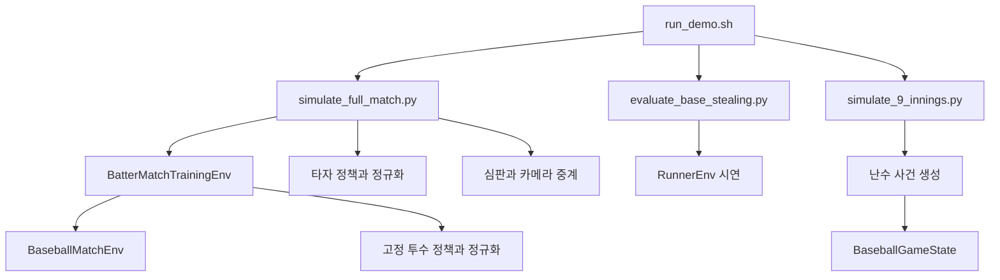

# 야구 강화학습 프로젝트: 목적, 문제 정의, 설계 판단과 시간순 복원

조사 기준: 2026-10-09. 주 대상은 `baseball/main`의 `f63dc977f29d53103b0853ac29fbaeddfb95b60e`다. 이어지는 `bipedal_baseball/main`의 `ec3f85484ffb2d612fc890f2b515eba705748d9e`도 별도 장에서 다룬다. 두 폴더는 각각 독립 Git 저장소다. 상위 취업준비 저장소의 커밋을 이 프로젝트의 개발 이력으로 섞지 않았다.

## 1. 이 보고서를 읽는 기준

이 보고서는 목적과 성공을 좋은 말로 연결하는 소개서가 아니다. 실제로 무엇을 만들었고, 무엇을 학습시켰고, 무엇은 사람이 정했는지까지 내려가 프로젝트를 이해하는 해설서다. 코드가 남아 있다는 사실, 실행 기록이 있다는 사실, 그 코드가 의도한 기능을 올바르게 수행한다는 사실을 서로 구분한다.

근거는 다음 네 종류로 표시한다.

- **기록**: README, PAPER, EXPERIMENT_LOG, RESEARCH_LOG, 패치 주석, Git 커밋에 실제로 적혀 있는 의도와 주장.
- **코드 확인**: 현재 파일 또는 특정 커밋의 소스를 직접 읽어 확인한 동작. 경로와 줄번호는 파일별 해설에 붙였다.
- **실행 증거**: 이미 보존된 TensorBoard, 평가 배열, CSV, 기존 감사의 실행 로그. 2026-09-26 감사 결과를 이번에 다시 실행한 결과처럼 쓰지 않는다.
- **해석·제안**: 기록과 코드로부터 추론한 설계 이유 및 앞으로의 수정 방안. 작성자가 당시 머릿속으로 실제 생각한 것이라고 단정하지 않는다.

이번 작업에서 원본 코드, 모델 가중치, 실험 로그, 영상, Git 이력을 변경하지 않았다. 장시간 재학습이나 전체 데모 재렌더링을 수행하지 않았다. 현재 파일 분석, Git blob 구문 분석, 안전한 모델 메타데이터 읽기와 기존 실행 증거 재대조를 수행했다. 현재 순수 Python GameState의 파울 3사례·기본 카운트 전이 2사례와 심판의 합성 궤적 점 검사도 작게 실행했으며 06장에 따로 기록했다. AST 구문 검사는 Python을 실행하는 것이 아니며, 구문이 맞다는 것이 런타임 정상이나 물리적 타당성을 뜻하지 않는다.

현재 외부 작업 폴더의 `task.md`, `implementation_plan.md`, `walkthrough.md`는 bipedal Phase 12 내용이다. 초기 baseball 패치가 같은 경로에 썼다는 이유로 현 내용을 당시의 초기 기록으로 사용하면 시간 역전이 생긴다. 현재 사본은 `evidence/external_current_*.md`에 보존했으며 후속 단계의 기록으로만 취급한다.

## 2. 목적을 세 단계로 나눠 이해하기

### 2.0 초기 게임 스튜디오라는 출발점도 함께 읽기

8월31일 stash의 untracked snapshot `f04e72e:README.md`에는 `Baseball RL Game & Simulator Studio`가 남아 있다. 이 설명은 물리 환경·학습 엔진·시각화 대시보드·터미널 게임의 네 모듈을 묶고, 사용자가 투수나 타자로 직접 참여하거나 AI 대결을 관전하는 경험을 제시한다. 공 궤적·스트라이크존 heatmap·타구 데이터를 대시보드에서 보는 것이 출력이다. 초기 mechanism/game/dashboard 코드와 연결되는 목적이며, 원문은 stash patch에 보존했다.

이 자료에서 읽히는 구체적인 질문은 “투구의 구종·구속·조준과 타격 타이밍·경로가 어떤 결과를 만들고, 서로를 상대하는 정책을 사람이 이해하고 플레이할 수 있게 보여줄 수 있는가”다. 후기 PAPER의 실물 전이 비전은 이 질문을 로봇 제어와 전체 야구 생태계로 넓혀 설명한다. 두 자료가 서로 다른 시점·형태로 남았으므로 후기 회고만으로 초기 모든 구현이 전신 로봇 배포를 이미 겨냥했다고 단정하지 않는다. stash README의 league/PER 주장 역시 실제 trainer 연결을 04장에서 별도로 확인한다.

### 2.1 장기 비전: 자율 야구와 실물 전이

`docs/PAPER.md:170-198`의 회고는 최초 비전을 실물 전이 가능한 강화학습 기반 야구 생태계라고 설명한다. 감독, 9명의 수비수, 투구, 타격, 주루, 보행, 상호작용을 하나의 플랫폼으로 연결하려는 목표다. 야구를 선택하면 빠르게 이동하는 물체를 관측하고, 시간 안에 판단하고, 관절체를 움직여 접촉하고, 결과를 규칙으로 판정하는 문제를 한 장면에서 다룰 수 있다.

이 목표는 좋은 연구 질문이지만, 그 목표의 존재가 달성을 뜻하지 않는다. 현재 baseball 코드에는 실물 로봇 통신, 실제 센서 상태 추정, C++ 제어 런타임, 실기기 배포 증거가 없다. PAPER의 ONNX/CAN/RT-Preempt/EKF 서술은 탐색과 향후 계획으로 읽어야 한다. 특정 0.2ms 추론이나 1kHz 제어가 이 프로젝트에서 측정됐다는 뜻으로 옮기면 안 된다.

### 2.2 개발 중 선택한 범위: 문제를 작게 쪼개 학습 가능하게 만들기

초기 `.agents/AGENTS.md`는 64×64 자기시점 영상과 고유수용감각으로 공의 위치를 추론하도록 정한다. 처음부터 서로 변하는 투수와 타자를 맞붙이지 않고 티볼·투구·포구 드릴을 별도로 학습시키며, 나중에 같은 수비 신경망을 공유하고 통신을 붙이는 전략이다.

이후 주요 `cognitive_ai` PPO 드릴과 match는 H1 모델 위에 미리 정한 관절 키프레임과 공의 정확한 위치·속도 벡터를 사용한다. 초기 `CognitiveBaseballEnv`에는 영상 관측 선언도 남아 있지만 그와 연결된 `train_cognitive`는 정책 신경망 최적화 대신 상태를 직접 읽는 heuristic timing 탐색이다. 주요 PPO는 전체 몸의 모든 토크를 처음부터 발견하기보다 투구 릴리스, 조준, 파워, 스윙 시작과 높이·회전 보정을 선택한다. 이 변경은 같은 문제의 구현 최적화만이 아니라 **학습 문제 자체를 바꾼 범위 조정**이다. 영상 인지와 전신 균형의 부담을 덜고 타이밍·목표 선택을 먼저 다루는 구조가 된다.

PAPER는 보행과 고속 접촉을 동시에 학습시키는 어려움, 연산 부담을 범위 조정 이유로 적는다. 실제 코드는 고정 골반, 각도 직접 대입, 다리 없는 이동 베이스로 그 선택을 뒷받침한다. 다만 정량적인 연산 병목 프로파일이나 기존 전신 학습과의 통제 비교가 남아 있는 것은 별도로 확인해야 한다. 설명이 그럴듯하다는 이유로 원인 실험까지 완료됐다고 말할 수 없다.

### 2.3 현재 확인되는 산출물: 여러 드릴과 시연의 묶음

현재 baseball은 투수·타자 드릴 환경, 고정 상대를 이용한 타자 학습, 일부 수비·주루 환경, 경기 판정과 카메라 연출, 9이닝 논리 시연, 모델·영상·문서를 묶은 프로젝트다. `run_demo.sh`는 이들을 순서대로 호출한다. 하나의 공·하나의 상태·모든 정책이 9이닝 내내 이어지는 통합 경기 실행과는 다른 연결 구조다.

이 차이는 가치를 부정하기 위한 구분이 아니다. 어떤 학습과 모듈화가 실제 기여인지 정확히 찾기 위한 구분이다. 사용자가 직접 만든 판단을 설명할 때는 “많은 로봇을 다 학습했다”보다 “학습하기 어려운 복합 문제를 어떤 제약 아래 나눴고, 어디에서 통합 계약이 깨졌는지 확인했다”가 실제 코드와 더 잘 맞는다.

현재 데모의 호출 관계를 그리면 다음과 같다. 세 가지 시연은 같은 실행 스크립트에서 순서대로 호출되지만 상태를 공유하는 하나의 경기 루프는 아니다.

## 3. 문제 정의를 구체적으로 다시 세우기

### 3.1 인지 문제

초기 문제는 카메라 영상만으로 빠른 공의 위치·속도·미래 경로를 추정하는 것이다. 부분 관측과 시간 정보가 필요하므로 CNN 인코더, 고유수용감각 인코더, 잠재 상태와 순환 월드모델이 초기 archive에 등장한다. 이때 “영상에 공이 보이는가”, “공이 너무 작아 한 픽셀 이하가 되는가”, “정책이 보지 못하는 진실값이 들어가는가”가 중요한 검증 질문이다.

후기 cognitive 문제는 정확한 공 위치와 속도, 도달 예상 시간과 높이를 받는 상태 벡터 정책이다. 이 문제에서는 영상 인식 오차를 검증하는 것이 아니라 좌표계, 단위, 순서, 정규화, 예측식이 맞는지 검증해야 한다. 타이밍 성능을 영상 기반 추적 성능으로 부르면 두 문제를 혼동하게 된다.

### 3.2 접촉과 타이밍 문제

정지한 티볼에 닿는 것부터 시작하면 스윙 형상과 배트 접촉을 검증할 수 있다. 이후 느린 토스를 넣으면 도달 시간에 맞춰 스윙을 시작해야 한다. 50/80km/h 피칭머신은 대응 시간을 줄이고, 변화구는 단순 직선 예측을 어렵게 만든다. 이 순서는 “쉬운 성공 경험을 먼저 만든다”는 교육적 이야기보다, 실패 원인을 분리하는 실험 설계로 이해하는 편이 정확하다. 정지 공에도 못 맞추면 인지나 구속을 탓할 수 없기 때문이다.

그러나 티볼 공 질량을 낮춘다고 중력가속도가 없어지지는 않는다. 힘과 질량, 중력보상, 직접 위치 유지가 각각 어떻게 적용되는지 봐야 한다. 이 사례처럼 문서의 설명과 물리식은 다른 근거다. 물리 환경의 세부는 02장에서 검증한다.

### 3.3 자연스러운 모션과 과제 보상 문제

단순히 공만 맞추는 보상은 사람 같은 동작을 보장하지 않는다. 키프레임을 만들어 기본 동작을 주고 일부 파라미터만 학습시키면 탐색 범위가 줄고 영상도 빠르게 만들 수 있다. 대신 자연스러운 동작은 주로 제작한 궤적이 제공하며, 정책이 토크를 통해 동작을 스스로 발견한 정도는 줄어든다. 보상 최적화와 모션 제작을 구분해야 한다.

PAPER와 패치의 MoCap 표현은 실제 광학식 모션캡처 데이터 수집·리타게팅 파이프라인과 동일하지 않다. `mocap_preview.py`와 `inject_mocap_*`는 사람이 코드로 정한 6×19 각도 테이블을 보간한다. “오타니 스타일”은 동작 디자인의 참고 표현이며, 실측 선수 데이터가 코드에 들어왔다는 증거가 아니다.

### 3.4 물리 모델과 게임 규칙 문제

물리 엔진이 충돌을 계산하는 것과 야구 규칙을 정확히 판정하는 것은 별개다. 스트라이크 존을 통과한 위치를 저장하고, 파울을 세었을 때 기존 볼·스트라이크를 보존하고, 타구의 최초 낙구와 담장 사건을 구분해야 한다. 고속 공은 두 샘플 사이에 존을 통과할 수 있으므로 현재 점만 검사하는 방식에는 누락 가능성이 있다. 심판·상태 머신은 신경망이 아니라 사람이 작성한 결정 규칙이다.

### 3.5 여러 정책과 모듈 사이의 계약 문제

단독 PitcherEnv에서 학습한 정책을 MatchEnv로 가져올 때 차원이 같아도 입력 순서와 의미, 모션 조정 관절, 물리 법칙이 같아야 한다. VecNormalize는 열별 통계를 저장하므로 순서가 바뀌면 다른 의미의 숫자가 다른 통계로 정규화된다. 모델 파일, 정규화 파일, 환경 설정과 버전, 관측 스키마가 하나의 단위여야 한다.

평가 환경의 자동 reset도 같은 종류의 계약이다. 끝난 공의 위치를 보려면 terminal info나 terminal observation을 사용해야 한다. 다음 타석으로 reset된 공을 읽고 이전 타석 판정에 넣으면 멋진 중계 화면과 부정확한 지표가 함께 만들어질 수 있다.

## 4. 기대효과와 실제 확인 수준

| 기대효과 | 왜 기대할 수 있는가 | 현재 확인되는 부분 | 아직 필요한 증거 |
|---|---|---|---|
| 복잡한 RL 문제를 단계별로 설계하는 능력 | 티볼→토스→머신→변화구→맞대결로 원인을 분리 | 해당 환경·학습·진단 코드가 존재 | 공통 조건·다중 시드의 커리큘럼 비교 |
| 물리 시뮬레이션 이해 | XML·접촉·관절 주소·외력·릴리스 조작 | 소스와 수정 기록이 구체적으로 존재 | 단위/에너지/시간 간격 검증과 외부 실측 보정 |
| 인지와 제어 결합 연구 | 초기 CNN·RSSM, 후기 상태 정책을 비교 가능 | 설계 전환과 코드가 남음 | 자기시점 영상 정책의 검증된 학습·성능 |
| 모듈별 디버깅과 통합 경험 | 정책·정규화·물리·판정·중계가 만남 | 계약 오류와 수정 흔적을 추적 가능 | 통합 계약을 고친 뒤 종단간 경기 평가 |
| 시각적 설명과 연구 기록 | 영상, 카메라, HTML/PDF, 코드·로그 연결 | 제작·정리 이력과 파일이 있음 | 주장과 정확한 실험 bundle의 일대일 연결 |
| 실물 전이 준비 | 토크 제한·지연·도메인 랜덤화라는 질문으로 확장 | 후속 bipedal에 일부 장치가 구현됨 | 실제 모터·센서·실시간 제어·하드웨어 검증 |
| 디지털 스포츠 제품 | 심판·카메라·게임 로직은 재사용 가능한 구성요소 | 시연 가능한 요소들이 있음 | 실제 사용자/운영/제품 검증; 상업 효과 측정 |

성공률, 성능 개선, 상업 가치, 학술적 새로움은 서로 다른 주장이다. 학습량 200만 step은 학습이 있었다는 증거이고, 높은 보상은 해당 보상 최적화의 증거다. 그것만으로 현실적인 야구나 실물 로봇 성능, RL의 기준선 대비 우월성이 입증되지는 않는다.

## 5. 실제 Git 시간선

시간은 커밋의 작성·저장 시각(+09:00)이다. 전체 first-parent 27개를 확인했고, 별도 stash 저장 상태 3개도 목록에 포함했다. 각 커밋의 원문 diff는 `history/`에 보존했다. 파일이 처음 커밋된 시점은 실제 작업을 시작하거나 끝낸 정확한 시각과 다를 수 있다.

| 저장 시각 | 커밋 | 실제 변경 | 해석과 주의점 |
|---|---|---|---|
| 07-22 18:50:09 | bf82416 | PyTorch workbook·학습 저장소 시작 | 이때는 현재 야구 프레임워크가 아님 |
| 07-24 19:06:24 | 60641d0 | 투수·타자 mechanism, 기본 환경 파일 | 손/팔·궤적을 수식과 기구학으로 만드는 초기 기반 |
| 07-24 19:15:50 | 2ef3ca9 | 게임 환경, game CLI, dashboard, networks, replay, trainer | 첫 end-to-end 프레임워크가 한 묶음으로 저장됨 |
| 07-24 19:39:51 | b2be6bf | networks 수정 | 커밋 제목보다 실제 diff 범위는 좁음 |
| 07-27 08:32:00 | 01b6357 | EXECUTION_GUIDE 작성 | 당시 경로와 실행 구조; 현 경로와 구분 |
| 07-31 11:46:13 | 7f926ed | 초기 파일 archive 이동, 영상·월드모델·다중 에이전트·H1 cognitive 추가 | 큰 설계 전환이 일괄 저장됨; 파일별 정확한 제작 순서는 Git만으로 알 수 없음 |
| 08-31 21:26:27 | stash 98f2dfc / c8cc421 / f04e72e | WIP/index/untracked snapshot | main의 독립 개발 단계 세 개로 세면 안 됨 |
| 09-01 23:24:37 | 62f112b | Phase1~7 환경·훈련·평가·패치·영상 일괄 저장 | 티볼부터 수비까지 실제 세부 순서는 문서와 코드 연결로 복원 |
| 09-01 23:33:29 | fafee96 | 심판, 스트라이크 존, 방송 카메라 | Phase8.1; 판정 로직과 화면 연출의 결합 |
| 09-01 23:42:50 | a7227be | 공기역학 함수·제구 보상 수정 | Phase8.2; match 소스의 들여쓰기 오류가 Git에 실제 들어감 |
| 09-01 23:49:00 | df8a0aa | 포수·주자 XML/환경/학습·도루 시연 | Phase8.3; 앞의 구문 오류는 이 커밋에서도 남음 |
| 09-01 23:51:08 | d1cfbb5 | 9이닝 game state와 난수 시연 | Phase9; match 구문 오류는 여전히 남음 |
| 09-01 23:57:09 | 58b2a58 | mega PPO, 4-frame stack, annealing, adversarial stub | 구문 오류 수정; self-play는 완성되지 않은 뼈대 |
| 09-03 00:17:38 | 93aa1e7 | README 패키징 | 프로젝트 설명을 정리 |
| 09-03 00:17:44 | fe09ffc | run_demo.sh | 서로 다른 3개 시연을 순차 실행 |
| 09-06 02:55:10 | 37cba3b | 학술 형식 PAPER 작성 | 기존 구현을 논문 형식으로 재서술 |
| 09-06 03:10:32 | 547f58a | HTML 보고서와 이미지 | 코드 진전보다 문서/프레젠테이션 작업 |
| 09-06 03:15:43 | 27ac333 | 누락 프레임/텍스처·인쇄 CSS 수정 | 보고서 표시 문제 수정 |
| 09-06 03:36:12 | ec0d5f9 | 전문가 관점 서술·two-track roadmap | 독립 외부 전문가 심사 증거로 취급하지 않음 |
| 09-06 03:40:52 | 652e940 | 패치 파일 scripts/patches 이동·PDF | 경로 정리; 대부분 코드 내용 변화 없음 |
| 09-06 03:41:42 | a64134d | 24 모델 ZIP·16 norm 파일을 Git 포함 | 학습 시각과 모델 공개 저장 시각은 다름 |
| 09-06 04:02:04 | 92043ab | SKALA 계기·배포/벤치마크 회고 추가 | 회고로서 생각의 기록; 배포 구현 완료가 아님 |
| 09-06 04:08:22 | 530b6ea | 초기 비전·연산 장벽·회고 표현 수정 | 과거의 동기를 후에 설명한 기록임을 표시 |
| 09-06 04:18:38 | 48db86d | 문서 docs 이동 | 정리·게시 구조 변화 |
| 09-06 04:18:42 | 25db149 | README docs 링크 | 문서 접근성 개선 |
| 09-06 04:19:53 | bb1d93d | .nojekyll | GitHub Pages 표시 설정 |
| 09-06 04:21:31 | ee09bb0 | 고아 submodule 참조 제거 | checkout 실패 원인 제거; 필요한 실제 assets 여부는 별도 |
| 09-06 04:26:03 | f63dc97 | report_assets→assets | 현재 분석 대상 HEAD |

### 5.1 실제 수정이 확인되는 실패 사례

`a7227be`의 match diff는 `_apply_aerodynamics()`와 `mj_step()`을 substep 반복문 밖으로 잘못 내보냈고 아래 contact 블록은 깊은 들여쓰기로 남겼다. Git blob을 AST로 분석하면 268행 `unexpected indent`가 나온다. 다음 `df8a0aa`, `d1cfbb5`에서도 같은 오류가 남는다. `58b2a58`에서 해당 네 줄을 반복문 안으로 다시 들여쓰고 `self.has_hit`을 `getattr(self,'has_hit',False)`로 바꿔 구문 오류를 고친다.

이 사례를 “물리 엔진을 넣고 성공했다”로 압축하면 세 중요한 단계가 사라진다. 기능을 추가하려는 의도, 문법이 깨진 실제 결과, 이후 문법 수정이다. 더구나 현재 타격 플래그는 `has_contacted`이며 `has_hit`은 설정되지 않는다. `getattr`는 속성 에러를 피하지만 올바른 타격 상태를 연결하는 수정까지 하지 못했다. 구문 수정과 기능 수정은 다른 완료 기준이다. 이번 구문 기록은 `evidence/git_syntax_by_commit.json`에 있다.

### 5.2 커밋이 말하지 못하는 것

Phase1~7은 62f112b에 한꺼번에 추가됐다. 따라서 “티볼 개발에 몇 시간, 변화구에 몇 시간” 같은 정밀 작업시간을 Git 시각으로 계산하면 잘못이다. TensorBoard의 wall_time은 학습 이벤트 시간이며 사람의 개발 시간과도 다르다. 보고서는 정확히 남아 있는 시간만 적고, 상세 드릴 순서는 의존 관계와 phase 기록으로 복원한다. 별도 stash는 오래된 b2be6bf를 base로 하며 WIP diff는 game/dashboard 수정이고 untracked tree는 README 한 파일이다. 이를 8월31일 새 cognitive 단계의 snapshot이라고 설명하면 안 된다.

## 6. Phase별 목적→구현→문제→수정→생각

### Phase 0: 초기 기구학·게임·학습 프레임워크

**목적과 구현.** 투수/타자 mechanism, 게임 환경, 행동 신경망, replay, trainer, dashboard를 연결해 야구 문제를 학습 루프로 만들려 했다. 이 단계는 현 H1 PPO보다 초기 구조다. archive는 단순 쓰레기 폴더가 아니라 처음에 어떤 인지와 학습을 시도했는지 남긴 설계 유산이다. 04장에서 mechanism 수식, CNN·상태 인코더, RSSM, imagination, 손실과 curriculum까지 파일별로 내려간다.

**문제와 판단.** 복잡한 영상 인지, 여러 역할, 월드모델, 실제 접촉을 한 번에 맞춰야 하는 구조는 고장 원인을 분리하기 어렵다. 예를 들어 단일 world_model_trainer에서 actor target을 detach한 뒤 actor loss를 역전파하는 결함은 “월드모델을 구현했다”는 파일 존재와 학습 가능한 경로가 다름을 보여준다. 다중 에이전트 버전에는 그 gradient를 살리려던 변화가 있다. 정확한 결과는 소스 수준과 학습 증거 수준을 분리해 읽는다.

**설계 생각의 근거.** egocentric-only, isolated-drills-first는 AGENTS에 명시돼 있다. parameter sharing과 latent communication은 향후 확장 계획이며 현재 9인 통신을 학습했다는 의미가 아니다.

### Phase 1-A: 티볼로 스윙과 접촉부터 분리

**목적과 구현.** 공이 정지한 상태에서 배트가 접촉하도록 만든다. 문서에는 trigger·높이의 2D 행동이 적혀 있지만 현재 `teeball_env.py:22-24,62,84`는 reset부터 스윙을 활성화하고 높이 보정 1D만 받는다. 따라서 현 티볼 정책이 스윙 시작까지 배운다고 설명하면 맞지 않는다. 고속 공이 보이지 않아서 실패하는지, 스윙 자체가 닿지 않는지 분리하는 최소 과제다. `test_grid`, `test_trigger`, `test_timing_*`, `check_contact_pos`, `sweep_bat`는 시작 조건·타이밍·스윙 평면을 직접 고정해 탐색하는 진단 흔적이다. 각 진단이 현재 행동 계약을 따르는지도 02장에서 따로 확인한다.

**문제와 수정.** 공의 높이·타자 위치·배트 경로가 맞아야 한다. 단순 타격률보다 실제 bat-ball contact, 타구 방향·속도, 이탈·지면 접촉이 중요하다. 문서의 90%는 해당 평가 조건에서 주장된 수치다. 모델과 당시 환경·seed·평가 분모가 정확히 묶이지 않으면 현 코드에서 그대로 재현되는 성능으로 인용할 수 없다.

**생각의 해석.** 과제를 쉽게 만들어 시작했다는 판단은 합리적이다. 그러나 접촉 경로를 직접 만든 정도와 PPO가 보정한 정도를 설명해야 강화학습의 기여를 과장하지 않는다.

### Phase 1-B: 소프트토스로 시간 예측 도입

**목적과 구현.** 7~9m/s 수준의 느린 공을 던지고 위치3·속도3·예상 도달시간·예상 높이의 8D 관측을 준다. 정책이 기다리다 적절한 시점에 스윙하도록 만드는 과제다.

**문제와 수정.** 서로 단위와 범위가 다른 위치·속도·시간을 그대로 넣으면 학습을 어렵게 만들 수 있어 `train_normalized.py`와 VecNormalize가 등장한다. 정상화는 데이터 스케일 문제를 다루지만 타이밍 또는 접촉 모델이 잘못된 것을 고치지는 않는다. 문서의 정규화 도입 후 타격 성공률 70%는 전후 동일 조건 평가 원자료가 없으며, 기존 9/26 소표본 진단 6/10과 별도 결과다. 70%는 상대 개선율이라는 뜻이 아니다.

**생각의 해석.** “신경망이 더 커야 한다” 이전에 입력을 보기 좋게 만드는 접근이다. 이때부터 normalization provenance가 정책 파일만큼 중요한 의존성이 된다.

### Phase 1-C: 피칭머신으로 대응 시간을 줄이기

**목적과 구현.** 같은 드릴을 50km/h, 80km/h로 올려 스윙 시작 시점의 오차에 더 민감한 조건을 만든다. `train_curriculum_pitching.py`, 별도 deep 80km/h 스크립트와 모델이 나뉜다.

**문제와 수정.** 낮은 구속에서 배운 타이밍이 높은 구속에 그대로 맞지 않는다. 공이 배트를 지나는 공간·시간의 조합을 확인해야 하고, 명목상 속도와 실제 공기 저항 후 속도도 다르다. 학습 재개·정규화 재사용·새 환경 값이 어떻게 이어지는지 03장에서 모두 추적한다. 80km/h best와 deep norm을 임의로 섞으면 결과가 달라지는 이유도 그 장에 설명한다.

**생각의 해석.** 점진적 난이도는 상대와 환경을 동시에 바꾸는 복잡성을 줄인다. 다만 각 단계를 따로 성공한 것이 한 정책이 전체 범위를 다루는 성능과 동일하지 않다.

### Phase 1-D: 변화구와 몸통 회전

**목적과 구현.** breaking_ball_env는 구종별 횡·종 가속도와 스윙 yaw 보정을 추가한다. 직선·중력 예측만으로 맞추기 어려운 경로에 대응하려 한다.

**문제와 수정.** 구종이 바뀌면 예측 높이·코스가 달라져 timing만으로는 실패한다. 다만 이 단계에는 정확한 공 상태와 사람이 만든 예측값이 주어지며, 표준 공기역학 전체를 센서에서 추론하는 문제가 아니다. 문서의 10/15 컨택은 해당 기록의 주장으로 유지하고, 과거 감사의 1/10을 그 수치의 직접 반증 또는 재현이라고 단정하지 않는다.

### Phase 2: 직접 투수 모델과 제구·속도 목표

**목적과 구현.** H1 투수, 손-공 weld, 4D 릴리스·조준·파워 선택을 만들고 plate 도달 거리와 속도를 보상한다. 릴리스에서 손 속도와 파워 계수로 공 속도를 직접 설정한다. 이 속도 주입은 실제 모터가 같은 공 속도를 만들 수 있다는 보장과 다르다.

**문제와 수정.** 빠르게만 던지면 제구가 나빠질 수 있어 zone reward를 강화한다. 이후 8.2에서 strike에는 큰 보상, ball에는 거리 패널티를 넣는다. 단독 관측/경기 관측의 순서, 13D 구형 norm/16D 현재 환경, 19관절 목록으로 바뀌면서 조준 인덱스가 달라지는 문제가 남아 있다.

**생각의 근거.** 패치 주석과 reward diff는 “속도를 올리면서 제구를 강제한다”는 의도를 보여준다. 문서의 15/15·84.4km/h는 그 시점의 주장이고, 다른 checkpoint·조건의 9/26 10/10은 별도 제한된 진단이다.

### Phase 3: 같은 공간의 투타 맞대결

**목적과 구현.** 투수·타자 XML을 합치고, 기존 투수 정책을 고정한 타자 wrapper로 타자 학습을 한다. 두 환경의 joint 이름에 p_/b_ prefix를 넣고, 타석 위치를 옮겨 접촉 공간을 정합한다. 타자의 결과를 HUD로 표시한다.

**문제와 수정.** joint 없는 이름을 -1로 쓰면 다른 주소를 잘못 읽을 수 있어 valid_indices와 qpos/qvel 주소를 분리한다. 각도를 직접 덮고 기존 속도를 남겨 놓으면 물리 상태가 맞지 않을 수 있어 qvel을 0으로 만드는 패치가 나온다. 이것은 수치 안정화를 위한 기구학 개입이지 동역학적 모션 학습을 완료했다는 뜻은 아니다.

**생각의 해석.** 역할별 학습을 유지하면서 상대만 실제 모델로 교체하려는 구조다. 그러나 단독과 합동 환경의 관측·물리 계약이 같지 않으면 고정 정책조차 같은 행동을 보장하지 못한다.

### Phase 4: 고속 투구와 선구안

**목적과 구현.** 파워 범위를 높이고 구종 변화를 넣는다. 타자가 못 맞힌 채 끝난 공에서 존 밖 스윙에는 -100, 존 밖에서 기다림에는 +150을 주며, 존 안에서 기다리면 -150을 준다. 존 안 헛스윙은 -50이다. 타자가 모든 공에 무조건 휘두르거나 무조건 기다리는 행동을 막으려는 plate discipline이다.

**문제와 판단.** 높은 릴리스 속도가 나왔다고 실제 H1 모터 토크·출력 범위에서 해당 투구가 가능하다는 뜻은 아니다. 또한 볼넷이라는 경기 누적 사건과 단일 공을 참는 보상은 다르다. 체계적인 선구안 평가는 zone label, swing decision, 오분류, 누적 count를 분리해야 한다.

### Phase 5: 경기장과 타구 추적

**목적과 구현.** 잔디·흙, 베이스·라인·담장, 바람·항력, 타격 이후 궤적과 카메라를 넣어 관람 가능한 장면을 만든다. 공이 끝까지 어디에 가는지 관찰하려는 목적은 좋은 평가 도구로도 이어질 수 있다.

**문제와 판단.** 현재 XML의 상대 텍스처 경로는 원본 checkout 자족성을 깨뜨릴 수 있다. 경기장 비주얼과 판정 좌표가 같은 기준인지, 두 항력 구현이 겹치지 않는지, 실제 접촉 뒤 최종 상태를 저장하는지 따로 검증해야 한다. “AAA급”은 문서의 평가 표현이며 측정된 엔진 품질 기준이 아니다.

### Phase 6: 19관절 모션 제작

**목적과 구현.** 높이 든 다리, 와인드업, 체중 이동처럼 보이는 투구와 큰 스윙을 위해 6개 키프레임을 19개 관절로 확장한다. `mocap_preview`는 CubicSpline으로 순수 기구학 미리보기를 만들고, inject 스크립트는 같은 동작 테이블을 환경에 넣는다.

**문제와 수정.** 기존 5관절 인덱스 0/1/2가 19관절 목록에서는 hip를 의미하게 되므로 조준 인덱스 변경이 필요하다. 패치는 그 변경을 시도하지만 현재 단독 PitcherEnv에는 이전 슬라이스 수정이 남아 있다. 성공한 수정 의도와 실제 적용 결과를 확인하지 않으면 보기 좋은 모션이 정책 전이 문제를 숨긴다.

### Phase 7: 보행을 제외한 수비

**목적과 구현.** H1 다리 가지를 제거하고 base_x/base_y/base_yaw 이동 자유도와 왼손 글러브를 붙인다. 낙구 위치 추적과 팔 위치를 먼저 학습시키려 한다. 모델 이름에 wheels가 있지만 wheel-ground rolling 전체를 구현했는지는 XML의 slide joint 구조를 기준으로 읽는다.

**문제와 수정.** 모델 복제 과정에서 중복 ball/body/material, 제거한 다리를 참조하는 actuator, 누락한 이동/왼팔 actuator, include 경로와 카메라를 연달아 고친다. 이 패치 묶음은 모델 재사용이 빠르지만 참조 관계를 끝까지 검증해야 한다는 과정을 보여준다. 과거 5/5는 수치 불안정과 함께 발생했으므로 정상 포구 성능의 근거로 채택하기 어렵다.

### Phase 8.1~8.3: 심판·물리·포수·주루 확장

**목적과 구현.** 판정과 카메라 전환, 구종별 힘, 포수·주자 모델을 추가해 단순 투타 장면을 경기 사건으로 바꾸려 한다. 역할을 복제해 확장하는 접근은 자연스럽지만 이름·주소·보상·종료가 새 개체를 가리키는지 확인해야 한다.

**문제와 남은 상태.** has_hit/has_contacted 불일치, 외력과 직접 가속도 적용의 중첩, 포수 glove_box 이름 불일치, 주자 관측이 공의 상태를 읽는 문제가 현재 소스에 남아 있다. COR 1.35는 패치의 문자열 치환 시도는 존재하지만 현재 active contact 코드에 실제 적용되는 것과 다르다. 상세 경로는 02/03/05장에서 다룬다.

### Phase 9: 9이닝 논리

**목적과 구현.** balls/strikes/outs/bases/score/inning을 추적하는 객체를 만들고 random choice로 사건을 생성해 게임을 끝까지 진행한다. 상태 머신을 로봇 제어와 분리해 먼저 검사하려는 방법으로는 의미가 있다.

**문제와 남은 상태.** 물리 경기의 공 결과를 상태 머신으로 넘기는 통합 루프는 현재 demo에 없다. foul 전에 count를 지우는 결함도 남아 있다. “9이닝 텍스트 시연을 만들었다”와 “PPO 로봇들이 9이닝 실제로 경기한다”를 각각 적어야 한다.

### Mega 단계: 더 많은 학습, 시간 정보, adversarial 뼈대

**목적과 구현.** 16개 병렬 환경, 200만 step 목표, learning-rate annealing, 타자 4-frame stack, adversarial wrapper를 추가한다. 실제 이벤트는 200만 이상 step을 보여 학습 실행의 존재는 확인된다.

**문제와 남은 상태.** MlpPolicy에 frame stack을 주는 것과 LSTM은 다르다. frozen batter 행동을 만드는 pass, 잘못된 observation 형식과 action 차원 등 adversarial 코드는 완성된 self-play가 아니다. 더 오래 학습하는 것은 기존 관측·물리·평가 계약 오류를 자동으로 고치지 않는다. best model과 마지막 norm의 저장 시점도 묶이지 않으므로 재현성 문제가 생긴다.

## 7. 설계 선택에서 읽을 수 있는 고민

첫째, 전신·영상·다중 에이전트를 처음부터 모두 해결하려는 비전과 제한된 계산·디버깅 자원 사이에서 범위를 조정했다. 코드에 남은 고정 골반·키프레임·slide base는 그 조정의 실제 형태다. 이를 감추기보다 제약과 판단을 설명하는 편이 설계 경험을 더 구체적으로 보여준다.

둘째, 실패를 정책 탓만 하지 않고 배트 경로, 공 높이, 관절 주소, 속도, 정규화, 카메라, XML 참조까지 내려가 진단했다. 44개 패치와 21개 cognitive 진단 파일은 이런 탐색을 보여준다. 그러나 문자열 치환이 성공했는지, 바뀐 contract가 맞는지 검증하는 자동 장치가 부족해 수정 의도와 실제 상태가 벌어졌다.

셋째, 스윙하지 않기·번트만 하기 같은 reward hacking을 문제로 보고 속도/스윙/선구안 항목을 추가했다. 다만 그 보상이 실제 물리량인지 액션 크기의 대용인지까지 확인해야 한다. 잘못된 지표를 최적화하면 높은 학습 보상과 잘못된 야구 장면이 동시에 나올 수 있다.

넷째, 시연과 연구 증거를 동시에 만들려 했다. 영상·중계·보고서는 학습 과정을 전달하는 장점이 있지만, 카메라와 HUD가 읽는 상태가 reset 후 값이면 관람과 평가가 함께 오염된다. 시연용 코드도 실험 계측기처럼 계약을 가져야 한다.

다섯째, 후기 회고는 실물 배포와 학술 비교에 필요한 요소를 스스로 짚고 후속 bipedal로 이어진다. 여기서 핵심은 배우려 한 질문과 실제 해낸 구현을 모두 존중하면서도 같은 것으로 쓰지 않는 것이다. 구현을 넘어선 기대는 기대효과로, 코드와 로그가 증명한 것은 성과로 기록한다.

## 8. 이론을 확인할 때 사용한 1차 자료

MuJoCo의 qpos와 qvel은 free/ball joint가 있으면 차원이 다를 수 있으며, 입력·외력·접촉을 이용해 동역학을 적분한다. 따라서 위치를 직접 덮는 것과 actuator로 토크를 넣는 것은 다른 제어 경로다. 이는 파일별 기구학 개입을 설명하는 기준으로만 사용했다. [MuJoCo 계산 문서](https://mujoco.readthedocs.io/en/stable/computation/index.html)

SB3 VecEnv는 episode 끝에 자동 reset될 수 있고 마지막 observation을 별도로 전달한다. VecNormalize와 frame stack은 환경 wrapper이며 입력 전처리/시간 정보의 계약을 갖는다. 이 일반 규약과 현재 프로젝트가 그 규약을 쓰는 방식을 대조했다. [SB3 벡터 환경 문서](https://stable-baselines3.readthedocs.io/en/master/guide/vec_envs.html)

PPO는 환경에서 모은 경험으로 정책을 업데이트하는 알고리즘이다. 알고리즘을 썼다는 사실은 환경의 보상·물리·평가를 검증하지 않는다. 본 프로젝트의 성능 판단은 코드와 로그에 근거한다. [PPO 원논문](https://arxiv.org/abs/1707.06347)

DeepMimic은 예제 동작을 활용한 물리 기반 캐릭터 skill 학습을 제시한다. 본 프로젝트의 수작업 각도 테이블 보간과 표준 예제 기반 동역학 학습은 구분해서 설명했다. 이는 향후 비교의 참고 기준이며 현재 프로젝트가 DeepMimic을 구현했다는 뜻은 아니다. [DeepMimic 연구자 프로젝트 페이지](https://xbpeng.github.io/projects/DeepMimic/)

## 9. 본인의 선택에서 사고를 복원하기: AI 활용과 개인 기여의 연결

### 9.1 이번 보완의 목적과 근거 수준

사용자는 이번 대화에서 AI에게 명령하고 진행을 승인한 것이 자신의 주된 역할이었다고 설명했고, 문서에 남은 선택과 행동에서 그 사고를 유추해 경험 서사의 간극을 메워 달라고 요청했다. 따라서 코드 작성량으로 개인 기여를 환산하지 않고, 무엇을 문제로 보았는지, 어떤 작업 방향과 검증 기준을 요구했는지, 어떤 선택을 유지하거나 바꾸었는지를 복원한다.

이 절의 1인칭 문장은 기록을 바탕으로 구성한 경험 서사다. 당시의 내적 독백을 그대로 옮긴 인용문은 아니다. 근거는 다음과 같이 나눈다.

- 직접 요구: 연구일지가 사용자 발언으로 인용한 문장. 현재 저장된 문서의 인용이며 원 대화 전체를 별도로 확보한 것은 아니다.
- 대응 변화: 그 요구 뒤에 남은 일지, 소스, Git diff의 변경.
- 사고 복원: 요구와 변경을 연결해 읽을 수 있는 판단. 이를 요청한 사용자 설명에 따라 선택의 주체를 본인으로 놓되, 특정 수식·상수의 독자적 고안이나 모든 실험의 직접 실행까지 추가하지 않는다.
- 회고·설계안: 프로젝트가 기록한 설계 논리. 본인이 채택한 방향으로 설명할 수 있으나 각 세부의 최초 제안자는 구분되지 않는 경우가 있다.

AI에게 무엇을 시켰는지 자체가 개인 행동의 일부다. 특히 완료 기준을 바꾸거나, 높은 성공률에도 재작업을 요구하거나, 다음 단계에서 고려할 조건을 구체적으로 제시한 행동은 판단의 근거가 된다. 반대로 AI가 수행한 순기구학 계산을 그대로 본인의 독자적 수학 도출로 쓰는 것은 이 복원에 포함하지 않는다.

### 9.2 직접 발언에서 복원되는 다섯 판단

| 기록된 발언·행동 | 직접 확인되는 선택 | 복원할 수 있는 생각 |
|---|---|---|
| RESEARCH_LOG 215행: 투수도 같이 학습하지 않느냐는 질문 | 투수 학습을 다음 작업 범위에 포함하도록 요구 | 타자 한쪽의 결과에 더해 상대와의 연결도 확인해야 함 |
| 같은 215행: 검증·실행·영상 열기·분석·자동화를 요구 | 진행을 맡기면서 확인 절차도 지정 | 반복 작업을 자동화하되 수치와 실제 장면의 정합을 확인해야 함 |
| 854행: 무릎을 더 굽혀야 높이가 맞지 않겠느냐는 제안 | 다음 타자 학습에 자세와 높이 조건을 반영하도록 요구 | 학습 결과에 영향을 주는 몸의 기하와 초기 자세를 함께 봐야 함 |
| 944행: 포수가 아직 중심을 잡지 못한다는 지적 | 기존 완료 설명 이후에도 균형 문제의 재수정을 요구 | 넘어짐 여부 외에 흔들림과 중심 유지도 수용 기준임 |
| 같은 944행: 낮은 자세·양팔·허리·왼발·체중 이동을 요구 | 사람다운 동작을 구체적인 신체 조건으로 나눔 | 타격의 한 순간뿐 아니라 지지·회전·팔 동작의 연결을 검토해야 함 |

#### 판단 1. 단독 타자 학습에서 상대와의 연결로 범위를 정하기

근거는 [후속 연구일지의 사용자 질문](../../../bipedal_baseball/RESEARCH_LOG.md:215)과 그 다음의 작업 목록이다. 사용자는 “근데 투수도 같이학습 안하나?”라고 질문했다. 일지에는 투수 환경·학습·평가와 투타 결투 환경을 추가하는 방향이 이어진다.

여기서 복원할 수 있는 사고는 “타자가 주어진 공을 잘 맞히는 결과만으로 내가 만들려는 야구 장면을 충분히 확인할 수 있는가”라는 질문이다. 공을 만들어 주는 조건과 그 공에 대응하는 타자를 함께 보도록 실험 범위를 넓힌 선택으로 읽을 수 있다. 이는 단독 성능과 모듈 연결의 차이를 다루는 판단이다.

경험 문장으로는 다음과 같이 쓸 수 있다.

> 타자의 학습 결과를 확인하는 과정에서 투수도 학습 대상에 포함해야 한다고 판단했습니다. 투구 조건과 타자의 대응이 한 장면에서 연결되도록 다음 작업의 범위를 정했습니다.

이 문장은 투수 알고리즘의 수식·네트워크를 본인이 처음 고안했다거나 두 정책의 전신 경기가 완전히 검증되었다는 주장까지 포함하지 않는다.

#### 판단 2. 자동 진행에 검증 조건을 붙이기

같은 [연구일지 215행](../../../bipedal_baseball/RESEARCH_LOG.md:215)에는 “알아서 검증하고 실행해주고 영상직접 열어보고 확인하면서 분석하고 자동화하여 진행해주세요”라는 요구가 있다. 작업을 위임한 사실과 검증 방식을 지정한 사실이 한 문장에 함께 남아 있다.

복원할 수 있는 사고는 반복 구현·실행에는 AI를 활용하면서, 로그의 완료 문구와 성공률이 실제 움직임을 제대로 대표하는지도 확인해야 한다는 판단이다. [763~769행](../../../bipedal_baseball/RESEARCH_LOG.md:763)의 후속 설명은 콘솔 중심 검토에 영상·프레임 검사를 추가했다고 기록한다. 이 문서의 후속 설명은 투구 존 높이와 포수 환경 문제로 이어진다.

경험 문장으로는 다음과 같이 연결할 수 있다.

> 반복 구현과 실험 진행은 AI를 활용해 이어가되, 영상을 열어 동작까지 확인하도록 검증 조건을 붙였습니다. 단계가 완료되었다는 설명이 실제 장면에서도 성립하는지를 함께 보도록 요구했습니다.

원래 발언의 “직접 열어보기”는 AI에게 준 지시다. 본인이 모든 영상을 프레임별로 측정했다는 뜻으로 확대하지 않는다. 본인의 직접 기여는 자동화의 범위와 검토 기준을 지정한 데 있다.

#### 판단 3. 무릎과 높이의 관계를 다음 실험 조건으로 제시하기

[연구일지 854행](../../../bipedal_baseball/RESEARCH_LOG.md:854)에는 “다음번에 타자 학습할 때 무릎을 좀더 굽혀야 높이 맞지 않겠나 싶은데”라는 발언이 있다. 이는 단순한 진행 승인을 넘어 수정 방향의 가설을 제시한 사례다.

이 발언에서 읽을 수 있는 생각은 타격 높이와 몸의 자세가 맞지 않는 문제가 학습 결과에 영향을 줄 수 있다는 것이다. 구속·학습량·네트워크만 보지 않고 무릎 굴곡과 타격 높이의 관계를 검토 대상으로 올렸다. 이후 일지는 준비 자세·관절 각도·골반 높이·타석 위치를 변경하고, 발의 지면 침투에 의한 튀어 오름도 수정했다고 기록한다. 사용자 발언이 자세 변경의 방향을 제시했다는 사실과, 침투 깊이 및 비침투 높이를 계산한 구현 과정은 구분한다.

경험 문장으로는 다음과 같이 쓸 수 있다.

> 타자의 자세를 보며 무릎을 더 굽혀야 공의 높이에 맞출 수 있겠다는 가설을 제시했습니다. 다음 학습에서는 자세와 타격 높이의 관계를 고려하도록 조건을 바꾸었습니다.

이 요구에서 특정 관절각이나 골반 높이의 수치를 사용자가 독립적으로 계산했다고까지 유추하지 않는다. 자신의 기여는 문제의 방향을 짚고 실험 조건으로 옮긴 판단이다.

#### 판단 4. 생존율과 자세 안정성을 따로 보기

직전 Entry 11은 무낙하·높은 타격률을 완료 결과처럼 기록했으나, [944행](../../../bipedal_baseball/RESEARCH_LOG.md:944)의 사용자 피드백은 “아직 포수 중심 못잡는거 너무 아쉽고”로 시작한다. 문서에 좋은 숫자가 있어도 사용자가 문제를 남겨 두고 다시 개선을 요구했다는 점이 중요하다.

복원할 수 있는 생각은 “넘어지지 않는다”는 사건 지표가 “중심을 안정적으로 유지한다”는 동작 품질 전체를 설명하지 못한다는 것이다. 사용자는 포수의 흔들림을 별도 검토 대상으로 유지했다. 이후 골반 목표 위치·복원 제어·위치 편차 지표가 추가되거나 조정된다.

경험 문장으로는 다음과 같이 연결할 수 있다.

> 넘어지지 않았다는 결과가 제시된 뒤에도 포수의 중심 문제가 남아 있다고 보았습니다. 균형 유지의 기준에 자세의 흔들림과 중심 위치도 포함하도록 재수정을 요구했습니다.

여기서 성과는 완료 주장을 그대로 수용하지 않고 수용 기준을 구체화한 행동이다. 최종 포수 drift는 목표에 미달하므로 모든 안정화 목표가 해결되었다고 끝내지 않는다.

#### 판단 5. ‘사람답게’라는 요구를 수정 가능한 조건으로 나누기

같은 [944행](../../../bipedal_baseball/RESEARCH_LOG.md:944)의 발언은 “타자 자세 더낮추고 양팔 모아서 치되허리를쓰고 왼발은 뜨지 않고 무게중심 잘 가져가야하는거아닌가”라고 구체적인 신체 조건을 제시한다. 막연한 불만 표현에서 그치지 않고 자세·팔·허리·앞발·체중 이동을 나누어 요구했다.

복원할 수 있는 생각은 공과 배트의 접촉뿐 아니라 발의 지지, 몸통 회전, 양팔의 연결이 의도한 동작 안에서 함께 성립해야 한다는 것이다. 이후 구현에는 양팔을 포함한 관절 목표, 손-배트 결합, 허리와 골반의 회전, 발 접지 보조와 관련 지표가 나타난다. 세부 수식은 AI가 구현했더라도, 무엇을 개선할 대상으로 삼을지와 결과를 받아들일 조건을 정한 기여는 설명할 수 있다.

경험 문장으로는 다음과 같이 쓸 수 있다.

> 사람다운 타격이라는 목표를 낮은 자세, 모인 양팔, 허리 회전, 앞발 접지와 체중 이동으로 나누어 제시했습니다. 각 조건이 동작에 반영되도록 수정 방향을 정하고 반복 개선을 요구했습니다.

원문과 코드에 남은 종료값·site 잔차를 스윙 전 과정의 완벽한 접지나 실제 양손 간격으로 확대하지 않는다. 본인의 판단을 살리는 데 그런 확대는 필요하지 않다.

### 9.3 전체 설계 흐름에서 복원되는 세 가지 추가 판단

#### 범위를 분해하면서 무엇을 먼저 확인할지 정한 판단

[PAPER 회고 172~177행](../../docs/PAPER.md:172)은 큰 야구 생태계의 목표와 복합 과제·연산 부담, 단계적 분해를 적는다. 현재 코드에는 고정 기반에서 접촉과 타이밍을 확인하는 드릴이 남아 있다. 이를 다음과 같은 사고로 복원할 수 있다.

> 한 번에 여러 동작을 연결하면 실패가 어디에서 비롯되는지 구분하기 어려웠습니다. 먼저 공에 닿는 조건과 타이밍을 따로 확인하는 단계로 범위를 나누고, 각 단계를 다음 실험의 기반으로 삼았습니다.

이는 후기 회고와 실제 구조의 정합에서 얻는 해석이다. 당시 본인이 모든 병목을 직접 측정했다는 주장이나 커리큘럼이 통계적으로 우월하다는 주장까지 포함하지 않는다.

#### 단순화가 제외한 균형 문제를 다시 중심에 놓은 판단

[후속 연구일지 10~17행](../../../bipedal_baseball/RESEARCH_LOG.md:10)은 이전 프로젝트에서 다리를 제거해 이족 접촉 문제를 회피했다는 반성과, 두 발로 서서 타격하는 질문에 집중하겠다는 선택을 적는다. 코드도 고정 기저 타격에서 자유 골반·다리 PD 제어로 확장된다.

이 흐름은 다음과 같이 설명할 수 있다.

> 타격 장면을 구현하는 동안 몸을 고정하거나 이동 방식을 단순화했지만, 그 조건에서는 스윙하면서 균형을 유지하는 문제를 충분히 다루기 어려웠습니다. 후속 실험에서는 두 발의 지지와 전신 균형을 다시 중심 과제로 삼았습니다.

이는 단순화를 무조건 잘못으로 취급하지 않고 그 선택이 검증 범위를 어디까지 제한하는지 받아들인 판단이다. 실물 전이까지 성공했다는 뜻은 아니다.

#### 자세 안정성과 스윙 자유도를 함께 조정한 판단

Git 3dc3ab8d에서 강성을 강화한 뒤 ec3f8548은 일부 gain과 앞발 보조 토크를 낮춘다. 최종 commit 메시지는 swing-vs-balance tradeoff와 스윙을 막지 않는 조정을 직접 적는다. [연구일지 1118~1141행](../../../bipedal_baseball/RESEARCH_LOG.md:1118)도 해당 선택을 기록한다.

복원할 수 있는 사고는 “더 강하게 붙잡는 제어”가 항상 더 좋은 타격을 만들지 않으며 자세 유지와 회전·전환에 필요한 움직임을 함께 평가해야 한다는 것이다. 사용자가 선택·승인한 설계 방향의 논리로 설명할 수 있다. 각 gain의 최초 계산자를 본인으로 정하거나 성능 변화의 원인을 한 항목으로 확정할 필요는 없다.

> 자세를 안정시키기 위해 제어를 강화하는 방향으로 진행했지만, 스윙을 방해하는 문제가 함께 나타났습니다. 안정성을 유지하면서 움직임에 필요한 여유를 남기도록 일부 강성을 다시 낮추는 방향을 선택했습니다.

여러 조건과 학습이 동시에 달라졌으므로 타격률의 변화가 강성 조정 하나로 발생했다고 주장하지 않는다. 본인의 선택은 결과를 보며 변경 방향을 되돌릴 수 있었다는 데 있다.

### 9.4 경험을 설명할 때 연결되는 사고의 흐름

다음은 위 기록에서 복원한 설명 예시다. 특정 회사나 글자 수에 맞춘 최종 자기소개서는 아니다.

> 야구를 소재로 휴머노이드의 투구와 타격을 실험하는 프로젝트를 AI 코딩 도구와 함께 진행했습니다. 구현과 반복 실행에는 AI를 활용했고, 저는 목표와 다음 작업의 범위, 결과를 받아들일 조건을 정했습니다.
>
> 타자 학습을 진행하면서 투수도 학습 대상에 포함하도록 요구했고, 결과를 영상으로 확인하는 절차를 함께 지정했습니다. 타자의 자세에서는 무릎을 더 굽혀야 공의 높이에 맞출 수 있겠다는 가설을 제시해 다음 실험의 조건으로 반영했습니다.
>
> 높은 성공률이 제시된 뒤에도 포수가 중심을 잡지 못하고 타자의 양팔과 앞발이 부자연스러운 문제를 남겨 두었습니다. 그래서 사람다운 타격이라는 목표를 낮은 자세, 양팔 연결, 허리 사용, 앞발 접지와 체중 이동으로 구체화해 수정 방향을 요구했습니다.
>
> 이 과정을 통해 결과를 승인하는 데 필요한 기준도 구체화했습니다. 공을 맞혔는지, 넘어졌는지와 함께 어떤 자세와 움직임으로 그 결과를 만들었는지를 보아야 했습니다. 자세 안정성과 스윙의 여유를 함께 조정하는 후속 선택까지 이어졌고, 최종에도 남은 균형·구종 대응의 한계를 구분했습니다.

여기서 직접 발언으로 가장 강하게 뒷받침되는 기여는 투수 포함 요구, 영상 검증 지시, 무릎과 높이의 가설, 포수 중심의 재수정 요구, 전신 동작 조건의 구체화다. 정확한 제어 수식과 gain의 독자적 도출, 모든 실험의 개인 실행은 이 예시에 추가하지 않는다.

### 9.5 자기소개서 소재로서의 재평가

“AI에게 명령·승인했다”는 설명만으로 개인 판단이 없었다고 결론내리는 것은 부족하다. 실제 요구에 문제 관찰, 가설, 다음 작업 범위와 완료 기준이 들어 있기 때문이다. 이 경험은 본인이 요구·실험 방향·검증 기준을 정한 장면을 중심으로 문제 해결·개선·도전 문항의 소재가 될 수 있다.

현재 가장 강한 이야기의 시작점은 높은 타격률이나 방대한 코드가 아니다. 연구일지의 완료 설명 이후에도 중심과 자세의 문제가 남았다고 요구한 장면이다. 그 다음에 무릎과 높이의 관계, 양팔·허리·앞발·체중 이동을 조건으로 나눈 선택, 후속 조정을 연결하면 개인의 사고와 행동이 드러난다.

결과는 성공률 숫자로만 닫지 않는다. 요구를 구체적인 모델·제어·검토 항목으로 옮겨 반복 개선을 진행한 것은 설명 가능한 산출물이고, 최종에도 drift나 구종 대응의 미달이 남은 것은 구현의 한계다. 이 두 가지를 함께 쓰면 문제를 관찰하고 개선 방향을 정한 개인 경험을 살리면서도 완성도를 과장하지 않을 수 있다.
