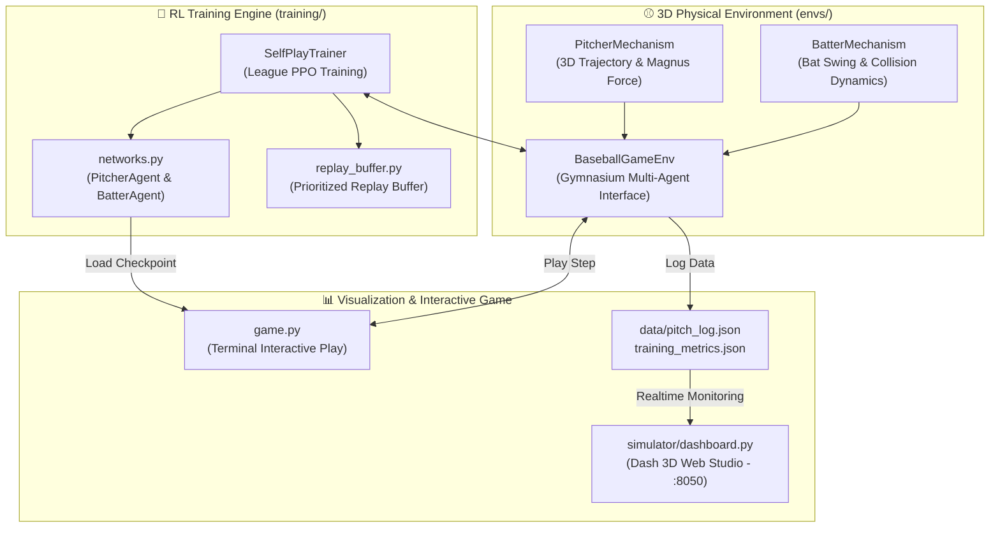

# ⚾ Baseball RL Game & Simulator Studio

투수(Pitcher)와 타자(Batter) 간의 3D 물리 시뮬레이션 및 Self-Play 강화학습(PPO) 기반 야구 미니 프로젝트입니다.

---

## 🏗️ 전체 시스템 아키텍처 & 실행 구조

프로젝트는 크게 **[물리 시뮬레이션 환경(envs)]**, **[강화학습 엔진(training)]**, **[시각화 대시보드(simulator)]**, 그리고 **[인터랙티브 게임(game.py)]**의 4개 모듈로 구성됩니다.



### 🔄 데이터 및 모듈 흐름 (Data Flow)
1. **투구 & 스윙 궤적 계산 (`envs/`)**: 
   투수의 구속, 구종, 투구 좌표 action을 바탕으로 `PitcherMechanism`이 공의 3D 궤적을 시간 스텝 단위로 계산합니다. 타자는 이 궤적 정보(Observation)를 보고 스윙 타이밍 및 경로를 결정하여 `BatterMechanism`에서 3D 충돌 및 타구 속도/타구각을 계산합니다.
2. **Self-Play 학습 (`training/`)**:
   투수 모델과 타자 모델이 `BaseballGameEnv` 안에서 서로를 상대로 1타석 대결을 진행하며, PPO 알고리즘과 리그 저장소를 통해 상대 전략에 맞춰 동적으로 진화합니다.
3. **데이터 로그 및 대시보드 시각화 (`simulator/`)**:
   학습 및 시뮬레이션 과정에서 발생하는 투구 궤적, 스윙 데이터, 스트라이크/볼 결과가 `data/pitch_log.json`에 저장되고, Dash 3D 대시보드가 이를 실시간으로 시각화합니다.
4. **인터랙티브 게임 (`game.py`)**:
   학습된 가중치(체크포인트)를 불러와 유저가 직접 투수/타자로 참여하거나 ASCII 그래픽을 통해 AI 대결을 실시간 관전합니다.

---

## 📁 프로젝트 코드 구조

```text
baseball/
├── envs/                       # Gymnasium 호환 3D 야구 시뮬레이션 환경
│   ├── __init__.py
│   ├── baseball_game_env.py    # 통합 멀티 에이전트 대결 환경 (BaseballGameEnv)
│   ├── pitcher_mechanism.py    # 투수 공의 3D 물리 시뮬레이션 (공기저항, 마그누스 효과, 궤적)
│   └── batter_mechanism.py     # 타자 스윙 및 배트-공 충돌 물리 모델 (타구속도/타구각 계산)
│
├── training/                   # Self-Play PPO 강화학습 엔진
│   ├── __init__.py
│   ├── trainer.py              # Self-Play 및 리그(League) 적대적 학습 트레이너
│   ├── networks.py             # 투수/타자 Actor-Critic 신경망 아키텍처
│   └── replay_buffer.py        # 우선순위 경험 재생 버퍼 (Prioritized Replay Buffer)
│
├── simulator/                  # 실시간 3D 대시보드
│   ├── __init__.py
│   └── dashboard.py            # Dash + Plotly 기반 웹 모니터링 스튜디오 (포트 8050)
│
├── game.py                     # 터미널 기반 대화형 Playable 게임 엔진
├── requirements.txt            # 필요 라이브러리 목록
└── README.md                   # 프로젝트 설명 및 사용 설명서
```

---

## 🚀 환경 구축 및 실행 방법 (Step-by-Step Guide)

### 1단계: 가상환경 생성 및 활성화

프로젝트 루트 폴더(`baseball/`)에서 가상환경을 생성하고 활성화합니다.

* **macOS / Linux**:
  ```bash
  # 가상환경 생성
  python3 -m venv .venv

  # 가상환경 활성화
  source .venv/bin/activate
  ```

* **Windows**:
  ```cmd
  # 가상환경 생성
  python -m venv .venv

  # 가상환경 활성화 (Command Prompt)
  .venv\Scripts\activate

  # 가상환경 활성화 (PowerShell)
  .venv\Scripts\Activate.ps1
  ```

*(활성화되면 터미널 프롬프트 맨 앞에 `(.venv)` 표시가 나타납니다.)*

---

### 2단계: 의존성 패키지 설치

가상환경이 활성화된 상태에서 필요 패키지들을 설치합니다:
```bash
pip install -r requirements.txt
```

---

### 3단계: 실행 모드별 사용법

#### 🎮 A. 터미널 인터랙티브 게임 실행 (`game.py`)

* **AI vs AI 대결 관전 모드** (기본)
  ```bash
  python game.py
  ```

* **유저가 투수로 플레이** (구종/좌표 지정 투구)
  ```bash
  python game.py --role pitcher
  ```

* **유저가 타자로 플레이** (스윙 타이밍 조절)
  ```bash
  python game.py --role batter
  ```

* **특정 학습 체크포인트 로드**
  ```bash
  python game.py --checkpoint checkpoints/latest.pt
  ```

---

#### 🧠 B. Self-Play 강화학습 실행 (`training/`)

* **기본 학습 시작** (1,000 에피소드)
  ```bash
  python -m training.trainer --episodes 1000
  ```

* **체크포인트에서 이어 학습**
  ```bash
  python -m training.trainer --resume checkpoints/latest.pt
  ```

---

#### 📊 C. 실시간 3D 웹 대시보드 실행 (`simulator/`)

```bash
python -m simulator.dashboard
```
* 서버가 시작되면 웹 브라우저에서 `http://127.0.0.1:8050` 에 접속하여 3D 공 궤적, 스트라이크존 히트맵, 타구 데이터 및 승률을 실시간으로 확인합니다.
